# Low Level Design - Sprint 2: Seller Listing Creation

**Document Version:** 2.0
**Product:** ValueX
**Sprint:** Sprint 2 - Seller Listing Creation
**Stories Covered:** US-004, US-114, US-005, US-006, US-007, US-089, US-078, US-008, US-009, US-084, US-010
**Repos:** valuex-backend, valuex-mobile, valuex-ai
**Sprint Goal:** Allow sellers to create and publish listings, with AI-assisted metadata, moderation, and paid plan monetization.

**Reference Documents:**
- [Sprint-plan.md](../Sprint-plan.md) - Sprint 2 section
- [user-stories.md](../user-stories.md) - US-004 through US-010, US-078, US-084, US-089
- [HLD Part 1 - High Level Architecture](../HLD/01-High-Level-Architecture.md)
- [HLD Part 2 - Backend Architecture](../HLD/02-Backend-Architecture.md) - §4.3 Listing Module, §4.5 Plan & Entitlement Module, §4.18 Moderation Module
- [HLD Part 3 - Data Architecture](../HLD/03-Data-Architecture.md) - §4.3 Listing Domain, §4.7 Payment Domain
- [HLD Part 4 - AI Architecture](../HLD/04-AI-Architecture.md) - §4.2 Listing Intelligence Service, §8 Restricted Item & Content Moderation AI
- [HLD Part 6 - Security, Deployment & DevOps](../HLD/06-Security-Deployment-DevOps.md)
- [HLD Part 7 - API Integrations, Release & Risk](../HLD/07-API-Integrations-Release-Risk.md) - §21 Payment Gateway Integration
- [CODING_STANDARDS.md](../CODING_STANDARDS.md)

---

## Sprint 2 Story Map & Dependency Order

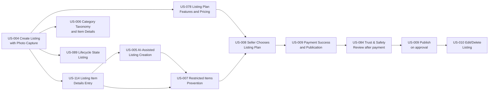

**Seller flow (product owner decision, 2026-10-16):** photos and item details (US-004, US-114, US-005) → restricted item check (US-007) → plan selection and payment (US-008, US-009) → Trust & Safety review (US-084) → publication on approval (US-009). The review runs **after payment and before publishing**. A rejected listing is revised by the seller and resubmitted for review without paying again.

This document contains one self-contained LLD section per story, in dependency order. Each section has its own Overview, Data Model, API Contracts, Service Logic, Sequence Diagram, Validation Rules, Error Handling, and NFR/Security notes. Shared infrastructure (Listing module package layout, `ApiResponse` envelope, `AiGatewayClient`) is defined once in the US-005 section (§B) and reused by reference from later sections.

## Master Table of Contents

- [Part A - US-004: Create Listing with Photo Capture](#part-a---us-004-create-listing-with-photo-capture)
- [Part B - US-005: AI-Assisted Listing Creation](#1-story-overview)
- [Part C - US-006: Category Taxonomy and Category-driven Item Details](#part-c---us-006-category-taxonomy-and-category-driven-item-details)
- [Part D - US-007: Restricted Items Prevention](#part-d---us-007-restricted-items-prevention)
- [Part E - US-089: Lifecycle State - Listing](#part-e---us-089-lifecycle-state---listing)
- [Part F - US-084: Pre-Publication Trust & Safety Review](#part-f---us-084-pre-publication-trust--safety-review)
- [Part G - US-078: Listing Plan Features and Pricing](#part-g---us-078-listing-plan-features-and-pricing)
- [Part H - US-008: Seller Chooses Listing Plan](#part-h---us-008-seller-chooses-listing-plan)
- [Part I - US-009: Listing Publication After Payment](#part-i---us-009-listing-publication-after-payment)
- [Part J - US-010: Edit/Delete Listing](#part-j---us-010-editdelete-listing)

---

# Part A - US-004: Create Listing with Photo Capture

**Story Points:** 8 | **Repos:** valuex-mobile, valuex-backend
**Dependency:** US-001 (User Registration) - caller must be an authenticated, `ACTIVE` seller

## A.1 Story Overview

**As a** seller **I want to** create a listing by capturing photos of my item **so that** I can quickly list items for sale. This story is the entry point of the entire Sprint 2 flow: it creates the `listings` row in `DRAFT` status and uploads/persists `listing_images`, which every later story (AI suggestions, tagging, moderation, plan selection, publication) builds on top of.

| Actor | Role |
|---|---|
| Seller | Captures/selects photos, provides minimal initial metadata |
| Flutter Mobile App | Camera/gallery capture, client-side image validation, chunked upload |
| Listing Module (Spring Boot) | Creates draft listing and associates ready listing media |
| Media Module (Spring Boot) | Owns `ObjectStoragePort`, upload authorization, media lifecycle, variants |
| Cloudflare R2 + CDN | Initial object-store/CDN provider behind the configurable S3-compatible adapter |

### A.1.1 Edge Cases Covered

| Edge Case | Handling |
|---|---|
| Camera permission denied | Client-only; backend unaffected. Mobile shows OS permission rationale + settings deep link |
| Camera fails to open | Client falls back to gallery picker |
| >10 photos attempted | Client blocks selection past 10; backend also rejects `POST .../images` beyond 10 with `ERROR_MAX_PHOTOS_EXCEEDED` (defense in depth) |
| Poor photo quality | Client-side blur/resolution heuristic warns before upload; backend enforces hard minimum resolution |
| Non-item / random photos | Not blocked here — AI content signal is advisory (US-005) and restricted-item detection is US-007's concern |
| Network failure mid-upload | Per-image upload is independently retryable; listing stays in `DRAFT` with partial images until all succeed |

## A.2 Scope

**In scope:** `POST /api/v1/listings` (create draft), `POST /api/v1/listings/{id}/images` (upload image), `DELETE /api/v1/listings/{id}/images/{imageId}` (remove before submit), `GET /api/v1/listings/{id}` (resume draft).
**Out of scope:** AI suggestions (US-005), category tagging UI (US-006), restricted item checks (US-007), plan selection/publish (US-078/US-008/US-009).

## A.3 Data Model

Defines the base tables that all other Sprint 2 stories extend, per [HLD §4.3 Listing Domain](../HLD/03-Data-Architecture.md#43-listing-domain):

```sql
-- V{N}__create_listing_domain.sql

CREATE TYPE listing_status AS ENUM (
    'DRAFT', 'PLAN_SELECTION_PENDING', 'PLAN_PAYMENT_PENDING', 'PLAN_PAYMENT_FAILED',
    'PLAN_PAYMENT_SUCCESS', 'TRUST_SAFETY_REVIEW', 'APPROVED', 'PUBLISHED',
    'REJECTED', 'REVISION_REQUIRED', 'SOLD', 'EXPIRED',
    'DEACTIVATED_BY_SELLER', 'REMOVED_BY_ADMIN'
);
-- Superset used by US-089 lifecycle design (Part E); US-004 only ever writes DRAFT.

CREATE TABLE listings (
    id UUID PRIMARY KEY DEFAULT uuid_generate_v4(),
    seller_id UUID NOT NULL REFERENCES users(id),
    title VARCHAR(100),
    description TEXT,
    condition VARCHAR(50),
    price NUMERIC(12,2),
    status listing_status NOT NULL DEFAULT 'DRAFT',
    plan_type VARCHAR(50),
    ai_assisted BOOLEAN NOT NULL DEFAULT FALSE,
    seller_location VARCHAR(255),  -- NULL on a new draft; set to the city of the pickup address the seller picks when posting (design change, Oct 2026)
    expires_at TIMESTAMP,
    created_at TIMESTAMP NOT NULL DEFAULT CURRENT_TIMESTAMP,
    updated_at TIMESTAMP NOT NULL DEFAULT CURRENT_TIMESTAMP
);

CREATE INDEX idx_listings_seller_status ON listings(seller_id, status);

CREATE TABLE listing_images (
    id UUID PRIMARY KEY DEFAULT uuid_generate_v4(),
    listing_id UUID NOT NULL REFERENCES listings(id) ON DELETE CASCADE,
    media_asset_id UUID NOT NULL REFERENCES media_assets(id),
    sort_order INTEGER NOT NULL DEFAULT 0,
    created_at TIMESTAMP NOT NULL DEFAULT CURRENT_TIMESTAMP
);

CREATE INDEX idx_listing_images_listing ON listing_images(listing_id);
CREATE UNIQUE INDEX uq_listing_images_media ON listing_images(media_asset_id);
CREATE UNIQUE INDEX uq_listing_images_order ON listing_images(listing_id, sort_order);

CREATE TABLE listing_status_history (
    id UUID PRIMARY KEY DEFAULT uuid_generate_v4(),
    listing_id UUID NOT NULL REFERENCES listings(id),
    from_status listing_status,
    to_status listing_status NOT NULL,
    changed_by UUID,
    reason VARCHAR(255),
    changed_at TIMESTAMP NOT NULL DEFAULT CURRENT_TIMESTAMP
);
```

US-004 also depends on the shared Media Module tables defined by the object-storage HLD update. If they do not already exist when US-004 is implemented, this story's migration must introduce them before `listing_images.media_asset_id` can reference them:

```sql
CREATE TABLE media_assets (
    id UUID PRIMARY KEY DEFAULT uuid_generate_v4(),
    owner_type VARCHAR(50) NOT NULL,
    owner_id UUID NOT NULL,
    media_purpose VARCHAR(50) NOT NULL,
    storage_provider VARCHAR(50) NOT NULL,
    bucket VARCHAR(255) NOT NULL,
    object_key TEXT NOT NULL,
    original_filename VARCHAR(255),
    detected_content_type VARCHAR(100),
    size_bytes BIGINT,
    width INTEGER,
    height INTEGER,
    checksum VARCHAR(255),
    perceptual_hash VARCHAR(255),
    status VARCHAR(30) NOT NULL,
    visibility VARCHAR(30) NOT NULL,
    created_by UUID,
    created_at TIMESTAMPTZ NOT NULL DEFAULT CURRENT_TIMESTAMP,
    processed_at TIMESTAMPTZ,
    retention_until TIMESTAMPTZ,
    deleted_at TIMESTAMPTZ
);

CREATE TABLE media_variants (
    id UUID PRIMARY KEY DEFAULT uuid_generate_v4(),
    media_asset_id UUID NOT NULL REFERENCES media_assets(id),
    variant_type VARCHAR(30) NOT NULL,
    object_key TEXT NOT NULL,
    content_type VARCHAR(100) NOT NULL,
    size_bytes BIGINT,
    width INTEGER,
    height INTEGER,
    created_at TIMESTAMPTZ NOT NULL DEFAULT CURRENT_TIMESTAMP
);
```

`listing_images` stores listing-specific ordering and ownership linkage only. Binary metadata (`bucket`, `object_key`, `checksum`, `perceptual_hash`, dimensions, status, variants) lives in the reusable `media_assets` / `media_variants` model owned by the Media Module in [HLD Part 3 §8](../HLD/03-Data-Architecture.md#8-object-storage-design). `perceptual_hash` is populated by media processing at upload time but only *consumed* starting with US-082 (watermark/manipulation detection, Sprint 9) — computing it up front avoids a backfill migration later.

## A.4 API Contracts

Base path `/api/v1/listings`, package `com.valuex.listing`.

| Method & Path | Purpose | Auth |
|---|---|---|
| `POST /api/v1/listings` | Create draft listing (empty shell); not Aadhaar-gated, so a seller can start a listing before verifying | `SELLER`, `ACTIVE` |
| `POST /api/v1/media/uploads` | Create `PENDING_UPLOAD` media asset and return short-lived upload URL (rejects when the listing already has 10 READY photos) | authenticated owner |
| `POST /api/v1/media/{mediaId}/complete` | Read the stored object, verify real type/size/dimensions, mark `READY` or `REJECTED` (idempotent when already `READY`) | authenticated owner |
| `GET /api/v1/media/{mediaId}` | Media metadata; variants exposed as CDN URLs only for public media | authenticated owner |
| `DELETE /api/v1/media/{mediaId}` | Delete unattached media (`MEDIA_IN_USE` if attached) | authenticated owner |
| `POST /api/v1/media/{mediaId}/access` | Short-lived download URL for `READY` media (`MEDIA_NOT_READY` otherwise) | authenticated owner |
| `POST /api/v1/listings/{id}/images` | Associate a READY `LISTING_IMAGE` media asset with the listing | `SELLER`, owner |
| `DELETE /api/v1/listings/{id}/images/{imageId}` | Remove an image while in `DRAFT`, re-sequence the rest and delete its media | `SELLER`, owner |
| `GET /api/v1/listings/{id}` | Fetch draft to resume editing | `SELLER`, owner |
| `POST /api/v1/listings/{id}/submit` | Seller submits the draft after capturing photos (min 1, `ERROR_PHOTO_REQUIRED`); `@RequiresIdentityVerification` (403 `AADHAAR_VERIFICATION_REQUIRED` if not verified). This is the first Aadhaar gate in the seller journey, ahead of plan selection | `SELLER`, owner |

Create draft request/response:

```json
// POST /api/v1/listings -> 201
{ "success": true, "data": { "listingId": "uuid", "status": "DRAFT" } }
```

Image upload uses the shared Media API pattern from [HLD Part 7 §28](../HLD/07-API-Integrations-Release-Risk.md#28-media-apis) to keep large binaries off the Spring Boot heap: `POST /api/v1/media/uploads` returns a short-lived upload URL generated through `ObjectStoragePort`; the client uploads directly to the configured object store (Cloudflare R2 for MVP), `POST /api/v1/media/{mediaId}/complete` starts validation/variant processing, then `POST /api/v1/listings/{id}/images` associates the READY `mediaId` with the listing.

```json
{ "mediaId": "uuid-media-asset", "sortOrder": 0 }
```

## A.5 Service Logic (key rules)

```java
@Transactional
public UUID attachListingImage(UUID listingId, UUID sellerId, AttachListingImageRequest req) {
    var listing = requireOwnedDraft(listingId, sellerId); // 404 LISTING_NOT_FOUND / 400 LISTING_NOT_IN_DRAFT

    long count = listingImageRepository.countByListingId(listingId);
    if (count >= 10) throw new BusinessException("ERROR_MAX_PHOTOS_EXCEEDED", "Maximum 10 photos allowed");

    var media = mediaAssetService.requireReadyAsset(req.mediaId(), sellerId, "LISTING_IMAGE");
    if (media.width() < 480 || media.height() < 480)
        throw new BusinessException("ERROR_INVALID_PHOTO", "Photo quality too low or invalid format");
    if (media.sizeBytes() > 10 * 1024 * 1024)
        throw new BusinessException("ERROR_INVALID_PHOTO", "Photo exceeds 10MB limit");

    var image = new ListingImage();
    image.setListingId(listingId);
    image.setMediaAssetId(req.mediaId());
    image.setSortOrder((int) count);
    return listingImageRepository.save(image).getId();
}
```

`requireOwnedDraft` centralizes the ownership + status check reused by US-006, US-005, and US-010's edit path.

## A.6 Sequence Diagram

```mermaid
sequenceDiagram
    actor Seller
    participant Mobile
    participant Backend as Listing Module
    participant Media as Media Module
    participant R2 as Configured Object Store (R2 for MVP)
    participant DB as PostgreSQL

    Seller->>Mobile: Tap "Sell Item" -> capture/select photos
    Mobile->>Backend: POST /listings (create draft, not Aadhaar-gated)
    Backend->>DB: INSERT listings (status=DRAFT)
    Backend-->>Mobile: listingId
    loop per photo (max 10)
        Mobile->>Media: POST /media/uploads (purpose=LISTING_IMAGE, owner=listingId)
        Media-->>Mobile: mediaId + short-lived upload URL
        Mobile->>R2: PUT image bytes
        Mobile->>Media: POST /media/{mediaId}/complete
        Media->>Media: validate content, sanitize EXIF, generate AVIF/WebP variants
        Media-->>Mobile: media status READY
        Mobile->>Backend: POST /listings/{id}/images (mediaId)
        Backend->>Backend: validate owner, READY status, count/size/resolution
        Backend->>DB: INSERT listing_images(media_asset_id)
    end
    Mobile->>Seller: Photos captured; Submit
    Mobile->>Backend: POST /listings/{id}/submit (Aadhaar-gated: 403 -> Aadhaar screen -> back to Sell)
    Mobile->>Seller: Proceed to item details (US-005/US-006)
```

## A.7 Validation Rules & Error Codes

| Rule | Error Code | Message |
|---|---|---|
| Min 2 photos before proceeding past capture step (US-114) | `ERROR_MIN_PHOTOS_REQUIRED` (client-gated on the photo page; the draft submit and the US-114 details save also check on the server) | "At least 2 photos required" |
| Max 10 photos | `ERROR_MAX_PHOTOS_EXCEEDED` | "Maximum 10 photos allowed" |
| Format JPG/PNG/HEIC only | `ERROR_INVALID_PHOTO` | "Photo quality too low or invalid format" |
| Max 10MB per photo | `ERROR_INVALID_PHOTO` | "Photo exceeds 10MB limit" |
| Min resolution 480x480 | `ERROR_INVALID_PHOTO` | "Photo quality too low or invalid format" |
| Upload transport failure / object missing in storage | `ERROR_PHOTO_UPLOAD_FAILED` | "Failed to upload photo. Check your connection" |
| Camera permission denied (client-only) | `ERROR_CAMERA_PERMISSION_DENIED` | "Camera access required to capture photos" |
| Same media attached twice | `MEDIA_ALREADY_ATTACHED` | "Photo is already attached to a listing" |
| Requested `sortOrder` already used | `LISTING_IMAGE_ORDER_CONFLICT` | "Another photo already uses that position" |
| Delete media still attached to a listing | `MEDIA_IN_USE` | "Remove the photo from its listing before deleting it" |
| Download access for non-READY media | `MEDIA_NOT_READY` | "Media is not available" |
| Listing photo with non-`LISTING` owner | `ERROR_INVALID_PHOTO` | "Listing photos must belong to a listing" |

## A.8 Security & NFR Notes

- Upload URLs are generated by `ObjectStoragePort` from external provider configuration, scoped to one object key, short-lived (15 minutes), and `PUT`-only — clients never receive long-lived R2/S3-compatible credentials.
- Image registration endpoint re-validates dimensions/size server-side (never trusts client-reported EXIF alone) to prevent tampered metadata bypassing limits.
- Ownership enforced via `SecurityContext.getCurrentUserId()` on every call, consistent with [CODING_STANDARDS.md §2.6](../CODING_STANDARDS.md).
- Target: image registration P95 < 300ms; end-to-end photo-to-draft-ready P95 < 8s on 4G (dominated by client-side direct upload and media processing, not this API).

### A.8.1 Implementation Reconciliation (US-004)

- Implemented backend package names are `com.valuex.media` and `com.valuex.listing`, with repositories under `infrastructure.persistence`; controllers use the existing `ApiResponse` envelope and `SecurityContext`.
- Migration `V10__listing_media_schema.sql` (renumbered from V9 to resolve a Flyway version clash) stores `listing_images.media_asset_id`; reusable `media_assets` and `media_variants` tables own provider/object metadata.
- `ObjectStoragePort` is configured through `OBJECT_STORAGE_PROVIDER` and `valuex.media.storage.*`. Cloudflare R2 is the default adapter using the AWS S3-compatible SDK (one cached `S3Client`/`S3Presigner` per adapter); AWS S3 and Backblaze B2 adapters remain extension points. Adapter SDK failures are translated to a provider-neutral `StorageException`.
- `valuex.media.storage.public-endpoint` (`OBJECT_STORAGE_PUBLIC_ENDPOINT`) lets signed URLs use a host that devices can reach while the server talks to the internal endpoint; `path-style-access` (default `true`) is required for local S3-compatible stores. Local development uses a RustFS container (`object-storage` in `docker-compose.yml`, host port 9300) with buckets created by `object-storage-init`.
- `POST /api/v1/media/{mediaId}/complete` is authoritative: it reads object metadata **and the first 512 KB** via `ObjectStoragePort.readHead`, identifies JPEG/PNG/HEIC from magic bytes (`ImageInspector`), reads JPEG/PNG dimensions from the bytes (client values are ignored), and rejects type mismatches, empty/oversized objects and images under 480×480. HEIC dimensions cannot be decoded by the JDK, so client-reported dimensions are used for HEIC only. Rejections are persisted as `REJECTED` (`noRollbackFor = BusinessException`) and the stored object is removed best-effort. A missing/unreadable object returns `ERROR_PHOTO_UPLOAD_FAILED` and leaves the asset `PENDING_UPLOAD` so the client can retry. Only `PENDING_UPLOAD` assets can be completed; `READY` returns idempotently.
- Object keys take their extension from the validated content type (never the client file name); `image/heif` is normalised to `image/heic`; the original file name is stored stripped of paths/control characters and truncated to 255.
- Upload authorization verifies that a `LISTING` media request targets an existing `DRAFT` listing owned by the authenticated seller, requires `LISTING_IMAGE` media to be owned by a `LISTING`, and rejects new uploads once the listing has 10 READY photos. Listing attachment additionally verifies the READY media belongs to that listing, is not already attached, and that a requested `sortOrder` is free.
- Attach/delete take a `PESSIMISTIC_WRITE` lock on the listing row (`findByIdAndSellerIdForUpdate`) so concurrent uploads cannot exceed 10 photos or collide on `sort_order`. Re-sequencing after a delete runs in two flushed passes (negative positions first) because the unique `(listing_id, sort_order)` index is checked per row.
- Removing a listing image also deletes its media asset; `DELETE /media/{id}` refuses attached media (`MEDIA_IN_USE`), is a no-op for already deleted media, and marks the asset `DELETION_PENDING` when the store is unavailable.
- `createDraft` writes the initial `listing_status_history` row (`null → DRAFT`, reason `DRAFT_CREATED`) and is **not** Aadhaar-gated; the gate sits on `POST /listings/{id}/submit` (`@RequiresIdentityVerification`), which only validates ownership/`DRAFT` state and the 1-photo minimum.
- Aadhaar detour (mobile): on `AADHAAR_VERIFICATION_REQUIRED` from submit, `CreateListingController` is kept alive, the app opens the Aadhaar screen and stores the Sell route as the post-Aadhaar destination (`postAadhaarRouteProvider`). After verification (or "Not now") the router returns to Sell with the photos intact; when verified the submit is retried automatically.
- `MediaAssetResponse.variants` contains CDN URLs (`cdn-base-url` + variant key) only for `PUBLIC_DERIVATIVE` media; bucket object keys are never returned.
- Asynchronous derivative generation (AVIF/WebP), EXIF stripping and server-side perceptual hashing remain deferred follow-ups; the lifecycle/schema is ready for them.
- Flutter client: `features/listing` (repository + `CreateListingController` + `CreateListingScreen`) implements the flow in §A.6 from the bottom-nav **Sell** tab; see the US-004 implementation plan.

---

# Part B - US-005: AI-Assisted Listing Creation

> **Update (2026-10-25, category taxonomy):** `category_suggestions` now hold category codes from the taxonomy (`categoryCode` for an enabled L3, with its L1 and L2 derived) instead of category ids and free paths. The classifier selects from the L1/L2/L3 taxonomy in one stage and the service prefills only attributes whose `ai_extractable` flag is YES (LIMITED only with a "please verify" flag; never non-visible or legal facts); returned keys are validated against the category's listing schema (Part C). An Admin switch (US-121) turns AI on or off and sets confidence thresholds; when AI is off, unavailable or low-confidence the seller enters everything, including the category. Price comparables join on `listings.category_id` and the profile's attributes. Retention and limits for photos sent to the Vision service are defined here. The text below that mentions `categoryId`, `categoryPath` and `listing_categories` is to be read with these changes until Part B is revised in full when US-005 is planned for build.

> **Update (2026-10-28, AI cost optimization):** vision models identify the item from 2 to 10 seller photos (one object, different angles) and capture the metadata of its category. To keep the cost down the AI service runs a cascade of 3 to 4 models, cheapest first, and moves to the next model only when the confidence is too low or a model keeps failing; every model call is retried a few times first. The AI also tries to fill every AI-extractable field of the detected L3 category (required and optional) and writes the title, description, condition and condition notes (§6.5.4). Only the best 3 to 5 resized views go to the models, and the originals stay untouched in R2 (§6.5.6). Providers, models, order, thresholds and retry settings are configuration only. See [§6.5](#65-model-cascade-cost-optimization). Where older text below says the minimum is 1 image (§5.2.1, §9), `LISTING_HAS_NO_IMAGES`, a 5-second timeout (§5.9, §10, §14), "no retry" (§10), or a single vision call (§6.3), read it with §6.5 and these changes.

**Story Points:** 8 | **Repos:** valuex-backend, valuex-ai
**Dependency:** US-004 (Create Listing with Photo Capture) - must be complete; listing must exist in `DRAFT` state with at least 2 uploaded images (the US-004 minimum) before this flow runs

## Table of Contents (Part B)

1. [Story Overview](#1-story-overview)
2. [Scope](#2-scope)
3. [Architecture & Component Interaction](#3-architecture--component-interaction)
4. [Data Model (PostgreSQL)](#4-data-model-postgresql)
5. [Backend Design (valuex-backend)](#5-backend-design-valuex-backend)
6. [AI Service Design (valuex-ai)](#6-ai-service-design-valuex-ai)
7. [Sequence Diagrams](#7-sequence-diagrams)
8. [Validation Rules Implementation](#8-validation-rules-implementation)
9. [Error Handling & Error Codes](#9-error-handling--error-codes)
10. [Resilience Configuration](#10-resilience-configuration)
11. [Observability](#11-observability)
12. [Security & Privacy](#12-security--privacy)
13. [Testing Strategy](#13-testing-strategy)
14. [Non-Functional Requirements](#14-non-functional-requirements)
15. [Open Items / Follow-ups](#15-open-items--follow-ups)

---

# 1. Story Overview

**As a** seller
**I want** AI to suggest item details from my photos
**So that** I can create listings faster with accurate information

The system analyzes photos already uploaded for a draft listing (US-004) and returns suggested category, title, condition, price range, and description. Every suggestion is advisory — the seller may accept, edit, or reject each field independently, and manual entry is always available. Per [HLD §3.1](../HLD/04-AI-Architecture.md#31-ai-must-be-advisory-unless-business-rule-requires-blocking), AI must never block listing creation; restricted-item blocking is a separate concern owned by US-007.

## 1.1 Actors

| Actor | Role |
|---|---|
| Seller | Triggers suggestion generation, reviews/accepts/edits/rejects fields |
| Spring Boot Backend (Listing Module) | Source of truth for the listing draft; orchestrates the AI call; persists suggestions and feedback |
| AI Gateway (FastAPI) | Internal-only entry point; routes to Listing Intelligence Service |
| Listing Intelligence Service | Performs image analysis, category classification, price estimation, description/title generation |

## 1.2 Acceptance Criteria Recap

- Given uploaded item photos, when AI analyzes the images, suggest: category, title, condition, price range, description.
- Seller can accept, edit, or reject each suggestion independently, and can always enter fields manually.

## 1.3 Edge Cases Covered by This Design

| Edge Case | Handling |
|---|---|
| AI cannot identify item | Empty/low-confidence `categorySuggestions`, `WARNING_UNABLE_TO_IDENTIFY` |
| AI suggests wrong category | Seller edits before publish (no backend rejection) |
| AI suggests unrealistic price | Backend re-validates suggested range against comparable listings; `WARNING_PRICE_OUT_OF_RANGE` appended if outside 20% band |
| Photos contain multiple items | AI returns `MULTIPLE_ITEMS_DETECTED` warning |
| Item unique/rare, no comparables | Wide fallback price range + low confidence flag, no hard failure |
| AI service timeout or failure | Circuit breaker + timeout fallback → degraded response, manual entry allowed |

---

# 2. Scope

## 2.1 In Scope

- `POST /api/v1/listings/{listingId}/ai-suggestions` - trigger suggestion generation
- `GET /api/v1/listings/{listingId}/ai-suggestions` - fetch latest suggestion (resume draft)
- `PATCH /api/v1/listings/{listingId}/ai-suggestions/{suggestionId}/feedback` - record accept/edit/reject per field
- `POST /ai/v1/listings/suggest` internal AI endpoint (Listing Intelligence Service)
- Persistence of suggestions and per-field feedback for the AI feedback loop ([HLD §18.2](../HLD/04-AI-Architecture.md#182-feedback-loops))
- Fallback to manual entry on AI failure/timeout
- Cost-aware model cascade, configurable providers and retry inside the AI service (§6.5)

## 2.2 Out of Scope

- Restricted item / moderation blocking - covered by **US-007**, own service call, own LLD
- Multi-category tagging UI - covered by **US-006**
- Pre-publication trust & safety review - covered by **US-084**
- Model training/fine-tuning pipeline - covered by AI Ops (HLD §18), not a Sprint 2 deliverable
- pgvector / embedding-based similarity - not used here; Listing Intelligence Service is independent of Visual Search AI. (See memory note: pgvector setup is deferred and only required before **visual search** work, i.e. US-039+, not this story.)

---

# 3. Architecture & Component Interaction

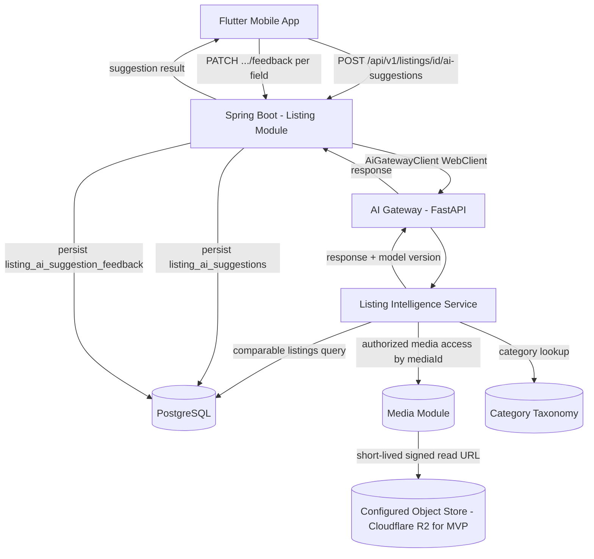

**Ownership boundary (per [HLD §3.3](../HLD/04-AI-Architecture.md#33-ai-service-isolation)):** the Listing Intelligence Service returns predictions only. It never writes to `listings`. Spring Boot remains the sole writer of listing state; suggestion acceptance is applied to the draft listing through the existing `PATCH /api/v1/listings/{id}` endpoint (US-004/US-010), not by the AI suggestion endpoints themselves.

---

# 4. Data Model (PostgreSQL)

Extends the Listing Domain defined in [HLD §4.3](../HLD/03-Data-Architecture.md#43-listing-domain). Assumes `listings` and `listing_images` already exist from US-004. Migration file name/version must be set to the next available Flyway version at implementation time (shown here as `V{N}` placeholder per [CODING_STANDARDS.md §2.7](../CODING_STANDARDS.md)).

```sql
-- V17__listing_ai_suggestions.sql (as built: VARCHAR columns with CHECK constraints instead of enum types,
-- and no price columns because price suggestion is on hold; ai_assisted already exists since V10)

CREATE TABLE listing_ai_suggestions (
    id UUID PRIMARY KEY DEFAULT uuid_generate_v4(),
    listing_id UUID NOT NULL REFERENCES listings(id) ON DELETE CASCADE,
    status VARCHAR(20) NOT NULL,         -- PENDING, COMPLETED, FAILED, TIMEOUT (CHECK)
    category_suggestions JSONB,          -- [{categoryCode, categoryPath, confidence}]
    attribute_suggestions JSONB,         -- [{key, value, confidence, verify}] for the category's AI-extractable fields
    title_suggestion VARCHAR(100),
    condition_suggestion VARCHAR(50),
    condition_notes_suggestion TEXT,
    description_suggestion TEXT,
    warnings JSONB,                      -- ["MULTIPLE_ITEMS_DETECTED", ...]
    overall_confidence NUMERIC(5,4),
    model_name VARCHAR(100),
    model_version VARCHAR(50),
    inference_id UUID,
    tier_attempts JSONB,                 -- [{tier, model, outcome, confidence, attempts, latencyMs, imagesSent, inputTokens, outputTokens}]
    latency_ms INTEGER,
    fallback_used BOOLEAN NOT NULL DEFAULT FALSE,
    created_at TIMESTAMP NOT NULL DEFAULT CURRENT_TIMESTAMP,
    CONSTRAINT chk_listing_ai_suggestion_status
        CHECK (status IN ('PENDING', 'COMPLETED', 'FAILED', 'TIMEOUT'))
);

CREATE INDEX idx_listing_ai_suggestions_listing ON listing_ai_suggestions(listing_id, created_at DESC);
CREATE INDEX idx_listing_ai_suggestions_status ON listing_ai_suggestions(status);

-- One row per field the seller acted on; feeds the AI feedback loop (HLD 18.2)
CREATE TABLE listing_ai_suggestion_feedback (
    id UUID PRIMARY KEY DEFAULT uuid_generate_v4(),
    suggestion_id UUID NOT NULL REFERENCES listing_ai_suggestions(id) ON DELETE CASCADE,
    field VARCHAR(30) NOT NULL,          -- CATEGORY, TITLE, CONDITION, CONDITION_NOTES, DESCRIPTION, ATTRIBUTE (CHECK)
    attribute_key VARCHAR(100),          -- required when field = 'ATTRIBUTE' (CHECK)
    action VARCHAR(20) NOT NULL,         -- ACCEPTED, EDITED, REJECTED (CHECK)
    original_value TEXT,
    final_value TEXT,
    created_at TIMESTAMP NOT NULL DEFAULT CURRENT_TIMESTAMP,
    CONSTRAINT chk_listing_ai_feedback_field
        CHECK (field IN ('CATEGORY', 'TITLE', 'CONDITION', 'CONDITION_NOTES', 'DESCRIPTION', 'ATTRIBUTE')),
    CONSTRAINT chk_listing_ai_feedback_action
        CHECK (action IN ('ACCEPTED', 'EDITED', 'REJECTED')),
    CONSTRAINT chk_listing_ai_feedback_attribute_key
        CHECK (field <> 'ATTRIBUTE' OR attribute_key IS NOT NULL)
);

CREATE INDEX idx_listing_ai_feedback_suggestion ON listing_ai_suggestion_feedback(suggestion_id);
```

### 4.1 Notes

- `category_suggestions` and `warnings` are `JSONB` rather than child tables — they are write-once, read-as-a-blob per suggestion, never queried by individual array element, so relational normalization adds no value here.
- `listing_ai_suggestions` is append-only in practice (a new row per generation attempt, e.g. seller re-uploads photos and re-triggers), which preserves an audit trail without needing an UPDATE-based status machine.
- `ai_assisted` on `listings` lets analytics ([HLD §12.2](../HLD/04-AI-Architecture.md#122-quality-metrics) - "seller acceptance rate of suggestions") join back to listing outcomes without scanning the suggestions table.

---

# 5. Backend Design (valuex-backend)

Follows [CODING_STANDARDS.md §2.2](../CODING_STANDARDS.md) package layout, added under the existing `listing` module.

## 5.1 Package Additions

```text
com.valuex.listing/
├── controller/
│   └── ListingAiController.java
├── service/
│   └── ListingAiService.java
├── domain/
│   ├── ListingAiSuggestion.java
│   ├── ListingAiSuggestionFeedback.java
│   ├── ListingAiSuggestionStatus.java
│   ├── ListingAiFeedbackField.java
│   └── ListingAiFeedbackAction.java
├── repository/
│   ├── ListingAiSuggestionRepository.java
│   └── ListingAiSuggestionFeedbackRepository.java
├── dto/
│   ├── ListingAiSuggestionResponse.java
│   ├── CategorySuggestionDto.java
│   ├── PriceRangeDto.java
│   └── SuggestionFeedbackRequest.java
└── exception/
    └── (reuses common.exception.BusinessException)

com.valuex.common.infrastructure.ai/
├── AiGatewayClient.java
├── ListingSuggestRequest.java
└── ListingSuggestResponse.java

com.valuex.media/
├── controller/
│   └── MediaController.java
├── service/
│   └── MediaAssetService.java
├── domain/
│   ├── MediaAsset.java
│   ├── MediaVariant.java
│   ├── MediaPurpose.java
│   ├── MediaStatus.java
│   └── MediaVisibility.java
├── repository/
│   ├── MediaAssetRepository.java
│   └── MediaVariantRepository.java
├── port/
│   └── ObjectStoragePort.java
└── infrastructure/
    ├── CloudflareR2ObjectStorageAdapter.java   // active MVP adapter
    ├── AwsS3ObjectStorageAdapter.java          // optional/future adapter
    └── BackblazeB2ObjectStorageAdapter.java    // optional/future adapter
```

`AiGatewayClient` lives in `common.infrastructure` (not the `listing` module) because the AI Gateway is a single shared entry point ([HLD §4.1](../HLD/04-AI-Architecture.md#41-ai-gateway-api)) also used by the fraud, moderation, and visual search integrations delivered in later sprints.

`ObjectStoragePort` is the only object-store dependency visible to application services. The active adapter is selected by external configuration (`OBJECT_STORAGE_PROVIDER=r2|aws-s3|backblaze-b2`, endpoint, region, credentials, bucket prefix, CDN base URL). Switching providers requires configuration and infrastructure changes once the target adapter exists; listing, payment, moderation, and AI business code must not change.

```java
public interface ObjectStoragePort {
    UploadAuthorization createUploadAuthorization(UploadRequest request);
    StoredObjectMetadata getMetadata(StorageObjectKey objectKey);
    DownloadAuthorization createDownloadAuthorization(StorageObjectKey objectKey, Duration validity);
    void delete(StorageObjectKey objectKey);
    void copy(StorageObjectKey source, StorageObjectKey destination);
}
```

## 5.2 API Contracts

All endpoints follow the standard envelope in [CODING_STANDARDS.md §1.6](../CODING_STANDARDS.md). Base path `/api/v1/listings`.

### 5.2.1 Trigger Suggestion Generation

```http
POST /api/v1/listings/{listingId}/ai-suggestions
Authorization: Bearer <jwt>
```

Request body (optional):

```json
{
  "textHint": "iPhone used 1 year"
}
```

Success response (`AI` returned suggestions):

```json
{
  "success": true,
  "data": {
    "suggestionId": "8f2a...uuid",
    "status": "COMPLETED",
    "categorySuggestions": [
      { "categoryCode": "CAT-0001", "categoryPath": "Electronics > Mobile Phones", "confidence": 0.91 }
    ],
    "titleSuggestion": "Apple iPhone 13 128GB - Good Condition",
    "conditionSuggestion": "GOOD",
    "descriptionSuggestion": "Used Apple iPhone 13 with visible minor wear...",
    "conditionNotesSuggestion": "Minor scratches on the frame; no cracks on the screen.",
    "attributeSuggestions": [
      { "key": "brand", "value": "APPLE", "confidence": 0.97, "verify": false },
      { "key": "storage_gb", "value": 128, "confidence": 0.71, "verify": true }
    ],
    "priceRange": { "min": 32000, "max": 38000, "currency": "INR" },
    "warnings": ["WARNING_PRICE_OUT_OF_RANGE"],
    "confidence": 0.89,
    "modelName": "listing-intelligence-llm",
    "modelVersion": "1.2.0",
    "fallback": false
  },
  "metadata": { "requestId": "uuid", "timestamp": "2026-08-02T10:00:00Z" }
}
```

Degraded response (AI unavailable/timeout) — **still HTTP 200 / `success: true`** because the flow is advisory and must not block listing creation ([HLD §13.1](../HLD/04-AI-Architecture.md#131-listing-ai-failure)):

```json
{
  "success": true,
  "data": {
    "suggestionId": "8f2a...uuid",
    "status": "FAILED",
    "fallback": true,
    "message": "Auto-suggestions unavailable. Please enter details manually"
  },
  "metadata": { "requestId": "uuid", "timestamp": "2026-08-02T10:00:00Z" }
}
```

Error responses (true client/business errors, standard error envelope, `success: false`):

| HTTP | Code | Condition |
|---|---|---|
| 404 | `LISTING_NOT_FOUND` | listingId doesn't exist or doesn't belong to caller |
| 400 | `ERROR_MIN_PHOTOS_REQUIRED` | fewer than 2 READY photos (replaces `LISTING_HAS_NO_IMAGES`) |
| 400 | `LISTING_NOT_IN_DRAFT` | listing is not in `DRAFT` status |
| 429 | `AI_SUGGESTION_RATE_LIMITED` | seller retriggers too frequently (see §8) |

### 5.2.2 Fetch Latest Suggestion

```http
GET /api/v1/listings/{listingId}/ai-suggestions
```

Returns the most recent `listing_ai_suggestions` row for the listing (same shape as above), or `404 AI_SUGGESTION_NOT_FOUND` if none was ever generated (mobile falls back to showing "Get AI Suggestions" button rather than an error state).

### 5.2.3 Record Field Feedback

```http
PATCH /api/v1/listings/{listingId}/ai-suggestions/{suggestionId}/feedback
```

Request:

```json
{
  "feedback": [
    { "field": "TITLE", "action": "ACCEPTED", "originalValue": "Apple iPhone 13 128GB - Good Condition", "finalValue": "Apple iPhone 13 128GB - Good Condition" },
    { "field": "PRICE", "action": "EDITED", "originalValue": "32000-38000", "finalValue": "35000" },
    { "field": "CATEGORY", "action": "REJECTED", "originalValue": "Electronics > Mobile Phones", "finalValue": null }
  ]
}
```

Response: `200` with `{ "recorded": 3 }`. This endpoint only records feedback for analytics/retraining — it does **not** mutate the listing. The mobile client separately calls the existing `PATCH /api/v1/listings/{id}` (US-004) with the seller's final field values.

## 5.3 DTOs

```java
package com.valuex.listing.dto;

import java.math.BigDecimal;
import java.util.List;
import java.util.UUID;

public record ListingAiSuggestionResponse(
        UUID suggestionId,
        String status,
        List<CategorySuggestionDto> categorySuggestions,
        String titleSuggestion,
        String conditionSuggestion,
        String descriptionSuggestion,
        String conditionNotesSuggestion,
        List<AttributeSuggestionDto> attributeSuggestions,
        PriceRangeDto priceRange,
        List<String> warnings,
        Double confidence,
        String modelName,
        String modelVersion,
        boolean fallback,
        String message
) {}
```

```java
package com.valuex.listing.dto;

import java.util.UUID;

public record CategorySuggestionDto(String categoryCode, String categoryPath, Double confidence) {}
```

```java
package com.valuex.listing.dto;

public record AttributeSuggestionDto(String key, Object value, Double confidence, boolean verify) {}
```

```java
package com.valuex.listing.dto;

import java.math.BigDecimal;

public record PriceRangeDto(BigDecimal min, BigDecimal max, String currency) {}
```

```java
package com.valuex.listing.dto;

import jakarta.validation.Valid;
import jakarta.validation.constraints.NotEmpty;
import java.util.List;

public record SuggestionFeedbackRequest(@NotEmpty @Valid List<FeedbackItem> feedback) {

    public record FeedbackItem(
            String field,        // CATEGORY | TITLE | CONDITION | CONDITION_NOTES | DESCRIPTION | ATTRIBUTE | PRICE
            String attributeKey, // required when field = ATTRIBUTE
            String action,       // ACCEPTED | EDITED | REJECTED
            String originalValue,
            String finalValue
    ) {}
}
```

## 5.4 Entity

```java
package com.valuex.listing.domain;

import jakarta.persistence.*;
import lombok.Getter;
import lombok.Setter;
import org.hibernate.annotations.JdbcTypeCode;
import org.hibernate.type.SqlTypes;

import java.math.BigDecimal;
import java.time.Instant;
import java.util.List;
import java.util.UUID;

@Entity
@Table(name = "listing_ai_suggestions")
@Getter
@Setter
public class ListingAiSuggestion {

    @Id
    @GeneratedValue
    private UUID id;

    @Column(name = "listing_id", nullable = false)
    private UUID listingId;

    @Enumerated(EnumType.STRING)
    private ListingAiSuggestionStatus status;

    @JdbcTypeCode(SqlTypes.JSON)
    @Column(name = "category_suggestions")
    private List<CategorySuggestionJson> categorySuggestions;

    @Column(name = "title_suggestion")
    private String titleSuggestion;

    @Column(name = "condition_suggestion")
    private String conditionSuggestion;

    @Column(name = "description_suggestion")
    private String descriptionSuggestion;

    @Column(name = "price_min")
    private BigDecimal priceMin;

    @Column(name = "price_max")
    private BigDecimal priceMax;

    @Column(name = "price_currency")
    private String priceCurrency;

    @JdbcTypeCode(SqlTypes.JSON)
    private List<String> warnings;

    @Column(name = "overall_confidence")
    private BigDecimal overallConfidence;

    @Column(name = "model_name")
    private String modelName;

    @Column(name = "model_version")
    private String modelVersion;

    @Column(name = "inference_id")
    private UUID inferenceId;

    @Column(name = "latency_ms")
    private Integer latencyMs;

    @Column(name = "fallback_used", nullable = false)
    private boolean fallbackUsed;

    @Column(name = "created_at", nullable = false, updatable = false)
    private Instant createdAt;

    @Override
    public boolean equals(Object o) {
        if (this == o) return true;
        if (!(o instanceof ListingAiSuggestion that)) return false;
        return id != null && id.equals(that.id);
    }

    @Override
    public int hashCode() {
        return getClass().hashCode();
    }

    public record CategorySuggestionJson(UUID categoryId, String categoryPath, Double confidence) {}
}
```

`@Data` is intentionally not used per [CODING_STANDARDS.md §2.12](../CODING_STANDARDS.md) — `equals`/`hashCode` are pinned to `id` only. `ListingAiSuggestionFeedback` follows the same pattern (omitted for brevity — five columns: `id`, `suggestionId`, `field`, `action`, `originalValue`, `finalValue`, `createdAt`).

## 5.5 Repository

```java
package com.valuex.listing.repository;

import com.valuex.listing.domain.ListingAiSuggestion;
import org.springframework.data.jpa.repository.JpaRepository;

import java.util.Optional;
import java.util.UUID;

public interface ListingAiSuggestionRepository extends JpaRepository<ListingAiSuggestion, UUID> {
    Optional<ListingAiSuggestion> findFirstByListingIdOrderByCreatedAtDesc(UUID listingId);
    long countByListingIdAndCreatedAtAfter(UUID listingId, java.time.Instant since);
}
```

`countByListingIdAndCreatedAtAfter` backs the per-listing rate limit described in §8.4.

## 5.6 AiGatewayClient (Infrastructure)

```java
package com.valuex.common.infrastructure.ai;

import io.github.resilience4j.circuitbreaker.annotation.CircuitBreaker;
import io.github.resilience4j.timelimiter.annotation.TimeLimiter;
import lombok.RequiredArgsConstructor;
import lombok.extern.slf4j.Slf4j;
import org.springframework.stereotype.Component;
import org.springframework.web.reactive.function.client.WebClient;
import reactor.core.publisher.Mono;

import java.util.concurrent.CompletableFuture;

@Component
@RequiredArgsConstructor
@Slf4j
public class AiGatewayClient {

    private final WebClient aiGatewayWebClient; // bean configured with base URL + X-Internal-Api-Key header

    @CircuitBreaker(name = "aiGateway", fallbackMethod = "suggestListingFallback")
    @TimeLimiter(name = "aiGateway")
    public CompletableFuture<ListingSuggestResponse> suggestListing(ListingSuggestRequest request) {
        return aiGatewayWebClient.post()
                .uri("/ai/v1/listings/suggest")
                .bodyValue(request)
                .retrieve()
                .bodyToMono(ListingSuggestResponse.class)
                .toFuture();
    }

    @SuppressWarnings("unused") // invoked reflectively by Resilience4j on open circuit / timeout / any exception
    private CompletableFuture<ListingSuggestResponse> suggestListingFallback(
            ListingSuggestRequest request, Throwable throwable) {
        log.warn("AI Gateway suggestListing failed, falling back to manual entry. listingId={} cause={}",
                request.listingId(), throwable.toString());
        return CompletableFuture.completedFuture(ListingSuggestResponse.unavailable());
    }
}
```

`ListingSuggestResponse.unavailable()` is a static factory returning a sentinel with `available=false` so `ListingAiService` can build the degraded response without inspecting exception types.

## 5.7 ListingAiService

```java
package com.valuex.listing.service;

import com.valuex.common.exception.BusinessException;
import com.valuex.common.exception.NotFoundException;
import com.valuex.common.infrastructure.ai.AiGatewayClient;
import com.valuex.common.infrastructure.ai.ListingSuggestRequest;
import com.valuex.common.infrastructure.ai.ListingSuggestResponse;
import com.valuex.listing.domain.*;
import com.valuex.listing.dto.*;
import com.valuex.listing.repository.ListingAiSuggestionFeedbackRepository;
import com.valuex.listing.repository.ListingAiSuggestionRepository;
import com.valuex.listing.repository.ListingImageRepository;
import com.valuex.listing.repository.ListingRepository;
import lombok.RequiredArgsConstructor;
import org.springframework.stereotype.Service;
import org.springframework.transaction.annotation.Transactional;

import java.time.Instant;
import java.util.List;
import java.util.UUID;
import java.util.concurrent.ExecutionException;
import java.util.concurrent.TimeoutException;

@Service
@RequiredArgsConstructor
public class ListingAiService {

    private static final int MAX_TRIGGERS_PER_HOUR = 5;

    private final ListingRepository listingRepository;
    private final ListingImageRepository listingImageRepository;
    private final ListingAiSuggestionRepository suggestionRepository;
    private final ListingAiSuggestionFeedbackRepository feedbackRepository;
    private final AiGatewayClient aiGatewayClient;

    @Transactional
    public ListingAiSuggestionResponse generateSuggestions(UUID listingId, UUID sellerId, String textHint) {
        var listing = listingRepository.findByIdAndSellerId(listingId, sellerId)
                .orElseThrow(() -> new NotFoundException("LISTING_NOT_FOUND", "Listing not found"));

        if (listing.getStatus() != ListingStatus.DRAFT) {
            throw new BusinessException("LISTING_NOT_IN_DRAFT", "Listing must be in draft to request AI suggestions");
        }

        var mediaIds = listingImageRepository.findMediaAssetIdsByListingId(listingId);
        if (mediaIds.isEmpty()) {
            throw new BusinessException("LISTING_HAS_NO_IMAGES", "Upload at least one photo before requesting suggestions");
        }

        long recentTriggers = suggestionRepository.countByListingIdAndCreatedAtAfter(
                listingId, Instant.now().minusSeconds(3600));
        if (recentTriggers >= MAX_TRIGGERS_PER_HOUR) {
            throw new BusinessException("AI_SUGGESTION_RATE_LIMITED", "Too many suggestion requests. Try again later");
        }

        // sellerLocation is null until the seller picks the pickup address when posting; the AI service treats it as optional
        var request = new ListingSuggestRequest(listingId, sellerId, mediaIds, listing.getSellerLocation(), textHint);

        ListingSuggestResponse aiResponse;
        long startedAt = System.currentTimeMillis();
        try {
            aiResponse = aiGatewayClient.suggestListing(request).get();
        } catch (ExecutionException | TimeoutException | InterruptedException e) {
            if (e instanceof InterruptedException) Thread.currentThread().interrupt();
            aiResponse = ListingSuggestResponse.unavailable();
        }
        int latencyMs = (int) (System.currentTimeMillis() - startedAt);

        if (!aiResponse.available()) {
            var failedEntity = persistFailedSuggestion(listingId, latencyMs);
            return ListingAiSuggestionResponse.fallback(failedEntity.getId());
        }

        var entity = persistCompletedSuggestion(listingId, aiResponse, latencyMs);
        listing.setAiAssisted(true);
        return toResponse(entity);
    }

    public ListingAiSuggestionResponse getLatestSuggestion(UUID listingId, UUID sellerId) {
        listingRepository.findByIdAndSellerId(listingId, sellerId)
                .orElseThrow(() -> new NotFoundException("LISTING_NOT_FOUND", "Listing not found"));

        var entity = suggestionRepository.findFirstByListingIdOrderByCreatedAtDesc(listingId)
                .orElseThrow(() -> new NotFoundException("AI_SUGGESTION_NOT_FOUND", "No suggestion generated yet"));
        return toResponse(entity);
    }

    @Transactional
    public int recordFeedback(UUID listingId, UUID suggestionId, UUID sellerId,
                               List<SuggestionFeedbackRequest.FeedbackItem> items) {
        listingRepository.findByIdAndSellerId(listingId, sellerId)
                .orElseThrow(() -> new NotFoundException("LISTING_NOT_FOUND", "Listing not found"));

        var suggestion = suggestionRepository.findById(suggestionId)
                .filter(s -> s.getListingId().equals(listingId))
                .orElseThrow(() -> new NotFoundException("AI_SUGGESTION_NOT_FOUND", "Suggestion not found"));

        var entities = items.stream()
                .map(item -> toFeedbackEntity(suggestion.getId(), item))
                .toList();
        feedbackRepository.saveAll(entities);
        return entities.size();
    }

    // persistFailedSuggestion / persistCompletedSuggestion / toResponse / toFeedbackEntity: mapping helpers, omitted for brevity
}
```

### 5.7.1 Price Re-validation (Defense in Depth)

Per the acceptance criteria "Price suggestion must be within 20% of similar listings", the backend independently re-validates the AI-provided range against comparable active listings **at persistence time**, rather than trusting the AI service's own bound:

```java
private List<String> validatePriceRange(BigDecimal aiMin, BigDecimal aiMax, UUID categoryId, String condition) {
    var comparableMedian = listingRepository.findMedianPriceByCategoryAndCondition(categoryId, condition);
    if (comparableMedian == null) {
        return List.of(); // no comparables — nothing to validate against, AI service already flags this case
    }
    var lowerBound = comparableMedian.multiply(BigDecimal.valueOf(0.8));
    var upperBound = comparableMedian.multiply(BigDecimal.valueOf(1.2));
    boolean outOfRange = aiMax.compareTo(lowerBound) < 0 || aiMin.compareTo(upperBound) > 0;
    return outOfRange ? List.of("WARNING_PRICE_OUT_OF_RANGE") : List.of();
}
```

This warning is appended to whatever warnings the AI service itself returned (e.g. `MULTIPLE_ITEMS_DETECTED`) — the two are independent checks and neither suppresses the other.

## 5.8 Controller

```java
package com.valuex.listing.controller;

import com.valuex.common.dto.ApiResponse;
import com.valuex.common.security.SecurityContext;
import com.valuex.listing.dto.ListingAiSuggestionResponse;
import com.valuex.listing.dto.SuggestionFeedbackRequest;
import com.valuex.listing.service.ListingAiService;
import io.swagger.v3.oas.annotations.Operation;
import io.swagger.v3.oas.annotations.tags.Tag;
import jakarta.validation.Valid;
import lombok.RequiredArgsConstructor;
import org.springframework.http.ResponseEntity;
import org.springframework.security.access.prepost.PreAuthorize;
import org.springframework.web.bind.annotation.*;

import java.util.UUID;

@RestController
@RequestMapping("/api/v1/listings/{listingId}/ai-suggestions")
@RequiredArgsConstructor
@Tag(name = "Listing AI", description = "AI-assisted listing suggestion endpoints")
public class ListingAiController {

    private final ListingAiService listingAiService;

    @PostMapping
    @PreAuthorize("hasRole('SELLER')")
    @Operation(summary = "Generate AI suggestions for a draft listing's uploaded photos")
    public ResponseEntity<ApiResponse<ListingAiSuggestionResponse>> generate(
            @PathVariable UUID listingId,
            @RequestBody(required = false) TextHintRequest body) {
        var sellerId = SecurityContext.getCurrentUserId();
        var textHint = body != null ? body.textHint() : null;
        var result = listingAiService.generateSuggestions(listingId, sellerId, textHint);
        return ResponseEntity.ok(ApiResponse.success(result));
    }

    @GetMapping
    @PreAuthorize("hasRole('SELLER')")
    @Operation(summary = "Fetch the latest AI suggestion for a listing")
    public ResponseEntity<ApiResponse<ListingAiSuggestionResponse>> getLatest(@PathVariable UUID listingId) {
        var sellerId = SecurityContext.getCurrentUserId();
        var result = listingAiService.getLatestSuggestion(listingId, sellerId);
        return ResponseEntity.ok(ApiResponse.success(result));
    }

    @PatchMapping("/{suggestionId}/feedback")
    @PreAuthorize("hasRole('SELLER')")
    @Operation(summary = "Record accept/edit/reject feedback per suggested field")
    public ResponseEntity<ApiResponse<Object>> recordFeedback(
            @PathVariable UUID listingId,
            @PathVariable UUID suggestionId,
            @Valid @RequestBody SuggestionFeedbackRequest request) {
        var sellerId = SecurityContext.getCurrentUserId();
        int recorded = listingAiService.recordFeedback(listingId, suggestionId, sellerId, request.feedback());
        return ResponseEntity.ok(ApiResponse.success(java.util.Map.of("recorded", recorded)));
    }

    public record TextHintRequest(String textHint) {}
}
```

Note: `SecurityContext.getCurrentUserId()` is used for ownership, never a client-supplied `sellerId`, per [CODING_STANDARDS.md §2.6](../CODING_STANDARDS.md).

## 5.9 Configuration

```yaml
# application.yml additions
valuex:
    media:
        storage:
            provider: ${OBJECT_STORAGE_PROVIDER:r2} # r2 | aws-s3 | backblaze-b2
            endpoint: ${OBJECT_STORAGE_ENDPOINT:https://<account-id>.r2.cloudflarestorage.com}
            region: ${OBJECT_STORAGE_REGION:auto}
            access-key-id: ${OBJECT_STORAGE_ACCESS_KEY_ID}
            secret-access-key: ${OBJECT_STORAGE_SECRET_ACCESS_KEY}
            bucket-prefix: ${OBJECT_STORAGE_BUCKET_PREFIX:valuex-dev}
            cdn-base-url: ${MEDIA_CDN_BASE_URL:https://media-dev.valuex.com}
            upload-url-ttl: 15m
            download-url-ttl: 10m
  ai:
    gateway:
      base-url: ${AI_GATEWAY_BASE_URL:http://valuex-ai-service:8000}
      api-key: ${AI_GATEWAY_API_KEY:changeme}
      timeout-seconds: 20 # hard limit; the cascade may call several models (§6.5) and the AI service deadline is 17s

resilience4j:
  circuitbreaker:
    instances:
      aiGateway:
        sliding-window-size: 20
        failure-rate-threshold: 50
        wait-duration-in-open-state: 30s
        permitted-number-of-calls-in-half-open-state: 5
  timelimiter:
    instances:
      aiGateway:
        timeout-duration: 20s
  retry:
    instances:
      aiGateway:
        max-attempts: 2 # one retry, only for connection failures and HTTP 502/503; never after a read timeout (§10)
        wait-duration: 500ms
```

New Maven dependency: `io.github.resilience4j:resilience4j-spring-boot3`, `org.springframework:spring-webflux` (for the reactive `WebClient`, used here only as an HTTP client, not for reactive controllers), and an S3-compatible object-storage client dependency used only inside provider adapters. The active adapter is selected from `valuex.media.storage.provider`; business services depend only on `ObjectStoragePort`.

## 5.10 Internal Endpoints for the AI Service (decided 2026-10-28)

The AI service does not read backend tables or call the public API. It uses internal endpoints that are not reachable from the public internet and are protected by `X-Internal-Api-Key` (a separate `SecurityFilterChain` for `/internal/v1/**`, no JWT, constant-time key comparison, key from `VALUEX_INTERNAL_API_KEY`; a missing or wrong key gives 401).

| Endpoint | Purpose |
|---|---|
| `GET /internal/v1/taxonomy/snapshot` | Enabled L3 categories (code, name, L1/L2 path, marketplace status) and `version` (checksum of the last successful `taxonomy_import_log` row); `ETag` / `If-None-Match` returns 304 |
| `GET /internal/v1/taxonomy/categories/{code}/ai-fields` | The category's AI-prefill fields: key, label, type, unit, option codes, validation and `aiExtractable` (`YES` or `LIMITED`, read from `attribute_definitions.ai_extractable`) |
| `POST /internal/v1/media/read-access` | Body `listingId`, `mediaIds`. Checks each is a READY photo attached to that listing and returns short-lived download URLs from `ObjectStoragePort.createDownloadAuthorization`; nothing is stored |

The AI service caches the snapshot and `ai-fields` by version. The backend still validates every returned category and attribute against the schema (it never trusts the AI service), and marks `LIMITED` attributes `verify=true`.

---

# 6. AI Service Design (valuex-ai)

Follows [CODING_STANDARDS.md §5.2](../CODING_STANDARDS.md) project structure. This story implements the `listing` router/service pair; other routers (`visual_search`, `fraud`, `moderation`, `support`) are separate stories.

## 6.1 Router

```python
# app/routers/listing.py
from fastapi import APIRouter, Depends
from app.core.security import verify_internal_api_key
from app.models.requests import ListingSuggestRequest
from app.models.responses import ListingSuggestResponse
from app.services.listing_service import generate_listing_suggestions

router = APIRouter(prefix="/ai/v1/listings", tags=["listing"])


@router.post("/suggest", response_model=ListingSuggestResponse, dependencies=[Depends(verify_internal_api_key)])
async def suggest_listing_details(request: ListingSuggestRequest) -> ListingSuggestResponse:
    return await generate_listing_suggestions(request)
```

## 6.2 Pydantic Models

```python
# app/models/requests.py (excerpt)
from pydantic import BaseModel, ConfigDict, Field
from uuid import UUID


class ListingSuggestRequest(BaseModel):
    model_config = ConfigDict(str_strip_whitespace=True)

    listing_id: UUID = Field(alias="listingId")
    seller_id: UUID = Field(alias="sellerId")
    media_ids: list[UUID] = Field(alias="mediaIds", min_length=2, max_length=10)
    seller_location: str | None = Field(default=None, alias="sellerLocation")
    text_hint: str | None = Field(default=None, alias="textHint", max_length=500)
```

```python
# app/models/responses.py (excerpt)
from pydantic import BaseModel
from uuid import UUID


class CategorySuggestion(BaseModel):
    category_code: str      # an enabled L3 code from the taxonomy snapshot
    category_path: str
    confidence: float


class PriceRange(BaseModel):
    min: float
    max: float
    currency: str = "INR"


class AttributeSuggestion(BaseModel):
    key: str
    value: str | int | float | bool | list[str] | dict | None
    confidence: float
    verify: bool            # true when the dictionary marks the field ai_extractable = LIMITED


class ListingSuggestResult(BaseModel):
    category_suggestions: list[CategorySuggestion]
    title_suggestion: str | None
    condition_suggestion: str | None
    condition_notes_suggestion: str | None
    description_suggestion: str | None
    attribute_suggestions: list[AttributeSuggestion]
    price_range: PriceRange | None = None   # price suggestion is on hold


class ListingSuggestResponse(BaseModel):    # standard AI envelope, CODING_STANDARDS 5.4 (camelCase aliases on the wire)
    inference_id: UUID
    model_name: str
    model_version: str
    result: ListingSuggestResult
    confidence_score: float
    warnings: list[str]
    tier_attempts: list[TierAttempt]  # extra top-level field, see §6.5.7
```

## 6.3 Service Logic

```python
# app/services/listing_service.py
import time
from uuid import uuid4

from app.core.config import settings
from app.core.logging import logger
from app.models.requests import ListingSuggestRequest
from app.models.responses import ListingSuggestResponse
from app.services import (
    image_analysis,      # vision model: item identification, condition, multi-item / unclear detection
    category_classifier,  # maps identified item -> taxonomy nodes with confidence
    price_estimator,      # queries comparable listings, computes bounded price range
    text_generator,        # produces title + description from identified attributes
)

MODEL_NAME = "listing-intelligence-llm"
MODEL_VERSION = "1.2.0"


async def generate_listing_suggestions(request: ListingSuggestRequest) -> ListingSuggestResponse:
    started_at = time.monotonic()
    inference_id = uuid4()
    warnings: list[str] = []

    media_refs = await media_client.create_read_authorizations(request.media_ids)
    analysis = await image_analysis.analyze(media_refs, timeout_seconds=settings.ai.vision_timeout_seconds)

    if analysis.item_count > 1:
        warnings.append("MULTIPLE_ITEMS_DETECTED")
    if analysis.confidence < settings.ai.min_identification_confidence:
        warnings.append("WARNING_UNABLE_TO_IDENTIFY")
    if analysis.is_unclear:
        warnings.append("WARNING_IMAGE_UNCLEAR")

    categories = await category_classifier.classify(analysis, top_k=3)

    price_range = None
    if categories:
        estimate = await price_estimator.estimate(
            category_id=categories[0].category_id,
            condition=analysis.condition,
            location=request.seller_location,
        )
        if estimate.comparable_count < settings.ai.min_comparable_listings:
            warnings.append("WARNING_LOW_PRICE_CONFIDENCE")
        price_range = estimate.price_range

    title = None
    description = None
    if analysis.confidence >= settings.ai.min_identification_confidence:
        title, description = await text_generator.generate(
            analysis=analysis,
            category=categories[0] if categories else None,
            text_hint=request.text_hint,
        )

    latency_ms = int((time.monotonic() - started_at) * 1000)
    logger.info(
        "listing_suggest_complete",
        inference_id=str(inference_id),
        listing_id=str(request.listing_id),
        model_version=MODEL_VERSION,
        confidence=analysis.confidence,
        latency_ms=latency_ms,
        warnings=warnings,
    )

    return ListingSuggestResponse(
        inference_id=inference_id,
        model_name=MODEL_NAME,
        model_version=MODEL_VERSION,
        result=ListingSuggestResult(
            category_suggestions=categories,
            title_suggestion=title,
            condition_suggestion=analysis.condition,
            condition_notes_suggestion=condition_notes,
            description_suggestion=description,
            attribute_suggestions=attributes,
            price_range=price_range,
        ),
        warnings=warnings,
        confidence_score=analysis.confidence,
        tier_attempts=attempts,
    )
```

`image_analysis.analyze` above is the cascade of [§6.5](#65-model-cascade-cost-optimization): it picks the cheapest model whose answer is confident enough, so `MODEL_NAME` and `MODEL_VERSION` are those of the accepting tier, not constants. In the same way `text_generator` and the attribute filling are replaced by the attribute and text call of §6.5.4, which produces `title`, `description`, `condition_notes` and `attributes`; `price_estimator` is not built while price suggestion is on hold.

### 6.3.1 Price Estimator (Comparable-Listings Query)

```python
# app/services/price_estimator.py (excerpt)
async def estimate(category_id, condition, location) -> PriceEstimate:
    comparables = await fetch_comparable_listings(
        category_id=category_id,
        condition=condition,
        location=location,
        max_age_days=90,
        limit=50,
    )
    if len(comparables) < settings.ai.min_comparable_listings:
        # No/thin comparable set: return a wide range flagged low-confidence
        # rather than fabricating a tight, unfounded range.
        return PriceEstimate(price_range=None, comparable_count=len(comparables))

    prices = sorted(c.price for c in comparables)
    p25, p75 = percentile(prices, 25), percentile(prices, 75)
    return PriceEstimate(
        price_range=PriceRange(min=p25, max=p75, currency="INR"),
        comparable_count=len(comparables),
    )
```

`fetch_comparable_listings` reads from the PostgreSQL `listings` table (read-only role — Listing Intelligence Service never writes to backend-owned tables), joined on `listing_categories`.

## 6.4 Configuration

```python
# app/core/config.py (excerpt)
from pydantic_settings import BaseSettings


class AISettings(BaseSettings):
    vision_timeout_seconds: float = 3.0
    min_identification_confidence: float = 0.55
    min_comparable_listings: int = 5


class Settings(BaseSettings):
    ai: AISettings = AISettings()
    internal_api_key: str
    database_url: str
    media_api_base_url: str
    media_api_key: str
```

The vision settings (`vision_timeout_seconds` and the single confidence threshold) are replaced by the provider and tier configuration in §6.5.2.

## 6.5 Model Cascade (Cost Optimization)

### 6.5.1 Overview

Vision models are the main AI cost. The Listing Intelligence Service therefore does not call one model; it calls up to 4 configured models in order from cheapest to most expensive, and stops at the first answer that is confident enough.

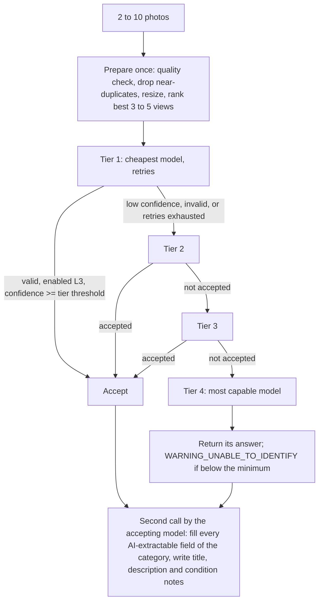

### 6.5.2 Configuration (no code change to swap models or providers)

```yaml
# valuex-ai configuration (values are placeholders; secrets come from environment variables)
ai:
  listing:
    deadline_seconds: 17            # whole request incl. attributes; no new attempt or tier starts past this (backend hard limit is 20s)
    attribute_timeout_seconds: 6    # reserved: a tier starts only if the time left is at least its timeout plus this; the attribute call is skipped if less remains
    attribute_max_output_tokens: 2500
    min_identification_confidence: 0.55
    field_min_confidence: 0.60      # attribute values below this are dropped
    image:                          # see §6.5.6; starting values, tune on the labelled photo set
      fetch_timeout_seconds: 3      # per image, fetched in parallel
      prepare_timeout_seconds: 4    # whole preparation step, counted in deadline_seconds
      max_side_px: 1024             # long side after resize; never enlarged
      format: jpeg
      jpeg_quality: 80
      quality:
        min_sharpness: 100          # variance of the Laplacian on a 512 px copy
        min_brightness: 35          # mean luma, 0 to 255
        max_brightness: 225
      duplicate:
        max_hamming_distance: 6     # 64-bit difference hash
      selection:
        min_views: 3
        max_views: 5
    retry:
      max_attempts: 3               # per model call
      initial_backoff_ms: 300
      multiplier: 2.0
      max_backoff_ms: 2000
      jitter: true
      max_retry_after_seconds: 5    # cap on a provider's Retry-After
    shadow:                         # optional comparison against the strongest tier, off by default (§6.5.8)
      enabled: false
      sample_rate: 0.05             # share of eligible requests
      reference_tier: tier4
      max_per_hour: 200             # hard cap on extra calls
      timeout_seconds: 20           # own limit, outside the seller's deadline
    providers:                      # reusable connections
      openai: { type: openai_compatible, base_url: ${OPENAI_BASE_URL}, api_key_env: OPENAI_API_KEY }
      google: { type: openai_compatible, base_url: ${GOOGLE_BASE_URL}, api_key_env: GOOGLE_API_KEY }  # use type google_genai instead if the compatible endpoint is not enough (Open Gap 22)
    tiers:                          # cheapest first; 1 to 4 entries, 3 to 4 in production
      - { name: tier1, provider: openai, model: "GPT-6 Luna",  accept_confidence: 0.85, max_images: 3,  timeout_seconds: 5,  max_output_tokens: 800,  price_per_1m_input: 0.0, price_per_1m_output: 0.0 }
      - { name: tier2, provider: google, model: "Gemini 3.1 Flash-Lite",  accept_confidence: 0.80, max_images: 4,  timeout_seconds: 6, max_output_tokens: 1000 }
      - { name: tier3, provider: openai, model: "GPT-6.1 Sol",  accept_confidence: 0.75, max_images: 5, timeout_seconds: 7, max_output_tokens: 1200 }
      - { name: tier4, provider: google, model: "Gemini 3.1 Pro",  accept_confidence: 0.0,  max_images: 5, timeout_seconds: 9, max_output_tokens: 1200 }
```

The providers and models are the ones chosen on 2026-10-28 (the model names are used as given and must be set to the exact API model ids; tier 4 is Google (confirmed 2026-10-28)). The accept thresholds start strict (0.85 / 0.80 / 0.75) and are loosened from real data (§11.1); image caps, timeouts and unit prices are starting values. A tier starts only if the time left covers its timeout plus `attribute_timeout_seconds`, so within the 17s deadline a request normally reaches tier 2, and tiers 3 and 4 only when earlier tiers fail fast or answer quickly.

Startup validation (the service refuses to start otherwise): at least 1 and at most 4 tiers, every tier references a defined provider, every `api_key_env` is set, thresholds between 0 and 1, `max_images` between 1 and `image.selection.max_views` (which is at most 10), and `shadow.reference_tier`, when shadow is enabled, names a configured tier. The last tier's `accept_confidence` is not used because its answer is returned whatever its confidence. Changing a model, a provider, the order or a threshold needs a configuration change and a restart only; US-121 may later move the thresholds to Admin settings.

### 6.5.3 Provider abstraction

```python
class VisionModelProvider(Protocol):
    async def analyze(self, request: VisionRequest) -> VisionResult: ...

PROVIDER_TYPES: dict[str, type[VisionModelProvider]] = {"openai_compatible": OpenAiCompatibleProvider}
```

`VisionRequest` holds the model id, prepared images, the prompt, the JSON schema of the expected answer, the output limit and the timeout. `VisionResult` holds the parsed answer (`category_code`, `category_confidence`, `title`, `condition`, `description`, `item_count`, `is_unclear`) and token usage. Adapters raise `TransientProviderError` (timeout, connection, 429, 5xx, unparseable answer) or `PermanentProviderError` (400, 401, 403, content-policy refusal). The `openai_compatible` adapter covers any provider with that protocol by configuration alone. A provider with a different protocol needs one new adapter registered in `PROVIDER_TYPES`; after that it is configuration only.

### 6.5.4 Cascade algorithm

```python
async def run_cascade(media_refs, request, deadline) -> CascadeOutcome:
    attempts: list[TierAttempt] = []
    last = None
    prepared = await prepare_views(media_refs, deadline)   # once per request, §6.5.6; raises when no image is usable
    for tier in settings.ai.listing.tiers:
        if deadline.remaining() < tier.timeout_seconds + settings.ai.listing.attribute_timeout_seconds:
            break                                   # keep time for the attribute call
        images = prepared.top(tier.max_images)      # already resized; the tier takes the top N of the ranking
        result, record = await call_with_retry(tier, images, request, deadline)
        attempts.append(record)
        if result is None:
            continue                                # retries exhausted -> next tier
        last = (tier, result)
        if accepts(tier, result):
            return CascadeOutcome(tier, result, attempts)
    return CascadeOutcome(*last, attempts) if last else CascadeOutcome.unavailable(attempts)

def accepts(tier, result) -> bool:
    return result.is_valid and taxonomy.is_enabled_l3(result.category_code) \
        and result.category_confidence >= tier.accept_confidence
```

- One pass per tier; a tier is never called twice for the same request.
- Self-reported confidence alone is not trusted: the answer must also be valid structured output with an enabled L3 code.
- If the last tier answered but below `min_identification_confidence`, the response carries `WARNING_UNABLE_TO_IDENTIFY` and no category (existing §7.3 behaviour).
- If no tier answered, the service returns an unavailable result and the backend sends the degraded response (§7.2).
- **Attributes and subjective fields (second call).** After a category is accepted, one more call by the accepting tier's provider and model sends the photos and the category's field list from the internal `ai-fields` endpoint: every field the Metadata Dictionary marks AI-extractable (`YES` or `LIMITED`), required and optional, including "More details" fields and, for "Other ..." categories, `item_type_free_text`. The prompt asks for a value and a confidence per field the model can determine and nothing for a field it cannot see (no guessing); option fields return option codes. The same call writes the final `title` (built from key attributes such as brand and model where known, at most 100 characters), `description` (at most 2000), `condition` and `condition_notes` (at most 1000). Values below `field_min_confidence` are dropped, `LIMITED` values are returned with `verify=true`, and fields marked `NO` (facts only the seller knows, such as purchase date) and non-visible or legal facts are never requested. A `NO` flag that is wrong for a field visible in the photos is corrected in the dictionary by a reviewed override (`taxonomy/overrides/ai-extractable-overrides.csv`, set to `LIMITED`), after which the field is requested like any other. The call has the same retry rules and no escalation. If less than `attribute_timeout_seconds` remains it is skipped and the draft title and description from the first call are returned without attributes.

### 6.5.5 Retry policy

| Situation | Behaviour |
|---|---|
| Timeout, connection error, HTTP 429 (uses `Retry-After` up to `max_retry_after_seconds`), HTTP 5xx | Retry with exponential backoff and jitter, up to `max_attempts` per tier |
| Unparseable or schema-invalid answer | Retry once |
| HTTP 400, 401, 403, content-policy refusal | No retry; counts as a failed attempt and the cascade moves to the next tier |
| Attempts exhausted | Escalate to the next tier |
| Overall deadline reached | No new attempt or tier starts; return the best answer so far, or unavailable |

Backend side: `AiGatewayClient` retries once, only on a connection failure or HTTP 502/503 returned before the gateway did any work, and never after a read timeout, so a single seller action cannot pay for two cascades (§10).

### 6.5.6 Photos and image preparation

- The seller uploads 2 to 10 photos of one object from different angles (US-004 rules; the app guides this). The backend rejects fewer than 2 READY photos with `ERROR_MIN_PHOTOS_REQUIRED` and sends all READY photo IDs in display order.
- The models do not receive every photo at camera resolution. The service prepares the photos once per request and sends only the best 3 to 5 resized views, all in one multimodal call per attempt (never one call per photo):

```text
original 2 to 10 photos (R2, untouched)
  -> fetch through short-lived links (parallel)
  -> decode (JPEG, PNG, HEIC), apply orientation, drop metadata
  -> quality check
  -> near-duplicate removal
  -> resize
  -> rank and select the best 3 to 5 views
  -> each tier takes the top max_images of that ranking
```

| Step | Rule |
|---|---|
| Quality check | Scored on a 512 px copy: sharpness (variance of the Laplacian) at least `min_sharpness`, mean brightness between `min_brightness` and `max_brightness`. Images below are set aside, not deleted. |
| Near-duplicates | 64-bit difference hash; images within `max_hamming_distance` form a group and the sharpest of each group stays (the cover photo wins a tie). |
| Resize | Long side down to `max_side_px` (never enlarged), JPEG at `jpeg_quality`, EXIF and GPS dropped. |
| Selection and ranking | The cover photo (display order 0) comes first when it passed the quality check. Then, one at a time, the image most different from those already chosen (largest minimum hash distance, ties by sharpness) up to `max_views`. If fewer than `min_views` remain and more photos were uploaded, the best of the set-aside ones are added back up to `min_views`. With 2 uploaded photos both are used. |
| Per tier | Tier 1 takes the top 3, tier 2 the top 4, tiers 3 and 4 the top 5 (`max_images`). Escalation takes more views from the same ranking and never repeats the preparation. |

- If every image fails the quality check the best two are still sent and the response carries `WARNING_IMAGE_UNCLEAR`. An image that cannot be fetched or decoded is skipped; if none is usable the service returns unavailable and the backend sends the degraded response (§7.2).
- Fetching is parallel and the CPU work (decode, scoring, resize) runs in a thread pool (CODING_STANDARDS §5.7). The whole step is limited by `prepare_timeout_seconds` and counts against `deadline_seconds`.
- The originals are never modified, copied or deleted. The resized copies exist only in memory for the request and are never written to disk or object storage. The service needs Pillow, NumPy and `pillow-heif` (HEIC is accepted by US-004).
- Photos that show different objects raise `MULTIPLE_ITEMS_DETECTED`; the seller still gets a successful advisory response. Selection by difference can pick a view of the other object, which the model then flags.
- The taxonomy list in the prompt is a stable prefix so providers that cache prompts can reuse it.
- Today the service downloads the originals. Once the media module produces smaller derivatives (a documented follow-up of US-004) the service should fetch those instead.

### 6.5.7 Contract addition

```python
class TierAttempt(BaseModel):
    tier: str
    model: str
    outcome: Literal["ACCEPTED", "ESCALATED", "FAILED"]
    confidence: float | None
    attempts: int
    latency_ms: int
    input_tokens: int | None
    output_tokens: int | None
    images_sent: int
```

The backend stores `tier_attempts` on the suggestion row (§4) for cost and quality analysis and does not return provider or model names to the mobile app.

## 6.5.8 Shadow Comparison (optional, off by default)

Purpose: measure on real traffic how often a cheap tier agrees with the strongest tier, without relying on seller behaviour, so thresholds can be tuned (§11.1).

- Only when `shadow.enabled` is true. For a request served by a tier below `shadow.reference_tier`, a random `sample_rate` share is eligible; no more than `max_per_hour` extra calls are made.
- It runs as a background task after the response has been sent, on the same prepared views (the top `max_images` of the reference tier), with the normal retry rules and its own `shadow.timeout_seconds`. It is not part of the seller's deadline, and any failure only increments a metric.
- It compares the category code and the values of attribute keys both answers returned, and records agreement counts only.
- It is skipped when the served tier is the reference tier, when the cascade ended unavailable, or when the hourly cap is reached.
- It stores nothing and never changes the seller's response; its tokens are counted in the cost metrics (§11). The reference provider receives the same views, so the same provider terms apply.

## 6.6 valuex-ai Layout (this story)

Only what the story needs, within the structure in CODING_STANDARDS §5.2:

```text
valuex-ai/
├── app/
│   ├── main.py
│   ├── routers/listing.py              # POST /ai/v1/listings/suggest
│   ├── services/
│   │   ├── listing_service.py          # orchestration: images, cascade, attributes, warnings
│   │   └── vision/
│   │       ├── base.py                 # VisionModelProvider, VisionRequest/Result, error types
│   │       ├── openai_compatible.py       # the one adapter
│   │       ├── registry.py                # PROVIDER_TYPES, builds providers from config
│   │       ├── retry.py                   # call_with_retry
│   │       ├── images/                    # fetch, decode (incl. HEIC), quality, near-duplicates, resize, view selection (§6.5.6)
│   │       ├── cascade.py                 # run_cascade, accepts
│   │       └── prompts.py                 # system prompt, taxonomy prefix, JSON schema
│   ├── clients/backend_client.py       # taxonomy snapshot, ai-fields, media read-access (§5.10)
│   ├── models/{requests,responses}.py
│   └── core/{config,security,logging,exceptions}.py
├── config/ai.example.yaml
├── tests/
├── Dockerfile, requirements.txt, pyproject.toml
```

Price estimation (`price_estimator`) is not built while price suggestion is on hold; the price parts of §6.3 and §6.3.1 stay as reference only. The seller's `textHint` is passed to the model only as quoted, length-capped data, and the model's JSON answer is validated (category in the snapshot, title and description lengths, allowed condition values, attribute types) before it is returned.

---

# 7. Sequence Diagrams

## 7.1 Happy Path

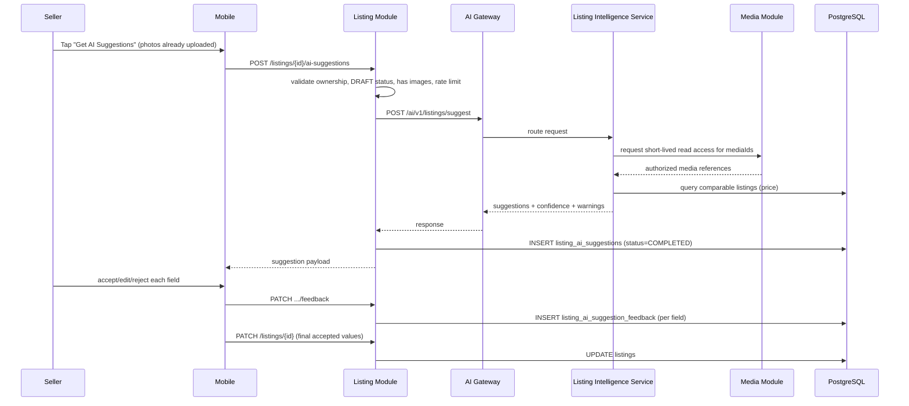

## 7.2 AI Failure / Timeout Fallback

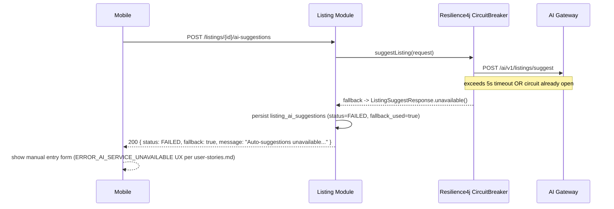

## 7.3 Low-Confidence / Unable-to-Identify

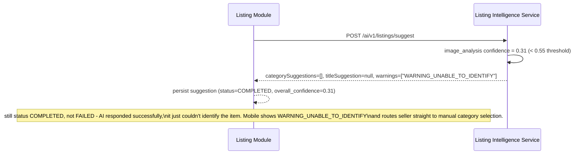

## 7.4 Model Cascade with Retry and Escalation

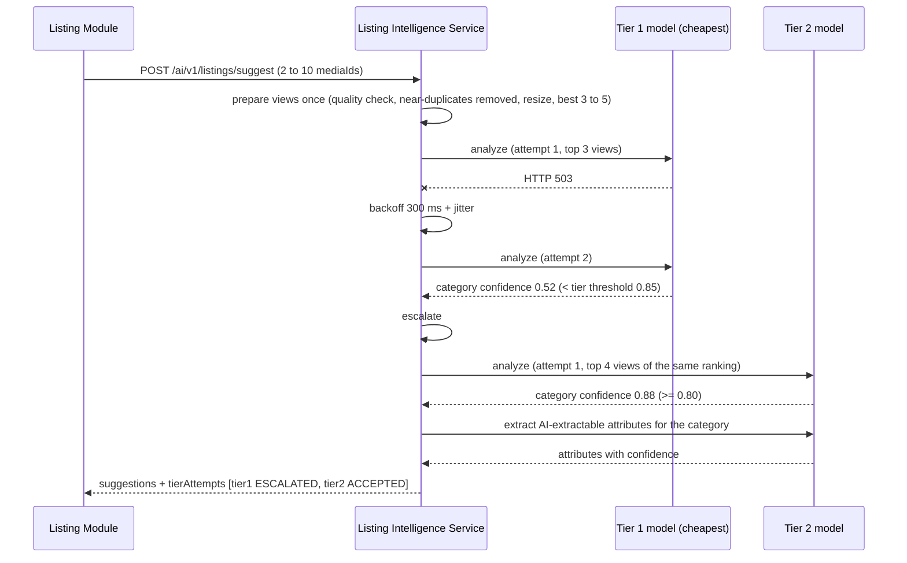

---

# 8. Validation Rules Implementation

Mapping each rule from [user-stories.md](../user-stories.md#us-005-ai-assisted-listing-creation) US-005 to its enforcement point:

| Rule | Enforced By |
|---|---|
| AI suggestions are optional; manual entry always allowed | Suggestion endpoints never mutate `listings`; seller always has direct access to `PATCH /api/v1/listings/{id}` regardless of suggestion outcome |
| Price suggestion must be within 20% of similar listings | Dual enforcement: `price_estimator` bounds itself to the comparable IQR (§6.3.1); backend re-validates independently at persistence (§5.7.1) |
| Category must be from predefined list | `category_classifier.classify()` only selects from the `categories` taxonomy table — never freeform text |
| Title max length: 100 characters | Pydantic-side generation is prompted with a 100-char constraint; DB column `title_suggestion VARCHAR(100)` enforces it as a hard backstop |
| Description max length: 2000 characters | Same pattern — `description_suggestion TEXT` has no DB limit, so a service-layer truncation guard is applied before persistence |

## 8.4 Rate Limiting (Design Decision, Not in User Story Text)

The user story doesn't specify a trigger frequency limit, but an unbounded retrigger button would let a seller hammer the AI Gateway (cost risk, [HLD §19](../HLD/04-AI-Architecture.md#19-ai-risks--mitigations) "AI cost spike"). `MAX_TRIGGERS_PER_HOUR = 5` per listing is enforced in `ListingAiService.generateSuggestions` (§5.7) via `countByListingIdAndCreatedAtAfter`. This is a soft internal control, not a user-facing plan/quota — unlike the buyer-facing photo search entitlement in [HLD §5.5](../HLD/04-AI-Architecture.md#55-photo-search-entitlement-rules), which is out of scope for this story.

---

# 9. Error Handling & Error Codes

| Error Code | HTTP | Trigger | User-Facing Message (from user-stories.md) |
|---|---|---|---|
| `LISTING_NOT_FOUND` | 404 | listing doesn't exist / not owned by caller | - |
| `LISTING_NOT_IN_DRAFT` | 400 | listing already published/deleted | - |
| `ERROR_MIN_PHOTOS_REQUIRED` | 400 | fewer than 2 READY photos (replaces `LISTING_HAS_NO_IMAGES`) | "At least 2 photos required" |
| `AI_SUGGESTION_RATE_LIMITED` | 429 | >5 triggers/hour on one listing | - |
| `AI_SUGGESTION_NOT_FOUND` | 404 | `GET`/feedback on listing with no suggestion history | - |
| (degraded, not an error) | 200 | AI Gateway timeout/circuit open | `ERROR_AI_SERVICE_UNAVAILABLE`: "Auto-suggestions unavailable. Please enter details manually" |
| (warning in payload) | 200 | low identification confidence | `WARNING_UNABLE_TO_IDENTIFY`: "Unable to identify item. Please select category manually" |
| (warning in payload) | 200 | price outside comparable band | `WARNING_PRICE_OUT_OF_RANGE`: "Suggested price may be too high/low. Please verify" |

Per [CODING_STANDARDS.md §2.10](../CODING_STANDARDS.md), all thrown exceptions are `NotFoundException`/`BusinessException`/`ValidationException`, handled centrally by `GlobalExceptionHandler` — no controller-level try/catch. The AI-unavailable and low-confidence cases are deliberately **not** exceptions: they are successful, advisory responses per [HLD §3.1](../HLD/04-AI-Architecture.md#31-ai-must-be-advisory-unless-business-rule-requires-blocking), so they're modeled as data (`fallback: true` / `warnings: [...]`), not HTTP error status codes.

---

# 10. Resilience Configuration

| Control | Value | Rationale |
|---|---|---|
| Per-call timeout | 20s hard limit (was 5s) | The cascade can call several models; the AI service stops starting new work at 17s and the app waits up to 25s (§6.5.2). Typical requests accepted by tier 1 stay near the earlier 5s target |
| Circuit breaker sliding window | 20 calls | Standard Resilience4j default, small enough to react within a few minutes at expected Sprint-2 traffic |
| Failure rate threshold | 50% | Opens circuit before a struggling AI service compounds into cascading timeouts across concurrent listing creations |
| Wait duration in open state | 30s | Matches AI Gateway pod restart / autoscale reaction time |
| Retry (backend to gateway) | 1 retry, 500ms | Only for a connection failure or HTTP 502/503 returned before the gateway did any work. Never after a read timeout or a 4xx, because the cascade may already be running and a second one would double the AI spend |
| Retry (AI service to each model) | up to 3 attempts, backoff 300ms doubling to 2s with jitter | Transient errors only (§6.5.5); exhausted attempts escalate to the next tier instead of failing the request |

Vision-model call inside the AI service (`image_analysis.analyze`, §6.3) has its own inner timeout (`vision_timeout_seconds`, default 3.0s) so a single slow image doesn't consume the full 5s backend budget before the AI service can even assemble a partial/degraded internal response.

The per-tier timeouts and the 17s overall deadline in §6.5.2 replace this single inner vision timeout.

---

# 11. Observability

Per [HLD §12](../HLD/04-AI-Architecture.md#12-ai-observability):

**Metrics (backend, via Micrometer/Prometheus):**
- `listing_ai_suggestion_requests_total{status}` (COMPLETED / FAILED / TIMEOUT)
- `listing_ai_suggestion_latency_ms` (histogram)
- `listing_ai_suggestion_fallback_total` (circuit breaker + timeout fallbacks)
- `ai_listing_tier_requests_total{tier, outcome}` (ACCEPTED / ESCALATED / FAILED) and the share of requests accepted at each tier
- `ai_listing_model_retries_total{tier, reason}`
- `ai_listing_images_received`, `ai_listing_images_sent{tier}` and `ai_listing_images_dropped_total{reason}` (BLURRY, DARK, BRIGHT, DUPLICATE, UNREADABLE), plus the preparation time, to see how much the preparation saves
- `ai_listing_shadow_requests_total{served_tier, reference_tier}`, `ai_listing_shadow_category_agreement_total{served_tier, agrees}`, `ai_listing_shadow_attribute_agreement` (histogram of the share of attributes with equal values) and the shadow tokens (only when shadow is on)
- `ai_listing_tokens_total{tier, direction}` and `ai_listing_estimated_cost{tier}` (from the configured unit prices), to track cost per suggestion and the escalation rate
- `listing_ai_suggestion_feedback_total{field, action}` — feeds the "seller acceptance rate" quality metric from [HLD §12.2](../HLD/04-AI-Architecture.md#122-quality-metrics)

**Logs (AI service, structured JSON per `app/core/logging.py`):** `inference_id`, `listing_id`, `model_version`, `confidence`, `latency_ms`, `warnings`, per [HLD §12.3](../HLD/04-AI-Architecture.md#123-logs). Never logs raw image bytes, signed URLs, provider credentials, or seller PII — only media IDs and derived attributes.

**Quality feedback loop:** `listing_ai_suggestion_feedback` rows are the raw input to the "seller edits to AI suggestions" feedback source listed in [HLD §18.2](../HLD/04-AI-Architecture.md#182-feedback-loops). No retraining pipeline is built in this story — this table is the durable capture point that a later AI Ops story consumes.

## 11.1 Tuning from Real Data

Thresholds, view counts and image limits start as guesses and are tuned after go-live from two sources. No new storage is needed.

**Seller feedback joined with `tier_attempts`.** The tier whose answer was returned has `outcome = 'ACCEPTED'` in `tier_attempts` (the last tier's answer counts as returned even when its confidence is low). Seller feedback is a proxy for correctness: sellers may keep a wrong value or not bother to fix it, so read the numbers as a trend.

```sql
-- How often sellers keep the category, by returned tier and confidence band (0.05 wide)
WITH returned AS (
    SELECT s.id, e->>'tier' AS tier,
           floor((e->>'confidence')::numeric * 20) / 20 AS band
    FROM listing_ai_suggestions s,
         jsonb_array_elements(s.tier_attempts) e
    WHERE s.status = 'COMPLETED' AND e->>'outcome' = 'ACCEPTED'
)
SELECT r.tier, r.band, count(*) AS n,
       avg((f.action = 'ACCEPTED')::int) AS category_kept_rate
FROM returned r
JOIN listing_ai_suggestion_feedback f ON f.suggestion_id = r.id AND f.field = 'CATEGORY'
GROUP BY r.tier, r.band
ORDER BY r.tier, r.band;

-- Escalation, cost and latency by tier over the last 14 days
SELECT e->>'tier' AS tier, e->>'outcome' AS outcome, count(*) AS n,
       sum((e->>'inputTokens')::bigint)  AS input_tokens,
       sum((e->>'outputTokens')::bigint) AS output_tokens,
       avg((e->>'latencyMs')::int)       AS avg_latency_ms,
       avg((e->>'imagesSent')::int)      AS avg_images_sent
FROM listing_ai_suggestions s, jsonb_array_elements(s.tier_attempts) e
WHERE s.created_at >= now() - interval '14 days'
GROUP BY 1, 2
ORDER BY 1, 2;

-- Which fields sellers keep, edit or reject
SELECT f.field, f.attribute_key, count(*) AS n,
       avg((f.action = 'ACCEPTED')::int) AS kept,
       avg((f.action = 'EDITED')::int)   AS edited,
       avg((f.action = 'REJECTED')::int) AS rejected
FROM listing_ai_suggestion_feedback f
GROUP BY f.field, f.attribute_key
ORDER BY n DESC;
```

How to read them: if tier 1 answers in the 0.80 to 0.85 band and sellers keep the category about as often as in higher bands, lower that tier's threshold; if the keep rate drops, raise it. The cost query shows how many requests reach tiers 2 to 4. The key names inside `tier_attempts` (`tier`, `outcome`, `confidence`, `latencyMs`, `imagesSent`, `inputTokens`, `outputTokens`) must match what the backend stores; the queries are tested against the test database during implementation.

**Shadow comparison (optional, §6.5.8)** removes the seller bias for escalation: it shows how often a cheap tier agrees with the strongest tier. Metrics only.

**Changing a value** is a configuration change and a restart until US-121 adds Admin settings. Recommended go-live: AI off by default, enabled for internal users first, strict thresholds, review the numbers after a few weeks, then loosen one threshold at a time.

---

# 12. Security & Privacy

- `AiGatewayClient` calls carry `X-Internal-Api-Key`; the AI Gateway is not reachable from the public internet ([CODING_STANDARDS.md §1.5](../CODING_STANDARDS.md), [HLD §15.1](../HLD/04-AI-Architecture.md#151-access-control)).
- Images are referenced by `mediaId` only — never re-uploaded to the AI service and never exposed as permanent provider URLs; `image_analysis.analyze` receives short-lived authorized media references generated per request, not stored signed URLs ([HLD §15.2](../HLD/04-AI-Architecture.md#152-data-privacy)).
- `listing_ai_suggestions.description_suggestion` and `title_suggestion` are LLM output shown to the seller before it can reach any other user — validated for length only in this story; profanity/restricted-content filtering is owned by US-007's moderation pass, run separately before publish.
- `sellerId` on the request path is always taken from `SecurityContext`, never trusted from the request body (§5.8).
- Provider API keys are read from environment variables named in the configuration (`api_key_env`), never stored in configuration files or logs. Every provider and model receives seller photos, so each must be approved and must not retain or train on them (contract term); the list of enabled providers is reviewed before a new one is added.
- Logs and `tier_attempts` hold tier names, model ids, confidences, counts and latencies only; no image bytes, signed URLs or prompts containing seller text.
- Only resized copies without EXIF or GPS data are sent to a provider, and only the 3 to 5 selected views. The original photos are read through short-lived links and never changed, copied or deleted; the resized copies live in memory for the request only. The optional shadow comparison (§6.5.8) sends the same selected views to the reference provider, so it is covered by the same provider terms and is off by default.

---

# 13. Testing Strategy

Per [CODING_STANDARDS.md §2.11](../CODING_STANDARDS.md) / §5 (Python).

## 13.1 Backend Unit Tests (JUnit 5 + Mockito + AssertJ)

- `shouldReturnSuggestionsWhenAiGatewaySucceeds()`
- `shouldReturnFallbackResponseWhenAiGatewayTimesOut()`
- `shouldReturnFallbackResponseWhenCircuitBreakerOpen()`
- `shouldThrowNotFoundWhenListingDoesNotBelongToSeller()`
- `shouldThrowBusinessExceptionWhenListingHasNoImages()`
- `shouldThrowBusinessExceptionWhenListingNotInDraft()`
- `shouldThrowRateLimitedWhenTriggeredMoreThanFiveTimesInHour()`
- `shouldAppendPriceOutOfRangeWarningWhenAiPriceOutsideComparableBand()`
- `shouldNotAppendPriceWarningWhenNoComparableListingsExist()`
- `shouldPersistFeedbackRowsPerField()`
- `shouldRetryGatewayOnceOnConnectionFailureOrServiceUnavailable()`
- `shouldNotRetryGatewayAfterReadTimeoutOrClientError()`
- `shouldPersistTierAttemptsFromResponse()`
- `shouldSendAllReadyPhotosInDisplayOrder()` and `shouldRejectFewerThanTwoReadyPhotos()`

## 13.2 Backend Integration Tests (`@SpringBootTest`, TestContainers PostgreSQL)

- `POST /listings/{id}/ai-suggestions` happy path → `200`, row persisted, `listings.ai_assisted = true`
- `POST /listings/{id}/ai-suggestions` with AI Gateway mock returning 5xx → `200` degraded payload, `status=FAILED`
- `GET /listings/{id}/ai-suggestions` with no prior suggestion → `404 AI_SUGGESTION_NOT_FOUND`
- `PATCH .../feedback` with invalid `field` enum value → `400 VALIDATION_ERROR`

## 13.3 AI Service Tests (pytest)

- `test_returns_unable_to_identify_warning_below_confidence_threshold`
- `test_returns_multiple_items_warning_when_item_count_greater_than_one`
- `test_returns_null_price_range_when_comparable_count_below_minimum`
- `test_response_always_includes_model_name_and_version`
- `test_internal_api_key_required` (401 without `X-Internal-Api-Key`)
- `test_cascade_stops_at_first_tier_that_meets_its_threshold`
- `test_cascade_escalates_on_low_confidence_and_on_invalid_category`
- `test_cascade_returns_last_tier_answer_with_unable_to_identify_when_still_low`
- `test_retry_on_timeout_429_5xx_and_unparseable_answer_with_backoff`
- `test_no_retry_on_400_401_403_and_content_policy_refusal`
- `test_exhausted_retries_escalate_to_next_tier`
- `test_overall_deadline_stops_new_attempts_and_tiers`
- `test_swapping_model_provider_order_or_threshold_by_configuration_only`
- `test_invalid_tier_configuration_stops_startup`
- `test_blurry_dark_and_bright_images_are_set_aside`
- `test_near_duplicates_collapse_to_the_sharpest_image`
- `test_cover_photo_ranked_first_when_it_passes_quality`
- `test_selection_prefers_different_views_and_is_capped_at_five`
- `test_views_topped_up_to_three_from_set_aside_images_and_two_uploads_send_two`
- `test_each_tier_takes_its_top_n_views_of_one_ranking`
- `test_resized_images_have_no_exif_or_gps_and_are_never_enlarged`
- `test_heic_png_and_jpeg_decode_and_unreadable_images_are_skipped`
- `test_all_images_failing_quality_sends_best_two_with_image_unclear_warning`
- `test_originals_are_never_modified_or_written_anywhere`
- `test_preparation_respects_its_timeout_and_counts_against_the_deadline`
- `test_attribute_call_skipped_when_too_little_time_remains`
- `test_tier_not_started_when_its_timeout_plus_attribute_call_do_not_fit`
- `test_attribute_call_requests_all_ai_extractable_required_and_optional_fields_and_none_marked_no`
- `test_fields_not_visible_are_returned_empty_not_guessed`
- `test_limited_fields_are_flagged_verify`
- `test_subjective_fields_within_limits_and_item_type_free_text_for_other_categories`
- `test_response_uses_standard_envelope_with_tier_attempts`
- `test_shadow_is_off_by_default_and_respects_sample_rate_and_hourly_cap`
- `test_shadow_runs_after_the_response_and_its_failure_does_not_affect_it`
- `test_shadow_skipped_when_served_tier_is_the_reference_tier`
- `test_shadow_agreement_metrics_for_matching_and_differing_category_and_attributes`
- `test_shadow_stores_nothing`
- `test_photo_count_between_two_and_ten_enforced`
- `test_tier_attempts_and_cost_metrics_emitted`

## 13.4 Edge Case Coverage Matrix

| User Story Edge Case | Test |
|---|---|
| AI cannot identify item from photos | `test_returns_unable_to_identify_warning_below_confidence_threshold` |
| Photos contain multiple items | `test_returns_multiple_items_warning_when_item_count_greater_than_one` |
| AI suggests unrealistic price | `shouldAppendPriceOutOfRangeWarningWhenAiPriceOutsideComparableBand` |
| Item unique/rare, no comparables | `test_returns_null_price_range_when_comparable_count_below_minimum` |
| AI service timeout or failure | `shouldReturnFallbackResponseWhenAiGatewayTimesOut`, `...CircuitBreakerOpen` |

---

# 14. Non-Functional Requirements

| Requirement | Target | Source |
|---|---|---|
| Listing AI latency | Under 5s when tier 1 accepts; hard limit 20s (cascade with retries) | Updated 2026-10-28 from the HLD §12.1 target of 5s; HLD §12.1 aligned |
| AI cost | Cheapest accepted tier per request; escalation rate and cost per suggestion tracked | §6.5, §11 |
| Availability degradation | Never blocks listing creation | [HLD §3.1](../HLD/04-AI-Architecture.md#31-ai-must-be-advisory-unless-business-rule-requires-blocking) |
| Concurrent suggestion requests | Bounded by circuit breaker sliding window (20) + per-listing rate limit (5/hr) | §8.4, §10 |
| Data retention | `listing_ai_suggestions`/`_feedback` retained indefinitely (small volume, feeds retraining); no PII stored beyond `sellerId`/`listingId` foreign keys | [HLD §11.1](../HLD/04-AI-Architecture.md#111-postgresql) |

---

# 15. Open Items / Follow-ups

- **Model source for MVP (decided 2026-10-28: external vision models in a configurable cascade, §6.5)** was left as an implementation choice in [HLD §4.2](../HLD/04-AI-Architecture.md#42-listing-intelligence-service) ("MVP may use... "). This LLD's `image_analysis` / `text_generator` modules are written against a provider-agnostic interface so the concrete vendor can be selected during implementation without changing the router/service contract.
- **Restricted item detection (US-007)** is a separate, blocking check layered on top of this advisory flow — not covered here. Confirm with the team whether US-007's moderation call happens synchronously within the same `POST /ai-suggestions` round trip or as an independent call triggered by image upload (US-004), since that affects whether `ListingAiService` needs to short-circuit on a moderation block.
- **Cascade values to choose:** the actual providers and models (chosen, §6.5.2), and the thresholds, view counts, image preparation limits and deadline (starting values in §6.5.2). They need tuning on a labelled photo set, and self-reported confidence must be checked for calibration before go-live.
- **Taxonomy and media access for the AI service:** decided 2026-10-28, internal endpoints in §5.10.
- **Response shape:** §6.2 is flat while CODING_STANDARDS §5.4 defines an envelope; proposed to follow the envelope, to be confirmed.
- **HLD §12.1** latency target was aligned with §14 on 2026-10-28. CODING_STANDARDS §5.7 still lists "Listing AI: < 5 seconds" and should be updated the same way.
- **pgvector** is not required for this story (Listing Intelligence Service does not use embeddings/vector search). It remains a tracked prerequisite only for visual search work (US-039+) per the existing backlog note in `Sprint-plan.md`.

---

# Part C - US-006: Category Taxonomy and Category-driven Item Details

**Story Points:** 13 | **Repos:** valuex-backend, valuex-mobile
**Dependency:** US-004, US-114, US-089 (built before US-005 and US-007)
**Sources:** `Documents/Category_Taxonomy_CSVs/*`; decisions D1 to D33 in `Documents/Category_Taxonomy_Review_Drafts.md`; plan `Documents/US-Implementation-Plans/US-006-Implementation-Plan.md`. The outside design document `ValueX_Category_Taxonomy_MVP_Design.md` supplied ideas for tables and endpoints only; where it conflicts with this design, this design wins.

## C.1 Story Overview

**As a** seller **I want to** choose my item's category from the marketplace taxonomy and fill in the details that category needs **so that** buyers can find my item and see accurate information. A listing has exactly one L3 category (L1 and L2 are derived). Multi-category tagging was dropped. The Item Details page (US-114) becomes a form driven by the category's schema: common fields, required fields and optional fields under "More details".

## C.2 Scope

**In scope:** the taxonomy and metadata tables; an idempotent all-or-nothing importer for the CSVs; category children (popular and others), category search and the listing schema APIs; `PUT` the category of a listing and the extended details `PATCH`; server-side validation against the schema; Real Estate transaction intent and `listing_price_inr` derivation; the 3-level mobile picker and dynamic form.
**Out of scope:** delivery fields and eligibility (US-122); the Conditional compliance popup (US-007); buyer-side property flow (US-118); Admin screens (US-121); OpenSearch (US-120); AI prefill (US-005); item location (US-108).

## C.3 Data Model

Migration `V16__taxonomy_and_listing_attributes.sql` (recheck the next free version at implementation time). Tables are plural, as elsewhere, and use `uuid_generate_v4()`.

```sql
CREATE TABLE categories (
    id UUID PRIMARY KEY DEFAULT uuid_generate_v4(),
    parent_id UUID REFERENCES categories(id),
    code VARCHAR(120) NOT NULL UNIQUE,            -- CAT-0001 for L3; L1-MOBILES_TABLETS, L2-... generated
    name VARCHAR(180) NOT NULL,
    slug VARCHAR(180) NOT NULL,
    level SMALLINT NOT NULL CHECK (level BETWEEN 1 AND 3),
    marketplace_status VARCHAR(20) NOT NULL DEFAULT 'ALLOWED',   -- ALLOWED | CONDITIONAL
    admin_enabled BOOLEAN NOT NULL DEFAULT TRUE,
    ui_popular BOOLEAN NOT NULL DEFAULT FALSE,
    ui_rank INTEGER,
    display_order INTEGER,
    policy_notes TEXT,
    created_at TIMESTAMPTZ NOT NULL DEFAULT now(),
    updated_at TIMESTAMPTZ NOT NULL DEFAULT now(),
    UNIQUE (parent_id, slug)
);

CREATE TABLE attribute_definitions (
    id UUID PRIMARY KEY DEFAULT uuid_generate_v4(),
    attribute_key VARCHAR(120) NOT NULL UNIQUE,   -- stable identifier (Metadata Dictionary)
    display_name VARCHAR(180) NOT NULL,           -- UI label (Metadata Dictionary)
    data_type VARCHAR(30) NOT NULL,
    unit VARCHAR(40),
    ui_control VARCHAR(60),
    searchable BOOLEAN NOT NULL DEFAULT FALSE,
    filterable BOOLEAN NOT NULL DEFAULT FALSE,
    ai_extractable VARCHAR(10) NOT NULL DEFAULT 'NO',            -- YES | LIMITED | NO
    validation_json JSONB,
    help_text TEXT,
    admin_enabled BOOLEAN NOT NULL DEFAULT TRUE
);

CREATE TABLE attribute_options (
    id UUID PRIMARY KEY DEFAULT uuid_generate_v4(),
    attribute_id UUID NOT NULL REFERENCES attribute_definitions(id),
    code VARCHAR(120) NOT NULL,
    display_value VARCHAR(180) NOT NULL,
    display_order INTEGER,
    admin_enabled BOOLEAN NOT NULL DEFAULT TRUE,
    UNIQUE (attribute_id, code)
);

CREATE TABLE metadata_profiles (
    id UUID PRIMARY KEY DEFAULT uuid_generate_v4(),
    code VARCHAR(100) NOT NULL UNIQUE,            -- PHONE, CAR, PROP_HOME ...
    name VARCHAR(180) NOT NULL,
    version INTEGER NOT NULL DEFAULT 1,
    admin_enabled BOOLEAN NOT NULL DEFAULT TRUE
);

CREATE TABLE metadata_profile_attributes (
    profile_id UUID NOT NULL REFERENCES metadata_profiles(id),
    attribute_id UUID NOT NULL REFERENCES attribute_definitions(id),
    required BOOLEAN NOT NULL DEFAULT FALSE,
    display_order INTEGER NOT NULL,
    ai_prefill_enabled BOOLEAN NOT NULL DEFAULT FALSE,
    seller_editable BOOLEAN NOT NULL DEFAULT TRUE,
    searchable BOOLEAN NOT NULL DEFAULT FALSE,
    filterable BOOLEAN NOT NULL DEFAULT FALSE,
    PRIMARY KEY (profile_id, attribute_id)
);

CREATE TABLE profile_attribute_options (       -- per-profile option subsets (for example transaction_intent)
    profile_id UUID NOT NULL REFERENCES metadata_profiles(id),
    attribute_id UUID NOT NULL REFERENCES attribute_definitions(id),
    option_id UUID NOT NULL REFERENCES attribute_options(id),
    PRIMARY KEY (profile_id, attribute_id, option_id)
);

CREATE TABLE category_metadata_profiles (
    category_id UUID PRIMARY KEY REFERENCES categories(id),
    profile_id UUID NOT NULL REFERENCES metadata_profiles(id)
);
-- No per-category override table in this release: the importer's override files (required fields,
-- type corrections, option lists, profile additions) are applied to the profile when it is loaded.

CREATE TABLE listing_attribute_values (
    listing_id UUID NOT NULL REFERENCES listings(id) ON DELETE CASCADE,
    attribute_id UUID NOT NULL REFERENCES attribute_definitions(id),
    value_text TEXT, value_integer BIGINT, value_decimal NUMERIC(18,4),
    value_boolean BOOLEAN, value_date DATE,
    value_option_id UUID REFERENCES attribute_options(id),
    value_json JSONB,
    value_source VARCHAR(20) NOT NULL DEFAULT 'SELLER',          -- SELLER | AI | ADMIN | IMPORT
    ai_confidence NUMERIC(5,4),
    seller_confirmed BOOLEAN NOT NULL DEFAULT FALSE,
    created_at TIMESTAMPTZ NOT NULL DEFAULT now(),
    updated_at TIMESTAMPTZ NOT NULL DEFAULT now(),
    PRIMARY KEY (listing_id, attribute_id)
);

CREATE TABLE listing_attribute_option_values (  -- multi-select, one row per option, never comma-separated text
    listing_id UUID NOT NULL REFERENCES listings(id) ON DELETE CASCADE,
    attribute_id UUID NOT NULL REFERENCES attribute_definitions(id),
    option_id UUID NOT NULL REFERENCES attribute_options(id),
    value_source VARCHAR(20) NOT NULL DEFAULT 'SELLER',
    ai_confidence NUMERIC(5,4),
    PRIMARY KEY (listing_id, attribute_id, option_id)
);

CREATE TABLE taxonomy_import_log (
    id UUID PRIMARY KEY DEFAULT uuid_generate_v4(),
    version VARCHAR(40) NOT NULL, checksum VARCHAR(128) NOT NULL,
    counts_json JSONB, status VARCHAR(20) NOT NULL,
    created_at TIMESTAMPTZ NOT NULL DEFAULT now()
);

ALTER TABLE listings
    ADD COLUMN category_id UUID REFERENCES categories(id),   -- an enabled L3
    ADD COLUMN condition_notes TEXT,
    ADD COLUMN negotiable BOOLEAN,
    ADD COLUMN quantity INTEGER,
    DROP COLUMN category_slug;                                -- dev data is discarded
-- listings.price (NUMERIC(12,2)) keeps its name and holds the normalized listing price
```

Common fields stay as `listings` columns (`title`, `description`, `condition`, `price`, `condition_notes`, `negotiable`, `quantity`); everything else is a typed attribute value.

## C.4 API Contract

All endpoints need authentication and use the standard envelope.

```http
GET /api/v1/categories/children?parentCode=&scope=POPULAR|OTHERS|ALL
GET /api/v1/categories/search?q=
GET /api/v1/categories/{code}/listing-schema
PUT /api/v1/listings/{listingId}/category
PATCH /api/v1/listings/{listingId}
```

- `children`: enabled children of a node (top level without `parentCode`); `POPULAR` returns up to 15 L1 or 10 L2 by `ui_rank`, `OTHERS` the remaining enabled ones, `ALL` every enabled child in display order. Each item: `code`, `name`, `level`, `hasChildren`, `popular`, `marketplaceStatus`. A leaf as parent gives `ERROR_CATEGORY_LEAF`; an unknown or disabled parent gives `CATEGORY_NOT_FOUND`.
- `search`: up to 20 enabled L3 categories whose name, or whose parent's name, matches (case-insensitive, at least 2 characters; shorter text gives an empty list), with the full path.
- `listing-schema`: the form definition for an L3: `category` (with path), `profileCode`, `group` (`GOODS`, `WHOLE_VEHICLE`, `REAL_ESTATE`), `common` (`conditionVisible`, `quantityVisible`, `negotiableVisible`, `priceDerived`), `transactionIntents` and `fields`. Each field: `key`, `label` (dictionary display name), `type` (option types without options arrive as `TEXT` or `TEXT_LIST`), `unit`, `uiControl`, `required`, `requiredWhen` (`{ key, values }`, used for the price by transaction intent), `section` (`CATEGORY` or `MORE`), `options`, `validation` (`min`, `max`, `maxLength`, `maxItems`, `maxDecimals`, `pattern`), `aiPrefill`, `order` and `prefillOption` (the option that repeats the category name, or the only option). Required fields come first, then the other category fields, then `MORE`.
- `PUT category` body: `{ "categoryCode": "CAT-0001" }`; the seller comes from the security context only. Attributes outside the new schema are deleted in the same transaction.
- `PATCH` (extends US-114): `conditionNotes`, `negotiable`, `quantity`, `attributes` (an object by attribute key, for example `{ "brand": "Apple" }`) and the existing fields; `categorySlug` is removed. `price` is the asking price and is ignored for Real Estate. `ListingDraftResponse` carries `category` (code, name, status, path), the stored `attributes` (option codes, text, numbers, booleans, ISO dates, lists, objects) and the new common fields.
- **Errors:** `ERROR_CATEGORY_REQUIRED`, `CATEGORY_NOT_FOUND` (404), `ERROR_CATEGORY_DISABLED`, `ERROR_CATEGORY_NOT_LEAF`, `ERROR_ATTRIBUTE_NOT_ALLOWED`, `ERROR_ATTRIBUTE_REQUIRED`, `ERROR_ATTRIBUTE_INVALID` (these three carry `error.details.field` with the attribute key), `ERROR_CONDITION_NOTES_REQUIRED`, `ERROR_NEGOTIABLE_REQUIRED`, `ERROR_QUANTITY_INVALID` and the existing price and condition errors.

## C.5 Service Logic

```java
@Transactional
public void setCategory(UUID listingId, UUID sellerId, String categoryCode) {
    var listing = requireOwnedDraft(listingId, sellerId);        // owner + DRAFT/REVISION_REQUIRED
    var category = categoryService.requireSelectableLeaf(categoryCode); // CATEGORY_NOT_FOUND, ERROR_CATEGORY_NOT_LEAF, ERROR_CATEGORY_DISABLED
    listing.setCategoryId(category.id());
    attributeService.deleteOutside(listingId, listingSchemaService.schemaFor(category).keys());
}

@Transactional
public void saveDetails(UUID listingId, UUID sellerId, UpdateListingDetailsRequest req) {
    var listing = requireOwnedDraft(listingId, sellerId);
    var schema = listingSchemaService.schemaFor(listing.getCategory());   // ERROR_CATEGORY_REQUIRED if none
    attributeValidator.validate(schema, req);          // type, unit, range, options, cross-field; ERROR_ATTRIBUTE_*
    listing.setPrice(priceResolver.resolve(schema, req)); // goods: asking price; Real Estate: by intent
    attributeValueService.replace(listingId, schema, req.attributes());
}
```

- **Effective enabled:** an L3 is selectable when its L1, L2 and L3 are `admin_enabled` (a disabled parent hides the branch without rewriting child flags). Real Estate and Conditional categories are enabled from day one.
- **Schema:** built from the profile and the Common-field applicability rules (Real Estate: no condition, quantity or More details; whole vehicles: no quantity and no `ownership_count`, since the profile has `owner_count`; delivery fields are added by US-122). It is built on each request from indexed tables; no cache is used in this release. Latitude, longitude and the other system or common-column keys (`AttributeRules.EXCLUDED_KEYS`) are never offered as fields.
- **Validation:** the schema sends the limits (`validation`) and the server enforces the same ones in `AttributeValidator`: unknown keys, required and conditionally required fields, types, ranges, decimals, patterns, options (by code or label), list and object sizes, dates (`expiry_date` and `available_from` not in the past) and related fields (`price_min` ≤ `price_max`, `carpet_area_min_sqft` ≤ `carpet_area_max_sqft`, `floor_number` ≤ `total_floors`, `players_min` ≤ `players_max`, `pieces_missing` ≤ `pieces_total`, `carpet_area_sqft` ≤ `builtup_area_sqft`). Fields that repeat the category name (`property_type`, `apparel_type` and the other "type" attributes) and an intent with a single option are filled in when the seller sends nothing.
- **Storage:** `ListingAttributeService` writes each value to the column of its type (`value_text`, `value_integer`, `value_decimal`, `value_boolean`, `value_date`, `value_option_id`, `value_json`), multi-select options one row each in `listing_attribute_option_values`; every save replaces the listing's earlier values.
- **Price (`ListingPriceResolver`):** goods and vehicles use `asking_price_inr`; Real Estate Sale gives `sale_price` (`price_min` for New Developments), Rent and Lease give `monthly_rent`. The schema offers only the intents allowed for the profile and requires the matching price. The maximum price is ₹10,00,00,000 (`valuex.listing.max-price`).
- **"Others":** the OTHER profile has only common fields plus `item_type_free_text`; non-common entries are stored in one JSON attribute (`special_attributes_json`).
- **Importer:** CSVs and override files (`required-fields.csv`, `type-overrides.csv`, `options.csv`, `profile-additions.csv`) under `src/main/resources/taxonomy/`; idempotent, all-or-nothing, upsert by code, skipped when the files' checksum matches the last successful import, with the validations in the plan (hierarchy, profile and key checks, popular limits 15 L1 and 10 L2 per L1, duplicate ranks, duplicate display names inside a profile, option code collisions); runs on deploy (`valuex.taxonomy.import-on-startup`, optional `valuex.taxonomy.import-dry-run`) and logs to `taxonomy_import_log`. Option codes are the upper-case display value with `+` written as `PLUS`; the options of "type" attributes are generated from the L3 names of the profile (L2 names for `instrument_family`).

## C.6 Sequence Diagram

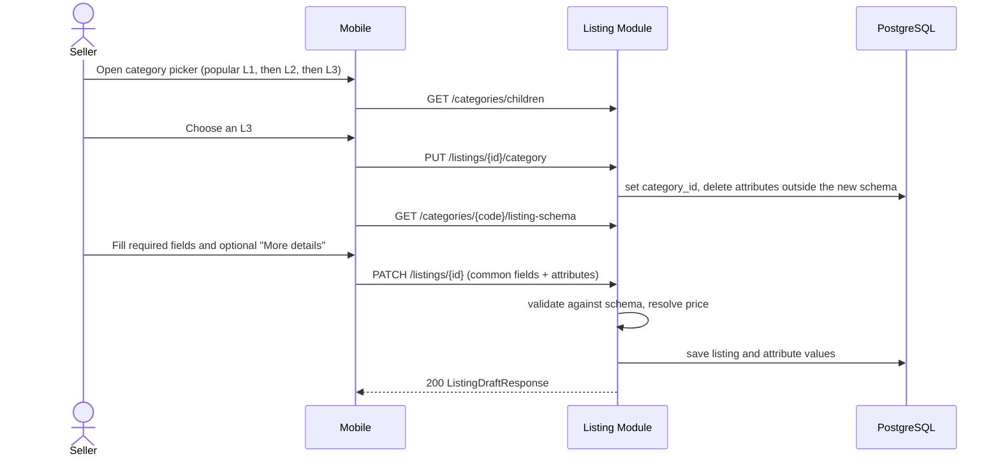

## C.7 Validation Rules & Error Codes

| Rule | Error Code | Message |
|---|---|---|
| Category required | `ERROR_CATEGORY_REQUIRED` | "Choose a category" |
| Category exists | `CATEGORY_NOT_FOUND` (404) | "This category is not available" |
| Category enabled (effective) | `ERROR_CATEGORY_DISABLED` | "This category is not available" |
| Category is an L3 | `ERROR_CATEGORY_NOT_LEAF` | "Choose a more specific category" |
| Attribute belongs to the schema | `ERROR_ATTRIBUTE_NOT_ALLOWED` | "This detail does not apply to the chosen category" |
| Required attributes present | `ERROR_ATTRIBUTE_REQUIRED` | "Please fill in the required details" |
| Type, unit, range, option, cross-field | `ERROR_ATTRIBUTE_INVALID` | "Please check this detail" |
| Price above 0, at most 2 decimals, at most ₹10,00,00,000 | existing price error | existing message |

## C.8 NFR & Notes

- `PUT` of the category is idempotent. Responses for children, search and schema are cached in Redis and evicted after an import.
- The category tree is at most 3 levels; the picker loads one level at a time.
- AI is not involved in this story. The schema carries `aiPrefillEnabled` so US-005 can prefill later; whenever AI is off, unavailable or low-confidence the seller types everything (Admin switch in US-121).
- Seller pincode and the serial number value are never exposed; `video_available` stays hidden until video upload exists.

---

# Part D - US-007: Restricted Items Prevention

> **Update (2026-10-25, category taxonomy):** Detection uses AI and keywords. Prohibited items are blocked with the Restrictions-sheet message; Conditional categories (and Conditional items detected in a listing) show a compliance popup with the sheet text and continue only on "Agree & Continue". The acceptance is stored with listing, category, policy version and time. The popup applies to all Real Estate categories; Solar Panels (CAT-0204) and Forklifts (CAT-0742) have none. The mapping of Conditional categories to Restrictions rows is in `Documents/Category_Taxonomy_Review_Drafts.md` (section 7). The `ListingCategoryProvider` port returns the listing's single L3 category code (and its L1 and L2 codes) from `listings.category_id`.

**Story Points:** 5 | **Repos:** valuex-backend, valuex-ai
**Dependency:** US-005 (AI-Assisted Listing Creation) — reuses the AI Gateway integration pattern and runs against the same uploaded images/text

## D.1 Story Overview

**As a** platform **I want to** prevent listing of restricted items **so that** the platform remains compliant and safe. Unlike US-005 (advisory), this check is **blocking**: per [HLD §8 Restricted Item & Content Moderation AI](../HLD/04-AI-Architecture.md#8-restricted-item--content-moderation-ai), a `Restricted` result blocks listing creation outright, `Unclear` routes to manual review, and `Severe violation` restricts the seller account (US-088 lifecycle transition to `UNDER_REVIEW`).

This check runs at item details submission (US-114, **Choose Listing Plan**), before plan selection and payment, independently of and prior to US-084's broader Trust & Safety review — US-007 is the narrow "is this item outright prohibited" gate, run early so a seller does not pay for a listing that cannot be published; US-084 is the fuller fraud/reputation review that runs after plan payment and before publication. It runs again before a revised listing is resubmitted for review.

## D.2 Scope

**In scope:** `POST /api/v1/listings/{id}/restricted-check` (backend orchestration), `POST /ai/v1/moderation/restricted-item-check` (AI service), account flagging on severe violation, appeal submission.
**Out of scope:** Broader trust & safety scoring (US-084), admin review console UI (Sprint 10, US-054), watermark detection (Sprint 9, US-082).

## D.3 Data Model

```sql
-- V{N}__add_listing_moderation_checks.sql
CREATE TYPE moderation_result AS ENUM ('SAFE', 'UNCLEAR', 'RESTRICTED', 'SEVERE_VIOLATION');

CREATE TABLE listing_moderation_checks (
    id UUID PRIMARY KEY DEFAULT uuid_generate_v4(),
    listing_id UUID NOT NULL REFERENCES listings(id),
    result moderation_result NOT NULL,
    matched_categories JSONB,      -- ["weapons", "counterfeit_goods"]
    matched_keywords JSONB,        -- text-scan hits, redacted in logs
    confidence NUMERIC(5,4),
    model_version VARCHAR(50),
    reviewed_by_admin_id UUID,     -- set only if UNCLEAR was manually resolved
    admin_decision VARCHAR(20),    -- APPROVED | REJECTED
    created_at TIMESTAMP NOT NULL DEFAULT CURRENT_TIMESTAMP
);
CREATE INDEX idx_listing_moderation_listing ON listing_moderation_checks(listing_id);

CREATE TABLE listing_moderation_appeals (
    id UUID PRIMARY KEY DEFAULT uuid_generate_v4(),
    moderation_check_id UUID NOT NULL REFERENCES listing_moderation_checks(id),
    seller_id UUID NOT NULL REFERENCES users(id),
    appeal_reason TEXT NOT NULL,
    status VARCHAR(20) NOT NULL DEFAULT 'PENDING', -- PENDING | UPHELD | OVERTURNED
    resolved_by_admin_id UUID,
    resolved_at TIMESTAMP,
    created_at TIMESTAMP NOT NULL DEFAULT CURRENT_TIMESTAMP
);
```

## D.4 API Contract

```http
POST /api/v1/listings/{listingId}/restricted-check
```

Response (blocking result):

```json
{
  "success": false,
  "error": { "code": "ERROR_RESTRICTED_ITEM", "message": "This item cannot be listed. See prohibited items policy" },
  "data": { "matchedCategories": ["weapons"], "result": "RESTRICTED" }
}
```

Response (unclear, queued):

```json
{
  "success": true,
  "data": { "result": "UNCLEAR", "message": "Listing flagged for review. You'll be notified within 24 hours" }
}
```

```http
POST /api/v1/listings/{listingId}/restricted-check/{checkId}/appeal
```

## D.5 Service Logic

```java
@Transactional
public ModerationCheckResult runRestrictedItemCheck(UUID listingId, UUID sellerId) {
    var listing = requireOwnedListing(listingId, sellerId);
    var mediaIds = listingImageRepository.findMediaAssetIdsByListingId(listingId);

    var aiResult = aiGatewayClient.checkRestrictedItem(new RestrictedItemCheckRequest(
            listingId, mediaIds, listing.getTitle(), listing.getDescription())).join();
    // Unlike US-005's AiGatewayClient, no advisory fallback here: if the AI
    // Gateway is unreachable, the request FAILS CLOSED (§D.9) rather than
    // silently allowing an unchecked listing through.

    var check = persistCheck(listingId, aiResult);

    switch (aiResult.result()) {
        case SAFE -> { /* no-op, seller proceeds */ }
        case UNCLEAR -> queueForManualReview(check);
        case RESTRICTED -> throw new BusinessException("ERROR_RESTRICTED_ITEM",
                "This item cannot be listed. See prohibited items policy");
        case SEVERE_VIOLATION -> {
            userModerationService.flagAccountUnderReview(sellerId, "SEVERE_RESTRICTED_ITEM_VIOLATION"); // US-088 transition
            throw new BusinessException("ERROR_ACCOUNT_SUSPENDED",
                    "Your account is suspended due to policy violations");
        }
    }
    return toResult(check);
}
```

## D.6 Sequence Diagram

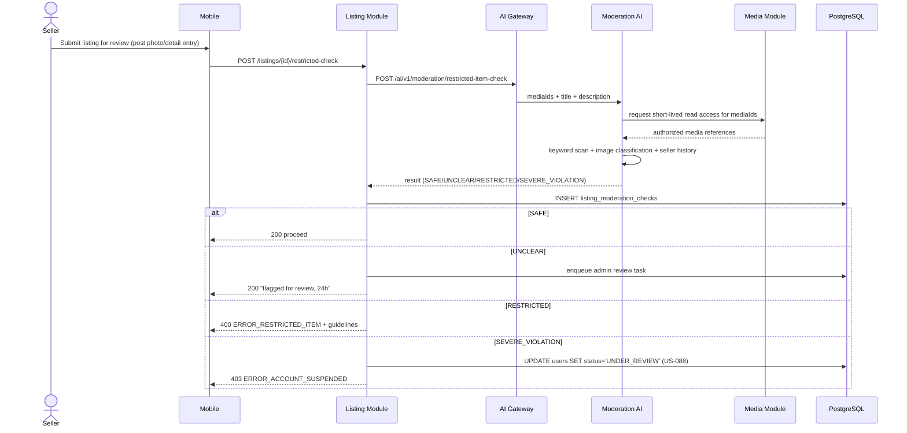

## D.7 Validation Rules & Error Codes

| Rule | Error Code | HTTP |
|---|---|---|
| Restricted category detected | `ERROR_RESTRICTED_ITEM` | 400 |
| Borderline/ambiguous → manual review | `LISTING_UNDER_REVIEW` (advisory) | 200 |
| Repeated/severe violation | `ERROR_ACCOUNT_SUSPENDED` | 403 |
| Seller appeals | `APPEAL_SUBMITTED` | 201 |
| AI Gateway unreachable | `ERROR_MODERATION_UNAVAILABLE` | 503 |

## D.8 Appeal Flow

`POST .../appeal` is only permitted when `result IN ('RESTRICTED', 'SEVERE_VIOLATION')` and no prior appeal exists for that check (`UNIQUE(moderation_check_id)` at the application layer). Appeals are queued to a senior-moderator queue (admin console delivered in Sprint 10, US-055's sibling); this story only owns appeal *submission* and status tracking, per the acceptance criteria's "Appeal submitted" message.

## D.9 Resilience: Fail-Closed, Not Fail-Open

This is the key resilience difference from US-005: **AI unavailability must not allow an unchecked listing to publish.** `AiGatewayClient.checkRestrictedItem` has no advisory fallback — a circuit-open or timeout condition surfaces as `503 ERROR_MODERATION_UNAVAILABLE`, and the listing remains blocked at the current step until the check can run. This matches [HLD §3.1](../HLD/04-AI-Architecture.md#31-ai-must-be-advisory-unless-business-rule-requires-blocking): "AI must never block listing creation" applies to *advisory* AI (US-005); restricted-item detection is explicitly the carved-out "business rule requires blocking" exception.

| Control | Value |
|---|---|
| Timeout | 8s (image classification is heavier than US-005's suggestion call) |
| Circuit breaker | Separate Resilience4j instance `moderationGateway` (does not share budget with `aiGateway`) |
| Fallback | None — fail closed, `503`, retry button shown to seller |

## D.10 Security & Compliance

- `matched_keywords` are stored but redacted (`***`) in application logs to avoid leaking exact bypass phrases into log aggregators accessible to a wider engineering audience than the moderation team.
- Account flagging (`flagAccountUnderReview`) writes to `listing_moderation_checks` and the `users` status column in the same transaction as the moderation check, ensuring an admin never sees a "severe violation" check without a corresponding account state change (audit consistency, feeds US-083 System Audit Trail in Sprint 10).

## D.11 As Built (2026-10, supersedes D.3 to D.9 where they differ)

**Approach.** The check is rule-based and database-driven, not a separate moderation AI call. The category (the seller's choice, else the AI vision classification of US-005) is mapped to a row of the JustQlic Restrictions sheet; whole words and phrases of the title and description are matched against a reviewed term list; and the US-005 classification call returns an optional `restrictionPolicyCode` for a Prohibited item visible in the photos. The strictest finding wins. There is no `POST /ai/v1/moderation/restricted-item-check` endpoint, no `moderationGateway` circuit breaker and no fail-closed 503: nothing external runs at check time. The only `valuex-ai` change is the extra field in the classification answer.

**Tables (Flyway `V18`).**

| Table | Purpose |
|---|---|
| `restriction_policies` | The 21 sheet rows: `code` (PK), `status` (`PROHIBITED`/`CONDITIONAL`), `default_severity`, English and Hindi title, message and CTA, `policy_version`, `active` |
| `restriction_terms` | Reviewed keywords: `term` (normalised), `policy_code`, `severity` (`RESTRICTED`/`SEVERE_VIOLATION`), `active`; unique on the active term |
| `category_restriction_policies` | L3 category code to Conditional policy code (all 37 Real Estate L3 plus 50 named categories; CAT-0204 and CAT-0742 have none) |
| `listing_moderation_checks` | One row per check: `result` (VARCHAR with check constraint: `SAFE`, `COMPLIANCE_REQUIRED`, `UNCLEAR`, `RESTRICTED`, `SEVERE_VIOLATION`), `source` (`AI`, `RULES`), `matched_policy_codes`, `matched_keywords`, `category_code`, `content_hash`, `policy_version`, `model_version`, admin fields |
| `listing_compliance_acceptances` | One row per policy the seller agreed to: listing, check, seller, category, `policy_code`, `policy_version`, `accepted_at` |
| `listing_moderation_appeals` | As D.3, with `status` as VARCHAR (`PENDING`, `UPHELD`, `OVERTURNED`) |
| `listing_ai_suggestions` (changed) | New `restriction_policy_code` and `media_hash` |

The loader (`RestrictionPolicyLoader`) fills the first three from `src/main/resources/restrictions/` at start-up; the policy version is the SHA-256 of the source files.

**Outcomes and API.** `POST /api/v1/listings/{listingId}/restricted-check` stores the check and answers `{checkId, result, policyVersion, policies[{code, status, title, titleHi, message, messageHi, ctaLabel, ctaLabelHi}], message}`:

| Result | HTTP | Meaning |
|---|---|---|
| `SAFE` | 200 | Seller continues |
| `COMPLIANCE_REQUIRED` | 200 | One popup with every row; `POST .../{checkId}/compliance-acceptance` with `{policyCodes}` records them |
| `RESTRICTED` | 400 `ERROR_RESTRICTED_ITEM` | Blocked; `data` still carries the check and the matched rows |
| `SEVERE_VIOLATION` | 403 `ERROR_ACCOUNT_SUSPENDED` | Blocked; the account moves to `UNDER_REVIEW` through `UserStateService.flagForReview(sellerId, null, reason)` |

Three blocked checks in 30 days (`valuex.moderation.blocked-checks-threshold`, `blocked-checks-window-days`) also flag the account. Other errors: `LISTING_NOT_FOUND` (404, also for another seller's listing), `LISTING_NOT_IN_DRAFT`, `ERROR_MIN_PHOTOS_REQUIRED`, `ERROR_CATEGORY_REQUIRED`, `MODERATION_CHECK_NOT_FOUND`, `ERROR_COMPLIANCE_NOT_APPLICABLE` (not the latest check, wrong result or content changed), `ERROR_COMPLIANCE_POLICIES_MISMATCH`, `ERROR_COMPLIANCE_ALREADY_ACCEPTED`, `ERROR_APPEAL_NOT_ALLOWED`, `ERROR_APPEAL_ALREADY_SUBMITTED`.

**Gate.** `RestrictedItemGate.requireCleared(listingId)` (for US-008 and US-009) passes only when the latest check was made on the listing's current content hash (title, description, category code, photos) and is `SAFE`, or `COMPLIANCE_REQUIRED` with every row accepted at the current policy version, or `UNCLEAR` approved by an admin, or blocked with an `OVERTURNED` appeal. Otherwise it throws `ERROR_RESTRICTED_CHECK_REQUIRED`, `ERROR_COMPLIANCE_ACCEPTANCE_REQUIRED`, `LISTING_UNDER_REVIEW`, `ERROR_RESTRICTED_ITEM` or `ERROR_ACCOUNT_SUSPENDED`.

**Logging.** Matched terms are stored but never logged; the log lines carry listing id, check id, result and source only.

---

# Part E - US-089: Lifecycle State - Listing

**Story Points:** 5 | **Repos:** valuex-backend
**Dependency:** US-004 (listings must exist to have a lifecycle)

## E.1 Story Overview

**As a** platform **I want** to track listing lifecycle states **so that** listing status determines visibility and actions. This story formalizes the `listing_status` enum (already stubbed in Part A §A.3) into a governed state machine with validated transitions, history logging, and visibility rules consumed by every other Sprint 2+ story that reads or writes listing status.

## E.2 Full State Set

Per [user-stories.md US-089](../user-stories.md#us-089-lifecycle-state---listing):

```text
DRAFT -> PLAN_SELECTION_PENDING -> PLAN_PAYMENT_PENDING -> {PLAN_PAYMENT_FAILED | PLAN_PAYMENT_SUCCESS}
PLAN_PAYMENT_SUCCESS -> TRUST_SAFETY_REVIEW -> {APPROVED | REVISION_REQUIRED | REJECTED}
REVISION_REQUIRED -> TRUST_SAFETY_REVIEW (review attempt 1 or 2 failed: the seller revises and resubmits without paying again)
REJECTED (third failed review attempt: final, the plan fee is refunded)
APPROVED -> PUBLISHED
PUBLISHED -> BUYER_INQUIRY_PENDING -> NEGOTIATION_IN_PROGRESS -> OFFER_ACCEPTED -> ORDER_CREATED -> SOLD
PUBLISHED -> EXPIRED | DEACTIVATED_BY_SELLER | REMOVED_BY_ADMIN
EXPIRED -> PLAN_SELECTION_PENDING (manual renewal only)
PLAN_PAYMENT_PENDING -> PLAN_SELECTION_PENDING (PAYMENT_TIMEOUT after 30 minutes, or RESELECT_PLAN before paying)
PLAN_PAYMENT_FAILED -> PLAN_SELECTION_PENDING (RESELECT_PLAN)
PUBLISHED -> TRUST_SAFETY_REVIEW (EDIT_FOR_REVIEW: major edit by the seller, US-010)
DRAFT | PLAN_SELECTION_PENDING | PLAN_PAYMENT_FAILED | REVISION_REQUIRED | EXPIRED -> DEACTIVATED_BY_SELLER (DELETE, US-010)
```

Note: Sprint 2's seller flow (updated 2026-10-16 to payment first, review before publishing) exercises: `DRAFT → PLAN_SELECTION_PENDING → PLAN_PAYMENT_PENDING → PLAN_PAYMENT_SUCCESS → TRUST_SAFETY_REVIEW → APPROVED → PUBLISHED`, plus the `REJECTED`/`REVISION_REQUIRED` branches. The listing is a `DRAFT` while photos, item details (US-114) and the restricted item check (US-007) happen, so `MEDIA_UPLOAD_PENDING`, `AI_DETAILS_GENERATED` and `PRICE_PENDING` stay in the enum but are not reachable in Sprint 2. States from `BUYER_INQUIRY_PENDING` onward are driven by Sprint 3/4 stories and are included here only so the enum and transition table are complete and forward-compatible — this LLD does not implement their triggering logic. The delivered implementation uses the in-code `ListingStateMachine` (see the US-089 implementation plan) in place of the `listing_status_transitions` table below; the allowed transitions are the same.

## E.3 Data Model

The `listing_status` enum was already defined in Part A §A.3. This story adds the governed transition table and enforcement:

> **Decided 2026-10-16:** the transitions are kept in code (`ListingStateMachine`) and statuses stay `VARCHAR`, so the `listing_status` enum and the `listing_status_transitions` table below are **not built**. The list is kept as the reference for the allowed moves. The only migration is a nullable `action` column on `listing_status_history` (V13).

```sql
-- V{N}__add_listing_status_transitions.sql
CREATE TABLE listing_status_transitions (
    from_status listing_status,   -- NULL = initial creation
    to_status listing_status NOT NULL,
    PRIMARY KEY (from_status, to_status)
);

INSERT INTO listing_status_transitions (from_status, to_status) VALUES
    (NULL, 'DRAFT'),
    ('DRAFT', 'PLAN_SELECTION_PENDING'),
    ('PLAN_SELECTION_PENDING', 'PLAN_PAYMENT_PENDING'),
    ('PLAN_PAYMENT_PENDING', 'PLAN_PAYMENT_FAILED'),
    ('PLAN_PAYMENT_PENDING', 'PLAN_PAYMENT_SUCCESS'),
    ('PLAN_PAYMENT_FAILED', 'PLAN_PAYMENT_PENDING'),
    ('PLAN_PAYMENT_FAILED', 'PLAN_SELECTION_PENDING'),
    ('PLAN_PAYMENT_SUCCESS', 'TRUST_SAFETY_REVIEW'),
    ('TRUST_SAFETY_REVIEW', 'APPROVED'),
    ('TRUST_SAFETY_REVIEW', 'REJECTED'),
    ('TRUST_SAFETY_REVIEW', 'REVISION_REQUIRED'),
    ('REVISION_REQUIRED', 'TRUST_SAFETY_REVIEW'),
    ('APPROVED', 'PUBLISHED'),
    ('PUBLISHED', 'SOLD'),
    ('PUBLISHED', 'EXPIRED'),
    ('PUBLISHED', 'DEACTIVATED_BY_SELLER'),
    ('PUBLISHED', 'REMOVED_BY_ADMIN'),
    ('EXPIRED', 'PLAN_SELECTION_PENDING');
-- (Sprint 3+ transitions BUYER_INQUIRY_PENDING..ORDER_CREATED added by those sprints' migrations)
```

`listing_status_history` (defined in Part A §A.3) records every actual transition; the whitelist is checked in code by `ListingStateMachine` before allowing one.

## E.4 Service Logic — Central Transition Guard

Every module that changes `listings.status` (Listing, Plan/Entitlement, Payment, Moderation) must go through this shared guard rather than issuing a raw `UPDATE`:

```java
@Service
@RequiredArgsConstructor
public class ListingLifecycleService {

    private final ListingRepository listingRepository;
    private final ListingStateMachine stateMachine;
    private final ListingStatusHistoryRepository historyRepository;
    private final DomainEventPublisher eventPublisher;

    /** changedBy is null for system actions (expiry, scheduled jobs). */
    @Transactional
    public Listing transition(UUID listingId, ListingState target, String action, UUID changedBy, String reason) {
        var listing = listingRepository.findByIdForUpdate(listingId) // SELECT ... FOR UPDATE
                .orElseThrow(() -> new NotFoundException("LISTING_NOT_FOUND", "Listing not found"));

        var from = listing.getStatus();
        // In-code ListingStateMachine; an invalid move raises the shared 400 INVALID_STATE_TRANSITION.
        stateMachine.transition(from, target, action);

        listing.setStatus(target);
        var saved = listingRepository.save(listing);
        // reason is trimmed to 255 characters; the history row also records the action
        historyRepository.save(ListingStatusHistory.builder()
                .listingId(listingId).fromStatus(from).toStatus(target)
                .changedBy(changedBy).action(action).reason(reason).build());
        eventPublisher.publish(new ListingStatusChangedEvent(this, listingId, from, target, action, changedBy, reason));
        return saved;
    }
}
```

`ListingStatusChangedEvent` extends `DomainEvent` (as `UserStateChangedEvent` does) and carries the listing ID, from, to, action, who changed it and the reason. Listeners must use `@TransactionalEventListener(phase = AFTER_COMMIT)`. Buyer visibility is defined in one place, `ListingState.isLiveForBuyers()` (`PUBLISHED` only), and `ListingState.isTerminal()` marks `SOLD`, `DEACTIVATED_BY_SELLER`, `REMOVED_BY_ADMIN` and `REJECTED`.

`findByIdForUpdate` (pessimistic row lock) prevents a race between, e.g., a seller-initiated delete (US-010) and an admin rejection (US-084) landing concurrently on the same listing.

## E.5 Visibility Rules (Business Rules from Acceptance Criteria)

| Rule | Enforcement Point |
|---|---|
| Cannot publish without successful plan payment | `TRUST_SAFETY_REVIEW` is reachable only from `PLAN_PAYMENT_SUCCESS` (or `REVISION_REQUIRED` after an earlier payment), and `PUBLISHED` only from `APPROVED`, per whitelist |
| Must pass `TRUST_SAFETY_REVIEW` before `PUBLISHED` | No whitelist row skips around review: `PUBLISHED` is reachable only from `APPROVED` |
| `PUBLISHED` listings visible in search | Search indexing (Sprint 3) subscribes to `ListingStatusChangedEvent`, indexes only when `toStatus == PUBLISHED`, de-indexes on any exit from `PUBLISHED` |
| `SOLD` listings archived | Search/listing read APIs filter `status NOT IN ('SOLD','EXPIRED','REMOVED_BY_ADMIN','DEACTIVATED_BY_SELLER')` by default |
| Expired listings not auto-renewed | No whitelist transition from `EXPIRED` back to `PUBLISHED`; only back to `PLAN_SELECTION_PENDING` (manual renew, modeled as a fresh plan purchase) |

## E.6 Sequence Diagram — Guarded Transition

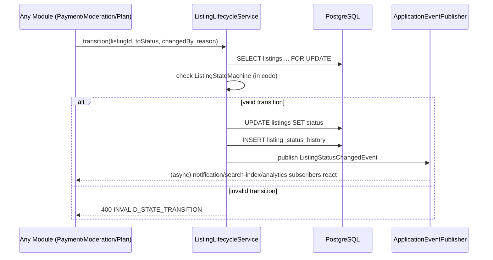

## E.7 Error Handling

| HTTP | Code | Trigger |
|---|---|---|
| 400 | `INVALID_STATE_TRANSITION` | attempted transition not allowed by `ListingStateMachine` (shared behaviour, decided 2026-10-16; replaces the 409 `INVALID_LISTING_STATE_TRANSITION` first drafted) |
| 404 | `LISTING_NOT_FOUND` | listingId doesn't exist |

## E.8 Observability & Audit

- Every row in `listing_status_history` is immutable (insert-only), feeding [US-083 System Audit Trail](../user-stories.md#us-083-system-audit-trail) (Sprint 10) without needing a separate audit hook in this story.
- Metric `listing_status_transition_total{from,to}` for funnel analysis (draft→published conversion rate).
- `ListingStatusChangedEvent` is the single integration point later sprints hook into (search indexing, notifications, analytics) — avoids each module polling `listings.status` directly.

---

# Part F - US-084: Pre-Publication Trust & Safety Review

**Story Points:** 5 | **Repos:** valuex-backend, valuex-ai
**Dependency:** US-007 (Restricted Items Prevention) — the narrower restricted-item gate has already passed before plan selection; US-009 — this review starts only after the plan payment has succeeded (`PLAN_PAYMENT_SUCCESS`), and publication happens only after approval

## F.1 Story Overview

> **As built (2026-10-31, built together with US-009):** the review auto-approves while AI is off. With no fraud score a listing that reaches the review is approved at once and recorded as `AUTO_APPROVED_NO_AI`; with `valuex.moderation.manual-review-enabled=true` it waits in the queue instead. The trusted-seller bypass still applies (no seller is trusted until ratings and orders exist: `SellerReputationPort` answers "no data"). Admin approve and reject are services (`TrustSafetyReviewService.approve`, `reject`, `requestRevision`) with no endpoints until the admin console (Sprint 10); the seller endpoints are `POST /api/v1/listings/{id}/trust-safety-review` (start, resubmit or read the outcome) and `POST .../appeal`. Migration `V21`. The AI path calls `AiGatewayClient.computeFraudScore` (`/ai/v1/listings/fraud-score`, own circuit breaker); that endpoint is not built yet, and the price score is omitted until the price-suggestion design exists. `categories_unrelated` no longer exists, so it is not a signal. Seller notifications are not sent here: `ListingReviewDecidedEvent` and the status change event are published for US-115.

**As a** platform **I want** all listings reviewed before publication **so that** prohibited items and fraud are prevented. The review runs **after the seller has paid for the listing plan and before the listing is published** (product owner decision, 2026-10-16). Where US-007 is a binary restricted-item gate, US-084 computes a holistic **fraud score** (image analysis, text analysis, price reasonableness, seller reputation) and routes based on a threshold: score < 70 auto-approves; score ≥ 70 queues for manual admin review within a 24-hour SLA. Trusted sellers (rating > 4.5, 50+ sales) bypass to auto-approval regardless of score.

## F.2 Scope

**In scope:** `POST /api/v1/listings/{id}/trust-safety-review` (orchestration, called when plan payment succeeds; transitions the listing via `ListingLifecycleService` from Part E), fraud score computation call, admin approve/reject endpoints, appeal flow, resubmission of a revised listing without a second payment.
**Out of scope:** Admin review console UI (Sprint 10, US-054), fraud/velocity scoring shared with post-publication monitoring (Sprint 9, US-052 — this story's score is listing-specific, not account-wide).

## F.3 Data Model

```sql
-- V{N}__add_trust_safety_review.sql
CREATE TABLE listing_trust_safety_reviews (
    id UUID PRIMARY KEY DEFAULT uuid_generate_v4(),
    listing_id UUID NOT NULL REFERENCES listings(id),
    attempt_number INTEGER NOT NULL DEFAULT 1, -- 1..3 per paid plan; a seller gets 3 review attempts
    fraud_score NUMERIC(5,2),                -- 0-100; null without an AI score (AI off or down, trusted-seller bypass)
    auto_decision VARCHAR(30) NOT NULL,      -- AUTO_APPROVED | AUTO_APPROVED_NO_AI | QUEUED_FOR_REVIEW | TRUSTED_SELLER_BYPASS
    review_reason VARCHAR(10) NOT NULL DEFAULT 'INITIAL', -- INITIAL | EDIT (an edit review never counts as an attempt and never refunds)
    sla_deadline TIMESTAMP,                  -- set when queued: created_at + valuex.moderation.review-sla-hours
    admin_id UUID,
    admin_decision VARCHAR(20),              -- APPROVED | REJECTED | REVISION_REQUESTED
    rejection_reason VARCHAR(500),
    score_breakdown JSONB,                   -- {imageScore, textScore, priceScore, reputationScore}; only the parts the AI gave
    reviewed_at TIMESTAMP,
    created_at TIMESTAMP NOT NULL DEFAULT CURRENT_TIMESTAMP
);
CREATE INDEX idx_trust_safety_review_listing ON listing_trust_safety_reviews(listing_id, created_at DESC);
CREATE INDEX idx_trust_safety_review_pending ON listing_trust_safety_reviews(sla_deadline)
    WHERE auto_decision = 'QUEUED_FOR_REVIEW' AND admin_decision IS NULL;
-- listing_trust_safety_appeals(review_id UNIQUE, seller_id, appeal_reason, status PENDING|UPHELD|OVERTURNED, resolver, timestamps)
```

## F.4 API Contract

```http
POST /api/v1/listings/{listingId}/trust-safety-review     -- seller-triggered (or auto-triggered on submit)
GET  /api/v1/admin/listings/review                          -- admin queue (owned jointly with US-054, Sprint 10)
POST /api/v1/admin/listings/{listingId}/approve
POST /api/v1/admin/listings/{listingId}/reject
```

Reject request:

```json
{ "reason": "Price 300% above comparable listings — possible scam" }
```

## F.5 Service Logic

```java
@Transactional
public TrustSafetyReviewResult review(UUID listingId) {
    var listing = listingRepository.findById(listingId)
            .orElseThrow(() -> new NotFoundException("LISTING_NOT_FOUND", "Listing not found"));
    lifecycleService.transition(listingId, ListingStatus.TRUST_SAFETY_REVIEW, listing.getSellerId(), "payment_succeeded_review_started");

    var seller = sellerReputationClient.getReputation(listing.getSellerId());
    if (seller.rating() > 4.5 && seller.completedSales() >= 50) {
        return approve(listingId, listing.getSellerId(), "TRUSTED_SELLER_BYPASS", null);
    }

    var score = aiGatewayClient.computeFraudScore(toFraudScoreRequest(listing)).join();
    var review = persistReview(listingId, score);

    if (score.total() < 70) {
        return approve(listingId, listing.getSellerId(), "AUTO_APPROVED", score);
    }
    reviewQueueRepository.enqueue(review.getId(), slaDeadline: Instant.now().plus(Duration.ofHours(24)));
    return TrustSafetyReviewResult.queued(review.getId());
}

private TrustSafetyReviewResult approve(UUID listingId, UUID sellerId, String decision, FraudScoreResponse score) {
    lifecycleService.transition(listingId, ListingStatus.APPROVED, sellerId, decision);
    return TrustSafetyReviewResult.approved(decision, score);
}
```

Admin approve/reject reuses `lifecycleService.transition(..., APPROVED|REJECTED, adminId, reason)`, guaranteeing the same audit trail (`listing_status_history`) whether approval was automated or manual. `APPROVED` is what triggers publication (Part I §I.5): the plan is already paid, so no further payment step follows. Each review that does not approve the listing is one failed attempt (`attempt_number` on `listing_trust_safety_reviews`); a seller gets at most **3 attempts** per paid plan. After attempt 1 or 2 the listing moves to `REVISION_REQUIRED`, the seller is notified with the reason, edits the listing (US-114 page) and resubmits it for review (`REVISION_REQUIRED → TRUST_SAFETY_REVIEW`) without paying again; the restricted item check (US-007) runs again before resubmission. After the 3rd failed attempt the listing moves to `REJECTED` (final), the seller is notified (`LISTING_REJECTED_FINAL`) and a `ListingRefundDueEvent` is published so the payment moves to `REFUND_REVIEW` (Part I). Whether the refund is then issued automatically or by finance is decided later (product owner, 2026-10-16).

## F.6 Sequence Diagram

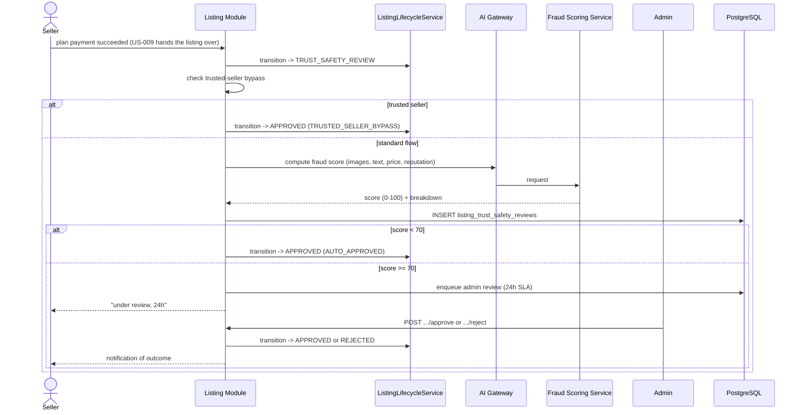

## F.7 Validation & Error Handling

| Condition | Code | HTTP |
|---|---|---|
| Listing under review | `LISTING_UNDER_REVIEW` | 200 (advisory) |
| Admin rejects (attempt 1 or 2) | `LISTING_REJECTED` | 200 (seller notified with `rejection_reason`; listing becomes `REVISION_REQUIRED`) |
| Admin rejects (attempt 3) | `LISTING_REJECTED_FINAL` | 200 (seller notified; listing becomes `REJECTED`; payment becomes `REFUND_REVIEW`) |
| Seller appeals rejection | `APPEAL_SUBMITTED` | 201 |
| Review SLA breach (>24h unresolved) | internal alert only, not user-facing error | n/a |
| AI fraud scoring unavailable | never an error and never a rejection: with manual review off the listing is approved as `AUTO_APPROVED_NO_AI` (recorded so it can be re-reviewed); with manual review on it is queued (`QUEUED_FOR_REVIEW`, `fraud_score` null) | 200 |

Appeals reuse the same `listing_moderation_appeals`-style pattern as Part D, but referencing `listing_trust_safety_reviews.id`; reviewed by a senior moderator per the acceptance criteria ("Appeals reviewed by senior moderator").

## F.8 Resilience

Unlike US-007 (hard fail-closed reject), a fraud-scoring outage here **queues for manual review** rather than blocking outright — the acceptance criteria explicitly describes a threshold-routing model, and manual review is always a safe fallback since a human will still gate publication. This is a deliberate difference from Part D's stricter behavior: US-007 blocks known-prohibited items outright (no human needed to say "no"), while US-084's fraud score is inherently probabilistic and better resolved by a human than by failing the entire submission.

## F.9 Observability

- Metric `trust_safety_review_queue_depth` and `trust_safety_review_sla_breach_total` — directly supports the "Manual review SLA: 24 hours" business rule.
- Metric `trust_safety_auto_approval_rate` vs `manual_review_rate` — capacity planning input for the admin moderation team (Sprint 10 dashboard, US-100).

---

# Part G - US-078: Listing Plan Features and Pricing

**Story Points:** 3 | **Repos:** valuex-backend, valuex-mobile
**Dependency:** US-004 (listing draft must exist to select a plan for it)

> **Update 2026-10-16 (dynamic plans and GST):** Plans, features and prices are data managed from the admin console (US-116), not fixed values, so the seed in §G.3 is only the starting catalog (Basic ₹49, original ₹99; no free plan; a plan whose price is set to zero is free). Plan codes carry no behavior. The catalog is read from `GET /api/v1/plans/seller` (cached, evicted on every admin save). Prices include GST for now: a `platform_settings` table (created with the `plans` table) holds `GST_MODE` (`INCLUSIVE` or `EXCLUSIVE`) and `GST_RATE_PERCENT`, and the catalog response adds `priceIncludesGst`, `gstRatePercent` and the GST part of the price. Plans have `display_order`, `badge` and a `version` column for concurrent edit checks. `FeaturedListingRotationService` and the `PLAN_EXPIRED` read check move to Sprint 3. When a seller selects a plan, US-008 copies the price, validity days and tax mode onto the listing, so later changes never alter existing listings or open payments.

> **As built (2026-10-17).** `V15__seller_plans.sql` creates `plans` and `platform_settings`. Differences from §G.3 and §G.4: `original_price` is nullable; `plans` also has `display_order`, `badge` (`POPULAR`, `BEST_VALUE`), `is_recommended`, `version` (JPA `@Version`) and timestamps, with checks on audience, prices (not negative) and validity (positive); `features` hold only the marketing lines (validity and support are shown separately, from `validity_days` and `support_level`); `support_level` is free text with the known values `AI_EMAIL`, `AI_EMAIL_CHAT`, `AI_EMAIL_CHAT_CALL`. `GET /api/v1/plans/seller` returns an array of plans with `code`, `name`, `originalPrice`, `discountedPrice`, `discountAmount`, `discountPercent`, `validityDays`, `supportLevel`, `features`, `badge`, `recommended`, `priceIncludesGst`, `gstRatePercent`, `gstAmount` and `totalAmount` (rupees, 2 decimals). Inclusive GST is the part of the price (`price × rate / (100 + rate)`); exclusive GST is added (`price × rate / 100`, total = price + GST). `PlanCatalogService.sellerPlans()` is cached in the `sellerPlans` cache (Redis, `spring.cache.redis.time-to-live: 1h`; in-memory in tests) and `evictCatalog()` clears it. `TaxSettingsService.current()` reads `GST_MODE` and `GST_RATE_PERCENT` and fails loudly when they are missing or invalid. The mobile Choose Listing Plan page (`ListingPlanScreen`) opens after Item Details and shows the cards and the breakdown; Review Listing is wired by US-008.

## G.1 Story Overview

**As a** seller **I want to** understand differences between listing plans **so that** I can choose the right plan for my item. This story is the read-only "plan catalog + pricing breakdown" step; the actual selection + payment flow is US-008/US-009. It owns the `plans`/`listing_plans` catalog data defined in [HLD §4.5 Plan & Entitlement Module](../HLD/02-Backend-Architecture.md#45-plan--entitlement-module).

## G.2 Scope

**In scope:** `GET /api/v1/plans/seller` (catalog with pricing/features), plan validity computation, Featured-listing rotation cap (max 20).
**Out of scope:** Payment processing (US-008/US-009), plan upgrade mid-validity (US-064, later sprint), buyer-side plans (US-079, Sprint 12).

## G.3 Data Model

```sql
-- V{N}__add_seller_plans.sql
CREATE TABLE plans (
    id UUID PRIMARY KEY DEFAULT uuid_generate_v4(),
    code VARCHAR(20) UNIQUE NOT NULL,   -- BASIC | BOOSTED | PRIORITY
    name VARCHAR(50) NOT NULL,
    audience VARCHAR(10) NOT NULL,      -- SELLER | BUYER
    original_price NUMERIC(10,2) NOT NULL,
    discounted_price NUMERIC(10,2) NOT NULL,
    validity_days INTEGER NOT NULL,
    support_level VARCHAR(20) NOT NULL, -- AI_EMAIL | AI_EMAIL_CHAT | AI_EMAIL_CHAT_CALL
    features JSONB NOT NULL,            -- ["Listed on top when searched", "Featured badge", ...]
    is_active BOOLEAN NOT NULL DEFAULT TRUE
);

INSERT INTO plans (code, name, audience, original_price, discounted_price, validity_days, support_level, features) VALUES
    ('BASIC', 'Basic', 'SELLER', 99, 49, 7, 'AI_EMAIL',
        '["Listed in chronological order", "7 days validity"]'),
    ('BOOSTED', 'Boosted', 'SELLER', 399, 149, 7, 'AI_EMAIL_CHAT',
        '["Listed on top when searched", "7 days validity"]'),
    ('PRIORITY', 'Priority', 'SELLER', 699, 249, 30, 'AI_EMAIL_CHAT_CALL',
        '["Boosted placement", "Featured on landing page", "Featured badge", "1 month validity"]');
```

`listings.plan_type` (Part A) stores the selected `plans.code` once purchased (US-008); this story only reads the catalog.

## G.4 API Contract

```http
GET /api/v1/plans/seller
```

```json
{
  "success": true,
  "data": [
    { "code": "BASIC", "name": "Basic", "originalPrice": 99, "discountedPrice": 49, "validityDays": 7,
      "supportLevel": "AI_EMAIL", "features": ["Listed in chronological order", "7 days validity"] },
    { "code": "BOOSTED", "name": "Boosted", "originalPrice": 399, "discountedPrice": 149, "validityDays": 7,
      "supportLevel": "AI_EMAIL_CHAT", "features": ["Listed on top when searched", "7 days validity"] },
    { "code": "PRIORITY", "name": "Priority", "originalPrice": 699, "discountedPrice": 249, "validityDays": 30,
      "supportLevel": "AI_EMAIL_CHAT_CALL", "features": ["Boosted placement", "Featured on landing page", "Featured badge", "1 month validity"] }
  ]
}
```

## G.5 Service Logic — Featured Rotation Cap

The only non-trivial business rule in this story is "Featured items shown max 20 on landing page (rotation basis)":

```java
@Service
@RequiredArgsConstructor
public class FeaturedListingRotationService {

    private static final int MAX_FEATURED_SLOTS = 20;
    private final ListingRepository listingRepository;

    // Called by the landing-page read API (owned by Sprint 3+ discovery module);
    // this service only computes eligibility, not the landing page itself.
    public List<UUID> currentFeaturedListingIds() {
        return listingRepository.findActivePriorityListingsOrderByPublishedAtAsc(PageRequest.of(0, MAX_FEATURED_SLOTS))
                .stream().map(Listing::getId).toList();
        // Oldest-published-first rotation: a new PRIORITY listing enters the
        // pool immediately but only surfaces once an older one ages out of
        // the top-20 window or expires — simplest fair rotation without a
        // separate scheduling job for Sprint 2.
    }
}
```

## G.6 Validation Rules & Error Codes

| Rule | Enforcement | Error Code |
|---|---|---|
| Validity starts from publication | `listings.expires_at` set by US-009 when the listing is published (after payment and approval), not at payment or catalog-read time | n/a (informational here) |
| Plan features non-transferable | No "transfer plan" endpoint exists | n/a |
| Max 20 featured on landing page | `FeaturedListingRotationService` | n/a (silent cap, not a user-facing error) |
| Payment required before plan activates | Enforced downstream in US-008/US-009 | `ERROR_PAYMENT_REQUIRED` |
| Plan expired | Read-path check when serving a listing whose `expires_at < now()` | `PLAN_EXPIRED` |

## G.7 NFR Notes

- `GET /api/v1/plans/seller` is cached (`@Cacheable`, Redis, 1-hour TTL) since plan catalog data changes infrequently (admin-managed, not implemented in Sprint 2) — avoids a DB round trip on every listing creation flow.
- Feature/price content is seeded via migration (§G.3), not hardcoded in the mobile client, so a future price change doesn't require an app release.

---

# Part H - US-008: Seller Chooses Listing Plan

**Story Points:** 5 | **Repos:** valuex-backend, valuex-mobile
**Dependency:** US-078 (plan catalog must exist); listing must be a `DRAFT` that has passed the restricted item check (US-007) and has complete item details (US-114) before plan selection, per the transition whitelist (Part E §E.3). The Trust & Safety review (Part F) runs **after** payment.

> **Update 2026-10-16 (gateway-neutral):** The payment gateway is not chosen. The payment port, sandbox adapter, `payments` and `payment_attempts` tables, callback handling, refund and checkout wrapper are now **US-117**; read `razorpayOrderId`, `razorpayKeyId` and the Razorpay SDK in this part as the gateway-neutral order ID, public key and checkout wrapper of US-117. This story keeps plan selection, the listing plan snapshot (`plan_price`, `plan_validity_days`, `plan_price_includes_gst` on `listings`) and the zero-price path (no payment, straight to `ListingPaymentCompletedHandler`). No logic depends on a plan being named Basic or being free.

## H.1 Story Overview

**As a** seller **I want to** choose a listing plan (Basic/Boosted/Priority) **so that** I can control visibility and reach. This story owns plan selection and payment initiation; **review and publication** after payment success belong to US-084 and US-009 — this separation matches the lifecycle split between `PLAN_PAYMENT_PENDING`/`PLAN_PAYMENT_SUCCESS` (this story), `TRUST_SAFETY_REVIEW` (US-084) and `PUBLISHED` (US-009, on approval).

## H.2 Scope

**In scope:** `POST /api/v1/listings/{id}/plan-selection`, Razorpay order creation for paid plans, immediate activation path for the free Basic plan, max-50-active-listings enforcement.
**Out of scope:** Payment webhook handling / publication (US-009), payment gateway integration details beyond order creation (shared infra also used by Escrow/Subscriptions per [HLD §21](../HLD/07-API-Integrations-Release-Risk.md#21-payment-gateway-integration)).

## H.3 Data Model

```sql
-- V{N}__add_listing_payments.sql
CREATE TABLE payments (
    id UUID PRIMARY KEY DEFAULT uuid_generate_v4(),
    reference_type VARCHAR(30) NOT NULL,   -- LISTING_PLAN | ORDER | SUBSCRIPTION (US-008 uses LISTING_PLAN)
    reference_id UUID NOT NULL,            -- listings.id for LISTING_PLAN
    gateway_order_id VARCHAR(255),
    amount NUMERIC(12,2) NOT NULL,
    status VARCHAR(50) NOT NULL DEFAULT 'PAYMENT_INITIATED',
    created_at TIMESTAMP NOT NULL DEFAULT CURRENT_TIMESTAMP
);
CREATE INDEX idx_payments_reference ON payments(reference_type, reference_id);

CREATE TABLE payment_attempts (
    id UUID PRIMARY KEY DEFAULT uuid_generate_v4(),
    payment_id UUID NOT NULL REFERENCES payments(id),
    gateway_transaction_id VARCHAR(255),
    status VARCHAR(50) NOT NULL,
    failure_reason VARCHAR(255),
    attempted_at TIMESTAMP NOT NULL DEFAULT CURRENT_TIMESTAMP
);
```

`payments.reference_type` is a discriminator reused by Sprint 5's `PAYMENT_ORDER` (US-021) and Sprint 12's `SUBSCRIPTION` (US-038) — this story only ever writes `LISTING_PLAN` rows, but the table is shaped so later sprints don't need a new payments table.

> **As built by US-117 (migration `V19__payments.sql`, replaces the sketch above).** `payments`: `id`, `reference_type`, `reference_id`, `payer_user_id` (FK `users`), `amount NUMERIC(12,2) > 0`, `currency` (`INR`), `status` (the `PaymentState` names, CHECK-constrained), `gateway_provider`, `gateway_order_id` (unique), `gateway_payment_id` (unique), `failure_reason`, `expires_at`, `version` (optimistic lock), `created_at`, `updated_at`. A partial unique index `uq_payments_open_reference` on (`reference_type`, `reference_id`) where status is `PAYMENT_INITIATED` or `PAYMENT_PENDING` allows one open payment per reference. `payment_attempts` adds `kind` (`CREATE_ORDER`, `CHECKOUT_RESULT`, `CALLBACK`, `STATUS_FETCH`). New tables: `payment_gateway_events` (unique `gateway_event_id`, `outcome`; no raw bodies) and `payment_refunds`. This story calls `PaymentService.createOrReuse(CreatePaymentCommand)` and gets a `PaymentCheckoutDetails` (`paymentId`, `orderId`, `amount` in rupees, `currency`, `publicKey`, `expiresAt`); read the plan-selection response's `razorpayOrderId` and `amount` (paise) as `orderId` and `amount` (rupees) from it. Callers react to `PaymentSucceededEvent` (with `late`) and `PaymentFailedEvent` (`reason` `FAILED`, `EXPIRED`, `SUPERSEDED`). A payment with no gateway configured answers `503 ERROR_GATEWAY_UNAVAILABLE`.

## H.4 API Contract

```http
POST /api/v1/listings/{listingId}/plan-selection
```

```json
{ "planCode": "BOOSTED" }
```

Free plan (`BASIC`) response — immediate:

```json
{ "success": true, "data": { "planCode": "BASIC", "paymentRequired": false, "listingStatus": "PLAN_PAYMENT_SUCCESS" } }
```

Paid plan response — redirect to gateway:

```json
{
  "success": true,
  "data": {
    "planCode": "BOOSTED", "paymentRequired": true,
    "razorpayOrderId": "order_xyz", "amount": 14900, "currency": "INR"
  }
}
```

> **As built by US-008 (migration `V20__listing_plan_snapshot.sql`).** `POST /api/v1/listings/{listingId}/plan-selection` takes `{ "planCode": "BOOSTED" }` and needs Aadhaar verification (`@RequiresIdentityVerification`, so an unverified seller gets `403 AADHAAR_VERIFICATION_REQUIRED`). The response is `{ planCode, paymentRequired, listingStatus, amount, payment }`: `amount` is in rupees and is the catalog price with GST added only in exclusive mode; `payment` is the US-117 `PaymentCheckoutDetails` (`paymentId`, `orderId`, `amount`, `currency`, `publicKey`, `expiresAt`) and is null for a plan priced at zero (then `listingStatus` is `PLAN_PAYMENT_SUCCESS` and `ListingPaymentCompletedHandler.onPaymentSuccess` is called). The price, validity and GST mode are copied to `listings.plan_price`, `plan_validity_days`, `plan_price_includes_gst` when the plan is chosen. Errors: `ERROR_INCOMPLETE_LISTING`, `ERROR_MIN_PHOTOS_REQUIRED`, `ERROR_MAX_LISTINGS_REACHED` (`valuex.listing.max-active-listings`, default 50, counting every status except `SOLD`, `EXPIRED`, `DEACTIVATED_BY_SELLER`, `REMOVED_BY_ADMIN`, `REJECTED`), `ERROR_PLAN_SELECTION_NOT_ALLOWED` (listing is past plan selection), `PLAN_NOT_FOUND` (404), the US-007 gate errors, and `ERROR_GATEWAY_UNAVAILABLE` (503, the whole selection is rolled back). The draft response now also carries `planCode`.

## H.5 Service Logic

```java
@Transactional
public PlanSelectionResult selectPlan(UUID listingId, UUID sellerId, String planCode) {
    var listing = requireOwnedListing(listingId, sellerId);
    if (listing.getStatus() != ListingStatus.DRAFT)
        throw new BusinessException("ERROR_INCOMPLETE_LISTING", "Complete all required fields before selecting plan");
    restrictedItemGate.requireCleared(listingId); // US-007 check passed for the current title, description and category

    long activeCount = listingRepository.countBySellerIdAndStatusIn(sellerId, ACTIVE_STATUSES);
    if (activeCount >= 50)
        throw new BusinessException("ERROR_MAX_LISTINGS_REACHED", "You've reached the maximum listing limit");

    var plan = planRepository.findByCodeAndAudience(planCode, "SELLER")
            .orElseThrow(() -> new NotFoundException("PLAN_NOT_FOUND", "Unknown plan"));

    lifecycleService.transition(listingId, ListingStatus.PLAN_SELECTION_PENDING, sellerId, "plan_selected:" + planCode);
    listing.setPlanType(plan.getCode());

    if (plan.getDiscountedPrice().signum() == 0) {
        lifecycleService.transition(listingId, ListingStatus.PLAN_PAYMENT_SUCCESS, sellerId, "free_plan_auto_success");
        return PlanSelectionResult.freeActivated(plan.getCode());
    }

    lifecycleService.transition(listingId, ListingStatus.PLAN_PAYMENT_PENDING, sellerId, "awaiting_payment");
    var order = paymentGatewayClient.createOrder(plan.getDiscountedPrice(), "INR",
            "LISTING_PLAN", listingId);
    paymentRepository.save(Payment.initiated("LISTING_PLAN", listingId, order.id(), plan.getDiscountedPrice()));
    return PlanSelectionResult.paymentRequired(plan.getCode(), order.id(), plan.getDiscountedPrice());
}
```

`ACTIVE_STATUSES` = every status except `SOLD, EXPIRED, DEACTIVATED_BY_SELLER, REMOVED_BY_ADMIN, REJECTED` — matches the "max 50 active listings" business rule's intent (drafts-in-progress count toward the cap to prevent seller spam-drafting).

## H.6 Sequence Diagram

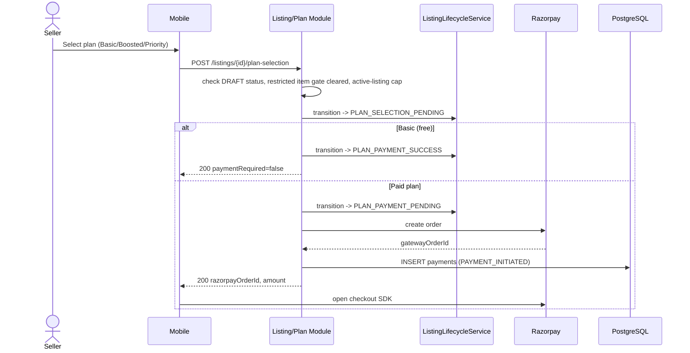

(Continued in Part I §I.5 — the Razorpay webhook / payment success callback that follows this order creation.)

## H.7 Validation Rules & Error Codes

| Rule | Error Code | Message |
|---|---|---|
| Draft must be complete and cleared by US-007 before plan selection | `ERROR_INCOMPLETE_LISTING` | "Complete all required fields before selecting plan" |
| Free plan requires no payment | n/a — handled by `signum() == 0` branch | — |
| Paid plans require successful payment before publishing | Enforced by lifecycle whitelist (Part E) — review is reachable only from `PLAN_PAYMENT_SUCCESS`, and `PUBLISHED` only from `APPROVED` | — |
| Max 50 active listings per seller | `ERROR_MAX_LISTINGS_REACHED` | "You've reached the maximum listing limit" |
| Payment fails | `ERROR_PAYMENT_FAILED` | "Payment unsuccessful. Please try again" |

## H.8 Edge Cases

| Edge Case | Handling |
|---|---|
| Seller cancels payment in Razorpay UI | Client calls no completion endpoint; listing remains `PLAN_PAYMENT_PENDING`; seller can re-open checkout for the same `gatewayOrderId` or re-select plan (new order created) |
| Seller closes app before payment | Same as above — `PLAN_PAYMENT_PENDING` is a durable, resumable state; a scheduled job (US-009 side) times out orders unpaid after 30 minutes back to `PLAN_SELECTION_PENDING` |
| Payment fails at gateway | Webhook (US-009) marks `payments.status = FAILED`; lifecycle transitions to `PLAN_PAYMENT_FAILED`; seller can retry plan selection |

---

# Part I - US-009: Listing Publication After Payment

**Story Points:** 5 | **Repos:** valuex-backend
**Dependency:** US-008 (plan selection + payment order must already be created)

> **Update 2026-10-16 (gateway-neutral):** The webhook endpoint, signature check (`X-Razorpay-Signature` in this part is the gateway's signature header), amount check, idempotency and payment settling are now **US-117**, which publishes `PaymentSucceededEvent` and `PaymentFailedEvent`. This story listens for those events for reference type `LISTING_PLAN`, owns the hand-over to review, the publish step, the refund flag and the recovery jobs, and sets `expires_at` from `published_at` plus the validity days snapshotted on the listing (not the current catalog value). A plan priced at zero follows the same hand-over without a payment. Migration order: V15 plans and settings (US-078, as built; the stories after it take the next free version at implementation time: payments (US-117), listing plan snapshot (US-008), review (US-084), `published_at` (US-009)).

## I.1 Story Overview

> **As built (2026-10-31, built together with US-084, after US-117 and US-008):** the code differs from the sketch in I.5. `ListingPaymentHandler` (implements US-008's `ListingPaymentCompletedHandler`) moves the listing to `PLAN_PAYMENT_SUCCESS` and runs `TrustSafetyReviewService.review`, each step in its own transaction (`RequiresNewTransaction`) and never throwing; US-008's zero-price call waits for its transaction to commit (it holds the listing row lock). `ListingPaymentResultListener` reacts to `PaymentSucceededEvent` and `PaymentFailedEvent` for `LISTING_PLAN` after commit: a late success continues the listing only when it still waits for payment and the amount equals the snapshot's expected amount (price, plus GST at the current rate when the snapshot excludes GST), otherwise `PaymentRefundService.requestRefund` flags it (`REFUND_REVIEW`, metric `payment.late.refund.review`). `ListingPublicationService` listens for the `APPROVED` status change, sets `published_at` and `expires_at` (once) and publishes. `ListingRefundDueListener` flags the plan fee through `requestRefund` (no gateway call). `ListingRecoveryJob` (every minute) retries stuck hand-overs, publications and reviews with no decision, and returns a listing waiting for a payment that is gone to plan selection after 30 minutes; the attempt count (5) is kept in memory, so a restart gives a stuck listing a fresh set, and exhaustion raises an alert (log `ALERT`, metric `listing.recovery.exhausted`) for finance. No notification is sent (US-115). Migration `V22` adds `published_at`. Mobile: the page `/sell/submitted` replaces the Home snackbar after a confirmed payment or a plan priced at zero.

**As a** seller **I want** my listing to be published immediately after successful payment **so that** buyers can discover it right away. Updated 2026-10-16 (payment first, then review, then publish): this story owns the Razorpay webhook, the hand-over to the Trust & Safety review (Part F) when payment succeeds, and the transactional publish operation that runs as soon as the review approves the listing. It also owns the recovery path when something fails after payment succeeds — a scenario the acceptance criteria explicitly calls out ("Payment succeeds but listing publish fails").

## I.2 Scope

**In scope:** `POST /api/v1/webhooks/payment` (Razorpay webhook per [HLD §21](../HLD/07-API-Integrations-Release-Risk.md#21-payment-gateway-integration)), idempotent payment-success handling with hand-over to the Trust & Safety review, idempotent publish transaction on approval, plan feature activation, recovery when the hand-over or the publish fails, review-pending and published notifications.
**Out of scope:** Escrow (unrelated payment domain, Sprint 5), the actual Razorpay checkout SDK integration on mobile (US-008's concern).

## I.3 Data Model

Extends `payments` (Part H §H.3):

```sql
-- V{N}__add_payment_webhook_idempotency.sql
ALTER TABLE payments ADD COLUMN webhook_processed_at TIMESTAMP;
ALTER TABLE payments ADD COLUMN gateway_payment_id VARCHAR(255);
CREATE UNIQUE INDEX uq_payments_gateway_payment_id ON payments(gateway_payment_id) WHERE gateway_payment_id IS NOT NULL;
-- Guarantees a duplicate webhook delivery for the same gateway_payment_id
-- cannot be processed twice (defends ERROR_DUPLICATE_PAYMENT).
```

## I.4 API Contract

```http
POST /api/v1/webhooks/payment
X-Razorpay-Signature: <hmac>
```

```json
{ "event": "payment.captured", "payload": { "payment": { "id": "pay_abc", "order_id": "order_xyz", "amount": 14900 } } }
```

Response: always `200` (per Razorpay webhook contract — non-200 triggers gateway retries); actual business outcome is asynchronous from the webhook caller's perspective.

## I.5 Service Logic — Idempotent Publish with Rollback

```java
@Service
@RequiredArgsConstructor
public class PaymentWebhookService {

    private final PaymentRepository paymentRepository;
    private final ListingLifecycleService lifecycleService;
    private final ListingRepository listingRepository;
    private final PaymentGatewayClient paymentGatewayClient;
    private final NotificationService notificationService;

    @Transactional
    public void handlePaymentCaptured(String razorpayPaymentId, String razorpayOrderId, BigDecimal amount) {
        var payment = paymentRepository.findByGatewayOrderId(razorpayOrderId)
                .orElseThrow(() -> new BusinessException("PAYMENT_NOT_FOUND", "No matching payment order"));

        if (payment.getWebhookProcessedAt() != null) {
            return; // idempotent no-op: duplicate webhook delivery (ERROR_DUPLICATE_PAYMENT avoided silently)
        }
        payment.setGatewayPaymentId(razorpayPaymentId);
        payment.setStatus("PAYMENT_SUCCESS");
        payment.setWebhookProcessedAt(Instant.now());
        paymentRepository.save(payment);

        var listingId = payment.getReferenceId();
        lifecycleService.transition(listingId, ListingStatus.PLAN_PAYMENT_SUCCESS, null, "payment_captured");
        try {
            trustSafetyReviewService.review(listingId); // PLAN_PAYMENT_SUCCESS -> TRUST_SAFETY_REVIEW (Part F)
            notificationService.notifySeller(listingId, "LISTING_UNDER_REVIEW");
        } catch (Exception e) {
            // The payment record and PLAN_PAYMENT_SUCCESS are already committed; a reconciliation job
            // retries the hand-over for listings stuck in PLAN_PAYMENT_SUCCESS and raises an alert.
            log.error("Review hand-over failed after successful payment, listingId={}", listingId, e);
        }
    }

    /** Runs when Part F approves the listing (ListingStatusChangedEvent with toStatus = APPROVED). */
    @Transactional
    public void publishApprovedListing(UUID listingId) {
        try {
            var listing = listingRepository.findById(listingId).orElseThrow();
            var plan = planRepository.findByCode(listing.getPlanType()).orElseThrow();
            listing.setExpiresAt(Instant.now().plus(Duration.ofDays(plan.getValidityDays()))); // validity starts from publication
            lifecycleService.transition(listingId, ListingStatus.PUBLISHED, null, "auto_publish_on_approval"); // plan features go live
            notificationService.notifySeller(listingId, "LISTING_PUBLISHED");
        } catch (Exception e) {
            // The listing stays APPROVED and is paid for; a retry job publishes it. If it cannot be published
            // after the retries, an alert is raised and finance refunds the payment manually.
            log.error("Publish failed after approval, listingId={}", listingId, e);
        }
    }

    /** Runs when Part F rejects the listing for the third time (ListingRefundDueEvent). */
    @Transactional
    public void startRefundReview(UUID listingId) {
        var payment = paymentRepository.findByReferenceTypeAndReferenceId("LISTING_PLAN", listingId).orElseThrow();
        payment.setStatus("REFUND_REVIEW"); // existing PaymentState.REFUND_REVIEW; whether the refund is issued automatically or manually is decided later
        paymentRepository.save(payment);
        notificationService.notifySeller(listingId, "LISTING_REFUND_DUE");
    }
}
```

Webhook signature verification (`X-Razorpay-Signature` HMAC check) happens in the controller layer before this service method is ever invoked, per [HLD §21](../HLD/07-API-Integrations-Release-Risk.md#21-payment-gateway-integration) — an unverified webhook body is rejected with `401` before touching any listing state.

## I.6 Sequence Diagram

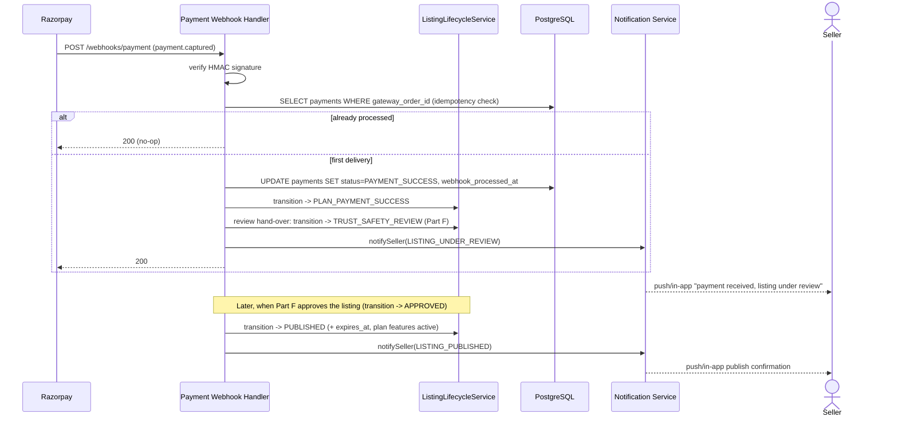

## I.7 Validation Rules & Error Codes

| Rule | Error Code | Detail |
|---|---|---|
| Payment must be confirmed before review and publishing | Webhook-driven only; no client-triggered publish endpoint exists; review starts only from `PLAN_PAYMENT_SUCCESS` and publication only from `APPROVED` | — |
| Listing stays safe if the review hand-over or the publish fails after payment | `handlePaymentCaptured` keeps `PLAN_PAYMENT_SUCCESS` and `publishApprovedListing` keeps `APPROVED`; retry jobs complete the step; unrecoverable cases are refunded manually | `ERROR_PUBLISH_FAILED`: "Payment successful but listing failed to publish. Refund initiated" (shown only if the refund is issued) |
| Duplicate payment for same listing | `uq_payments_gateway_payment_id` + `webhookProcessedAt` idempotency guard | `ERROR_DUPLICATE_PAYMENT` (silently absorbed, not surfaced as user error) |
| Plan activation within 5 minutes of approval | Publication runs synchronously on the approval event and typically completes in milliseconds; SLA is a monitoring target (`payment_to_publish_latency_ms` metric, which now also includes the review time), not a hard timeout in code |
| Network interruption after payment | Razorpay retries webhook delivery on non-2xx/timeout; idempotency guard makes retries safe |

## I.8 Resilience & Consistency

- Payment-success handling and the review hand-over are separate steps from publication. The payment record and the `PLAN_PAYMENT_SUCCESS` transition commit in their own transaction, so the record of successful payment survives even if the hand-over to review fails; a reconciliation job retries the hand-over for listings stuck in `PLAN_PAYMENT_SUCCESS`. Publication is triggered by the `APPROVED` event in its own transaction; if it fails the listing stays `APPROVED` and a retry job publishes it. A listing that is rejected in review is not published and is not charged again: the seller edits it and resubmits it for review (Part F §F.5), up to 3 review attempts in total. After the third failed attempt Part F publishes a `ListingRefundDueEvent`, `startRefundReview` moves the payment to `REFUND_REVIEW` and tells the seller, and the refund itself (automatic or manual) is decided later. Plan validity (`expires_at`) starts when the listing is published, so review time and revision time do not use up the seller's plan.
- Refund calls to Razorpay are themselves idempotent on `razorpayPaymentId` (gateway-side guarantee); a retry of the rollback path (e.g., after an app restart mid-handling) won't double-refund.

## I.9 Observability & Security

- Metric `payment_to_publish_latency_ms` — supports the "within 5 minutes" business rule as a monitored SLA rather than an enforced timeout.
- Metric `listing_publish_failure_total` with alerting — a non-zero rate here means seller-facing refunds are happening, which is both a UX and a finance concern worth paging on.
- Webhook endpoint is otherwise unauthenticated (no seller JWT — it's a server-to-server callback) and relies entirely on HMAC signature verification; rate-limited at the API Gateway to blunt replay/flood attempts even though replays are already idempotent.

---

# Part J - US-010: Edit/Delete Listing

> **Update (2026-10-25, category taxonomy):** A change of the L3 category is a major edit (re-moderation) and deletes attribute values that are not in the new category's schema (Part C); metadata edits follow the category schema; the price maximum is ₹10,00,00,000.

**Story Points:** 5 | **Repos:** valuex-backend, valuex-mobile
**Dependency:** US-009 (only published listings are meaningfully editable/deletable in the ways this story's acceptance criteria describe, though the same endpoints also serve editing a `DRAFT`/`REVISION_REQUIRED` listing per Part A/F)

## J.1 Story Overview

**As a** seller **I want to** edit or delete my listings **so that** I can keep information accurate and remove sold items. Edits to a `PUBLISHED` listing are either **minor** (applied immediately) or **major** (price change >20% or category change — require re-moderation, looping back through Part F's Trust & Safety review). Deletion is blocked whenever the listing has active orders, pending payment, or open disputes.

## J.2 Scope

**In scope:** `PATCH /api/v1/listings/{id}` (edit, reused by every earlier story's "final values" step), `DELETE /api/v1/listings/{id}` (soft delete), edit-history logging, active-viewer notification hook.
**Out of scope:** Order/dispute domain logic itself (Sprints 5/7/8) — this story only *queries* their existence via a port interface to decide whether deletion is allowed.

## J.3 Data Model

```sql
-- V{N}__add_listing_edit_history.sql
CREATE TABLE listing_edit_history (
    id UUID PRIMARY KEY DEFAULT uuid_generate_v4(),
    listing_id UUID NOT NULL REFERENCES listings(id),
    edited_by UUID NOT NULL,
    changed_fields JSONB NOT NULL,   -- {"price": {"from": 30000, "to": 42000}, ...}
    requires_remoderation BOOLEAN NOT NULL DEFAULT FALSE,
    edited_at TIMESTAMP NOT NULL DEFAULT CURRENT_TIMESTAMP
);

ALTER TABLE listings ADD COLUMN deleted_at TIMESTAMP;
ALTER TABLE listings ADD COLUMN deleted_by UUID;
-- Soft delete: row retained 90 days (acceptance criteria), purge job is a
-- separate ops concern, not implemented in this story.
```

## J.4 API Contract

```http
PATCH /api/v1/listings/{listingId}
```

```json
{ "title": "Apple iPhone 13 128GB", "price": 34000, "description": "..." }
```

```http
DELETE /api/v1/listings/{listingId}
```

Blocked response:

```json
{ "success": false, "error": { "code": "ERROR_CANNOT_DELETE_ACTIVE_ORDER", "message": "Cannot delete listing with active orders" } }
```

## J.5 Service Logic

```java
@Transactional
public EditListingResult edit(UUID listingId, UUID sellerId, EditListingRequest req) {
    var listing = requireOwnedListing(listingId, sellerId);

    var changedFields = diffChangedFields(listing, req);
    boolean majorEdit = isCategoryChange(changedFields)
            || isPriceChangeOverThreshold(listing.getPrice(), req.price(), 0.20);

    applyFields(listing, req);
    listingRepository.save(listing);
    editHistoryRepository.save(new ListingEditHistory(listingId, sellerId, changedFields, majorEdit));

    List<String> warnings = new ArrayList<>();
    if (activeViewerTracker.hasActiveViewers(listingId)) {
        warnings.add("WARNING_BUYERS_WILL_BE_NOTIFIED");
        notificationService.notifyActiveViewers(listingId, "LISTING_UPDATED");
    }

    if (majorEdit && listing.getStatus() == ListingStatus.PUBLISHED) {
        lifecycleService.transition(listingId, ListingStatus.TRUST_SAFETY_REVIEW, sellerId, "major_edit_remoderation");
        // Re-enters Part F's review flow; listing is temporarily de-listed from search until re-approved.
    }
    return new EditListingResult(listing.getId(), majorEdit, warnings);
}

@Transactional
public void delete(UUID listingId, UUID sellerId) {
    var listing = requireOwnedListing(listingId, sellerId);

    if (orderQueryPort.hasActiveOrders(listingId))
        throw new BusinessException("ERROR_CANNOT_DELETE_ACTIVE_ORDER", "Cannot delete listing with active orders");
    if (orderQueryPort.hasPendingPayment(listingId))
        throw new BusinessException("ERROR_CANNOT_DELETE_ACTIVE_ORDER", "Cannot delete listing with active orders");
    if (disputeQueryPort.hasOpenDispute(listingId))
        throw new BusinessException("ERROR_CANNOT_DELETE_ACTIVE_ORDER", "Cannot delete listing with active orders");

    listing.setDeletedAt(Instant.now());
    listing.setDeletedBy(sellerId);
    lifecycleService.transition(listingId, ListingStatus.DEACTIVATED_BY_SELLER, sellerId, "seller_deleted");
    listingRepository.save(listing);
}
```

`orderQueryPort` / `disputeQueryPort` are interfaces implemented by the Order and Dispute modules once those sprints land (Sprint 5/8) — in Sprint 2 they resolve to trivial "always false" adapters since no orders/disputes exist yet, but the port boundary is defined now so US-010 doesn't need rework later ([HLD §5](../HLD/02-Backend-Architecture.md#5-spring-boot-package-structure) module boundaries).

## J.6 Sequence Diagram — Major Edit Triggering Re-Moderation

```mermaid
sequenceDiagram
    actor Seller
    participant Mobile
    participant Backend as Listing Module
    participant Lifecycle as ListingLifecycleService
    participant DB as PostgreSQL
    participant Viewers as Active Viewers

    Seller->>Mobile: Edit price from 30000 -> 42000 (+40%)
    Mobile->>Backend: PATCH /listings/{id}
    Backend->>Backend: diff fields, detect >20% price change -> majorEdit=true
    Backend->>DB: UPDATE listings + INSERT listing_edit_history
    Backend->>Viewers: notify (WARNING_BUYERS_WILL_BE_NOTIFIED)
    Backend->>Lifecycle: transition PUBLISHED -> TRUST_SAFETY_REVIEW
    Note over Lifecycle: Re-enters Part F flow; listing de-listed from search until re-approved
    Backend-->>Mobile: 200 { majorEdit: true, warnings: [...] }
```

## J.7 Validation Rules & Error Codes

| Rule | Error Code | Message |
|---|---|---|
| Cannot delete with active orders/pending payment/open disputes | `ERROR_CANNOT_DELETE_ACTIVE_ORDER` | "Cannot delete listing with active orders" |
| Price change >20% requires re-moderation | not a hard error — routes to `TRUST_SAFETY_REVIEW` | `WARNING_PRICE_CHANGE_TOO_HIGH`-style informational banner: "Price change >20% requires admin approval" |
| Edit history maintained for audit | `listing_edit_history` insert on every `PATCH` | — |
| Deleted listings retained 90 days | Soft delete via `deleted_at`; hard purge is a separate scheduled ops job, out of scope | — |
| Active viewers notified of changes | `activeViewerTracker` + `notificationService.notifyActiveViewers` | `WARNING_BUYERS_WILL_BE_NOTIFIED` |

## J.8 Edge Cases

| Edge Case | Handling |
|---|---|
| Edit during active negotiation | Out of scope for Sprint 2 (negotiations don't exist until Sprint 4, US-017); `orderQueryPort`-style port reserved for a future `negotiationQueryPort` |
| Delete while buyer is viewing | `activeViewerTracker.hasActiveViewers` check fires the notification warning; deletion itself is not blocked by viewership alone (only by orders/payments/disputes) |
| Seller changes item drastically (different item) | Treated as a major edit if category changes; title/description-only changes without a category or >20% price change are minor and don't trigger re-moderation — acceptable per acceptance criteria, which only names category/price as major-edit triggers |
| Edit violates new platform policies | Re-moderation path (Part F) catches this on the next major edit; policy violations on a minor-only edit are not proactively re-scanned in this story (would require scanning every `PATCH`, out of scope for 5 SP) |

## J.9 NFR & Security

- `requireOwnedListing` (shared helper, first defined in Part A §A.5) is reused here — no new ownership-check code path, reducing IDOR risk surface.
- `listing_edit_history.changed_fields` stores only field-level diffs (not full before/after snapshots) to keep the audit table lightweight while still satisfying "edit history maintained for audit."
- Soft-delete (`deleted_at`) rather than hard `DELETE` ensures `listing_status_history` and `listing_edit_history` foreign keys remain valid and the 90-day retention requirement is trivially satisfiable by a scheduled purge job outside this story's scope.


