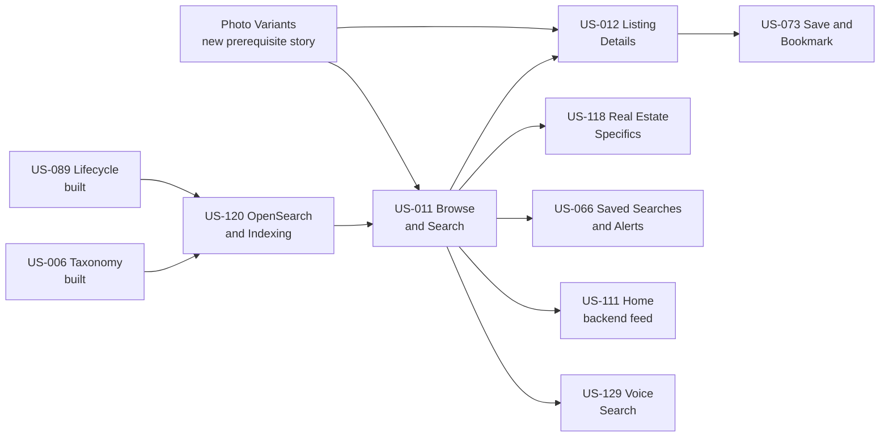
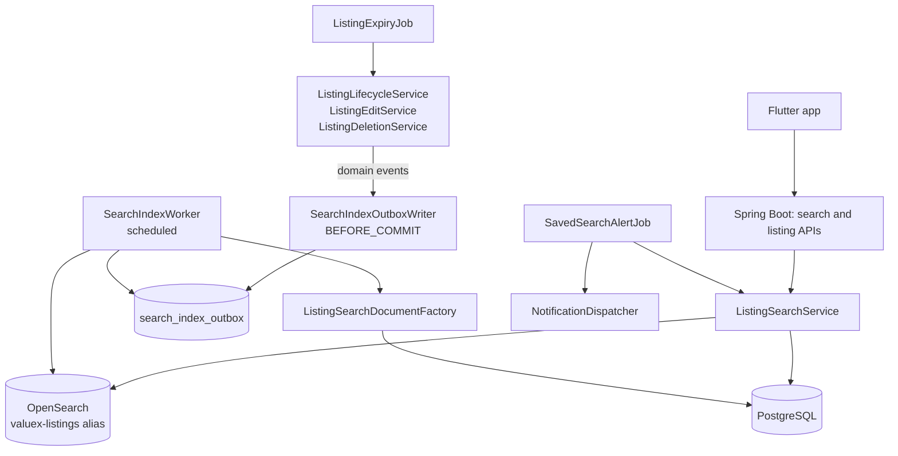
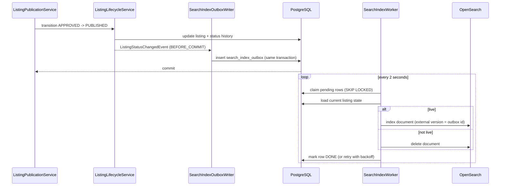
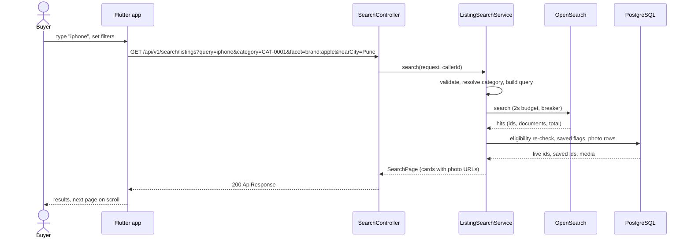
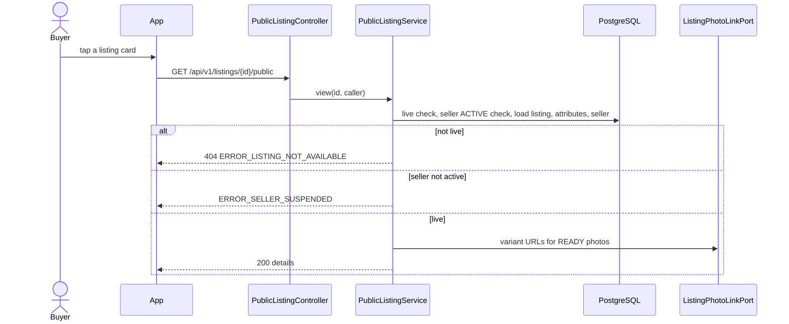
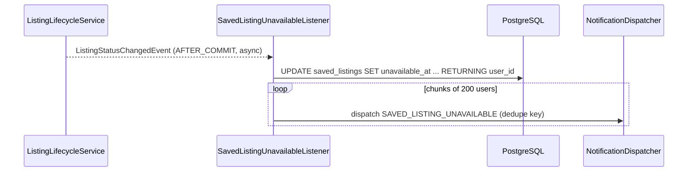
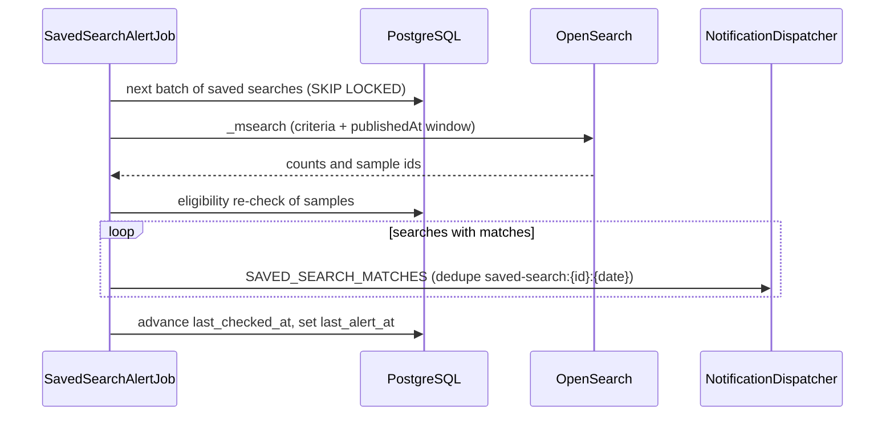
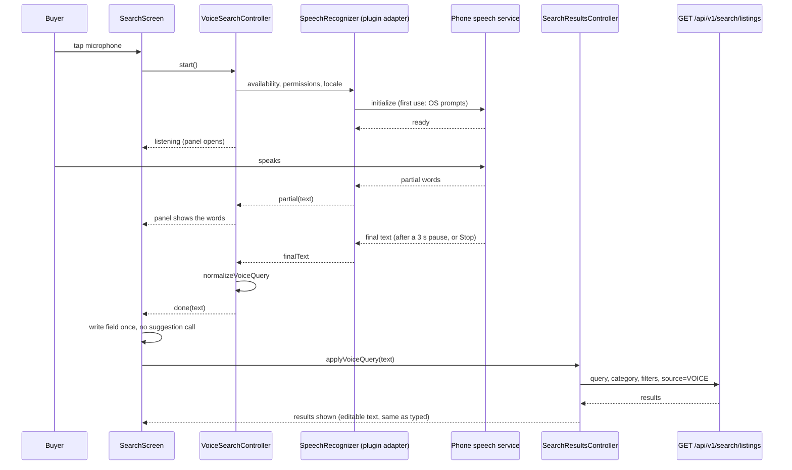

# Low Level Design - Sprint 3: Discovery & Search

**Document Version:** 1.3 (1.0 final design approved by the product owner on 2026-11-09; Part I, Voice Search, added 2026-11-11 and awaiting the product owner's confirmation of V1 to V8; not implemented. Part C public field projection and US-012 save control deferral approved on 2026-11-12 with the US-012 plan.)
**Product:** ValueX
**Sprint:** Sprint 3 - Discovery & Search
**Stories Covered:** US-120, US-011, US-012, US-073, US-118, US-066, US-111 (backend feed; the mobile page is already built on a mock repository), one new prerequisite story, Listing Photo Variants (Part H, US-128), and one new story, Voice Search (Part I, US-129)
**Repos:** valuex-backend, valuex-mobile, infra (OpenSearch in `docker-compose.yml` and CI). `valuex-ai` is not touched.
**Sprint Goal:** Enable buyers to discover items: fast keyword, filter and category search over published listings, listing details, saved items, saved searches with alerts, and a Home page served by real endpoints.

**Change Log:**

| Version | Date | Change |
|---|---|---|
| 0.1 | Nov 2026 | First draft of all seven stories. Decided by the product owner on 2026-11-09: city and state level location (no coordinates); hosting-neutral OpenSearch; in-app saved-search alerts with push later; one ranking for Home and search; US-120 owns the listing expiry sweep. Proposed defaults that still need confirmation are listed in section 9. |
| 0.2 | Nov 2026 | Product owner answers applied: property and goods never mixed (D6), own listings excluded (D7), saved-item retention is an Admin-managed setting, default 90 days (D8), and buyer photos use thumbnail, card, detail and zoom variants (D9). Found that the variant tables and CDN mapping exist but nothing generates variants, so a new prerequisite story is added (Part H). Items 5 and 6 of the previous list (Real Estate close action, ranking numbers) are explained with a recommendation in section 9.3. |
| 1.1 | Nov 2026 | Added Part I (US-129 Voice Search, 5 SP proposed), based on the tentative design in `VoiceSearchTentativeDesignByChatGPT.md`: native speech recognition on the phone fills the existing search box, one optional `source` query parameter and metric tags on the search API, no new endpoint, table or Admin setting. Decisions V1 to V8 (section 9.5) are recommendations awaiting the product owner. B.4 and sections 8 and 9 are updated. Parts A to H are unchanged. |
| 1.2 | Nov 2026 | US-012 public attribute projection is explicitly separate from the US-123 owner preview response. A new `PublicListingFieldProjector` derives buyer-visible values from the stored category schema and excludes owner-only preview context. Approved by the user on 2026-11-12 with the US-012 plan. |
| 1.3 | Nov 2026 | US-012 does not show or mutate a save/heart control before US-073. Its `saved` response field is `false` until US-073 supplies real saved state. Approved by the user on 2026-11-12 with the US-012 plan revision. |
| 1.0 | Nov 2026 | **Final.** All recommendations and proposals accepted (section 9.1, D1 to D19). Every business number is an Admin-managed setting (new section 1.6): ranking weights, search limits, saved-item and saved-search limits, retention, alert time, Home limits and rate limits. Deployment-only values (timeouts, batch sizes, image sizes) stay configuration. |

**Reference Documents:**
- [Sprint-plan.md](../Sprint-plan.md) - Sprint 3 section
- [user-stories.md](../user-stories.md) - US-120, US-011, US-012, US-073, US-118, US-066, US-111, US-128, US-129
- [Voice Search tentative design](../VoiceSearchTentativeDesignByChatGPT.md) - input to Part I (adapted, see I.3)
- [HLD Part 1 - High Level Architecture](../HLD/01-High-Level-Architecture.md)
- [HLD Part 2 - Backend Architecture](../HLD/02-Backend-Architecture.md) - §4.4 Search Module
- [HLD Part 3 - Data Architecture](../HLD/03-Data-Architecture.md) - §6 OpenSearch Design (listing index and ranking strategy)
- [HLD Part 5 - Frontend Architecture](../HLD/05-Frontend-Architecture.md) - Home and search screens
- [HLD Part 6 - Security, Deployment & DevOps](../HLD/06-Security-Deployment-DevOps.md) - OpenSearch cluster, no PII in the index
- [HLD Part 7 - API Integrations, Release & Risk](../HLD/07-API-Integrations-Release-Risk.md) - §6 Search APIs, Saved Searches
- [LLD Sprint 2](Sprint-2-Seller%20Listing%20Creation-LLD.md) - Part C (taxonomy), Part E (lifecycle and events), Part G (plans), Part I (publication), Part J (edit and delete), Part L (preview projection)
- [valuex-mobile/docs/Flutter-Design-System.md](../../valuex-mobile/docs/Flutter-Design-System.md)
- [CODING_STANDARDS.md](../CODING_STANDARDS.md)

---

## Sprint 3 Story Map & Dependency Order



Build order: US-120 and Photo Variants (Part H, in parallel), US-011, US-012, US-073, US-118, US-066, US-111, US-129 (Voice Search only needs US-011 and can run in parallel with any of the later stories). Photo Variants is not a hard blocker: until it is done, photo URLs fall back to a signed link to the original (section 1.4). US-111 and US-066 only need US-011 and can run in parallel with US-012 once US-011 is merged.

This document has one self-contained part per story, in build order. Part A also defines the shared pieces that later parts reuse by reference: the search module layout, the listing card, listing photo URLs (thumbnail, card, detail and zoom variants), the location normaliser and the ranking.

## Master Table of Contents

- [1. Sprint 3 Architecture Overview](#1-sprint-3-architecture-overview)
- [Part A - US-120: OpenSearch Setup and Listing Indexing](#part-a---us-120-opensearch-setup-and-listing-indexing)
- [Part B - US-011: Browse and Search Listings](#part-b---us-011-browse-and-search-listings)
- [Part C - US-012: View Listing Details](#part-c---us-012-view-listing-details)
- [Part D - US-073: Save and Bookmark Listings](#part-d---us-073-save-and-bookmark-listings)
- [Part E - US-118: Real Estate Listing Specifics](#part-e---us-118-real-estate-listing-specifics)
- [Part F - US-066: Saved Searches and Alerts](#part-f---us-066-saved-searches-and-alerts)
- [Part G - US-111: Home Page](#part-g---us-111-home-page)
- [Part H - Prerequisite: Listing Photo Variants (new story)](#part-h---prerequisite-listing-photo-variants-new-story)
- [Part I - US-129: Voice Search](#part-i---us-129-voice-search)
- [8. Sprint 3 Cross-Cutting Notes](#8-sprint-3-cross-cutting-notes)
- [9. Decisions, Conflicts and Open Items](#9-decisions-conflicts-and-open-items)

---

# 1. Sprint 3 Architecture Overview

## 1.1 Principles

1. **PostgreSQL is the source of truth; OpenSearch is a rebuildable read model.** The index can be dropped and rebuilt from PostgreSQL at any time. Nothing is stored only in OpenSearch.
2. **Publication never depends on OpenSearch.** Listing changes write a row to a PostgreSQL outbox in the same transaction; a worker updates the index afterwards (HLD 02 and US-120).
3. **Eligibility is rechecked in PostgreSQL.** The index can lag by seconds, so every search page is filtered through one indexed PostgreSQL check before it is returned (HLD: "PostgreSQL remains authoritative for listing eligibility").
4. **No PII in the index.** No address line, pincode, phone, email or seller name (US-120, HLD 06).
5. **Existing conventions are reused:** `ApiResponse` envelope, `BusinessException`/`NotFoundException` codes, `DomainEventPublisher` and `@TransactionalEventListener`, programmatic Resilience4j (as in `AiGatewayConfig`), `ValuexProperties` for configuration, Flyway migrations, and the scheduled-job style of `SuspendedAccountAutoLiftJob`.

## 1.2 Component View



## 1.3 Package Additions (modular monolith, same layering as `auth` and `notification`)

```text
com.valuex.search
  api/            SearchController, SavedSearchController, HomeController, InternalSearchController
  application/
    dto/          SearchRequest, SearchPage, ListingCard, FacetGroup, SavedSearchRequest, SavedSearchResponse, HomePromo, ...
    port/         ListingSearchPort, ListingIndexSourcePort, ListingPhotoLinkPort
    service/      ListingSearchService, SearchRequestValidator, SearchQueryBuilder, ListingEligibilityFilter,
                  SearchIndexWorker, SearchIndexOutboxWriter, ListingSearchDocumentFactory, SearchReindexService,
                  SearchReconciliationJob, ListingExpiryJob, SavedSearchService, SavedSearchAlertJob,
                  CityNormalizer, HomeFeedService, PromoService
  domain/         SearchIndexOutbox, SavedSearch, HomePromo, ListingSearchDocument, SortOption
  infrastructure/
    opensearch/   OpenSearchListingSearchAdapter, OpenSearchConfig, IndexBootstrap
    persistence/  SearchIndexOutboxRepository, SavedSearchRepository, HomePromoRepository
com.valuex.listing (additions)
  api/            PublicListingController, SavedListingController
  application/    PublicListingService, SavedListingService, ListingClosureService, SavedListingRetentionJob
  domain/         SavedListing
  infrastructure/ ListingIndexSourceAdapter (implements the search port), ListingPhotoLinkAdapter
```

The search module reaches listing data only through `ListingIndexSourcePort` (implemented in the listing module), in the same way the listing module reaches reputation data through `SellerReputationPort`.

## 1.4 Shared Building Blocks

| Block | Used by | Definition |
|---|---|---|
| **Listing card** (`ListingCard`) | B, D, F, G | `listingId`, `title`, `price`, `priceQualifier` (`STARTING_FROM` or null), `transactionIntent`, `city`, `condition`, `sellerRating` (null when none), `badge` (`BOOSTED`, `FEATURED` or null), `photo {thumbnailUrl, cardUrl, expiresAt}`, `publishedAt`, `category {l3Code, l3Name}`, `saved` |
| **Listing photo URLs** | B, C, D, G | `ListingPhotoLinkPort.urls(listingId, mediaIds)` (batch) returns `thumbnailUrl`, `cardUrl`, `detailUrl` and `zoomUrl` per photo, only for photos of a live listing. When the four variants exist (Part H) and `valuex.media.cdn-base-url` is set, the URLs are CDN URLs of the public derivatives (`MediaAssetResponse` already maps variants this way); they do not expire and `expiresAt` is absent. Until the variants exist, all four fields hold the same short-lived signed link to the original (`ObjectStoragePort.createServerDownloadAuthorization`, TTL is the setting `PHOTO_FALLBACK_LINK_MINUTES`, default 15) and `expiresAt` is set, so the app never has to know which case applies. The original is never delivered once variants exist. Domain tables keep media ids only. |
| **Photo variant per surface** | B, C, D, G | `THUMBNAIL` (about 300 px): Saved Items rows, seller listings list. `CARD` (about 600 px): Home Featured and search result cards. `DETAIL` (about 1200 px): the details gallery. `ZOOM` (about 1600 px): full-screen zoom. Sizes follow the object storage design (section 7). |
| **City normaliser** (`CityNormalizer`) | A, B, F, G | One function used at index time and query time: trim, lower-case, ASCII-fold, collapse spaces, then resolve aliases from `resources/search/city-aliases.csv` (for example `bangalore` to `bengaluru`, `gurgaon` to `gurugram`, `bombay` to `mumbai`). States are matched against `IndianStates` canonical names. |
| **Ranking** | A, B, G | Section B.5. Home and search use the same ranking (decided 2026-11-09). |
| **Eligibility filter** | B, F, G | `ListingEligibilityFilter.retainLive(ids)`: one query `status = 'PUBLISHED' AND deleted_at IS NULL AND expires_at > now()` joined to the seller account being `ACTIVE`. |

## 1.5 Deployment configuration (`ValuexProperties.search`)

These are technical values, set per environment and reviewed with a deployment. Numbers that change product behaviour are not here: they are Admin-managed settings (section 1.6).

| Property | Default | Purpose |
|---|---|---|
| `valuex.search.enabled` | `true` | Master switch. When false, indexing is paused (outbox keeps filling) and search returns `ERROR_SEARCH_UNAVAILABLE`. |
| `valuex.search.opensearch.uris` | `http://localhost:9200` | Cluster endpoints. Hosting stays open (section 9.1, D2). |
| `valuex.search.opensearch.username` / `password` | empty | Basic auth when the cluster has security on. Secrets come from the secret manager, never from the repository. |
| `valuex.search.opensearch.connect-timeout` / `socket-timeout` | 1s / 2s | Search call limits. Indexing uses a 10s socket timeout. |
| `valuex.search.index.alias-read` / `alias-write` | `valuex-listings-read` / `valuex-listings-write` | Aliases over `valuex-listings-v{N}`. |
| `valuex.search.index.shards` / `replicas` | 1 / 0 dev, 1 prod | Index settings. |
| `valuex.search.outbox.batch-size` / `poll-interval` / `max-attempts` | 100 / 2s / 8 | Worker settings; backoff is 5s, 30s, 2m, 10m, then 1h. |
| `valuex.search.expiry.cron` | `0 */10 * * * *` | Expiry sweep schedule (every 10 minutes). |
| `valuex.search.alerts.batch-size` | 100 | Saved searches per `_msearch` call. |
| `valuex.settings.cache-ttl` | 60s | How long an instance keeps the Admin settings snapshot (section 1.6). |

## 1.6 Admin-managed settings (decided 2026-11-09: every business number is configurable by an Admin)

**Mechanism.** Values live in the existing `platform_settings` table (`setting_key`, `setting_value`, `updated_at`, `updated_by`; created in V15 for the GST settings). A code registry, `DiscoverySettingDefinition`, declares for each key its type, default, allowed range and any cross-field rule. `PlatformSettingsService.discovery()` returns an immutable `DiscoverySettings` snapshot that each instance caches for `valuex.settings.cache-ttl`; a save also evicts the cache on every instance through a Redis message, so a change normally applies within seconds.

- A missing or invalid stored value falls back to the default, logs a warning and counts `settings.invalid{key}`; the service never fails a request because of a bad setting.
- `DiscoverySettingsService.update(changes, adminId)` validates every changed key and the cross-field rules together and writes all or nothing, recording `updated_by`. Cross-field rules: `SEARCH_BOOST_STATE <= SEARCH_BOOST_CITY`; `SEARCH_PAGE_SIZE_DEFAULT <= SEARCH_PAGE_SIZE_MAX`; `SEARCH_PAGE_SIZE_MAX <= 100`.
- Each story's migration seeds its keys with the defaults (`INSERT ... ON CONFLICT DO NOTHING`), so an upgrade never overwrites an Admin value.
- **Admin UI.** A "Discovery settings" screen in the platform settings area of US-116 (Sprint 10), grouped as below, showing the default, the allowed range and who last changed each value; backed by `GET` and `PUT /api/v1/admin/settings/discovery` (the `/api/v1/admin/**` role rule already exists in `SecurityConfig`), audited through US-083. Until Sprint 10 the service and tests exist and values are changed with a SQL update that follows the ranges below. This is the same arrangement as US-084 (services now, admin endpoints with the console).
- **When a change applies.** Ranking numbers are query parameters of the OpenSearch script, so they affect the next search and need no reindex. Limits apply on the next request, the retention days at the next cleanup run, the alert time at the next 15-minute tick.

| Group | Key | Default | Allowed | Used by |
|---|---|---|---|---|
| Ranking | `SEARCH_TIER_WEIGHT` | 0.5 | 0 to 2 | `tierFactor = 1 + weight x planTier` (B.5) |
| Ranking | `SEARCH_BOOST_CITY` / `SEARCH_BOOST_STATE` | 1.3 / 1.1 | 1 to 3 | Same city, same state (B.5) |
| Ranking | `SEARCH_RATING_SPAN` | 0.2 | 0 to 1 | `ratingFactor = 1 - span/2 + span x rating/5` |
| Ranking | `SEARCH_RECENCY_FLOOR` | 0.6 | 0.1 to 1 | Lowest recency factor |
| Ranking | `SEARCH_RECENCY_SCALE_DAYS` / `SEARCH_RECENCY_OFFSET_DAYS` / `SEARCH_RECENCY_DECAY` | 14 / 1 / 0.5 | 1 to 90 / 0 to 14 / 0.1 to 0.9 | Recency decay curve |
| Ranking | `SEARCH_MIN_SCORE` | 1.0 | 0 to 20 | Relevance floor for text queries |
| Ranking | `SEARCH_MIN_SHOULD_MATCH_PERCENT` | 75 | 25 to 100 | Text match fallback |
| Ranking | `SEARCH_BOOST_EXACT_TITLE` / `_TITLE` / `_TITLE_PREFIX` / `_SEARCH_TEXT` / `_DESCRIPTION` / `_CATEGORY_NAME` | 5 / 3 / 1 / 2 / 0.5 / 2 | 0 to 20 each | Field weights (B.5) |
| Ranking | `SEARCH_FUZZY_MIN_TERM_LENGTH` | 4 | 3 to 10 | Shortest term that allows fuzziness |
| Search limits | `SEARCH_QUERY_MAX_LENGTH` | 200 | 20 to 500 | Query length |
| Search limits | `SEARCH_PAGE_SIZE_DEFAULT` / `SEARCH_PAGE_SIZE_MAX` | 20 / 50 | 5 to 50 / 10 to 100 | Paging |
| Search limits | `SEARCH_MAX_WINDOW` | 1000 | 100 to 10000 | Deepest reachable result |
| Search limits | `SEARCH_MAX_FACETS` / `SEARCH_FACET_BUCKETS` | 10 / 20 | 1 to 20 / 5 to 50 | Facet filters and buckets |
| Saved items and searches | `SAVED_LISTING_MAX` | 200 | 10 to 1000 | Part D |
| Saved items and searches | `SAVED_LISTING_RETENTION_DAYS` | 90 | 7 to 365 | Part D |
| Saved items and searches | `SAVED_SEARCH_MAX` | 10 | 1 to 50 | Part F |
| Saved items and searches | `SAVED_SEARCH_ALERT_TIME` | 09:00 (Asia/Kolkata) | HH:mm | Daily digest time (Part F) |
| Saved items and searches | `SAVED_SEARCH_ALERT_SAMPLE_TITLES` / `SAVED_SEARCH_ALERT_MIN_HOURS` | 3 / 20 | 0 to 5 / 1 to 24 | Digest content and the repeat guard |
| Home | `HOME_FEATURED_MAX` / `HOME_PROMO_MAX` | 20 / 5 | 4 to 40 / 1 to 10 | Part G |
| Home | `CATEGORY_POPULAR_L1_MAX` / `CATEGORY_POPULAR_L2_MAX` | 15 / 10 | 1 to 30 / 1 to 20 | Popular categories (replaces the constants in `CategoryService`; the same limits US-121 validates) |
| Rate limits | `RATE_LIMIT_SEARCH_PER_MIN` / `RATE_LIMIT_DETAILS_PER_MIN` / `RATE_LIMIT_SAVE_PER_MIN` | 60 / 120 / 60 | 10 to 600 each | Per user |
| Photos | `PHOTO_FALLBACK_LINK_MINUTES` | 15 | 5 to 60 | Signed-original fallback link lifetime (section 1.4) |

The plan tier and badge of each plan (`plans.search_tier`, `plans.listing_badge`) are already Admin-managed per plan through the US-116 plan screens.

**What stays deployment configuration, and why.** Timeouts, circuit breaker settings, outbox batch size, poll interval and retry backoff, index shards and replicas, job schedules (outbox, expiry, reconciliation, retention), and the photo variant sizes and JPEG quality (Part H). They protect the platform rather than shape the product, and a wrong value can cause an outage or, for image sizes, force regenerating every photo, so they change with a reviewed deployment, not from a screen. If you want any of them on the Admin screen, it is one more definition in the registry.

---

# Part A - US-120: OpenSearch Setup and Listing Indexing

**Story Points:** 8 | **Repos:** valuex-backend, infra
**Dependency:** US-006 (taxonomy and attribute values), US-089 (lifecycle events), US-009 (publication and `expires_at`), US-010 (edit and delete events)

## A.1 Story Overview

**As a** platform **I want** a managed listing search index **so that** buyers get fast keyword, filter and facet search. A listing is indexed when it reaches `PUBLISHED`, removed when it leaves `PUBLISHED` (or expires, is deleted, is hidden for review, or its seller is no longer active), and kept current when it is edited. OpenSearch downtime never blocks publication.

### A.1.1 Edge Cases Covered

| Edge case | Handling |
|---|---|
| OpenSearch down at publication | Only the PostgreSQL outbox row is written; the worker retries with backoff. Publication succeeds. |
| Index event order (publish, edit, delete in quick succession) | The worker is state based: it reloads the listing and decides upsert or delete from the current database state, and writes with an external version equal to the outbox id (A.5.2). |
| Reindex after taxonomy change | `SearchReindexService` rebuilds from PostgreSQL by category or in full. |
| Mapping change | New versioned index behind aliases, rebuilt from PostgreSQL, alias swapped atomically (A.5.5). |
| Attribute explosion | Attributes are one `nested` field of typed records, never one field per attribute. |
| Missing seller rating | `sellerRating` is null and the ranking factor is neutral. Ratings do not exist until Sprint 8. |
| Disabled category or disabled parent | Excluded at query time (B.6) and, when the Admin disables it later, reindexed out by category. |
| Listing expires | Query-time filter `expiresAt > now` plus the expiry sweep that moves it to `EXPIRED` (A.5.4). |
| Outbox bug or lost event | A daily reconciliation job compares PostgreSQL and the index and repairs both directions (A.5.6). |

## A.2 Scope

**In scope:** OpenSearch client and configuration, index mapping and aliases, the outbox, the worker, the document factory, reindex and reconciliation, the expiry sweep, schema additions the index needs (seller state, plan tier and badge), local and CI setup, health and metrics.
**Out of scope:** the search API itself (Part B), index hosting and sizing decisions (section 9.4, item 1), image embeddings and pgvector (deferred in the HLD), the Admin category console (US-121; it will call the reindex service).

## A.3 Data Model

### A.3.1 Migration `V25__search_index_outbox_and_listing_search_columns.sql` (number provisional; take the next free number when built)

```sql
CREATE TABLE search_index_outbox (
    id              BIGSERIAL    PRIMARY KEY,
    listing_id      UUID         NOT NULL,
    reason          VARCHAR(40)  NOT NULL,          -- STATUS_CHANGED | EDITED | DELETED | SELLER_STATE | REINDEX | RECONCILE | BACKFILL
    status          VARCHAR(12)  NOT NULL DEFAULT 'PENDING',  -- PENDING | DONE | FAILED
    attempts        INTEGER      NOT NULL DEFAULT 0,
    next_attempt_at TIMESTAMPTZ  NOT NULL DEFAULT now(),
    last_error      VARCHAR(500),
    created_at      TIMESTAMPTZ  NOT NULL DEFAULT now(),
    processed_at    TIMESTAMPTZ,
    CONSTRAINT chk_search_outbox_status CHECK (status IN ('PENDING', 'DONE', 'FAILED'))
);
CREATE INDEX idx_search_outbox_pending ON search_index_outbox (next_attempt_at, id) WHERE status = 'PENDING';
CREATE INDEX idx_search_outbox_listing ON search_index_outbox (listing_id, id);
CREATE INDEX idx_search_outbox_done ON search_index_outbox (processed_at) WHERE status = 'DONE';

-- The index needs the seller's state, and ranking needs the plan tier and badge as they were when the plan was chosen.
ALTER TABLE listings ADD COLUMN seller_state        VARCHAR(100);
ALTER TABLE listings ADD COLUMN plan_search_tier    SMALLINT;      -- 0 none, 1 boosted, 2 priority (data-driven, see below)
ALTER TABLE listings ADD COLUMN plan_badge          VARCHAR(20);   -- BOOSTED | FEATURED | null
ALTER TABLE plans    ADD COLUMN search_tier         SMALLINT NOT NULL DEFAULT 0;
ALTER TABLE plans    ADD COLUMN listing_badge       VARCHAR(20);
ALTER TABLE plans    ADD CONSTRAINT chk_plans_search_tier CHECK (search_tier BETWEEN 0 AND 3);

UPDATE plans SET search_tier = 1, listing_badge = 'BOOSTED'  WHERE code = 'BOOSTED';
UPDATE plans SET search_tier = 2, listing_badge = 'FEATURED' WHERE code = 'PRIORITY';
UPDATE listings l SET plan_search_tier = p.search_tier, plan_badge = p.listing_badge
  FROM plans p WHERE p.code = l.plan_type AND l.plan_type IS NOT NULL;

-- Listings that are live today are indexed on first start.
INSERT INTO search_index_outbox (listing_id, reason)
SELECT id, 'BACKFILL' FROM listings WHERE status = 'PUBLISHED' AND deleted_at IS NULL;

-- Admin-managed settings of the search stories (section 1.6): every SEARCH_*, RATE_LIMIT_* and PHOTO_FALLBACK_LINK_MINUTES key with its default.
INSERT INTO platform_settings (setting_key, setting_value) VALUES ('SEARCH_TIER_WEIGHT', '0.5'), ('SEARCH_BOOST_CITY', '1.3') /* ... */
ON CONFLICT (setting_key) DO NOTHING;
```

**Why plan tier and badge are data:** Sprint 2 decided that plan codes carry no behaviour (plans are edited in the admin console, US-116). Ranking therefore reads `plans.search_tier` and `plans.listing_badge`, copied onto the listing by `PlanSelectionService` at selection (next to the price, validity and tax snapshot of V20), so a later plan edit does not reorder existing listings. `PlanSelectionService` gains two setters; the US-116 plan screens gain the two fields.

**Why `seller_state`:** the listing keeps only a city string today (`listings.seller_location`). With the city and state decision, Item Details also sends the state of the chosen place (`ListingDetailsRequest.locationState`, optional, validated against `IndianStates`), stored in `seller_state`. `ListingEditService` treats a location change as one change of both fields. Listings without a state still match by city.

### A.3.2 Index: `valuex-listings-v1` (aliases `valuex-listings-read` and `valuex-listings-write`)

Document (a revision of HLD 03 §6: the rounded point is dropped by the 2026-11-09 decision, a `cityKey`/`stateKey` pair and `primaryMediaId` are added):

```json
{
  "listingId": "uuid",
  "sellerId": "uuid",
  "transactionIntent": "SALE",
  "title": "Apple iPhone 14 128GB Blue",
  "description": "...",
  "searchText": "apple iphone 14 128gb blue smartphones mobile phones apple",
  "category": {
    "l1Code": "L1-MOBILES_TABLETS", "l2Code": "L2-MOBILES_TABLETS-MOBILE_PHONES", "l3Code": "CAT-0001",
    "l1Name": "Mobiles & Tablets", "l2Name": "Mobile Phones", "l3Name": "Smartphones"
  },
  "categoryCodes": ["L1-MOBILES_TABLETS", "L2-MOBILES_TABLETS-MOBILE_PHONES", "CAT-0001"],
  "profileCode": "MOB_PHONE",
  "price": 42000.00,
  "priceQualifier": null,
  "condition": "GOOD",
  "location": { "city": "Pune", "cityKey": "pune", "state": "Maharashtra", "stateKey": "maharashtra", "locality": null },
  "attributes": [
    { "key": "brand", "type": "KEYWORD", "keywordValue": "apple" },
    { "key": "storage_gb", "type": "NUMBER", "numberValue": 128 }
  ],
  "sellerRating": null,
  "planTier": 2,
  "planBadge": "FEATURED",
  "publishedAt": "2026-11-09T12:00:00Z",
  "expiresAt": "2026-12-09T12:00:00Z",
  "primaryMediaId": "uuid",
  "indexedAt": "2026-11-09T12:00:05Z"
}
```

Mapping summary (`resources/search/listings-mapping-v1.json`):

| Field | Type | Notes |
|---|---|---|
| `listingId`, `sellerId`, `profileCode`, `transactionIntent`, `condition`, `planBadge`, `priceQualifier`, `primaryMediaId` | `keyword` | |
| `title` | `text` (standard + lowercase + asciifolding) | Sub-field `title.prefix` with an `edge_ngram` (2 to 15) index analyzer and the standard search analyzer, for partial words such as "iph". Sub-field `title.exact` as `keyword` lower-cased, ignore above 150. |
| `description`, `searchText` | `text` | `description` is searched with a lower weight; `searchText` holds title, category names and the searchable attribute display values (A.5.3). |
| `category.*Code`, `categoryCodes` | `keyword` | `categoryCodes` lets one `terms` filter match an L1, L2 or L3 scope. |
| `category.*Name` | `text` with a `keyword` sub-field | Category-name match feeds category relevance (B.5). |
| `price` | `scaled_float` (scaling 100) | The normalised `listings.price` (for Real Estate, derived from the intent by `ListingPriceResolver`). |
| `location.cityKey`, `location.stateKey` | `keyword` | Normalised by `CityNormalizer`. `location.city`, `location.state`, `location.locality` are display values (`index: false`). |
| `attributes` | `nested` | `key` keyword; `type` keyword; `keywordValue` keyword; `numberValue` double; `booleanValue` boolean. Option attributes are indexed by option code, not display text. |
| `sellerRating` | `float` | Null until Sprint 8. |
| `planTier` | `byte` | |
| `publishedAt`, `expiresAt`, `indexedAt` | `date` | |

Settings: 1 primary shard (the MVP corpus is small), replicas by environment, `refresh_interval` 1s, `index.gc_deletes` 60s (needed for external-version deletes).

## A.4 API Contracts

Only one internal endpoint. Public search endpoints are in Part B.

```http
POST /internal/v1/search/reindex      -- its own internal API key (`valuex.search.internal.api-key`, separate from the AI service's key), own filter chain, not routable from the app
{ "scope": "ALL" | "CATEGORY" | "LISTING", "categoryCode": "CAT-0001", "listingId": "uuid" }
-> 202 { "enqueued": 1250 }
```

`ALL` and `CATEGORY` enqueue `REINDEX` outbox rows in pages of 1,000 (never one transaction for the whole corpus). The Admin console (US-121) calls the service directly, not this endpoint.

## A.5 Backend Design

### A.5.1 Outbox writer (producer)

`SearchIndexOutboxWriter` has `@TransactionalEventListener(phase = BEFORE_COMMIT)` methods, so the row is written in the same transaction as the change and rolls back with it:

| Event | Condition | Row |
|---|---|---|
| `ListingStatusChangedEvent` | from or to is `ListingState.isLiveForBuyers()` (today `PUBLISHED`) | `STATUS_CHANGED` |
| `ListingEditedEvent` | always (a minor edit changes the document; a major edit also moves the listing out of `PUBLISHED`) | `EDITED` |
| `ListingDeletedEvent` | always | `DELETED` |
| `UserStateChangedEvent` (US-088) | seller becomes or stops being `ACTIVE` | one `SELLER_STATE` row per live listing of the seller |

The writer only inserts `(listing_id, reason)`; it never serialises the listing. If two rows for one listing are pending, the worker handles the newest and marks the older ones `DONE`.

### A.5.2 Worker (`SearchIndexWorker`)

```java
@Scheduled(fixedDelayString = "${valuex.search.outbox.poll-interval:2s}")
public void drain() {
    List<OutboxRow> batch = outbox.claimPending(batchSize);      // SELECT ... WHERE status='PENDING' AND next_attempt_at <= now()
                                                                  //   ORDER BY id LIMIT :n FOR UPDATE SKIP LOCKED, in a short transaction
    Map<UUID, OutboxRow> newest = latestPerListing(batch);       // highest id per listing; the rest are marked DONE
    for (OutboxRow row : newest.values()) {
        try {
            Optional<ListingSearchDocument> doc = factory.buildIfLive(row.listingId());   // empty = not live: delete
            if (doc.isPresent()) port.upsert(doc.get(), row.id());          // external version = outbox id
            else                  port.delete(row.listingId(), row.id());
            outbox.markDone(row);
        } catch (VersionConflictException stale) {
            outbox.markDone(row);                                          // a newer write already won
        } catch (Exception e) {
            outbox.markRetry(row, e);                                      // attempts + 1, backoff; FAILED after max-attempts
        }
    }
}
```

- The decision is made from the **current database state**, not from the event payload, so out-of-order events cannot leave a stale document.
- `buildIfLive` returns a document only when the listing is `PUBLISHED`, not deleted, not expired, in an enabled category and owned by an `ACTIVE` seller.
- OpenSearch writes use `version_type=external` with the outbox id, so two workers racing on one listing cannot overwrite a newer write. A version conflict counts as success.
- With `valuex.search.enabled=false` the worker does nothing and rows stay `PENDING`.
- `FAILED` rows (attempts exhausted) raise the `search.outbox.failed` gauge for the alert and are retried by the reconciliation job (A.5.6).
- Cleanup: `DONE` rows older than 7 days are deleted by the same job that cleans notifications (`@Scheduled`, daily).

### A.5.3 Document factory (`ListingSearchDocumentFactory`)

Reads through `ListingIndexSourcePort` (one batch query per page of listing ids, not one per listing):

- **Category:** L1, L2, L3 codes and names from the `categories` join used by `CategoryService` (the leaf must be enabled with every ancestor and `marketplace_status` of `ALLOWED` or `CONDITIONAL`).
- **Price:** `listings.price`. **Qualifier:** `STARTING_FROM` when the profile is `PROP_NEW_DEV` (the price is the minimum price).
- **Intent:** the `transaction_intent` option value (Real Estate only).
- **Location:** `city`/`state` from `listings.seller_location`/`seller_state`. For Real Estate the property's own `city` and `locality` attributes take precedence when present. The pincode, latitude and longitude attributes and the `AttributeRules.EXCLUDED_KEYS` are never indexed.
- **Attributes:** only attributes that are `filterable` in the category's metadata profile (`metadata_profile_attributes.filterable`) go into `attributes`; attributes that are `searchable` add their display text to `searchText`. Serial numbers, authenticity proofs and any attribute in `EXCLUDED_KEYS` are skipped. Values are typed: options by code, numbers and money as `NUMBER`, booleans as `BOOLEAN`, free text as `KEYWORD` (lower-cased, 150 characters at most).
- **Plan:** `listings.plan_search_tier` (null counts as 0) and `plan_badge`.
- **Rating:** `SellerReputationPort.findReputation(sellerId).rating()`, null when there is no data.
- **Photo:** the media id of the first `listing_images` row by `sort_order`.

### A.5.4 Expiry sweep (`ListingExpiryJob`, decided 2026-11-09)

```java
@Scheduled(cron = "${valuex.search.expiry.cron:0 */10 * * * *}")
public void expire() {
    for (UUID id : listingRepository.findExpiredPublishedIds(now, PageRequest.of(0, 200))) {   // FOR UPDATE SKIP LOCKED
        try { lifecycle.transition(id, ListingState.EXPIRED, "EXPIRE", null, "plan_validity_ended"); }
        catch (BusinessException alreadyMoved) { /* another instance or the seller got there first */ }
    }
}
```

`changedBy` is null for system actions, as `ListingLifecycleService` already allows. The transition publishes `ListingStatusChangedEvent`, which writes the outbox delete row and lets US-115 and US-073 react. Until the job runs, search still hides the listing through `expiresAt > now`. Renewal (`EXPIRED -> PLAN_SELECTION_PENDING`) is unchanged.

### A.5.5 Index bootstrap and mapping change

`IndexBootstrap` runs at startup: if no index exists behind the read alias, it creates `valuex-listings-v1` from the mapping file and attaches both aliases. It never deletes data.

Mapping change procedure (documented in `valuex-backend/README.md`): create `valuex-listings-v{N+1}`; point the **write** alias at both indexes; run `SearchReindexService.rebuildAll()` from PostgreSQL; swap the **read** alias to the new index in one `_aliases` call; remove the old index from the write alias and delete it after a soak period.

### A.5.6 Reconciliation (`SearchReconciliationJob`, daily 03:00)

1. Page through live listing ids in PostgreSQL (1,000 per page) and check them against the index with `_mget` (ids only). Missing ones get a `RECONCILE` upsert row.
2. Page through index ids with `search_after` on `_id` and check them against `ListingEligibilityFilter`. Ones that are not live get a `RECONCILE` delete row.
3. Re-queue `FAILED` outbox rows once.
4. Record `search.reconcile.repaired{direction}`. A repair count above a small threshold raises an alert (it means an event was lost).

### A.5.7 Client and resilience

- Library: the OpenSearch Java client matching the server major version (pin both at implementation).
- `OpenSearchListingSearchAdapter` implements `ListingSearchPort` (`upsert`, `delete`, `search`, `msearch`, `ensureIndex`, `count`). Everything OpenSearch-specific stays in `infrastructure.opensearch`.
- A dedicated Resilience4j circuit breaker `searchBreaker` is created programmatically (as `aiFraudScoreCircuitBreaker` is) for **search** calls. Indexing calls use retries through the outbox instead. Search failures, timeouts and an open circuit become `ServiceUnavailableException("ERROR_SEARCH_UNAVAILABLE")` (HTTP 503).
- Search calls are idempotent, so one retry on a connection error is allowed within the 2s budget.

### A.5.8 Local and CI setup

- `docker-compose.yml`: service `opensearch` (OpenSearch 2.x, `discovery.type=single-node`, security plugin disabled for local use only, `OPENSEARCH_JAVA_OPTS=-Xms512m -Xmx512m`, port 9200, named volume, health check on `/_cluster/health`). Production security (TLS, basic auth) is configuration only.
- Integration tests start an OpenSearch container with Testcontainers next to PostgreSQL. CI runner memory must allow it (a check item for the S0-006 pipeline owner).
- `README.md`: how to start the service, reset the index and run the reindex endpoint.

## A.6 Sequence Diagrams

### A.6.1 Publication to index



### A.6.2 OpenSearch down

The worker call fails, the row goes back to `PENDING` with `attempts + 1` and a later `next_attempt_at`; publication already committed. When the cluster returns the rows drain in order. `search.outbox.lag.seconds` shows the delay.

## A.7 Validation Rules & Error Codes

| Rule | Enforcement | Code |
|---|---|---|
| Only published, non-expired listings are searchable | Document factory, query filter `expiresAt > now`, eligibility re-check | n/a |
| Addresses, phone numbers, pincode and seller name are never indexed | Document factory allow-list; a unit test asserts the serialised document has no forbidden key | n/a |
| Disabled category or disabled ancestor excluded | Factory and query-time exclusion (B.6) | n/a |
| OpenSearch unavailable on search | Circuit breaker, timeout | `ERROR_SEARCH_UNAVAILABLE` (503): "Search is temporarily unavailable. Try again" |
| Unknown reindex scope or category | `ValidationException` | `ERROR_INVALID_REINDEX_SCOPE` (400) |

## A.8 Security & NFR Notes

- The internal reindex endpoint needs its own internal API key (`valuex.search.internal.api-key`), so the AI service's key cannot trigger a reindex; it is not under `/api/v1` and is not documented in the public OpenAPI.
- The index holds nothing that is not already visible on a published listing. Seller identity is a UUID only.
- Cluster credentials and TLS settings come from the secret manager; the app never logs the URI with credentials.
- Targets (proposed): outbox lag under 10s at p95 in normal operation; full rebuild of 100,000 listings within 30 minutes at 5 documents per second per worker thread or better.
- Metrics: `search.outbox.pending` and `search.outbox.failed` (gauges), `search.outbox.lag.seconds`, `search.index.errors.total{operation}`, `search.reconcile.repaired{direction}`, `search.expiry.expired.total`. Alerts: pending above 1,000 for 10 minutes, any `FAILED` row, lag above 60s.
- Health: an `opensearch` health indicator is reported in `/actuator/health` but **excluded from the readiness group**, so a search outage does not take the whole API out of rotation.

## A.9 Testing Strategy

**Backend unit:** `ListingSearchDocumentFactoryTest` (every field, the forbidden-key allow-list, New Development `STARTING_FROM`, Real Estate property city and locality, attribute typing, missing rating and state); `SearchIndexOutboxWriterTest` (which events write rows); `SearchIndexWorkerTest` (newest-per-listing, delete when not live, version conflict counts as success, retry and `FAILED` after max attempts, disabled switch); `CityNormalizerTest` (aliases, accents, spacing); `ListingExpiryJobTest` (already-moved listings are skipped).
**Backend integration (Testcontainers PostgreSQL and OpenSearch):** publish a listing, drain the outbox, the document exists with the expected values; edit price, delete, expire, hide for review and suspend the seller, the document is updated or removed; OpenSearch stopped during publication, publication succeeds and rows drain after restart; two workers on the same listing; reindex by category and in full; alias swap keeps search working; reconciliation repairs a missing and an extra document; plan tier and badge snapshot survive a later plan edit.
**Infra:** `docker compose up` starts OpenSearch healthy; CI job starts the container.
**Coverage:** more than 90% for new code (`CODING_STANDARDS.md`).

## A.10 As built (2026-11-09)

The implementation follows A.1 to A.9 with these differences:

| Area | Design said | Built | Why |
|---|---|---|---|
| Settings change reach | Redis pub/sub evicts the cache on every instance | Local eviction on save; other instances pick up a change within the cache TTL (`settings-cache-ttl-seconds`, 60) | Simpler, and a minute of delay is acceptable for business numbers |
| Search circuit breaker | Resilience4j breaker around search calls | Not added in this story | There is no search call yet; it arrives with the query adapter in US-011. Index writes run in the worker, which retries with backoff |
| Expiry sweep | `FOR UPDATE SKIP LOCKED` batches | Plain batch query, then one `ListingLifecycleService.transition` per listing, which locks the row; `BusinessException` and `ValidationException` are treated as "someone else moved it" | The lifecycle service already serialises per listing |
| Draft response | `locationState` returned on the draft | Accepted and stored (`UpdateListingDetailsRequest.locationState`, `listings.seller_state`) but not returned | Nothing reads it back yet; the app sends it from Home on every save |
| Index creation | `CreateIndexRequest` with the mapping | Generic client `PUT /valuex-listings-v1` with the mapping file and token replacement | `opensearch-java` 2.20 cannot take a raw JSON body on the typed builder |
| Conflict handling | `OpenSearchException` status 409 is "stale" | Also `ResponseException.status()` | The Apache 5 transport throws `ResponseException` for HTTP errors; both are handled |
| Health | `DOWN` when the cluster is down | `DEGRADED` | A search outage must not make the whole API report unhealthy |
| Live predicate | `expires_at > now()` | `expires_at > (now() AT TIME ZONE 'UTC')` | Listing timestamps are `timestamp without time zone` holding UTC wall-clock time; a bare `now()` is wrong on a server whose zone is not UTC |
| HTTP clients | not mentioned | The four existing `RestClient` users (AI gateway, MSG91, Google address, Google token) are pinned to `SimpleClientHttpRequestFactory` | `httpclient5` is now on the classpath (needed by the OpenSearch transport); without the pin Spring would switch those clients to Apache, which retries `429` and `503` on its own |
| Maven coverage exclusions | `com/valuex/search/**` | Only the placeholder state machines `search/domain/PhotoSearchState*` and `SearchState*` | The new search code is real and counted |
| Flyway number | V25 (provisional) | V25 | Confirmed: V24 was the latest on `main` |

**Verification limits.** The build machine had no Docker, so the Testcontainers tests were skipped there. The
PostgreSQL side (migrations V1 to V25, the live predicate, attribute read model, outbox queue, events inside and
outside a transaction, expiry sweep, internal-key chains, and every existing integration test) was run against a
local PostgreSQL 16 through temporary copies of the tests. Nothing was run against a real OpenSearch: the adapter is
tested against an HTTP stub and the document is checked against the strict mapping, but index creation and queries on
a live cluster are covered only by the manual guide (`US-120-Testing-Guide.md`, TC-001 to TC-010).

---

# Part B - US-011: Browse and Search Listings

**Story Points:** 8 | **Repos:** valuex-backend, valuex-mobile
**Dependency:** US-120, US-009

## B.1 Story Overview

**As a** buyer **I want to** browse and search for items **so that** I can find what I need. Keyword search ranks by relevance; browsing goes L1, L2, L3 (popular first, then Others); filters narrow by price, condition, location, category facets and Real Estate transaction intent; results page as the buyer scrolls.

### B.1.1 Edge Cases Covered

| Edge case | Handling |
|---|---|
| No results | 200 with an empty list and `advisory.code = NO_RESULTS_FOUND` |
| Special characters, very long text | Plain-text `multi_match` (never `query_string`), so characters have no query syntax; control characters stripped; over the query length limit is rejected |
| Many filters at once | At most `SEARCH_MAX_FACETS` (default 10) facet filters; all combined with AND |
| Location outside India | State must be a known Indian state; unknown values are rejected |
| `priceMin` above `priceMax` | `ERROR_INVALID_PRICE_RANGE` |
| Real Estate without an intent | `ERROR_INTENT_REQUIRED`, the app shows the Buy, Rent or Lease prompt (Part E) |
| Disabled category | Not browsable, not searchable, and its listings are excluded |
| Search index lag | Eligibility re-check in PostgreSQL drops sold, removed or expired hits |
| OpenSearch down | `ERROR_SEARCH_UNAVAILABLE`, the app shows an error state with Retry |
| Deep paging | Window capped at the setting `SEARCH_MAX_WINDOW` (default 1000); a page past the cap returns an empty list with `hasNext = false` |

## B.2 Scope

**In scope:** `GET /api/v1/search/listings`, request validation, query building, ranking, facets for an L3 category, eligibility re-check, card assembly with photo links, mobile search page, filter sheet and results list, category browsing wiring.
**Out of scope:** photo search (`POST /api/v1/search/photo`, Sprint 13), saved searches (Part F), the Home feed (Part G), recent-search history and suggestions built from past queries (`search_queries` is not built: no story needs it, add it with analytics; title and category auto-complete was added later, see B.12), `GET /api/v1/search/categories` (the US-006 `GET /api/v1/categories/children` and `/categories/search` already serve category browsing and search; see section 9.2, C7).

## B.3 Data Model

No new tables. Reads the index (Part A) and PostgreSQL (eligibility, saved flags, photos).

## B.4 API Contract

```http
GET /api/v1/search/listings
Authorization: Bearer <access token>      -- any ACTIVE account
```

| Parameter | Type | Rules |
|---|---|---|
| `query` | string | Optional; trimmed; control characters removed; at most `SEARCH_QUERY_MAX_LENGTH` characters, default 200 (`ERROR_QUERY_TOO_LONG`). Blank means browse. |
| `category` | string | An enabled L1, L2 or L3 code. Unknown or disabled gives the same not-found error as `CategoryService`. |
| `transactionIntent` | `SALE`, `RENT`, `LEASE` | Required for Real Estate scope; supported intents per category from the listing schema (Part E). |
| `facet` | repeated `key:value` | Only with an L3 `category`. `key:code` (option), `key:min..max` (number, either end optional), `key:true` (boolean). The key must be `filterable` in the category's profile; option codes must exist. At most 10. |
| `priceMin`, `priceMax` | decimal | Not negative, at most 2 decimals, `priceMin <= priceMax`. For Real Estate the price is per the intent (Part E). |
| `condition` | repeated code | Condition codes of the listing schema. Not valid for Real Estate. |
| `city`, `state` | string | Hard filters chosen on the filter sheet. State must be a known Indian state; `city` is normalised. |
| `nearCity`, `nearState` | string | Ranking boost only (the Home place). Never stored or logged (section 8). |
| `sort` | `RELEVANCE` (default), `NEWEST`, `PRICE_ASC`, `PRICE_DESC` | Price sorts need an intent for Real Estate. |
| `page`, `size` | int | `page` starts at 0; `size` default `SEARCH_PAGE_SIZE_DEFAULT` (20), at most `SEARCH_PAGE_SIZE_MAX` (50). |
| `includeFacets` | boolean | Only honoured with an L3 `category` on page 0. |
| `source` | `TYPED` (default), `VOICE` | Added by US-129 (Part I). Metrics only; no effect on matching or ranking. Unknown value gives `ERROR_INVALID_FILTERS`. |

Response:

```json
{
  "success": true,
  "data": {
    "items": [ { "listingId": "uuid", "title": "Apple iPhone 14 128GB", "price": 42000.00, "priceQualifier": null,
                 "transactionIntent": null, "city": "Pune", "condition": "GOOD", "sellerRating": null,
                 "badge": "FEATURED", "photo": { "thumbnailUrl": "https://media.../thumb.jpg", "cardUrl": "https://media.../card.jpg" },
                 "publishedAt": "2026-11-09T09:00:00Z", "category": { "l3Code": "CAT-0001", "l3Name": "Smartphones" },
                 "saved": false } ],
    "page": 0, "size": 20, "totalItems": 134, "hasNext": true,
    "appliedIntent": null,
    "facets": [ { "key": "brand", "label": "Brand", "type": "OPTION",
                  "buckets": [ { "code": "apple", "label": "Apple", "count": 41 } ] },
                { "key": "storage_gb", "label": "Storage", "type": "NUMBER", "min": 16, "max": 512 } ],
    "advisory": null
  }
}
```

`advisory` is `{ "code": "NO_RESULTS_FOUND", "message": "No items found. Try different keywords" }` when `items` is empty on page 0. `facets` is present only when requested. The paging fields follow `GET /api/v1/listings/mine`.

## B.5 Ranking (shared with Home, decided 2026-11-09)

HLD order: exact match, category relevance, seller rating, plan boost, recency. Implemented as a bounded **multiplier** on the text score so a paid listing can lift a good match but never turn a weak match into the strongest one:

```text
score = textScore x tierFactor x locationFactor x ratingFactor x recencyFactor
```

| Part | Definition (every number is an Admin-managed setting, section 1.6; defaults shown) |
|---|---|
| `textScore` (with a query) | `bool.should`: `match_phrase` on `title.exact`/`title` (boost `SEARCH_BOOST_EXACT_TITLE`, 5, exact match); `multi_match` over `title^SEARCH_BOOST_TITLE` (3), `title.prefix^SEARCH_BOOST_TITLE_PREFIX` (1), `searchText^SEARCH_BOOST_SEARCH_TEXT` (2), `description^SEARCH_BOOST_DESCRIPTION` (0.5) with `operator: and` first and a `minimum_should_match` of `SEARCH_MIN_SHOULD_MATCH_PERCENT` (75%) as the fallback; fuzziness `AUTO` (prefix length 1) only for terms of `SEARCH_FUZZY_MIN_TERM_LENGTH` (4) characters or more; category-name match on `category.l3Name`/`l2Name` (boost `SEARCH_BOOST_CATEGORY_NAME`, 2) is the category relevance signal. `min_score` (`SEARCH_MIN_SCORE`, 1.0) is the relevance floor. |
| `textScore` (browse, no query) | Constant 1, so browse order comes from the factors. |
| `tierFactor` | `1 + SEARCH_TIER_WEIGHT x planTier` (default weight 0.5: tier 0, 1, 2 give 1.0, 1.5, 2.0). |
| `locationFactor` | `SEARCH_BOOST_CITY` (1.3) when `cityKey = nearCity`, `SEARCH_BOOST_STATE` (1.1) when only `stateKey = nearState`, else 1.0. Without `nearCity` it is 1.0. |
| `ratingFactor` | `1 - span/2 + span x rating/5` with `span = SEARCH_RATING_SPAN` (0.2, so 0.9 to 1.1); 1.0 when there is no rating. |
| `recencyFactor` | `floor + (1 - floor) x gauss(publishedAt, scale, offset, decay)` with `floor = SEARCH_RECENCY_FLOOR` (0.6), scale `SEARCH_RECENCY_SCALE_DAYS` (14), offset `SEARCH_RECENCY_OFFSET_DAYS` (1) and decay `SEARCH_RECENCY_DECAY` (0.5), so old listings sink at most to the floor. |

This is a `function_score` with `boost_mode: multiply` and the factors in one `script_score` (Painless, with the numbers read from the Admin settings snapshot on each request and passed as script parameters, null-safe on `sellerRating`). `sort=NEWEST` sorts by `publishedAt desc`, `PRICE_*` by `price` with `publishedAt desc` as tie-break; the relevance floor still applies when there is a query. Weights are Admin-managed settings (section 1.6), launched with these defaults and reviewed after about two weeks of beta traffic (decision D11). Golden-order tests lock the behaviour, not the numbers.

## B.6 Backend Design

### B.6.1 Flow (`ListingSearchService.search`)

1. `SearchRequestValidator` normalises and validates (all errors in B.9). It resolves the `category` to its level, enabled state and metadata profile (through `CategoryService`), the supported intents and the filterable attributes (through `ListingSchemaService`; both are read from indexed tables and cached for 5 minutes per category code in Redis, evicted with the taxonomy import).
2. `SearchQueryBuilder` builds the request:
   - **filter:** `expiresAt > now`; `categoryCodes` in `{category}`; `transactionIntent`; `price` range; `condition` terms; `location.cityKey`/`stateKey`; one `nested` filter per facet; `must_not` on `sellerId = caller` (own listings are not shown) and on disabled category codes.
   - **disabled categories:** `DisabledCategoryProvider` returns the codes of categories that are disabled or sit under a disabled parent, read from `categories` and cached in Redis for 60 seconds (short, so a disable takes effect quickly without waiting for a reindex).
   - **scoring:** B.5.
   - **facet aggregations** when requested: for each filterable attribute of the profile, a `nested` aggregation (`terms` of `keywordValue` limited to 20 for options and booleans, `stats` of `numberValue` for numbers) filtered by `key`. Facets reflect the current filters except the facet's own selection.
   - `size`, `from`, `track_total_hits` up to the window.
3. The adapter executes the search (breaker, 2s timeout).
4. `ListingEligibilityFilter.retainLive(ids)` removes any hit that is not live in PostgreSQL. A page may therefore hold fewer than `size` items; `hasNext` comes from the OpenSearch total.
5. Cards are assembled: one `listing_images`/`media_assets`/`media_variants` batch for the photos (variants are looked up at read time, not stored in the index, so a variant that arrives after indexing needs no reindex), `ListingPhotoLinkPort.urls`, `saved` from one batch query on `saved_listings` (Part D).
6. Search never logs the query text or location; it logs the request id, result count and latency.

### B.6.2 Controller and rate limit

`SearchController.search(@Valid SearchRequest)` reads the caller from `SecurityContext`. A per-user limit (`RATE_LIMIT_SEARCH_PER_MIN`, default 60) uses the existing Redis rate-limit helper and throws `RateLimitedException`.

## B.7 Sequence Diagram



## B.8 Mobile Design (valuex-mobile)

New feature `lib/features/search/{data,domain,presentation}`; the Search tab of `main_nav.dart` and the Home search bar open it.

- `SearchRepository` (Dio, same pattern as `ListingRepository`): `search(SearchCriteria, page)`. `SearchCriteria` is an immutable value object (also reused by saved searches, Part F).
- Screens and widgets: `SearchScreen` (search field with a 200 character limit that is enforced silently (the inline counter was removed on 2026-11-11), a recent-text-free empty state with the popular categories), `SearchResultsView` (infinite scroll with a page size of 20, pull to refresh, loading skeletons, `NO_RESULTS_FOUND` state with a "clear filters" action, error state with Retry), `FilterSheet` (price range with min greater than max shown inline, condition chips, state and city, the L3 facet form built from the response `facets`), category browse reusing the `CategoryNode` calls (`/categories/children` with `scope=POPULAR` then `OTHERS`), `ListingCard` (the Home card, shared; heart for Part D; a "Starting from" label when `priceQualifier` is set; "BOOSTED" or "Featured" badge).
- Real Estate entry: choosing a Real Estate category first shows the Buy, Rent or Lease chooser (Part E) before any search call.
- Photos: result and Home cards load `cardUrl`, compact lists load `thumbnailUrl`; images are cached on disk by URL and sized to the card (`cacheWidth`) so a 600 px variant is never decoded at full size.
- State: Riverpod controller keeping the criteria, the pages and the latest request id (a response for an older request is ignored when the user types quickly, with a 400 ms debounce on the text field).
- The place used for `nearCity`/`nearState` comes from the existing `homeLocationControllerProvider`; only city and state are sent.
- All strings in the English and Hindi ARB files; 48 dp tap targets; headings and labels; tested at 200% text; the screens are added to `all_screens_accessibility_test.dart` and `screen_headings_test.dart`.
- Figma frames for search, filters and results are not yet provided (section 9.4, item 6). Until then the layout follows the Home card and the design system.

## B.9 Validation Rules & Error Codes

| Rule | Code | HTTP |
|---|---|---|
| Query longer than `SEARCH_QUERY_MAX_LENGTH` (default 200) | `ERROR_QUERY_TOO_LONG`: "Search text is too long" | 400 |
| `priceMin` above `priceMax` | `ERROR_INVALID_PRICE_RANGE`: "Minimum price cannot be above maximum price" | 400 |
| Any other bad filter (unknown facet key, option code, state, condition, more than `SEARCH_MAX_FACETS` facets, facet without an L3 category) | `ERROR_INVALID_FILTERS`: "Invalid filter combination" | 400 |
| Real Estate scope without `transactionIntent` | `ERROR_INTENT_REQUIRED`: "Choose Buy, Rent or Lease" | 400 |
| Intent not supported by the category | `ERROR_INTENT_NOT_SUPPORTED`: "This option is not available for this property type" | 400 |
| Unknown or disabled category | the not-found error `CategoryService` already uses | 404 |
| No results | `NO_RESULTS_FOUND` (advisory) | 200 |
| OpenSearch unavailable | `ERROR_SEARCH_UNAVAILABLE` | 503 |
| Rate limit | `RateLimitedException` | 429 |

Only published, non-expired listings from active sellers are returned; paid plan listings rank higher (B.5); a minimum relevance applies to text queries.

## B.10 Security & NFR Notes

- Authentication required; the caller's own listings are excluded; no seller contact data is returned.
- The query is never interpreted as query syntax; field names and sort keys come from allow-lists; facet keys are checked against the category's profile, so a caller cannot probe arbitrary index fields.
- Targets (proposed): p95 under 300 ms at the API for a page of 20 (OpenSearch under 100 ms, one eligibility query, one batch of photo URLs); p99 under 800 ms.
- Metrics: `search.requests.total{result}`, `search.latency` (timer), `search.results.empty.total`, `search.eligibility.dropped.total` (a high value means index lag).

## B.11 Testing Strategy

**Unit:** `SearchRequestValidatorTest` (each rule and code above, normalisation, facet grammar); `SearchQueryBuilderTest` (filters, `must_not` for own and disabled, intent, facets, window cap, sort); ranking golden tests on a fixed fixture corpus (exact match first, Priority above Basic at similar text score, a weak match with a high tier does not beat a strong match, recency and rating effects, null rating neutral); `ListingEligibilityFilterTest`.
**Integration (Testcontainers):** end to end keyword, category, price, condition, location and facet searches; disabled category and disabled parent; Real Estate intent rules; own listings excluded; an indexed listing that was sold a moment ago is dropped by the re-check; empty result advisory; pagination and window cap; OpenSearch stopped gives 503; special characters and a 200 character query; unauthenticated call is 401.
**Mobile:** repository payloads; debounce and stale-response handling; infinite scroll; filter sheet validation; empty, error and retry states; Hindi at 200% text; accessibility guidelines.

## B.12 As built (2026-11-10)

The implementation follows B.1 to B.11 with these differences:

| Area | Design said | Built | Why |
|---|---|---|---|
| Query builder | `SearchQueryBuilder` in `application/service`, typed OpenSearch builders | `OpenSearchQueryBuilder` in `search/infrastructure/opensearch`; it writes the request as JSON (Jackson) and the adapter sends it through the generic client. The application layer passes a `ListingSearchQuery` and gets a `ListingSearchResult` (no OpenSearch types) | Keeps the application layer free of OpenSearch types; the JSON can be compared in unit tests; `opensearch-java` 2.20 cannot take a raw script body easily |
| Photos | `ListingPhotoLinkPort.urls` in the search package | New batch method `ListingPhotoLinkPort.mainPhotos(Map<listingId, preferredMediaId>)` in `media/port`: one pass for a page; the indexed `primaryMediaId` is used when still attached, else the listing's first photo | `urls` serves one listing; 20 cards would run it 20 times |
| Facet and disabled-category caches | Redis, 5 minutes and 60 seconds, evicted by the taxonomy import | `SearchFacetCatalog` and `DisabledCategoryProvider` (taxonomy module) keep process-local TTL caches (5 min, 60 s); `TaxonomyImportService` publishes `TaxonomyImportedEvent` after a real import, which clears them | No existing cache mechanism for taxonomy data; local caches are enough for read-mostly data and need no Redis round trip. Another instance sees a disable within 60 s |
| Real Estate scope | Not detailed above L3 | `CategoryService.resolveScope(code)`: Real Estate when all enabled leaves under the code have `PROP_` profiles; a mixed scope counts as goods (property excluded). A test over the seed data fails when an L1 or L2 mixes property and goods | Decision G2 (2026-11-10) |
| Facet counts | Aggregations "except the facet's own selection" | Facet choices go in `post_filter`; each facet is a `filter` aggregation holding every other facet's choice, then `nested` and `terms` / `stats`. Boolean facets use `terms` on `booleanValue` | One query returns hits and counts; the own selection is left out as designed. Counts of options are per nested value (a listing has one value per option) |
| Facet types | Option, number, boolean | `OPTION`, `OPTION_OR_TEXT`, `MULTI_OPTION` with options become OPTION facets (free-text values are not facets); `INTEGER` and `DECIMAL` become NUMBER; `BOOLEAN` stays; others and private-looking keys are skipped. A profile attribute without options (for example `brand` for phones today) gives no facet until options are loaded | Only values the app can label are offered |
| Text query | `multi_match` with fuzziness for terms of `SEARCH_FUZZY_MIN_TERM_LENGTH` or more | Strict AND `multi_match`, the percent fallback without fuzziness, plus one fuzzy `multi_match` (AUTO, prefix length 1, title and search text) per term of the minimum length (at most 6); `match_phrase` on `title.exact`; category-name match | `multi_match` cannot apply fuzziness per term |
| Validation details | Not detailed | Out-of-range `page` or `size` are rejected (`ERROR_INVALID_FILTERS`), not clamped; a negative price or more than 2 decimals gives `ERROR_INVALID_PRICE_RANGE` ("Enter a valid price"), an unparsable price `ERROR_INVALID_FILTERS`; an unknown `nearState` is ignored instead of rejected (it only affects ranking); `facet` for a number needs `..` (`key:64..256`, `key:64..`, `key:..256`); repeated option facets of one key combine with OR | Strict, predictable inputs; a ranking hint must not block a search |
| Rate limit | In the controller | In `ListingSearchService` (key `rate:search:<userId>`, 1 minute, error code `RATE_LIMIT_EXCEEDED`); if Redis fails the search is allowed and a warning is logged | Testable with the service; a broken limiter must not stop search |
| Circuit breaker | Resilience4j around search calls | Programmatic breaker `openSearchSearch` in `OpenSearchListingSearchAdapter` for search calls only; settings `valuex.search.opensearch.circuit-*` (window 20, minimum calls 10, failure rate 50%, open 15 s, half-open 3). Open breaker, timeout, HTTP error or transport failure all become `SearchUnavailableException`, shown as `ERROR_SEARCH_UNAVAILABLE` (503) | Deferred from US-120 (A.10) |
| Search switched off | Not mentioned | `DisabledListingSearchPort` is the `ListingSearchPort` bean when `valuex.search.enabled=false` and answers every call as unavailable | The search service and controller still start |
| `saved` | From `saved_listings` | Always `false` until US-073 | Decision G1 |
| Mobile | Category tiles open category browse | Home tiles and `CategorySelectionScreen` rows come from the mock repository (ids are not taxonomy codes), so they open a search with the category name as the text. Real L1 to L2 to L3 browsing is reached from the Search screen ("Browse all categories"). Real Estate is recognised by the L1 name "Real Estate" because `CategoryNode` has no group flag; `ERROR_INTENT_REQUIRED` is the fallback that opens the chooser. Search routes require sign-in | Home switches to the real taxonomy with US-111. A `group` field on `CategoryNode` would remove the name check |

**Auto-complete (extension, 2026-11-11).** Added at the user's request; before this the LLD listed suggestions as out of scope (B.2). `GET /api/v1/search/suggestions?query=&limit=` returns `ApiResponse<List<{text, type CATEGORY|LISTING, categoryCode}>>`: up to 3 categories (from `CategoryService.search`, kept only when a word of the category name starts with the typed text), then distinct titles of live listings found with a `match` on `title.prefix` (operator `and`; one-letter words dropped, words cut to 15 characters, the length of the edge n-grams in the mapping), filtered like a search (not expired, no property, not the caller's own, not a disabled category) and re-checked with `ListingEligibilityFilter`. Fewer than 2 characters returns `[]` without calling the index; `limit` default 8, max 10; text limit `SEARCH_QUERY_MAX_LENGTH`; per-user rate limit 4 times `RATE_LIMIT_SEARCH_PER_MIN` (key `rate:suggest:<userId>`, no new setting); same circuit breaker and 503 as search; metric `search.suggest.requests.total{result}`; the text is never logged. No recent-search history or popular-query suggestions (no `search_queries` table). Mobile: a 250 ms debounced list under the search field, failures silent.

**Single-screen categories (approved extension, 2026-11-11).** `SearchScreen` now keeps a shared
`CategoryBrowser` beneath the pinned search field. L1 cards expand L2 headings in place, and L2
headings expand a three-column L3 icon grid; only one L1 and one L2 are expanded at a time.
Minimum-click revision (2026-11-11): expanding L1 requests `ALL` children and immediately shows
every L2 group, with popular groups first (stable partition preserving API order within each group).
There is no Other groups control. Expanding L2 requests `ALL` leaves and immediately renders all
L3 tiles, without Show more / Show less. Top-level More categories still reveals `OTHERS` on demand.
L1 and L2 View all actions and L3 tiles use the existing result routes and Real Estate intent
rules. Filters appear on results, not on the category start view. Expansion
and scroll position survive Back from results and temporary text/suggestion views.
`CategoryBrowseScreen` remains as a compatibility wrapper around Search: parent deep links start
with that parent expanded and Browse all returns to the full taxonomy inline.
Existing providers supply data and inline loading/error/Retry states; expansion is widget-local UI
state. Shared `core/widgets/category_icon.dart` renders curated, bundled Material vector icons in
Search, Home and the Home category list (replacing mixed sample photos and missing-image placeholders).
`tool/generate_category_icons.py` generates `core/theme/category_icon_catalog.g.dart` from the approved
taxonomy: 39 L1 codes, 157 L2 path codes, 907 L3 codes and 12 Home aliases. Exact code mappings take
precedence over name aliases; related variants share appropriate icon families, with leaf overrides
for distinct products such as feature phones, foldables and headphones. No network/image-generation
dependency. New unmapped leaves inherit their parent icon; otherwise use a neutral category glyph
with the normal text label. Regenerate and run `--check` when taxonomy or artwork assignments change.
The grid reflows to fewer columns as text grows, without truncating category labels.
English/Hindi controls, expanded semantics and 48 dp targets are retained. No API/schema changes.

**Verification.** The ranking script, the query and the facet counts were run on a real OpenSearch 2.17.1
(`ListingSearchIntegrationTest`, Testcontainers, 20 tests): exact title first, plan tier above a free plan at a similar
match, a weak match with a top tier below a strong match, recency, rating (missing rating neutral), nearby place order
(same city, same state, other), L1/L2/L3 browsing, disabled category, intent rules, own listings, a sold listing, paging
and window, special characters, 200-character query, 401, 429, and 503 with the cluster paused. With the default
`SEARCH_MIN_SCORE` of 1.0 a one-letter typo of a long term still matches and a nonsense term matches nothing on the
small test corpus; the value still needs checking on real data (G5). Facet p95 (G7) was not measured: only a small
corpus was available. Sonar was not run (no server).

---

# Part C - US-012: View Listing Details

**Story Points:** 5 | **Repos:** valuex-backend, valuex-mobile
**Dependency:** US-011

## C.1 Story Overview

**As a** buyer **I want to** view complete listing details **so that** I can make an informed decision: a swipeable photo gallery, title, description, condition, price, the category path and its attributes, seller summary, listing age, and the actions that exist today.

### C.1.1 Edge Cases Covered

| Edge case | Handling |
|---|---|
| Listing deleted, expired, sold or hidden while viewing | 404 `ERROR_LISTING_NOT_AVAILABLE`; the app shows the message and returns to the list |
| Seller suspended while the buyer views | `ERROR_SELLER_SUSPENDED` |
| Photos fail to load | Client placeholder with retry. CDN variant URLs do not expire; fallback signed links are re-requested when `expiresAt` passes |
| Seller has no other listings or reviews | Empty lists; reviews return `reviewsAvailable = false` until Sprint 8 |
| Actions not built yet (chat, calls, cart) | Returned as unavailable with `COMING_SOON`, so the app shows them disabled |
| Real Estate | No cart or Buy Now; intent and price by intent (Part E) |

## C.2 Scope

**In scope:** `GET /api/v1/listings/{listingId}/public`, `GET /api/v1/sellers/{sellerId}/listings`, `GET /api/v1/sellers/{sellerId}/reviews` (empty until Sprint 8), the mobile details page and gallery, the seller page.
**Out of scope:** save/bookmark control and mutation (US-073; until then the response's `saved` field is `false`), chat, call and video button behaviour (Sprint 4), add to cart (Sprint 5), reviews content (Sprint 8), view counters (US-067), report listing.

## C.3 Data Model

No new tables. Reads `listings`, `listing_images`/`media_assets`, `listing_attribute_values` and option values, `users` (display name, joined date), and the saved flag (Part D).

## C.4 API Contract

```http
GET /api/v1/listings/{listingId}/public
GET /api/v1/sellers/{sellerId}/listings?page=0&size=20
GET /api/v1/sellers/{sellerId}/reviews?page=0&size=20
```

`/public` is separate from the owner endpoint `GET /api/v1/listings/{id}` (which stays owner-only). Response of `/public`:

```json
{
  "success": true,
  "data": {
    "listingId": "uuid", "title": "...", "description": "...",
    "condition": { "code": "GOOD", "label": "Good" }, "conditionNotes": "Minor scratches",
    "price": 42000.00, "priceQualifier": null, "currency": "INR", "negotiable": true, "quantity": 1,
    "transactionIntent": null,
    "category": [ { "code": "L1-...", "name": "Mobiles & Tablets", "level": 1 }, { "code": "L2-...", "name": "Mobile Phones", "level": 2 },
                  { "code": "CAT-0001", "name": "Smartphones", "level": 3 } ],
    "attributes": [ { "key": "brand", "label": "Brand", "value": "Apple", "unit": null } ],
    "photos": [ { "mediaId": "uuid", "sortOrder": 0, "thumbnailUrl": "https://...", "detailUrl": "https://...", "zoomUrl": "https://...", "width": 3000, "height": 4000 } ],
    "seller": { "sellerId": "uuid", "displayName": "Asha", "rating": null, "ratingCount": 0,
                "city": "Pune", "joinedAt": "2025-03-14T00:00:00Z", "otherListingsCount": 3 },
    "publishedAt": "2026-11-07T09:00:00Z", "serverTime": "2026-11-09T09:00:00Z",
    "capabilities": { "chat": { "available": false, "reason": "COMING_SOON" }, "call": { "available": false, "reason": "COMING_SOON" },
                      "video": { "available": false, "reason": "COMING_SOON" }, "cart": { "available": false, "reason": "COMING_SOON" },
                      "buyNow": { "available": false, "reason": "COMING_SOON" } },
    "saved": false, "ownListing": false
  }
}
```

The app computes "Posted 2 days ago" from `publishedAt` and `serverTime`, so a wrong device clock does not change the text. `saved` is `false` until US-073 implements saved-state reads; US-012 has no save control or mutation. `capabilities` is computed on the server: Real Estate returns `cart` and `buyNow` as `{ "available": false, "reason": "NOT_APPLICABLE" }`; the caller's own listing returns every action as `OWN_LISTING`; flipping an action on in Sprint 4 or 5 is one configuration change (`valuex.features.chat-enabled` and similar), not an app release.

## C.5 Backend Design

- `PublicListingService.view(listingId, callerId)`: `ListingEligibilityFilter` check (`ERROR_LISTING_NOT_AVAILABLE` for anything not live, including deleted, expired, hidden for review and sold); seller account must be `ACTIVE` (`ERROR_SELLER_SUSPENDED` otherwise). It then calls a dedicated `PublicListingFieldProjector` with the listing's stored category schema and persisted attribute values.
- `PublicListingFieldProjector` returns only populated attributes whose keys are present in the current `ListingSchemaResponse.fields`, carrying the schema label and unit in the Part C public attribute DTO. It omits unknown/unmapped values and all `AttributeRules.EXCLUDED_KEYS`. It is separate from US-123's owner-only `ListingPreviewAssembler`/`ListingDraftResponse`: no status banner, review reason, plan name/code, owner image/media IDs or other owner-preview context is returned. Both may use the same schema metadata, but the public API must not serialize or reuse the owner response as its projection.
- **Never exposed:** seller pincode, the serial number value, latitude and longitude, `AttributeRules.EXCLUDED_KEYS` values, seller mobile or email, the Aadhaar state, and the seller's full name (only `users.display_name`).
- **Photos:** all `READY` images in `sort_order`, each with thumbnail, detail and zoom URLs (`ListingPhotoLinkPort`, section 1.4; `expiresAt` is added to a photo only while the signed-link fallback is in use); `GET` responses carry `Cache-Control: no-store`, while the CDN variant files themselves are cached.
- **Seller block:** `joinedAt` from `users.created_at`; `rating` and `ratingCount` from `SellerReputationPort` (null and 0 until Sprint 8); `city` from the listing's location; `otherListingsCount` is the number of the seller's other live listings (one indexed count).
- **Seller listings:** `GET /sellers/{sellerId}/listings` runs the Part B query with a `sellerId` filter and no text, newest first, and returns the same cards. An inactive seller returns `ERROR_SELLER_SUSPENDED`; an unknown seller the not-found error. `GET /sellers/{sellerId}/reviews` returns `{ "reviewsAvailable": false, "items": [] }` until the Rating module exists.
- No view counter is written in this story. The service publishes nothing; US-067 will add a `ListingViewedEvent` at this one place.

## C.6 Sequence Diagram



## C.7 Mobile Design

- New feature `lib/features/listing_view` (not `listing`, which is the seller flow): `ListingDetailsScreen`, `PhotoGallery` (swipeable `PageView` showing `detailUrl`, the strip of `thumbnailUrl` images, full-screen pinch-to-zoom loading `zoomUrl` on demand, page indicator, placeholder and retry when a URL fails or its fallback link expires, `cached_network_image` style disk cache keyed by URL), `SellerSummaryCard`, `AttributeList`, `ActionBar` (Chat, Call, Video and Add to Cart shown disabled with a short "Coming soon" label while `available` is false; hidden for `NOT_APPLICABLE`), `SellerListingsScreen`. Do not show a save/heart control until US-073.
- Reuse the US-123 `ListingPreview` read-only widgets and the Part L field projection where the layout matches (the US-123 plan already reserves this reuse), instead of a second renderer.
- Router: `/listing/:id`; deep links from notifications and Saved Items open the same route.
- States: loading skeleton, `ERROR_LISTING_NOT_AVAILABLE` and `ERROR_SELLER_SUSPENDED` messages with a back action, generic error with Retry.
- Strings in the English and Hindi ARB files; condition labels come from the response; price in INR with Indian digit grouping; rating stars (0 to 5) only when a rating exists.

## C.8 Validation Rules & Error Codes

| Rule | Code | HTTP |
|---|---|---|
| Listing not published, expired, deleted or hidden | `ERROR_LISTING_NOT_AVAILABLE`: "This listing is no longer available" | 404 |
| Seller account not active | `ERROR_SELLER_SUSPENDED`: "Seller account is suspended" | 403 |
| Seller id unknown | the not-found error | 404 |

All photos of the listing are returned; price is INR; rating is 0 to 5 stars; age is derived from `publishedAt`.

## C.9 Security & NFR Notes

- Authenticated callers only; the response is built from an allow-list of fields.
- Variant URLs and fallback links are only returned after the live check, so a hidden listing's photos are not handed out by this endpoint. Public derivatives are unguessable (opaque media ids) but are not access controlled once a URL is known; they are deleted with the media when a listing is deleted (Part H).
- Target (proposed): p95 under 250 ms for a listing with 10 photos.

## C.10 Testing Strategy

**Unit:** `PublicListingServiceTest` (live and not-live states, suspended seller, hidden fields, capabilities per category and ownership, null rating, seller counts, `saved=false` before US-073); projection test shows no forbidden keys.
**Integration:** details of a live listing; the same id after delete, expiry, sale, hide for review and suspension; another buyer cannot see an unpublished listing; variant URLs are returned when variants exist and the signed fallback otherwise; seller listings and the empty reviews response.
**Mobile:** gallery swipe, zoom and link failure; disabled actions; unavailable and suspended states; Hindi at 200% text; accessibility guidelines.

## C.11 As built (2026-11-12)

**Backend** (`valuex-backend`): `PublicListingController`, `PublicListingService`, `PublicListingFieldProjector`, `PublicListingResponse`, `PublicListingAttribute`, `SellerReviewsResponse` and `ForbiddenException` (403 `ERROR_SELLER_SUSPENDED`, handled in `GlobalExceptionHandler`). Seller listings reuse the Part B search through `ListingSearchService.sellerListings`, `SearchRequestValidator.validateSellerListings` and a new `sellerId` term filter in `OpenSearchQueryBuilder` (`ListingSearchQuery` gained a `sellerId` component with a convenience constructor that leaves it null). `ListingCondition` gained a display `label()`. All three endpoints send `Cache-Control: no-store`.

Differences from the design above:

| Design | As built | Why |
|---|---|---|
| `/sellers/{id}/reviews?page&size` | No paging parameters | The response is always empty until Sprint 8; paging is added with the Rating module |
| `photos[].width/height` | Not returned | The app does not need them; the three variant URLs are enough |
| `rating.ratingCount` | `0` | The reputation port returns only the rating until Sprint 8 |
| Seller profile shows the seller's *other* listings | It lists all of the seller's live listings, including the one just viewed; `seller.otherListingsCount` still counts only the others | The seller listings endpoint is the Part B query with a seller filter and has no exclusion |
| Own listing: every action `OWN_LISTING` | Same, also for Real Estate (so Add to Cart and Buy Now show "Your listing" there) | One rule, no category logic on the client |

**Mobile** (`valuex-mobile`, `lib/features/listing_view`): `ListingViewScreen` (`/listing/:listingId`), `SellerProfileScreen` (`/seller/:sellerId`), `ListingGallery` (swipe on `detailUrl`, thumbnail strip, full-resolution `InteractiveViewer` on `zoomUrl`, "Refresh" only when a photo has `expiresAt`), `ListingViewBody`, `ListingActions`, `PublicListing` model and `ListingViewRepository`. The route guard requires a signed-in account for both routes. Search result cards open `/listing/:id`; Home cards still say "Coming soon".

- The attributes are projected on the server, so the US-123 `projectPreviewFields` and `PreviewGallery` are not reused: they read the owner response and owner-only photo links. Only shared building blocks are reused (`ListingCard`, `AppImage`, `ErrorView`, `SquareBackButton`, `SingleToneButton`, `BrandGradientButton`).
- The seller profile title is generic ("Seller profile"); the seller name is not passed through navigation, so a copied link cannot show a name the server did not send.
- Seller reviews show "coming soon" while `reviewsAvailable` is false and "No reviews yet" when it is true and empty; review items are not modelled before Sprint 8.
- The action area is pinned at normal text sizes and scrolls with the page above 130% text scale.
- Errors: `ERROR_LISTING_NOT_AVAILABLE`, `ERROR_SELLER_SUSPENDED` and `SELLER_NOT_FOUND` show their message without Retry; other failures show Retry.

---

# Part D - US-073: Save and Bookmark Listings

**Story Points:** 3 | **Repos:** valuex-backend, valuex-mobile
**Dependency:** US-012

## D.1 Story Overview

**As a** buyer **I want to** save listings **so that** I can review them later. A heart on cards and the details page saves or removes a listing; Saved Items lists them; a saved listing that becomes unavailable is marked "No longer available" and the buyer is told.

### D.1.1 Edge Cases Covered

| Edge case | Handling |
|---|---|
| Hundreds of saved items | Hard limit of `SAVED_LISTING_MAX` (default 200, `ERROR_MAX_SAVED`), paged list |
| Saved item price changes | The list always shows the current price |
| Seller suspended, listing expires or is sold or removed | Marked unavailable; one in-app notification per buyer |
| Listing hidden for review (major edit) | Shown as temporarily unavailable; no notification; available again after republication |
| Save twice, remove twice, rapid taps | Idempotent `PUT` and `DELETE` |
| Two devices saving at the limit | Per-user advisory lock around the count and insert |

## D.2 Scope

**In scope:** the `saved_listings` table, save, remove and list endpoints, the `saved` flag on cards and details, unavailability marking and notification, the 90-day cleanup, the Saved Items screen and the heart control.
**Out of scope:** Add to cart and Buy from Saved Items (Sprint 5; the button is disabled until then), price drop alerts (future enhancement in the story), the Profile hub badge.

## D.3 Data Model

Migration `V26__saved_listings.sql` (provisional number):

```sql
CREATE TABLE saved_listings (
    user_id            UUID        NOT NULL REFERENCES users (id),
    listing_id         UUID        NOT NULL REFERENCES listings (id),
    created_at         TIMESTAMPTZ NOT NULL DEFAULT now(),
    unavailable_at     TIMESTAMPTZ,            -- first time the listing left the market for good
    unavailable_reason VARCHAR(30),            -- SOLD | EXPIRED | REMOVED | DELETED | SELLER_SUSPENDED
    PRIMARY KEY (user_id, listing_id)
);
CREATE INDEX idx_saved_listings_user ON saved_listings (user_id, created_at DESC);
CREATE INDEX idx_saved_listings_listing ON saved_listings (listing_id);
CREATE INDEX idx_saved_listings_unavailable ON saved_listings (unavailable_at) WHERE unavailable_at IS NOT NULL;
```

Availability shown to the buyer is **computed at read time** from the listing (`PUBLISHED`, not deleted, not expired, seller `ACTIVE`). `unavailable_at` and `unavailable_reason` exist only to drive the one-time notification and the retention clock.

**Retention setting (decided 2026-11-09):** how long an unavailable entry is kept is an Admin-managed platform setting, not a constant. It lives in the existing `platform_settings` table (created in V15 for the GST settings) under the key `SAVED_LISTING_RETENTION_DAYS`, seeded with `90`, together with `SAVED_LISTING_MAX` = `200`, by the V26 migration (`INSERT ... ON CONFLICT DO NOTHING`). Allowed values are whole days from 7 to 365. `updated_at` and `updated_by` on that table record who changed it. The Admin UI is the platform settings screen of US-116 (Admin - Manage Listing Plans and Tax Settings, Sprint 10), which gains this field; until it exists the value is changed with a database update.

## D.4 API Contract

```http
PUT    /api/v1/saved-listings/{listingId}     -- save; 200, idempotent
DELETE /api/v1/saved-listings/{listingId}     -- remove; 204, idempotent
GET    /api/v1/saved-listings?page=0&size=20  -- newest saved first
```

List item = the section 1.4 `ListingCard` plus `available` (boolean), `unavailableReason` (`SOLD`, `EXPIRED`, `REMOVED`, `DELETED`, `SELLER_SUSPENDED`, `UNDER_REVIEW`, or null), `savedAt`. Unavailable items keep their title, last known price and photo placeholder, and carry no photo URLs. Paging fields: `page`, `size`, `totalItems`, `hasNext`, plus `maxSaved` (200).

## D.5 Backend Design

- `SavedListingService.save(userId, listingId)`: takes `pg_advisory_xact_lock(hashtext('saved:' || userId))`, requires the listing to be live (`ERROR_ITEM_UNAVAILABLE`), returns without change when the pair exists, rejects at `SAVED_LISTING_MAX` rows (default 200, `ERROR_MAX_SAVED`), inserts. `remove` deletes the row if present.
- A listing the caller owns can be saved (there is no rule against it; Saved Items is the buyer's list).
- `SavedListingUnavailableListener` (`@TransactionalEventListener(AFTER_COMMIT)`, async) on `ListingStatusChangedEvent`, `ListingDeletedEvent` and the seller state event:
  1. Maps the change to a reason: `SOLD`, `EXPIRED`, `REMOVED_BY_ADMIN` (`REMOVED`), `DEACTIVATED_BY_SELLER` or delete (`DELETED`), seller not active (`SELLER_SUSPENDED`). A move to `TRUST_SAFETY_REVIEW` is **not** a reason (temporary).
  2. `UPDATE saved_listings SET unavailable_at = now(), unavailable_reason = ? WHERE listing_id = ? AND unavailable_at IS NULL` and reads the affected user ids in the same statement (`RETURNING user_id`).
  3. Sends one in-app notification per user through `NotificationDispatcher` in chunks of 200, event type `SAVED_LISTING_UNAVAILABLE`, `IN_APP` channel only, dedupe key `saved:{listingId}:{reason}`, deep link to Saved Items. Copy (English and Hindi, the Hindi draft marked for native review) lives in `SavedListingNotificationCopy`. A failure is logged and never blocks the listing flow, as `ListingEventNotificationListener` does.
  4. If a listing becomes live again (for example a seller is reinstated), `unavailable_at` is cleared by the same listener.
- `SavedListingRetentionJob` (daily): reads `SAVED_LISTING_RETENTION_DAYS` through `PlatformSettingsService` on every run (so an Admin change applies at the next run, with no restart) and deletes rows with `unavailable_at < now() - retentionDays`. An invalid or missing value falls back to 90 and logs a warning. Entries of listings that are still available are never removed by the job.
- `list` joins `listings` for status, price and seller state, so availability and price are always current; the page is one query plus the batch photo URLs (`THUMBNAIL` variant) for available items.

## D.6 Sequence Diagram



## D.7 Mobile Design

- A shared `SaveHeart` widget on `ListingCard` and the details action bar: optimistic toggle, rollback and a snackbar on failure, `PUT`/`DELETE` calls, 48 dp tap target, a semantic label that says Save or Remove from saved.
- `SavedItemsScreen` (reached from the existing Profile menu entry "Saved Items"): paged list, unavailable cards greyed with a "No longer available" badge and a Remove action only, an "Under review" label for the temporary case, empty state, error state with Retry, pull to refresh. The "Add to cart" action is shown disabled until Sprint 5.
- The `saved` flag arrives on cards and details, so no extra call is needed to draw hearts.
- Notification deep link opens Saved Items (the existing `notification_deep_links.dart` mapping gets one entry).
- Rows show `thumbnailUrl`; an unavailable row shows the neutral placeholder.

## D.8 Validation Rules & Error Codes

| Rule | Code | HTTP |
|---|---|---|
| More than `SAVED_LISTING_MAX` saved items (default 200) | `ERROR_MAX_SAVED`: "Maximum {n} saved items reached. Remove some to add more" | 409 |
| Saving a listing that is not live | `ERROR_ITEM_UNAVAILABLE`: "This listing is no longer available" | 409 |
| Unknown listing id | the not-found error | 404 |

Can save from search results, Home or the listing page. Entries for unavailable listings are retained for the Admin-set number of days (default 90) after they became unavailable.

## D.9 Security & NFR Notes

- Every query is scoped by `user_id = caller`; a user can never read or change another user's list (no ids of other users in any path).
- A saved list reveals interest, so nothing from it is logged beyond counts.
- Target (proposed): list p95 under 200 ms for 200 items per user; save and remove p95 under 100 ms.

## D.10 Testing Strategy

**Unit:** `SavedListingServiceTest` (save, idempotent save, limit, not live, remove, list mapping of available and unavailable); listener mapping of each status change to a reason; copy test.
**Integration:** save then list; limit at `SAVED_LISTING_MAX` under two concurrent requests; sold, expired, removed and deleted listings mark entries and send one notification per buyer (a second event sends none); major edit shows "under review" with no notification; retention job (default 90 days, a changed setting applies on the next run, an invalid value falls back to 90); another user cannot see the list.
**Mobile:** heart optimistic update and rollback; Saved Items states; unavailable card; Hindi at 200% text; accessibility guidelines.

---

# Part E - US-118: Real Estate Listing Specifics

**Story Points:** 5 | **Repos:** valuex-backend, valuex-mobile
**Dependency:** US-006 (intent and price derivation, built), US-011

## E.1 Story Overview

**As a** buyer or seller of property **I want** property listings to follow a sale, rent or lease flow that ends at price negotiation **so that** property can be advertised and negotiated without the goods checkout and delivery flow. The seller-side intent and the derived `listing_price_inr` are already built in US-006 (`ListingPricing`, `ListingPriceResolver`). This story adds the buyer-side rules and the seller's close action.

### E.1.1 Edge Cases Covered

| Edge case | Handling |
|---|---|
| Intent not supported by the property family | `ERROR_INTENT_NOT_SUPPORTED` on search; listing side already validated by US-006 |
| Search without an intent | `ERROR_INTENT_REQUIRED`; the app prompts Buy, Rent or Lease |
| Changing the intent after entering prices | The app clears the price range; the server is stateless |
| New Development with a minimum above the maximum | Rejected at listing save by US-006 (`ERROR_INVALID_PRICE_RANGE`); search shows "Starting from" with the minimum |
| Commercial Lease without the optional total lease amount | Details simply omit it |
| Property and goods in one list | Never mixed (rule below) |

## E.2 Scope

**In scope:** intent rules in search (Part B), supported intents per category node, the `STARTING_FROM` qualifier, no-cart rules in details (Part C), the seller's Mark as Sold, Rented or Leased action, the mobile intent prompt and My Listings action.
**Out of scope:** chat, call, video and negotiation (Sprint 4), plan pricing by L1 (US-119).

## E.3 Data Model

Migration `V27__listing_closed_outcome.sql` (provisional number):

```sql
ALTER TABLE listings ADD COLUMN closed_outcome VARCHAR(10);   -- SOLD | RENTED | LEASED, set only by the close action
ALTER TABLE listings ADD CONSTRAINT chk_listings_closed_outcome CHECK (closed_outcome IN ('SOLD', 'RENTED', 'LEASED'));
```

The lifecycle state machine gains one whitelist row: `PUBLISHED -> SOLD`, action `MARK_PROPERTY_CLOSED`. Goods still reach `SOLD` only through `COMPLETE_ORDER`.

## E.4 API Contract

```http
POST /api/v1/listings/{listingId}/close
{ "outcome": "SOLD" | "RENTED" | "LEASED" }
-> 200 { "listingId": "uuid", "status": "SOLD", "closedOutcome": "RENTED" }
```

Search and details contracts are in Parts B and C. The supported intents of a category node come from `GET /api/v1/categories/{code}/listing-schema` (`transactionIntents`) for an L3; for an L1 or L2 the new `TransactionIntentCatalog` returns the union over its descendants (profile option rows for `transaction_intent`, cached with the taxonomy).

Supported intents by family (from the story): Homes: Sale, Rent. New Developments: Sale. Land: Sale, Lease. Commercial: Sale, Rent, Lease. Shared and Managed Living: Rent.

## E.5 Backend Design

- **Search rules (in `SearchRequestValidator`):**
  1. A category scope inside Real Estate needs `transactionIntent` (`ERROR_INTENT_REQUIRED`) and the intent must be supported by that node (`ERROR_INTENT_NOT_SUPPORTED`).
  2. Property and goods are never mixed: a search with no category, or with a non-Real Estate category, returns goods only; a search with a `transactionIntent` and no category returns that intent's property listings only. (Decided, D6.)
  3. Price filters and price sorts on Real Estate always run inside one intent, so sale and rent amounts are never compared.
- **Price meaning:** Sale uses the sale price (the minimum price for New Developments, qualifier `STARTING_FROM`); Rent and Lease use the monthly rent. This is `listings.price` as US-006 derives it; no new derivation is added.
- **No purchase flow:** `capabilities.cart` and `capabilities.buyNow` are `NOT_APPLICABLE` for Real Estate (Part C). The same server-side flag is the source for Sprint 4 and 5, so no later story needs a Real Estate check in the app.
- **Close action (`ListingClosureService.close`):** owner only; the listing must be `PUBLISHED` and in a Real Estate category (`ERROR_NOT_A_PROPERTY_LISTING` otherwise); `outcome` must fit the listing's intent (`SOLD` for Sale, `RENTED` for Rent, `LEASED` for Lease; `ERROR_INTENT_NOT_SUPPORTED` otherwise); under the row lock it sets `closed_outcome` and calls `ListingLifecycleService.transition(id, SOLD, "MARK_PROPERTY_CLOSED", sellerId, outcome)`. The status event removes it from the index, marks saved entries unavailable (`SOLD`) and notifies savers.
- The My Listings sold tab (US-010) already lists `SOLD`; the card shows "Rented" or "Leased" from `closedOutcome`.

## E.6 Mobile Design

- `PropertyIntentSheet` (Buy, Rent, Lease) shown when the buyer opens a Real Estate category or enters Real Estate from Home; the chosen intent is part of `SearchCriteria` and shown as a chip that can be changed; changing it clears the price range.
- Cards show the intent label and "Starting from" for New Developments; details show the price by intent and hide cart and Buy Now.
- My Listings: a "Mark as Sold, Rented or Leased" action on a live property card with a confirmation sheet (`ConfirmationSheet` from Sprint 2); the label follows the listing's intent.
- Strings in English and Hindi.

## E.7 Validation Rules & Error Codes

| Rule | Code | HTTP |
|---|---|---|
| Real Estate search without intent | `ERROR_INTENT_REQUIRED`: "Choose Buy, Rent or Lease" | 400 |
| Intent not supported | `ERROR_INTENT_NOT_SUPPORTED`: "This option is not available for this property type" | 400 |
| Price required for the intent | `ERROR_PRICE_REQUIRED_FOR_INTENT`: "Enter the price for your option" (built in US-006) | 400 |
| Minimum above maximum price | `ERROR_INVALID_PRICE_RANGE`: "Minimum price cannot be above maximum price" | 400 |
| Close a listing that is not a published property | `ERROR_NOT_A_PROPERTY_LISTING`: "Only a published property listing can be closed this way" | 409 |

The maximum price is Rs 10,00,00,000 (already enforced at listing save).

## E.8 Security & NFR Notes

- The close action is owner-only (same ownership lookup as the edit and delete endpoints) and takes the listing row lock, so a double tap cannot transition twice.
- Property city and locality are public listing text; pincode and coordinates are never indexed or returned (Part A).

## E.9 Testing Strategy

**Unit:** intent rules for every family and node level; goods and property separation; `STARTING_FROM`; `ListingClosureService` (owner, state, intent and outcome fit, double call).
**Integration:** Real Estate search with and without intent; price filter within one intent; a Sale listing never appears in a Rent search; close action removes the listing from search and shows it in My Listings sold; goods listings cannot use the close endpoint.
**Mobile:** intent sheet, chip and price reset; hidden cart and Buy Now; close action and labels; Hindi at 200% text; accessibility guidelines.

---

# Part F - US-066: Saved Searches and Alerts

**Story Points:** 5 | **Repos:** valuex-backend, valuex-mobile
**Dependency:** US-011

## F.1 Story Overview

**As a** buyer **I want to** save my search criteria and get alerts **so that** I'm notified when matching items are listed. A saved search stores the category code, facets and, for Real Estate, the intent. Alerts are a **daily digest** delivered **in app** (decided 2026-11-09: push comes later, because there is no push infrastructure yet; the alert logic does not change when a push channel is added).

### F.1.1 Edge Cases Covered

| Edge case | Handling |
|---|---|
| More than `SAVED_SEARCH_MAX` saved searches (default 10) | `ERROR_MAX_SAVED_SEARCHES` |
| Same criteria saved twice | Unique per user by criteria hash; the existing search is returned |
| Many matches | One digest per search per day with the count and up to `SAVED_SEARCH_ALERT_SAMPLE_TITLES` (3) sample titles |
| Category disabled or removed | Search marked invalid, alerts stop, `ERROR_INVALID_CRITERIA` shown on the card |
| User suspended or inactive | Skipped by the job |
| Job re-run or two instances | Dedupe key per search per day and a `last_checked_at` watermark |

## F.2 Scope

**In scope:** `saved_searches` table, create, list, update (alerts toggle, name) and delete endpoints, criteria validation, the daily alert job, in-app digest notifications, the Saved Searches screen and the Save Search button.
**Out of scope:** push notifications and FCM topic subscription from the story's Flutter notes (deferred until a push story exists), real-time alerts, email or SMS alerts.

## F.3 Data Model

Migration `V28__saved_searches.sql` (provisional number):

```sql
CREATE TABLE saved_searches (
    id              UUID         PRIMARY KEY DEFAULT uuid_generate_v4(),
    user_id         UUID         NOT NULL REFERENCES users (id),
    name            VARCHAR(80)  NOT NULL,
    criteria        JSONB        NOT NULL,           -- normalised SearchCriteria (see below)
    criteria_hash   CHAR(64)     NOT NULL,           -- SHA-256 of the canonical criteria JSON
    alerts_enabled  BOOLEAN      NOT NULL DEFAULT TRUE,
    invalid_reason  VARCHAR(40),                     -- CATEGORY_DISABLED | CATEGORY_REMOVED | ATTRIBUTE_REMOVED
    last_checked_at TIMESTAMPTZ  NOT NULL DEFAULT now(),   -- publishedAt watermark of the last alert run
    last_alert_at   TIMESTAMPTZ,
    created_at      TIMESTAMPTZ  NOT NULL DEFAULT now(),
    updated_at      TIMESTAMPTZ  NOT NULL DEFAULT now(),
    CONSTRAINT uq_saved_searches_user_criteria UNIQUE (user_id, criteria_hash)
);
CREATE INDEX idx_saved_searches_alerts ON saved_searches (id) WHERE alerts_enabled AND invalid_reason IS NULL;
```

`criteria` holds `query`, `category`, `transactionIntent`, `facet[]`, `priceMin`, `priceMax`, `condition[]`, `city`, `state`. It never holds `nearCity`/`nearState` (a Home ranking hint) or the sort. Facets, conditions and keys are sorted before hashing so the same search always has the same hash. The V28 migration also seeds `SAVED_SEARCH_MAX`, `SAVED_SEARCH_ALERT_TIME`, `SAVED_SEARCH_ALERT_SAMPLE_TITLES` and `SAVED_SEARCH_ALERT_MIN_HOURS`.

## F.4 API Contract

```http
POST   /api/v1/search/saved             { "name": "optional", "criteria": { ... } }  -> 201 (200 when it already exists)
GET    /api/v1/search/saved                                                         -> 200 list
PATCH  /api/v1/search/saved/{id}        { "alertsEnabled": false, "name": "..." }   -> 200
DELETE /api/v1/search/saved/{id}                                                    -> 204
```

`POST` and `GET` are the HLD 07 endpoints; `PATCH` and `DELETE` implement "enable or disable alerts per search" and "delete anytime". List item: `id`, `name`, `criteria`, `alertsEnabled`, `valid` (boolean), `invalidMessage` (`ERROR_INVALID_CRITERIA` text when not valid), `lastAlertAt`, `createdAt`. Tapping a saved search runs `GET /api/v1/search/listings` with the returned criteria; no separate "run" endpoint exists. When `name` is omitted the server builds one from the query and category name (80 characters at most).

## F.5 Backend Design

- **Save:** `SavedSearchService.create` validates the criteria with the same `SearchRequestValidator` as Part B (`ERROR_INVALID_CRITERIA` wraps any validation failure), computes the hash, returns the existing row on a hash match, else enforces the limit `SAVED_SEARCH_MAX` (default 10) under a per-user advisory lock (`ERROR_MAX_SAVED_SEARCHES`) and inserts.
- **List:** re-validates each criteria cheaply against the cached category and profile data and fills `valid` and `invalid_reason` (a category disabled by the Admin later flips the card without a job).
- **Daily alert job (`SavedSearchAlertJob`)**, ticking every 15 minutes: it runs once a day, at the first tick at or after the time in the setting `SAVED_SEARCH_ALERT_TIME` (default 09:00 Asia/Kolkata), guarded by a Redis marker `saved-search-alert:{yyyy-MM-dd}` set with `SET NX` (so two instances or a restart cannot run it twice, and an Admin time change applies to the next tick):
  1. `runStart = now()`.
  2. Page through alert-enabled, valid searches of `ACTIVE` users (id order, 100 per batch, `FOR UPDATE SKIP LOCKED` on the page so two instances never share a batch).
  3. For each batch build one `_msearch`: the search criteria as in Part B (own listings excluded, disabled categories excluded) plus `publishedAt > last_checked_at AND publishedAt <= runStart`, `size = SAVED_SEARCH_ALERT_SAMPLE_TITLES`, `track_total_hits`.
  4. For every search with hits, re-check the sample ids through `ListingEligibilityFilter`, then send one in-app notification (`SAVED_SEARCH_MATCHES`, dedupe key `saved-search:{id}:{yyyy-MM-dd}`, deep link to that saved search) with the count and up to `SAVED_SEARCH_ALERT_SAMPLE_TITLES` titles. Copy in English and Hindi in `SavedSearchNotificationCopy`.
  5. Set `last_checked_at = runStart` for every processed search whether or not it matched, and `last_alert_at` when a message was sent. A guard skips a search alerted less than `SAVED_SEARCH_ALERT_MIN_HOURS` (default 20) hours ago, so a manual re-run cannot send twice in a day.
  6. Invalid searches are marked and skipped; a failure on one batch is logged and the job moves on (the watermark is only advanced after the batch succeeded, so no match is lost).
- **Scale note:** one query per saved search per day is fine for the MVP corpus. If volume grows (above roughly 200,000 active alerts) switch to reverse matching with the OpenSearch percolator at indexing time; the table and notification contract stay the same.

## F.6 Sequence Diagram



## F.7 Mobile Design

- `SavedSearchesScreen` (reached from Search results header and the Profile menu): list with name, a readable criteria summary, a toggle for alerts, delete with an undo snackbar, an "invalid" state showing `ERROR_INVALID_CRITERIA` with a Delete action only, empty and error states.
- "Save Search" button in the search results header (disabled with no criteria; shows the limit message at 10; shows "Already saved" when the server returns the existing search).
- Tapping a saved search opens the results page with its criteria; the alert notification deep link opens the same page.
- No FCM topic subscription in this sprint (deviation from the story's Flutter notes, decision D3 in section 9.1).

## F.8 Validation Rules & Error Codes

| Rule | Code | HTTP |
|---|---|---|
| More than `SAVED_SEARCH_MAX` saved searches (default 10) | `ERROR_MAX_SAVED_SEARCHES`: "Maximum {n} saved searches allowed" | 409 |
| Criteria invalid now or no longer valid | `ERROR_INVALID_CRITERIA`: "Search criteria no longer valid" | 400 (create), shown on the card (list) |
| Another user's search id | the not-found error | 404 |

Alerts go out at most once per day per search (digest). A user can delete a saved search at any time.

## F.9 Security & NFR Notes

- Every statement is scoped by `user_id = caller`; foreign ids return the same 404 as unknown ones.
- Criteria are validated against allow-lists on write and on every run, so stored JSON cannot reach OpenSearch with unchecked field names.
- Alert text uses listing titles that were already moderated; titles are plain text and shortened to 60 characters (the `PlainText` helper).
- Metrics: `saved_search.alert.runs.total`, `saved_search.alert.sent.total`, `saved_search.alert.invalid.total`, job duration; alert when a run does not finish within 30 minutes.

## F.10 Testing Strategy

**Unit:** criteria canonicalisation and hash (order independent); limit and duplicate handling; validity re-check; job batching, watermark advance only on success, the repeat guard, skip of inactive users and invalid searches; a changed alert time applies at the next tick and the Redis marker stops a second run.
**Integration (Testcontainers):** create, list, toggle, delete; limit under two concurrent creates; listings published before and after the watermark; digest sent once per day; a disabled category flips the search to invalid; another user cannot read or change a search; Real Estate saved search keeps its intent.
**Mobile:** save button states; list, toggle and delete with undo; invalid state; deep link; Hindi at 200% text; accessibility guidelines.

---

# Part G - US-111: Home Page

**Story Points:** 8 | **Repos:** valuex-backend, valuex-mobile
**Dependency:** US-011. The mobile page is built from Figma on `MockHomeRepository`; this story delivers the backend endpoints and switches the app to them.

## G.1 Story Overview

**As a** logged-in buyer **I want** a home page that shows items near me, lets me search, browse categories and reach the main areas of the app **so that** I can find something to buy quickly. This part designs the endpoints the page needs: categories, Featured Deals Near You, active promos and the header badges. Location handling (device or saved address) stays on the device; the server only receives the chosen city and state as transient query parameters.

### G.1.1 Edge Cases Covered

| Edge case | Handling |
|---|---|
| No listings near the chosen place | Featured returns the best listings elsewhere flagged `nearMatch: false`; with none at all, `NO_LISTINGS_NEAR_YOU` |
| Fewer than 15 popular L1 categories | Returned as they are |
| Promo expired or removed while open | Promo endpoint returns only active promos; the app drops the card on refresh |
| Partial failure (promos load, listings fail, or the reverse) | Separate endpoints, so each section fails alone |
| Location permission denied or unavailable | Handled in the app; the call is made with a saved place or without a place (national ranking) |
| City spelled differently by device and address | `CityNormalizer` aliases (section 1.4) |
| Counts above 99 | The app shows "99+"; the server returns exact counts |

## G.2 Scope

**In scope:** `GET /api/v1/home/featured`, `GET /api/v1/home/promos`, popular and Others categories from the existing category endpoints plus a category image key, the home badge counts, the `home_promos` table, the app repository switch from mock to real.
**Out of scope:** an Admin console for promos and category images (US-121 and a later admin story; promo rows are loaded by the product team through a SQL seed until then), photo search (US-038, US-039), the cart count (Sprint 5, returned as 0), Google Places or any address entry on Home (not used).

## G.3 Data Model

Migration `V29__home_promos_and_category_images.sql` (provisional number):

```sql
CREATE TABLE home_promos (
    id             UUID         PRIMARY KEY DEFAULT uuid_generate_v4(),
    badge          VARCHAR(30)  NOT NULL,
    title          VARCHAR(80)  NOT NULL,
    body           VARCHAR(200) NOT NULL,
    cta_label      VARCHAR(30)  NOT NULL,
    title_hi       VARCHAR(80),
    body_hi        VARCHAR(200),
    cta_label_hi   VARCHAR(30),
    image_key      VARCHAR(60),
    target_type    VARCHAR(10)  NOT NULL,            -- CATEGORY | SEARCH | LISTING (in-app targets only)
    target_value   VARCHAR(200) NOT NULL,            -- category code, search text or listing id
    starts_at      TIMESTAMPTZ  NOT NULL,
    ends_at        TIMESTAMPTZ  NOT NULL,
    display_order  INTEGER      NOT NULL DEFAULT 0,
    enabled        BOOLEAN      NOT NULL DEFAULT TRUE,
    created_at     TIMESTAMPTZ  NOT NULL DEFAULT now(),
    CONSTRAINT chk_home_promos_target CHECK (target_type IN ('CATEGORY', 'SEARCH', 'LISTING')),
    CONSTRAINT chk_home_promos_window CHECK (ends_at > starts_at)
);
CREATE INDEX idx_home_promos_active ON home_promos (display_order) WHERE enabled;

ALTER TABLE categories ADD COLUMN image_key VARCHAR(60);   -- key of a bundled app image, null shows the neutral placeholder
```

Promo targets are in-app only (no URLs), so a promo can never send the buyer to an outside site. `image_key` values for the 15 popular L1 categories are set by the same seed. The V29 migration also seeds `HOME_FEATURED_MAX`, `HOME_PROMO_MAX`, `CATEGORY_POPULAR_L1_MAX` and `CATEGORY_POPULAR_L2_MAX`.

## G.4 API Contract

```http
GET /api/v1/home/featured?city=Pune&state=Maharashtra     -- up to HOME_FEATURED_MAX (20) cards
GET /api/v1/home/promos                                   -- active promos, at most HOME_PROMO_MAX (5)
GET /api/v1/categories/children?scope=POPULAR             -- existing (US-006), now with imageKey
GET /api/v1/categories/children?scope=OTHERS              -- the "Others" tile contents
```

- `featured` returns `{ "items": [ListingCard x up to HOME_FEATURED_MAX], "nearMatch": true }`. It is a thin wrapper over the Part B search with no text, `nearCity`/`nearState` from the parameters, `sort=RELEVANCE`, `size = HOME_FEATURED_MAX` (default 20): plan tier first, then same city, then same state, then rating and recency (B.5). "See All" opens the Part B search with the same `nearCity`/`nearState` and no query, so the order matches and it paginates. `nearMatch` is `false` when none of the returned listings is in the buyer's city or state.
- `promos` returns `[{ "id", "badge", "title", "body", "ctaLabel", "imageKey", "target": { "type": "CATEGORY", "value": "L1-..." } }]`, text chosen by `Accept-Language` (Hindi when present, else English), `starts_at <= now < ends_at` and `enabled`, ordered by `display_order`, at most `HOME_PROMO_MAX` (5). Cached in Redis for 5 minutes (`homePromos`); a promo seed or change shows up within that time.
- `CategoryNode` gains `imageKey` (null allowed).
- **Badges:** the unread notification count comes from the existing notifications endpoint (US-077); the cart count is 0 until Sprint 5 and the app reads it from a `CartBadgeSource` stub. No new badge endpoint is added in this story.
- Responses for `featured` are `Cache-Control: private, max-age=60`; the app also keeps the last result for the offline state.

## G.5 Backend Design

- `HomeFeedService.featured(callerId, city, state)` calls `ListingSearchService.browseNear` with page size 20 (own listings excluded) and sets `nearMatch`. City and state are normalised exactly as in Part B and are not logged.
- `PromoService.active(locale)` reads `home_promos` through the repository with the active window and caches the result; the locale only selects the text columns.
- `CategoryService` adds `image_key` to the node query; the popular limits (15 L1, 10 L2) now come from the settings `CATEGORY_POPULAR_L1_MAX` and `CATEGORY_POPULAR_L2_MAX` instead of the constants.
- Nothing about the buyer's place is stored. The previous wording "never sent to the server" in US-111 and HLD 05 is updated to "never saved or stored; city and state are sent as query parameters for ranking only" (section 9.2, C2).

## G.6 Mobile Design

- Replace `MockHomeRepository` with `ApiHomeRepository` behind the existing `HomeRepository` interface; the Riverpod providers (`home_providers.dart`) keep their shape. Keep the mock for widget tests and as the Dev fallback while the backend is not deployed.
- `categories()` calls `/categories/children?scope=POPULAR` (and `OTHERS` for the More tile); `promos()` calls `/home/promos`; `featuredListings(location)` calls `/home/featured` with `city` and `state` from `HomeLocation` (area and pincode are not sent); `Listing` gains the fields of the card (`priceQualifier`, `badge`, `photo`, `saved`); `Promo.image` and `ListingCategory.image` map `imageKey` to a bundled asset, with the neutral placeholder as fallback.
- Each section loads independently: a failed promo call hides only the promo card; a failed featured call shows the section error with Retry; stale content stays visible with a banner when the network is down.
- The promo card routes by `target.type`: `CATEGORY` opens results for that category, `SEARCH` opens search with the text, `LISTING` opens the details.
- Listing card taps open Part C details; the heart (Part D) works from Home; "See All" opens Part B with the same place.

## G.7 Validation Rules & Error Codes

| Rule | Code | HTTP |
|---|---|---|
| Featured shows at most `HOME_FEATURED_MAX` (20) live listings, plan tier first, then nearest or newest | n/a | n/a |
| No listings at all | `NO_LISTINGS_NEAR_YOU` (advisory, empty list) | 200 |
| Promo or categories cannot be loaded | `ERROR_CATEGORIES_UNAVAILABLE`, `ERROR_HOME_LOAD_FAILED` (client messages; server returns 503) | 503 |
| Invalid `state` value | `ERROR_INVALID_FILTERS` | 400 |

The location errors (`ERROR_LOCATION_PERMISSION_DENIED`, `ERROR_LOCATION_UNAVAILABLE`, `NO_SAVED_LOCATIONS`, `ERROR_SAVED_LOCATIONS_FAILED`) stay client-side.

## G.8 Security & NFR Notes

- Promo targets are restricted to in-app types by a database constraint; promo text is plain text rendered without markup.
- City and state are not logged and not stored; the existing address list (`GET /users/me/addresses`) is read only by the app to offer a saved place.
- Targets (proposed): `featured` p95 under 300 ms (the Part B pipeline with the featured size), `promos` p95 under 50 ms from cache.

## G.9 Testing Strategy

**Unit:** `PromoServiceTest` (window edges, disabled, Hindi fallback, limit of 5, cache); `HomeFeedServiceTest` (`nearMatch`, own listings excluded, normalisation).
**Integration:** featured ordering (Priority and Boosted first, then same city, then recency); a city alias match; no near match; promos active and expired; category nodes carry `imageKey`; each endpoint fails independently when its dependency is down.
**Mobile:** repository mapping from API payloads; partial-failure states; promo targets; offline banner; Hindi at 200% text; accessibility guidelines; the existing Home widget tests keep running on the mock.

---

# Part H - Prerequisite: Listing Photo Variants (new story)

**Proposed ID:** US-128 (next free number after the US-127 placeholder) | **Story Points:** 5 (proposed) | **Repos:** valuex-backend (and the backend Docker image)
**Dependency:** US-004 (media upload, built). Needed by US-011, US-012, US-073 and US-111 for fast cards and galleries; those stories can ship first on the signed-link fallback.

## H.1 Story Overview

**As a** buyer **I want** listing photos to load quickly in lists and galleries **so that** browsing is smooth on mobile networks. Today a listing photo is stored once, as the seller's original (up to 10 MB). Buyers need small copies: thumbnail, card, detail and zoom.

### H.1.1 What already exists (checked in the code, 2026-11-09)

| Piece | State |
|---|---|
| `media_variants` table and `MediaVariantType` (`THUMBNAIL`, `CARD`, `DETAIL`, `ZOOM`) | Built (V10) |
| `MediaAssetResponse` mapping of variants to CDN URLs through `valuex.media.cdn-base-url` | Built |
| `MediaVisibility.PUBLIC_DERIVATIVE` for `LISTING_IMAGE` assets | Built |
| Variant sizes, formats and the Media Worker | Designed in `Valuex-Object-Storage-Design-Decision.md` §7 and §8 |
| **Anything that creates variants** | **Not built.** No code writes `media_variants` rows or the derivative objects. |
| HEIC uploads | Accepted without decoding (`MediaAssetService` allows an unreadable HEIC); Java's `ImageIO` cannot decode HEIC |

### H.1.2 Edge Cases Covered

| Edge case | Handling |
|---|---|
| Variants not generated yet (new upload, backlog) | Delivery falls back to the signed original (section 1.4); search and details keep working |
| One variant fails | The asset stays `PENDING` and is retried; the other variants are kept; after the maximum attempts it is marked `FAILED` and the fallback stays in use |
| HEIC, large or odd images | Decoded by libvips (H.5.2); a decode failure marks the asset `FAILED`, never crashes the worker |
| Rotated phone photos | EXIF orientation is applied, then metadata is stripped |
| Location data in photos | EXIF, including GPS, is removed from every derivative |
| Listing or media deleted | Variant objects and rows are deleted with the media asset |
| Existing photos | Backfilled by the same job |

## H.2 Scope

**In scope:** variant generation and storage, the retry job and backfill, delivery switch in `ListingPhotoLinkPort`, deletion of variants, local and CI setup, metrics.
**Out of scope:** AVIF output and format negotiation (a later optimisation, configurable), image CDN setup itself (Infra: the custom domain and cache rules for the derivatives), profile and evidence images, switching the seller's My Listings thumbnails (a one-line follow-up that is recommended once variants exist).

## H.3 Data Model

Migration `V30__listing_photo_variants.sql` (provisional number, take the next free one when built):

```sql
ALTER TABLE media_assets ADD COLUMN variant_status   VARCHAR(10) NOT NULL DEFAULT 'PENDING';   -- PENDING | READY | FAILED
ALTER TABLE media_assets ADD COLUMN variant_attempts SMALLINT    NOT NULL DEFAULT 0;
ALTER TABLE media_assets ADD COLUMN variant_error    VARCHAR(255);
ALTER TABLE media_assets ADD CONSTRAINT chk_media_variant_status CHECK (variant_status IN ('PENDING', 'READY', 'FAILED'));
CREATE UNIQUE INDEX uq_media_variants_asset_type ON media_variants (media_asset_id, variant_type);
CREATE INDEX idx_media_assets_variants_pending ON media_assets (created_at)
    WHERE status = 'READY' AND media_purpose = 'LISTING_IMAGE' AND variant_status = 'PENDING';
```

`variant_status` only matters for `LISTING_IMAGE` assets; other purposes keep the default and are ignored by the job. Existing `READY` listing photos start `PENDING`, which is the backfill. Variant object keys are opaque and never reuse the original name: `listing_image_variants/{mediaId}/{thumb|card|detail|zoom}.jpg`, stored in a **separate bucket** `<bucket-prefix>-listing-variants` that is exposed through the CDN, while the originals bucket stays private (decided 2026-11-09, so a public CDN never exposes originals with their camera data). They are written with `Cache-Control: public, max-age=31536000, immutable`, which is safe because a key is never overwritten.

## H.4 Variant Targets

From the object storage design (section 7), JPEG in this story:

| Variant | Longest side | Use | Target payload |
|---|---|---|---|
| `THUMBNAIL` | 300 px | compact lists | 20 to 50 KB |
| `CARD` | 600 px | Home and result cards | 60 to 120 KB |
| `DETAIL` | 1200 px | details gallery | 150 to 300 KB |
| `ZOOM` | 1600 px | full-screen zoom | 300 to 600 KB |

Aspect ratio is kept; an image smaller than a target is never enlarged (that variant is the original size). JPEG quality 82 (`valuex.media.variant.jpeg-quality`). The format is a setting (`valuex.media.variant.format`, `jpeg` now; `webp` or `avif` later without a schema change, since `media_variants.content_type` is stored).

## H.5 Backend Design

### H.5.1 Job (`MediaVariantJob`)

```java
@Scheduled(fixedDelayString = "${valuex.media.variant.poll-interval:10s}")
public void run() {
    for (UUID id : assets.claimPendingListingImages(batchSize)) {      // SELECT ... FOR UPDATE SKIP LOCKED, batch 10
        try {
            variantService.generate(id);                                 // all four variants, or throws
            assets.markVariantsReady(id);
        } catch (Exception e) {
            assets.markVariantAttempt(id, e);                            // attempts + 1; FAILED after max (default 5)
        }
    }
}
```

`MediaVariantService.generate(mediaId)`: download the original through `ObjectStoragePort`, decode once, produce the four sizes from the decoded image (largest first), upload each with the cache header, then insert the four `media_variants` rows in one transaction. Existing rows for the asset are reused (the unique index makes a retry idempotent). Concurrency per instance is capped (`valuex.media.variant.concurrency`, default 2) because a decoded 12 megapixel image takes about 50 MB of memory; the existing `ImageInspector` pixel limits apply before decoding.

### H.5.2 Image processor (`ImageVariantProcessor` port)

| Adapter | Formats | Use |
|---|---|---|
| `ImageIoVariantProcessor` | JPEG, PNG | Default, no native dependency; used in unit tests and local runs without libvips |
| `VipsVariantProcessor` | JPEG, PNG, **HEIC**, WebP, AVIF | Selected with `valuex.media.variant.processor=vips`; libvips is installed in the backend Docker image |

Recommendation: production uses libvips. If the Alpine runtime image cannot decode HEIC, the runtime image becomes Debian-based (decided 2026-11-09). iPhone photos are commonly HEIC and the upload path already accepts HEIC, so an `ImageIO`-only worker would leave every such photo on the signed-original fallback. Both adapters apply EXIF orientation and strip all metadata.

### H.5.3 Delivery and deletion

- `ListingPhotoLinkPort.urls` reads `media_variants` for the page of media ids in one query. If all four types exist and the CDN base URL is configured it returns CDN URLs; otherwise it returns the signed original as the fallback (section 1.4). `MediaAssetService.delete` and the deletion paths that remove listing photos also delete the variant objects and rows (storage failure leaves `DELETION_PENDING`, as the original does today).
- The seller's own screens (My Listings thumbnail, Preview) keep working on the original until switched; switching `MyListingsService.thumbnail` to `THUMBNAIL` is a recommended follow-up.

## H.6 Validation Rules & Error Codes

No new user-facing errors: failures are internal, retried, and invisible to buyers thanks to the fallback. A photo that cannot be decoded after the maximum attempts stays `FAILED` and raises the `media.variant.failed` gauge for an alert.

## H.7 Security & NFR Notes

- The worker reads only `LISTING_IMAGE` assets in `READY` status and writes only under the derivative key prefix.
- Variants contain no EXIF or GPS data. They are public derivatives: unguessable keys, but anyone holding a URL can fetch it, so they are deleted with the media and never created for evidence or profile images.
- Targets (proposed): a new photo has all variants within 60 seconds in normal operation; a full backfill of 100,000 photos within 24 hours with two workers.
- Metrics: `media.variant.generated.total{type}`, `media.variant.failed.total`, `media.variant.pending` (gauge), generation time per image. Alert when pending stays above 500 for 30 minutes or any asset is `FAILED`.

## H.8 Testing Strategy

**Unit:** sizes and no-upscale rule; orientation applied; metadata stripped (no EXIF or GPS left); idempotent retry; attempts and `FAILED` after the maximum; delivery chooses CDN URLs, partial variants fall back to the signed original, and a missing CDN base URL falls back; deletion removes objects and rows.
**Integration (Testcontainers PostgreSQL and the object storage stand-in):** upload, run the job, four variants exist with the expected dimensions; HEIC fixture with the vips adapter (skipped when libvips is not installed); backfill of existing assets; a corrupt image ends `FAILED` without blocking other assets.
**Infra:** the backend image contains libvips; the CI job installs it or skips the HEIC test.

## H.9 As built (2026-11-09)

| Area | Design said | Built | Why |
|---|---|---|---|
| Fallback link | `createServerDownloadAuthorization` | `createDownloadAuthorization` (the device-reachable one) | The server link may use an address a phone cannot reach (plan gap G4) |
| Flyway number | V30 (provisional) | V26 | Next free number |
| Work queue | `FOR UPDATE SKIP LOCKED` per batch | One `UPDATE ... RETURNING` that moves a lease (`media_assets.variant_lease_until`) forward, with `SKIP LOCKED` inside, in `MediaVariantQueue` | The job works outside any transaction (network and CPU), so a lease is needed; it also takes over from an instance that died. A failed try waits `attempts` minutes before the next |
| Retry rules | all failures retried | A picture that cannot be decoded as an image (`UNSUPPORTED_FORMAT`), HEIC without libvips (`HEIC_NEEDS_VIPS`) and `IMAGE_TOO_LARGE` stop at once as `FAILED`; storage, temp-file and libvips faults are retried up to `max-attempts` | A retry cannot help the first three |
| Port names | `ListingPhotoLinkAdapter` | `ListingPhotoLinkPort` in `media/port`, `ListingPhotoLinkAdapter` in `media/infrastructure` | Matches the module layout |
| Real photo size | not mentioned | After generation `media_assets.width` and `height` are corrected to the real, rotated size when they differ (HEIC trusts the phone at upload) | Plan gap G7 |
| Runtime image | Alpine plus libvips | Debian-based `eclipse-temurin:21-jre` with `libvips-tools` and `curl` (health check) | Decision G2; Alpine was not tried because there is no Docker on the build machine, and HEIC support is the reason for the switch. **The image build itself has not been run** |
| `vipsthumbnail` flags (spike, libvips 8.18.7 on macOS) | `--size down`, `--rotate` | `-s 'WxH>'` (shrink only), auto-rotate is the default, output option `[Q=82,strip]`, absolute output path | `--size down` is not accepted by this version ("bad geometry spec") |
| Test profile | job on | `valuex.media.variant.enabled=false` in `application-test.yml` | The job would otherwise claim the fixture photos of other tests |

**Verification limits.** Verified locally: the processors (ImageIO and real libvips 8.18.7 including a rotated JPEG with
GPS text), the service, job and link adapter with an in-memory object store, the R2 adapter against a local HTTP stub,
and the work queue, job, delivery and deletion against a local PostgreSQL 16 (all existing integration tests were run
again too). Not verified: the Docker image with libvips, the real R2 bucket and CDN, HEIC through libvips on Linux, and
the libvips tests on CI (they are skipped where libvips is missing, so CI coverage of `VipsVariantProcessor` depends on
the CI image).

---

# Part I - US-129: Voice Search

**Story Points:** 5 (proposed) | **Repos:** valuex-mobile (almost all the work), valuex-backend (one optional query parameter and metric tags)
**Dependency:** US-011 (the search screen, the search API and its rules). Nothing in US-012, US-073, US-118, US-066 or US-111 depends on it.
**Status:** Implemented on feature branches from `main`; V1 to V8 were accepted by the product owner on 2026-11-12. Automated validation is recorded in the US-129 implementation plan. Real-device validation, Hindi native-speaker review and legal/privacy review remain pending.

## I.1 Story Overview

**As a** buyer **I want to** search by speaking **so that** I can find items without typing, in English or Hindi. The phone's own speech recognition turns the voice into text; the text goes into the existing search box and runs the existing search. ValueX does not receive, store or process audio.

### I.1.1 Edge Cases Covered

| Edge case | Handling |
|---|---|
| Microphone or speech permission denied | `VOICE_PERMISSION_DENIED` message with Try again; typing is unaffected |
| Permission denied for good (the phone no longer asks), or restricted by parental controls or a device policy | `VOICE_PERMISSION_BLOCKED` with an Open Settings button |
| Phone has no speech service (for example no Google speech services on Android) | `VOICE_UNAVAILABLE`; the app offers typing |
| The chosen language is not installed or not supported | `VOICE_LANGUAGE_UNAVAILABLE`; the other language is offered |
| No internet and no on-device pack for the language | `VOICE_NETWORK_REQUIRED` |
| Nothing recognised, silence, or only noise | `VOICE_NO_SPEECH` with Try again; no search is made |
| Recogniser ends without a final result (some Android engines) | The last partial text is used when it is not empty; otherwise `VOICE_NO_SPEECH` |
| Microphone held by another app or a phone call | `VOICE_BUSY` |
| Wrong words | Text is editable in the search box; Try again; nothing is searched until recognition ends |
| Long speech | 20 s listening cap; text cut at 200 characters (the existing silent limit) |
| Quick double tap | One session at a time; the second tap is ignored |
| Screen leaves, app backgrounded, panel dismissed | Recognition is cancelled; no result is applied after that |
| Permission revoked while the app is open | The next start finds it denied and shows the permission message |
| Hindi words against English listings | Devanagari tokens are indexed and searched as written; there is no transliteration (V7); the empty result is normal and the text stays editable |
| Hinglish | Not promised; a named manual test case (I.11) |
| Speech recogniser returns numbers as words | Searched as words; no filter is derived (V5) |
| Screen reader users | The panel is a live region; the recognised text is announced; all controls are labelled |

## I.2 Scope

**In scope:** microphone button in the search field; first-use notice; permission flow; listening panel with live text, language switch, Stop and Cancel; text tidying; one automatic search when recognition ends; error states; lifecycle handling; the optional `source` parameter and metric tags on `GET /api/v1/search/listings`; Android and iOS platform configuration; English and Hindi strings; tests and a manual device test guide.
**Out of scope:** understanding spoken prices or filters, voice commands, a wake word, reading results aloud, audio upload or server-side recognition (valuex-ai), Hindi to English transliteration or synonyms, search history, voice on the Home search bar (it opens this Search screen, so the button is one tap away), strict offline recognition with custom native bridges (V1, option B), photo search (Sprint 13).

## I.3 What the tentative design says and what ValueX does

The tentative design's architecture (Flutter UI, a speech service separate from the search call, native recognisers, the existing search API) is kept. The following parts are changed because the ValueX code and rules differ:

| Tentative design | ValueX decision | Reason |
|---|---|---|
| `POST /api/search` with `{query, source, language}` | No new endpoint. `GET /api/v1/search/listings` is reused. An optional `source` (`TYPED` default, `VOICE`) feeds a metric. `language` is not sent. | The ValueX search API is a `GET` with its own envelope, validation and rate limit (B.4); nothing in the search uses the language, so sending it adds a field with no behaviour (V4). |
| `ChangeNotifier` + `provider` package | Riverpod `@riverpod` Notifier, generated file committed, `FakeSpeechRecognizer` override in tests | CODING_STANDARDS 3.3; the app already uses Riverpod and does not use `provider`. |
| `permission_handler` + `speech_to_text` | Same two packages. `permission_handler ^11.3.1` is already in `pubspec.yaml` (not yet used in code); `speech_to_text` is new. | Reuse. |
| Controller initialised when the search screen opens | Initialised on the first tap only | `initialize()` can show the permission dialogs; asking before the buyer shows interest is poor practice and fails store review. |
| Text field rewritten from the transcript on every build | Live text is shown in the listening panel only; the field is written once, when recognition ends | The search box has a 250 ms suggestion call and a 400 ms search debounce (B.12); writing partial words into it would fire a call per word and fight the user's edits. |
| Separate Search button and a "Voice Search" screen | No new screen; a bottom panel over the existing Search screen; results show on the same screen | One search flow (V2). |
| Fixed Android and iOS `MethodChannel` for strict offline use | Not in this story (V1) | The offline requirement is undecided; the plugin supports an on-device preference, and a native bridge costs about 3 more days and only works on newer OS versions. |
| `Colors.red`, hard-coded English text, `debugPrint` of results | Design tokens, ARB strings in English and Hindi, no transcript in any log | Design system, `no_hardcoded_strings_test`, privacy (I.10). |
| Estimate 6 to 10 days | About 8 working days including device testing (spike 1, mobile 4.5, backend 0.5, QA and docs 2) | 5 SP proposed; 8 SP if V1 becomes option B. |

## I.4 Data Model

No new tables, indexes or migrations. Two non-sensitive preferences are kept on the device in `SharedPreferences` (the same store the language setting uses): `voice_search_language` (`en_IN` or `hi_IN`) and `voice_search_notice_shown` (boolean, with the notice version `v1` in the key so a changed notice is shown again). Audio and transcripts are never stored anywhere.

## I.5 API Contract

No new endpoint. One additive, optional query parameter on the existing call (compatible within `/api/v1`):

| Parameter | Type | Rules |
|---|---|---|
| `source` | `TYPED` (default), `VOICE` | Says whether the query text was typed or spoken. Used only for metrics (I.6). Not stored, not part of the saved search criteria (Part F), has no effect on matching or ranking. Any other value gives `ERROR_INVALID_FILTERS`. The app sends it only as `VOICE`, and only on the first page of a spoken query. |

`GET /api/v1/search/suggestions` is not called while speaking and is unchanged.

## I.6 Backend Design

Small, contained change in `com.valuex.search`:

- `SearchSource` enum (`TYPED`, `VOICE`) in `search/domain`, with `parse(String)` that returns an empty `Optional` for an unknown value, like `SearchSort.parse`.
- `SearchRequest` gains a trailing `String source`; `SearchController.search` adds `@RequestParam(required = false) String source` and passes it on; the OpenAPI annotation lists the values.
- `SearchRequestValidator`: a blank or missing `source` means `TYPED`; an unknown value throws the existing `invalidFilters()` (`ERROR_INVALID_FILTERS`). `ValidatedSearch` does not need to carry it (it does not affect the query).
- `ListingSearchService`: the existing counters get a `source` tag, derived leniently from the raw value (`VOICE` or `TYPED`, anything else counts as `TYPED` because a bad value is rejected anyway): `search.requests.total{result, source}` and `search.results.empty.total{source}`. All increments of one meter use the same tag keys (Micrometer registries reject a meter name used with different tag keys), so the existing increments are changed together. The `search.latency` timer stays untagged to keep one latency figure for the dashboards.
- The query text and the `source` value stay out of log lines; the existing log line (`results`, `page`, `latencyMs`) does not change.
- The README search section lists the parameter. No Flyway migration, no Admin setting and no rate-limit change: a spoken search is one ordinary search request and uses `RATE_LIMIT_SEARCH_PER_MIN`.

The zero-result rate for voice searches (`search.results.empty.total{source=VOICE}` over `search.requests.total{source=VOICE}`) is the number to watch after launch, together with the Hindi share, to decide on the follow-ups in I.2.

## I.7 Mobile Design (valuex-mobile)

### I.7.1 Packages and platform configuration

- `speech_to_text ^7.3.0` and its direct `speech_to_text_platform_interface ^2.5.0` dependency are used (the resolved speech_to_text version is 7.5.0). The adapter uses Apple Speech and Android `SpeechRecognizer`; it does not guarantee offline recognition (V1). `hasOnDeviceSupport(localeId:)` is queried per locale; if the capability query fails, the adapter requests the phone service without the on-device preference. `permission_handler` is used to distinguish denied from permanently denied/restricted and to open Settings. The requested real-device spike was skipped at the user's direction, so the exact behavior on physical devices and by locale remains unverified.
- **iOS** `Info.plist`: `NSMicrophoneUsageDescription` and `NSSpeechRecognitionUsageDescription`, in the style of the existing location, camera and photo strings. The Podfile enables `PERMISSION_MICROPHONE=1` and `PERMISSION_SPEECH_RECOGNIZER=1` for the permission_handler pod. Simulator build and real-device permission behavior remain validation items.
- **Android** `AndroidManifest.xml`: `RECORD_AUDIO` and a `<queries>` entry for `android.speech.RecognitionService` (needed on Android 11 and later to find the recogniser). No other permission.
- No third-party SDK, no network call to a speech service from ValueX code.

### I.7.2 Structure (CODING_STANDARDS 3.2)

```text
lib/features/voice_search/
  domain/
    speech_recognizer.dart        abstract SpeechRecognizer: availability(), languages(), start(language) -> Stream<SpeechEvent>, stop(), cancel()
    speech_event.dart             SpeechEvent: partial(text) | finalText(text) | failed(VoiceError) | ended
    voice_error.dart              enum VoiceError { permissionDenied, permissionBlocked, unavailable, languageUnavailable, noSpeech, networkRequired, busy }
    voice_language.dart           enum VoiceLanguage { english('en_IN'), hindi('hi_IN') } and the app-language default
    voice_query_normalizer.dart   pure function: raw recognised text -> search text (I.7.4)
  data/
    speech_to_text_recognizer.dart  adapter over the plugin (the only file that imports it); error-name mapping; locale resolution
    voice_preferences.dart          the two preferences of I.4
  presentation/
    providers/voice_search_controller.dart   @riverpod Notifier and VoiceSearchState (generated file committed)
    widgets/voice_search_button.dart         the microphone control in the field
    widgets/voice_listening_sheet.dart       the bottom panel
    widgets/voice_notice_sheet.dart          the first-use notice
```

The search feature imports only `VoiceSearchButton` and the sheet function; the voice feature knows nothing about search (V4: speech recognition stays independent of the search call, so the engine can be replaced later). A `speechRecognizerProvider` returns the plugin adapter and is overridden by `FakeSpeechRecognizer` in tests, the same pattern as `locationServiceProvider` and `FakeLocationService`.

### I.7.3 Controller and states

`VoiceSearchState { phase, partialText, language, error }` with `phase` one of `idle`, `starting` (availability and permission), `listening`, `finishing`, `done(text)`, `failed(error)`.

| Event | Action |
|---|---|
| `start()` | Ignored unless `idle` or `failed`. Show the first-use notice if not yet shown (declining returns to `idle`). Check availability and permissions (see below). Resolve the recognition locale for the chosen language. Open the stream with partial results, `pauseFor` 3 s, `listenFor` 20 s and the dictation mode suited to short queries. |
| partial event | Update `partialText` (panel only). |
| final event or `ended` | Take the final text, or the last partial if there is none. Normalise (I.7.4). Empty gives `failed(noSpeech)`; otherwise `done(text)`. |
| error event | Map the platform error name to a `VoiceError` (table below) and go to `failed`. A late error after `done` is ignored. |
| `stop()` | Ask the recogniser to finish; its final result completes the flow. |
| `cancel()`, panel closed, route popped, app `paused`, or app `inactive` while listening/finishing | Cancel the recogniser, discard text, back to `idle`. |
| `switchLanguage(lang)` | Saves the preference, restarts listening in the new language (not while `starting`). |

Every session has a counter value; events carrying an older value are dropped, so a slow recogniser can never write into a newer session (the same technique as the request id in `SearchResultsController`). `ref.onDispose` cancels the recogniser.

**Permissions.** `speech_to_text.initialize()` shows the operating-system prompts the first time. If it reports no permission, `permission_handler` is asked for the status: permanently denied or restricted gives `permissionBlocked` (the panel shows Open Settings, `openAppSettings()`); otherwise `permissionDenied` (Try again asks once more). If the plugin reports the service missing, the result is `unavailable`.

**Locale.** The recogniser's installed locales are read once per session. English tries `en_IN`, then `en_US`, `en_GB`, then any `en_*`. Hindi needs `hi_IN`; if absent the result is `languageUnavailable` and the panel offers the other language. The default language follows the app language (`LocaleController`); the last choice made in the panel overrides it.

**Error mapping** (the adapter owns the table; plugin error names are confirmed in the spike and covered by a unit test):

| Platform signal (examples) | `VoiceError` |
|---|---|
| `error_no_match`, `error_speech_timeout`, empty final text | `noSpeech` |
| `error_network`, `error_network_timeout`, `error_server`, offline with no on-device pack | `networkRequired` |
| `error_audio`, `error_busy`, `error_recognizer_busy` | `busy` |
| `error_permission`, `error_insufficient_permissions` | `permissionDenied` (blocked when the status check says so) |
| `error_language_not_supported`, `error_language_unavailable` | `languageUnavailable` |
| initialisation failure, any other signal | `unavailable` |

### I.7.4 Turning speech into a search

`normalizeVoiceQuery(raw)` is a pure function: remove control characters, trim, collapse spaces, strip trailing `. ? ! , ।`, then remove one leading command phrase and one trailing command phrase from small fixed lists, and only when words remain afterwards; finally cut at `SearchCriteria.maxQueryLength` (200) on a character boundary (never inside a surrogate pair).

- Leading (English): `show me`, `find me`, `find`, `search for`, `search`, `i want`, `i need`, `looking for`, `please`, `pls`. Leading (Hindi): `मुझे`.
- Trailing (English): `please`, `pls`, `for me`. Trailing (Hindi): `दिखाओ`, `दिखाइए`, `खोजो`, `ढूंढो`, `चाहिए`.
- Examples: "Show me Samsung phones." gives `Samsung phones`; "मुझे सैमसंग फोन चाहिए" gives `सैमसंग फोन`; "iPhone 14" is unchanged; "Find" alone is unchanged (no words would remain).
- The lists are code constants with unit tests, not user-visible strings; they are not Admin settings. The text is never lower-cased, translated or reordered. Digits and currency words stay as spoken (V5).

When `done(text)` arrives the Search screen: closes the panel; writes the text into the field once (cursor at the end); calls `_suggestions.onSubmitted()` so no suggestion call follows; unfocuses the field; and calls `SearchResultsController.applyVoiceQuery(text)`, which does `applyCriteria(criteria.copyWith(query: text))` with the current category, intent and filters and marks the first-page request as `VOICE`. A later keystroke, edit, filter change or page change is `TYPED`. `SearchCriteria` gets no `source` field, so saved searches (Part F) and deep links never carry it; the repository takes `SearchSource` as a separate argument and adds `source=VOICE` only for that request.

### I.7.5 User interface

Follows the Home and Search screens' tokens (Poppins and DM Sans, `AppColors`, 48 dp targets, no Figma frame exists for Search, section 9.4 item 6).

- **Button.** In the search field the clear (x) button stays; a microphone button (`Icons.mic_none_rounded`, 48 dp, tooltip and semantic label "Search by voice") sits to its right, always visible. The field's suffix becomes a small `Row`. The 200-character limit stays silent (no counter).
- **First-use notice** (`voice_notice_sheet.dart`, once): "Your phone's speech service turns your voice into text. Depending on your phone and language, it may send your voice to Apple or Google to do this. JustQlic does not record or keep your voice." with Continue and Not now.
- **Listening panel** (modal bottom sheet, like `FilterSheet`): title "Listening…" (live region), a pulsing microphone circle (still when the system's reduce-motion setting is on), the live words (up to four lines, then scroll), "English | हिन्दी" language chips, a primary Stop button and a Cancel text button. While `starting` it shows a progress state.
- **Error panel** (same sheet): the message of the error, with Try again; Open Settings for `permissionBlocked`; a switch-language action for `languageUnavailable`; and Type instead (closes the panel and focuses the field) for `unavailable` and `networkRequired`.
- Dismissing the panel (swipe, scrim, Back) cancels recognition.
- All strings in `app_en.arb` and `app_hi.arb` (new `voice*` keys). The Hindi texts are drafts for native-speaker review, as in US-115.

### I.7.6 Lifecycle and screen reader

The controller registers a `WidgetsBindingObserver`: `paused` cancels; `inactive` cancels only once listening or finishing. This avoids cancelling the initial permission flow when the OS permission UI temporarily makes the app inactive. The Search screen's disposal cancels too. Announcements use `SemanticsService` for "Listening" and for the final text. The panel meets the existing accessibility guidelines (tap target, label, contrast); simulator/device accessibility validation remains pending.

## I.8 Sequence Diagram



## I.9 Validation Rules & Error Codes

| Rule | Value |
|---|---|
| Search text | Same as US-011: at most 200 characters, control characters removed, validated and rate limited by the search API |
| Listening limits | 3 s of silence or 20 s in total (mobile constants, not Admin settings) |
| Sessions | One at a time |
| `source` | `TYPED` or `VOICE`; unknown gives `ERROR_INVALID_FILTERS` |
| In-app messages | `VOICE_PERMISSION_DENIED`, `VOICE_PERMISSION_BLOCKED`, `VOICE_UNAVAILABLE`, `VOICE_LANGUAGE_UNAVAILABLE`, `VOICE_NO_SPEECH`, `VOICE_NETWORK_REQUIRED`, `VOICE_BUSY` (client-only; the backend has no voice codes) |

## I.10 Security & NFR Notes

- **Audio.** Never recorded to a file, never uploaded, never sent to any ValueX service. The phone's speech service (Apple or Google) handles it and may use its servers unless the phone recognises on the device (V1); the first-use notice says so. The Privacy Policy must name the operating-system speech services before launch (Legal item, section 9.4).
- **Transcript.** Treated like typed search text: not stored, not logged, not an analytics property, not in crash reports (the mobile `logger` writes only phase names and error names). Search history is not built (D15).
- **Permissions.** The microphone is used only after a tap, only while the panel is open, and is released when recognition ends, the panel closes or the app is backgrounded. The permission strings say this. Screen protection is not needed (no sensitive data on this screen).
- **Abuse and cost.** A spoken search is one search request under the existing per-user rate limit. No suggestion calls are made while speaking.
- **Targets (proposed).** Tap to listening under 1 s when permissions are already granted; first words visible within 1 s of speaking on a normal connection; no extra search call for partial words; results time is the search p95 (B.10). No crash or stuck microphone when the app is backgrounded in any state.
- **Metrics (backend).** `search.requests.total{result, source}` and `search.results.empty.total{source}`.

## I.11 Testing Strategy

**Implementation spike (deferred at the user's direction).** The implementation used `speech_to_text ^7.3.0`, its platform interface's `hasOnDeviceSupport(localeId:)`, and mapped the plugin's documented error names in the adapter. Unit tests cover locale resolution, error mapping and an ended session with partial text. Physical iPhone/Android tests are not replaced by these tests: actual locale availability, on-device behavior, permission prompts/macros and final-result behavior remain pending in the US-129 testing guide and implementation plan. Do not claim strict offline recognition.

**Mobile unit and widget tests** (target above 90% for new code):
- `normalizeVoiceQuery` table: every phrase in both languages, "only a command word" stays, punctuation, 200-character cut with an emoji at the boundary, control characters, mixed case, digits.
- Error mapping table; locale resolution (en_IN present, only en_US, only en_GB, Hindi absent); preference reading and writing.
- Controller with `FakeSpeechRecognizer` and `fake_async`: happy path, partial then final, `ended` with only partials, no result, every `VoiceError`, permission blocked versus denied, double tap, stop, cancel, language switch while listening, stale events from an older session, dispose during listening, app `paused` cancels, a late error after `done`.
- Widgets: button label, tap target and position beside the clear button; notice shown once and Not now; panel states (starting, listening, live text, each error with its action, Open Settings called); language chips; dismiss cancels; reduce-motion; Hindi and 200% text; the accessibility guidelines; `no_hardcoded_strings_test`; `screen_headings_test` where it applies.
- Search integration: `done` writes the field once, makes exactly one search call with `source=VOICE` and the category, intent and filters kept; no suggestion calls while partials arrive; an edit afterwards sends `TYPED`; page 2 and refresh do not send `VOICE`; an empty or noise-only result makes no call; a Real Estate category still asks Buy, Rent or Lease; the saved-search criteria do not contain `source`; a search failure keeps the spoken text and offers Retry.
- Repository: `source=VOICE` appears only when asked; nothing else about the request changes.

**Backend tests:** validator (missing, `TYPED`, `VOICE`, lower case, unknown, blank); controller binding; service metrics carry the `source` tag for success, empty and rejected outcomes; a request with `source=VOICE` returns the same page as without it; the text and the source are not in the log line.

**Manual device guide** (`Documents/Manual Testing Guides/US-129-Testing-Guide.md`, written when built), following the tentative design's checklist: Android and iPhone in English and Hindi; permission denied and blocked; airplane mode with and without an on-device pack; weak network; a phone without speech services; noise and accents; Hindi, Hinglish and number phrases; editing before searching; background and call interruptions; TalkBack and VoiceOver; Real Estate and filter combinations.

---

## I.12 As built (US-129 implementation)

- Added the voice feature under `lib/features/voice_search/{domain,data,presentation}`; only `speech_to_text_recognizer.dart` imports the speech plugin. `SpeechToText.withMethodChannel()` is injected in adapter tests so singleton initialization does not leak between fake platform sessions.
- Dependencies are `speech_to_text ^7.3.0` and direct `speech_to_text_platform_interface ^2.5.0` (resolved `speech_to_text` 7.5.0). The adapter requests partials, 3-second pause and 20-second maximum; it checks on-device support for the chosen locale and falls back to the phone speech service if that capability query throws. Device-specific results were not verified.
- The notice preference key is `voice_search_notice_shown_v1`; the language key is `voice_search_language`. The preference service gained boolean methods to support the notice.
- Query normalization removes Unicode C0/C1 controls, collapses whitespace, strips the implemented trailing punctuation, removes only the planned boundary command phrases when words remain, and truncates by Unicode runes to avoid splitting emoji.
- The Search repository adds `source=VOICE` only for an explicitly voice-originated request. The results controller consumes the voice marker on the first-page request; subsequent typed/edit/filter/page/refresh requests are typed. `SearchCriteria` remains unchanged.
- The listening-sheet provider owns recognition cleanup: dismissing the sheet disposes the provider and cancels the session. Search does not redundantly call `cancel()` after the modal returns; the controller has already ended for a result, and duplicate cancellation could interfere with applying the returned query.
- The backend strictly validates supported source values while treating blank/missing as typed for metric purposes. Both search counters receive a stable `source` tag; latency and the existing content-free log line remain unchanged.
- Lifecycle nuance: `paused` cancels any current session; `inactive` cancels only during listening/finishing. This is intentional because the OS permission UI may make the app temporarily inactive during initial authorization.
- Validation completed in automation is recorded in `Documents/US-Implementation-Plans/US-129-Implementation-Plan.md`. The iOS simulator build passed; Android build and real-device validation, native-speaker review and legal/privacy review remain pending and are release gates in `Documents/Manual Testing Guides/US-129-Testing-Guide.md`.

# 8. Sprint 3 Cross-Cutting Notes

1. **Privacy of the chosen place.** `nearCity`, `nearState`, `city` and `state` are query parameters used for ranking and filtering only. They are not stored, not written to logs, and not added to metrics labels. Saved searches store `city` and `state` only when the buyer chose them as filters.
2. **Rate limiting.** Search, details, and save and remove use per-user Redis limits from the Admin settings `RATE_LIMIT_SEARCH_PER_MIN` (60), `RATE_LIMIT_DETAILS_PER_MIN` (120) and `RATE_LIMIT_SAVE_PER_MIN` (60).
3. **Lifecycle and the index.** Index membership is decided in one place: `ListingState.isLiveForBuyers()` (today `PUBLISHED` only). Sprint 4 must decide whether `BUYER_INQUIRY_PENDING` and `NEGOTIATION_IN_PROGRESS` listings stay visible; if they do, that one method changes and the index follows.
4. **Notifications.** New event types `SAVED_LISTING_UNAVAILABLE` and `SAVED_SEARCH_MATCHES` go through `NotificationDispatcher` on the `IN_APP` channel only. The Hindi texts are drafts for native-speaker review (as in US-115).
5. **API envelope.** Single resources use `ApiResponse`; lists use the paging fields of `GET /api/v1/listings/mine` (`page`, `size`, `totalItems`, `hasNext`).
6. **Flyway numbers** V25 to V30 are provisional; take the next free number when each story is built, as Sprint 2 did.
7. **Observability.** All new jobs (`SearchIndexWorker`, `ListingExpiryJob`, `SearchReconciliationJob`, `SavedSearchAlertJob`, `SavedListingRetentionJob`) log start, count and duration, never user content, and expose Micrometer timers and counters.
8. **Documentation reconciliation.** The earlier items in this cross-cutting list remain separate documentation work: US-111 and HLD 05 (the chosen place is sent transiently, not stored/logged), HLD 03 §6, HLD 07 §6 (saved-search `PATCH`/`DELETE`, no `/search/categories`), Sprint 2 LLD Part G, US-066, US-116, US-121, US-011/US-066/US-073/US-111 settings notes, US-114, Valuex-Object-Storage-Design-Decision.md, and Sprint-plan Sprint 3 (US-128). For US-129, HLD 05 now records the Search voice action/panel, HLD 07 §6 documents the optional `source`, and the Sprint plan records implementation and pending device validation; see Part I/I.12.
8. **Documentation reconciliation.** The earlier items in this cross-cutting list remain separate documentation work. For US-129, HLD 05 now records the voice button/panel on Search, HLD 07 §6 documents `source`, and the Sprint 3 plan records implementation and pending device validation. The US-129-specific documentation changes are complete on the story worktree.

---

# 9. Decisions, Conflicts and Open Items

## 9.1 Decided by the product owner (2026-11-09)

| # | Topic | Decision |
|---|---|---|
| D1 | Listing location | City and state level. No coordinates and no distance ranking. The app sends the chosen city and state as transient parameters. |
| D2 | OpenSearch hosting | Hosting-neutral. One connection configuration; single-node container for development and CI; production hosting and sizing remain with Infra. |
| D3 | Saved search alerts | In-app daily digest now; a push channel is added later without changing alert logic. |
| D4 | Featured and plan ranking | One ranking for Home and search: plan tier, then relevance or nearness, then recency. `FeaturedListingRotationService` (Sprint 2 Part G) is dropped. |
| D5 | Listing expiry | US-120 owns the sweep that moves `PUBLISHED` listings past `expires_at` to `EXPIRED`. |
| D6 | Property and goods in search | Never mixed: no category or a goods category returns goods only; an intent without a category returns that intent's property only; Real Estate scope requires an intent (`ERROR_INTENT_REQUIRED`). |
| D7 | Own listings | Excluded from the caller's search and Home results. |
| D8 | Saved-item retention | An unavailable entry is kept for a number of days after it became unavailable; the number is an Admin-managed platform setting (default 90, 7 to 365), edited in the Admin UI (US-116 platform settings, Sprint 10; a database update until then). Entries of still-available listings are never removed. |
| D9 | Photos | Buyers get thumbnail, card, detail and zoom variants (CDN URLs), with a signed-original fallback until variants exist. Variant generation is a new prerequisite story (Part H). |
| D10 | Real Estate Mark as Sold, Rented or Leased | Built in Sprint 3, limited to `PUBLISHED` listings; Sprint 4 adds the same transition from the negotiation states. |
| D11 | Ranking | Formula and starting numbers accepted as launch defaults, held as Admin-managed settings, reviewed after about two weeks of beta traffic. Paid listings rank above unpaid ones when browsing; in text search a weak match never beats a strong one. |
| D12 | Plan tier and badge | Data-driven `plans.search_tier` and `plans.listing_badge`, snapshotted on the listing at plan selection. |
| D13 | Category images | `categories.image_key` mapped to bundled app images; uploaded images come with US-121. |
| D14 | Promo management | A SQL seed by the product team; no admin API in Sprint 3. |
| D15 | Search history | `search_queries` table and search suggestions are not built. |
| D16 | Location edit | `ListingDetailsRequest.locationState` is added (US-114); `seller_state` is stored. |
| D17 | City aliases | Maintained `city-aliases.csv`; Product owns additions. |
| D18 | Photo processing | JPEG variants now (WebP or AVIF later by configuration); libvips in production because HEIC uploads are accepted. New story US-128, 5 SP, built in parallel with US-120. |
| D19 | Admin-managed numbers | Every business number is an Admin-managed setting (section 1.6). Deployment-only values (timeouts, batch sizes, schedules, image sizes) stay configuration. |

## 9.2 Conflicts found and how this LLD resolves them

| # | Conflict | Resolution |
|---|---|---|
| C1 | US-120 and HLD 03 index city, locality and a rounded point, but listings store only a city string and addresses have no coordinates. | D1: index city and state (plus property locality for Real Estate). The point is removed from the document. |
| C2 | US-111 and HLD 05 say the chosen place is "never sent to the server", yet Home needs nearby listings from the server. | The place is never saved or logged; city and state are sent as query parameters for ranking. Docs to be updated (section 8, item 8). |
| C3 | Sprint 2 says plan codes carry no behaviour, but ranking and badges need a plan tier. | `plans.search_tier` and `plans.listing_badge`, snapshotted onto the listing at selection (A.3.1). |
| C4 | Sprint 2 Part G rotates only Priority listings oldest-first; US-111 ranks Boosted and Priority first, then newest or nearest. | D4. |
| C5 | US-066 mentions FCM topic subscription; no push infrastructure exists (`NotificationChannelType` has no PUSH). | D3. |
| C6 | Nothing moves listings to `EXPIRED` although the transition exists. | D5. |
| C7 | HLD 07 lists `GET /api/v1/search/categories`; US-006 already built `/categories/children` and `/categories/search`. | Not built again; HLD updated. |
| C8 | US-118 needs the seller to mark a property Sold or Rented, but `SOLD` is reachable only through `COMPLETE_ORDER`. | New transition `PUBLISHED -> SOLD` (`MARK_PROPERTY_CLOSED`) and `closed_outcome` (Part E). |
| C9 | Listings that receive an inquiry leave `PUBLISHED` (`RECEIVE_INQUIRY`), which would remove them from search. | Not an issue in Sprint 3 (no inquiries yet). Sprint 4 decides through `isLiveForBuyers()` (section 8, item 3). |
| C10 | The tentative voice design calls `POST /api/search` with `{query, source, language}`. | The ValueX search is `GET /api/v1/search/listings`; Part I reuses it and adds only an optional `source` (V4). |
| C11 | The tentative voice design asks for strict offline recognition as an open question; no product decision exists. | V1 recommends native recognition with an on-device preference and a first-use notice; strict offline is a follow-up. |

## 9.3 Implementation notes for the builders

All proposals were accepted (D10 to D19), so nothing in this document is awaiting a decision. Points to keep in mind during the build:

- **Ranking review (D11).** After about two weeks of beta traffic, review the share of paid listings in the top 10, click-through by position and the zero-result rate, and adjust the settings of section 1.6. Golden-order tests lock the behaviour (exact match first, paid above unpaid at similar relevance, a weak match never beats a strong one), not the numbers.
- **Real Estate close action (D10).** Limited to `PUBLISHED`; Sprint 4 adds whitelist rows for the negotiation states.
- **Settings before the Admin screen.** Until US-116 delivers the Discovery settings screen (Sprint 10), changes are made with a SQL update that respects the allowed ranges in section 1.6; the service validates on read and falls back to the default for any bad value.
- **Part H is parallel work.** The signed-original fallback keeps US-011, US-012, US-073 and US-111 shippable without it.

## 9.4 Open items

1. **OpenSearch production hosting, sizing, backups and alerting** (US-120 "Open"): Infra to decide; nothing in this LLD depends on the answer.
2. **CI capacity** for an OpenSearch Testcontainer in the S0-006 pipeline.
3. **Contact details in descriptions.** Sellers can type phone numbers or links into titles and descriptions, and these become searchable and visible. Text moderation belongs to US-084 (parked) and US-007; no masking is designed here.
4. **Seller rating** is null until Sprint 8; rating factor is neutral and the card shows no stars.
5. **Hindi search.** The standard analyzer works for Devanagari tokens but has no stemming or transliteration; a Hindi analysis plugin and transliteration are not planned for the MVP.
6. **Figma frames** for Search, Filters, Listing Details, Saved Items and Saved Searches have not been provided. Only Home has a design. Layouts follow the existing Home card and the design system until frames arrive.
7. **Reviews on the seller page** return an empty list until the Rating module (Sprint 8).
8. **Real-time alerts** (instead of a daily digest) would need the percolator approach in F.5 and a push channel.
9. **Voice search and Hindi (US-129).** A Hindi spoken query becomes Devanagari text and matches only listing text written in Devanagari; there is no transliteration or Hindi-to-English synonym layer (extends item 5). Measure the zero-result rate of `source=VOICE` after launch before deciding on a follow-up story.
10. **Voice search privacy and store review (US-129).** Legal must confirm the first-use notice wording and add the operating-system speech services to the Privacy Policy and the app store privacy answers before the build ships. iOS permission texts are English only unless localised `InfoPlist.strings` are added.
11. **Voice search and natural language (US-129).** Spoken filters such as "under 20000" are searched as words. A follow-up could parse price and condition (client rules or `valuex-ai`); it needs its own design.

## 9.5 Voice Search decisions (US-129, accepted 2026-11-12)

The product owner accepted recommendations V1 to V8. The implementation and pending validation follow these decisions; no strict-offline guarantee is made.

| # | Topic | Recommendation | If the answer is different |
|---|---|---|---|
| V1 | Recognition engine and offline use | Native recognition through `speech_to_text`: Apple Speech and Android `SpeechRecognizer`. Prefer on-device recognition where the plugin can request and detect it; otherwise the phone's service may use its servers, after a one-time notice (I.7.5). No audio goes to ValueX. No custom native bridges in this story. | Strict offline (never cloud) needs a Kotlin and a Swift bridge using `SpeechRecognizer.createOnDeviceSpeechRecognizer` (Android 12 and later) and `requiresOnDeviceRecognition` (iOS), a device and language support check, and a clear "not available on this phone" path; about 3 more days, 8 SP, and Hindi on-device support is uncertain. |
| V2 | When to search | Search automatically when recognition ends (about 3 s of silence or Stop); the text stays visible and editable, so a wrong word is fixed with one edit. | A "Search" confirmation step adds one tap and a second state to the panel. |
| V3 | Language | The default follows the app language (English or Hindi); the buyer switches in the panel and the choice is remembered. English uses `en_IN` first. No automatic detection. Hinglish is not promised and is tested before any claim. | Automatic detection or a mixed mode needs a different engine and is a separate design. |
| V4 | Backend | No new endpoint or service. One optional `source` parameter and metric tags; `language` is not sent. | Dropping `source` makes this a mobile-only story and removes the voice metrics. |
| V5 | Natural-language queries | Only a short list of leading and trailing command phrases is removed (I.7.4). Spoken price and condition are not parsed. | Parsing "under 20000" into `priceMax` is a separate story (client rules or `valuex-ai`). |
| V6 | Privacy | Audio is never kept or sent by ValueX; the transcript is treated like typed text (not stored, not logged); a first-use notice names the phone's speech service. Legal reviews the wording and the Privacy Policy. | A stricter policy leads to V1 option B. |
| V7 | Hindi matching | A Devanagari query matches listing text written in Devanagari as it is; no transliteration or synonyms now. | A synonym or transliteration layer in the search analyzer is a larger OpenSearch change (item 9 in 9.4). |
| V8 | Controls and settings | Listening limits (3 s, 20 s) and the phrase lists are code constants; no Admin setting and no remote switch. A defect on one phone model is handled by an app update. | A remote on/off flag needs a client configuration endpoint, which Sprint 3 does not have (Home is the first to need it, US-111). |
