# Low Level Design - Sprint 4: Communication & Negotiation

**Document Version:** 0.1 (first draft, 2026-11-14; every recommendation in section 9.1 awaits the product owner's confirmation; nothing is implemented)
**Product:** ValueX (the app and business name shown to users is JustQlic)
**Sprint:** Sprint 4 - Communication & Negotiation
**Stories Covered:** US-069, US-013, US-014, US-015, US-016, US-017, US-076, US-018, US-080, US-068, and three proposed prerequisite stories found missing while designing: US-130 Realtime Gateway (Part A), US-131 Push Notification Channel (Part B) and US-132 Block and Report User (Part C)
**Repos:** valuex-backend, valuex-mobile, infra (WebSocket ingress, Redis, Agora and FCM secrets, recording bucket). `valuex-web` is not touched (Admin endpoints only, no console screen until Sprint 10). `valuex-ai` is not touched (message screening is rule-based).
**Sprint Goal:** Enable buyer-seller interaction and price negotiation: contact from a listing, chat, masked voice calls, recorded video calls, stored communication history, offers and counter offers with a locked accepted price, a backend guard that stops checkout without an accepted price, automatic expiry of stale negotiations, and a Buy Now path that skips negotiation.

**Change Log:**

| Version | Date | Change |
|---|---|---|
| 0.1 | Nov 2026 | First draft of all ten stories and three proposed prerequisite stories. Resolves the question Sprint 3 left open (section 8, item 3, and conflict C9 there): listings stay `PUBLISHED` and visible while chats and negotiations run (decision D6). Proposed decisions D1 to D22, conflicts C1 to C20 and open items O1 to O14 are in section 9. The draft was reviewed adversarially before release; the concurrency, retention, privacy and endpoint findings were applied (atomic checkout consumption, synchronous Buy Now price-change cancellation, expiry-aware reservations, hold-aware recording deletion, either-side heartbeat rule, server-side chat image sanitisation, evidence holds from reports, role-split evidence access, the real listing edit endpoint). |

**Reference Documents:**
- [Sprint-plan.md](../Sprint-plan.md) - Sprint 4 section
- [user-stories.md](../user-stories.md) - US-069, US-013, US-014, US-015, US-016, US-017, US-076, US-018, US-080, US-068 (and the US-118 update of 2026-11-13 on negotiated prices)
- [PRD v1.3](../PRD_ValueX_v1.3.md) - FR-7 to FR-12, FR-46, FR-58, real-time chat latency under 1 second, persistent chat and video storage
- [HLD Part 1 - High Level Architecture](../HLD/01-High-Level-Architecture.md) - communication and negotiation services
- [HLD Part 2 - Backend Architecture](../HLD/02-Backend-Architecture.md) - §4.6 Communication Module, §4.7 Negotiation Module
- [HLD Part 3 - Data Architecture](../HLD/03-Data-Architecture.md) - §4.4 Negotiation Domain, §4.12 Communication Domain, §9 and §14 retention
- [HLD Part 5 - Frontend Architecture](../HLD/05-Frontend-Architecture.md) - Communication screens, §10 Push Notifications
- [HLD Part 6 - Security, Deployment & DevOps](../HLD/06-Security-Deployment-DevOps.md) - encryption, rate limiting, spam messaging and mass negotiations
- [HLD Part 7 - API Integrations, Release & Risk](../HLD/07-API-Integrations-Release-Risk.md) - §7 Negotiation APIs, §19 WebSocket APIs, §23 Communication Integration
- [LLD Sprint 3](Sprint-3-Discovery-Search-LLD.md) - sections 1.6 (Admin-managed settings), 8 and 9 (cross-cutting notes), Part C (listing capabilities), Part D (saved listings), Part E (US-118 close action)
- [LLD Sprint 1](Sprint-1-Identity-User-Management-LLD.md) - notifications, Aadhaar gating, profile hub badges
- [valuex-mobile/docs/Flutter-Design-System.md](../../valuex-mobile/docs/Flutter-Design-System.md)
- [CODING_STANDARDS.md](../CODING_STANDARDS.md)
- [Valuex-Object-Storage-Design-Decision.md](../Valuex-Object-Storage-Design-Decision.md) - private buckets and short-lived links
- [.claude/skills/lld-generator.md](../../.claude/skills/lld-generator.md) - the outline this document follows (see section 1.9)

---

## Sprint 4 Story Map & Dependency Order

| Part | Story | Title | SP | Repos | Depends on |
|---|---|---|---|---|---|
| A | US-130 (new, proposed) | Realtime Gateway (WebSocket) | 5 (proposed) | backend, mobile, infra | S0-001, US-107 |
| B | US-131 (new, proposed) | Push Notification Channel (FCM) | 5 (proposed) | backend, mobile, infra | US-077 |
| C | US-132 (new, proposed) | Block and Report User | 3 (proposed) | backend, mobile | US-003 |
| D | US-069 | Buyer Initiates Contact from Listing | 3 | mobile, backend | US-012, US-132 |
| E | US-013 | Chat with Seller | 8 | backend, mobile | US-069, US-130, US-131 |
| F | US-014 | Masked Voice Call | 8 | backend, mobile | US-013 |
| G | US-015 | Video Call with Recording | 8 | backend, mobile | US-014 |
| H | US-016 | Communication History Storage | 5 | backend | US-015 |
| I | US-017 | Price Negotiation | 8 | backend, mobile | US-013 |
| J | US-076 | Seller Negotiation Management | 5 | backend, mobile | US-017 |
| K | US-018 | Prevent Checkout Without Price Acceptance | 3 | backend | US-017 |
| L | US-080 | Auto-Expire Inactive Negotiations | 3 | backend | US-017 |
| M | US-068 | Direct Buy Now Flow | 5 | backend, mobile | US-012, Part I (shared price agreement) |

The ten planned stories add up to 56 SP; the three proposed stories add 13 SP, so the sprint would carry 69 SP. That is above every other sprint (section 9.4, O13 proposes how to split or sequence it).

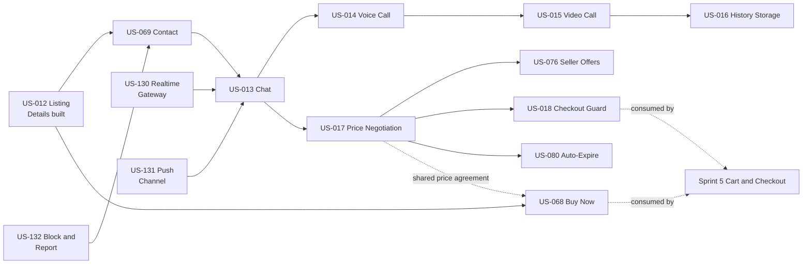

**Recommended build order:** US-130, US-131 and US-132 in parallel; then US-069, US-013; then three parallel tracks: calls (US-014, US-015, US-016), negotiation (US-017, then US-076, US-018 and US-080 in parallel) and US-068 once the price agreement table of US-017 exists. US-016 is last because it needs call and recording data to exist, but its retention rules (Part H) are written first and used by Parts E to G.

This document has one self-contained part per story, in build order. Section 1 defines the shared pieces that later parts reuse by reference: the module layout, the realtime event envelope, the conversation thread, the price agreement, the Admin-managed settings, the notification catalogue and the external integrations.

## Master Table of Contents

- [1. Sprint 4 Architecture Overview](#1-sprint-4-architecture-overview)
- [Part A - US-130: Realtime Gateway (new)](#part-a---us-130-realtime-gateway-new)
- [Part B - US-131: Push Notification Channel (new)](#part-b---us-131-push-notification-channel-new)
- [Part C - US-132: Block and Report User (new)](#part-c---us-132-block-and-report-user-new)
- [Part D - US-069: Buyer Initiates Contact from Listing](#part-d---us-069-buyer-initiates-contact-from-listing)
- [Part E - US-013: Chat with Seller](#part-e---us-013-chat-with-seller)
- [Part F - US-014: Masked Voice Call](#part-f---us-014-masked-voice-call)
- [Part G - US-015: Video Call with Recording](#part-g---us-015-video-call-with-recording)
- [Part H - US-016: Communication History Storage](#part-h---us-016-communication-history-storage)
- [Part I - US-017: Price Negotiation](#part-i---us-017-price-negotiation)
- [Part J - US-076: Seller Negotiation Management](#part-j---us-076-seller-negotiation-management)
- [Part K - US-018: Prevent Checkout Without Price Acceptance](#part-k---us-018-prevent-checkout-without-price-acceptance)
- [Part L - US-080: Auto-Expire Inactive Negotiations](#part-l---us-080-auto-expire-inactive-negotiations)
- [Part M - US-068: Direct Buy Now Flow](#part-m---us-068-direct-buy-now-flow)
- [8. Sprint 4 Cross-Cutting Notes](#8-sprint-4-cross-cutting-notes)
- [9. Decisions, Conflicts and Open Items](#9-decisions-conflicts-and-open-items)

---

# 1. Sprint 4 Architecture Overview

## 1.1 Principles

1. **PostgreSQL is the source of truth; realtime is a hint.** A chat message, offer, call state or agreement is committed to PostgreSQL first. The WebSocket, Redis fan-out and push only tell a device that something changed. After any gap (reconnect, killed app) the app re-reads over REST using sequence cursors, so a lost realtime event never loses data.
2. **Writes go over REST, change notifications come over WebSocket** (decision D2). Sending a message, making an offer or accepting one is an ordinary authenticated HTTP call with validation, rate limits, idempotency keys and standard error codes. The socket carries server-to-client events and a few small client signals (typing, acknowledgements, call heartbeat).
3. **Nothing blocks on a provider.** Agora, FCM and the object store are reached through ports with timeouts, a circuit breaker and a fallback (section 1.8). A provider outage degrades one feature (for example "Call unavailable") and never breaks chat, offers or listing details.
4. **The listing stays live while people talk and negotiate** (decision D6). Many buyers can chat and negotiate on one listing at once. Exclusivity exists only where money is about to move: an accepted price (24 hours) or a Buy Now reservation (15 minutes) reserves the item through one table, `price_agreements` (section 1.4).
5. **Every business number is an Admin-managed setting** (Sprint 3 decision D19, section 1.6 here). Limits, timers, retention days and rate limits are not constants. Deployment-only values (timeouts, batch sizes, ports, provider endpoints) stay configuration (section 1.5).
6. **No phone number, email or address ever reaches the other party** in a DTO, notification, push, log line or call screen. Calls run in-app, so no number is involved at all (decision D4).
7. **Existing conventions are reused:** `ApiResponse` envelope, `BusinessException`, `NotFoundException`, `ForbiddenException`, `ConflictException`, `DomainEventPublisher` with `@TransactionalEventListener`, the generic `StateMachine<S>` (every transition writes a history row and publishes an event), `RedisCacheService.checkRateLimit`, `PlatformSettingsService` snapshots, `AuditLogger`, programmatic Resilience4j (as in `AiGatewayConfig`), `@RequiresIdentityVerification` (Aadhaar gating), `ProfileMenuBadgeProvider`, `ListingEngagement`, Flyway, and scheduled jobs in the style of `SuspendedAccountAutoLiftJob`.

## 1.2 Component View

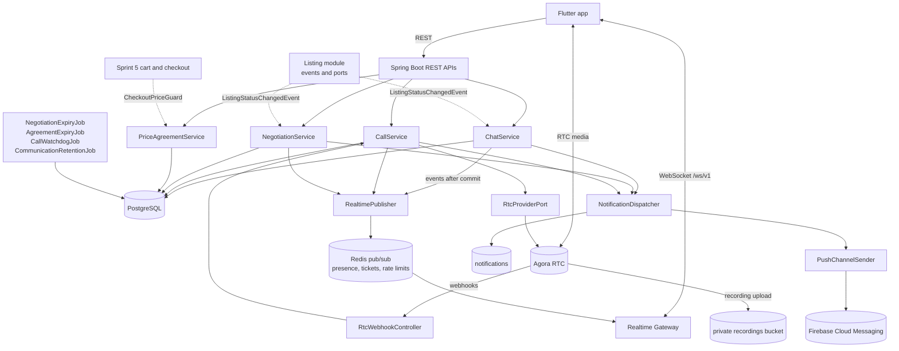

## 1.3 Package Additions (modular monolith, same layering as `auth` and `notification`)

The `communication`, `negotiation`, `cart` and `order` packages already exist from Sprint 0 as `package-info` and state-machine skeletons only; this sprint fills `communication` and `negotiation` and adds `realtime`.

```text
com.valuex.realtime                       (US-130)
  api/            RealtimeTicketController
  config/         WebSocketConfig, RealtimeHandshakeInterceptor
  application/    RealtimeGateway, RealtimePublisher, PresenceService, RealtimeTicketService, RealtimeEvent
  infrastructure/ RedisRealtimeBus, LocalSessionRegistry
com.valuex.notification (additions)       (US-131)
  api/            DeviceTokenController
  application/    PushChannelSender, PushMessage, port/PushPort
  domain/         DeviceToken; NotificationChannelType gains PUSH
  infrastructure/ FcmPushAdapter, NoopPushAdapter, DeviceTokenRepository, PushTokenCleanupJob
com.valuex.communication                  (US-132, US-069, US-013, US-014, US-015, US-016)
  api/            ChatController, CallController, BlockController, ReportController, RtcWebhookController,
                  AdminCommunicationController
  application/
    dto/          ThreadResponse, MessageResponse, SendMessageRequest, CallResponse, RtcCredentials, ...
    port/         ListingContextPort (implemented in listing), ParticipantDirectoryPort (implemented in auth),
                  RtcProviderPort, RecordingPort, CommunicationHoldPort
    service/      ContactEligibilityService, ChatService, MessageScreeningService, CallService, RecordingService,
                  BlockService, ReportService, CommunicationClosureService, CommunicationEvidenceService,
                  CommunicationRetentionJob, CallWatchdogJob, RecordingReconcileJob
  domain/         ChatThread, ChatMessage, ContactAttempt, CallSession, CallEvent, CallState, CallStateMachine,
                  UserBlock, CommunicationReport, CommunicationAccessLog
  infrastructure/
    persistence/  repositories
    rtc/          AgoraRtcAdapter, AgoraTokenBuilder, AgoraRecordingClient, MockRtcAdapter
com.valuex.negotiation                    (US-017, US-076, US-018, US-080, US-068)
  api/            NegotiationController, OfferController, PriceAgreementController, BuyNowController
  application/
    dto/          OfferRequest, NegotiationResponse, OfferReceivedItem, PriceAgreementResponse, BuyNowRequest, ...
    port/         ThreadNegotiationPort (defined in communication, implemented here)
    service/      NegotiationService, OfferRulesService, OfferEligibilityService, PriceAgreementService,
                  CheckoutPriceGuard, BuyNowService, NegotiationNotificationService,
                  NegotiationListingEventListener, NegotiationActivityListener, NegotiationExpiryJob,
                  AgreementExpiryJob, OffersBadgeProvider
  domain/         Negotiation, Offer, NegotiationStatusHistory, PriceAgreement,
                  NegotiationState (extended), NegotiationStateMachine (extended)
  infrastructure/ persistence/
com.valuex.listing (additions)
  application/port/   ContactCapabilityPort, OfferCapabilityPort (implemented in communication and negotiation)
  application/        PublicListingService composes both; ListingEngagement.chatCount reads chat threads
  domain/             Listing gains buy_now_enabled
com.valuex.search (changes)
  infrastructure      ListingIndexSourceAdapter gains retainBrowsable (live and not reserved) for result pages only;
                      retainLive is unchanged (decision D22)
```

Dependency rules: `communication` and `negotiation` reach listing and user data only through ports implemented in the listing and auth modules (the way `search` reaches listings through `ListingIndexSourcePort`). `negotiation` calls `communication` only through domain events and one narrow service, `ChatService.postSystemMessage`. `listing` never imports `communication` or `negotiation` classes; it calls the two capability ports.

## 1.4 Shared Building Blocks

| Block | Used by | Definition |
|---|---|---|
| **Realtime event envelope** | A, D to M | `{"v":1,"type":"chat.message.created","id":"<uuid>","ts":"<ISO-8601 UTC>","data":{...}}`. `id` is unique per event so a client can ignore duplicates. Events are hints: payloads carry ids, sequence numbers and small summaries; the one exception is `chat.message.created`, which carries the message itself (at most about 3 KB, the same shape as the REST response) so a thread updates without a round trip. The full list of types is in A.4. |
| **Conversation thread** (`chat_threads`) | D, E, F, G, H, I | One thread per buyer and listing (`UNIQUE (listing_id, buyer_id)`), created by the first contact of any kind: chat, call, video call or offer (decision D16). Chat messages, call summaries and offer cards are all rows of the thread, so one screen shows the whole conversation and one retention rule governs it. |
| **System message** | E, F, G, I | A `chat_messages` row with `sender_id` null and a `message_type` of `LISTING_CONTEXT`, `OFFER_EVENT` or `CALL_SUMMARY`, plus a small `payload` JSON. Written by `ChatService.postSystemMessage` in the same transaction as the event that caused it. |
| **Price agreement** (`price_agreements`) | I, J, K, L, M, Sprint 5 | One row says "buyer B may buy listing L at price P until time T". Source is `OFFER` (the seller accepted a price) or `BUY_NOW` (the listed price, reserved for 15 minutes). A partial unique index allows at most one `ACTIVE` agreement per listing, which is the exclusivity rule; an agreement reserves only while `valid_until` is in the future, and code that decides (accept, Buy Now, checkout, search) clears stale rows under the listing lock first, so a late expiry job never blocks a sale. Sprint 5 cart and checkout read it only through `CheckoutPriceGuard` (Part K). |
| **Capability** | D, M | The `{available, reason}` object of the listing details response (Sprint 3 Part C). Sprint 4 computes it per caller instead of returning `COMING_SOON`. New reasons: `UNAVAILABLE`, `NOT_NEGOTIABLE`, `DISABLED_BY_SELLER`, `RESERVED`, `IDENTITY_REQUIRED`. `COMING_SOON` stays valid for `buyNow` until checkout exists (decision D10). A new capability, `offer`, is added next to `chat`, `call`, `video`, `cart` and `buyNow`. |
| **Rate limit** | D, E, F, I | `RedisCacheService.checkRateLimit(key, max, window)` with the maximum read from the Admin settings (section 1.6). A broken limiter never stops users (as in search). |
| **Participant directory** (`ParticipantDirectoryPort`) | C to M | `find(userId)` returns `displayName`, `accountState`, `aadhaarVerified`, `rating` and `ratingCount` (through `SellerReputationPort`). It never returns mobile or email. |
| **Listing context** (`ListingContextPort`) | D to M | `find(listingId)` returns `title`, `price`, `priceQualifier`, `negotiable`, `buyNowEnabled`, `quantity`, `status`, `sellerId`, `realEstate`, `thumbnail media id`. Implemented in the listing module over `ListingRepository`. |
| **Domain events** | E to M | Existing: `ListingStatusChangedEvent`, `ListingDeletedEvent`, `UserStateChangedEvent`. New: `ChatMessageCreatedEvent`, `CallStateChangedEvent`, `NegotiationChangedEvent`, `PriceAgreementChangedEvent`, `ThreadClosedEvent`. Notification and realtime listeners run `AFTER_COMMIT` and never throw into the caller; two listeners that protect integrity run `BEFORE_COMMIT` inside the caller's transaction: the negotiation activity bump (E.5) and the Buy Now price-change cancellation (M.5). |

## 1.5 Deployment configuration (`ValuexProperties`)

Technical values, set per environment. Product numbers are Admin-managed settings (section 1.6).

| Property | Default | Purpose |
|---|---|---|
| `valuex.realtime.enabled` | `true` | Master switch. When false the app falls back to polling (A.7). |
| `valuex.realtime.allowed-origins` | empty | Browser origins allowed on the WebSocket (mobile sends none). |
| `valuex.realtime.ticket-ttl` | 30s | Lifetime of a single-use WebSocket ticket. |
| `valuex.realtime.max-sessions-per-user` | 3 | Oldest session is closed with 4409 when exceeded. |
| `valuex.realtime.ping-interval` / `idle-timeout` | 25s / 75s | Heartbeat and idle close. |
| `valuex.realtime.send-buffer-bytes` / `send-time-limit` | 524288 / 5s | Slow consumers are closed (4408). |
| `valuex.realtime.max-inbound-message-bytes` | 8192 | Larger frames close the session (4413). |
| `valuex.push.provider` | `noop` | `fcm` in staging and production, `noop` in dev and CI. |
| `valuex.push.fcm.credentials-secret` | empty | Name of the secret holding the service account JSON. Never in the repository. |
| `valuex.rtc.provider` | `mock` | `agora` in staging and production, `mock` in dev and CI. |
| `valuex.rtc.agora.app-id` / `app-certificate` | empty | Secrets from the secret manager. |
| `valuex.rtc.agora.rest-base-url` | `https://api.agora.io` | Cloud Recording REST host. |
| `valuex.rtc.agora.customer-id` / `customer-secret` | empty | Cloud Recording REST credentials (secrets). |
| `valuex.rtc.webhook-secret` | empty | HMAC secret that verifies provider notifications (secret). |
| `valuex.rtc.token-grace` | 60s | Extra token lifetime beyond the maximum call duration. |
| `valuex.rtc.connect-timeout` / `read-timeout` | 2s / 5s | REST calls to the provider. |
| `valuex.recording.enabled` | `true` | Kill switch for video recording (calls continue without it; section G.8). |
| `valuex.recording.bucket-suffix` | `-call-recordings` | Private bucket `<prefix>-call-recordings`. |
| `valuex.recording.storage-vendor` / `region` / `access-secret` | per environment | Where the provider writes recordings (secret holds a write-only key). |
| `valuex.communication.job.watchdog-interval` | 15s | `CallWatchdogJob` schedule. |
| `valuex.communication.job.retention-cron` | `0 30 2 * * *` | Daily retention run (02:30 Asia/Kolkata). |
| `valuex.negotiation.job.expiry-interval` | 60s | `NegotiationExpiryJob` and `AgreementExpiryJob` schedule. |
| `valuex.negotiation.job.batch-size` | 200 | Rows per job pass (`FOR UPDATE SKIP LOCKED`). |
| `valuex.checkout.enabled` | `false` | Turns the `buyNow` and `cart` capabilities on. Sprint 5 sets it to `true` with checkout (decision D10). |

**Environment variables** (new): `AGORA_APP_ID`, `AGORA_APP_CERTIFICATE`, `AGORA_CUSTOMER_ID`, `AGORA_CUSTOMER_SECRET`, `RTC_WEBHOOK_SECRET`, `RECORDING_STORAGE_ACCESS_KEY`, `RECORDING_STORAGE_SECRET_KEY`, `FCM_SERVICE_ACCOUNT_JSON`, `REALTIME_ALLOWED_ORIGINS`, `RTC_PROVIDER`, `PUSH_PROVIDER`. Secrets come from the secret manager and are listed in `dev-real.env.example` without values.

## 1.6 Admin-managed settings (every business number is configurable, Sprint 3 decision D19)

**Mechanism.** The same as Sprint 3 section 1.6: values live in `platform_settings` (`setting_key`, `setting_value`); two code registries, `CommunicationSetting` and `NegotiationSetting` (same shape as `DiscoverySetting`: kind, default, minimum, maximum, `parse`), are read through `PlatformSettingsService.communication()` and `PlatformSettingsService.negotiation()` snapshots, cached for `valuex.settings.cache-ttl` and evicted on save. A missing or invalid stored value falls back to the default, logs a warning and counts `settings.invalid{key}`. The migrations seed defaults with `INSERT ... ON CONFLICT (setting_key) DO NOTHING`, so an Admin value is never overwritten. The Admin UI is the platform settings screen of US-116 (Sprint 10), which gains these fields (section 8.7, item 9); until then a value is changed with a database update.

**`CommunicationSetting`**

| Key | Default | Range | Meaning |
|---|---|---|---|
| `CHAT_MESSAGE_MAX_CHARS` | 2000 | 100 to 5000 | Longest text message, counted in Unicode characters (US-013). |
| `CHAT_IMAGE_MAX_MB` | 5 | 1 to 10 | Largest shared image (US-013). |
| `CHAT_MESSAGES_PER_MIN` | 30 | 5 to 120 | Messages one user can send per minute across all threads. |
| `CHAT_NEW_THREADS_PER_DAY` | 20 | 1 to 100 | New conversations one buyer can start per day (spam prevention, US-069). |
| `CONTACT_ATTEMPTS_PER_PAIR_PER_HOUR` | 10 | 1 to 60 | Contact attempts (any channel) from one buyer to one seller per hour. |
| `CALL_ATTEMPTS_PER_PAIR_PER_HOUR` | 3 | 1 to 20 | Call and video requests from one buyer to one seller per hour. |
| `CHAT_PAGE_SIZE` | 30 | 10 to 100 | Messages per page. |
| `CHAT_NOTIFY_COALESCE_MINUTES` | 10 | 1 to 120 | At most one in-app chat notification per thread in this window. |
| `CHAT_AUTO_REPORT_FLAGS` | 3 | 1 to 20 | Flagged messages in 24 hours that raise an automatic report for review. |
| `REPORTS_PER_DAY` | 10 | 1 to 50 | Reports one user can file per day (Part C). |
| `CALL_RING_SECONDS` | 45 | 15 to 120 | How long a call rings before it ends as no answer. |
| `CALL_MAX_MINUTES` | 30 | 5 to 120 | Maximum call length, voice and video (US-014, US-015). |
| `CALL_JOIN_SECONDS` | 30 | 10 to 90 | Time both parties have to join after the call is accepted. |
| `CHAT_RETENTION_DAYS` | 180 | 30 to 730 | Chat history is kept this long after a conversation closes (US-013, US-016). |
| `CALL_LOG_RETENTION_DAYS` | 180 | 30 to 730 | Call logs are kept this long after a conversation closes. |
| `VIDEO_RECORDING_RETENTION_DAYS` | 30 | 7 to 90 | Recordings are deleted this long after a conversation closes (US-015, US-016). |
| `COMM_INACTIVE_CLOSE_DAYS` | 90 | 30 to 365 | A conversation with no activity this long counts as closed, which starts the retention clocks (decision D12). |
| `CONTACT_ATTEMPT_RETENTION_DAYS` | 180 | 30 to 730 | How long the contact-attempt log is kept. |

**`NegotiationSetting`**

| Key | Default | Range | Meaning |
|---|---|---|---|
| `NEGOTIATION_MAX_ROUNDS` | 5 | 2 to 10 | Prices submitted in one negotiation, offers and counter offers together (decision D8, US-017, US-076). |
| `NEGOTIATION_INACTIVITY_HOURS` | 48 | 6 to 168 | Hours without activity before a negotiation expires (US-017, US-080). |
| `NEGOTIATION_WARNING_BEFORE_HOURS` | 24 | 1 to 72 | The expiry warning is sent this long before expiry. Must be lower than `NEGOTIATION_INACTIVITY_HOURS` (cross-field rule). |
| `NEGOTIATION_MAX_LIFETIME_DAYS` | 14 | 2 to 60 | Absolute limit, however much activity there is (decision D8). |
| `PRICE_LOCK_HOURS` | 24 | 1 to 72 | How long an accepted price stays valid (US-018, US-076). |
| `NEGOTIATION_LOW_OFFER_PERCENT` | 50 | 10 to 90 | An offer below this percent of the listed price needs a confirmation (`WARNING_LOW_OFFER`). |
| `NEGOTIATION_REOFFER_COOLDOWN_HOURS` | 24 | 0 to 168 | After a seller rejects, the same buyer waits this long before a new offer on the same listing. Expiry has no cooldown (US-080). |
| `NEGOTIATION_OPEN_PER_BUYER_MAX` | 20 | 1 to 100 | Open negotiations one buyer can hold at once (mass negotiation guard, HLD 06). |
| `OFFERS_PER_MIN` | 20 | 5 to 120 | Offer, counter and respond calls per user per minute. |
| `BUY_NOW_RESERVATION_MINUTES` | 15 | 5 to 60 | How long Buy Now holds the item for the buyer (US-068). |
| `BUY_NOW_PER_HOUR` | 10 | 1 to 60 | Buy Now reservations one buyer can start per hour (hoarding guard, Part M). |

## 1.7 Data Model Overview

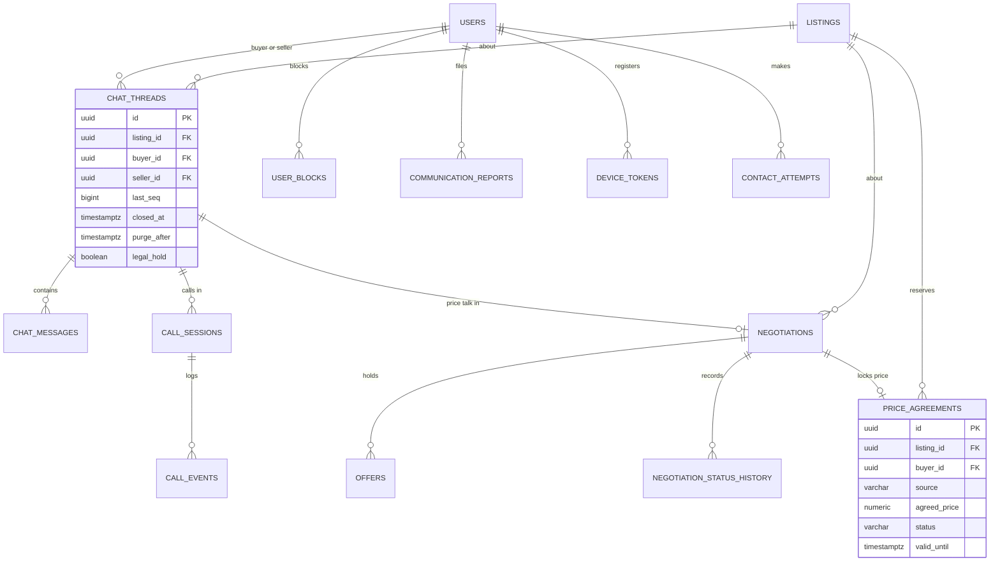

**Migrations** (provisional numbers; `main` is at V31, so each story takes the next free number when it is built, as Sprint 2 and 3 did):

| Provisional | Part | Content |
|---|---|---|
| `V32__device_tokens.sql` | B | `device_tokens` |
| `V33__user_blocks_and_reports.sql` | C | `user_blocks`, `communication_reports` |
| `V34__chat_and_contact.sql` | D, E, H | `chat_threads`, `chat_messages`, `contact_attempts`, `communication_access_log`, `CommunicationSetting` seeds, `MediaPurpose.CHAT_IMAGE` |
| `V35__call_sessions.sql` | F, G | `call_sessions`, `call_events` |
| `V36__negotiation_and_price_agreements.sql` | I, J, K, L | `negotiations`, `offers`, `negotiation_status_history`, `price_agreements`, `NegotiationSetting` seeds |
| `V37__buy_now.sql` | M | `listings.buy_now_enabled`, `BUY_NOW_RESERVATION_MINUTES` seed |

## 1.8 External Integrations and Integration Patterns

| Integration | Purpose | Port and adapters | Failure handling |
|---|---|---|---|
| **Agora RTC** (decision D4) | In-app voice and video media, RTC tokens | `RtcProviderPort.createCredentials(callId, userId, role, ttl)`; `AgoraRtcAdapter` (token builder, no network call), `MockRtcAdapter` (dev, CI) | Token creation is local and cannot fail on a network outage. If the provider is down the media layer fails on the device and the app reports `ERROR_CALL_FAILED`; the server ends the call through the watchdog (`JOIN_FAILED`). |
| **Agora Cloud Recording** | Server-side recording of video calls | `RecordingPort.acquire/start/stop/query`; `AgoraRecordingClient` over REST with its own Resilience4j circuit breaker | One retry after 5 s; then `recording_status = FAILED`, the call continues and the app shows `ERROR_RECORDING_FAILED` (section G.8). A reconcile job queries the provider for calls whose status is unclear. |
| **Agora notifications (webhooks)** | Channel join and leave, recording upload events | `POST /api/v1/webhooks/rtc`, public path, HMAC-SHA256 signature check, idempotent by provider event id | Invalid signature returns 401 and is counted. A missing webhook is covered by client acknowledgements and the watchdog. |
| **Firebase Cloud Messaging** | Push delivery | `PushPort`; `FcmPushAdapter` (Firebase Admin SDK), `NoopPushAdapter` | Transient errors retry three times (1 s, 4 s, 15 s); an invalid or unregistered token is revoked; the in-app notification and the WebSocket already carry the event, so a push failure loses no data. |
| **Object storage** | Chat images (existing media API), call recordings (private bucket) | Existing `ObjectStoragePort`; recordings use a separate bucket and a write-only key held by the provider | Signed links only; see G.9 and H.5. |
| **Redis** | Pub/sub fan-out, presence, tickets, rate limits | `RedisRealtimeBus`, `PresenceService`, `RedisCacheService` | If Redis is down, realtime degrades to the local instance and polling; rate limits fail open (as in search); writes are unaffected. |

**Retry and circuit-breaker pattern.** Provider clients are built programmatically (the `AiGatewayConfig` style): a `TimeLimiter`, a `CircuitBreaker` (opens at 50 percent failures over 20 calls, half-open after 30 s) and a bounded `Retry` for idempotent calls only. Every outbound call has a metric `integration.calls{provider,outcome}` and never logs message text, tokens or recording keys.

## 1.9 How this document maps to the LLD generator outline

The repository's LLDs are organised as one self-contained part per story. The generic outline of the LLD generator skill maps to it as follows.

| LLD generator section | Where it is in this document |
|---|---|
| 1 Overview | Header, story map, section 1 |
| 2 Database Design (ERD, tables, indexes, migrations) | 1.7 and each part's "Data Model" |
| 3 Backend API Design (endpoints, schemas, errors) | Each part's "API Contract" and "Validation Rules & Error Codes"; consolidated error list in 8.2 |
| 4 Backend Component Design (controllers, services, repositories, DTOs, security) | 1.3 and each part's "Backend Design" |
| 5 Mobile App Design (Flutter) | Each part's "Mobile Design"; shared structure in 8.4 |
| 6 Web App Design (React) | Not applicable in Sprint 4 (section 8.5) |
| 7 AI Services Design (Python) | Not applicable in Sprint 4 (section 8.5) |
| 8 Integration Flows (sequence diagrams, external integrations) | Each part's "Sequence Diagram" and 1.8 |
| 9 Non-Functional Requirements | Each part's "Security & NFR Notes" and section 8.1 |
| 10 Testing Strategy | Each part's "Testing Strategy" and section 8.6 |

---

# Part A - US-130: Realtime Gateway (new)

**Story Points:** 5 (proposed) | **Repos:** valuex-backend, valuex-mobile, infra
**Dependency:** S0-001 (backend skeleton), US-107 (access token refresh)
**Why this story exists:** US-013 needs messages to arrive in under one second (PRD non-functional requirement), US-014 and US-015 need a call to ring, and US-017, US-018 and US-076 want live state changes. HLD 02 and HLD 07 name `/ws/chat`, `/ws/notifications` and `/ws/video`, but the repository has no WebSocket dependency, endpoint, ticket or presence code. This story builds the one shared channel so the stories above do not each invent their own.

## A.1 Story Overview

**As a** signed-in user **I want** new messages, offers and incoming calls to reach me immediately **so that** a conversation feels live.

### A.1.1 Edge Cases Covered

| Edge case | Handling |
|---|---|
| Phone loses network or switches Wi-Fi to mobile data | Client reconnects with backoff; after reconnect it re-reads missed data over REST using sequence cursors (A.7). No event is required for correctness. |
| App in the background or killed | The socket is closed after 30 s in the background; push (Part B) covers delivery; opening the app reconnects and re-syncs. |
| Access token expires while connected (1 hour) | The server closes with 4401 shortly before expiry; the app refreshes the token (US-107) and reconnects with a new ticket. |
| Same account on two phones | Both receive events (up to `max-sessions-per-user`); a fourth session closes the oldest with 4409. |
| Account is suspended or banned | `UserStateChangedEvent` closes all of the user's sessions with 4403; a new ticket is refused. |
| Backend instance restarts during a deploy | Sessions close with 1001; clients reconnect to another instance; Redis fan-out means no sticky session is needed. |
| Slow or stalled client | Send buffer limit; the session is closed with 4408 so one device cannot hold server memory. |
| Redis unavailable | Events reach only sessions on the same instance; the app polls (A.7); REST writes are unaffected. |
| Replayed or stolen ticket | Single use, 30 s lifetime, bound to the user; consumed with an atomic get-and-delete. |

## A.2 Scope

**In scope:** the WebSocket endpoint, ticket issue and validation, the event envelope and type list, Redis fan-out, presence, close codes, limits, metrics, the mobile `RealtimeClient`, ingress configuration notes.
**Out of scope:** the content of chat, call and negotiation events (Parts E to L define them), a web client, push (Part B), message persistence (Part E).

## A.3 Data Model

No PostgreSQL table. Redis keys (all with a TTL):

| Key | Value | TTL | Purpose |
|---|---|---|---|
| `rt:ticket:{sha256(ticket)}` | JSON `{userId, tokenExp}` | 30 s | Single-use WebSocket ticket (consumed with `GETDEL`). |
| `rt:presence:{userId}` | sorted set, member `sessionId`, score = expiry epoch seconds | 120 s, refreshed | Foreground sessions heard from in the last 90 s. |
| `rt:u:{userId}` | pub/sub channel | none | Per-user fan-out between instances. |

`PresenceService.isOnline(userId)` removes expired members and returns `true` when at least one foreground session remains. A background session is not "online": push is the better route to a backgrounded app (A.5, B.5).

## A.4 API Contract

### A.4.1 Ticket

```http
POST /api/v1/realtime/tickets          -- authenticated; 200
```
```json
{ "success": true,
  "data": { "ticket": "q3...opaque, 43 chars", "expiresInSeconds": 30,
            "url": "wss://api.example.com/ws/v1", "pingIntervalSeconds": 25 } }
```
Errors: `ERROR_REALTIME_UNAVAILABLE` (503, `valuex.realtime.enabled=false`), the standard 401 for an invalid access token, `ERROR_ACCOUNT_NOT_ACTIVE` (403).

### A.4.2 Connection

```text
GET wss://host/ws/v1?ticket=<ticket>
```
The query string carries only the one-time ticket, never the access token (query strings reach access logs). The handshake is refused with HTTP 401 when the ticket is missing, unknown or used, and with 403 when the account is not `ACTIVE` or the `Origin` header is present and not in `valuex.realtime.allowed-origins`.

### A.4.3 Event types, server to client

| Type | `data` | Sent by |
|---|---|---|
| `chat.message.created` | the message exactly as the REST `MessageResponse` (E.4), at most about 3 KB | E |
| `chat.message.delivered` | `{threadId, upToSeq}` | E |
| `chat.read` | `{threadId, upToSeq}` | E |
| `chat.typing` | `{threadId, userId, typing}` | E |
| `chat.thread.updated` | `{threadId, canSend, readOnlyReason, lastSeq}` | E, C |
| `badge.updated` | `{chatsUnread, offersAwaiting}` | E, J |
| `notification.created` | `{notificationId, eventType}` | existing notifications |
| `negotiation.updated` | `{negotiationId, listingId, state, awaiting, round, expiresAt, agreedPrice}` | I, J, L |
| `agreement.updated` | `{agreementId, listingId, status, validUntil}` | I, K, L, M |
| `call.incoming` | `{callId, type, callerName, listing{id,title}, ringingExpiresAt, consentRequired}` | F, G |
| `call.updated` | `{callId, state, endReason, recordingStatus}` | F, G |
| `error` | `{code}` | gateway |

### A.4.4 Client to server

| Type | `data` | Effect |
|---|---|---|
| `ping` | none | Server answers `pong`, refreshes presence. |
| `app.state` | `{foreground}` | Marks the session foreground or background for presence. |
| `chat.typing` | `{threadId, typing}` | Relayed to the other participant; never stored. |
| `chat.delivered` | `{threadId, upToSeq}` | Same service call as `POST /chats/{id}/delivered`. |
| `chat.read` | `{threadId, upToSeq}` | Same as `POST /chats/{id}/read`. |
| `call.heartbeat` | `{callId}` | Same as `POST /calls/{id}/heartbeat`. |

Unknown types are ignored and counted; frames above `max-inbound-message-bytes` close the session.

### A.4.5 Close codes

| Code | Name | Client action |
|---|---|---|
| 1001 | Going away (deploy) | Reconnect with backoff. |
| 4401 | Token expired or invalid | Refresh token, new ticket, reconnect. |
| 4403 | Account not active | Stop reconnecting; show the account state screen. |
| 4408 | Slow consumer | Reconnect and re-sync. |
| 4409 | Session replaced (too many sessions) | Reconnect only on user action. |
| 4413 | Frame too large | Log; reconnect. |
| 4429 | Inbound rate exceeded (more than 20 frames per second) | Back off 30 s. |

## A.5 Backend Design

- **Config.** `spring-boot-starter-websocket` is added to `pom.xml`. `WebSocketConfig` registers `RealtimeWebSocketHandler` on `/ws/v1` with `RealtimeHandshakeInterceptor`. `SecurityConfig` permits `/ws/v1` at the filter level (the ticket is the credential) and keeps everything else as it is.
- **`RealtimeTicketService`.** `issue(userId, tokenExp)` creates 32 random bytes (base64url), stores `sha256` of it with a 30 s TTL, returns the ticket. `consume(ticket)` does `GETDEL` and returns the user or empty. The ticket endpoint is rate limited to 30 calls per minute per user (`RATE_LIMIT_EXCEEDED`).
- **`RealtimeHandshakeInterceptor`.** Checks `Origin`, consumes the ticket, loads the account state through `ParticipantDirectoryPort` (must be `ACTIVE`), and stores `userId` and `sessionDeadline` (the access token's `exp`) in the session attributes.
- **`LocalSessionRegistry`.** `ConcurrentHashMap<UUID, Set<Session>>`; each session is wrapped in `ConcurrentWebSocketSessionDecorator(session, sendTimeLimit, bufferLimit)`. A scheduled sweep closes sessions past `sessionDeadline` with 4401 and idle sessions past `idle-timeout`.
- **`RealtimePublisher.publishToUser(userId, type, data)`.** Builds the envelope and `PUBLISH rt:u:{userId}`. It is called only from `AFTER_COMMIT` listeners (never inside a transaction), so a rolled-back write never produces an event. `RedisRealtimeBus` subscribes with a pattern (`rt:u:*`) on every instance and hands each message to `LocalSessionRegistry.deliver(userId, json)`. If Redis publish fails, the publisher falls back to local delivery and counts `realtime.publish.failures`.
- **`PresenceService`.** `touch(userId, sessionId, foreground)` on connect, ping and `app.state`; `remove` on close; `isOnline(userId)` as in A.3. Part B (push policy) and Part F (call reachability) read it.
- **Account state.** A listener on `UserStateChangedEvent` closes all sessions of the user when the new state is not `ACTIVE` (through the bus, so it reaches every instance).
- **Inbound handling.** `RealtimeWebSocketHandler` parses JSON frames, applies a token bucket of 20 frames per second per session, and forwards typed frames to `ChatService`, `CallService` and `PresenceService`. A handler failure is logged with the type only and answered with an `error` event; it never closes the session except for protocol violations.
- **Metrics.** `realtime.sessions.active` (gauge), `realtime.events.sent.total{type}`, `realtime.events.received.total{type}`, `realtime.send.failures{reason}`, `realtime.connect.total{outcome}`, `realtime.publish.failures`.
- **Infra.** The ingress or load balancer must allow WebSocket upgrade and an idle timeout of at least 75 s (the ping interval is 25 s). No sticky sessions are needed. `docker-compose.yml` needs no change (Redis already runs); the infra repository documents the ingress annotation and the `wss` TLS rule (HLD 06: TLS 1.3 everywhere).

## A.6 Sequence Diagram

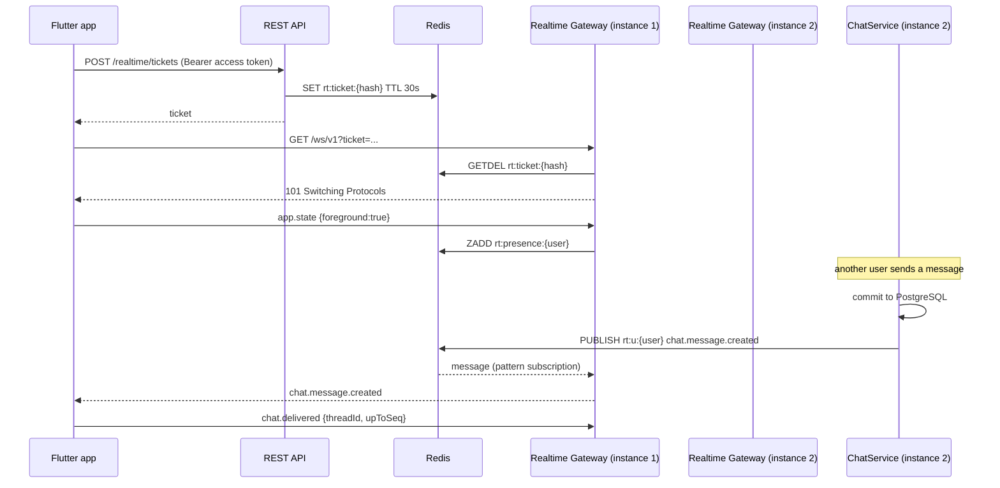

## A.7 Mobile Design (valuex-mobile)

- **`core/realtime/realtime_client.dart`** (new): an interface `RealtimeClient` with `Stream<RealtimeEvent> events`, `connect()`, `disconnect()`, `send(type, data)` and `ConnectionState state`; implementation `WebSocketRealtimeClient` over `web_socket_channel` (the version is pinned when the story is built). A Riverpod provider owns it for the signed-in session, so a sign-out disconnects it.
- **Connect flow.** `POST /realtime/tickets`, open the socket, send `app.state {foreground:true}`, then ping every `pingIntervalSeconds`. Backoff on failure: 1, 2, 4, 8, 16, 30 s with jitter, reset after a stable minute. 4403 stops reconnecting; 4401 refreshes the token first.
- **Lifecycle.** `WidgetsBindingObserver`: on pause send `app.state {foreground:false}` and close after 30 s; on resume reconnect and trigger a re-sync.
- **Re-sync after a gap.** On every (re)connect the chat list, the open thread (`afterSeq`), the offers lists and any active call are re-read once. Events are applied idempotently by `id` and by `seq`.
- **Fallback.** When the ticket call returns `ERROR_REALTIME_UNAVAILABLE` or the socket cannot be opened for 60 s, screens that need freshness poll every 15 s while visible (chat list, open thread, offers). This keeps the app usable and is covered by a widget test.
- **UI contract.** Features subscribe through typed providers (`chatEventsProvider`, `negotiationEventsProvider`, `callEventsProvider`) that filter the stream; widgets never read the raw socket.
- **Strings and accessibility.** A thin "Reconnecting..." banner (`realtimeReconnecting`) is shown only while a chat thread is open and the socket is down, with a live-region role; English and Hindi in the ARB files.

## A.8 Validation Rules & Error Codes

| Rule | Code | HTTP or close |
|---|---|---|
| Realtime switched off | `ERROR_REALTIME_UNAVAILABLE` | 503 |
| Account not active at ticket or handshake | `ERROR_ACCOUNT_NOT_ACTIVE` | 403, close 4403 |
| Ticket missing, unknown or already used | the standard 401 | 401 |
| Too many sessions for the user | none | close 4409 on the oldest |

## A.9 Security & NFR Notes

- The credential is a single-use, 30 s ticket; the access token never appears in a URL. The ticket is hashed in Redis. Origin is checked when present. Frames are size limited and rate limited per session.
- Authorisation is by `userId` of the session: a user receives only events published to `rt:u:{ownId}`. There is no subscribe-by-id message, so one user cannot listen to another's channel.
- Logs contain the event type, the session id and the user id, never the payload.
- Targets (PRD: under 1 s): server time from commit to socket write under 200 ms at p95 and under 500 ms at p99 on one instance; 10,000 concurrent sessions per instance on a 2 vCPU, 4 GB node (to be verified by the load test in A.10).
- Horizontal scaling: instances are stateless apart from their local sessions; Redis pub/sub carries the fan-out. If the pub/sub channel becomes a bottleneck, Redis Streams or a per-shard channel is the next step (not needed for the MVP).

## A.10 Testing Strategy

- **Unit:** ticket issue and single-use consume, expiry; presence math; envelope serialisation; the token bucket; origin check.
- **Integration (Testcontainers Redis, embedded server):** connect with a ticket, receive a published event, ticket reuse is refused, token expiry closes with 4401, suspension closes with 4403, a fourth session closes the first with 4409, a slow consumer closes with 4408, an event published on one "instance" (a second `RedisRealtimeBus`) reaches a session on the other.
- **Mobile:** `RealtimeClient` against a fake socket: backoff sequence, resume re-sync, idempotent event application, polling fallback, 4403 stops reconnecting.
- **Load:** a script opens 10,000 sessions and measures publish-to-receive latency (run once per release, not in CI).

---

# Part B - US-131: Push Notification Channel (new)

**Story Points:** 5 (proposed) | **Repos:** valuex-backend, valuex-mobile, infra
**Dependency:** US-077 (notification dispatcher)
**Why this story exists:** US-013 says the seller "receives notification", US-017 and US-076 say the other party is notified of every offer, and US-014 and US-015 must ring a person whose app is closed. `NotificationChannelType` has `IN_APP`, `SMS` and `EMAIL` only (its own comment says push does not exist), Sprint 3 deferred push for saved-search alerts, and HLD 05 names Firebase Cloud Messaging. Without this story a message would sit unseen until the app is opened.

## B.1 Story Overview

**As a** user **I want** a notification on my phone when someone messages me, makes or answers an offer, or calls me **so that** I can respond without keeping the app open.

### B.1.1 Edge Cases Covered

| Edge case | Handling |
|---|---|
| User is looking at the app | No push when `PresenceService.isOnline` is true (the WebSocket already delivered it), except incoming calls, which always push. |
| Device token is stale or the app was uninstalled | FCM answers `UNREGISTERED` or `INVALID_ARGUMENT`; the token is revoked and the next dispatch skips it. |
| User signs out | The device's tokens are revoked at logout, so a signed-out phone never receives another user's messages. |
| Same user on two phones | Every active token gets the push; a read on one phone reaches the other through the WebSocket. |
| User denied notification permission | The token is still registered with `permission_granted=false`; no push is sent; the in-app notification still exists. |
| FCM is down | Three retries, then the failure is counted; the in-app notification and WebSocket are unaffected. |
| Lock-screen privacy | The push never contains message text, an offer amount or a phone number (decision D18). |
| Language | The device's locale is stored at registration; push copy is sent in English or Hindi. |

## B.2 Scope

**In scope:** `NotificationChannelType.PUSH`, `device_tokens`, register and unregister endpoints, `PushPort` with FCM and no-op adapters, the push policy per event type, token cleanup, mobile Firebase setup, permission timing, deep links, Android channels, iOS APNs configuration.
**Out of scope:** per-category user preferences (US-087, Sprint 12; the dispatcher already has `NotificationPreferences.shouldSend`), WhatsApp (US-086), marketing push, a native incoming-call screen with CallKit or ConnectionService (decision D15, post-MVP), web push.

## B.3 Data Model

Migration `V32__device_tokens.sql` (provisional number):

```sql
CREATE TABLE device_tokens (
    id                 UUID         PRIMARY KEY DEFAULT gen_random_uuid(),
    user_id            UUID         NOT NULL REFERENCES users (id),
    device_id          VARCHAR(100) NOT NULL,           -- the install id the app keeps in secure storage
    platform           VARCHAR(10)  NOT NULL,           -- ANDROID | IOS
    fcm_token          VARCHAR(512) NOT NULL,
    locale             VARCHAR(10)  NOT NULL DEFAULT 'en',
    app_version        VARCHAR(30),
    permission_granted BOOLEAN      NOT NULL DEFAULT TRUE,
    created_at         TIMESTAMPTZ  NOT NULL DEFAULT now(),
    last_seen_at       TIMESTAMPTZ  NOT NULL DEFAULT now(),
    revoked_at         TIMESTAMPTZ,
    CONSTRAINT chk_device_tokens_platform CHECK (platform IN ('ANDROID', 'IOS')),
    CONSTRAINT uq_device_tokens_token UNIQUE (fcm_token)
);
CREATE INDEX idx_device_tokens_user_active ON device_tokens (user_id) WHERE revoked_at IS NULL;
CREATE INDEX idx_device_tokens_cleanup ON device_tokens (last_seen_at) WHERE revoked_at IS NULL;
```

`user_sessions` has no device column (V7 dropped it), so the app sends its own install id. A token that moves to another account (shared phone) is re-assigned by the upsert on `fcm_token`.

## B.4 API Contract

```http
PUT    /api/v1/devices/push-token      -- register or refresh; 204
DELETE /api/v1/devices/push-token      -- body {deviceId}; 204, idempotent
```
```json
{ "deviceId": "7c9e...", "platform": "ANDROID", "token": "fcm...", "locale": "hi",
  "appVersion": "0.4.0", "permissionGranted": true }
```
Both calls are authenticated and rate limited (30 per hour per user). `PUT` upserts by `fcm_token`, sets `user_id` to the caller, clears `revoked_at`, and revokes older tokens of the same user and `deviceId`.

**Push payload** (FCM `notification` block plus `data`):

```json
{ "notification": { "title": "New message from Asha", "body": "Open JustQlic to read it" },
  "data": { "eventType": "CHAT_MESSAGE", "deepLink": "/chats/8b3f...", "eventId": "b9c0...", "channel": "chat" },
  "android": { "priority": "HIGH", "notification": { "channelId": "chat" } },
  "apns": { "headers": { "apns-priority": "10" } } }
```

## B.5 Backend Design

- **`NotificationChannelType.PUSH`** is added (and its comment updated). `NotificationDispatcher` already stores one in-app row and fans out to channels; it now also calls `PushChannelSender` when the request's channel set contains `PUSH`.
- **`PushChannelSender.send(userId, notification)`:** applies `PushPolicy` (below), loads active tokens of the user, builds the payload from `PushCopy` in the token's locale, calls `PushPort.send` per token, and handles results: success counts `push.sent{eventType}`; `UNREGISTERED` and `INVALID_ARGUMENT` set `revoked_at`; transient errors retry through the Resilience4j policy of 1.8; a final failure counts `push.failed{reason}` and is logged without the token.
- **`PushPolicy`** (one table in code, so changing it is a one-line change):

| Event type | Channel set | Android channel | Priority | Skipped when user is online (foreground) |
|---|---|---|---|---|
| `CHAT_MESSAGE` | `IN_APP`, `PUSH` | `chat` | normal | yes |
| `OFFER_RECEIVED`, `OFFER_COUNTERED`, `OFFER_ACCEPTED`, `OFFER_REJECTED`, `OFFER_SUPERSEDED` | `IN_APP`, `PUSH` | `offers` | normal | yes |
| `NEGOTIATION_EXPIRING`, `NEGOTIATION_EXPIRED`, `AGREEMENT_EXPIRING`, `AGREEMENT_EXPIRED` | `IN_APP`, `PUSH` | `offers` | normal | yes |
| `CALL_INCOMING`, `VIDEO_CALL_REQUEST` | `PUSH` only (no inbox row; the call screen is the record) | `calls` | high | no (always sent) |
| `CALL_MISSED` | `IN_APP`, `PUSH` | `calls` | normal | yes |

- **Token lifecycle.** `DeviceTokenService.register/unregister`; the existing logout and account-close services call `revokeForDevice` and `revokeForUser`. `PushTokenCleanupJob` (daily) deletes rows revoked for more than 30 days or not seen for 60 days.
- **`PushPort`** has `FcmPushAdapter` (Firebase Admin SDK, credentials from the secret manager, one `FirebaseMessaging` bean) and `NoopPushAdapter` (logs the count only, used in dev and CI, selected by `valuex.push.provider`).
- **Dedupe.** The existing `dedupeKey` of the notification covers the in-app row; the push carries `eventId` = the notification id (or a generated id for calls) so the app can drop a push it already got over the socket.
- **Metrics.** `push.sent`, `push.failed`, `push.tokens.revoked`, `push.skipped{reason=online|no_token|permission}`.

## B.6 Sequence Diagram

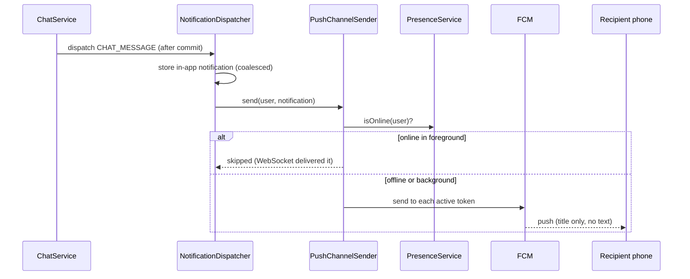

## B.7 Mobile Design (valuex-mobile)

- **Packages:** `firebase_core` and `firebase_messaging` (versions pinned during the story), a small `PushService` in `core/push/`. Firebase configuration files (`google-services.json`, `GoogleService-Info.plist`) are per environment and are not committed (listed in `.gitignore`); the infra story documents how CI injects them.
- **Permission timing.** The notification permission (Android 13 `POST_NOTIFICATIONS`, iOS) is requested the first time the user starts a chat, makes an offer or receives an offer, with a short explanation sheet before the system prompt, never at launch. A "no" is remembered; Profile > Notifications offers a shortcut to the system settings.
- **Token registration.** After sign-in and on every `onTokenRefresh`, `PUT /devices/push-token` with the install id (the existing secure-storage device id), platform, locale and app version. On sign-out, `DELETE` before the session is cleared.
- **Android channels:** `chat` (default importance), `offers` (default), `calls` (high importance with sound), `general`. Names are localised ARB strings.
- **Foreground behaviour.** A push that arrives while the app is open is ignored when its `eventId` was already received over the socket; otherwise a standard in-app banner is shown. A tap on a background notification routes through `notificationTargetFor(deepLink)` (the existing mapping gains `/chats/{id}`, `/offers/{id}`, `/calls/{id}`).
- **Incoming call push.** The `calls` channel shows a heads-up notification (full-screen intent on Android where permitted) that opens the incoming-call screen; if the ringing window has passed, the screen says "Missed call" and offers Chat (decision D15).
- **iOS.** APNs key uploaded to Firebase by infra; `remote-notification` background mode; the capability is documented in the manual testing guide because it needs a real device.

## B.8 Validation Rules & Error Codes

| Rule | Code | HTTP |
|---|---|---|
| Unknown platform or empty token | `ERROR_INVALID_PUSH_TOKEN` | 422 |
| Rate limit on token calls | `RATE_LIMIT_EXCEEDED` (existing code) | 429 |

## B.9 Security & NFR Notes

- A token is a credential to the device: it is never logged, never returned by any API, and is revoked at sign-out. A token can belong to one user at a time.
- Push content is generic by design (decision D18); the app fetches the detail over the authenticated API after the tap.
- FCM service account JSON lives only in the secret manager; the Admin SDK has the `firebase.messaging` role only.
- Delivery is best effort and never required for correctness. Target: dispatch to FCM within 2 s of the event at p95.

## B.10 Testing Strategy

- **Unit:** `PushPolicy` table (every event type), `PushCopy` in both locales, token upsert and re-assignment, revoke on `UNREGISTERED`, retry then give up, online skip, calls never skipped.
- **Integration:** `DeviceTokenController` (200 and 204 paths, rate limit, other user's token re-assigned), logout revokes tokens, cleanup job.
- **Mobile:** `PushService` with a fake messaging plugin: permission sheet timing, registration on refresh, deregistration at sign-out, deep link routing, duplicate suppression by `eventId`.
- **Manual (real devices):** Android 13+ and one iOS device, app killed, backgrounded and foreground; Hindi device language; call heads-up.

---

# Part C - US-132: Block and Report User (new)

**Story Points:** 3 (proposed) | **Repos:** valuex-backend, valuex-mobile
**Dependency:** US-003 (profile)
**Why this story exists:** US-013 lists "User blocks seller" as an edge case, US-069 has "Seller has blocked buyer" and the error `ERROR_BLOCKED`, and US-015 lets a user "report inappropriate behavior during call". No block or report feature exists in the stories, the sprint plan or the code. Sprint 4 needs the minimum: block, unblock, report, and a stored report queue that the Admin stories (US-057 in Sprint 10, US-055 in Sprint 8) will consume.

## C.1 Story Overview

**As a** user **I want** to block someone who bothers me and report abusive behaviour **so that** I feel safe using chat, calls and offers.

### C.1.1 Edge Cases Covered

| Edge case | Handling |
|---|---|
| Blocking while a chat is open | The thread becomes read-only for both people (`ERROR_BLOCKED` on send); history stays visible to both until retention ends. |
| Blocked user tries to contact again | Chat, call, video and offer all refuse with `ERROR_BLOCKED` ("You cannot contact this seller"); the message does not say who blocked whom. |
| Blocking someone with an accepted price or an order | Blocking does not cancel an active price agreement or an order; it only stops new contact. Support or the dispute process handles those. |
| Blocking oneself | `ERROR_INVALID_BLOCK` (422). |
| Blocking twice, unblocking twice | Idempotent. |
| Report of a message, call, thread or user | One open report per reporter and target; a second report is accepted without creating a duplicate row. The containing thread (and, for a call report, that call) is put on hold so the evidence is not deleted before an Admin reviews it. |
| Report during a video call | The report marks the call's recording as flagged and puts it on hold so the 30-day deletion does not remove evidence (G.8). |
| False or abusive reporting | Rate limit and a counter; Admin review is Sprint 10. |

## C.2 Scope

**In scope:** `user_blocks`, `communication_reports`, block, unblock, list-blocked and report endpoints, the `BlockService.isBlockedEitherWay` check used by Parts D to M, system auto-reports from Part E, the mobile menu actions and Blocked Users screen.
**Out of scope:** Admin review UI and actions (US-057, US-055), penalties (US-051), seller-side listing hiding from blocked buyers in search (not requested).

## C.3 Data Model

Migration `V33__user_blocks_and_reports.sql` (provisional number):

```sql
CREATE TABLE user_blocks (
    blocker_id UUID        NOT NULL REFERENCES users (id),
    blocked_id UUID        NOT NULL REFERENCES users (id),
    created_at TIMESTAMPTZ NOT NULL DEFAULT now(),
    PRIMARY KEY (blocker_id, blocked_id),
    CONSTRAINT chk_user_blocks_self CHECK (blocker_id <> blocked_id)
);
CREATE INDEX idx_user_blocks_blocked ON user_blocks (blocked_id);

CREATE TABLE communication_reports (
    id               UUID         PRIMARY KEY DEFAULT gen_random_uuid(),
    reporter_id      UUID         REFERENCES users (id),            -- null for a system report
    reported_user_id UUID         NOT NULL REFERENCES users (id),
    target_type      VARCHAR(10)  NOT NULL,                         -- USER | THREAD | MESSAGE | CALL
    target_id        UUID         NOT NULL,
    reason           VARCHAR(30)  NOT NULL,
    details          VARCHAR(500),
    source           VARCHAR(10)  NOT NULL DEFAULT 'USER',          -- USER | SYSTEM
    status           VARCHAR(15)  NOT NULL DEFAULT 'OPEN',          -- OPEN | REVIEWING | CLOSED
    created_at       TIMESTAMPTZ  NOT NULL DEFAULT now(),
    reviewed_by      UUID,
    reviewed_at      TIMESTAMPTZ,
    CONSTRAINT chk_reports_target CHECK (target_type IN ('USER', 'THREAD', 'MESSAGE', 'CALL')),
    CONSTRAINT chk_reports_reason CHECK (reason IN ('SPAM', 'HARASSMENT', 'SCAM_OR_FRAUD',
        'INAPPROPRIATE_CONTENT', 'OFFENSIVE_BEHAVIOUR', 'SHARING_CONTACT_DETAILS', 'OTHER'))
);
CREATE UNIQUE INDEX uq_reports_open_per_target
    ON communication_reports (reporter_id, target_type, target_id) WHERE status = 'OPEN' AND reporter_id IS NOT NULL;
CREATE INDEX idx_reports_status ON communication_reports (status, created_at);
```

## C.4 API Contract

```http
PUT    /api/v1/users/{userId}/block       -- 204, idempotent
DELETE /api/v1/users/{userId}/block       -- 204, idempotent
GET    /api/v1/users/me/blocks?page=0&size=20   -- blocked users: userId, displayName, blockedAt
POST   /api/v1/reports                    -- 201 {reportId}
```
```json
{ "targetType": "MESSAGE", "targetId": "5c1e...", "reason": "HARASSMENT", "details": "optional text up to 500 characters" }
```

## C.5 Backend Design

- **`BlockService`:** `block`, `unblock`, `isBlockedEitherWay(a, b)` (one indexed query on both directions, cached per request), `list`. After a block, a `ThreadReadOnlyChangedEvent` is published for the pair's threads so connected clients get `chat.thread.updated` with `readOnlyReason = BLOCKED`.
- **`ReportService.report`:** resolves `reported_user_id` from the target (message sender, call counterpart, thread counterpart) and refuses a target the reporter was not part of (`NotFoundException`, so ids cannot be probed). `details` is cleaned with `PlainText`. A report on a `CALL` also sets the call's `flagged` and `legal_hold` (Part G). Rate limit: 10 reports per day per user (a `CommunicationSetting` addition `REPORTS_PER_DAY`, range 1 to 50).
- **Evidence hold.** Every report puts the containing thread and its calls on hold (`CommunicationHoldPort`, Part H), so chat text, images and recordings are not deleted before an Admin reviews the report; closing the report releases the hold (US-057, Sprint 10). Until that console exists, the daily retention run exports the number of holds caused by reports (`retention.held{source=report}`) so a growing backlog is visible.
- **System reports** (`source = SYSTEM`) are created by `MessageScreeningService` when `CHAT_AUTO_REPORT_FLAGS` flagged messages from one sender appear within 24 hours (E.5).
- **Privacy.** A blocked person is never told. `ERROR_BLOCKED` is the same response whether the pair is blocked or the seller is simply unavailable for contact, apart from the code.

## C.6 Mobile Design

- Chat thread overflow menu: Block {name}, Report. Block shows a confirmation dialog explaining what changes; Report opens a bottom sheet with the reason list and an optional text field. Call screens (voice and video) have a Report action too.
- Profile > Account: "Blocked users" screen (`/blocked-users`) with unblock. Strings in English and Hindi; every action has a semantic label; touch targets 48 dp.
- After a block, the open thread shows a read-only banner and the composer is disabled.

## C.7 Validation Rules & Error Codes

| Rule | Code | HTTP |
|---|---|---|
| Contact attempt where either side blocked the other | `ERROR_BLOCKED`: "You cannot contact this seller" | 403 |
| Block yourself | `ERROR_INVALID_BLOCK` | 422 |
| Unknown or inaccessible report target | the not-found error | 404 |
| Unknown reason | `ERROR_INVALID_REPORT_REASON` | 422 |
| More than the daily report limit | `RATE_LIMIT_EXCEEDED` (existing code) | 429 |

## C.8 Security & NFR Notes

- Every query is scoped by the caller; the block list is never readable by the blocked person. Reports are write-only for users (no endpoint reads them back).
- Report details are plain text; they are never rendered as HTML.
- The block check is on the hot path of every contact and send; it uses the primary key and one secondary index and is covered by the 200 ms server-time target of Part A.

## C.9 Testing Strategy

- **Unit:** block and unblock idempotency, either-way check, self-block, report target resolution for each type, uniqueness of an open report, rate limit.
- **Integration (PostgreSQL):** blocked pair cannot create a thread, send, call or offer (once those parts exist, a shared contract test is run against each); block makes an existing thread read-only; unblock restores it.
- **Mobile:** menu actions, confirmation and error states, Blocked Users screen, read-only composer, Hindi and 200 percent text.

---

# Part D - US-069: Buyer Initiates Contact from Listing

**Story Points:** 3 | **Repos:** mobile, backend
**Dependency:** US-012 (listing details), US-132 (block check)
**Scope note (2026-10-25 update to the story):** For Real Estate listings contact leads to chat, calls, video calls and price negotiation only; Add to Cart and Buy Now are not applicable (US-118).

## D.1 Story Overview

**As a** buyer **I want** to contact the seller from the listing page **so that** I can ask about the item. The details page shows Chat, Call, Video Call and Make Offer; each opens the right flow with the listing as context.

### D.1.1 Edge Cases Covered

| Edge case | Handling |
|---|---|
| Seller offline | Chat works (delivered by push and when the seller opens the app). Call and video need a reachable seller (D.5); otherwise `ERROR_SELLER_UNAVAILABLE`. |
| Seller account suspended or not active | All contact options are disabled with reason `UNAVAILABLE`; a direct API call returns `ERROR_SELLER_UNAVAILABLE`. |
| Buyer account not active (for example signup not finished) | `ERROR_ACCOUNT_NOT_ACTIVE`; the app sends the buyer to the registration step they are on. Chat, call and video do not need Aadhaar; Make Offer and Buy Now do (decision D9). |
| Seller has blocked the buyer, or the buyer blocked the seller | `ERROR_BLOCKED` ("You cannot contact this seller"); the capability reason is the generic `UNAVAILABLE`, so a block is not revealed on the details page. |
| Many attempts in a short time | Per-pair and per-day limits (section 1.6); `WARNING_RATE_LIMIT`. |
| Buyer opens their own listing | Capability reason `OWN_LISTING` (already built); the API returns `ERROR_OWN_LISTING`. |
| Listing deleted, expired or sold while the details page is open | The next action returns the existing `ERROR_LISTING_NOT_AVAILABLE`; the page refreshes. |
| Buyer taps Chat twice quickly | The thread is unique per buyer and listing, so the second request returns the same thread. |
| Signed-out user | The listing route is already behind sign-in (route guard); a stale session gets the standard 401 and the "Please login to contact seller" message. |

## D.2 Scope

**In scope:** per-caller capabilities on the listing details response, the `contact` block (existing thread and negotiation), the eligibility guard shared by chat, call, video and offer, the contact-attempt log and limits, the mobile action bar.
**Out of scope:** the chat (E), calls (F, G), offers (I), Buy Now (M) themselves; they only call the guard.

## D.3 Data Model

Part of migration `V34__chat_and_contact.sql` (provisional):

```sql
CREATE TABLE contact_attempts (
    id         UUID        PRIMARY KEY DEFAULT gen_random_uuid(),
    buyer_id   UUID        NOT NULL REFERENCES users (id),
    seller_id  UUID        NOT NULL REFERENCES users (id),
    listing_id UUID        NOT NULL REFERENCES listings (id),
    channel    VARCHAR(10) NOT NULL,        -- CHAT | CALL | VIDEO | OFFER | BUY_NOW
    outcome    VARCHAR(25) NOT NULL,        -- ALLOWED | BLOCKED | RATE_LIMITED | SELLER_UNAVAILABLE | NOT_ELIGIBLE
    created_at TIMESTAMPTZ NOT NULL DEFAULT now(),
    CONSTRAINT chk_contact_attempts_channel CHECK (channel IN ('CHAT', 'CALL', 'VIDEO', 'OFFER', 'BUY_NOW'))
);
CREATE INDEX idx_contact_attempts_buyer ON contact_attempts (buyer_id, created_at DESC);
CREATE INDEX idx_contact_attempts_pair ON contact_attempts (buyer_id, seller_id, created_at DESC);
CREATE INDEX idx_contact_attempts_created ON contact_attempts (created_at);
```

Rows are kept `CONTACT_ATTEMPT_RETENTION_DAYS` (default 180) and then deleted by the retention job (Part H). The table holds ids and the outcome only, never message text.

## D.4 API Contract

No new endpoint. The existing `GET /api/v1/listings/{id}/public` response changes additively:

```json
"capabilities": {
  "chat":   { "available": true,  "reason": null },
  "call":   { "available": true,  "reason": null },
  "video":  { "available": true,  "reason": null },
  "offer":  { "available": true,  "reason": null },
  "cart":   { "available": false, "reason": "COMING_SOON" },
  "buyNow": { "available": false, "reason": "COMING_SOON" }
},
"contact": { "threadId": "8b3f...", "negotiationId": null }
```

`reason` values: `COMING_SOON`, `NOT_APPLICABLE`, `OWN_LISTING` (existing) and `UNAVAILABLE`, `NOT_NEGOTIABLE`, `DISABLED_BY_SELLER`, `RESERVED`, `IDENTITY_REQUIRED` (new). `contact` is `null` fields when the caller has no thread or open negotiation yet, and is always `null` for the owner. Older app versions ignore the new `offer` field and the new reasons (`CapabilityReason.other`). Part K adds one more optional member, `contact.agreement` (the caller's accepted price, if any).

**Per-channel rules** (first matching row wins, evaluated by `ContactEligibilityService`):

| Order | Condition | `chat`, `call`, `video` | `offer` | `buyNow` and `cart` |
|---|---|---|---|---|
| 1 | Caller owns the listing | `OWN_LISTING` | `OWN_LISTING` | `OWN_LISTING` |
| 2 | Seller account not `ACTIVE`, or either side blocked the other | `UNAVAILABLE` | `UNAVAILABLE` | `UNAVAILABLE` |
| 3 | Real Estate | available | by rows 4 and 5 | `NOT_APPLICABLE` |
| 4 | Listing is not negotiable or has no price | available | `NOT_NEGOTIABLE` | by Part M |
| 5 | Caller not Aadhaar verified | available | `IDENTITY_REQUIRED` | `IDENTITY_REQUIRED` |
| 6 | Listing is reserved for another buyer (Part I and M) | available | `RESERVED` | `RESERVED` |
| 7 | Otherwise | available | available | by Part M |

## D.5 Backend Design

- **`ContactCapabilityPort`** (listing module) is implemented by `ContactEligibilityService` (communication module); **`OfferCapabilityPort`** is implemented by `OfferEligibilityService` (negotiation module, Part I) for `offer`, `buyNow` and `cart`. `PublicListingService.capabilities(...)` composes both. Each port has two methods: `capabilities(callerId, listing)` and a contact summary (`ContactCapabilityPort.existingThreadId`, `OfferCapabilityPort.openNegotiationId` and the caller's agreement, Part K), which are two indexed single-row queries behind the `contact` block. The block checks of a request (blocks, seller state, presence of an agreement) are read once per request, and neither port opens a transaction of its own.
- **`ContactGuard.require(channel, callerId, listingId)`** is the single entry used by `ChatService.openThread`, `CallService.create` and `NegotiationService.createOffer`. Checks in order: caller `ACTIVE` (`ERROR_ACCOUNT_NOT_ACTIVE`); listing live (`ERROR_LISTING_NOT_AVAILABLE`); caller is not the owner (`ERROR_OWN_LISTING`); seller `ACTIVE` (`ERROR_SELLER_UNAVAILABLE`); not blocked either way (`ERROR_BLOCKED`); the rate limits (`WARNING_RATE_LIMIT`, HTTP 429): `CONTACT_ATTEMPTS_PER_PAIR_PER_HOUR`, and for a new thread `CHAT_NEW_THREADS_PER_DAY`, and for calls `CALL_ATTEMPTS_PER_PAIR_PER_HOUR`. Channel-specific checks (call reachability, negotiability, identity) follow in the calling service.
- **Logging every attempt.** `ContactAttemptService.record(...)` runs in `REQUIRES_NEW`, so a refused attempt is stored even though the request fails. The outcome is the first failing check. Counters `contact.attempts{channel,outcome}` are exported.
- **Reachability for calls (decision D15).** The callee is reachable when `PresenceService.isOnline(calleeId)` is true or the callee has at least one active push token. With neither, the request fails at once with `ERROR_SELLER_UNAVAILABLE` instead of ringing nobody.
- **First message context (E.5).** The first contact of any kind creates the thread and a `LISTING_CONTEXT` system message holding the title, price and photo id at that moment.
- **`ListingEngagement.chatCount`** (built in Sprint 2 as the single place for chat counts, returning 0 today) now counts the listing's chat threads, so My Listings shows real numbers.

## D.6 Sequence Diagram

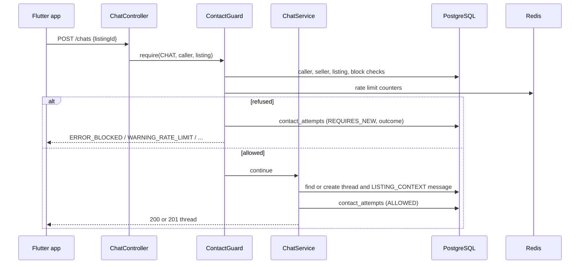

## D.7 Mobile Design

- `ListingActions` (built in Sprint 3 Part C) reads the new capabilities. Chat, Call and Video use the shared `SingleToneButton` with leading icons (already in place); **Make Offer** is added as a fourth secondary control in the same wrap, ahead of Add to Cart and Buy Now. Disabled controls keep their semantic label with the reason spoken ("Chat, unavailable"); the visual "Coming soon" text stays hidden as built.
- `CapabilityReason` gains `unavailable`, `notNegotiable`, `disabledBySeller`, `reserved`, `identityRequired`; an unknown value still maps to `other`.
- **Actions.** Chat: `POST /chats` then push `/chats/:threadId`. Call: request microphone permission (`permission_handler`), then `POST /calls/voice`. Video: consent sheet (G.7), camera and microphone permission, then `POST /calls/video`. Make Offer: open the offer sheet (I.7). `IDENTITY_REQUIRED` opens the existing Aadhaar entry. A guard in each controller ignores a second tap while a request is running.
- **Existing conversation.** When `contact.threadId` is present, the Chat button is labelled "Open chat" and goes straight to the thread; when `contact.negotiationId` is present the Make Offer button becomes "View offer".
- **Errors** are mapped once in `contact_error_messages.dart` to ARB strings (English and Hindi): `ERROR_BLOCKED`, `ERROR_SELLER_UNAVAILABLE`, `WARNING_RATE_LIMIT`, `ERROR_LISTING_NOT_AVAILABLE`, `ERROR_OWN_LISTING`, `ERROR_ACCOUNT_NOT_ACTIVE`; network failures use the standard "Unable to connect. Retry".
- The listing details page stays within the Soft Luxe layout: no new colours, the action bar keeps its pinned and scrolling behaviour at large text sizes.

## D.8 Validation Rules & Error Codes

| Rule | Code | HTTP |
|---|---|---|
| Caller account not active | `ERROR_ACCOUNT_NOT_ACTIVE` | 403 |
| Not signed in | the standard 401 (message: "Please login to contact seller") | 401 |
| Seller not active, or call target unreachable | `ERROR_SELLER_UNAVAILABLE`: "Seller is currently unavailable" | 409 |
| Either side blocked | `ERROR_BLOCKED`: "You cannot contact this seller" | 403 |
| Too many attempts | `WARNING_RATE_LIMIT`: "Too many contact attempts. Try again later" | 429 |
| Own listing | `ERROR_OWN_LISTING` | 409 |
| Listing not live | `ERROR_LISTING_NOT_AVAILABLE` (existing) | 404 |
| Contact options only for signed-in users | enforced by authentication on every endpoint | 401 |

## D.9 Security & NFR Notes

- The capability response never says that a block exists; blocks and suspended sellers give the same `UNAVAILABLE`.
- No request or response field contains a phone number or email of either party.
- Attempts are rate limited per pair and per day; all refusals are logged for Trust & Safety (HLD 06: monitor spam messaging).
- Adds two indexed lookups to the details endpoint; the 120 requests-per-minute details limit is unchanged and the endpoint stays under its current latency target.

## D.10 Testing Strategy

- **Unit:** every row of the rule table (including real estate and own listing), guard order, rate limits (per pair, per day), outcome recorded for each refusal, existing-thread detection, chat count.
- **Integration (PostgreSQL):** details response for owner, buyer, blocked buyer, suspended seller, real estate; refused attempts persist after a rolled-back request.
- **Mobile:** action bar for each capability combination, reason spoken, double-tap guard, "Open chat" and "View offer" labels, error mapping in Hindi, 320 px width and 200 percent text.

---

# Part E - US-013: Chat with Seller

**Story Points:** 8 | **Repos:** backend, mobile
**Dependency:** US-069, US-130, US-131
**Scope note (2026-10-25 update to the story):** Real Estate listings use chat, calls, video calls and negotiation only; the flow ends when the owner marks the property closed (US-118).

## E.1 Story Overview

**As a** buyer **I want** to chat with the seller **so that** I can ask questions about the item. Messages are stored, the other person is notified, and the whole history is available with timestamps.

### E.1.1 Edge Cases Covered

| Edge case | Handling |
|---|---|
| Seller does not respond | Nothing blocks the buyer; the seller gets a coalesced in-app notification and a push; the thread shows "Sent" and "Delivered" states; no auto-message. |
| Spam or inappropriate messages | Profanity is refused with `WARNING_CONTENT_FLAGGED`; contact details, links, repeated text and off-platform payment words are flagged (not refused); `CHAT_MESSAGES_PER_MIN`; automatic report after `CHAT_AUTO_REPORT_FLAGS` flags in 24 hours (E.5). |
| Listing deleted, sold or expired after the chat started | The thread stays readable and writable while both accounts are active (people may be coordinating a deal); it is read-only only when an Admin removed or rejected the listing (the `canSend` rule in E.5). |
| Network interruption during chat | Send uses a client message id; the app retries the same id; the server returns the stored message instead of a duplicate. History is re-read by sequence after reconnect. |
| User blocks the seller (or the reverse) | The thread becomes read-only for both (`ERROR_BLOCKED`); history stays visible (Part C). |
| Message of 2000 characters or more | Rejected with `ERROR_MESSAGE_TOO_LONG` (limit `CHAT_MESSAGE_MAX_CHARS`, counted in Unicode characters, so Hindi text is not penalised). |
| Empty or whitespace-only message | `ERROR_EMPTY_MESSAGE`. |
| Image over the size limit or not an image | `ERROR_IMAGE_TOO_LARGE`, `ERROR_IMAGE_INVALID`. |
| Two messages sent at the same moment | Per-thread sequence assigned under a row lock; ordering is by `seq`, never by device time. |
| Same account on two phones | Both receive the realtime event; read state is shared through the thread cursor. |
| Account of the other person closed | `canSend=false`, reason `ACCOUNT_UNAVAILABLE`; history is kept until retention ends. |

## E.2 Scope

**In scope:** threads and messages, send, history, delivered and read state, typing, unread counts and the chat badge, image messages, system messages (listing context; offer and call cards from Parts I, F and G), message screening, notification coalescing, retention clocks (Part H), the chat list and thread screens, the Chats tab.
**Out of scope:** voice and video (F, G), group chat, message edit and delete, voice notes, link previews, translation, human-support chat (US-045 is separate).

## E.3 Data Model

Part of migration `V34__chat_and_contact.sql` (provisional). Also adds `CHAT_IMAGE` to `MediaPurpose` (private, owner = the sending user, visibility private; delivered only through signed links) and seeds the `CommunicationSetting` defaults of section 1.6.

```sql
CREATE TABLE chat_threads (
    id                   UUID          PRIMARY KEY DEFAULT gen_random_uuid(),
    listing_id           UUID          NOT NULL REFERENCES listings (id),
    buyer_id             UUID          NOT NULL REFERENCES users (id),
    seller_id            UUID          NOT NULL REFERENCES users (id),
    listing_title        VARCHAR(200)  NOT NULL,      -- snapshot: survives listing deletion and edits
    listing_price        NUMERIC(12,2),
    last_seq             BIGINT        NOT NULL DEFAULT 0,
    last_message_at      TIMESTAMPTZ,
    last_message_type    VARCHAR(20),
    last_message_preview VARCHAR(120),
    buyer_read_seq       BIGINT        NOT NULL DEFAULT 0,
    seller_read_seq      BIGINT        NOT NULL DEFAULT 0,
    buyer_delivered_seq  BIGINT        NOT NULL DEFAULT 0,
    seller_delivered_seq BIGINT        NOT NULL DEFAULT 0,
    buyer_unread_count   INTEGER       NOT NULL DEFAULT 0,
    seller_unread_count  INTEGER       NOT NULL DEFAULT 0,
    created_at           TIMESTAMPTZ   NOT NULL DEFAULT now(),
    last_activity_at     TIMESTAMPTZ   NOT NULL DEFAULT now(),
    closed_at            TIMESTAMPTZ,                -- starts the retention clocks (Part H)
    close_reason         VARCHAR(30),
    purge_after          TIMESTAMPTZ,
    legal_hold           BOOLEAN       NOT NULL DEFAULT FALSE,
    CONSTRAINT uq_chat_threads_pair UNIQUE (listing_id, buyer_id),
    CONSTRAINT chk_chat_threads_parties CHECK (buyer_id <> seller_id)
);
CREATE INDEX idx_chat_threads_buyer   ON chat_threads (buyer_id,  last_activity_at DESC);
CREATE INDEX idx_chat_threads_seller  ON chat_threads (seller_id, last_activity_at DESC);
CREATE INDEX idx_chat_threads_listing ON chat_threads (listing_id);
CREATE INDEX idx_chat_threads_open    ON chat_threads (last_activity_at) WHERE closed_at IS NULL;
CREATE INDEX idx_chat_threads_purge   ON chat_threads (purge_after) WHERE purge_after IS NOT NULL AND legal_hold = FALSE;

CREATE TABLE chat_messages (
    id                UUID         PRIMARY KEY DEFAULT gen_random_uuid(),
    thread_id         UUID         NOT NULL REFERENCES chat_threads (id) ON DELETE CASCADE,
    seq               BIGINT       NOT NULL,
    sender_id         UUID         REFERENCES users (id),          -- null for a system message
    message_type      VARCHAR(20)  NOT NULL,
    body              TEXT,
    media_asset_id    UUID         REFERENCES media_assets (id),
    payload           JSONB,                                        -- system card data (listing, offer, call)
    notify_user_id    UUID         REFERENCES users (id),          -- the person a system message counts as unread for
    client_message_id UUID,
    flagged           BOOLEAN      NOT NULL DEFAULT FALSE,
    flag_reasons      VARCHAR(100),                                 -- CONTACT_INFO,EXTERNAL_LINK,REPEATED,OFF_PLATFORM_PAYMENT
    created_at        TIMESTAMPTZ  NOT NULL DEFAULT now(),
    CONSTRAINT uq_chat_messages_seq UNIQUE (thread_id, seq),
    CONSTRAINT chk_chat_messages_type CHECK (message_type IN
        ('TEXT', 'IMAGE', 'LISTING_CONTEXT', 'OFFER_EVENT', 'CALL_SUMMARY')),
    CONSTRAINT chk_chat_messages_user CHECK (
        (message_type IN ('TEXT', 'IMAGE') AND sender_id IS NOT NULL)
        OR (message_type NOT IN ('TEXT', 'IMAGE') AND sender_id IS NULL)),
    CONSTRAINT chk_chat_messages_content CHECK (
        (message_type = 'TEXT'  AND body IS NOT NULL AND length(body) > 0)
        OR (message_type = 'IMAGE' AND media_asset_id IS NOT NULL)
        OR message_type NOT IN ('TEXT', 'IMAGE'))
);
CREATE UNIQUE INDEX uq_chat_messages_client ON chat_messages (thread_id, sender_id, client_message_id)
    WHERE client_message_id IS NOT NULL;
CREATE INDEX idx_chat_messages_flagged ON chat_messages (created_at) WHERE flagged;
```

Read and delivered state is a cursor per participant, not a row per message: a message is Delivered when the recipient's `*_delivered_seq` is at least its `seq`, Read when `*_read_seq` is. Unread counts are stored on the thread, incremented when a message is inserted and recomputed from the cursor when it moves (E.5), so the list and the badge never scan messages. The text of the last message is stored only as a 120-character preview; it is deleted with the thread. HLD 03 suggests monthly partitioning of chat messages; this design does not partition in the MVP (unique constraints on a partitioned table must include the partition key, and retention deletes whole threads), see conflict C16.

## E.4 API Contract

```http
POST /api/v1/chats                                  -- {listingId}; 201 new thread, 200 existing
GET  /api/v1/chats?role=ALL|BUYING|SELLING&page=0&size=20
GET  /api/v1/chats/{threadId}
GET  /api/v1/chats/{threadId}/messages?beforeSeq=&afterSeq=&limit=30
POST /api/v1/chats/{threadId}/messages              -- send; 201 (200 when the client message id was already stored)
POST /api/v1/chats/{threadId}/delivered             -- {upToSeq}; 204
POST /api/v1/chats/{threadId}/read                  -- {upToSeq}; 204
GET  /api/v1/chats/unread-count                     -- {chatsUnread}
```

All endpoints require authentication and the caller must be the thread's buyer or seller; any other user gets 404.

**Thread (list item and detail):**

```json
{ "threadId": "8b3f...", "role": "BUYER",
  "listing": { "listingId": "a1...", "title": "Apple Watch", "price": 14500, "thumbnailUrl": "https://...", "available": true },
  "counterpart": { "userId": "u2...", "displayName": "Asha K" },
  "lastMessage": { "type": "TEXT", "preview": "Is the box included?", "at": "2026-11-14T09:12:00Z", "fromMe": false },
  "unreadCount": 2, "canSend": true, "readOnlyReason": null,
  "negotiation": { "negotiationId": "n1...", "state": "SELLER_REVIEWING" } }
```

`readOnlyReason`: `BLOCKED`, `ACCOUNT_UNAVAILABLE`, `LISTING_REMOVED`. The thread detail adds `lastSeq`, `myReadSeq`, `otherReadSeq`, `otherDeliveredSeq` so the app can draw Sent, Delivered and Read.

**Message:**

```json
{ "id": "m9...", "seq": 42, "type": "TEXT", "fromMe": true, "body": "Is the box included?",
  "image": null, "payload": null, "flags": [], "status": "DELIVERED", "createdAt": "2026-11-14T09:12:00Z" }
```

`type` is `TEXT`, `IMAGE` (with `image: {url, width, height, expiresAt}`, a short-lived signed link), `LISTING_CONTEXT` (`payload {listingId, title, price, thumbnailUrl}`), `OFFER_EVENT` (`payload {negotiationId, event, amount, round, state}`, Part I) or `CALL_SUMMARY` (`payload {callId, callType, outcome, durationSeconds}`, Parts F and G). `status` is only present on the caller's own messages.

**Send request:**

```json
{ "clientMessageId": "6f0c...", "type": "TEXT", "body": "Is the box included?" }
{ "clientMessageId": "7d11...", "type": "IMAGE", "mediaId": "c4..." }
```

A flagged but delivered message returns its `flags` in the response body so the app can show the safety tip.

**Image upload** uses the existing media API: the client asks for an upload authorisation with purpose `CHAT_IMAGE` and the content type and size, uploads straight to storage, completes the upload, and then sends the message with the `mediaId`. The server accepts the media only if it is `READY`, owned by the sender, of purpose `CHAT_IMAGE`, an image MIME type, within `CHAT_IMAGE_MAX_MB`, and not yet used in another message. Before the message is stored the server decodes the image and writes a sanitised copy (longest side 1600 px, JPEG, no EXIF or location data) through the existing `ImageVariantProcessor` port of the photo-variant story, with its size, pixel and time limits. The sanitised copy is the only version ever delivered and the uploaded original is deleted right after; an image that cannot be decoded is refused with `ERROR_IMAGE_INVALID`. A modified client therefore cannot leak its location through image metadata.

## E.5 Backend Design

- **`ChatService.openThread(callerId, listingId)`:** `ContactGuard.require(CHAT, ...)`; find the thread by `(listing_id, buyer_id)`; if missing, insert it with the listing snapshot (`listing_title`, `listing_price`) and a `LISTING_CONTEXT` system message with `seq = 1`; `INSERT ... ON CONFLICT DO NOTHING` plus a re-select makes two quick taps safe. Returns the thread.
- **`ChatService.send(callerId, threadId, request)`** (`@Transactional`):
  1. Rate limit `CHAT_MESSAGES_PER_MIN` per user (Redis); `RATE_LIMIT_EXCEEDED` when exceeded.
  2. `SELECT ... FROM chat_threads WHERE id = :id FOR UPDATE` and check that the caller is a participant (404 otherwise).
  3. `canSend`: both accounts `ACTIVE` (batch `ParticipantDirectoryPort`), not blocked (`BlockService`), listing not `REMOVED_BY_ADMIN` or `REJECTED` (through `ListingContextPort`). Otherwise `ERROR_BLOCKED`, `ERROR_SELLER_UNAVAILABLE` or `ERROR_THREAD_READ_ONLY`.
  4. Validate: type, trimmed body not empty (`ERROR_EMPTY_MESSAGE`), `codePointCount` not above `CHAT_MESSAGE_MAX_CHARS` (`ERROR_MESSAGE_TOO_LONG`); for images the media rules of E.4. The body is cleaned with `PlainText` (control characters and markup removed); it is never interpreted as HTML.
  5. **Idempotency:** if a row with the same `(thread_id, sender_id, client_message_id)` exists, return it with 200 and do nothing else.
  6. Screening (below). A blocked message throws `WARNING_CONTENT_FLAGGED` (422) before anything is stored.
  7. `seq = last_seq + 1`; insert the message; update the thread: `last_seq`, `last_message_*`, `last_activity_at`, and `unread_count` of the other participant `+ 1`. One statement each, same transaction.
  8. Publish `ChatMessageCreatedEvent` (AFTER_COMMIT) and return the message.
- **`ChatMessageListener` (AFTER_COMMIT, async):** sends `chat.message.created` to the recipient and the sender's other devices (A.4.3), updates the recipient's `badge.updated`, and dispatches a `CHAT_MESSAGE` notification: in-app at most once per `CHAT_NOTIFY_COALESCE_MINUTES` per thread (dedupe key `chat:{threadId}:{recipientId}:{bucket}`), push per `PushPolicy` with the FCM collapse key `chat:{threadId}` so the device shows only the latest. Copy: title "New message from {displayName}", body "Open JustQlic to read it" (decision D18). A failure is logged and never reaches the sender.
- **`MessageScreeningService.screen(body)`**, rule based, no AI:
  - *Refuse:* any term of the blocked-term lists (English, Hindi in Roman script and Devanagari; resource files `communication/blocked-terms-{en,hi}.txt`, owned by Trust & Safety, normalised by lower-casing, accent folding and a small leetspeak map).
  - *Flag, deliver:* `CONTACT_INFO` (an Indian mobile number in any spacing or with `+91`, an email address, a UPI id), `EXTERNAL_LINK` (a URL), `OFF_PLATFORM_PAYMENT` (a short word list such as "gpay", "phonepe", "paytm", "bank transfer" next to a number), `REPEATED` (the same text three times in 60 seconds).
  - A Redis counter per sender counts flagged messages for 24 hours; at `CHAT_AUTO_REPORT_FLAGS` a system report (`source = SYSTEM`, reason `SHARING_CONTACT_DETAILS` or `SPAM`) is created for Admin review (Part C). Flags are returned to both sides so the app shows "For your safety, keep chats and payments on JustQlic."
- **Delivered and read:** `markDelivered(userId, threadId, upToSeq)` and `markRead(...)` take the thread row lock, clamp `upToSeq` to the range from the caller's current cursor to `last_seq` (a client cannot deliver or read ahead of what exists) and move the cursor forward only. `markRead` then recomputes the caller's unread count from the new cursor: the messages after it that the other person sent, plus system messages whose `notify_user_id` is the caller. Both publish `chat.message.delivered` and `chat.read` to the other participant. Typing is relayed from the WebSocket and never stored.
- **History:** keyset pagination by `seq`: no cursor returns the latest `limit` messages (newest last); `beforeSeq` loads older; `afterSeq` loads what was missed after a reconnect. Image links are signed per response with a 10-minute lifetime (`ObjectStoragePort.createDownloadAuthorization`).
- **Thread list:** one query by `role`, ordered by `last_activity_at DESC`; listing thumbnails are fetched in one batch through `ListingPhotoLinkPort` (THUMBNAIL variant) and the `available` flag through `ListingEligibilityFilter.liveAmong`; both stay available for deleted listings through the stored snapshot, with the neutral placeholder.
- **System messages:** `postSystemMessage(threadId, type, payload)` takes the same row lock and sequence path; used by Parts F, G and I. A system message carries `notify_user_id`, the person it matters to (the receiver of an offer event, the callee of a missed call), and counts as unread for that person only; `LISTING_CONTEXT` and other cards have none.
- **Activity for other parts:** every user message publishes `ChatMessageCreatedEvent`; the negotiation module's `NegotiationActivityListener` (`BEFORE_COMMIT`, so it joins the same transaction) bumps the deadlines of the thread's open negotiations (Part L), which keeps an active conversation from expiring. The dependency points one way: negotiation listens to communication events and calls `ChatService.postSystemMessage`; communication reads a negotiation summary through the `ThreadNegotiationPort` it defines and negotiation implements.
- **Retention hooks:** `last_activity_at` feeds the inactivity close rule; `closed_at` and `purge_after` are set by `CommunicationClosureService` (Part H).
- **Badge:** `GET /chats/unread-count` sums the caller's unread counts by thread side; the same number rides in `badge.updated`.

## E.6 Sequence Diagram

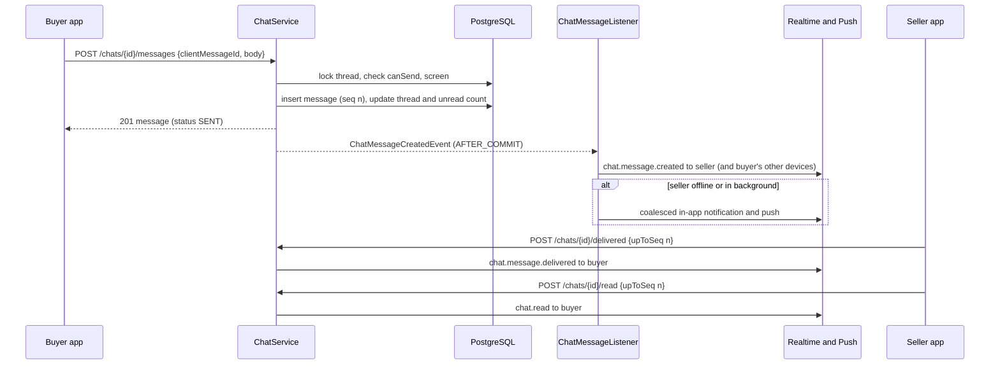

## E.7 Mobile Design (valuex-mobile)

- **Structure** (`features/chat/`): `data/chat_repository.dart` (REST over `ApiClient`), `domain/` (`ChatThread`, `ChatMessage`, `MessageStatus`, `ChatFlag`), `presentation/` with `chat_list_screen.dart`, `chat_thread_screen.dart`, widgets `message_bubble.dart`, `system_card.dart` (listing context, offer, call summary), `composer.dart`, `listing_header.dart`, `safety_banner.dart`, and providers `chat_list_controller`, `chat_thread_controller`, `chat_unread_provider` (Riverpod, generated, as in `saved_listings`).
- **Routes:** `/chats` (the Chats tab), `/chats/:threadId`; `RouteNames.chats`, `RouteNames.chatThread(id)` and the route guard (signed-in only). The bottom navigation `BottomNavItem.chats` stops calling `showComingSoon` and opens the list; its unread dot is driven by `chat_unread_provider` (the hard-coded `chatsHasUnread: true` placeholders on the Home and Search screens are removed).
- **Chat list:** rows with the listing thumbnail, title, counterpart name, last message preview, time, an unread count chip, and a "Selling" or "Buying" tag; filter chips All, Buying, Selling; pull to refresh; empty state ("No conversations yet. Start from a listing."); error state with Retry.
- **Thread screen:** the listing header card (tap opens the listing), a message list built newest first with date separators, own bubbles in brand blue and the other person's in the surface colour (contrast checked in the token test), system cards for listing context, offers and calls, status text under own messages (Sent, Delivered, Read) with a semantic label, typing indicator, the composer (multi-line field with a character counter near the limit, image attach through `image_picker` with a client-side resize to 1600 px to save data (the server sanitises every image anyway, E.4), Send). A first-open safety banner reminds users not to share OTPs, bank details or pay outside JustQlic (dismissible, remembered per install).
- **Sending states:** optimistic bubble with "Sending", failure state with Retry (same `clientMessageId`); an offline queue keeps unsent messages while the thread is open (HLD 05 "Chat Draft"). Scroll to the first unread on open; "New messages" chip when scrolled up.
- **Realtime:** `chatEventsProvider` applies `chat.message.created` (insert by `seq`, ignore duplicates), delivered and read cursors, typing (hidden after 4 seconds), `chat.thread.updated` (disable the composer with the read-only banner). After a reconnect it loads `afterSeq = last known`.
- **Accessibility and language:** every bubble has a spoken label with sender, text, time and status; touch targets 48 dp; 200 percent text and 320 px width must not overflow (as in the listing tests); all strings in English and Hindi ARB; long Hindi words wrap.
- **Errors:** `WARNING_CONTENT_FLAGGED` shows an inline message under the composer and keeps the text; `ERROR_MESSAGE_TOO_LONG` is prevented by the counter and also mapped; `ERROR_BLOCKED` and `ERROR_THREAD_READ_ONLY` switch the thread to read-only.

## E.8 Validation Rules & Error Codes

| Rule | Code | HTTP |
|---|---|---|
| Message longer than `CHAT_MESSAGE_MAX_CHARS` (2000) | `ERROR_MESSAGE_TOO_LONG`: "Message exceeds 2000 characters" | 422 |
| Empty or blank message | `ERROR_EMPTY_MESSAGE` | 422 |
| Blocked term found | `WARNING_CONTENT_FLAGGED`: "Message contains inappropriate content" (nothing stored; the user can edit and resend) | 422 |
| Seller or buyer account not active | `ERROR_SELLER_UNAVAILABLE`: "Seller is currently unavailable" | 409 |
| Either side blocked | `ERROR_BLOCKED` | 403 |
| Listing removed by an Admin | `ERROR_THREAD_READ_ONLY` | 409 |
| Image larger than `CHAT_IMAGE_MAX_MB` (5 MB) | `ERROR_IMAGE_TOO_LARGE`: "Image exceeds 5 MB" | 422 |
| Not an image, not owned, not ready or already used | `ERROR_IMAGE_INVALID` | 422 |
| More than `CHAT_MESSAGES_PER_MIN` messages in a minute | `RATE_LIMIT_EXCEEDED` (existing code) | 429 |
| Thread not found or caller not a participant | the not-found error | 404 |

Retention: chat history is kept `CHAT_RETENTION_DAYS` (default 180) after the conversation closes (Part H, decision D12).

## E.9 Security & NFR Notes

- Every query is scoped by the caller being the buyer or seller of the thread; image links are signed per response and expire in 10 minutes; a blocked person gets no link to new images.
- Message text is plain text end to end: sanitised on write, rendered as text by the app. It is never logged, never put in a push or a metric label, and never indexed by OpenSearch.
- Encryption at rest is provided by the database volume and backups (KMS managed) and, for images, by the bucket; the Admin evidence path is audited (Part H, decision D14).
- Performance: one row lock and three small statements per send; the thread row is the only hot row and is contended only by the two participants. Targets: send API p95 under 150 ms server time; list under 200 ms for 20 threads; history page under 100 ms.
- Observability: `chat.messages.sent{type}`, `chat.messages.refused{reason}`, `chat.messages.flagged{reason}`, `chat.send.latency`; none carries user content.
- Real-time latency (PRD under 1 second) is met by Part A: commit, publish, socket write.

## E.10 Testing Strategy

- **Unit:** send validation (length in code points including Devanagari and emoji, empty, image rules), idempotent resend, `seq` assignment, `canSend` for each reason, screening (blocked terms with spacing and leetspeak variants, phone formats, UPI, URL, repeated text), auto-report counter, coalescing key, delivered and read cursors, unread reset.
- **Integration (PostgreSQL, Redis, mocked storage):** two concurrent sends get distinct consecutive `seq`; duplicate `clientMessageId` returns one row; participant isolation (a third user gets 404); block makes the thread read-only; `afterSeq` returns exactly the missed messages; deleted listing keeps the thread readable; retention fields untouched by send.
- **Cursor and image safety:** `upToSeq` beyond `last_seq` is clamped and unread counts are recomputed correctly when messages arrive after the cursor; an uploaded JPEG with GPS metadata is delivered only as a sanitised copy without metadata, and an undecodable image is refused.
- **Controller:** all status codes of E.8, envelope shape, pagination bounds.
- **Mobile:** repository parsing, controller reducers (insert by `seq`, dedupe, status upgrade), composer states, offline retry with the same id, system cards, accessibility labels, Hindi, 320 px and 200 percent text, polling fallback.
- **Manual (two phones):** latency, background push, image send, block and report, flaky network (airplane mode toggle).

---

# Part F - US-014: Masked Voice Call

**Story Points:** 8 | **Repos:** backend, mobile
**Dependency:** US-013
**Scope note (2026-10-25 update to the story):** Included in the Real Estate flow (US-118).

## F.1 Story Overview

**As a** buyer **I want** to call the seller without revealing my number **so that** I can discuss details while keeping my privacy. The call runs inside the app (decision D4): no phone number of either person exists anywhere in the call, so numbers stay hidden by design, and the other person sees only a display name and the listing.

### F.1.1 Edge Cases Covered

| Edge case | Handling |
|---|---|
| Seller does not answer | The call rings `CALL_RING_SECONDS` (45 s), then ends as `NO_ANSWER`; the caller sees `ERROR_NO_ANSWER`; the seller gets a missed-call notification and a chat summary. |
| Call drops mid-conversation | Each side sends a heartbeat every 15 s; 45 s without one from either side ends the call as `DROPPED` at the last heartbeat time of the person who went quiet. Duration is kept up to that moment. |
| Poor network | The SDK network-quality callback drives a quality indicator on the call screen (client only); the call is not ended for quality alone. |
| Microphone permission denied | The app asks before it calls the API; on refusal it shows `ERROR_MICROPHONE_PERMISSION` with a shortcut to settings; nothing is created. |
| Call service unavailable | If the app cannot join the media channel the call ends as `JOIN_FAILED` and the caller sees `ERROR_CALL_FAILED`. |
| Callee already on another call | `ERROR_USER_BUSY` ("The other person is on another call"). |
| Caller already in a call | `ERROR_CALL_IN_PROGRESS`. |
| Both call each other at once | The second request is refused with `ERROR_CALL_IN_PROGRESS` and the app shows the incoming call. |
| Caller hangs up while it rings | `CANCELLED`; the ringing stops on the callee's device. |
| Callee's app is closed | A high-priority push shows a heads-up notification; the ringing window still applies (B.7, decision D15). |
| One side blocks the other during the call | The call ends (`BLOCKED`) and no further call is possible (Part C). |
| Call longer than `CALL_MAX_MINUTES` (30) | Warned two minutes before; ended by the server at the limit (`MAX_DURATION`); the media token also expires then. |
| Caller ID | The callee sees "JustQlic call", the caller's display name and the listing title; no number. |

## F.2 Scope

**In scope:** call creation, accept, decline, cancel, join, connected confirmation, heartbeat, end, thread call history, the call state machine, the Agora token adapter, the provider webhook receiver, the watchdog job, call summaries in chat, missed-call notifications, the mobile call screens and permissions.
**Out of scope:** video and recording (Part G; the same tables and endpoints serve both), PSTN bridging through Exotel or Twilio (a later adapter behind the same port, O3), call recording of voice calls (decision D5), conference calls, native incoming-call UI (D15).

## F.3 Data Model

Part of migration `V35__call_sessions.sql` (provisional). HLD 02 names `call_logs` and `video_sessions`; one table serves both because they share over 90 percent of their columns (conflict C15). Recording columns are used by Part G only.

```sql
CREATE TABLE call_sessions (
    id                     UUID         PRIMARY KEY DEFAULT gen_random_uuid(),
    call_type              VARCHAR(5)   NOT NULL,                  -- VOICE | VIDEO
    thread_id              UUID         REFERENCES chat_threads (id) ON DELETE SET NULL,
    listing_id             UUID         NOT NULL REFERENCES listings (id),
    caller_id              UUID         NOT NULL REFERENCES users (id),
    callee_id              UUID         NOT NULL REFERENCES users (id),
    state                  VARCHAR(10)  NOT NULL,                  -- RINGING | ACCEPTED | ACTIVE | ENDED
    end_reason             VARCHAR(20),
    rtc_channel            VARCHAR(64)  NOT NULL,
    requested_at           TIMESTAMPTZ  NOT NULL DEFAULT now(),
    ringing_expires_at     TIMESTAMPTZ  NOT NULL,
    accepted_at            TIMESTAMPTZ,
    caller_joined_at       TIMESTAMPTZ,
    callee_joined_at       TIMESTAMPTZ,
    connected_at           TIMESTAMPTZ,
    ended_at               TIMESTAMPTZ,
    duration_seconds       INTEGER,
    max_ends_at            TIMESTAMPTZ,
    last_heartbeat_caller_at TIMESTAMPTZ,
    last_heartbeat_callee_at TIMESTAMPTZ,
    caller_consent_at      TIMESTAMPTZ,                           -- video only (Part G)
    callee_consent_at      TIMESTAMPTZ,
    consent_notice_version VARCHAR(30),
    recording_status       VARCHAR(10)  NOT NULL DEFAULT 'NONE',   -- NONE | STARTING | RECORDING | STOPPED | UPLOADED | FAILED | DELETED
    recording_resource_id  VARCHAR(300),
    recording_sid          VARCHAR(300),
    recording_object_key   VARCHAR(400),
    recording_size_bytes   BIGINT,
    recording_started_at   TIMESTAMPTZ,
    recording_uploaded_at  TIMESTAMPTZ,
    recording_delete_after TIMESTAMPTZ,
    recording_deleted_at   TIMESTAMPTZ,
    flagged                BOOLEAN      NOT NULL DEFAULT FALSE,
    legal_hold             BOOLEAN      NOT NULL DEFAULT FALSE,
    purge_after            TIMESTAMPTZ,                           -- call-log retention (Part H)
    version                BIGINT       NOT NULL DEFAULT 0,
    created_at             TIMESTAMPTZ  NOT NULL DEFAULT now(),
    CONSTRAINT uq_call_sessions_channel UNIQUE (rtc_channel),
    CONSTRAINT chk_call_sessions_parties CHECK (caller_id <> callee_id),
    CONSTRAINT chk_call_sessions_type CHECK (call_type IN ('VOICE', 'VIDEO')),
    CONSTRAINT chk_call_sessions_state CHECK (state IN ('RINGING', 'ACCEPTED', 'ACTIVE', 'ENDED')),
    CONSTRAINT chk_call_sessions_end CHECK ((state = 'ENDED') = (end_reason IS NOT NULL)),
    CONSTRAINT chk_call_sessions_recording CHECK (
        recording_status = 'NONE'
        OR (call_type = 'VIDEO' AND caller_consent_at IS NOT NULL AND callee_consent_at IS NOT NULL))
);
CREATE INDEX idx_call_sessions_thread   ON call_sessions (thread_id, requested_at DESC);
CREATE INDEX idx_call_sessions_caller   ON call_sessions (caller_id, requested_at DESC);
CREATE INDEX idx_call_sessions_callee   ON call_sessions (callee_id, requested_at DESC);
CREATE INDEX idx_call_sessions_ringing  ON call_sessions (ringing_expires_at) WHERE state = 'RINGING';
CREATE INDEX idx_call_sessions_live     ON call_sessions (max_ends_at) WHERE state IN ('ACCEPTED', 'ACTIVE');
CREATE INDEX idx_call_sessions_rec_del  ON call_sessions (recording_delete_after)
    WHERE recording_status = 'UPLOADED' AND recording_deleted_at IS NULL AND legal_hold = FALSE;
CREATE INDEX idx_call_sessions_purge    ON call_sessions (purge_after) WHERE purge_after IS NOT NULL AND legal_hold = FALSE;

CREATE TABLE call_events (
    id          UUID        PRIMARY KEY DEFAULT gen_random_uuid(),
    call_id     UUID        NOT NULL REFERENCES call_sessions (id) ON DELETE CASCADE,
    event_type  VARCHAR(30) NOT NULL,   -- REQUESTED, PUSH_SENT, ACCEPTED, DECLINED, CANCELLED, JOINED, LEFT, CONNECTED,
                                        -- HEARTBEAT_LOST, ENDED, CONSENT_GIVEN, RECORDING_*, REPORTED, WEBHOOK
    actor_id    UUID,
    occurred_at TIMESTAMPTZ NOT NULL DEFAULT now(),
    detail      JSONB
);
CREATE INDEX idx_call_events_call ON call_events (call_id, occurred_at);
```

`rtc_channel` is `c_` plus 32 random hex characters, never derived from user or listing ids. `call_events` is the timestamped log US-016 asks for; heartbeats are kept in Redis (`call:hb:{callId}:{userId}`, value = the epoch time of the last beat, 300 s TTL so the time is still known when the 45 s rule fires) and both last times are copied to the row when the call ends.

**State machine** (`CallState` and `CallStateMachine extends StateMachine<CallState>`, as the other lifecycle modules; each transition writes a `call_events` row and publishes `CallStateChangedEvent`):

| From | To | Action | Trigger |
|---|---|---|---|
| `RINGING` | `ACCEPTED` | `ACCEPT` | Callee accepts |
| `RINGING` | `ENDED` | `DECLINE`, `CANCEL`, `TIMEOUT`, `BLOCK` | Callee declines, caller cancels, watchdog, block |
| `ACCEPTED` | `ACTIVE` | `BOTH_JOINED` | Both clients confirm they joined the channel |
| `ACCEPTED` | `ENDED` | `JOIN_TIMEOUT`, `CANCEL`, `FAIL`, `BLOCK` | `CALL_JOIN_SECONDS` passed, either side leaves, error |
| `ACTIVE` | `ENDED` | `END`, `MAX_DURATION`, `DROP`, `BLOCK`, `FAIL` | Hang up, limit reached, heartbeats lost, block, error |

End reasons stored in `end_reason`: `COMPLETED`, `DECLINED`, `CANCELLED`, `NO_ANSWER`, `JOIN_FAILED`, `DROPPED`, `MAX_DURATION`, `BLOCKED`, `SYSTEM_ERROR`.

## F.4 API Contract

```http
POST /api/v1/calls/voice            -- {listingId, threadId?}; 201
POST /api/v1/calls/video            -- Part G
GET  /api/v1/calls/{callId}         -- state for either participant
POST /api/v1/calls/{callId}/accept  -- callee; 200
POST /api/v1/calls/{callId}/decline -- callee; 200
POST /api/v1/calls/{callId}/cancel  -- caller, while ringing or accepted; 200
POST /api/v1/calls/{callId}/join    -- either participant once ACCEPTED or ACTIVE; 200 RtcCredentials
POST /api/v1/calls/{callId}/connected -- client confirms it joined the channel; 200
POST /api/v1/calls/{callId}/heartbeat -- 204 (also available as the WebSocket frame call.heartbeat)
POST /api/v1/calls/{callId}/end     -- either participant; 200, idempotent
GET  /api/v1/calls?threadId=&page=0&size=20   -- call history of a thread
POST /api/v1/webhooks/rtc           -- provider notifications; HMAC signature; public path
```

**Create response (201):**

```json
{ "callId": "c7...", "type": "VOICE", "state": "RINGING", "threadId": "8b3f...",
  "counterpart": { "userId": "u2...", "displayName": "Asha K" },
  "listing": { "listingId": "a1...", "title": "Apple Watch" },
  "ringingExpiresAt": "2026-11-14T09:13:00Z", "maxMinutes": 30, "serverTime": "2026-11-14T09:12:15Z" }
```

**Join response:** the credentials are issued only after the call is accepted, so a channel name and token are never handed out for a call nobody agreed to (and the provider does not bill for waiting).

```json
{ "provider": "agora", "appId": "…", "channel": "c_5f0b…", "uid": 1, "token": "007…",
  "expiresAt": "2026-11-14T09:45:00Z", "media": "AUDIO" }
```

`uid` is 1 for the caller and 2 for the callee (the channel exists for one call only). The `mock` provider returns fixed values so the app and CI can run without Agora.

**Call history item:** `callId`, `type`, `direction` (`OUTGOING` or `INCOMING`), `outcome` (`COMPLETED`, `MISSED`, `DECLINED`, `NO_ANSWER`, `FAILED`), `requestedAt`, `durationSeconds`.

## F.5 Backend Design

- **`CallService.create(callerId, request, type)`** (`@Transactional`): `ContactGuard.require(CALL, ...)` (Part D); take `pg_advisory_xact_lock` on the two user ids in ascending order, then check that neither user has a call in `RINGING`, `ACCEPTED` or `ACTIVE` (`ERROR_CALL_IN_PROGRESS` for the caller, `ERROR_USER_BUSY` for the callee); reachability of the callee (D.5, `ERROR_SELLER_UNAVAILABLE`); find or create the thread (`ChatService.openThread` logic); insert the call in `RINGING` with `ringing_expires_at = now + CALL_RING_SECONDS`; write the `REQUESTED` event. After commit: publish `call.incoming` to the callee over the WebSocket and send the high-priority push (`CALL_INCOMING`, B.5).
- **Accept, decline, cancel:** load by id with `FOR UPDATE` and the participant check (404 for others); run the transition through `CallStateMachine`; on accept set `accepted_at` and `max_ends_at = accepted_at + CALL_MAX_MINUTES + join allowance`. Each publishes `call.updated` to both parties.
- **Join:** valid only in `ACCEPTED` or `ACTIVE` for a participant; `RtcProviderPort.createCredentials(call, userId)` builds a token that expires at `max_ends_at + valuex.rtc.token-grace`; writes `JOINED`. Joining twice returns a fresh token (reconnect after a network change).
- **Connected:** records `caller_joined_at` or `callee_joined_at`; when both are set the call moves `ACCEPTED -> ACTIVE` (`BOTH_JOINED`), `connected_at = now()` (server clock), and the heartbeat clocks start. The provider webhook `channel join` events also feed this and win when they disagree by more than 5 seconds (they are the less spoofable source).
- **Heartbeat:** `SET call:hb:{callId}:{userId} <epoch milliseconds> EX 300`; no database write per beat. The value is the last time that person was heard from; the key outlives the 45 second rule so the exact time is still available when the watchdog applies it.
- **End:** either participant; `duration_seconds = ended_at - connected_at` (0 when never connected); posts a `CALL_SUMMARY` system message to the thread (`COMPLETED` with the duration, or `MISSED` for the callee's view of `NO_ANSWER`, `CANCELLED`); idempotent (a second end returns the stored result).
- **`CallWatchdogJob`** (every `valuex.communication.job.watchdog-interval`, `FOR UPDATE SKIP LOCKED`, batch 200, safe on several instances): `RINGING` past `ringing_expires_at` becomes `NO_ANSWER` via `TIMEOUT`; `ACCEPTED` past `accepted_at + CALL_JOIN_SECONDS` becomes `JOIN_FAILED` via `JOIN_TIMEOUT`; `ACTIVE` where either participant's last heartbeat (the Redis value, or `connected_at` when none was ever recorded) is more than 45 seconds old becomes `DROPPED` via `DROP`, with `ended_at` set to the older of the two last-heartbeat times (the other person would otherwise be alone in the channel) and both times copied to the row; any call past `max_ends_at` becomes `MAX_DURATION`. Each is counted in `call.ended{reason}`.
- **Missed call:** when a call ends as `NO_ANSWER` or `CANCELLED` before it was answered, the callee gets a `CALL_MISSED` notification (in-app and push) and the chat summary says "Missed call".
- **Block interplay:** `BlockService` publishes an event; `CallService` ends any live call of the pair with `BLOCK`.
- **`AgoraTokenBuilder`** produces the provider's AccessToken2 (HMAC-SHA256 over the app id, certificate, channel, uid, privileges and expiry) locally with no network call; the algorithm is the provider's published open-source builder and is vendored and unit-tested against known vectors (spike item G.5). Secrets come from configuration; the certificate never leaves the server.
- **`RtcWebhookController`** (public path in `SecurityConfig`, not behind JWT): verifies the HMAC signature header in constant time, rejects a stale timestamp, de-duplicates by provider event id (a short Redis key), and hands `join` and `leave` events to `CallService`. Unknown events are acknowledged and ignored. Invalid signatures return 401 and are counted (`rtc.webhook.rejected`).
- **Notifications:** event types `CALL_INCOMING` and `VIDEO_CALL_REQUEST` (push only), `CALL_MISSED`; copy in English and Hindi in `CommunicationNotificationCopy`, naming the caller's display name only.
- **Rate limits:** `CALL_ATTEMPTS_PER_PAIR_PER_HOUR` and the contact limits of Part D; heartbeat and join are not limited beyond a generous per-call ceiling (60 per minute).

## F.6 Sequence Diagram

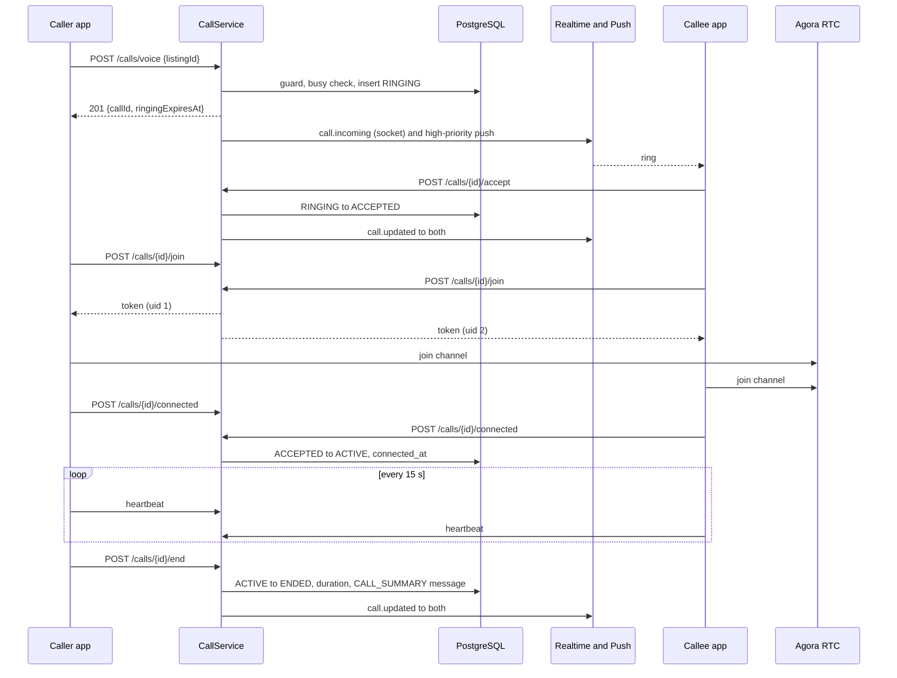

## F.7 Mobile Design (valuex-mobile)

- **Structure** (`features/calls/`): `data/call_repository.dart`; `domain/` (`Call`, `CallState`, `CallEndReason`, `RtcCredentials`); `data/rtc/rtc_client.dart` (an interface) with `AgoraRtcClient` (package `agora_rtc_engine`, version pinned in the spike) and a `FakeRtcClient` for tests; `presentation/` with `call_controller.dart` (Riverpod notifier: `idle`, `requesting`, `outgoingRinging`, `incomingRinging`, `joining`, `active`, `ended(reason)`), `incoming_call_screen.dart`, `in_call_screen.dart`, `call_ended_sheet.dart`, widgets `call_controls.dart` and `network_quality_chip.dart`.
- **Routes:** `/call/:callId` (full-screen, no bottom navigation). A global `CallOverlayListener` under the app shell listens to `call.incoming` and navigates to the incoming-call screen, even from another screen.
- **Outgoing flow:** tap Call, check microphone permission (`permission_handler`; on refusal `ERROR_MICROPHONE_PERMISSION` with an Open settings action), `POST /calls/voice`, show "Calling..." with a Cancel action, then on `ACCEPTED` call `join` and join the channel through `RtcClient`, then `connected`. Ringing ends with the server state; the app never ends a call locally without telling the server.
- **Incoming flow:** full-screen ringing UI with the caller's display name, the listing title, Accept and Decline (48 dp minimum, large touch areas); a vibration and the system ringtone while the screen is open; a silent timeout when `ringingExpiresAt` passes.
- **In-call (voice):** initial avatar, name, listing title, the timer from `connected_at` (server time), Mute, Speaker, End, Report; a note "Calls are not recorded"; a network-quality chip fed by the SDK callback; a two-minute warning banner before `max_ends_at`; a heartbeat timer (15 s) through the socket with REST fallback; audio route changes and phone interruptions end or pause the call as the platform dictates.
- **Platform setup:** Android `RECORD_AUDIO`, `MODIFY_AUDIO_SETTINGS`, `FOREGROUND_SERVICE` and `FOREGROUND_SERVICE_MICROPHONE` (an ongoing-call foreground service keeps the call alive in the background), `POST_NOTIFICATIONS`; iOS `NSMicrophoneUsageDescription` (localised) and the `audio` background mode.
- **Ended sheet:** outcome text (`ERROR_NO_ANSWER`: "Seller didn't answer. Try again later", declined, dropped, limit reached) with Call again and Chat actions.
- **Call history:** call summaries appear as system cards in the thread (E.7) and the thread has a Calls list via `GET /calls?threadId=`.
- **Accessibility and language:** controls have semantic labels and states ("Mute, on"); the timer is announced at intervals, not continuously; 200 percent text and 320 px width must not overflow; English and Hindi strings.

## F.8 Validation Rules & Error Codes

| Rule | Code | HTTP |
|---|---|---|
| Microphone permission refused | `ERROR_MICROPHONE_PERMISSION`: "Microphone access required for calls" (client side, before any request) | - |
| Cannot reach the media service, token or join failure | `ERROR_CALL_FAILED`: "Unable to connect call. Please try again" | 502 or client |
| No answer in the ringing window | `ERROR_NO_ANSWER`: "Seller didn't answer. Try again later" (end reason `NO_ANSWER`) | - |
| Seller or callee not reachable, or not active | `ERROR_SELLER_UNAVAILABLE` | 409 |
| Callee on another call | `ERROR_USER_BUSY` | 409 |
| Caller already in a call, or the pair already has one ringing | `ERROR_CALL_IN_PROGRESS` | 409 |
| Action not valid in the current state (for example accept after timeout) | `ERROR_CALL_NOT_ACTIVE` | 409 |
| Caller is not a participant | the not-found error | 404 |
| Blocked, rate limited, own listing | `ERROR_BLOCKED`, `WARNING_RATE_LIMIT`, `ERROR_OWN_LISTING` (Part D) | 403, 429, 409 |
| Duration | at most `CALL_MAX_MINUTES` (30) | ends the call |
| Retention | call logs kept `CALL_LOG_RETENTION_DAYS` (180) after the conversation closes (Part H) | - |

## F.9 Security & NFR Notes

- **Masking by construction.** No DTO, event, push, notification, log line or token contains a phone number or email. The channel name is random and is revealed only to accepted participants. Tokens are per user and per call, expire at the call's limit plus 60 s, and give publisher rights to that channel only.
- Only participants can read a call or act on it; another user gets 404. Webhooks are authenticated by signature, not by network location.
- Provider secrets are held in the secret manager; the certificate is never logged or returned.
- Performance: ringing starts within about 2 seconds of the tap at p95 (one insert, one publish, one push call after commit); the watchdog scans small partial indexes; heartbeats cost no database writes.
- Availability: a media-provider outage affects calls only (`ERROR_CALL_FAILED`); chat, offers and listing details continue.
- Cost control: credentials are issued only after acceptance, the call is capped at 30 minutes by both the server and the token, and voice is never recorded.

## F.10 Testing Strategy

- **Unit:** `CallStateMachine` (every allowed and a sample of forbidden transitions), duration maths (never connected, dropped, completed, limit), end idempotency, busy and in-progress checks including the concurrent case, reachability rule, token expiry maths and signature test vectors, webhook signature and replay, summary message content.
- **Integration (PostgreSQL, Redis, mock RTC adapter, fake clock):** full happy path, no answer, decline, cancel, join timeout, drop by missed heartbeat, limit reached, block ends the call, participant isolation, two simultaneous requests between the same users create one call, watchdog with two instances does not double-process.
- **Heartbeats:** the call drops when either participant is silent for 45 seconds, and `ended_at` equals the older last-heartbeat time.
- **Controller:** status codes and envelopes of F.8, public webhook path with and without a valid signature.
- **Mobile:** controller states with `FakeRtcClient` and a fake realtime stream, permission refusal, ringing timeout, cancel, accept, hang up, drop handling, two-minute warning, incoming call from another screen, Hindi and large-text layouts.
- **Manual (two real phones, different networks):** audio quality, Wi-Fi to mobile data switch, screen off, Bluetooth headset, app killed on the callee, 30-minute limit.

---

# Part G - US-015: Video Call with Recording

**Story Points:** 8 | **Repos:** backend, mobile
**Dependency:** US-014
**Scope note (2026-10-25 update to the story):** Included in the Real Estate flow (US-118).

## G.1 Story Overview

**As a** buyer **I want** to video call the seller to see the item **so that** I can check its condition. Before the call both people see "This call will be recorded for safety" and must agree; the video is stored securely and deleted 30 days after the conversation closes.

### G.1.1 Edge Cases Covered

| Edge case | Handling |
|---|---|
| User denies camera or microphone permission | The app asks before the request; refusal shows `ERROR_CAMERA_PERMISSION`; nothing is created. |
| Seller rejects the video call | End reason `DECLINED`; the buyer sees `ERROR_SELLER_DECLINED`; chat summary "Video call declined". |
| Poor network causes lag | Client-side `WARNING_LOW_BANDWIDTH` banner from the SDK quality callback with a "Turn off video" option; audio and the recording continue. |
| Recording fails but the call proceeds | `recording_status = FAILED`; both see "Recording unavailable but call can proceed" (`ERROR_RECORDING_FAILED` as an information message); the call is not stopped. |
| User wants to download the recording | Not offered in the MVP (decision D5); only an Admin can retrieve a recording for a dispute (Part H). A person who needs a copy goes through support (O8). |
| Consent not given | The server refuses to create or accept a video call without consent from that side (`ERROR_CONSENT_REQUIRED`), and the database refuses any recording status other than `NONE` without both consents. |
| Consent text changes | The server's current notice version must match; otherwise `ERROR_CONSENT_OUTDATED` and the app refreshes the notice. |
| Abuse during a call | A Report action marks the call `flagged` and puts a hold on its recording (Part C, G.5). |
| Storage unavailable or full | The recording fails as above and the failure reason (`STORAGE`) is logged; no user-facing blocking. |
| Call longer than 30 minutes | Ended by the server; the recording is stopped and finalised. |
| Consent withdrawn during the call | There is no mid-call opt-out: the person ends the call, and recording stops at the end (stated in the notice). |

## G.2 Scope

**In scope:** video call creation with consent, accept with consent, recording start, stop and finalisation, recording file handling and metadata, failure handling, retention deletion of recordings, reporting, video call screens and permissions, the consent notice endpoint.
**Out of scope:** user download or sharing of recordings (decision D5), recording of voice calls, live streaming, screen sharing, blur or background effects, Admin playback UI (Sprint 10).

## G.3 Data Model

No new table: the recording and consent columns are in `call_sessions` (F.3), with the database rule that `recording_status` can only be other than `NONE` when `call_type = 'VIDEO'` and both consent timestamps are set. The recordings go to a separate private bucket `<prefix>-call-recordings` (setting `valuex.recording.bucket-suffix`) with these rules, applied by the infra story:

- No public access, no ACL objects; server-side encryption with a customer-managed KMS key; versioning off.
- The provider writes with a dedicated key that has `PutObject` on `recordings/*` only. The application reads and deletes with its own role; no person has standing access.
- No age-based lifecycle rule. The storage layer cannot see legal holds or the configurable retention settings (an Admin can raise the inactivity close to 365 days and recordings to 90 days), so a fixed lifetime could destroy valid or held evidence. Deletion belongs to the retention job; a weekly, hold-aware orphan sweep in `RecordingReconcileJob` removes objects that have no matching call row or whose row is `DELETED`.
- Object keys are `recordings/{callId}/{provider file name}`: no user id, name or listing id.

## G.4 API Contract

```http
GET  /api/v1/calls/video/consent-notice        -- {version, text: {en, hi}}
POST /api/v1/calls/video                       -- {listingId, threadId?, consent: true, noticeVersion}; 201
POST /api/v1/calls/{callId}/accept             -- video body {consent: true, noticeVersion}; 200
POST /api/v1/reports                           -- {targetType: "CALL", targetId, reason}; reports during or after a call
```

The remaining lifecycle (`decline`, `cancel`, `join`, `connected`, `heartbeat`, `end`, `GET`, history) is Part F. A video call response adds `"media": "VIDEO"`, `"recordingStatus"` (`NONE`, `STARTING`, `RECORDING`, `FAILED`) and `"consentNoticeVersion"`. The `call.updated` event carries `recordingStatus` so the in-call "Recording" indicator is accurate: it shows only when `RECORDING` (never claimed without a real recording), and the "Recording unavailable" message appears when `FAILED`.

**Consent notice.** The text lives on the server (English and Hindi) with a version such as `video-recording-v1`, so wording can change after legal review without an app release. It states: the call is recorded for safety, who can see it (only authorised Trust & Safety staff when needed), how long it is kept (30 days after the conversation closes), and that ending the call stops the recording.

## G.5 Backend Design

- **Create and accept.** `CallService.create(..., VIDEO)` requires `consent = true` and the current `noticeVersion` (`ERROR_CONSENT_REQUIRED`, `ERROR_CONSENT_OUTDATED`) and stores `caller_consent_at` and `consent_notice_version`; the callee's `accept` requires the same and stores `callee_consent_at`. A decline stores no consent. Consent is also written to `call_events` (`CONSENT_GIVEN`) with the notice version.
- **Recording start.** After the call becomes `ACTIVE` (both consents are on the row, the invariant is also checked in code), a `CallStateChangedEvent` listener (AFTER_COMMIT, async) calls `RecordingService.start(callId)` if `valuex.recording.enabled`. It sets `recording_status = STARTING`, calls `RecordingPort.acquire(channel)` then `start(...)`, stores `recording_resource_id` and `recording_sid`, and sets `RECORDING` with `recording_started_at`. A recording bot joins the channel with its own uid and a token made for it. The recording is a single mixed file of both participants (mode "mix") at a modest resolution (about 640 by 480, 15 frames per second, to keep a 30-minute call near 100 to 150 MB; confirmed in the spike), written by the provider straight to the private bucket under the prefix `recordings/{callId}`.
- **Failure handling.** Any failure in acquire or start is retried once after 5 seconds; then `recording_status = FAILED`, a `RECORDING_FAILED` event with a reason (`PROVIDER`, `STORAGE`, `CONFIG`), a `call.updated` event, and the call continues. The recording is never silently assumed. `ERROR_STORAGE_FULL` is the internal reason code when the bucket refuses the write.
- **Stop and finalise.** When the call ends (any reason) `RecordingService.stop(callId)` stops the provider recording and stores the returned file list. The provider's upload-complete notification (webhook, same receiver as Part F) sets `recording_object_key`, `recording_size_bytes`, `recording_uploaded_at` and `UPLOADED`. `RecordingReconcileJob` (every 10 minutes) asks the provider for calls that are `STOPPED` or `RECORDING` for more than 10 minutes after the call ended and either completes the metadata or marks `FAILED` after 2 hours.
- **Retention.** `recording_delete_after` is set when the conversation closes (`closed_at + VIDEO_RECORDING_RETENTION_DAYS`, Part H). `CommunicationRetentionJob` deletes the object through `ObjectStoragePort.delete` on the recordings bucket, sets `recording_deleted_at` and `DELETED`, and skips rows with `legal_hold`. A recording whose conversation never closes is still bounded by the inactivity close rule (D12).
- **Reporting.** `ReportService` on a `CALL` target sets `flagged = true` and `legal_hold = true` on the call, so reported footage is not auto-deleted before review (Part C).
- **Access.** There is no user-facing recording URL. The only access is the Admin evidence endpoint of Part H, which returns a 5-minute signed link and writes an access log row.
- **Spike (half a day before building, results recorded in the pull request):** confirm that the provider's recording can write to the S3-compatible store we use (otherwise a dedicated S3 bucket is used for recordings only), mix versus individual recording, India data-residency and region options, cost per recorded minute, HLS versus MP4 output for Admin playback, the exact webhook signature scheme and event names, and whether a recording bot token must be renewed during a 30-minute call.

## G.6 Sequence Diagram

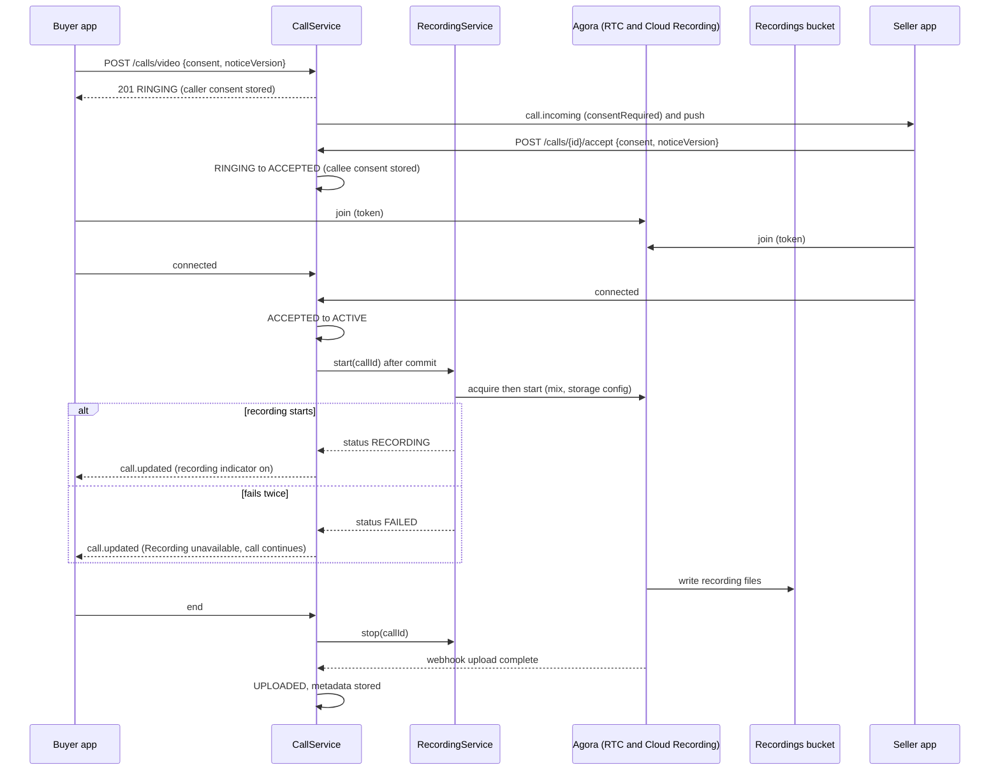

## G.7 Mobile Design (valuex-mobile)

- **Consent sheet** (caller, before the request) and **incoming screen** (callee): the server-provided notice text in the user's language, a single primary button ("I agree, start video call" or "Accept and join") and a clear Cancel or Decline; no pre-ticked box and no way to skip (the story says it cannot be skipped). The notice version is sent back with the action.
- **Permissions:** camera and microphone through `permission_handler`; refusal shows `ERROR_CAMERA_PERMISSION` and the Open settings shortcut. A video call needs both permissions; a person who only wants to talk uses a voice call.
- **In-call screen:** remote video full screen, local preview as a small draggable picture-in-picture, controls Mute, Camera on or off, Flip camera, Speaker, End, Report; a "Recording" indicator with the error colour dot and a semantic label, shown only while `recordingStatus` is `RECORDING`; the "Recording unavailable but call can proceed" banner when `FAILED`; the network-quality chip and the `WARNING_LOW_BANDWIDTH` banner with "Turn off video" (turns the camera off and keeps audio); the two-minute warning banner; the timer from the server `connected_at`.
- **Report** opens the report sheet (Part C) and does not interrupt the call.
- **Rendering and platform:** the SDK's platform view for video inside the design-system scaffold; portrait only; the screen stays awake during the call; Android foreground service types `camera` and `microphone`; iOS `NSCameraUsageDescription` and `NSMicrophoneUsageDescription` (localised) with the `audio` background mode, and no VoIP push or CallKit in the MVP (decision D15). The app cannot prevent a person from capturing their own screen; the notice is the disclosure.
- **Strings** (English and Hindi ARB): consent texts come from the server; labels, banners and errors are ARB entries. All controls have 48 dp targets and semantic labels; layouts hold at 200 percent text.

## G.8 Validation Rules & Error Codes

| Rule | Code | HTTP |
|---|---|---|
| Camera or microphone permission refused | `ERROR_CAMERA_PERMISSION`: "Camera and microphone access required" (client side) | - |
| Seller declines | `ERROR_SELLER_DECLINED`: "Seller declined video call" (end reason `DECLINED`) | - |
| Recording could not start or finish | `ERROR_RECORDING_FAILED`: "Recording unavailable but call can proceed" (information, shown from `recordingStatus = FAILED`) | - |
| Poor connection | `WARNING_LOW_BANDWIDTH`: "Poor connection. Video quality may be affected" (client side) | - |
| Missing consent on create or accept | `ERROR_CONSENT_REQUIRED` | 422 |
| Notice version out of date | `ERROR_CONSENT_OUTDATED` | 409 |
| Duration | at most `CALL_MAX_MINUTES` (30) | ends the call |
| Recording kept | `VIDEO_RECORDING_RETENTION_DAYS` (30) after the conversation closes; deleted by the retention job unless on hold | - |
| Reported call | `flagged` and `legal_hold` until an Admin clears it | - |
| All other call errors | as Part F.8 (`ERROR_SELLER_UNAVAILABLE`, `ERROR_USER_BUSY`, `ERROR_CALL_IN_PROGRESS`, `ERROR_BLOCKED`, ...) | - |

## G.9 Security & NFR Notes

- **Consent is evidence:** timestamps and the notice version are stored per call and per party, and are visible to the dispute process; recording cannot exist without them (database rule plus code check).
- **Encrypted at rest:** the recordings bucket uses SSE-KMS; the database and backups are encrypted by the platform (decision D14). In transit: TLS to the API; the provider's media is encrypted on the wire.
- **Least privilege:** the provider's key is write-only to one prefix; the application role cannot list other buckets; nobody has standing read access; every retrieval is a signed 5-minute link with an audit row (Part H).
- **Privacy:** only call participants are recorded, only video calls, only with consent, with a defined retention and a hold for reports. Legal review of the consent text and of retention under Indian data-protection law (the Digital Personal Data Protection Act, 2023) is an open item (O7).
- **Cost and capacity:** a mixed 30-minute recording is estimated at 100 to 150 MB; at 30 days retention the storage is bounded and monitored by `recording.storage.bytes` (a gauge from the reconcile job). A global kill switch (`valuex.recording.enabled`) lets operations stop recording without stopping calls.
- Failure of recording never ends a call and never blocks listing, chat or negotiation.

## G.10 Testing Strategy

- **Unit:** consent rules (missing, outdated, one side only), the database rule (a recording status without consent is refused), recording state transitions including retry then failure, finalisation from the webhook and from the reconcile job, deletion eligibility (past date, hold, already deleted), report sets hold.
- **Integration (PostgreSQL, mock recording client, mock storage):** full video call with recording, recording failure while the call continues, stop on every end reason, webhook completes the metadata, reconcile marks failed after two hours, retention deletes only eligible recordings and never a held one.
- **Controller:** consent notice endpoint, create and accept payloads, error codes.
- **Mobile:** consent sheet and incoming screen content from a fake notice, no way to proceed without the button, indicator shown only while `RECORDING`, failure banner, low-bandwidth banner and "Turn off video", permission refusal, report during a call, Hindi and large text.
- **Manual (two phones):** real recording in a staging bucket, deletion after the retention window using a shortened setting, report-and-hold, behaviour on a poor network.

---

# Part H - US-016: Communication History Storage

**Story Points:** 5 | **Repos:** backend
**Dependency:** US-015

## H.1 Story Overview

**As a** platform **I want** to store all communication history **so that** disputes can be resolved with evidence. Chats, call logs and video recordings are logged with timestamps, stored encrypted, retrievable by Admins for a case, and deleted on schedule.

### H.1.1 Edge Cases Covered

| Edge case | Handling |
|---|---|
| Storage limit exceeded | A recording that cannot be written fails as in G.5 (`ERROR_STORAGE_FULL` is the logged reason); chat images fail through the existing media errors; the metric `recording.storage.bytes` and an alert warn before the limit. |
| User asks for their data to be deleted | Recommended behaviour in H.5 (anonymise the user's messages unless a hold or open dispute applies); the service method is built, its trigger depends on the account-closure rules (O9). |
| Inappropriate content | The auto-report and the Admin report queue of Part C reach the evidence service; flagged messages are findable (`flagged` index). |
| Very old logs | After retention the data is deleted for good; there is no archive tier. Data under legal hold is kept until the hold is lifted. |
| A dispute is raised just before the retention date | `CommunicationHoldPort.hold(...)` (called by the dispute module, Sprint 8) sets `legal_hold` on the thread and its calls; the job skips held rows. |
| Conversation never leads to a transaction | The inactivity close rule (D12) starts the retention clocks after `COMM_INACTIVE_CLOSE_DAYS`. |
| Listing deleted | Threads and calls are kept (they reference the listing) and the snapshot title survives; deletion of the listing closes the conversation and starts retention. |
| Backups | Purged data remains in encrypted backups until they expire (HLD 03 section 12); a restore re-applies the purge (O12). |
| An Admin reads a conversation | Every retrieval writes an immutable access log row with a case reference and a reason. |

## H.2 Scope

**In scope:** the closure rules that start retention clocks, the retention job for chat, calls, recordings and contact attempts, legal holds, the evidence service and the Admin endpoints, the access log, anonymisation of a user's messages, metrics.
**Out of scope:** the Admin console screens (US-057, Sprint 10), the dispute workflow (US-047, US-055, Sprint 8; it calls the hold and evidence ports built here), user-facing export, legal discovery tooling.

## H.3 Data Model

Part of migration `V34__chat_and_contact.sql` (provisional):

```sql
CREATE TABLE communication_access_log (
    id             UUID         PRIMARY KEY DEFAULT gen_random_uuid(),
    admin_id       UUID         NOT NULL REFERENCES users (id),
    access_type    VARCHAR(30)  NOT NULL,      -- LIST_THREADS | READ_MESSAGES | READ_CALL | RECORDING_LINK | HOLD | RELEASE_HOLD
    target_type    VARCHAR(10)  NOT NULL,      -- THREAD | CALL | USER
    target_id      UUID,
    case_reference VARCHAR(60)  NOT NULL,
    reason         VARCHAR(300) NOT NULL,
    accessed_at    TIMESTAMPTZ  NOT NULL DEFAULT now()
);
CREATE INDEX idx_comm_access_log_target ON communication_access_log (target_type, target_id, accessed_at);
CREATE INDEX idx_comm_access_log_admin  ON communication_access_log (admin_id, accessed_at);

-- append-only: updates and deletes are refused (the same rule as the financial ledgers)
CREATE FUNCTION trg_comm_access_log_immutable() RETURNS trigger AS $$
BEGIN RAISE EXCEPTION 'communication_access_log is append-only'; END; $$ LANGUAGE plpgsql;
CREATE TRIGGER comm_access_log_no_update BEFORE UPDATE OR DELETE ON communication_access_log
    FOR EACH ROW EXECUTE FUNCTION trg_comm_access_log_immutable();
```

The retention fields already exist: `chat_threads.closed_at`, `close_reason`, `purge_after`, `legal_hold` (E.3) and `call_sessions.purge_after`, `recording_delete_after`, `legal_hold` (F.3). Settings used: `CHAT_RETENTION_DAYS`, `CALL_LOG_RETENTION_DAYS`, `VIDEO_RECORDING_RETENTION_DAYS`, `COMM_INACTIVE_CLOSE_DAYS`, `CONTACT_ATTEMPT_RETENTION_DAYS` (section 1.6).

**Retention summary (HLD 03 sections 9 and 14 made concrete):**

| Data | Kept | Clock starts |
|---|---|---|
| Chat messages and threads | `CHAT_RETENTION_DAYS` (180, about 6 months) | `closed_at` |
| Call logs (`call_sessions`, `call_events`) | `CALL_LOG_RETENTION_DAYS` (180) | `closed_at` of the thread |
| Video recordings | `VIDEO_RECORDING_RETENTION_DAYS` (30) | `closed_at` of the thread |
| Chat images | with the thread | `closed_at` |
| Contact attempts | `CONTACT_ATTEMPT_RETENTION_DAYS` (180) | created time |
| Access log | 7 years (audit class in HLD 03 section 14) | created time |
| Anything under `legal_hold` | until the hold is lifted | - |

## H.4 API Contract

All paths are under `/api/v1/admin/**`, which `SecurityConfig` already limits to `ADMIN` and `SUPER_ADMIN`; the recording link additionally requires `SUPER_ADMIN`. Every request must carry the header `X-Case-Reference` (for example a dispute id) and a `reason` query parameter or body field of at least 10 characters; without them the call fails with `ERROR_CASE_REFERENCE_REQUIRED`.

```http
GET    /api/v1/admin/communications/threads?listingId=&userId=&page=0&size=20
GET    /api/v1/admin/communications/threads/{threadId}/messages?afterSeq=&limit=100
GET    /api/v1/admin/communications/calls/{callId}
GET    /api/v1/admin/communications/calls/{callId}/recording-link     -- 5-minute signed link
POST   /api/v1/admin/communications/holds        -- {targetType: THREAD|CALL, targetId}; 201
DELETE /api/v1/admin/communications/holds/{targetType}/{targetId}
GET    /api/v1/admin/communications/access-log?targetId=&page=0&size=50
```

Thread and message responses include both participants' user ids, display names and roles (`BUYER`, `SELLER`), the full timeline with system messages, flags, and the call list; they never include a phone number or email. The recording link response is `{url, expiresAt}` and is refused unless the recording is `UPLOADED` and not deleted (`ERROR_RETRIEVAL_FAILED` otherwise, with a reason).

## H.5 Backend Design

- **Closure (`CommunicationClosureService.close(threadId, reason)`).** Sets `closed_at`, `close_reason`, `purge_after = closed_at + CHAT_RETENTION_DAYS`; for the thread's calls `purge_after = closed_at + CALL_LOG_RETENTION_DAYS` and, where a recording is `UPLOADED`, `recording_delete_after = closed_at + VIDEO_RECORDING_RETENTION_DAYS`. It publishes `ThreadClosedEvent`. Triggers:
  1. `ListingStatusChangedEvent` to `SOLD` (this includes the US-118 property close), `REMOVED_BY_ADMIN`, `REJECTED` or `DEACTIVATED_BY_SELLER`, and `ListingDeletedEvent`. `EXPIRED` is not a closure because a listing can be renewed.
  2. An order closing (Sprint 5 and 6): the order lifecycle publishes `OrderClosedEvent(listingId, buyerId, sellerId)` and communication closes the matching thread. Until that event exists, trigger 1 covers a sale.
  3. Inactivity: `CommunicationInactivityJob` (daily) closes threads with `last_activity_at` older than `COMM_INACTIVE_CLOSE_DAYS` that have no open negotiation, no `ACTIVE` price agreement and no live call (reason `INACTIVE`).
  4. A new message in a thread closed as `INACTIVE` reopens it: `closed_at` and `purge_after` are cleared; a recording already scheduled for deletion keeps its date (earlier deletion is the privacy-safe side).
- **`CommunicationRetentionJob`** (daily at 02:30; batches of 500 with `FOR UPDATE SKIP LOCKED`; metrics `retention.deleted{type}`, counts and durations only, no content in logs): (a) threads with `purge_after <= now()` and no hold: delete the chat images through `MediaAssetService.delete`, then the thread (messages cascade; its calls keep their own dates because `thread_id` is `ON DELETE SET NULL`); (b) calls with `purge_after <= now()` and no hold: delete the row (events cascade); (c) recordings with `recording_delete_after <= now()` and no hold: delete the object, set `DELETED`; (d) contact attempts older than the setting. Each batch runs in its own transaction; a failure in one thread is logged with its id and does not stop the batch.
- **Holds.** `CommunicationHoldPort.hold(targetType, targetId, caseReference)` sets `legal_hold` (on a thread it also holds all of the thread's calls) and writes an access log row; `release` clears it, and if the retention date has passed the next job run deletes. The dispute module calls the port when a dispute opens (Sprint 8). A report on any target holds the containing thread and its calls (Part C); closing the report releases that hold.
- **Evidence service (`CommunicationEvidenceService`).** Each method checks the headers, writes one `communication_access_log` row (and an `AuditLogger` entry) before returning data, reads through the repositories, and maps to the Admin DTOs. Recording links use `ObjectStoragePort.createDownloadAuthorization` for the recordings bucket with a 5-minute lifetime. The case reference is checked through `CaseReferencePort.isOpenAndAuthorised(adminId, caseReference)`, implemented by the dispute module in Sprint 8; until then the default implementation checks only the format, so Sprint 4 relies on the role split (`SUPER_ADMIN` for recordings), the mandatory reason, the immutable access log and an alert on unusual volume (`communication.evidence.reads{admin}`). The audit row is written even when retrieval then fails (`ERROR_RETRIEVAL_FAILED`).
- **Anonymisation (`CommunicationErasureService.anonymiseUser(userId)`).** Replaces the user's message bodies with a removed marker, deletes their chat images and clears flags and previews, in threads that have no hold, open dispute or active agreement; held threads are processed when the hold ends. The method is built and tested here; it is called by the account-closure flow once that flow defines when (O9).
- **Encryption.** At rest by the platform (database volume, backups, bucket KMS key, decision D14); the evidence endpoints are the only read path besides the participants' own APIs.

## H.6 Sequence Diagram

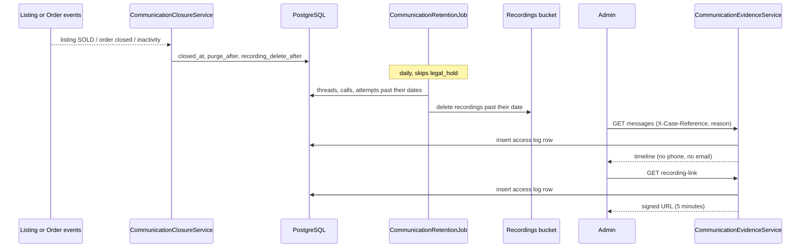

## H.7 Mobile Design

None: this is a backend story. The user-facing disclosures it depends on are part of Parts E and G: the chat safety banner and the video consent notice state how long data is kept. The privacy policy and the in-app help text are updated by the product team (O7).

## H.8 Validation Rules & Error Codes

| Rule | Code | HTTP |
|---|---|---|
| Missing case reference or reason | `ERROR_CASE_REFERENCE_REQUIRED` | 422 |
| Conversation, call or recording cannot be read | `ERROR_RETRIEVAL_FAILED`: "Unable to load conversation history" | 502 |
| Recording cannot be stored | `ERROR_STORAGE_FULL`: "Unable to store recording" (logged reason of a failed recording, not returned to users) | - |
| Hold target not found | the not-found error | 404 |
| Retention | chat 6 months, call logs 6 months, video recordings 30 days after the conversation closes | - |

## H.9 Security & NFR Notes

- Only `ADMIN` and `SUPER_ADMIN` reach the evidence endpoints and only `SUPER_ADMIN` can obtain a recording link; a real case registry check arrives with the dispute module (Sprint 8) and finer roles (for example read-only analysts) with the Admin console (Sprint 10, O11). Participants never read other people's history.
- Reading evidence is always logged in an append-only table (database trigger), with who, what, which case and why; the log itself is kept for 7 years.
- Messages and recordings are encrypted at rest and in transit; recording links expire in 5 minutes; no recording URL is ever stored.
- Logs and metrics from the jobs contain counts and ids only.
- Performance: the retention job works in batches over partial indexes (`purge_after`, `recording_delete_after`, `closed_at IS NULL`); one pass over a million threads stays inside its maintenance window because only rows past their date are touched.

## H.10 Testing Strategy

- **Unit:** closure date maths for each trigger and setting, reopen rule, hold propagation (thread to calls), job selection (past date, held, already deleted), erasure scope, evidence header validation, access-log write before retrieval and on failure, the trigger refusing updates and deletes (integration).
- **Integration (PostgreSQL, mock storage, fake clock):** SOLD closes the thread, the job deletes after the retention window, a held thread survives, a released hold is deleted on the next run, recordings are deleted only past their date, inactivity close respects open negotiations and live calls, Admin endpoints return the timeline and write the log, non-admin users get 403.
- **Holds from reports:** a report on a message holds its thread and calls; closing the report lets the next retention run delete; a recording link needs `SUPER_ADMIN`.
- **Controller:** Admin role enforcement and header requirements.
- **Operational check:** a staging run with shortened settings proves messages, calls, recordings and images disappear on schedule and that held items stay.

---

# Part I - US-017: Price Negotiation

**Story Points:** 8 | **Repos:** backend, mobile
**Dependency:** US-013
**Scope note (2026-10-25 update to the story, and the US-118 update of 2026-11-13):** For Real Estate the offer is made against the normalised listing price (sale price, monthly rent or "starting from" price) and the flow ends after negotiation, with no checkout. A negotiated price stays private to its buyer-seller pair and never changes the shared listing price.

## I.1 Story Overview

**As a** buyer **I want** to negotiate the price with the seller **so that** I can get a better deal. The buyer taps Make Offer and enters a price; the seller accepts, counters or rejects; a counter can be accepted, countered again or declined; an accepted price is locked so the buyer can check out at it.

### I.1.1 Edge Cases Covered

| Edge case | Handling |
|---|---|
| Absurdly low offer (for example 90 percent off) | Below `NEGOTIATION_LOW_OFFER_PERCENT` (50) of the asking price the server answers `WARNING_LOW_OFFER`; the buyer confirms with `confirmLowOffer = true` to send it. |
| Offer above the asking price, zero or negative | `ERROR_INVALID_OFFER` with the allowed range. |
| Several buyers negotiating on one listing | Each buyer has their own negotiation; the listing stays live. Exclusivity starts when the seller accepts one (Part J). |
| Seller changes mind after accepting | The accepted price cannot be reversed by the seller (decision D20). If both agree to change it, the buyer cancels and makes a new offer. |
| Negotiation inactive for days | Expires automatically (Part L). |
| Buyer makes an offer and disappears | The seller's offer expires after `NEGOTIATION_INACTIVITY_HOURS` (48); nothing else is blocked. |
| Seller lowers or raises the asking price during a negotiation | Offers stay as made; at acceptance the agreed price is the lower of the offer and the current asking price; counter ranges use the current asking price. |
| Listing sold, removed, deleted or expired meanwhile | Open negotiations are cancelled (`LISTING_UNAVAILABLE`) and both people are told. |
| Offer on a listing marked not negotiable, or without a price | `ERROR_NOT_NEGOTIABLE`. |
| Double tap or retry after a network error | `clientRequestId` makes the call idempotent; only one open negotiation per buyer and listing exists (partial unique index). |
| Answering an offer that was already countered, cancelled or expired | `ERROR_OFFER_NOT_CURRENT` or `ERROR_NEGOTIATION_EXPIRED`; the app refreshes. |
| Buyer re-offers right after a rejection | Refused for `NEGOTIATION_REOFFER_COOLDOWN_HOURS` (24); no cooldown after an expiry. |
| Too many negotiations by one buyer | `NEGOTIATION_OPEN_PER_BUYER_MAX` (20) and `OFFERS_PER_MIN` (HLD 06: mass negotiation monitoring). |
| Blocked, unverified, or the seller's own listing | `ERROR_BLOCKED`, `AADHAAR_VERIFICATION_REQUIRED` (existing gating code, decision D9), `ERROR_OWN_LISTING`. |

## I.2 Scope

**In scope:** the negotiation, offer, history and price agreement tables; the extended state machine; create offer, accept, reject, counter, cancel and read endpoints; rules for amounts, rounds and corridors; price lock through `price_agreements`; reaction to listing and account changes; notifications and chat cards; the buyer-side mobile screens.
**Out of scope:** the seller's offers inbox, the exclusivity rule and auto-reject of other offers (Part J), the checkout guard (Part K), expiry jobs (Part L), Buy Now (Part M), counter-offer chat messages typed by users (offers are structured; free talk stays in chat), automatic acceptance (the story forbids it).

## I.3 Data Model

Migration `V36__negotiation_and_price_agreements.sql` (provisional); also seeds `NegotiationSetting` defaults.

```sql
CREATE TABLE negotiations (
    id                UUID          PRIMARY KEY DEFAULT gen_random_uuid(),
    listing_id        UUID          NOT NULL REFERENCES listings (id),
    buyer_id          UUID          NOT NULL REFERENCES users (id),
    seller_id         UUID          NOT NULL REFERENCES users (id),
    thread_id         UUID          REFERENCES chat_threads (id) ON DELETE SET NULL,
    state             VARCHAR(30)   NOT NULL,       -- see the state table below
    listed_price      NUMERIC(12,2) NOT NULL,       -- asking price when the negotiation started
    real_estate       BOOLEAN       NOT NULL DEFAULT FALSE,
    round_count       INTEGER       NOT NULL DEFAULT 0,
    last_offer_by     VARCHAR(6),                   -- BUYER | SELLER
    last_offer_amount NUMERIC(12,2),
    agreed_price      NUMERIC(12,2),
    agreed_at         TIMESTAMPTZ,
    last_activity_at  TIMESTAMPTZ   NOT NULL DEFAULT now(),
    expires_at        TIMESTAMPTZ,                  -- inactivity deadline while a response is awaited
    max_lifetime_at   TIMESTAMPTZ   NOT NULL,
    warning_sent_at   TIMESTAMPTZ,
    closed_at         TIMESTAMPTZ,
    closed_reason     VARCHAR(30),
    version           BIGINT        NOT NULL DEFAULT 0,
    created_at        TIMESTAMPTZ   NOT NULL DEFAULT now(),
    CONSTRAINT chk_negotiations_parties CHECK (buyer_id <> seller_id),
    CONSTRAINT chk_negotiations_rounds CHECK (round_count >= 0)
);
-- one open negotiation per buyer and listing
CREATE UNIQUE INDEX uq_negotiations_open ON negotiations (listing_id, buyer_id)
    WHERE state IN ('SELLER_REVIEWING', 'BUYER_REVIEWING', 'OFFER_ACCEPTED');
CREATE INDEX idx_negotiations_buyer   ON negotiations (buyer_id, last_activity_at DESC);
CREATE INDEX idx_negotiations_seller  ON negotiations (seller_id, last_activity_at DESC);
CREATE INDEX idx_negotiations_listing ON negotiations (listing_id, state);
CREATE INDEX idx_negotiations_expiry  ON negotiations (expires_at)
    WHERE state IN ('SELLER_REVIEWING', 'BUYER_REVIEWING');
CREATE INDEX idx_negotiations_thread  ON negotiations (thread_id) WHERE thread_id IS NOT NULL;

CREATE TABLE offers (
    id                  UUID          PRIMARY KEY DEFAULT gen_random_uuid(),
    negotiation_id      UUID          NOT NULL REFERENCES negotiations (id) ON DELETE CASCADE,
    offered_by          UUID          NOT NULL REFERENCES users (id),
    party               VARCHAR(6)    NOT NULL,     -- BUYER | SELLER
    amount              NUMERIC(12,2) NOT NULL,
    round_no            INTEGER       NOT NULL,
    status              VARCHAR(12)   NOT NULL DEFAULT 'PENDING', -- PENDING|SUPERSEDED|ACCEPTED|REJECTED|EXPIRED|CANCELLED
    low_offer_confirmed BOOLEAN       NOT NULL DEFAULT FALSE,
    client_request_id   UUID,
    created_at          TIMESTAMPTZ   NOT NULL DEFAULT now(),
    responded_at        TIMESTAMPTZ,
    CONSTRAINT chk_offers_amount CHECK (amount > 0),
    CONSTRAINT uq_offers_round UNIQUE (negotiation_id, round_no)
);
CREATE UNIQUE INDEX uq_offers_client ON offers (negotiation_id, client_request_id) WHERE client_request_id IS NOT NULL;

-- HLD 02 calls this offer_status_history; it records every state transition of the negotiation
CREATE TABLE negotiation_status_history (
    id             UUID          PRIMARY KEY DEFAULT gen_random_uuid(),
    negotiation_id UUID          NOT NULL REFERENCES negotiations (id) ON DELETE CASCADE,
    from_state     VARCHAR(30),
    to_state       VARCHAR(30)   NOT NULL,
    action         VARCHAR(30)   NOT NULL,
    actor_id       UUID,                            -- null for the system (jobs, listing events)
    reason         VARCHAR(30),
    amount         NUMERIC(12,2),
    created_at     TIMESTAMPTZ   NOT NULL DEFAULT now()
);
CREATE INDEX idx_negotiation_history_neg ON negotiation_status_history (negotiation_id, created_at);

CREATE TABLE price_agreements (
    id             UUID          PRIMARY KEY DEFAULT gen_random_uuid(),
    listing_id     UUID          NOT NULL REFERENCES listings (id),
    buyer_id       UUID          NOT NULL REFERENCES users (id),
    seller_id      UUID          NOT NULL REFERENCES users (id),
    negotiation_id UUID          REFERENCES negotiations (id),
    source         VARCHAR(8)    NOT NULL,          -- OFFER | BUY_NOW
    agreed_price   NUMERIC(12,2) NOT NULL,
    status         VARCHAR(10)   NOT NULL DEFAULT 'ACTIVE', -- ACTIVE|CONSUMED|EXPIRED|CANCELLED|SUPERSEDED
    valid_until    TIMESTAMPTZ   NOT NULL,
    created_at     TIMESTAMPTZ   NOT NULL DEFAULT now(),
    ended_at       TIMESTAMPTZ,
    ended_reason   VARCHAR(30),                     -- EXPIRED, CANCELLED_BY_BUYER, PRICE_CHANGED, LISTING_UNAVAILABLE, CONSUMED, ...
    consumed_ref   UUID,                            -- the order id, set by Sprint 5
    CONSTRAINT chk_price_agreements_source CHECK (source IN ('OFFER', 'BUY_NOW')),
    CONSTRAINT chk_price_agreements_price CHECK (agreed_price > 0)
);
-- exclusivity: at most one active agreement per listing
CREATE UNIQUE INDEX uq_price_agreements_active ON price_agreements (listing_id) WHERE status = 'ACTIVE';
CREATE INDEX idx_price_agreements_buyer  ON price_agreements (buyer_id, status);
CREATE INDEX idx_price_agreements_expiry ON price_agreements (valid_until) WHERE status = 'ACTIVE';
```

**State machine.** `NegotiationState` and `NegotiationStateMachine` exist from Sprint 0. The service uses them as they are for the buyer and seller flow and adds four states or transitions that the skeleton lacks (conflict C17). `BUYER_OFFER_SENT` and `SELLER_COUNTERED` are transient: the service performs `NOTIFY_SELLER` and `NOTIFY_BUYER` in the same transaction, so a stored negotiation is always in one of `SELLER_REVIEWING`, `BUYER_REVIEWING`, `OFFER_ACCEPTED` or a closed state; each transition, including the transient ones, writes a `negotiation_status_history` row.

| From | To | Action | Status |
|---|---|---|---|
| `NEGOTIATION_STARTED` | `BUYER_OFFER_SENT` | `SEND_OFFER` | existing |
| `BUYER_OFFER_SENT` | `SELLER_REVIEWING` | `NOTIFY_SELLER` | existing |
| `SELLER_REVIEWING` | `OFFER_ACCEPTED` / `OFFER_REJECTED` / `SELLER_COUNTERED` | `ACCEPT_OFFER` / `REJECT_OFFER` / `COUNTER_OFFER` | existing |
| `SELLER_COUNTERED` | `BUYER_REVIEWING` | `NOTIFY_BUYER` | existing |
| `BUYER_REVIEWING` | `OFFER_ACCEPTED` / `OFFER_REJECTED` / `BUYER_OFFER_SENT` | `ACCEPT_OFFER` / `REJECT_OFFER` / `COUNTER_OFFER` | existing |
| `SELLER_REVIEWING`, `BUYER_REVIEWING` | `NEGOTIATION_EXPIRED` | `EXPIRE` | existing |
| `NEGOTIATION_STARTED`, `BUYER_OFFER_SENT`, `SELLER_REVIEWING` | `NEGOTIATION_CANCELLED` | `CANCEL` | existing |
| `BUYER_REVIEWING` | `NEGOTIATION_CANCELLED` | `CANCEL` | **new** (listing unavailable, account closed) |
| `OFFER_ACCEPTED` | `NEGOTIATION_EXPIRED` | `EXPIRE_ACCEPTANCE` | **new** (price lock ended, Part L) |
| `OFFER_ACCEPTED` | `NEGOTIATION_CANCELLED` | `CANCEL` | **new** (buyer walks away, listing unavailable) |
| `OFFER_ACCEPTED` | `NEGOTIATION_CONVERTED` (new state) | `CONSUME_ACCEPTANCE` | **new** (used by Sprint 5 when the order is created) |

`closed_reason` values: `REJECTED_BY_SELLER`, `DECLINED_BY_BUYER`, `CANCELLED_BY_BUYER`, `EXPIRED`, `ACCEPTANCE_EXPIRED`, `SUPERSEDED`, `LISTING_UNAVAILABLE`, `ACCOUNT_UNAVAILABLE`, `REPLACED_BY_BUY_NOW`, `CONVERTED`.

**Listing lifecycle (decision D6).** The listing state machine is not changed. `BUYER_INQUIRY_PENDING` and `NEGOTIATION_IN_PROGRESS` stay unused for per-pair negotiations and `ListingState.isLiveForBuyers()` stays `PUBLISHED` only. This answers the open question of Sprint 3 (section 8, item 3, and its conflict C9): chats and negotiations do not hide a listing; only an active price agreement does (Parts J and M), and that is applied at search time (M.5).

## I.4 API Contract

```http
POST /api/v1/listings/{listingId}/offers     -- make an offer; 201 (200 when clientRequestId repeats)
GET  /api/v1/negotiations?role=BUYER|SELLER&status=OPEN|CLOSED&page=0&size=20
GET  /api/v1/negotiations/{negotiationId}
POST /api/v1/offers/{offerId}/accept         -- the party whose turn it is
POST /api/v1/offers/{offerId}/reject
POST /api/v1/offers/{offerId}/counter        -- {amount, clientRequestId}
POST /api/v1/negotiations/{negotiationId}/cancel   -- buyer withdraws
```

`POST .../offers` requires an Aadhaar-verified caller (`@RequiresIdentityVerification`, decision D9). All endpoints are authenticated; a user who is not the buyer or seller of a negotiation gets 404.

```json
{ "amount": 12000.00, "clientRequestId": "9a3c...", "confirmLowOffer": false }
```

**Negotiation response (the same shape for the buyer and the seller; `role` tells whose view it is):**

```json
{ "negotiationId": "n1...", "role": "BUYER", "state": "SELLER_REVIEWING", "awaiting": "SELLER",
  "listing": { "listingId": "a1...", "title": "Apple Watch", "thumbnailUrl": "https://...", "askingPrice": 14500, "available": true },
  "buyer":  { "userId": "u1...", "displayName": "Ravi", "rating": null },
  "seller": { "userId": "u2...", "displayName": "Asha K", "rating": 4.8 },
  "round": 1, "maxRounds": 5,
  "offers": [ { "offerId": "o1...", "party": "BUYER", "amount": 12000.00, "round": 1, "status": "PENDING",
                "createdAt": "2026-11-14T09:12:00Z" } ],
  "agreedPrice": null, "priceLockExpiresAt": null,
  "expiresAt": "2026-11-16T09:12:00Z", "warnAt": "2026-11-15T09:12:00Z",
  "actions": { "canAccept": false, "canReject": false, "canCounter": false, "canCancel": true },
  "counterRange": null, "threadId": "8b3f...", "serverTime": "2026-11-14T09:12:01Z" }
```

`awaiting` is `BUYER`, `SELLER` or `NONE` (closed or accepted). `actions` is computed for the caller so the app never guesses. `counterRange` is `{min, max}` for the party who may counter, otherwise null.

## I.5 Backend Design

**Rules (`OfferRulesService`):**

| Who and when | Allowed amount |
|---|---|
| Buyer, first offer | more than 0 and not above the asking price |
| Seller counter | above the buyer's last offer and not above the asking price |
| Buyer counter | not below the buyer's previous offer and below the seller's last counter |
| Accept | the responder accepts the other party's last offer at its amount |

Amounts have at most two decimals and never exceed the asking price of the listing at that moment. A counter equal to the other party's last price is refused with a hint to use Accept. Every submitted price (offer or counter) counts as one round; at `NEGOTIATION_MAX_ROUNDS` (5) no further price can be submitted (`ERROR_MAX_NEGOTIATIONS` for the buyer, `WARNING_MAX_NEGOTIATIONS` for the seller), and the responder can only accept or reject (decision D8). A buyer's first offer below `NEGOTIATION_LOW_OFFER_PERCENT` of the asking price needs `confirmLowOffer = true`.

**`NegotiationService.createOffer`** (`@Transactional`): `ContactGuard.require(OFFER, ...)`; `OfferEligibilityService` checks (live, `negotiable`, price present, not reserved by another buyer's active agreement, `ERROR_ITEM_RESERVED`); rate limit `OFFERS_PER_MIN`; open negotiations of the buyer under `NEGOTIATION_OPEN_PER_BUYER_MAX`; reoffer cooldown after `REJECTED_BY_SELLER`; an existing open negotiation for the pair returns it when the `clientRequestId` matches its first offer (200) or `ERROR_NEGOTIATION_EXISTS` (409) with its id otherwise; rules and low-offer confirmation; find or create the chat thread (decision D16); insert the negotiation directly in its first stored state (`SELLER_REVIEWING`, so the unique index on open negotiations applies from the first insert) and the offer, validate `NEGOTIATION_STARTED -> BUYER_OFFER_SENT -> SELLER_REVIEWING` (`SEND_OFFER`, `NOTIFY_SELLER`) through the state machine and write both history rows, set `expires_at = now + NEGOTIATION_INACTIVITY_HOURS`, `max_lifetime_at = now + NEGOTIATION_MAX_LIFETIME_DAYS`, write history rows and the `OFFER_EVENT` system message in the thread. After commit: `negotiation.updated` to both, notification `OFFER_RECEIVED` to the seller.

**`NegotiationService.respond`** (accept, reject, counter): lock the negotiation row (`FOR UPDATE`); the caller must be the party whose turn it is (`awaiting`); the offer must be the latest `PENDING` one (`ERROR_OFFER_NOT_CURRENT`); the negotiation must not be past `expires_at` or `max_lifetime_at` (`ERROR_NEGOTIATION_EXPIRED`; the expiry job closes it within a minute, L.5); the listing must still be live (`ERROR_ITEM_UNAVAILABLE`).
- *Accept:* `agreed_price = MIN(offer amount, current asking price)`; offer `ACCEPTED`; transition `ACCEPT_OFFER`. For goods `PriceAgreementService.createFromOffer(...)` creates the agreement valid for `PRICE_LOCK_HOURS` and applies the exclusivity rule of Part J; for Real Estate no agreement is created (decision D7). `expires_at` is cleared for goods (the lock deadline lives on the agreement) and set to `max_lifetime_at` for property.
- *Reject:* transition `REJECT_OFFER`, `closed_reason` `REJECTED_BY_SELLER` or `DECLINED_BY_BUYER`, offer `REJECTED`.
- *Counter:* corridor check (rules above and `ERROR_INVALID_COUNTER`), previous offer `SUPERSEDED`, new offer row, the two-step transition (`COUNTER_OFFER` then `NOTIFY_*`), `expires_at` reset.
- Every action updates `last_activity_at` and `expires_at = LEAST(now + inactivity, max_lifetime_at)` and clears `warning_sent_at`.

**`cancel` (buyer):** allowed from `SELLER_REVIEWING`, `BUYER_REVIEWING` and `OFFER_ACCEPTED`; transition `CANCEL`, `CANCELLED_BY_BUYER`; for `OFFER_ACCEPTED` the agreement becomes `CANCELLED` and the listing is available to others again. This is also how "both parties agree to change the price" works (decision D20).

**Reacting to the world (`NegotiationListingEventListener`, AFTER_COMMIT):** on `ListingStatusChangedEvent` to `SOLD`, `REMOVED_BY_ADMIN`, `REJECTED`, `DEACTIVATED_BY_SELLER` or `EXPIRED`, and on `ListingDeletedEvent`: every open negotiation of the listing is cancelled (`LISTING_UNAVAILABLE`), its agreement is ended, and the buyer gets `OFFER_REJECTED`-style information ("This item is no longer available"). On `UserStateChangedEvent` of either party to a non-active state: cancel with `ACCOUNT_UNAVAILABLE`. A property closed through US-118 therefore ends its negotiations; a negotiated price is never written to the listing.

**Notifications (`NegotiationNotificationService`).** In-app and push, copy in English and Hindi in `NegotiationNotificationCopy`; push text is generic (decision D18); the in-app notification may name the item and amount because it is shown inside the authenticated app. Event types: `OFFER_RECEIVED`, `OFFER_COUNTERED`, `OFFER_ACCEPTED`, `OFFER_REJECTED`, `OFFER_WITHDRAWN` (in-app only, to the seller), `OFFER_SUPERSEDED` (Part J), `NEGOTIATION_EXPIRING`, `NEGOTIATION_EXPIRED`, `AGREEMENT_EXPIRED` (Part L). Dedupe key: `neg:{negotiationId}:{eventType}:{round}`. The mobile category mapping already treats `OFFER_` and `NEGOTIATION_` prefixes as Messages.

**Audit and logs.** The history table, the offers table and `AuditLogger` record who did what and when. Logs never contain amounts or user text; amounts are visible only to the two parties and to Admin evidence tools.

## I.6 Sequence Diagram

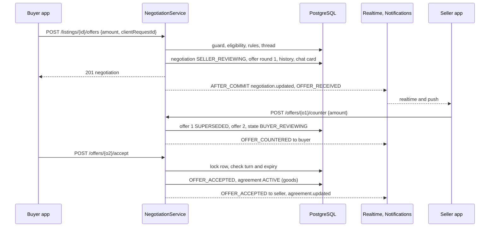

## I.7 Mobile Design (valuex-mobile)

- **Structure** (`features/negotiation/`): `data/negotiation_repository.dart`; `domain/` (`Negotiation`, `Offer`, `NegotiationState`, `NegotiationActions`, `PriceAgreement`); `presentation/` with `offer_sheet.dart` (Make Offer), `negotiation_screen.dart`, `offers_screen.dart` (Part J), widgets `offer_timeline.dart`, `offer_card.dart`, `expiry_chip.dart`, `price_lock_banner.dart`, providers `negotiation_controller`, `negotiations_list_controller`, `negotiation_events_provider`.
- **Routes:** `/negotiations/:id` and `/offers` (Part J); notification deep links `/offers/{id}` map to the negotiation screen.
- **Make Offer sheet:** a rupee amount field formatted with `Formatters.money`, the asking price and the allowed range as helper text ("You can offer up to ₹14,500"), live validation using the same rules as the server, the low-offer confirmation dialog when `WARNING_LOW_OFFER` arrives (the text and amount are kept), a clear Submit button with a progress state, and a link "Chat with seller" for questions. For rent and lease listings the wording follows the transaction intent (monthly rent) already used on the details page.
- **Negotiation screen:** listing header; a status chip and one-line explanation per state ("Waiting for the seller", "Seller countered ₹13,500", "Accepted: price locked until 9:10 pm", "Expired", "Declined"); the timeline of offers (round, who, amount, time) with the current one emphasised; an expiry countdown chip (from `expiresAt` and `serverTime`, so the device clock does not matter); actions Accept, Counter and Decline when it is the buyer's turn, and Cancel offer while waiting; a counter sheet with the corridor; after acceptance the lock banner with a countdown. The **Proceed to checkout** control exists in the layout (US-018: disabled with "Waiting for seller to accept your offer" until accepted, enabled after) but is shown only when the `cart` or `buyNow` capability is on, which is false until Sprint 5 (decision D10).
- **Chat integration:** `OFFER_EVENT` cards in the thread show who did what and the amount, with a View offer action; the Make Offer button on the thread header opens the sheet when no negotiation is open.
- **Realtime:** `negotiation.updated` and `agreement.updated` refresh the screen; a poll every 15 seconds replaces them when the socket is down (A.7).
- **Errors** map to ARB strings in English and Hindi (section I.8); `WARNING_LOW_OFFER` is a confirmation, not an error. Accessibility: amounts are announced as currency, countdowns are announced at intervals, 48 dp targets, 320 px and 200 percent text.

## I.8 Validation Rules & Error Codes

| Rule | Code | HTTP |
|---|---|---|
| Offer 0 or less, above the asking price, or outside the counter corridor | `ERROR_INVALID_OFFER`: "Offer must be between ₹1 and ₹[listed_price]" (the range in `error.details`) | 422 |
| Seller counter outside its range | `ERROR_INVALID_COUNTER`: "Counter offer must be between ₹X and ₹Y" | 422 |
| Offer far below the asking price | `WARNING_LOW_OFFER`: "Your offer is significantly lower than asking price" (request not applied; resend with `confirmLowOffer`) | 422 |
| Round cap reached | `ERROR_MAX_NEGOTIATIONS`: "Maximum negotiation attempts reached" (buyer); `WARNING_MAX_NEGOTIATIONS`: "Maximum negotiation rounds reached" (seller) | 409 |
| Negotiation past its deadline | `ERROR_NEGOTIATION_EXPIRED`: "This negotiation has expired" | 409 |
| Listing not negotiable or no price | `ERROR_NOT_NEGOTIABLE` | 409 |
| Open negotiation already exists | `ERROR_NEGOTIATION_EXISTS` (with the existing id) | 409 |
| Re-offer inside the cooldown | `ERROR_NEGOTIATION_COOLDOWN` | 409 |
| Too many open negotiations | `ERROR_TOO_MANY_NEGOTIATIONS` | 409 |
| Offer is not the latest, or not your turn | `ERROR_OFFER_NOT_CURRENT` | 409 |
| Listing reserved for another buyer | `ERROR_ITEM_RESERVED` | 409 |
| Listing no longer live | `ERROR_ITEM_UNAVAILABLE` | 409 |
| Not Aadhaar verified | `AADHAAR_VERIFICATION_REQUIRED` (existing) | 403 |
| Blocked, own listing, rate limit | `ERROR_BLOCKED`, `ERROR_OWN_LISTING`, `RATE_LIMIT_EXCEEDED` | 403, 409, 429 |
| Not a participant | the not-found error | 404 |
| Accepted price is locked | `PRICE_LOCK_HOURS` (24) | - |
| History | every action is logged in the history table and offers | - |

## I.9 Security & NFR Notes

- A negotiation is visible only to its buyer and seller (404 for anyone else); amounts never appear in logs, metric labels, push text or any shared listing field.
- Concurrency: the negotiation row lock and the `version` column serialise actions; the partial unique indexes enforce one open negotiation per pair and one active agreement per listing even if code is wrong.
- Money uses `BigDecimal` and `NUMERIC(12,2)` throughout; the mobile app sends a decimal string and never a floating-point number.
- Abuse controls from HLD 06 (mass negotiations): open negotiation cap, offers per minute, reoffer cooldown, Aadhaar gating, contact attempt log.
- Performance: every action is one row lock plus a few small writes; reads are by the indexes above; target API p95 under 150 ms.

## I.10 Testing Strategy

- **Unit:** corridor and rounds for every actor and boundary (equal, one paisa inside and outside), low-offer threshold, agreed price `MIN`, state machine rows including the new ones, idempotent offers, cooldown and open cap, listing-event cancellations, notification dedupe keys.
- **Integration (PostgreSQL):** full flow offer, counter, counter, accept; two buyers on one listing; two simultaneous first offers by one buyer create one negotiation; stale offer id after a counter; accept after expiry; cancel from each state; listing sold cancels negotiations; the partial unique indexes are enforced.
- **Controller:** statuses and envelopes, 404 for strangers, the Aadhaar gate.
- **Mobile:** sheet validation and the low-offer dialog, screen states for every `state` and `actions` combination, countdown from server time, realtime and polling updates, Hindi, 320 px and 200 percent text.

---

# Part J - US-076: Seller Negotiation Management

**Story Points:** 5 | **Repos:** backend, mobile
**Dependency:** US-017
**Scope note (2026-10-25 update to the story):** For Real Estate the owner can mark the property Sold or Rented after an agreed price (US-118); that action is separate and unchanged.

## J.1 Story Overview

**As a** seller **I want** to manage buyer offers efficiently **so that** I can accept, reject or counter them quickly. An Offers list shows every pending offer with the buyer, item, offered and asking price and time; accepting one locks the price for 24 hours, rejects the others for the same item and tells the buyer.

### J.1.1 Edge Cases Covered

| Edge case | Handling |
|---|---|
| Several buyers offer at once | Listed together, soonest-to-expire first; each can be handled separately. |
| Seller accepts one offer while others are pending | The other open negotiations for that goods listing are rejected automatically (`SUPERSEDED`) and their buyers are told neutrally ("The seller accepted another offer"). |
| Seller tries to accept a second offer | `ERROR_ALREADY_ACCEPTED` while a price agreement is active for the listing. |
| Offer expires while the seller is reviewing it | The action fails with `ERROR_OFFER_EXPIRED`; the list refreshes and shows it as expired. |
| Buyer cancels before the seller responds | The offer closes as withdrawn; a later accept gets `ERROR_OFFER_NOT_CURRENT`. |
| Counter at the round cap | `WARNING_MAX_NEGOTIATIONS`; only accept and reject remain. |
| Counter outside the allowed range | `ERROR_INVALID_COUNTER` with the range. |
| Real Estate | Accepting does not lock the property or reject other offers (decision D7); the owner closes the deal with US-118 when it happens. |
| Agreement expires without checkout | The price lock ends (Part L), the listing is open to everyone again and the seller can accept another offer. |
| Seller deletes or sells the listing | Open offers are cancelled (Part I listener). |

## J.2 Scope

**In scope:** the seller's offers list and summary, the exclusivity rule, auto-reject of other offers, neutral notifications to the other buyers, profile badges, the seller screens (Offers, offer detail with Accept, Reject and Counter), the counter sheet.
**Out of scope:** the create, respond and cancel endpoints (Part I), expiry (Part L), analytics on offers, bulk actions.

## J.3 Data Model

No new table. The partial unique index `uq_price_agreements_active` and the open-negotiation index (I.3) provide the rules. One index is added for the seller's list:

```sql
CREATE INDEX idx_negotiations_seller_open ON negotiations (seller_id, expires_at)
    WHERE state IN ('SELLER_REVIEWING', 'BUYER_REVIEWING', 'OFFER_ACCEPTED');
```

## J.4 API Contract

```http
GET /api/v1/offers/received?status=PENDING|ACCEPTED|CLOSED|ALL&page=0&size=20
GET /api/v1/offers/received/summary
```

`status` defaults to `PENDING` (negotiations awaiting the seller's response), sorted by `expiresAt` ascending; `ACCEPTED` lists accepted offers with a live price lock; `CLOSED` lists the rest, newest first. Paging fields are `page`, `size`, `totalItems`, `hasNext`.

```json
{ "items": [ { "negotiationId": "n1...", "offerId": "o2...", "state": "SELLER_REVIEWING",
    "buyer": { "userId": "u1...", "displayName": "Ravi", "rating": null, "ratingCount": 0 },
    "listing": { "listingId": "a1...", "title": "Apple Watch", "thumbnailUrl": "https://...", "askingPrice": 14500 },
    "offeredPrice": 12000.00, "offeredAt": "2026-11-14T09:12:00Z", "round": 1,
    "expiresAt": "2026-11-16T09:12:00Z", "priceLockExpiresAt": null } ],
  "page": 0, "size": 20, "totalItems": 3, "hasNext": false, "serverTime": "2026-11-14T10:00:00Z" }
```
`summary`: `{ "pending": 3, "accepted": 1, "expiringSoon": 1 }` (`expiringSoon` counts offers inside the warning window).

The buyer's own list is `GET /api/v1/negotiations?role=BUYER` (Part I). Accept, reject and counter use the Part I endpoints.

## J.5 Backend Design

- **`OffersReceivedQuery`:** one query over `negotiations`, the latest `offers` row, and listing and user data through the ports, with `awaiting = SELLER` for `PENDING`; buyer ratings come from `SellerReputationPort` in one batch (null until the rating module exists, so the app shows "No ratings yet" and no number is invented).
- **Exclusivity on accept (goods)**, inside the Part I accept transaction:
  1. `pg_advisory_xact_lock(hashtext('agree:' || listingId))` serialises accepts and Buy Now on the listing.
  2. Expire stale rows first: `PriceAgreementService.expireDue(listingId)` marks any `ACTIVE` agreement of the listing whose `valid_until <= now()` as `EXPIRED` (and its negotiation as expired, exactly as the expiry job does in bulk). A **reserving** agreement is always `status = 'ACTIVE' AND valid_until > now()`, so the lateness of a job never blocks a sale. Then, if a reserving agreement exists that belongs to another negotiation or to Buy Now: `ERROR_ALREADY_ACCEPTED` (for the seller's accept) and nothing changes. (The unique index is the backstop if the lock were ever bypassed.)
  3. Create the agreement; then lock and reject every other negotiation of the listing in `SELLER_REVIEWING` or `BUYER_REVIEWING` (`REJECT_OFFER`, `closed_reason = SUPERSEDED`, their offers `REJECTED`) in the same transaction.
  4. After commit: `OFFER_ACCEPTED` to the accepted buyer; `OFFER_SUPERSEDED` to each other buyer ("The seller accepted another offer for {item}. You can make a new offer if it becomes available again"); a neutral `OFFER_EVENT` card in their threads; `negotiation.updated` for all; `badge.updated` for the seller.
- **Real Estate:** steps 1 to 3 are skipped; only the accepted negotiation changes state.
- **Counter corridor for the UI:** `counterRange` for the seller is `{min: last buyer offer + 0.01, max: current asking price}` and, at the round cap, null.
- **Badges:** `OffersBadgeProvider implements ProfileMenuBadgeProvider` (the existing profile hub port) returns `OFFERS_RECEIVED` (negotiations awaiting the seller) and `MY_OFFERS` (awaiting the buyer); the same sums travel in `badge.updated`.
- **Seller-initiated noise control:** the in-app notification for a new offer is not coalesced (each offer matters), but push is collapsed per negotiation with `collapse_key = neg:{id}`.

## J.6 Sequence Diagram

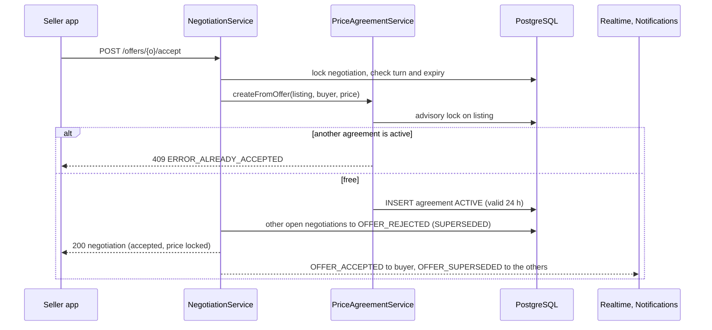

## J.7 Mobile Design (valuex-mobile)

- **Entry points:** a new Profile > Activity row "Offers" with a badge (`ProfileMenuKeys.offersReceived`, `ProfileMenuKeys.myOffers`; keys appear only when the server sends them, as the existing badge model allows), the notification deep link, and the Offers tab inside the chat list when the user has offers.
- **`offers_screen.dart`** (`/offers`): two tabs, **Received** (as seller) and **Sent** (as buyer); filter chips Pending, Accepted, Closed; cards with the buyer's name and rating chip ("No ratings yet" when absent), the item thumbnail and title, "Offered ₹12,000 of ₹14,500", time, and an expiry countdown chip; Pending sorted by soonest expiry; empty, loading and error states with Retry; pull to refresh; realtime updates.
- **Offer detail** is the negotiation screen of Part I in the seller's role: three actions **Accept**, **Reject**, **Counter**. Accept asks for confirmation and explains that the price is locked for 24 hours and other offers on the item will be declined. Reject asks for confirmation. Counter opens a bottom sheet with a slider between the buyer's offer and the asking price (steps of ₹1) and a numeric field (up to two decimals) that stay in sync, the range text, and Send; at the round cap the sheet is replaced by a banner explaining that only Accept or Reject remain.
- **After accepting,** the screen shows "Price locked until {time}" and that the buyer can now check out (the checkout itself arrives in Sprint 5).
- **Strings and accessibility:** English and Hindi ARB entries, semantic labels on countdowns, slider semantics with the value spoken as rupees, 48 dp targets, no overflow at 200 percent text.

## J.8 Validation Rules & Error Codes

| Rule | Code | HTTP |
|---|---|---|
| Offer past its deadline | `ERROR_OFFER_EXPIRED`: "This offer has expired" (same condition as `ERROR_NEGOTIATION_EXPIRED`, shown with seller wording) | 409 |
| Another price is already accepted for the listing | `ERROR_ALREADY_ACCEPTED`: "You've already accepted another offer for this item" | 409 |
| Counter outside the range | `ERROR_INVALID_COUNTER`: "Counter offer must be between ₹X and ₹Y" | 422 |
| Round cap | `WARNING_MAX_NEGOTIATIONS`: "Maximum negotiation rounds reached" | 409 |
| Offer not the latest | `ERROR_OFFER_NOT_CURRENT` | 409 |
| Offers expire after 48 hours without a seller response | `NEGOTIATION_INACTIVITY_HOURS` (Part L) | - |
| Accepting one offer auto-rejects the others | goods only (decision D7) | - |
| Price locked after accepting | `PRICE_LOCK_HOURS` (24) | - |

## J.9 Security & NFR Notes

- The list is scoped to `seller_id = caller`; offer ids from other sellers return 404. Buyer data shown is the display name and rating only.
- The auto-reject message to other buyers does not say who won or at what price.
- The accept path is the only place two buyers can collide; it is serialised by the advisory lock and the unique index, and covered by a concurrent test.
- Performance: the list query is bounded by `idx_negotiations_seller_open`; page size at most 50; p95 under 200 ms.

## J.10 Testing Strategy

- **Unit:** accept with and without an existing agreement, auto-reject set (only open states of the same listing), property exception, counter corridor, badge counts, list filtering and sorting, expired-while-reviewing.
- **Integration (PostgreSQL):** three buyers offer, seller accepts one, the others become `OFFER_REJECTED`/`SUPERSEDED`; a second accept returns `ERROR_ALREADY_ACCEPTED`; two simultaneous accepts leave exactly one active agreement; lock expiry frees the listing; Real Estate acceptance leaves other negotiations open.
- **Mobile:** Received and Sent tabs, sort order, countdown chips, confirmation dialogs, counter sheet (slider and field stay in sync, range limits, cap banner), accessibility, Hindi, large text.

---

# Part K - US-018: Prevent Checkout Without Price Acceptance

**Story Points:** 3 | **Repos:** backend
**Dependency:** US-017
**Hand-off:** Cart and checkout are Sprint 5 stories (US-019 to US-021). This story delivers the server-side rule and the contract they must call (conflict C4).

## K.1 Story Overview

**As a** platform **I want** to prevent buyers from checking out unless the seller accepted the price **so that** transactions rest on mutual agreement. The rule is enforced in the backend, not only by a disabled button.

### K.1.1 Edge Cases Covered

| Edge case | Handling |
|---|---|
| Buyer bypasses the app and calls checkout directly | The guard answers from the database: no active agreement means no checkout (`ERROR_UNAUTHORIZED_CHECKOUT` or the more specific codes below). |
| Seller accepts but the buyer already left the page | The agreement lives on the server for 24 hours; the buyer gets `OFFER_ACCEPTED` and can return. |
| Acceptance expires before checkout | `ERROR_ACCEPTANCE_EXPIRED`; the buyer must negotiate again. Expiry is judged by `valid_until` on the server, even if the expiry job has not run yet. |
| A cart with several items in different states | A batch status endpoint returns one state per listing (Pending, Accepted, Expired, None). |
| Amount sent by the client differs from the agreed price | `ERROR_PRICE_CHANGED`. |
| Another buyer holds the agreement | `ERROR_ITEM_RESERVED`. |
| Listing price changed while a Buy Now reservation was active | The reservation was cancelled (Part M); the guard returns `ERROR_PRICE_CHANGED`. |
| Real Estate | `ERROR_CHECKOUT_NOT_APPLICABLE`. |

## K.2 Scope

**In scope:** `CheckoutPriceGuard`, the status endpoints, the statuses and error mapping, the consumption contract for Sprint 5, the `agreement` summary on the listing details `contact` block.
**Out of scope:** cart, checkout, payment and order creation (Sprint 5), the cart screen and its badges (Sprint 5), the negotiation actions (Part I).

## K.3 Data Model

No new table: the guard reads `price_agreements` and `negotiations` (I.3). Statuses visible to the app are derived:

| Status | Meaning |
|---|---|
| `NONE` | No negotiation, no agreement for this buyer and listing. |
| `PENDING` | An open negotiation is waiting for a response (`SELLER_REVIEWING` or `BUYER_REVIEWING`). |
| `ACCEPTED` | An `ACTIVE`, unexpired agreement belongs to this buyer. |
| `EXPIRED` | The buyer's latest agreement or negotiation ended as `EXPIRED` or `ACCEPTANCE_EXPIRED`. |
| `RESERVED` | An active agreement belongs to someone else. |

## K.4 API Contract

```http
GET  /api/v1/listings/{listingId}/price-agreement         -- the caller's status for one listing
POST /api/v1/price-agreements/status                      -- {listingIds: [..up to 20..]}; one status per listing
```
```json
{ "status": "ACCEPTED", "source": "OFFER", "agreedPrice": 13500.00, "validUntil": "2026-11-15T09:40:00Z",
  "negotiationId": "n1...", "serverTime": "2026-11-14T10:00:00Z" }
```

The listing details response (Part D) gains the same `agreement` object inside `contact`, so the page can show "Your offer was accepted: ₹13,500 until 9:40 am". The guard itself is not an HTTP endpoint; it is a Java interface that Sprint 5 calls inside its own transactions:

```java
public interface CheckoutPriceGuard {
    /** Returns the valid agreement for this buyer and listing, or throws one of the codes of K.8.
     *  Call it inside the order-creation transaction: it locks the agreement row. */
    PriceAgreementView requireValid(UUID buyerId, UUID listingId, BigDecimal expectedAmount);

    /** Called by order creation in the same transaction: ACTIVE to CONSUMED (exactly one row), negotiation to CONVERTED. */
    void markConsumed(UUID agreementId, UUID orderId);
}
```

## K.5 Backend Design

- **`CheckoutPriceGuard.requireValid`** must run in the same transaction as order creation. It locks the listing's `ACTIVE` agreement row (`SELECT ... FOR UPDATE`), and `markConsumed` is a conditional update (`UPDATE price_agreements SET status = 'CONSUMED', consumed_ref = :order WHERE id = :id AND status = 'ACTIVE' AND valid_until > now()`) that must change exactly one row. Two concurrent checkouts therefore serialise: the second fails with `ERROR_ITEM_RESERVED` (or `ERROR_ITEM_SOLD`), never creating a second order. It decides in this order:
  1. The listing is not Real Estate (`ERROR_CHECKOUT_NOT_APPLICABLE`) and is live (`ERROR_ITEM_UNAVAILABLE`).
  2. Find the listing's `ACTIVE` agreement. If it belongs to the caller: if `valid_until <= now()` it is treated as expired (`ERROR_ACCEPTANCE_EXPIRED`), else if `expectedAmount` does not equal `agreed_price` (`ERROR_PRICE_CHANGED`), else for a `BUY_NOW` agreement it re-reads the listing's current asking price under the same lock and compares it with `agreed_price` (`ERROR_PRICE_CHANGED`), so a price edit that committed a moment ago cannot be bypassed, and only then is the agreement returned. If it belongs to another buyer: `ERROR_ITEM_RESERVED`.
  3. No active agreement: if the caller's latest agreement ended with `PRICE_CHANGED`, `ERROR_PRICE_CHANGED`; if it ended `EXPIRED`, `ERROR_ACCEPTANCE_EXPIRED`; if the caller has an open negotiation, `ERROR_PRICE_NOT_ACCEPTED`; otherwise `ERROR_UNAUTHORIZED_CHECKOUT`.
- **`markConsumed`** sets the agreement `CONSUMED` with `consumed_ref`, ends the negotiation with `CONSUME_ACCEPTANCE` (`CONVERTED`), and is idempotent for the same order id. Sprint 5 is also responsible for moving the listing out of `PUBLISHED` (its own state transition, since the existing machine reaches `ORDER_CREATED` only through `OFFER_ACCEPTED`; Sprint 5 decides whether to add a direct `PUBLISHED -> ORDER_CREATED` row or to pass through `OFFER_ACCEPTED`).
- **Status endpoints** call the same lookups without throwing; the batch version is two queries for any number of ids (agreements and open negotiations by `listing_id IN (...) AND buyer_id = ?`). It is rate limited like details (`RATE_LIMIT_DETAILS_PER_MIN`).
- **Realtime:** agreement changes publish `agreement.updated` to the buyer, so Sprint 5's cart badge can update live.

## K.6 Sequence Diagram

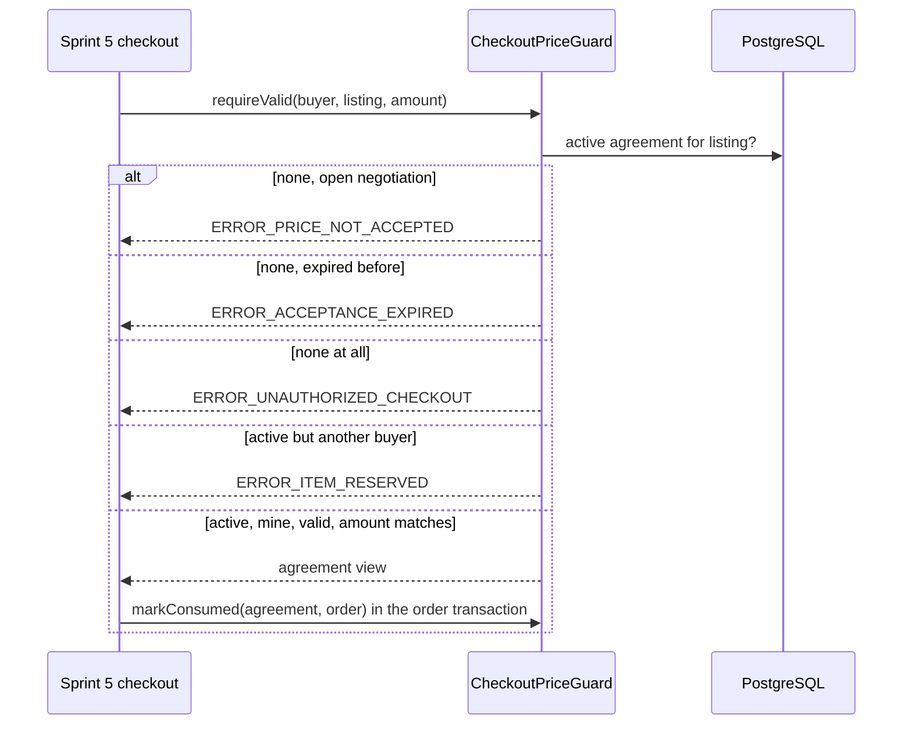

## K.7 Mobile Design

- Sprint 4 builds the data side: `PriceAgreementStatus` model, `priceAgreementStatusProvider(listingId)` and a batch provider for Sprint 5's cart, plus the `agreement` display on the details page ("Offer accepted: price locked until ...") and on the negotiation screen (I.7).
- The cart item badge (Pending, Accepted, Expired) and the checkout button state belong to Sprint 5 (US-019); they will use the providers above and the `agreement.updated` event.
- Strings for the messages of K.8 are added now (English and Hindi) so Sprint 5 only consumes them.

## K.8 Validation Rules & Error Codes

| Rule | Code | HTTP |
|---|---|---|
| Open negotiation, seller has not accepted | `ERROR_PRICE_NOT_ACCEPTED`: "Seller hasn't accepted your offer yet" | 409 |
| Acceptance older than `PRICE_LOCK_HOURS` (24) | `ERROR_ACCEPTANCE_EXPIRED`: "Price acceptance expired. Please re-negotiate" | 409 |
| No negotiation or Buy Now agreement at all | `ERROR_UNAUTHORIZED_CHECKOUT`: "Cannot proceed without seller acceptance" | 403 |
| Client amount differs from the agreed price, or the asking price changed | `ERROR_PRICE_CHANGED`: "Price has changed. Please review" | 409 |
| Agreement belongs to another buyer | `ERROR_ITEM_RESERVED` | 409 |
| Real Estate | `ERROR_CHECKOUT_NOT_APPLICABLE` | 409 |
| Backend validation | mandatory: the rule is enforced in the guard, not only in the UI | - |

## K.9 Security & NFR Notes

- The guard never trusts a client-supplied price or status; it reads the database and compares amounts with `BigDecimal.compareTo`.
- Agreement data is scoped to the caller; the `RESERVED` status reveals only that the item is taken, never by whom or at what price.
- The guard adds two indexed lookups to checkout and stays well inside the checkout latency budget.

## K.10 Testing Strategy

- **Unit:** every row of the decision order, expiry by clock when the job has not run, amount mismatch, idempotent `markConsumed`, status derivation for each status.
- **Integration (PostgreSQL, fake clock):** accepted offer then valid checkout; no negotiation; open negotiation; expired agreement; another buyer's agreement; price changed after Buy Now; the batch endpoint with mixed states.
- **Concurrency:** two simultaneous `requireValid` plus `markConsumed` calls on one agreement produce exactly one consumption; a price edit committed just before checkout makes a Buy Now agreement fail with `ERROR_PRICE_CHANGED`; a stale `ACTIVE` agreement past `valid_until` neither blocks a new accept or Buy Now nor passes the guard.
- **Contract suite for Sprint 5:** a reusable test class (`CheckoutPriceGuardContractTest`) that the checkout story runs against its own endpoints, so the rule cannot be bypassed by a new path.

---

# Part L - US-080: Auto-Expire Inactive Negotiations

**Story Points:** 3 | **Repos:** backend
**Dependency:** US-017
**Scope note (2026-10-25 update to the story):** Applies to Real Estate negotiations as well (US-118).

## L.1 Story Overview

**As a** platform **I want** to auto-expire inactive negotiations **so that** stale offers do not block transactions. After 48 hours without activity the negotiation expires, both people are told, nobody can act on the last offer, history is kept, and a new offer is possible.

### L.1.1 Edge Cases Covered

| Edge case | Handling |
|---|---|
| Buyer replies just before expiry | The response takes the row lock and checks `expires_at` at that instant; if it is not yet past, the action succeeds and the deadline moves. After the deadline, the action fails with `ERROR_NEGOTIATION_EXPIRED` even if the job has not run yet. |
| Seller was away | The warning 24 hours before expiry and the expiry notice both reach the person whose turn it was; they can start again with a new offer. |
| Many negotiations expire at once | The job works in batches with `FOR UPDATE SKIP LOCKED`; several instances do not collide. |
| User wants to restart | A new offer is allowed immediately after an expiry (no cooldown; the cooldown applies only after a rejection). |
| An accepted price that nobody used | Not the 48 hour rule: the price lock ends after `PRICE_LOCK_HOURS` (24) and the agreement expires (L.5). |
| A long chat but no price movement | Chat messages in the thread count as activity (decision D21) but the absolute `NEGOTIATION_MAX_LIFETIME_DAYS` (14) still ends it. |
| No automatic acceptance | Expiry never accepts a price. |
| Property negotiation | Same timers; an accepted property price has no lock and is kept until the listing closes. |

## L.2 Scope

**In scope:** the warning pass, the expiry pass, the price lock expiry pass, the activity bump from chat, notifications, history and metrics.
**Out of scope:** changing negotiation actions (Part I), seller reminders by SMS or email, an Admin screen for stuck negotiations.

## L.3 Data Model

Uses the columns of `negotiations` (`expires_at`, `warning_sent_at`, `max_lifetime_at`, `last_activity_at`, `closed_*`) and `price_agreements.valid_until`. One index serves the warning pass:

```sql
CREATE INDEX idx_negotiations_warning ON negotiations (expires_at)
    WHERE warning_sent_at IS NULL AND state IN ('SELLER_REVIEWING', 'BUYER_REVIEWING');
```

## L.4 API Contract

None. Visible effects are the existing `GET /negotiations/{id}` (`state = NEGOTIATION_EXPIRED`, `expiresAt`, `warnAt`), the `negotiation.updated` and `agreement.updated` events, and notifications.

## L.5 Backend Design

- **`NegotiationExpiryJob`** (every `valuex.negotiation.job.expiry-interval`, 60 s, in the style of `SuspendedAccountAutoLiftJob`):
  1. *Warning:* negotiations awaiting a response where `expires_at - NEGOTIATION_WARNING_BEFORE_HOURS <= now()` and `warning_sent_at IS NULL`, batch of `valuex.negotiation.job.batch-size` with `FOR UPDATE SKIP LOCKED`; send `NEGOTIATION_EXPIRING` ("Negotiation will expire in 24 hours. Please respond") to the party whose turn it is, set `warning_sent_at`.
  2. *Expiry:* negotiations in `SELLER_REVIEWING` or `BUYER_REVIEWING` with `expires_at <= now()` or `max_lifetime_at <= now()`: transition `EXPIRE` through the state machine (`NEGOTIATION_EXPIRED`, `closed_reason = EXPIRED`), the pending offer `EXPIRED`, a history row, an `OFFER_EVENT` card in the thread, `NEGOTIATION_EXPIRED` to both parties ("This negotiation has expired. Start a new offer"). The last offer can no longer be accepted or countered (the row is closed). History stays readable.
- **`AgreementExpiryJob`** (same schedule): `ACTIVE` agreements with `valid_until <= now()` become `EXPIRED` (`ended_reason = EXPIRED`); for source `OFFER` the negotiation moves `OFFER_ACCEPTED -> NEGOTIATION_EXPIRED` (`EXPIRE_ACCEPTANCE`, `closed_reason = ACCEPTANCE_EXPIRED`), both parties get `AGREEMENT_EXPIRED` ("Price acceptance expired. Please re-negotiate"), and the listing is browsable again at once: search hides a listing only while a reserving agreement exists (`ACTIVE` and `valid_until > now()`, M.5), so it reappears at `valid_until` even if the job runs a minute later; accept and Buy Now also clear stale rows themselves under the listing lock (`PriceAgreementService.expireDue`, J.5). Buy Now reservations expire silently in the app (the buyer sees the timer end) and in-app only.
- **Activity bump:** `NegotiationActivityListener` (a `BEFORE_COMMIT` listener of `ChatMessageCreatedEvent`, E.5) runs `UPDATE negotiations SET last_activity_at = now(), expires_at = LEAST(now() + :inactivity, max_lifetime_at), warning_sent_at = NULL WHERE thread_id = :t AND state IN ('SELLER_REVIEWING','BUYER_REVIEWING')`.
- **Idempotency and safety:** each pass is a small transaction per batch; a failed row is logged by id and skipped; re-running the job changes nothing that is already closed. The job reads its numbers from `PlatformSettingsService.negotiation()` on every pass, so an Admin change applies at the next run.
- **Metrics:** `negotiation.warned`, `negotiation.expired{reason}`, `agreement.expired{source}`, `negotiation.job.duration`.
- **A late reply** (after `expires_at` but before the job runs) is rejected with `ERROR_NEGOTIATION_EXPIRED` and the row is closed by the job within a minute; no reply can slip through, and nobody is blocked longer than one job interval.

## L.6 Sequence Diagram

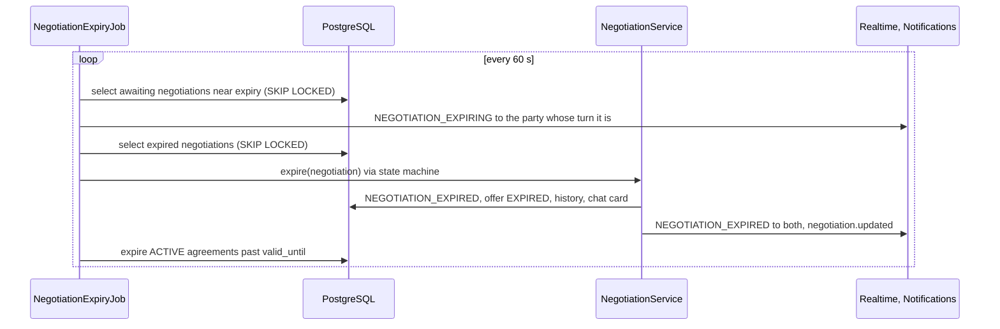

## L.7 Mobile Design

- No new screen. The negotiation screen and Offers list show the **Expired** state with a "Make a new offer" action, an expiring banner ("Expires in 3 hours") driven by `expiresAt` and `serverTime`, and move expired items to Closed; push and in-app notifications deep link to the negotiation.
- Strings (English and Hindi): expiring, expired and price-expired messages and the new-offer action.

## L.8 Validation Rules & Error Codes

| Rule | Code | HTTP |
|---|---|---|
| Action on an expired negotiation | `ERROR_NEGOTIATION_EXPIRED`: "This negotiation has expired. Start a new offer" | 409 |
| Warning before expiry | `WARNING_EXPIRING_SOON`: "Negotiation will expire in 24 hours. Please respond" (notification text and app banner, not an HTTP error) | - |
| Timeout | `NEGOTIATION_INACTIVITY_HOURS` (48) from the last offer action or thread message, never beyond `NEGOTIATION_MAX_LIFETIME_DAYS` (14) | - |
| Warning time | `NEGOTIATION_WARNING_BEFORE_HOURS` (24), must be below the timeout | - |
| Expired negotiations | kept in history; a new negotiation is allowed at once; no automatic acceptance | - |

## L.9 Security & NFR Notes

- Jobs run as the system actor (`actor_id` null in history); they never read message text.
- `SKIP LOCKED` batches make the jobs safe on several instances without an external lock service; the partial indexes keep each pass cheap even with millions of closed rows.
- Retention of negotiation rows after closure is not decided here (O10); they are small and are kept until the archival policy of Sprint 10 (US-127 style) is agreed.

## L.10 Testing Strategy

- **Unit:** time maths for warning, expiry, lifetime cap and agreement expiry with a fake clock; activity bump; notification recipient is the party whose turn it is; no warning twice.
- **Integration (PostgreSQL):** warn then expire a negotiation, reply just before the deadline succeeds and just after fails, two job instances do not double-process, chat message extends the deadline but not past the lifetime, agreement expiry frees the listing and the seller can accept another offer, restart allowed after expiry, property negotiation expires without lock effects.
- **Setting change:** a changed `NEGOTIATION_INACTIVITY_HOURS` applies at the next pass; an invalid value falls back to 48.

---

# Part M - US-068: Direct Buy Now Flow

**Story Points:** 5 | **Repos:** backend, mobile
**Dependency:** US-012; shares the price agreement of Part I
**Scope note (2026-10-25 update to the story):** Not available for Real Estate (no purchase flow, US-118). Delivery follows category eligibility (US-122, Sprint 5/6).

## M.1 Story Overview

**As a** buyer **I want** to purchase an item immediately at the listed price **so that** I can skip negotiation. Buy Now reserves the item for the buyer for 15 minutes at the asking price and hands over to checkout. A seller can switch Buy Now off per listing, which leaves Make Offer as the only way to buy.

### M.1.1 Edge Cases Covered

| Edge case | Handling |
|---|---|
| Item sold to someone else while this buyer checks out | The reservation is exclusive, so a second buyer is refused (`ERROR_ITEM_RESERVED`); if the listing is already sold or gone: `ERROR_ITEM_SOLD`. |
| Seller changes the price during checkout | The reservation is cancelled when the price changes (`ended_reason = PRICE_CHANGED`) and checkout returns `ERROR_PRICE_CHANGED`; the buyer reviews the new price and taps Buy Now again. |
| Buyer wants to negotiate after tapping Buy Now | The buyer releases the reservation (Cancel) and makes an offer; an offer is refused only if someone else holds the item. |
| Buyer has an open, unanswered offer and taps Buy Now | The open negotiation is cancelled (`REPLACED_BY_BUY_NOW`) so two prices do not compete. |
| Buyer already holds an accepted price | Buy Now returns the existing agreement (the lower accepted price) instead of a new one. |
| Multiple buyers tap Buy Now together | The advisory lock and the unique index let exactly one succeed. |
| Seller disabled Buy Now | `ERROR_BUY_NOW_DISABLED`: "Seller requires price negotiation for this item". |
| Seller disables Buy Now and has no negotiation allowed | The seller cannot save a goods listing with neither Buy Now nor negotiation (`ERROR_NO_PURCHASE_OPTION`, decision D11). |
| Reservation hoarding | `BUY_NOW_PER_HOUR` (10) per buyer, 15-minute expiry, Aadhaar gating. |
| Real Estate | `ERROR_BUY_NOW_NOT_APPLICABLE`. |
| Quantity above 1 | The MVP reserves the whole listing for one buyer (O14); stock handling is for Sprint 5. |
| Checkout not yet built | The `buyNow` capability stays `COMING_SOON` and the endpoint answers `ERROR_CHECKOUT_UNAVAILABLE` while `valuex.checkout.enabled` is false (decision D10). |

## M.2 Scope

**In scope:** the `buy_now_enabled` listing field with the seller's switch (listing create and edit, backend and mobile), the Buy Now endpoint, the 15-minute reservation through `price_agreements`, release and expiry, the price-change cancellation, hiding reserved listings from search, the capability rules, the reservation timer widget.
**Out of scope:** the cart, checkout, payment and order (Sprint 5), stock or quantity handling, a seller approval step, Buy Now analytics.

## M.3 Data Model

Migration `V37__buy_now.sql` (provisional):

```sql
ALTER TABLE listings ADD COLUMN buy_now_enabled BOOLEAN NOT NULL DEFAULT TRUE;

INSERT INTO platform_settings (setting_key, setting_value) VALUES
    ('BUY_NOW_RESERVATION_MINUTES', '15'),
    ('BUY_NOW_PER_HOUR', '10')
ON CONFLICT (setting_key) DO NOTHING;
```

Existing listings get `TRUE`, so nothing changes for them. `buy_now_enabled` is an ordinary common field: it is not a moderation-triggering change (a minor field in the edit history), it is returned to the owner in the draft and My Listings responses, and it never appears in the search index. The reservation itself is a `price_agreements` row with `source = 'BUY_NOW'` (I.3). `BUY_NOW_PER_HOUR` is added to `NegotiationSetting` (range 1 to 60).

## M.4 API Contract

```http
POST   /api/v1/listings/{listingId}/buy-now     -- {expectedPrice, clientRequestId}; 201 (200 when the caller already holds one)
DELETE /api/v1/price-agreements/{agreementId}   -- the buyer releases their reservation or accepted price; 204, idempotent
PATCH  /api/v1/listings/{listingId}             -- the existing draft and live-edit endpoint (ListingController, confirmRemoderation unchanged); the body gains "buyNowEnabled": true|false
```
```json
{ "agreementId": "p1...", "source": "BUY_NOW", "agreedPrice": 14500.00,
  "validUntil": "2026-11-14T10:15:00Z", "serverTime": "2026-11-14T10:00:00Z" }
```

`POST .../buy-now` requires an Aadhaar-verified caller (`@RequiresIdentityVerification`, decision D9). The owner's draft and My Listings responses gain `buyNowEnabled`. The public details response keeps the `capabilities.buyNow` object of Part D.

## M.5 Backend Design

- **`BuyNowService.start`** (`@Transactional`): `ContactGuard.require(BUY_NOW, ...)`; `valuex.checkout.enabled` (`ERROR_CHECKOUT_UNAVAILABLE`); listing live (`ERROR_ITEM_SOLD` when it is sold, otherwise `ERROR_LISTING_NOT_AVAILABLE`); not Real Estate (`ERROR_BUY_NOW_NOT_APPLICABLE`); `buy_now_enabled` (`ERROR_BUY_NOW_DISABLED`); price present; `expectedPrice` equals the current asking price (`ERROR_PRICE_CHANGED`); rate limit `BUY_NOW_PER_HOUR`; then `pg_advisory_xact_lock(hashtext('agree:' || listingId))` and:
  - first `PriceAgreementService.expireDue(listingId)` (J.5) clears any agreement whose `valid_until` has passed, so a late job never blocks a buyer; then
  - a reserving agreement (`ACTIVE` and `valid_until > now()`) of the same buyer is returned unchanged (200);
  - a reserving agreement of another buyer gives `ERROR_ITEM_RESERVED`;
  - otherwise insert the agreement (`BUY_NOW`, asking price, `valid_until = now + BUY_NOW_RESERVATION_MINUTES`), cancel the buyer's own open negotiation on this listing (`CANCEL`, `REPLACED_BY_BUY_NOW`), and publish `agreement.updated`.
- **Release:** `DELETE /price-agreements/{id}` by its buyer sets `CANCELLED` (`CANCELLED_BY_BUYER`); for an `OFFER` agreement it also cancels the negotiation. Expiry of a Buy Now reservation is handled by `AgreementExpiryJob` (Part L).
- **Price change during a reservation:** the cancellation is synchronous, because an asynchronous one could let checkout consume the old price in the gap. In the transaction that saves a changed asking price, `ListingEditService` publishes `ListingEditedEvent` and a `BEFORE_COMMIT` listener in the negotiation module calls `PriceAgreementService.cancelBuyNowForPriceChange(listingId)` under the same listing advisory lock, so listing code does not depend on negotiation code. Active `BUY_NOW` agreements become `CANCELLED` (`ended_reason = PRICE_CHANGED`) before the new price becomes visible, and the buyer is told in-app after commit. (If the existing code publishes the event outside the edit transaction, this story moves the publish inside it.) Checkout also re-checks the price under the lock (K.5). `OFFER` agreements are unaffected (a negotiated price stands; the agreed price was already fixed at acceptance as the lower of the offer and the asking price).
- **Seller switch:** `buyNowEnabled` is added to the listing edit request (`PATCH /api/v1/listings/{listingId}`, handled by `ListingEditService`). Rule for goods: `negotiable` or `buyNowEnabled` must be true (`ERROR_NO_PURCHASE_OPTION`, decision D11). Turning Buy Now off does not cancel an existing reservation; it simply stops new ones.
- **Capabilities (`OfferEligibilityService`):** `buyNow` and `cart` are `NOT_APPLICABLE` for Real Estate; `DISABLED_BY_SELLER` when `buy_now_enabled` is false (`cart` is unaffected); `RESERVED` when another buyer's agreement is active; `IDENTITY_REQUIRED` for an unverified caller; `COMING_SOON` while `valuex.checkout.enabled` is false; otherwise available.
- **Hiding reserved listings from search (decision D22).** A new method `ListingIndexSourcePort.retainBrowsable(ids)` returns the live listings that have no `ACTIVE` agreement with `valid_until > now()`; `ListingEligibilityFilter.retainBrowsable` calls it, and only `ListingSearchService` (search, Home and seller listings) uses it. `retainLive` is unchanged on purpose: `SearchReconciliationJob`, saved listings and saved-search alerts rely on it to decide index membership, and removing a reserved listing from the index would require a reindex when the reservation ends. Reserved listings therefore stay in the index and the details page; they are only filtered out of result pages, using the same drop-and-keep-total behaviour that search already has for non-live hits. No index mapping change is needed.
- **Checkout hand-over:** Sprint 5 calls `CheckoutPriceGuard.requireValid` with the agreement (Part K) and `markConsumed` when the order is created.

## M.6 Sequence Diagram

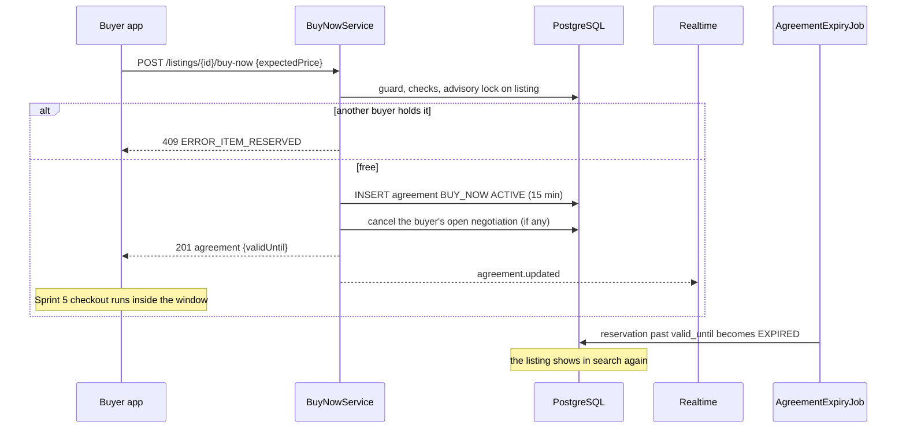

## M.7 Mobile Design (valuex-mobile)

- **Seller switch.** In the sell and edit price section, an **Allow Buy Now** switch (default on) with helper text ("Buyers can purchase at your asking price without negotiating") and a validation message when both it and "Price negotiable" are off. It is a normal field of the existing details form, included in the draft, live-edit and preview models, with ARB strings in English and Hindi and tests for the form states.
- **Buyer action.** `ListingActions` shows **Buy Now** when `capabilities.buyNow.available` is true. Tapping calls `POST /buy-now` with the displayed price; success navigates to the checkout route that Sprint 5 adds; errors map to messages (`ERROR_PRICE_CHANGED` refreshes the page and asks the buyer to review the new price). Until Sprint 5 the capability is `COMING_SOON`, so the button stays disabled as today (decision D10).
- **Reservation timer.** A shared `ReservationTimer` widget (countdown from `validUntil` and `serverTime`, announced at intervals, turns to the warning colour in the last minute) is built here for the checkout header of US-068 and used by Sprint 5; it has widget tests now.
- **Disabled reasons** show as a short caption under the button when `DISABLED_BY_SELLER` ("Seller requires price negotiation for this item") or `RESERVED` ("Someone else is checking out this item. Try again in a few minutes"); `Make Offer` remains the alternative.
- Layout stays within the Soft Luxe action bar; 48 dp targets; 200 percent text; no new colours.

## M.8 Validation Rules & Error Codes

| Rule | Code | HTTP |
|---|---|---|
| Item sold or gone | `ERROR_ITEM_SOLD`: "This item is no longer available" | 409 |
| Reserved by another buyer | `ERROR_ITEM_RESERVED` | 409 |
| Price changed since the buyer saw it | `ERROR_PRICE_CHANGED`: "Price has changed. Please review" | 409 |
| Seller turned Buy Now off | `ERROR_BUY_NOW_DISABLED`: "Seller requires price negotiation for this item" | 409 |
| Real Estate | `ERROR_BUY_NOW_NOT_APPLICABLE` | 409 |
| Checkout not enabled yet | `ERROR_CHECKOUT_UNAVAILABLE` | 503 |
| Goods listing with neither Buy Now nor negotiation | `ERROR_NO_PURCHASE_OPTION` (on listing save) | 422 |
| Not Aadhaar verified | `AADHAAR_VERIFICATION_REQUIRED` (existing) | 403 |
| Too many reservations | `RATE_LIMIT_EXCEEDED` | 429 |
| Buy Now price | the asking price at that moment (no negotiation) | - |
| Reservation | `BUY_NOW_RESERVATION_MINUTES` (15) | - |
| Escrow | Buy Now follows the same escrow flow in Sprint 5 | - |

## M.9 Security & NFR Notes

- The price is never taken from the client: `expectedPrice` is only a check against the server's current price. The agreed price is the server's.
- Exclusivity is enforced by the advisory lock and the partial unique index; reservations are bounded in time and number per buyer, and require a verified identity, so inventory cannot be hoarded cheaply.
- A cancelled or expired reservation always frees the item; there is no state where only an Admin can free it.
- Performance: one advisory lock and one insert; the search filter adds one indexed `NOT EXISTS` to a page of at most 50 ids.

## M.10 Testing Strategy

- **Unit:** each refusal in M.5 in order, idempotent repeat by the same buyer, existing lower `OFFER` agreement returned, own open negotiation replaced, price-change cancellation, purchase-option rule, capability reasons, `retainBrowsable` versus `retainLive`.
- **Integration (PostgreSQL):** two buyers racing (exactly one agreement), expiry frees the listing and search shows it again, a reserved listing is hidden from search but still opens in details, `retainLive` consumers (reconciliation, saved listings) are unaffected, listing edit with a new price cancels the reservation, the seller switch round trips through draft, edit and My Listings.
- **Controller:** statuses and envelopes, the checkout-disabled flag, Aadhaar gate.
- **Mobile:** switch and validation, button states per capability reason, error mapping, `ReservationTimer`, Hindi and large text.

---

# 8. Sprint 4 Cross-Cutting Notes

## 8.1 Non-Functional Summary

| Area | Target or rule | Where |
|---|---|---|
| Real-time latency (PRD: under 1 second) | Commit to socket write under 200 ms at p95; message send API under 150 ms server time at p95 | A.9, E.9 |
| Call setup | Ringing within about 2 seconds of the tap at p95 | F.9 |
| API response times | Offers and negotiation actions under 150 ms p95; lists under 200 ms p95 | I.9, J.9 |
| Scalability | Stateless instances; Redis pub/sub fan-out; 10,000 WebSocket sessions per 2 vCPU instance (to be load tested); jobs use `FOR UPDATE SKIP LOCKED` so any number of instances can run them | A.9, L.9 |
| Caching | Admin settings snapshot (60 s); presence and tickets in Redis; no cache of message or offer data | 1.6, A.3 |
| Security | Single-use WebSocket tickets, per-user event channels, participant-scoped queries (404 for others), plain-text messages, signed short-lived links for images and recordings, webhook HMAC, append-only access log, role-gated Admin endpoints, rate limits on every write path | A.9, E.9, F.9, G.9, H.9 |
| Privacy | No phone or email shared between users; generic push text; consent evidence for recording; defined retention with legal hold | F.9, G.9, H.5 |
| Encryption | At rest by the platform (database volume, backups, bucket KMS); in transit TLS 1.3 and `wss`; AES-256 application encryption stays reserved for the fields named in HLD 06 (decision D14) | H.5 |
| Monitoring | Micrometer metrics per part (listed in each Backend Design), structured JSON logs with request id, user id and action, never message text, amounts, tokens or recording keys; alerts on webhook rejections, push failure ratio, recording failures, job lag and WebSocket error rate | per part |
| Resilience | Ports with timeouts, circuit breakers and fallbacks for Agora, Cloud Recording, FCM and storage; Redis loss degrades realtime only; no provider outage blocks chat, offers or listing details | 1.8 |
| Accessibility and localisation | English and Hindi ARB strings for every new text; 48 dp targets; 320 px width and 200 percent text tests; semantic labels for status, countdowns and call controls | each Mobile Design |

## 8.2 Consolidated Error Codes

Codes follow `SCREAMING_SNAKE_CASE` and the standard error envelope. Codes that begin with `WARNING_` come from the stories; the request is **not** applied, the app shows the text as a warning and, where a confirmation exists (`WARNING_LOW_OFFER`), the user can resend with the confirmation flag. "Existing" codes are already in the code base.

| Code | HTTP | Part | Meaning |
|---|---|---|---|
| `ERROR_REALTIME_UNAVAILABLE` | 503 | A | Realtime switched off |
| `ERROR_ACCOUNT_NOT_ACTIVE` | 403 | A, D | Account is not active |
| `ERROR_INVALID_PUSH_TOKEN` | 422 | B | Bad push token request |
| `ERROR_BLOCKED` | 403 | C, D, E, F, I | "You cannot contact this seller" |
| `ERROR_INVALID_BLOCK` | 422 | C | Blocking oneself |
| `ERROR_INVALID_REPORT_REASON` | 422 | C | Unknown report reason |
| `ERROR_SELLER_UNAVAILABLE` | 409 | D, E, F | Seller or callee not active or not reachable |
| `WARNING_RATE_LIMIT` | 429 | D | Too many contact attempts |
| `ERROR_OWN_LISTING` | 409 | D, I | Action on the caller's own listing |
| `ERROR_LISTING_NOT_AVAILABLE` | 404 | D (existing) | Listing not live |
| `ERROR_MESSAGE_TOO_LONG` | 422 | E | Over 2000 characters |
| `ERROR_EMPTY_MESSAGE` | 422 | E | Empty message |
| `WARNING_CONTENT_FLAGGED` | 422 | E | Blocked term in the message |
| `ERROR_THREAD_READ_ONLY` | 409 | E | Thread cannot be written to |
| `ERROR_IMAGE_TOO_LARGE` / `ERROR_IMAGE_INVALID` | 422 | E | Image rules |
| `ERROR_MICROPHONE_PERMISSION` | client | F | Microphone access refused |
| `ERROR_CALL_FAILED` | 502 or client | F | Could not connect the call |
| `ERROR_NO_ANSWER` | end reason | F | Nobody answered |
| `ERROR_USER_BUSY` / `ERROR_CALL_IN_PROGRESS` / `ERROR_CALL_NOT_ACTIVE` | 409 | F | Call state conflicts |
| `ERROR_CAMERA_PERMISSION` | client | G | Camera or microphone refused |
| `ERROR_SELLER_DECLINED` | end reason | G | Seller declined the video call |
| `ERROR_RECORDING_FAILED` | information | G | Recording unavailable, call continues |
| `WARNING_LOW_BANDWIDTH` | client | G | Poor connection |
| `ERROR_CONSENT_REQUIRED` / `ERROR_CONSENT_OUTDATED` | 422 / 409 | G | Recording consent |
| `ERROR_CASE_REFERENCE_REQUIRED` | 422 | H | Admin evidence access without a case |
| `ERROR_RETRIEVAL_FAILED` | 502 | H | "Unable to load conversation history" |
| `ERROR_STORAGE_FULL` | logged | H, G | "Unable to store recording" |
| `ERROR_INVALID_OFFER` / `ERROR_INVALID_COUNTER` | 422 | I, J | Amount rules |
| `WARNING_LOW_OFFER` | 422 | I | Offer far below asking price |
| `ERROR_MAX_NEGOTIATIONS` / `WARNING_MAX_NEGOTIATIONS` | 409 | I, J | Round cap (buyer or seller wording) |
| `ERROR_NEGOTIATION_EXPIRED` / `ERROR_OFFER_EXPIRED` | 409 | I, J, L | Past the deadline |
| `ERROR_NOT_NEGOTIABLE` | 409 | I | Listing not negotiable or no price |
| `ERROR_NEGOTIATION_EXISTS` / `ERROR_NEGOTIATION_COOLDOWN` / `ERROR_TOO_MANY_NEGOTIATIONS` | 409 | I | Open, cooldown and cap rules |
| `ERROR_OFFER_NOT_CURRENT` | 409 | I, J | Stale offer or not your turn |
| `ERROR_ALREADY_ACCEPTED` | 409 | J | Another price already accepted |
| `ERROR_PRICE_NOT_ACCEPTED` / `ERROR_ACCEPTANCE_EXPIRED` / `ERROR_UNAUTHORIZED_CHECKOUT` | 409 / 409 / 403 | K | Checkout guard |
| `ERROR_CHECKOUT_NOT_APPLICABLE` | 409 | K | Real Estate |
| `ERROR_ITEM_SOLD` / `ERROR_ITEM_RESERVED` / `ERROR_ITEM_UNAVAILABLE` | 409 | M, I, K | Item state |
| `ERROR_PRICE_CHANGED` | 409 | K, M | Price changed |
| `ERROR_BUY_NOW_DISABLED` / `ERROR_BUY_NOW_NOT_APPLICABLE` | 409 | M | Buy Now rules |
| `ERROR_CHECKOUT_UNAVAILABLE` | 503 | M | Checkout flag off |
| `ERROR_NO_PURCHASE_OPTION` | 422 | M | Goods listing with no way to buy |
| `WARNING_EXPIRING_SOON` | notification | L | Expiry warning text |
| `AADHAAR_VERIFICATION_REQUIRED` | 403 | I, M (existing) | Identity gate |
| `RATE_LIMIT_EXCEEDED` | 429 | E, I, M (existing) | Per-minute and hourly limits |

## 8.3 Notification Catalogue

All go through `NotificationDispatcher` with the dedupe key shown. Priority follows HLD 05 section 10 (messages and offers medium; calls high). Hindi texts are drafts for native-speaker review (O5), as in US-115.

| Event type | Recipient | Channels | Deep link | Dedupe key | Part |
|---|---|---|---|---|---|
| `CHAT_MESSAGE` | the other participant | in-app (coalesced), push when offline | `/chats/{threadId}` | `chat:{threadId}:{userId}:{bucket}` | E |
| `OFFER_RECEIVED` | seller | in-app, push | `/offers/{negotiationId}` | `neg:{id}:OFFER_RECEIVED:{round}` | I |
| `OFFER_COUNTERED` | the other party | in-app, push | `/offers/{negotiationId}` | `neg:{id}:OFFER_COUNTERED:{round}` | I |
| `OFFER_ACCEPTED` | the other party | in-app, push | `/offers/{negotiationId}` | `neg:{id}:OFFER_ACCEPTED` | I |
| `OFFER_REJECTED` | the other party | in-app, push | `/offers/{negotiationId}` | `neg:{id}:OFFER_REJECTED` | I |
| `OFFER_WITHDRAWN` | seller | in-app | `/offers/{negotiationId}` | `neg:{id}:OFFER_WITHDRAWN` | I |
| `OFFER_SUPERSEDED` | other buyers on the listing | in-app, push | `/listing/{listingId}` | `neg:{id}:OFFER_SUPERSEDED` | J |
| `NEGOTIATION_EXPIRING` | the party whose turn it is | in-app, push | `/offers/{negotiationId}` | `neg:{id}:EXPIRING` | L |
| `NEGOTIATION_EXPIRED` | both | in-app, push | `/offers/{negotiationId}` | `neg:{id}:EXPIRED` | L |
| `AGREEMENT_EXPIRED` | both (offer source) | in-app, push | `/offers/{negotiationId}` | `agr:{id}:EXPIRED` | L |
| `CALL_INCOMING`, `VIDEO_CALL_REQUEST` | callee | push only (high priority), plus the socket | `/call/{callId}` | `call:{id}` | F, G |
| `CALL_MISSED` | callee | in-app, push | `/chats/{threadId}` | `call:{id}:missed` | F |

The mobile category mapping already files `CHAT_`, `OFFER_`, `NEGOTIATION_` and `MESSAGE_` events under Messages; `AGREEMENT_` and `CALL_` prefixes are added to the same mapping.

## 8.4 Mobile Shared Structure

- **New dependencies** (versions chosen and pinned during each story; the repository's `pubspec.yaml` lists ranges): `web_socket_channel` (A), `firebase_core` and `firebase_messaging` (B), `agora_rtc_engine` (F, G). Existing `permission_handler`, `image_picker`, `intl`, `flutter_secure_storage`, `shared_preferences`, `go_router`, Riverpod and `dio` are reused. A dependency is added only in the story that needs it.
- **Folders** (CODING_STANDARDS 3.2): `core/realtime/`, `core/push/`, `features/chat/`, `features/calls/`, `features/negotiation/`, each with `data/`, `domain/`, `presentation/`; shared widgets only in `core/widgets/`.
- **Routes** (`RouteNames` and `app_router.dart`, with the existing sign-in route guard): `/chats`, `/chats/:threadId`, `/call/:callId`, `/offers`, `/negotiations/:id`, `/blocked-users`; notification deep links `/chats/{id}`, `/offers/{id}`, `/call/{id}` are added to `notification_deep_links.dart`.
- **Navigation:** the Chats tab opens the chat list; the unread dot reads `chat_unread_provider`; Profile gets an Offers row with badges.
- **State:** Riverpod generated providers per feature; the realtime client is one provider scoped to the session; no business state in widgets.
- **Local storage:** secure storage keeps the install id for push; `shared_preferences` keeps small flags (safety banner dismissed, notification-permission explained, per-thread unsent draft text); no message database in the MVP (history is read from the server).
- **Platform setup:** Android manifest permissions and foreground service types (F, G), iOS usage descriptions and background modes (B, F, G), Firebase configuration files per environment (not committed).
- **Design system:** only existing tokens (`AppColors`, `AppTextStyles`, `AppSpacing`, `AppRadius`) and shared widgets; new reusable pieces (`ReservationTimer`, `ExpiryChip`, system message cards) go to `core/widgets/` or the feature; contrast pairs for new colour uses are added to the token contrast test.
- **Strings:** every new string is in `app_en.arb` and `app_hi.arb` (English fallback); server-provided texts (consent notice) are the only strings not in ARB.

## 8.5 Web and AI

- **valuex-web (React):** not part of Sprint 4. The Admin endpoints of Part H are ready for the Admin console (Sprint 10); no component, route or state design is needed now. A browser chat client would reuse the same ticket and event protocol (Part A) in a later sprint.
- **valuex-ai (Python):** not touched. Message screening is rule based (E.5); AI moderation of chat is not in the plan. The AI usage tiers in HLD 04 that mention chat refer to AI assistant chat, not buyer-seller chat.

## 8.6 Testing and Quality Gates

- **Unit and service tests** for every rule table in this document; **integration tests** with Testcontainers PostgreSQL and Redis (Redis is a new container in the CI integration job for Part A and the realtime tests; existing tests keep mocking `RedisConnectionFactory`); **controller tests** for envelopes and status codes.
- **Fakes** shipped with the stories: `MockRtcAdapter`, `NoopPushAdapter` with a recording variant for assertions, an in-memory `RealtimePublisher` for service tests, a controllable `Clock`, a fake recording client, and on mobile `FakeRealtimeClient`, `FakeRtcClient`, `FakePushService`.
- **Coverage:** more than 90 percent of new and changed backend and mobile code, with the repository minimums of CODING_STANDARDS (backend 80, mobile 85) as the gate.
- **Static checks before any push:** backend `mvn verify` with Checkstyle and the SonarQube scan; mobile `dart format`, `flutter analyze --fatal-infos`, `flutter gen-l10n`, and the contrast test; all findings fixed before the branch is pushed.
- **End-to-end and device checks** (manual, scripted in the testing guides): two phones for chat, voice and video (latency, background push, killed app, network switch, limits); one iOS device for push and calls; staging recording with shortened retention; Hindi device language; 200 percent text.
- **Manual testing guides** to be written per story in `Manual Testing Guides/`: US-013, US-014, US-015, US-017, US-076, US-068 (and the shared US-130 and US-131 setup notes).

## 8.7 Documentation Reconciliation and Hand-offs

Items that must be updated when the stories are built (documentation work, tracked separately):

1. **Sprint 3 LLD** section 8 item 3 and conflict C9: replace the open question with the decision of this document (D6). Part C capabilities gain `offer` and the new reasons.
2. **HLD 02** section 4.6 and 4.7: `call_sessions` instead of `call_logs` and `video_sessions`; `negotiation_status_history` instead of `offer_status_history`; the calls and offers endpoints as built; `price_agreements`.
3. **HLD 03** section 4.4 and 4.12: negotiation, offer, agreement and chat tables as designed here; retention clock definition; no message partitioning in the MVP.
4. **HLD 05:** realtime client, push permission timing, call and chat screens, Offers screen; section 10 notification types.
5. **HLD 06:** WebSocket ingress and origin rule; recordings bucket policy; rate-limit values now Admin-managed settings.
6. **HLD 07:** section 19 WebSocket APIs (single endpoint and ticket, event list), section 23 (Agora in-app voice and video, Exotel and Twilio deferred), negotiation and call endpoint details.
7. **user-stories.md:** add US-130, US-131 and US-132; update US-069, US-013, US-014, US-015, US-016, US-017, US-018, US-068, US-076, US-080 with the decisions and clarified rules (round definition, activity definition, retention clock, voice not recorded); US-103 related stories (Offers row).
8. **Sprint-plan.md:** Sprint 4 table with the three new stories (13 SP proposed, 69 SP total) and the capacity note (O13); the Sprint 5 dependency on `CheckoutPriceGuard`.
9. **US-116** (Admin settings, Sprint 10): the platform settings screen gains the `CommunicationSetting` and `NegotiationSetting` fields and the cross-field rule (warning before expiry is lower than the timeout).
10. **US-057 and US-055:** consume `communication_reports` and the evidence service (Part H).
11. **US-010:** `chatCount` in My Listings becomes real through `ListingEngagement` (D.5); `buyNowEnabled` is returned to the owner.
12. **Sprint 5 LLD (future):** cart and checkout call `CheckoutPriceGuard.requireValid` and `markConsumed`; decide the listing transition to `ORDER_CREATED` (K.5); the cart item status badge uses the K.4 endpoints; turn on `valuex.checkout.enabled`.
13. **Sprint 8 LLD (future):** the dispute module calls `CommunicationHoldPort` and the evidence service, and implements `CaseReferencePort`.
14. **`dev-real.env.example` and `scripts/start-dev-real.ps1`:** new secrets and the Redis requirement; the mobile build configuration keeps `RTC_PROVIDER` and `PUSH_PROVIDER` defaults safe (`mock`, `noop`) so a developer phone does not need provider accounts.

---

# 9. Decisions, Conflicts and Open Items

## 9.1 Recommended Decisions (awaiting the product owner's confirmation)

| # | Topic | Recommendation |
|---|---|---|
| D1 | WebSocket shape | One multiplexed endpoint `/ws/v1` with typed events and single-use ticket authentication. HLD's `/ws/chat`, `/ws/notifications` and `/ws/video` become logical channels of that connection. |
| D2 | Read and write paths | Writes (send message, make or answer an offer, call actions) are REST; the socket carries server events and a few client signals. |
| D3 | Missing foundations | Three new stories: US-130 Realtime Gateway (5 SP), US-131 Push Notification Channel (5 SP), US-132 Block and Report User (3 SP), all proposed. |
| D4 | Voice and video technology | In-app VoIP and video through Agora behind `RtcProviderPort`; no phone numbers and no PSTN bridging. Exotel or Twilio masked calling can be added later behind the same port. |
| D5 | Recording | Voice calls are not recorded; video calls are recorded after both consent, to a private KMS-encrypted bucket; users cannot download recordings (Admin evidence access only, audited). |
| D6 | Listing state during contact | The listing stays `PUBLISHED` and visible during chats and negotiations; `BUYER_INQUIRY_PENDING` and `NEGOTIATION_IN_PROGRESS` are not used; only an active price agreement reserves the item. |
| D7 | Real Estate negotiation | Offers, counters and acceptance work as for goods, but acceptance is not exclusive, creates no price lock or reservation, and does not reject other offers; the owner closes the deal with US-118. |
| D8 | Negotiation limits | A round is one submitted price (offer or counter); at most 5 per negotiation (Admin setting); 48 hours of inactivity expires it; an absolute lifetime of 14 days applies. |
| D9 | Identity | Chat, call and video need an active account only. Make Offer and Buy Now need an Aadhaar-verified buyer (they can lock the seller's item). |
| D10 | Checkout dependency | Buy Now and Add to Cart capabilities stay `COMING_SOON` and the Buy Now endpoint answers `ERROR_CHECKOUT_UNAVAILABLE` until `valuex.checkout.enabled` is turned on with Sprint 5; backend and tests are complete in Sprint 4. |
| D11 | Buy Now setting | `listings.buy_now_enabled`, default true; a goods listing must allow Buy Now or negotiation (`ERROR_NO_PURCHASE_OPTION`). |
| D12 | Retention clock | Chat (6 months), call logs (6 months) and recordings (30 days) start when the conversation closes: listing sold, removed, rejected, deactivated or deleted, order closed, or 90 days without activity. Legal hold stops deletion. All periods are Admin-managed settings. |
| D13 | Message screening | Refuse blocked terms (`WARNING_CONTENT_FLAGGED`); flag, but deliver, contact details, links, off-platform payment words and repeated text; automatic report after three flags in 24 hours. |
| D14 | Encryption at rest | Platform-level encryption (database volume and backups with KMS, bucket SSE-KMS). No application-level column encryption for chat bodies; Admin access is audited. |
| D15 | Reachability and ringing | A callee is reachable when foreground on the socket or holding a push token; calls ring 45 seconds; a high-priority push wakes the app; native CallKit and ConnectionService screens are post-MVP. |
| D16 | Negotiation and chat | Every negotiation belongs to the buyer-seller chat thread for the listing (created if needed); offers appear in the thread as cards. |
| D17 | Admin-managed numbers | Two registries, `CommunicationSetting` and `NegotiationSetting`, in `platform_settings`, exactly as the discovery settings (Sprint 3 D19). |
| D18 | Push privacy | Push text never contains message text, amounts or names beyond the sender's display name. |
| D19 | Names that differ from the HLD | One `call_sessions` table for voice and video; `negotiation_status_history` for the history table; richer chat tables without partitioning. |
| D20 | Accepted price | The seller cannot reverse an accepted price; the buyer may cancel; "both agree to change" is cancel plus a new offer. |
| D21 | Activity definition | A negotiation stays alive on any offer action or any user message in its thread, but never beyond its lifetime cap. |
| D22 | Search and reservations | Reserved listings are hidden from result pages by a new `retainBrowsable` filter; `retainLive` and the index are not changed. |

## 9.2 Conflicts Found and How This LLD Resolves Them

| # | Conflict | Resolution |
|---|---|---|
| C1 | HLD 07 section 23 lists Exotel or Twilio for masked voice (a phone network call), while US-014 describes a VoIP SDK, microphone permission and an in-call overlay. | D4: in-app calls; numbers never exist, so "caller ID shows platform number" is satisfied by design. |
| C2 | HLD 02 and 07 name three WebSocket paths. | D1. |
| C3 | Sprint 3 left open whether `BUYER_INQUIRY_PENDING` and `NEGOTIATION_IN_PROGRESS` listings stay visible, while US-017 expects several buyers negotiating at once and US-076 rejects other offers only on acceptance. | D6: listing state is not used for negotiation; exclusivity only at acceptance or Buy Now. |
| C4 | US-068 and US-018 talk about cart and checkout (Sprint 5) but are Sprint 4 stories. | Backend contract (`CheckoutPriceGuard`, agreement endpoints) now; capability flag for the UI (D10). |
| C5 | "Max 5 back-and-forth per buyer-seller pair" can mean 5 offers or 5 negotiations. | D8: 5 submitted prices per negotiation; a pair can start a new negotiation after expiry or the rejection cooldown. |
| C6 | US-013 says chat is kept 6 months "after transaction closure"; US-016 and HLD say 6 months; many chats never lead to a transaction. | D12. |
| C7 | Video deletion is worded "1 month" and "30 days" after closure. | 30 days, one Admin setting. |
| C8 | US-014 says both parties consent to recording "if applicable". | Voice is not recorded (D5), so no voice consent exists; the call screen says so. |
| C9 | Sprint 1 built no push channel; stories say the user "receives notification". | US-131. |
| C10 | Stories mention blocking (`ERROR_BLOCKED`, "user blocks seller") but no block feature exists. | US-132. |
| C11 | US-080 says 48 hours "from last message", US-017 says "inactivity", US-076 says respond within 48 hours. | D8 and D21 give one definition. |
| C12 | Price acceptance is valid 24 hours (US-018, US-076), Buy Now holds 15 minutes (US-068), negotiations expire in 48 hours (US-017). | Three timers, one `price_agreements` table for the first two, the negotiation deadline for the third. |
| C13 | US-018 asks cart items to show acceptance status (Sprint 5 UI). | Status endpoints now (K.4); the badge is built in Sprint 5. |
| C14 | US-069 `ERROR_LOGIN_REQUIRED` versus the existing route guard and 401 handling. | The standard 401 is used; the app shows the story's text. |
| C15 | HLD 02 names `call_logs`, `video_sessions` and `offer_status_history`. | `call_sessions` and `negotiation_status_history` (D19); HLD to be updated (8.7). |
| C16 | HLD 03 shows minimal chat tables and monthly partitioning of messages. | Richer tables for cursors, unread counts and idempotency; no partitioning in the MVP because unique constraints and whole-thread deletion fit one table better. |
| C17 | `NegotiationStateMachine` from Sprint 0 has no transition for an expired acceptance, a cancel after acceptance, or conversion to an order. | Four additions in I.3. |
| C18 | US-016 lets admins read communication logs, but the Admin console is Sprint 10. | Role-gated Admin endpoints now; screens later. |
| C19 | HLD 06 lists the AES-256 fields (no chat), while US-016 says "all communication encrypted at rest". | D14. |
| C20 | `ListingEligibilityFilter.retainLive` is also used by index reconciliation, saved listings and saved-search alerts; excluding reserved listings there would drop them from the index. | D22: a separate `retainBrowsable` for result pages only. |

## 9.3 Implementation Notes for the Builders

1. **Spikes first (half a day each, results recorded in the pull request):** Agora RTC token and Cloud Recording to our storage (G.5 list); FCM and APNs set-up and a killed-app push on a real device; WebSocket upgrade and idle timeout through the real ingress.
2. **Order of work:** Wave 1: US-130, US-131, US-132, US-069, US-013 (24 SP). Wave 2: US-017, then US-076, US-018 and US-080 in parallel, with US-014 on its own track (27 SP). Wave 3: US-015, US-016, US-068 (18 SP).
3. **Safe defaults:** `valuex.realtime.enabled=true`, `valuex.push.provider=noop`, `valuex.rtc.provider=mock`, `valuex.recording.enabled=true` (inactive with `mock`), `valuex.checkout.enabled=false`. A developer can run the whole sprint without any provider account.
4. **Migrations:** provisional V32 to V37 (1.7); take the next free numbers when each branch is cut.
5. **Pull requests:** one per story, each with its manual testing guide, tests, and "As built" notes appended to this LLD in the style of Sprint 3 (deviations are documented, not hidden).
6. **Shared test fixtures:** a `CommunicationFixtures` helper (two active users, a published listing, a thread) and a `NegotiationFixtures` helper are built in US-013 and US-017 and reused by the later stories; the block and rate-limit contract tests of Part C run against every contact entry point.
7. **Hindi:** all new copy is drafted in both languages in the same pull request; native review is tracked as O5.
8. **No logging of content:** a Checkstyle or ArchUnit rule (or a review checklist item) forbids logging message bodies, offer amounts, tokens and recording keys.

## 9.4 Open Items

| # | Item | Needed by |
|---|---|---|
| O1 | Outcome of the provider spike: recording to our storage (or a dedicated S3 bucket), region and data residency, cost per recorded minute, webhook scheme. | Before US-015 |
| O2 | Who owns the Firebase project, the Apple APNs key and the Agora project, and how secrets reach staging and production. | Before US-131 and US-014 |
| O3 | Whether product wants real phone-network masked calls (Exotel or Twilio) in addition to in-app calls. | Product |
| O4 | Owner and update process for the blocked-term lists (English, Hindi, Hinglish, Devanagari). | Before US-013 |
| O5 | Native-speaker review of Hindi copy (chat, notifications, consent notice). | Before release |
| O6 | HEIC and very large chat images depend on libvips in the production image (the photo-variant story); confirm the pixel and time limits of the processor for chat images. | Before US-013 release |
| O7 | Legal and privacy review of the recording consent text, retention periods, and privacy-policy updates under Indian data-protection law. | Before US-015 release |
| O8 | How a user can obtain a copy of a recording, if at all (support process). | Product and legal |
| O9 | When user data is anonymised on account closure and how it interacts with disputes. | Account-closure story |
| O10 | Retention of closed negotiation and agreement rows. | Sprint 10 archival |
| O11 | Finer Admin roles for evidence access (read-only analyst, recording access). | Sprint 10 |
| O12 | Backups versus purge: how a restore re-applies deletions. | Infra |
| O13 | **Capacity:** the sprint is 69 SP including the three proposed stories (the other sprints are smaller). Options: (A, recommended) keep all and run in the three waves of 9.3, treating video recording as the schedule risk; (B) move US-015 and US-016 recording hardening to the next sprint, because the checkout path does not depend on video; (C) move US-131 push to a parallel infra track and ship in-app notifications first. | Planning |
| O14 | Listings with quantity above 1: the MVP reserves the whole listing for one buyer. | Sprint 5 (stock) |

