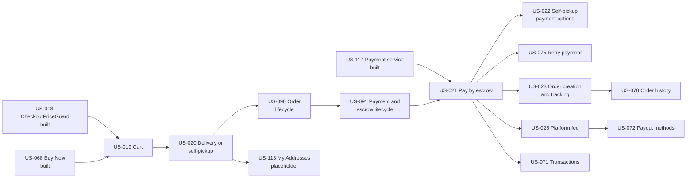
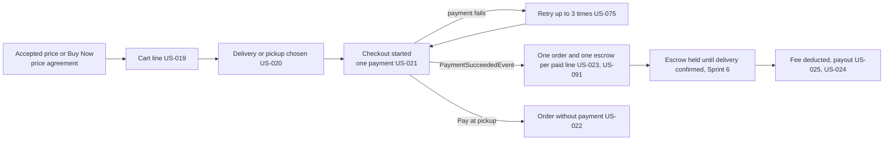
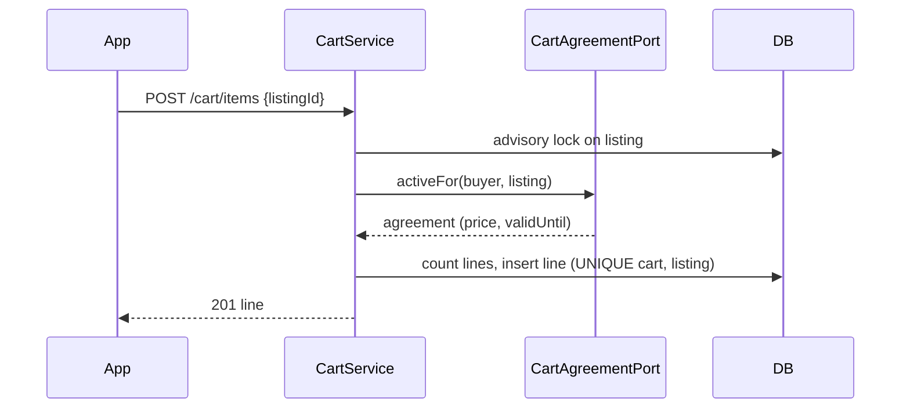
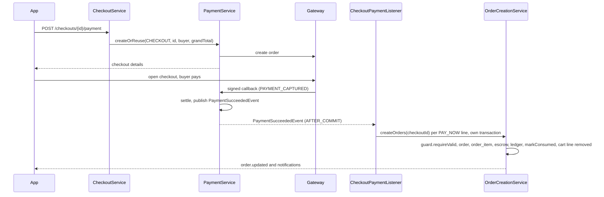
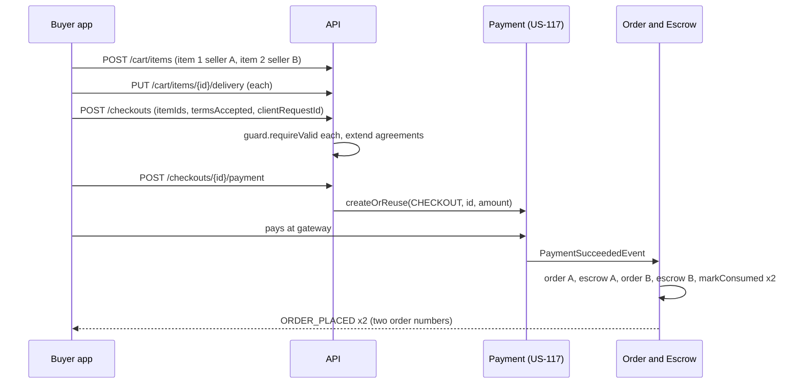

# Low Level Design - Sprint 5: Cart, Checkout & Payments

**Document Version:** 0.4 (2026-11-21). **US-019 and US-020 are built** (as-built notes in A.8 and B.6); all other stories are design only. Decisions marked "Proposed" still need product-owner confirmation unless an as-built section or a story plan records them as agreed.
**Product:** ValueX
**Sprint:** Sprint 5 - Cart, Checkout & Payments
**Stories Covered:** US-019, US-020, US-090, US-091, US-021, US-022, US-075, US-023, US-070, US-025, US-072, US-071, US-113 (placeholder only)
**Repos:** valuex-backend, valuex-mobile
**Sprint Goal:** Enable secure transactions and escrow: a buyer turns accepted prices into a cart, pays once, and the platform creates one order and one escrow per item.

**Change Log:**

| Version | Date | Change |
|---|---|---|
| 0.1 | 2026-11-19 | First version: all Sprint 5 stories designed in one document, written after Sprint 4 (negotiation, price agreements, Buy Now) and US-117 (payment integration) were built. US-113 is a placeholder and is designed only as far as Sprint 5 needs it. |
| 0.2 | 2026-11-19 | US-019 (Add to Cart) built, backend and mobile: as-built notes in A.8 (`V41__cart.sql`, `cart` package, `CartListingPort`, no ShedLock so the expiry job is safe through `SKIP LOCKED`, amounts as JSON numbers, the `cart` capability and `NEGOTIATION_REQUIRED`, Buy Now hand-off, no `cartSummaryProvider`). G1 to G12 of the US-019 plan were confirmed by the product owner. |
| 0.3 | 2026-11-20 | Product-owner answers to the Sprint 5 gaps G1 to G19 recorded in N.4: no distance rule for pickup or delivery (G6), address provider moves to MapmyIndia later (G7), escrow at a third-party provider behind `EscrowProviderPort` (G9, new D.2a), payout verification becomes story US-133 (G16). G17 decided: OpenPDF on the server, PDF and CSV both built in US-071. |
| 0.4 | 2026-11-21 | US-020 (Choose Delivery or Self-Pickup) built, backend and mobile: as-built notes in B.6 (`V42__cart_delivery.sql`; two cart endpoints; a new `POST /users/me/addresses` because no endpoint saved an address; the `shipping` ports with a stand-in quote adapter; pickup falls back from the listing's address to the seller's default address to the place typed on the listing; no `quoteId` from the app, the server re-quotes and compares `expectedShippingCost`; terms stored as a time and a version on the line). B.2 and Part M corrected where the build differs. G1 to G13 of the US-020 plan were confirmed by the product owner. |

**Reference Documents:**
- [Sprint-plan.md](../Sprint-plan.md) - Sprint 5 section
- [user-stories.md](../user-stories.md) - US-019 to US-023, US-025, US-070 to US-072, US-075, US-090, US-091, US-113
- [HLD Part 2 - Backend Architecture](../HLD/02-Backend-Architecture.md) - sections 4.8 Cart, 4.9 Order, 4.10 Payment, 4.11 Escrow, events
- [HLD Part 3 - Data Architecture](../HLD/03-Data-Architecture.md) - sections 4.5 Cart, 4.6 Order, 4.7 Payment, 4.8 Escrow, immutable financial records
- [HLD Part 7 - API Integrations](../HLD/07-API-Integrations-Release-Risk.md) - sections 8 to 11, 21
- [Sprint 4 LLD](Sprint-4-Communication-Negotiation-LLD.md) - Part K (`CheckoutPriceGuard`, price agreement status), Part M (Buy Now, M.11 "Not built")
- [Sprint 2 LLD](Sprint-2-Seller%20Listing%20Creation-LLD.md) - Part H and the US-117 note (payment port, `PaymentService`, events)
- [Sprint 6 LLD](Sprint-6-Shipping-Delivery-LLD.md) - Part A (`orders` columns read by Seller Incoming Orders)
- [CODING_STANDARDS.md](../CODING_STANDARDS.md)

---

## Sprint 5 Story Map & Dependency Order



Suggested build order (each is one branch and one pull request): US-019, US-020, US-090 with US-091 (one state-machine and schema change), US-021 with US-025 (the fee is first needed when escrow is created), US-022, US-075, US-023, US-070, US-071, US-072. US-113 waits for the product owner.

## Master Table of Contents

- [0. Cross-cutting design](#0-cross-cutting-design)
- [Part A - US-019 Add to Cart](#part-a---us-019-add-to-cart)
- [Part B - US-020 Choose Delivery or Self-Pickup](#part-b---us-020-choose-delivery-or-self-pickup)
- [Part C - US-090 Lifecycle State: Order](#part-c---us-090-lifecycle-state-order)
- [Part D - US-091 Lifecycle State: Payment and Escrow](#part-d---us-091-lifecycle-state-payment-and-escrow)
- [Part E - US-021 Buyer Makes Payment (Escrow)](#part-e---us-021-buyer-makes-payment-escrow)
- [Part F - US-022 Self-Pickup Payment Options](#part-f---us-022-self-pickup-payment-options)
- [Part G - US-075 Retry Failed Payments](#part-g---us-075-retry-failed-payments)
- [Part H - US-023 Order Creation and Tracking](#part-h---us-023-order-creation-and-tracking)
- [Part I - US-070 View Order History](#part-i---us-070-view-order-history)
- [Part J - US-025 Platform Fee Deduction](#part-j---us-025-platform-fee-deduction)
- [Part K - US-072 Seller Payout Methods](#part-k---us-072-seller-payout-methods)
- [Part L - US-071 Payment and Transaction History](#part-l---us-071-payment-and-transaction-history)
- [Part M - US-113 My Addresses (placeholder)](#part-m---us-113-my-addresses-placeholder)
- [Part N - End-to-end flow, NFR, testing, decisions and open items](#part-n---end-to-end-flow-nfr-testing-decisions-and-open-items)

---

# 0. Cross-cutting design

## 0.1 What already exists and what Sprint 5 adds

| Area | Built (do not redo) | Sprint 5 adds |
|---|---|---|
| Price rule | `CheckoutPriceGuard.requireValid` / `markConsumed`, `price_agreements` (`OFFER` and `BUY_NOW`), `agreement.updated`, batch status endpoint (Sprint 4 K, M) | Calls them; adds `extendForCheckout` (D4) |
| Payment | `PaymentGatewayPort`, `PaymentService.createOrReuse(CreatePaymentCommand)`, `payments`, `payment_attempts`, `payment_refunds`, callback and reconciliation, `PaymentSucceededEvent` (with `late`) and `PaymentFailedEvent` (US-117, V19) | New reference type `CHECKOUT`; a listener that creates orders; the buyer checkout screen |
| Capabilities | `buyNow` and `cart` capability with `COMING_SOON` while `valuex.checkout.enabled` is false (D10) | Turns `cart` on, and `buyNow` hands over to the cart (D3); the flag is set to true when US-021 ships |
| State machines | `CartStateMachine`, `OrderStateMachine`, `PaymentStateMachine`, `EscrowStateMachine` skeletons (Sprint 0) | Wired to real transitions; order machine extended in Part C |
| Addresses | `addresses` (US-108), `AddressController`, address component in the app | Delivery and pickup address use (Part B); My Addresses screen waits for US-113 |
| Fee and tax | `TaxSettingsService` (`GstMode`, rate) | Platform fee settings and calculator (Part J) |

## 0.2 Module ownership

| Module | Owns (Sprint 5) | Does not own |
|---|---|---|
| `cart` | `carts`, `cart_items`, `checkouts`, `checkout_lines`, cart and checkout endpoints, `CartItemExpiryJob`, `CheckoutExpiryJob` | Payment, order rows |
| `order` | `orders`, `order_items`, `order_status_history`, order endpoints, `OrderCreationService` | Shipping state (Sprint 6), returns (Sprint 7) |
| `payment` | `payments` (reference `CHECKOUT`), checkout wrapper endpoint | Escrow, fees |
| `escrow` | `escrow_accounts`, `escrow_ledger`, `FeeCalculator`, fee settings, `payout_methods` (the module owns seller payout), `user_transactions` projection | Release trigger (US-024, Sprint 6) |
| `shipping` | Only a port used by US-020: `ShippingQuotePort` (D6) | Shiprocket (US-122) |

Cross-module calls go through ports in `<module>/application/port` (as in Sprint 4). `cart` talks to `negotiation` through `CheckoutPriceGuard` and a new read port, to `listing` through `ListingFactsPort`, to `order` through `OrderCreationPort`, to `payment` through `PaymentService`.

## 0.3 Money flow and lifecycle



- **Order creation happens after payment** (US-021 rule "payment confirmation required before order creation"). Before that the buyer holds a `checkout`, not an order (D2). The early `OrderState` values of US-090 (`ORDER_INITIATED` to `PAYMENT_FAILED`) are recorded as checkout statuses and copied into each new order's `order_status_history` (Part C).
- **One payment, many orders:** `payments.reference_type = 'CHECKOUT'`, `reference_id = checkouts.id`, `amount = checkouts.grand_total`. Each paid line becomes its own order with its own escrow account; the sum of the escrow amounts equals the payment amount (checked in code and by a test).
- **Amounts are decided by the server.** The app never sends a price, a shipping cost or a total. A line is priced from its price agreement and the shipping quote the server stored.

## 0.4 Platform settings (new `CheckoutSetting` registry, same pattern as `NegotiationSetting`)

| Key | Default | Range | Used by |
|---|---|---|---|
| `CART_MAX_ITEMS` | 20 | 1 to 50 | US-019 |
| `CART_ITEM_TTL_HOURS` | 24 | 1 to 168 | US-019 |
| `CHECKOUT_PAYMENT_WINDOW_MINUTES` | 15 | 5 to 60 | US-021, US-075 |
| `CHECKOUT_MAX_PAYMENT_ATTEMPTS` | 3 | 1 to 5 | US-075 |
| `PLATFORM_FEE_PERCENT` | 5 | 0 to 30 | US-025 |
| `PLATFORM_FEE_MIN_AMOUNT` | 10 | 0 to 1000 | US-025 |
| `PAYOUT_ACTIVATION_HOURS` | 24 | 0 to 72 | US-072 |
| `ORDER_PAGE_SIZE` | 20 | 10 to 50 | US-070 |
| `SHIPPING_STUB_FLAT_RATE`, `SHIPPING_STUB_ETA_DAYS` | 60, 5 | 0 to 1000, 1 to 15 | US-020 stub only (D6) |

Environment: `valuex.checkout.enabled` (`CHECKOUT_ENABLED`) already exists; it is set true when US-021 ships. No other flag.

## 0.5 Error codes added in Sprint 5 (the texts of the stories are used as written)

| Code | HTTP | Text | Story |
|---|---|---|---|
| `ERROR_ITEM_UNAVAILABLE` | 409 | This item is no longer available | US-019, US-075 |
| `ERROR_PRICE_CHANGED` | 409 | Price has changed. Please review | US-019 (exists) |
| `ERROR_MAX_CART_ITEMS` | 409 | Cart limit reached (20 items) | US-019 |
| `ERROR_CART_EXPIRED` | 409 | Cart items expired. Please add again | US-019 |
| `ERROR_CART_ITEM_NOT_FOUND` | 404 | This item is not in your cart | US-019 |
| `ERROR_NO_DELIVERY_AVAILABLE` | 409 | Seller doesn't offer delivery to your location | US-020 |
| `ERROR_NO_SELF_PICKUP` | 409 | Self-pickup not available for this item | US-020 |
| `ERROR_INVALID_ADDRESS` | 422 | Please enter complete delivery address | US-020 |
| `ERROR_SELLER_DISABLED_PAY_AT_PICKUP` | 409 | Seller requires advance payment | US-022 |
| `ERROR_CHECKOUT_NOT_FOUND` | 404 | This checkout was not found | US-021 |
| `ERROR_PAYMENT_FAILED` | 402 | Payment unsuccessful. Please try again | US-021 (US-075: "Payment failed. Please try different method") |
| `ERROR_PAYMENT_TIMEOUT` | 409 | Payment timed out. Your cart is still saved | US-021 |
| `ERROR_GATEWAY_UNAVAILABLE` | 503 | Payment service temporarily unavailable | US-021 (exists in US-117) |
| `ERROR_INSUFFICIENT_BALANCE` | 402 | Payment failed due to insufficient funds | US-021 (mapped from the gateway failure reason) |
| `ERROR_MAX_RETRIES` | 409 | Maximum retry attempts reached. Please try again later | US-075 |
| `ERROR_RETRY_EXPIRED` | 409 | Retry window expired. Please create new order | US-075 |
| `ERROR_ORDER_NOT_FOUND` | 404 | This order was not found | US-023, US-070 |
| `ERROR_FEE_CALCULATION` | 500 | Unable to calculate fee. Transaction on hold | US-025 |
| `ERROR_INVALID_ACCOUNT`, `ERROR_NAME_MISMATCH`, `ERROR_INVALID_UPI`, `ERROR_PENDING_PAYOUT` | 422/409 | as in US-072 | US-072 |
| `ERROR_LOADING_ORDERS`, `ERROR_LOADING_TRANSACTIONS`, `ERROR_EXPORT_FAILED` | 500 | as in US-070, US-071 | US-070, US-071 |

Codes already built (`ERROR_ITEM_RESERVED`, `ERROR_ACCEPTANCE_EXPIRED`, `ERROR_PRICE_NOT_ACCEPTED`, `ERROR_CHECKOUT_NOT_APPLICABLE`, `ERROR_UNAUTHORIZED_CHECKOUT`) come from `CheckoutPriceGuard` and are passed through unchanged.

## 0.6 Events and notifications

| Event (domain) | Published by | Listeners |
|---|---|---|
| `CartItemAdded`, `CartItemRemoved` | `CartService` | Metrics; `agreement.updated` is re-used for live badges (decision D9) |
| `CheckoutStarted`, `CheckoutExpired` | `CheckoutService`, `CheckoutExpiryJob` | Release of agreement extension, cart restore |
| `OrderCreated` (HLD) | `OrderCreationService` | Notifications, `user_transactions`, `search` (listing becomes sold), seller badge (US-112) |
| `EscrowCreated` (HLD) | `EscrowService` | `user_transactions` |
| `PaymentSucceeded`, `PaymentFailed` (built) | `payment` | `CheckoutPaymentListener` |

In-app notifications (type: title / body): `ORDER_PLACED` (buyer: "Order placed" / "Your order {orderNumber} is confirmed"), `NEW_ORDER` (seller: "New order" / "{buyer} bought {item}"), `PAYMENT_FAILED` (buyer: "Payment unsuccessful" / "Your cart is still saved"), `ORDER_STATUS_CHANGED` (buyer, per US-023 statuses). Texts exist in English and Hindi. Push delivery follows US-131 when it is merged; Sprint 5 only creates the in-app notification rows through the existing `NotificationPort`. Live updates use the Realtime Gateway (US-130) topic `order.updated`.

## 0.7 Decisions (Proposed unless marked)

| # | Decision |
|---|---|
| D1 | A cart line always rests on an active price agreement (`OFFER` accepted, or `BUY_NOW`). A line without one cannot be added (story rule "item must have an accepted price"). |
| D2 | **No order exists before payment.** The pre-payment record is a `checkout`. US-075's "order stays Payment Pending for 15 minutes" is read as "the checkout stays payable". The story texts say "order"; the app shows "order" wording. |
| D3 | **Buy Now = reserve, add the line, open checkout for that line.** `POST /listings/{id}/buy-now` (built) keeps returning the reservation; the app then calls `POST /cart/items` for the same listing (the agreement already exists, so it succeeds) and opens checkout with that line pre-selected. The Buy Now reservation window (15 minutes) is the checkout window. |
| D4 | Starting a checkout extends every selected line's agreement `valid_until` to the checkout deadline plus 2 minutes (`PriceAgreementService.extendForCheckout`), so an agreement cannot end while a payment is in flight. Closing the checkout (expired, cancelled) lets the normal expiry job end them. |
| D5 | Late payment (money arrives after the checkout expired, `PaymentSucceededEvent.late`) or a line that can no longer be fulfilled: the line is refunded through `PaymentRefundService` (full amount of that line); the other lines continue. |
| D6 | Shipping quotes come from a `ShippingQuotePort`. US-122 (Sprint 6) is the real Shiprocket adapter. Sprint 5 ships a `StubShippingQuoteAdapter` (flat rate and ETA from settings) so delivery can be used end to end; it is replaced by configuration, not code, when US-122 lands. **Open gap G3.** |
| D7 | Fee is the seller's cost (US-025: "deducts fee from seller's payout"). The buyer pays item price plus shipping. The buyer order summary shows a "Platform fee" row only when a buyer-side fee is configured, which is 0 now (field `buyerFee` reserved, always 0). **Open gap G4** (US-021 lists "platform fees" in the buyer summary). |
| D8 | "Balance after transaction" (US-071) is the running net of the user's own transactions, not a wallet (no stored balance, no withdrawals of a balance). |
| D9 | No new realtime event for the cart; the cart re-reads on `agreement.updated`. |
| D10 | Money type: `NUMERIC(12,2)` in the database, `BigDecimal` with scale 2 and `RoundingMode.HALF_UP` in code, `Money` helper from `payment.domain` reused. Amounts travel as JSON strings. |

---

# Part A - US-019 Add to Cart

## A.1 Story Overview

A buyer adds items with an active price agreement to a cart, sees them grouped by seller, removes them, and starts checkout (Part E). Max 20 items, each line lasts 24 hours.

**Out of scope:** payment, order creation (Part E, H); delivery choice UI per line (Part B; the cart only shows the choice).

## A.2 Data Model

```sql
-- V41__cart.sql (built as V41: V40 is device_tokens)
CREATE TABLE carts (
    id         UUID PRIMARY KEY DEFAULT uuid_generate_v4(),
    buyer_id   UUID NOT NULL UNIQUE REFERENCES users (id),
    state      VARCHAR(30) NOT NULL DEFAULT 'EMPTY',      -- CartState
    created_at TIMESTAMPTZ NOT NULL DEFAULT NOW(),
    updated_at TIMESTAMPTZ NOT NULL DEFAULT NOW()
);

CREATE TABLE cart_items (
    id                  UUID PRIMARY KEY DEFAULT uuid_generate_v4(),
    cart_id             UUID NOT NULL REFERENCES carts (id) ON DELETE CASCADE,
    listing_id          UUID NOT NULL REFERENCES listings (id),
    seller_id           UUID NOT NULL REFERENCES users (id),
    agreement_id        UUID NOT NULL REFERENCES price_agreements (id),
    negotiated_price    NUMERIC(12,2) NOT NULL,            -- the agreed price when added (HLD column name kept)
    -- chosen in Part B / F, all NULL until the buyer chooses
    delivery_mode       VARCHAR(20),                       -- DELIVERY | SELF_PICKUP
    delivery_address_id UUID REFERENCES addresses (id),
    shipping_quote_id   UUID,
    shipping_cost       NUMERIC(12,2),
    payment_option      VARCHAR(20),                       -- PAY_NOW | PAY_AT_PICKUP
    added_at            TIMESTAMPTZ NOT NULL DEFAULT NOW(),
    expires_at          TIMESTAMPTZ NOT NULL,
    CONSTRAINT uq_cart_items_cart_listing UNIQUE (cart_id, listing_id),
    CONSTRAINT chk_cart_items_price CHECK (negotiated_price > 0)
);
CREATE INDEX idx_cart_items_expiry ON cart_items (expires_at);
CREATE INDEX idx_cart_items_agreement ON cart_items (agreement_id);
```

The HLD "Cart Locks" key (`cart-lock:{listingId}`, 15 minutes) is **not used**: exclusivity is the active `price_agreements` row (advisory lock plus the unique partial index), already built. A cart line never hides a listing from other buyers (D1).

## A.3 API Contracts

All under `/api/v1`, authenticated, account `ACTIVE`.

| Method and path | Purpose | Success | Errors |
|---|---|---|---|
| `GET /cart` | The cart grouped by seller, each line re-evaluated | 200 `CartResponse` | none |
| `POST /cart/items` `{ "listingId" }` | Add a line from the buyer's active agreement | 201 first add, 200 when already in cart | `ERROR_ITEM_UNAVAILABLE`, `ERROR_PRICE_NOT_ACCEPTED`, `ERROR_ITEM_RESERVED`, `ERROR_MAX_CART_ITEMS`, `ERROR_CHECKOUT_NOT_APPLICABLE` (Real Estate), `ERROR_UNAUTHORIZED_CHECKOUT` (own listing), `ERROR_CHECKOUT_UNAVAILABLE` (flag off, 503) |
| `DELETE /cart/items/{itemId}` | Remove a line | 204, repeating also 204 | `ERROR_CART_ITEM_NOT_FOUND` (not the caller's) |
| `GET /cart/summary` | `{ itemCount, validCount }` for the home badge | 200 | none |

`CartResponse`:

```json
{ "cartId": "...", "serverTime": "2026-11-19T10:00:00Z", "itemCount": 3,
  "groups": [ { "sellerId": "...", "sellerName": "Asha K.",
    "items": [ { "itemId": "...", "listingId": "...", "title": "...", "imageUrl": "...",
      "agreedPrice": "4500.00", "currentPrice": "4500.00",
      "status": "ACCEPTED", "agreementValidUntil": "...", "expiresAt": "...",
      "delivery": { "mode": null, "shippingCost": null, "paymentOption": null },
      "problem": null } ] } ] }
```

`status` (per line, server decided): `ACCEPTED` (agreement active and price equal), `PENDING` (a negotiation exists but no agreement yet; shown only because the story shows Pending, never payable), `EXPIRED` (agreement ended or line past `expires_at`), `UNAVAILABLE` (sold, suspended, deleted, not live). `problem` carries one of the four error codes when the line cannot be bought: `ERROR_ITEM_UNAVAILABLE`, `ERROR_PRICE_CHANGED` (with `currentPrice`), `ERROR_CART_EXPIRED`. Groups are ordered by the earliest `addedAt`; items inside a group newest first.

## A.4 Backend Design (valuex-backend, package `com.valuex.cart`)

| Class | Layer | Responsibility |
|---|---|---|
| `CartController` | api | The four endpoints; `@Valid` bodies; `ApiResponse` wrapper. |
| `CartService` | application | `view`, `add`, `remove`, `summary`. `add` is one transaction under `PriceAgreementService.lockListing(listingId)`: checkout flag, sold or not live, own listing, Real Estate, agreement read through `CartAgreementPort`, already in cart (return 200 with the same line), count against `CART_MAX_ITEMS`, insert, `CartStateMachine` `ADD_ITEM`. |
| `CartItemViewAssembler` | application | Builds one line status from the listing facts and the agreement (no database writes). |
| `CartAgreementPort` (in `cart/application/port`, adapter in `negotiation`) | port | `activeFor(buyerId, listingId)` returns `{ agreementId, price, validUntil, source }` or empty; `statusFor(buyerId, listingIds)` for the view. Wraps `PriceAgreementResolver`. |
| `CartItemExpiryJob` | application | Every 5 minutes (ShedLock, like `AgreementExpiryJob`): deletes lines past `expires_at`; marks nothing else (status is computed on read). Metric `cart.expired`. |
| `CartErrors`, `CartMetrics` | domain / application | Codes of 0.5; counters `cart.added`, `cart.refused{reason}`, `cart.expired`. |

Rules: a line's displayed price is always the agreement price; `ERROR_PRICE_CHANGED` appears when the listing price differs from a `BUY_NOW` agreement price (the agreement was cancelled by US-068's price-change listener, so the line shows `EXPIRED` with `problem = ERROR_PRICE_CHANGED`). An `OFFER` price stands when the listing price changes (US-068 rule), so it stays `ACCEPTED`.

Capability: `ContactEligibilityService` gets `cart` the same way `buyNow` was done: `NOT_APPLICABLE` (Real Estate), `DISABLED_BY_SELLER` is **not** used for cart, `IDENTITY_REQUIRED`, `RESERVED` (another buyer's agreement), `COMING_SOON` while the flag is off, available only when the caller holds an active agreement for the listing, otherwise `NEGOTIATION_REQUIRED` (new reason: the app then shows "Make an offer or Buy Now" instead of a dead button).

## A.5 Sequence



## A.6 Mobile Design (valuex-mobile, `features/cart`)

- `CartScreen` (route `/cart`): `ListView` with a section header per seller, line card with image, title, agreed price, status badge, a 24-hour countdown chip (shared `ReservationTimer` from US-068), a remove button with undo snackbar, the delivery summary line ("Choose at checkout" until Part B), a footer with total of valid lines and "Proceed to checkout" (disabled when no valid line).
- Providers: `cartProvider` (server is the source of truth, re-read on open, on `agreement.updated` and after each action), `cartSummaryProvider` (home badge).
- `ListingActions`: Add to Cart calls `CartRepository.add`; on `NEGOTIATION_REQUIRED` it shows the hint; refusal texts from 0.5 in English and Hindi.
- Offline: the last successful response is kept in memory only (the story's `isar` / `drift` store is **not** added, G5).

## A.7 Validation, Edge Cases and NFR

| Case | Behaviour |
|---|---|
| Seller removes or suspends the listing | Line shows `UNAVAILABLE`; checkout refuses it (`ERROR_ITEM_UNAVAILABLE`). |
| Price changed | See A.4. |
| Mix of delivery and self-pickup lines | Allowed; each line carries its own mode (Part B). |
| Cart abandoned for days | Lines deleted by the expiry job at 24 hours. |
| Two taps or two devices add the same item | `UNIQUE (cart_id, listing_id)` plus the lock make it idempotent. |
| Item in many carts | Allowed; only the agreement holder can check out. |

Performance: `view` reads at most 20 lines with batched queries (one listing-facts call, one agreement call). Tests: see Part N.

## A.8 As built (2026-11-19, US-019)

Plan: `Documents/US-Implementation-Plans/US-019-Implementation-Plan.md`. Backend branch `feature/US-019-add-to-cart`, mobile branch `feature/US-019-add-to-cart`. The flag `valuex.checkout.enabled` stays false: the cart **ships dark** (capability `COMING_SOON`, `POST /cart/items` answers 503 `ERROR_CHECKOUT_UNAVAILABLE`, reads work) and nothing in this story turns it on. US-021 does.

| # | LLD said | Built | Why |
|---|---|---|---|
| 1 | Migration number `V{N}`. | `V41__cart.sql`: `carts`, `cart_items` as A.2 (the US-020 columns NULL), indexes, `UNIQUE (cart_id, listing_id)`, and the two settings `CART_MAX_ITEMS` 20 and `CART_ITEM_TTL_HOURS` 24. | `V40` is `device_tokens` (US-131). |
| 2 | `CartItemExpiryJob` runs every 5 minutes with ShedLock. | `@Scheduled(fixedDelayString = "${valuex.cart.expiry-interval-ms:300000}")`. The delete is `DELETE ... FOR UPDATE SKIP LOCKED ... RETURNING cart_id`, then the empty carts get `ALL_ITEMS_REMOVED` in the same transaction. | The project has no ShedLock; `SKIP LOCKED` makes two instances safe. |
| 3 | `add` order: flag, listing, agreement, existing line, count, insert. | Flag; listing advisory lock (`CartAgreementPort.lockListing`); listing facts; agreement; the cart row (`FOR UPDATE`, created when missing); existing line; limit; insert. An expired line that the job has not removed yet is deleted and replaced on re-add; an existing line is re-pointed at a new agreement and its expiry is **not** extended. | One lock order (listing, then cart row) so parallel adds from one buyer cannot exceed the limit. |
| 4 | Refusal codes only listed. | Order: own listing 403 `ERROR_UNAUTHORIZED_CHECKOUT`; not live or sold `ERROR_ITEM_UNAVAILABLE`; Real Estate `ERROR_CHECKOUT_NOT_APPLICABLE`; another buyer's agreement `ERROR_ITEM_RESERVED`; a waiting offer `ERROR_PRICE_NOT_ACCEPTED` ("Seller hasn't accepted your offer yet"); no, ended or price-changed agreement `ERROR_PRICE_NOT_ACCEPTED` ("Make an offer or use Buy Now first"); 21st line 409 `ERROR_MAX_CART_ITEMS` with `details.limit`. | The app shows the limit from the server setting. |
| 5 | `status` list and three `problem` codes. | Per line, computed on read: past `expires_at` `EXPIRED` + `ERROR_CART_EXPIRED`; listing missing, not live, sold or Real Estate `UNAVAILABLE` + `ERROR_ITEM_UNAVAILABLE`; `ACCEPTED` at the agreement price (an `OFFER` price stands); `PENDING`; another buyer's agreement `UNAVAILABLE`; `PRICE_CHANGED` `EXPIRED` + `ERROR_PRICE_CHANGED`; `EXPIRED` or `NONE` `EXPIRED` + **`ERROR_ACCEPTANCE_EXPIRED`** (a fourth problem code). | A line whose agreement ended needs its own text: "Price acceptance expired. Make a new offer". |
| 6 | Amounts as strings. | Amounts are JSON numbers (`BigDecimal`), as every other endpoint. `CartLine` keeps the `delivery` block (all null until US-020) but the app ignores it and shows "Choose at checkout"; `validCount` is in `CartResponse` as well as `summary`. | Consistency with the existing API; the app needs no field for it. |
| 7 | Seller name and image: not named. | `CartListingPort` (adapter `listing/infrastructure/cart/CartListingAdapter`) wraps `ListingFactsAdapter` and `ListingPhotoLinkPort.mainPhotos`. Seller names come from `ParticipantDirectoryPort` inside `CartService`, not from the adapter. | Cheaper and keeps the adapter to the listing module. |
| 8 | `remove`: 204 twice; `ERROR_CART_ITEM_NOT_FOUND` for another buyer. | The same. 404 only when the line exists and belongs to someone else. | |
| 9 | `POST /cart/items` needs an active account. | Also `@RequiresIdentityVerification` (Aadhaar), like Make an Offer and Buy Now. | D9 of Sprint 4. |
| 10 | Capability order. | `cart()` in `ContactEligibilityService`: `IDENTITY_REQUIRED`, `RESERVED`, `COMING_SOON` (flag off), `NEGOTIATION_REQUIRED` unless the agreement status is `ACCEPTED`, else available; an anonymous visitor gets `NEGOTIATION_REQUIRED`; the seller's Buy Now switch is ignored. `ContactOptions` has a `cart` `Option` after `buyNow`. | As A.4. |
| 11 | Mobile: `ReservationTimer` on each line; `cartSummaryProvider`. | The line uses the existing `CountdownText` ("Price held for 14m" for the price, "Leaves your cart in 23h" for the line) because `ReservationTimer` is an mm:ss timer for the 15-minute hold. There is **no** `cartSummaryProvider`: `ApiHomeRepository.badges()` reads `GET /cart/summary` (zero on any error) and the home badge provider is invalidated after an add or a remove. | Fewer providers, one badge source. |
| 12 | `cartProvider` re-read on open, `agreement.updated`, after actions. | Also on every realtime reconnect. A failed quiet read keeps the last answer. `CartAdder` is **not** auto-dispose (a screen that only reads it, Saved items, would lose it during a request). | |
| 13 | Buy Now hand-off. | After a reservation, `ListingViewScreen._buyNow` calls `add` and pushes `/cart` ("Reserved for you and added to your cart"); a refusal shows its text and the reservation stays. | D3. |
| 14 | Hand-offs from earlier stories. | Saved items "Add to Cart" is wired; `HomeScreen.onCart` opens `/cart`; the route is signed-in only (`RouteGuard`). The "Proceed to checkout" button is disabled with "Checkout is coming soon" (US-021). | |

**Not built:** checkout, delivery choice (US-020), the local cart store (G5 of N.4: the server is the truth), a `cart.updated` event. **Open:** the Hindi texts need native review; the l10n files of this branch and mobile PR #82 (US-131) both change `app_en.arb` and `app_hi.arb`, so the second to merge resolves a conflict there.

---

# Part B - US-020 Choose Delivery or Self-Pickup

## B.1 Story Overview

For each cart line the buyer chooses home delivery (address, estimate, shipping cost) or self-pickup (seller pickup address and contact, then the payment choice of Part F).

## B.2 Design

- **Options endpoint:** `GET /cart/items/{itemId}/delivery-options?addressId=...` returns what the line allows. Options are computed by `DeliveryOptionsService`:
  - `selfPickup`: available when the listing has a pickup location (G2: listing pickup address column, see Part N) and the category allows it. Distance never limits it: a buyer may pick up from any city or state (G6, decided by the product owner). Returns `{ pickupAddress (line 1, city, pincode only until the order exists), sellerDisplayName }`; no pickup hours are shown (no data exists). The full address and phone are revealed only after the order is paid or confirmed (Part H).
  - `delivery`: available when the category is delivery-eligible (taxonomy, US-122) and `ShippingQuotePort.quote` returns a courier, at any distance, near or far (the buyer decides, G6). Returns `{ quoteId, cost, etaDate, courierName? }`. Whole vehicles and Real Estate are never eligible.
  - If neither is available the line cannot be bought: `ERROR_NO_DELIVERY_AVAILABLE` and `ERROR_NO_SELF_PICKUP` are returned as the reasons in the options (HTTP 200) and the checkout refuses the line.
- **Choice endpoint:** `PUT /cart/items/{itemId}/delivery` with `{ "mode": "DELIVERY", "addressId": "...", "expectedShippingCost": 60 }` or `{ "mode": "SELF_PICKUP", "paymentOption": "PAY_NOW" | "PAY_AT_PICKUP" }`, both with `"termsAccepted": true`. The server re-quotes (no `quoteId` comes from the app, B.6 row 5) and stores `delivery_mode`, `delivery_address_id`, `shipping_cost`, `payment_option`. Shipping cost above the item price is allowed but returned with `warning: SHIPPING_EXCEEDS_PRICE` for the app to show (edge case).
- **Address rules:** `addressId` must belong to the buyer and have all of line 1, city, state, valid pincode (`ERROR_INVALID_ADDRESS`). A new address is saved through `POST /users/me/addresses` (added by US-020: `AddressController` could only verify and list until then; B.6 row 2) and becomes the default when it is the buyer's first; the app then calls the choice endpoint. Naming (Home, Office, custom) uses `addresses.label`.
- **Terms:** the request carries `termsAccepted: true` for the chosen mode (validation rule "buyer must agree to terms for selected option"); the accepted terms version is stored on the checkout (Part E).

## B.3 Ports (D6)

```java
public interface ShippingQuotePort {
    /** One quote for one package; never throws for "not serviceable", returns empty instead. */
    Optional<ShippingQuote> quote(ShippingQuoteRequest request);   // pickupPin, deliveryPin, weightGrams, declaredValue
    record ShippingQuote(UUID quoteId, BigDecimal cost, LocalDate eta, String courier, Instant validUntil) {}
}
public interface DeliveryEligibilityPort { boolean deliveryEligible(UUID listingId); }
```

`StubShippingQuoteAdapter` (Sprint 5, profile-selected by `valuex.shipping.provider=stub`): flat `SHIPPING_STUB_FLAT_RATE`, eta now plus `SHIPPING_STUB_ETA_DAYS`, `deliveryEligible` true for goods that are not Real Estate or whole vehicles (G3). The Shiprocket adapter of US-122 replaces both.

## B.4 Mobile

Checkout step 1 ("How do you want to receive this?") per line: two option cards, the reusable address component (US-108), saved addresses with the default preselected, the pickup location (the story names an embedded map). Address search and validation use the US-108 component as it is today; they move to the MapmyIndia APIs when that integration is built, as a new adapter behind the existing address provider (`AddressProviderConfig`, next to the Google and sandbox adapters), so Sprint 5 needs no change then (G7). Until a map is available the pickup location is shown as address text, the "Pay Now / Pay at Pickup" choice for self-pickup, and the "Pay at Pickup is not protected by escrow" banner (Part F).

## B.5 Validation and Errors

At least one option must exist; address complete with pincode; quote calculated before checkout (`PUT .../delivery` is required for every line, else the checkout answers `ERROR_DELIVERY_NOT_CHOSEN` 409, "Choose how to receive each item"); self-pickup address valid. **No distance rule:** the story edge case "seller location too far for self-pickup" is not enforced; the buyer alone decides, so self-pickup is offered from any distance and delivery for any serviceable distance, however near (G6). The app may show the seller's city as information only.

## B.6 As built (2026-11-21, US-020)

Plan: `Documents/US-Implementation-Plans/US-020-Implementation-Plan.md`. Backend branch `feature/US-020-delivery-or-pickup`, mobile branch `feature/US-020-delivery-or-pickup`. Like the cart, the choice only exists for a line that exists, and a line can only be added while `valuex.checkout.enabled` is on, so the whole feature stays dark with the flag off (the two endpoints themselves do not read the flag).

| # | LLD said | Built | Why |
|---|---|---|---|
| 1 | Migration number not stated. | `V42__cart_delivery.sql`: `listings.pickup_address_id` (nullable, FK to `addresses`); `cart_items.shipping_eta`, `shipping_quote_valid_until`, `terms_accepted_at`, `terms_version`; the CHECK `chk_cart_items_delivery` (a line has no choice, or a delivery choice with address, cost, date and no payment option, or a self-pickup choice with a payment option and no address or cost, both with the terms); seeds `SHIPPING_STUB_FLAT_RATE` 60 and `SHIPPING_STUB_ETA_DAYS` 5. | The database refuses a line that mixes the two choices. |
| 2 | A new address is created through the existing `AddressController`. | **It could not be**: that controller only verified and listed. New `POST /users/me/addresses` (`AddressCreationService`): verifies again through the provider **outside** the database transaction, then saves; the first address is the default, a later one only with `makeDefault`, which clears the old default first; a per-user advisory lock keeps exactly one default under parallel saves. It answers 201 with the saved address and uses the existing codes of the verify endpoint (`ERROR_ADDRESS_INVALID`, `ERROR_PINCODE_MISMATCH`, `ERROR_ADDRESS_NOT_VERIFIED`, ...), **not** `ERROR_INVALID_ADDRESS`. | Without it AC2 ("saved as my default", "name it") cannot work. |
| 3 | `GET .../delivery-options` returns `{ quoteId, cost, etaDate, courierName? }`. | Always 200 with both options: `delivery { available, reason, cost, etaDate, courierName, warning }` and `selfPickup { available, reason, pickupAddress { line1, city, state, pincode }, sellerDisplayName }`. Without `addressId` the delivery option only says whether the item can be delivered at all. A line that cannot be bought answers 409 with its own problem code (`ERROR_ITEM_UNAVAILABLE`, `ERROR_PRICE_CHANGED`, `ERROR_CART_EXPIRED`, `ERROR_ACCEPTANCE_EXPIRED`) or `ERROR_PRICE_NOT_ACCEPTED`; an address that is not the buyer's or not complete answers 422 `ERROR_INVALID_ADDRESS`. | The screen explains an unavailable way without an error; no `quoteId` is needed (row 5). |
| 4 | Pickup address: `listings.pickup_address_id`, falling back to the seller's default address. | A third step: the place the seller typed on the listing (`seller_area`, `seller_location` as the city, `seller_state`), with no pincode. The listing column is read by SQL in the listing module (`CartPickupAdapter`); the `Listing` entity does not map it, because nothing writes it yet. | No seller can choose a pickup address yet, so without the third step self-pickup would be unavailable on almost every listing (plan G3). |
| 5 | The app sends a `quoteId` that the server matches within 10 minutes. | No `quoteId` from the app. `PUT` re-quotes and stores the cost, the date, the quote id and `shipping_quote_valid_until`; the app may send `expectedShippingCost` and a different cost answers 409 `ERROR_SHIPPING_CHANGED` with `details.shippingCost`. | No table holds quotes and the stand-in quote is deterministic (plan G5). |
| 6 | Terms: `termsAccepted: true`, the version stored on the checkout (Part E). | `termsAccepted` must be true (400 otherwise). The line stores `terms_accepted_at` and `terms_version` (`DELIVERY-1`, `PICKUP_PAY_NOW-1`, `PICKUP_PAY_AT_PICKUP-1`); the wording is in section 8 of the US-020 plan and in `app_en.arb` and `app_hi.arb`. The versioned terms record of the whole checkout stays with US-021. | A later change of wording stays traceable. |
| 7 | `ShippingQuotePort` and `DeliveryEligibilityPort`. | As B.3. `StubShippingQuoteAdapter` quotes every pincode at the flat rate, the date counted in Indian time, valid 10 minutes, courier "Standard delivery", and is active unless `valuex.shipping.provider` names another. `DeliveryEligibilityAdapter` (listing module) says goods yes, whole vehicles and Real Estate no, a listing with no or an unknown category yes. | Until US-122. |
| 8 | Classes not named. | `DeliveryLineGuard` (the line is the buyer's and can be bought), `DeliveryOptionsService`, `DeliveryChoiceService` (cart row locked, as `CartService`), ports `CartAddressPort` and `CartPickupPort` in `cart/application/port` with adapters in `user/infrastructure/cart` and `listing/infrastructure/cart`. `CartLine.Delivery` is `(mode, addressId, shippingCost, shippingEta, paymentOption, warning)`. Metrics `cart.delivery.chosen{mode}` and `cart.delivery.refused{reason}`. | |
| 9 | A mix of delivery and pickup lines is allowed. | Each line holds its own choice; adding the same listing again keeps the choice; replacing an expired line starts without one. | |
| 10 | Mobile: checkout step 1 per line with the address component of US-108. | `DeliveryScreen` at `/cart/items/:itemId/delivery`, opened by "Choose delivery" or "Change" on each cart line that can be bought; two option cards, saved addresses with the default preselected, "Add a new address", the cost and date, the shipping-above-price notice, pickup place, Pay Now or Pay at Pickup with the escrow banner, the terms checkbox, Save. The form of a new address (`AddressFormSheet`) is new: US-108 built the search field, the verification status and the state picker, but no screen used them. The line shows "Delivery, ₹60, by Nov 25" or "Self-pickup, pay now" instead of "Choose at checkout". | |

**Not built:** checkout and its screen (US-021 reuses `DeliveryScreen`), the Pay at Pickup seller switch and its rules (US-022), My Addresses (US-113), real couriers and weight (US-122), a map (address text only; MapmyIndia later behind the address provider). **Open:** the Hindi texts, including the terms, need native review and the English terms need sign-off by whoever owns the terms of service.

---

# Part C - US-090 Lifecycle State: Order

## C.1 Scope

Extend and wire `OrderState` / `OrderStateMachine`, add the `orders`, `order_items`, `order_status_history` tables, and define who may move an order. Sprint 5 drives the states up to `SHIPPING_MODE_SELECTED`; Sprint 6 and 7 drive the rest. The 24 states of the story already exist in `OrderState`.

## C.2 Data Model

```sql
-- V{N}__orders.sql
CREATE SEQUENCE order_number_seq START 1;

CREATE TABLE orders (
    id               UUID PRIMARY KEY DEFAULT uuid_generate_v4(),
    order_number     VARCHAR(30) NOT NULL UNIQUE,            -- 'VX-261119-000123'
    checkout_id      UUID NOT NULL REFERENCES checkouts (id),
    buyer_id         UUID NOT NULL REFERENCES users (id),
    seller_id        UUID NOT NULL REFERENCES users (id),
    delivery_mode    VARCHAR(20) NOT NULL,                   -- DELIVERY | SELF_PICKUP
    payment_option   VARCHAR(20) NOT NULL,                   -- PAY_NOW | PAY_AT_PICKUP
    status           VARCHAR(50) NOT NULL,                   -- OrderState name
    item_amount      NUMERIC(12,2) NOT NULL,
    shipping_amount  NUMERIC(12,2) NOT NULL DEFAULT 0,
    total_amount     NUMERIC(12,2) NOT NULL,
    delivery_address JSONB,                                  -- snapshot (line1, line2, city, state, pincode, label)
    pickup_address   JSONB,                                  -- snapshot for SELF_PICKUP
    seller_display_name VARCHAR(100) NOT NULL,               -- snapshot, survives a suspended seller (US-070)
    deleted_at       TIMESTAMPTZ,                            -- admin delete marks, never removes (US-070)
    version          BIGINT NOT NULL DEFAULT 0,
    created_at       TIMESTAMPTZ NOT NULL DEFAULT NOW(),
    updated_at       TIMESTAMPTZ NOT NULL DEFAULT NOW(),
    CONSTRAINT chk_orders_total CHECK (total_amount = item_amount + shipping_amount)
);
CREATE INDEX idx_order_buyer_created ON orders (buyer_id, created_at DESC);
CREATE INDEX idx_order_seller_status ON orders (seller_id, status, created_at DESC);   -- US-112

CREATE TABLE order_items (       -- exactly one row per order (D, HLD 4.6)
    id UUID PRIMARY KEY DEFAULT uuid_generate_v4(),
    order_id   UUID NOT NULL UNIQUE REFERENCES orders (id),
    listing_id UUID NOT NULL REFERENCES listings (id),
    seller_id  UUID NOT NULL REFERENCES users (id),
    price      NUMERIC(12,2) NOT NULL,
    title      VARCHAR(255) NOT NULL,        -- snapshots, so history survives a later edit or delete
    image_url  TEXT
);

CREATE TABLE order_status_history (
    id UUID PRIMARY KEY DEFAULT uuid_generate_v4(),
    order_id    UUID NOT NULL REFERENCES orders (id),
    from_status VARCHAR(50),
    to_status   VARCHAR(50) NOT NULL,
    actor_type  VARCHAR(20) NOT NULL,        -- BUYER | SELLER | SYSTEM | ADMIN | GATEWAY
    actor_id    UUID,
    note        VARCHAR(255),
    changed_at  TIMESTAMPTZ NOT NULL DEFAULT NOW()
);
CREATE INDEX idx_osh_order ON order_status_history (order_id, changed_at);
```

`order_status_history` is insert-only (no update or delete), like the escrow ledger.

## C.3 State Machine (Sprint 5 part)

Pre-payment states are held by the checkout and replayed into the history when the order is created (so the timeline starts at "Order initiated" with the checkout's real times):

| Checkout status | Order state recorded | When |
|---|---|---|
| (line added from agreement) | `SELLER_PRICE_ACCEPTED` | line added (time of `cart_items.added_at`) |
| `CHECKOUT_STARTED` | `ORDER_INITIATED`, `CHECKOUT_STARTED` | checkout created |
| `PAYMENT_PENDING` | `PAYMENT_PENDING` | payment order created |
| `PAYMENT_FAILED` | `PAYMENT_FAILED` | each failed attempt |
| `PAID` | `PAYMENT_SUCCESS`, `ESCROW_HELD`, `SHIPPING_MODE_SELECTED` | order created (one transaction) |

For **Pay at Pickup** the order skips payment: `... CHECKOUT_STARTED -> SHIPPING_MODE_SELECTED` with `payment_option = PAY_AT_PICKUP` (shown to the buyer as "Pending Pickup Payment"; the label is a presentation of that payment option, no new enum value, G8).

Allowed Sprint 5 transitions are added to `OrderStateMachine` with trigger names `START_CHECKOUT`, `PAYMENT_INITIATED`, `PAYMENT_FAILED`, `PAYMENT_CONFIRMED`, `ESCROW_HELD`, `MODE_SELECTED`, `CANCEL`. Cannot skip states except `CANCELLED`. Every transition goes through `OrderTransitionService.move(orderId, trigger, actor, note)`, which locks the order row (`SELECT ... FOR UPDATE`), checks the machine, writes the history row and publishes `OrderStatusChangedEvent`. `version` guards concurrent updates.

## C.4 Rules from the story

Escrow held until `COMPLETED` or `DISPUTE_RAISED` (Sprint 6 and 8); auto-complete after 7 days (Sprint 6, US-024); `CANCELLED` triggers refund (Sprint 7); both parties are notified at key states (`ORDER_STATUS_CHANGED`); timestamps recorded in the history for SLA.

---

# Part D - US-091 Lifecycle State: Payment and Escrow

## D.1 Scope

`PaymentState` already has the 14 states and a `payments.status` CHECK (V19). Sprint 5 adds the **escrow** tables and ties escrow states to payment states, with an immutable ledger.

## D.2 Data Model

```sql
-- V{N}__escrow.sql
CREATE TABLE escrow_accounts (
    id               UUID PRIMARY KEY DEFAULT uuid_generate_v4(),
    order_id         UUID NOT NULL UNIQUE REFERENCES orders (id),     -- one escrow per order (D)
    payment_id       UUID NOT NULL REFERENCES payments (id),
    seller_id        UUID NOT NULL REFERENCES users (id),
    amount           NUMERIC(12,2) NOT NULL,                          -- item amount plus shipping held
    fee_amount       NUMERIC(12,2) NOT NULL,                          -- platform fee, fixed at creation (Part J)
    fee_tax_amount   NUMERIC(12,2) NOT NULL DEFAULT 0,
    fee_percent_snapshot NUMERIC(5,2) NOT NULL,
    status           VARCHAR(30) NOT NULL,                            -- EscrowState name
    created_at       TIMESTAMPTZ NOT NULL DEFAULT NOW(),
    updated_at       TIMESTAMPTZ NOT NULL DEFAULT NOW(),
    version          BIGINT NOT NULL DEFAULT 0
);
CREATE INDEX idx_escrow_payment ON escrow_accounts (payment_id);

CREATE TABLE escrow_ledger (       -- insert-only
    id          UUID PRIMARY KEY DEFAULT uuid_generate_v4(),
    escrow_id   UUID NOT NULL REFERENCES escrow_accounts (id),
    entry_type  VARCHAR(30) NOT NULL,      -- DEPOSIT, FEE, RELEASE, REFUND, ADMIN_HOLD, ADMIN_UNHOLD
    amount      NUMERIC(12,2) NOT NULL,    -- always positive; direction comes from entry_type
    reference   VARCHAR(100),              -- payment id, refund id, payout id
    created_at  TIMESTAMPTZ NOT NULL DEFAULT NOW(),
    CONSTRAINT chk_escrow_ledger_amount CHECK (amount >= 0)
);
CREATE INDEX idx_escrow_ledger_escrow ON escrow_ledger (escrow_id, created_at);

CREATE FUNCTION forbid_ledger_change() RETURNS trigger AS $$
BEGIN RAISE EXCEPTION 'escrow_ledger and order_status_history are insert-only'; END; $$ LANGUAGE plpgsql;
CREATE TRIGGER trg_escrow_ledger_immutable BEFORE UPDATE OR DELETE ON escrow_ledger
    FOR EACH ROW EXECUTE FUNCTION forbid_ledger_change();
CREATE TRIGGER trg_osh_immutable BEFORE UPDATE OR DELETE ON order_status_history
    FOR EACH ROW EXECUTE FUNCTION forbid_ledger_change();
```

(The `payout` table is created with US-024 in Sprint 6; Sprint 5 only writes the seller payout **method**, Part K.)

## D.2a Third-party escrow (G9, decided 2026-11-20)

Funds will be held in an account of a **third-party escrow provider, not chosen yet**. So `escrow_accounts` is the platform's own record of the funds held for each order, and the provider is hidden behind a port:

```java
public interface EscrowProviderPort {
    String providerName();                                   // 'internal' until a provider is chosen
    EscrowHold hold(HoldRequest request);                    // funds for one order are held
    EscrowRelease release(ReleaseRequest request);           // Sprint 6, US-024
    EscrowRefund refund(RefundRequest request);              // Sprint 7, US-035
}
```

- Sprint 5 ships only an `InternalEscrowAdapter` that records the hold in the ledger (no money moves outside the existing payment gateway), selected by `valuex.escrow.provider=internal`. A real adapter is added when a provider is chosen, by configuration, with no change to checkout or order code.
- Two columns are added now so a provider can be added without a migration of live rows: `escrow_accounts.provider VARCHAR(30) NOT NULL DEFAULT 'internal'` and `escrow_accounts.provider_reference VARCHAR(100)`.
- **Open risk (G9a):** if the escrow provider also collects the buyer's money, the buyer payment flow of US-117 (gateway order, callback) could change for `CHECKOUT` payments. The design assumes the existing gateway collects the payment and the provider only holds it. This must be re-checked when the provider is chosen. There is no story yet for the provider integration; it should be added once the provider is known.

## D.3 State Mapping

| Payment (`payments.status`) | Escrow (`escrow_accounts.status`) | Order (`orders.status`) |
|---|---|---|
| `PAYMENT_INITIATED`, `PAYMENT_PENDING` | none | none (checkout `PAYMENT_PENDING`) |
| `PAYMENT_FAILED` | none | none (checkout `PAYMENT_FAILED`) |
| `PAYMENT_SUCCESS` | `ESCROW_CREATED` then `ESCROW_HELD` in the same transaction as the order | `PAYMENT_SUCCESS`, `ESCROW_HELD`, `SHIPPING_MODE_SELECTED` |
| (Sprint 6) | `RELEASE_PENDING`, `RELEASED_TO_SELLER`, `ADMIN_HOLD` | `BUYER_CONFIRMATION_PENDING`, `COMPLETED` |
| (Sprint 7) | `REFUND_REVIEW`, `REFUND_APPROVED`, `REFUND_REJECTED`, `REFUND_PROCESSED`, `PARTIAL_RELEASE` | `CANCELLED`, `RETURN_REQUESTED` |

The payment row is **one per checkout**; its status follows the gateway. Each escrow account carries its own state because lines are released, refunded or disputed independently. The consolidated payment's status stays `PAYMENT_SUCCESS` (it does not move to `ESCROW_HELD`, since that state is per order; the existing `PaymentState` keeps the values for the single-reference payments of US-117) (G9).

## D.4 Rules

`ESCROW_HELD` is the default after payment. `RELEASED_TO_SELLER` only after buyer confirmation or the 7-day auto-release (Sprint 6). `ADMIN_HOLD` during disputes. `PARTIAL_RELEASE` needs admin approval (Sprint 8). Every state change writes a ledger row or a history row (immutable, auditable). Refund timeline text 5 to 7 business days and payout 2 to 3 business days are shown by the app as help text only.

`EscrowService` (package `escrow.application.service`): `create(OrderCreatedContext)` (inside order creation), `ledger(escrowId, type, amount, reference)`, `transition(escrowId, trigger)`; the account row is locked for update on every change. The sum of ledger entries is checked by a reconciliation query run in tests and by an hourly metric `escrow.ledger_mismatch` (must be 0).

---

# Part E - US-021 Buyer Makes Payment (Escrow)

## E.1 Story Overview

The buyer reviews a summary of the chosen lines (items, shipping, fees, total), pays once through the gateway, and on success one order and one escrow per line are created.

## E.2 Data Model

```sql
-- V{N}__checkouts.sql
CREATE TABLE checkouts (
    id               UUID PRIMARY KEY DEFAULT uuid_generate_v4(),
    buyer_id         UUID NOT NULL REFERENCES users (id),
    status           VARCHAR(30) NOT NULL,    -- CHECKOUT_STARTED, PAYMENT_PENDING, PAYMENT_FAILED, PAID, PARTIALLY_FULFILLED, EXPIRED, CANCELLED
    items_total      NUMERIC(12,2) NOT NULL,
    shipping_total   NUMERIC(12,2) NOT NULL DEFAULT 0,
    buyer_fee_total  NUMERIC(12,2) NOT NULL DEFAULT 0,     -- always 0 now (D7)
    grand_total      NUMERIC(12,2) NOT NULL,                -- the amount paid online (PAY_NOW lines only)
    payment_id       UUID REFERENCES payments (id),         -- the latest payment
    attempts_used    SMALLINT NOT NULL DEFAULT 0,
    terms_version    VARCHAR(20) NOT NULL,
    client_request_id UUID NOT NULL,                        -- idempotency of the start call
    deadline_at      TIMESTAMPTZ NOT NULL,
    created_at       TIMESTAMPTZ NOT NULL DEFAULT NOW(),
    updated_at       TIMESTAMPTZ NOT NULL DEFAULT NOW(),
    version          BIGINT NOT NULL DEFAULT 0,
    CONSTRAINT uq_checkouts_request UNIQUE (buyer_id, client_request_id)
);
-- one open checkout per buyer: the cart is checked out as a whole
CREATE UNIQUE INDEX uq_checkouts_open_buyer ON checkouts (buyer_id)
    WHERE status IN ('CHECKOUT_STARTED', 'PAYMENT_PENDING', 'PAYMENT_FAILED');

CREATE TABLE checkout_lines (
    id                UUID PRIMARY KEY DEFAULT uuid_generate_v4(),
    checkout_id       UUID NOT NULL REFERENCES checkouts (id),
    listing_id        UUID NOT NULL REFERENCES listings (id),
    seller_id         UUID NOT NULL REFERENCES users (id),
    agreement_id      UUID NOT NULL REFERENCES price_agreements (id),
    price             NUMERIC(12,2) NOT NULL,
    shipping_cost     NUMERIC(12,2) NOT NULL DEFAULT 0,
    delivery_mode     VARCHAR(20) NOT NULL,
    payment_option    VARCHAR(20) NOT NULL,
    delivery_address  JSONB,
    pickup_address    JSONB,
    status            VARCHAR(20) NOT NULL DEFAULT 'PENDING',    -- PENDING, ORDERED, REFUNDED, FAILED
    order_id          UUID REFERENCES orders (id),
    CONSTRAINT uq_checkout_line UNIQUE (checkout_id, listing_id)
);
CREATE INDEX idx_checkout_lines_order ON checkout_lines (order_id);
```

## E.3 API Contracts

| Method and path | Purpose | Notes |
|---|---|---|
| `POST /checkouts` `{ itemIds[], termsAccepted, clientRequestId }` | Start a checkout from cart lines (all valid lines when `itemIds` empty) | Revalidates every line (below); returns `CheckoutResponse` with the summary and `deadlineAt`; idempotent on `clientRequestId` |
| `GET /checkouts/{id}` | Current state, summary, attempts left, per-line outcome | Buyer only |
| `POST /checkouts/{id}/payment` | Create or reuse the gateway order for the grand total; used for the first try and every retry (Part G) | Returns `PaymentCheckoutDetails` of US-117 (`paymentId`, `orderId`, `amount`, `currency`, `publicKey`, `expiresAt`); idempotent while a payment is open |
| `POST /checkouts/{id}/cancel` | The buyer leaves the checkout | 204; lines return to the cart |
| existing `POST /payments/{id}/checkout-result`, `GET /payments/{id}` | Report the gateway result, poll the status (US-117) | Unchanged |

The HLD names `POST /payments/initiate` and `POST /payments/{id}/retry`; this design maps both onto `POST /checkouts/{id}/payment` because a payment here always belongs to a checkout. The HLD text is updated when the story is built (decision pending, G10).

`CheckoutResponse.summary`: `{ lines[]: { itemId, title, imageUrl, sellerName, price, shippingCost, deliveryMode, paymentOption, payNow }, itemsTotal, shippingTotal, buyerFee: "0.00", payNowTotal, payAtPickupTotal, grandTotal }`. `grandTotal` is what the gateway charges (only `PAY_NOW` lines); pay-at-pickup lines are listed but not charged (Part F).

## E.4 Start Rules (`CheckoutService.start`, one transaction)

1. Flag check (`valuex.checkout.enabled`), else 503 `ERROR_CHECKOUT_UNAVAILABLE`.
2. Idempotency: same `clientRequestId` returns the existing checkout. An open checkout of the buyer with other lines returns 409 `ERROR_CHECKOUT_IN_PROGRESS` with its id (the app resumes it or cancels it).
3. Load the selected lines; every line must have its delivery choice (`ERROR_DELIVERY_NOT_CHOSEN`) and not be expired.
4. For each line, in order of `listing_id` (to avoid lock cycles): lock the listing, `CheckoutPriceGuard.requireValid(buyerId, listingId, price)` (maps to `ERROR_PRICE_CHANGED`, `ERROR_ITEM_UNAVAILABLE`, `ERROR_ITEM_RESERVED`, `ERROR_ACCEPTANCE_EXPIRED`), sold check (the stock check of the story), re-quote shipping when the quote is older than its validity (cost change shown and refused with `ERROR_SHIPPING_CHANGED` 409 and the new figure).
5. `PriceAgreementService.extendForCheckout(agreementIds, deadlineAt + 2 min)` (D4).
6. Insert the checkout and lines, status `CHECKOUT_STARTED`, `deadline_at = now + CHECKOUT_PAYMENT_WINDOW_MINUTES`. Cart lines stay until paid (so a failed payment leaves "cart still saved").
7. If every selected line is `PAY_AT_PICKUP`, the buyer confirms with `POST /checkouts/{id}/confirm` (Part F), no payment is created.

## E.5 Payment and Order Creation



`CheckoutPaymentListener` handles `PaymentSucceededEvent` for reference type `CHECKOUT` after commit and calls `OrderCreationService.createForLine(checkoutLineId)` once per line, each in its own `REQUIRES_NEW` transaction (so one failing line does not roll back the others; this is the story's "payment succeeds but creating the order for one of the items fails" edge case). `createForLine` is idempotent (a line with `order_id` is skipped) and does, in order:

1. `CheckoutPriceGuard.requireValid(buyerId, listingId, price)`; skipped when the checkout is `late` (money arrived after expiry), which goes to the refund path instead.
2. Insert `orders` (status `PAYMENT_SUCCESS`), `order_items` (title and image snapshot), `order_status_history` replay (Part C), move to `ESCROW_HELD` and `SHIPPING_MODE_SELECTED`.
3. `EscrowService.create`: row with fee from `FeeCalculator` (Part J), ledger `DEPOSIT` of the line total, state `ESCROW_HELD`.
4. `CheckoutPriceGuard.markConsumed(listingId, orderId)` (ends the agreement and converts the negotiation).
5. Listing becomes sold: `ListingLifecycle` transition `ORDER_CREATED` (decision of Sprint 4 K.5, open item 12; quantity is always 1) and the search index is updated through the existing outbox.
6. Delete the cart line; set `checkout_lines.status = ORDERED`, `order_id`.
7. Publish `OrderCreated`; notifications `ORDER_PLACED` to the buyer and `NEW_ORDER` to the seller.

When all lines are `ORDERED` the checkout becomes `PAID`; if some lines failed permanently the checkout is `PARTIALLY_FULFILLED` and `CheckoutRecoveryJob` (every minute, ShedLock) retries `PENDING` lines of paid checkouts up to 5 times, then refunds the line amount through `PaymentRefundService` (partial refund, ledger and `user_transactions` `REFUND`, line `REFUNDED`, notification "We could not complete one of your items, refunded").

Payment amount check: `Σ line price + Σ shipping of PAY_NOW lines = payments.amount = checkouts.grand_total`; the settlement already rejects an amount mismatch (`AMOUNT_MISMATCH` outcome, US-117).

## E.6 Failure Cases

| Case | Behaviour |
|---|---|
| Gateway timeout creating the order | 503 `ERROR_GATEWAY_UNAVAILABLE`; the checkout stays open; the buyer retries. |
| User closes the app during payment | The callback still settles and creates orders; opening the app shows the checkout or the orders (`GET /checkouts/{id}`). Reconciliation (US-117) covers a lost callback. |
| Payment fails after deduction | Gateway-side; reconciliation and `late` handling; never two orders for one line (idempotent line). |
| Duplicate payment attempt | `createOrReuse` returns the open payment; a second paid callback for the same payment id is a no-op (existing unique indexes). |
| Deadline passes unpaid | `CheckoutExpiryJob` (every minute): status `EXPIRED`, payment `superseded`, lines back to the cart (cart lines are intact), agreements left to their own expiry; notification `ERROR_PAYMENT_TIMEOUT` text "Payment timed out. Your cart is still saved". |
| Item sold to someone else meanwhile | Impossible while the agreement is held (D4); if it happens through an admin action, that line is refunded (D5). |

## E.7 Mobile

`CheckoutScreen` (route `/checkout/:id`): step 1 delivery choice per line (Part B), step 2 summary with the 15-minute `ReservationTimer` in the header (the Sprint 5 use of the widget), step 3 payment through the gateway checkout wrapper of US-117 (`PaymentCheckoutLauncher`), then `OrderConfirmationScreen` (order numbers per line). Payment screens enable the screenshot-protection service of US-109. The Buy Now success path (US-068) now opens this screen instead of the "Checkout is coming soon" snackbar, and `valuex.checkout.enabled` is set true.

---

# Part F - US-022 Self-Pickup Payment Options

## F.1 Design

- A seller setting per listing: `listings.pay_at_pickup_enabled BOOLEAN NOT NULL DEFAULT FALSE` (the story: "seller enable/disable toggle in listing settings"), edited like `buy_now_enabled` (US-068): goods only, minor edit with no new review, included in the edit history scalar values. Mobile: a switch "Allow Pay at Pickup" next to "Allow Buy Now" in the price section.
- At line choice (Part B) `PAY_AT_PICKUP` is accepted only when the listing allows it (`ERROR_SELLER_DISABLED_PAY_AT_PICKUP`), the mode is `SELF_PICKUP`, and the buyer acknowledged the warning (`WARNING_NO_PLATFORM_PROTECTION`, shown in the app, not an error).
- A checkout whose lines are all `PAY_AT_PICKUP` is confirmed with `POST /checkouts/{id}/confirm` (no payment). `OrderCreationService.createForLine` runs with no escrow: the order is created in `SHIPPING_MODE_SELECTED` with `payment_option = PAY_AT_PICKUP`, no escrow account, no fee (fee only on Pay Now), the agreement is consumed, the seller gets `NEW_ORDER` and a "pickup appointment" notice, and the listing is held as sold. A mixed checkout pays the `PAY_NOW` lines online and creates the pickup orders immediately on confirmation (both in the same `POST .../payment` success path; if the buyer pays nothing online the confirm call is used).
- **No refund mechanism** for pay-at-pickup disputes (story rule); the order detail shows "Not protected by escrow". No-show and seller refusal are handled by the dispute stories (Sprint 8); this part only records the order.
- "Buyer changes mind and wants escrow": allowed only before the order exists, by changing the line choice in the cart.

## F.2 Open Questions

The seller-protection question (buyer who never shows up keeps the item reserved forever) needs a rule: proposal is an automatic cancel 48 hours after order creation if the seller does not mark "picked up", releasing the listing back to published (setting `PAY_AT_PICKUP_HOLD_HOURS`, default 48). **Open gap G11.**

---

# Part G - US-075 Retry Failed Payments

## G.1 Design

- A failed attempt is a `PaymentFailedEvent` (`reason FAILED`) for reference `CHECKOUT`. `CheckoutPaymentFailureListener` increments `checkouts.attempts_used`, sets status `PAYMENT_FAILED`, writes the order-state replay row, and sends `PAYMENT_FAILED` ("Your cart is still saved"). On the **first** failure it extends the deadline once: `deadline_at = max(deadline_at, now + CHECKOUT_PAYMENT_WINDOW_MINUTES)` (the story's "15-minute window for retry after initial failure") and extends the agreements again (D4).
- `POST /checkouts/{id}/payment` is the retry call. It refuses with: `ERROR_MAX_RETRIES` when `attempts_used >= CHECKOUT_MAX_PAYMENT_ATTEMPTS` (3), `ERROR_RETRY_EXPIRED` after `deadline_at`, `ERROR_ITEM_UNAVAILABLE` ("Item no longer available. Order cancelled") when a line fails revalidation (the whole retry is refused, that line is removed from the checkout, the buyer is told which one, and may start a new checkout). A retry uses the same stored line prices and shipping ("price locked"), creates a new gateway order for the same checkout (a new `payments` row; `uq_payments_open_reference` allows it because the previous one is failed), and lets the buyer use another method (the method is chosen inside the gateway checkout).
- After the attempts or the window run out the checkout becomes `EXPIRED` (job, E.6) and the app returns to the home screen with a toast (story note).
- Responses carry `attemptsUsed`, `maxAttempts`, `deadlineAt`, `serverTime` for the "Attempt 2 of 3" text and countdown.

## G.2 Mobile

`PaymentNotifier` (Riverpod) holds `attempt`, `deadline`, status; `RetryPaymentScreen` shows the failure reason text mapped from the gateway failure reason (`ERROR_INSUFFICIENT_BALANCE` and the general `ERROR_PAYMENT_FAILED`), the attempt counter, the countdown, "Retry Payment". Network interruption: the app polls `GET /payments/{id}` before offering retry, so a payment that actually succeeded is not paid twice.

---

# Part H - US-023 Order Creation and Tracking

## H.1 Design

Order creation is Part E.5. This part adds what the buyer reads.

- `GET /orders/{id}` returns `OrderDetailResponse`: order number, listing snapshot, seller display name, `deliveryMode`, `paymentOption`, amounts, the **buyer-facing status** (below), the timeline (history rows with localized labels), `deliveryAddress`, `pickupAddress` and `pickupContact` (revealed only after the order exists, and only to the buyer and the seller), `shipment` (null until Sprint 6: courier, tracking id, link), `actions[]` (server decided: `TRACK`, `CONTACT_SELLER`, `CONTACT_SUPPORT` when stale, `CONFIRM_RECEIPT` (Sprint 6), `RETURN`/`DISPUTE` (Sprint 7, 8), `CANCEL` (Sprint 7)).
- **Buyer-facing status** is derived, not stored: `AWAITING_PICKUP` (from `SHIPPING_MODE_SELECTED` to `PICKUP_SCHEDULED`), `PICKED_UP`, `IN_TRANSIT`, `OUT_FOR_DELIVERY`, `DELIVERED` (from `DELIVERED` to `BUYER_CONFIRMATION_PENDING`), plus `COMPLETED`, `CANCELLED`, `RETURN`, `DISPUTE`, and `PENDING_PICKUP_PAYMENT` for pay-at-pickup. The mapping is one `BuyerOrderStatus` enum and mapper with a unit test per `OrderState`.
- **Stale status:** the detail response sets `stale: true` and the `CONTACT_SUPPORT` action when the status has not changed for 24 hours while the order is open; `WARNING_TRACKING_DELAYED` ("Tracking information not yet available") when delivery mode is `DELIVERY` and shipment data is missing after pickup; `ERROR_SHIPMENT_EXCEPTION` is for Sprint 6 (US-122) and only has its text registered here.
- **SLA fields:** each history row has `changed_at`, so the "pickup within 48 hours" SLA is a query for Sprint 6; no SLA job is built here.
- **Notifications:** every `OrderStatusChangedEvent` creates `ORDER_STATUS_CHANGED` for the buyer (and the realtime `order.updated`); in-app only until US-131.
- Several items bought together from the same seller are separate orders, each shown on its own (story edge case).

## H.2 Mobile

`OrderDetailScreen` (route `/orders/:id`): header with order number and chip, vertical timeline with timestamps, item card, delivery or pickup block, payment block (amounts, "Paid by escrow" / "Pay at pickup, not protected"), actions. A realtime listener refreshes it on `order.updated`.

---

# Part I - US-070 View Order History

## I.1 API

| Method and path | Purpose |
|---|---|
| `GET /orders?filter=ACTIVE\|COMPLETED\|CANCELLED\|RETURNED&page=0&size=20` | The caller's **buyer** orders, newest first, 20 per page, `metadata` with `page`, `size`, `totalElements`, `totalPages` |
| `GET /orders/{id}` | Part H |

Each row: `orderId`, `orderNumber`, `createdAt`, `imageUrl`, `title`, `counterpartyName` (seller for a buyer), `buyerStatus`, `totalAmount`. The seller's own list is **US-112 (Sprint 6)**, so for Sprint 5 `GET /orders` serves buyers; the story says "seller/buyer name" and the seller side arrives with US-112 (G12).

Filters map to `OrderState` sets in one `OrderHistoryFilter` enum: `ACTIVE` (everything between `PAYMENT_SUCCESS` and `BUYER_CONFIRMATION_PENDING`, plus `SHIPPING_MODE_SELECTED`, disputes and delivery failures), `COMPLETED` (`COMPLETED`), `CANCELLED` (`CANCELLED`), `RETURNED` (`RETURN_REQUESTED`, `RETURN_TO_SELLER`). Index `idx_order_buyer_created` plus a status filter is enough at the expected volume; if a user has hundreds of orders the keyset can replace the offset (not built).

Rules: sorted newest first; page size `ORDER_PAGE_SIZE` (20); history kept 2 years in the **list** (older rows are returned only by direct id; rows are never deleted); an admin-deleted order is marked `deleted_at` and hidden from the list but kept (add column `deleted_at TIMESTAMPTZ`); a suspended seller still shows with the stored display name snapshot (`order_items`/`orders` keep `seller_display_name`, add column in the orders migration).

## I.2 Mobile

`OrdersScreen` (route `/orders`, entered from the Profile hub "My Orders" row and the order confirmation): filter chips, infinite scroll, empty state "You haven't placed any orders yet", error state with Refresh, tap opens Part H. Texts: `ERROR_LOADING_ORDERS`, `NO_ORDERS_FOUND`.

---

# Part J - US-025 Platform Fee Deduction

## J.1 Design

- `FeeCalculator.fee(BigDecimal price)` = `max(PLATFORM_FEE_MIN_AMOUNT, price x PLATFORM_FEE_PERCENT / 100)` rounded HALF_UP to 2 places, capped at the price (a very low price never gives a fee above the price). The result `FeeBreakdown { itemPrice, fee, feeTax, netPayout, percentApplied }`.
- **Base is the accepted price** (`orders.item_amount`), not the listing price and not shipping (story rule).
- Fee is fixed when the escrow account is created and stored on `escrow_accounts` with the percent used, so a later setting change never changes an existing order. A promotional period is a settings change (percent), with no code.
- **Deducted at release** (US-024, Sprint 6): ledger `FEE` entry and `RELEASE` entry for the net; Sprint 5 stores and shows the fee, and writes the `DEPOSIT`.
- **Tax on the fee:** `feeTax` uses `TaxSettingsService` (existing GST mode and rate) applied to the fee; whether GST applies to the platform fee is a tax decision (G13); with rate 0 it shows 0.
- `ERROR_FEE_CALCULATION` is raised when the settings are missing or out of range; it stops order creation for that line, which stays `PENDING` for the recovery job (transaction on hold, as in the story) and raises an alert metric.
- **Fee preview** (story: "fee breakdown shown before the seller accepts an offer"): `GET /fees/preview?price=...` returns the `FeeBreakdown`; the Sprint 4 seller accept dialog (US-076) calls it. Sprint 5 builds the endpoint and the mobile call in the accept dialog (a hand-off from US-076, small mobile change).
- Seller transaction detail (Part L) shows `Item price`, `Platform fee`, `GST on fee`, `Net amount`.

## J.2 Tests

Boundaries around the minimum (price 100 gives 10 not 5), rounding, cap at the price, percent 0, settings missing, a changed setting not affecting an existing escrow.

---

# Part K - US-072 Seller Payout Methods

## K.1 Data Model

```sql
-- V{N}__payout_methods.sql
CREATE TABLE payout_methods (
    id                       UUID PRIMARY KEY DEFAULT uuid_generate_v4(),
    user_id                  UUID NOT NULL REFERENCES users (id),
    type                     VARCHAR(10) NOT NULL,            -- BANK | UPI
    holder_name              VARCHAR(100),
    account_number_encrypted TEXT,                            -- AES-GCM with the platform field key
    account_last4            VARCHAR(4),
    ifsc                     VARCHAR(11),
    bank_name                VARCHAR(100),
    upi_id                   VARCHAR(255),
    status                   VARCHAR(25) NOT NULL,            -- PENDING_VERIFICATION, ACTIVE, FAILED, REMOVED
    is_primary               BOOLEAN NOT NULL DEFAULT FALSE,
    verify_amount_minor      INTEGER,                         -- the test deposit, paise (BANK only)
    verify_attempts          SMALLINT NOT NULL DEFAULT 0,
    effective_from           TIMESTAMPTZ,                     -- activation plus 24 hours
    created_at               TIMESTAMPTZ NOT NULL DEFAULT NOW(),
    updated_at               TIMESTAMPTZ NOT NULL DEFAULT NOW()
);
CREATE UNIQUE INDEX uq_payout_primary ON payout_methods (user_id) WHERE is_primary AND status = 'ACTIVE';
```

## K.2 API (HLD names kept)

| Method and path | Purpose |
|---|---|
| `GET /users/me/payout-methods` | List (masked: last 4 digits, bank name, UPI masked), status, primary |
| `POST /users/me/payout-methods` | Add BANK (`accountNumber`, `ifsc`, `holderName`) or UPI (`upiId`) |
| `POST /users/me/payout-methods/{id}/verify` | BANK: the seller types the test amount |
| `PUT /users/me/payout-methods/{id}/primary` | Make primary |
| `DELETE /users/me/payout-methods/{id}` | Remove (status `REMOVED`) |

## K.3 Rules and Flow

- **Bank:** validate IFSC format (`^[A-Z]{4}0[A-Z0-9]{6}$`) and look the bank up (IFSC directory table or the provider response; "valid Indian bank"); name match: the holder name must match the registered (Aadhaar) name through `NameMatchPort` (token-based fuzzy match, threshold in settings); otherwise `ERROR_NAME_MISMATCH`. A small random test deposit (1 to 10 rupees, in paise) is sent through `PayoutVerificationPort`; the seller enters the amount (max 3 tries) to set `ACTIVE`.
- **UPI:** format `username@bank`; `PayoutVerificationPort.validateUpi` confirms the id exists and returns the holder name (also matched, `ERROR_INVALID_UPI`); active at once, and primary when it is the first.
- **Changes** take effect 24 hours after activation (`PAYOUT_ACTIVATION_HOURS`): `effective_from`; payouts use the primary method whose `effective_from <= now`. Changing or removing the primary while a payout is pending is refused with `ERROR_PENDING_PAYOUT` through `PendingPayoutPort` (always false until US-024 creates payouts, G14).
- **At least one method before the first sale:** `OrderCreationService` does not block (the buyer must not be affected); instead the seller gets a `PAYOUT_METHOD_REQUIRED` notification on `NEW_ORDER` and a banner in Incoming Orders, and US-024 refuses to release without a method (the funds wait in escrow). Whether to block the seller earlier (for example at publish) is a product decision (G15).
- Security: account numbers encrypted at rest, masked in every response and log, never returned in full; add and verify are rate-limited (5 per hour); screenshot protection (US-109) on the screens.
- `PayoutVerificationPort` has a `mock` adapter (like the payment gateway) until a payout provider is chosen (G16); the real verification (provider, test deposit, UPI check, name match, re-verification) is the new story US-133.

## K.4 Mobile

`PayoutSettingsScreen` (Profile > Payout Settings; the row exists in the hub spec) with list, add bank form, add UPI form, verify-amount sheet, primary switch, "changes apply in 24 hours" note.

---

# Part L - US-071 Payment and Transaction History

## L.1 Data Model

An insert-only projection written by listeners (no joins across five tables at read time):

```sql
-- V{N}__user_transactions.sql
CREATE TABLE user_transactions (
    id            UUID PRIMARY KEY DEFAULT uuid_generate_v4(),
    user_id       UUID NOT NULL REFERENCES users (id),
    type          VARCHAR(10) NOT NULL,       -- PAYMENT | REFUND | PAYOUT | FEE
    direction     VARCHAR(6) NOT NULL,        -- DEBIT | CREDIT
    amount        NUMERIC(12,2) NOT NULL CHECK (amount > 0),
    status        VARCHAR(10) NOT NULL,       -- SUCCESS | PENDING | FAILED
    order_id      UUID REFERENCES orders (id),
    payment_id    UUID REFERENCES payments (id),
    breakdown     JSONB,                      -- itemPrice, shipping, fee, feeTax, net
    occurred_at   TIMESTAMPTZ NOT NULL DEFAULT NOW()
);
CREATE INDEX idx_user_tx_user_time ON user_transactions (user_id, occurred_at DESC, id);
```

Writers: a successful or failed payment (buyer `PAYMENT` per order for `SUCCESS`; one row per failed attempt `FAILED` with no order reference), refund (`REFUND`, credit), and in Sprint 6 payout and fee at release (seller `PAYOUT` credit of the item amount and `FEE` debit, so the running net is the net payout, D8; `PENDING` while the payout waits). Rows are never updated except `PENDING` to `SUCCESS`/`FAILED` through one guarded update (the only exception, by a dedicated method that checks the old status); retention 7 years.

## L.2 API

| Method and path | Purpose |
|---|---|
| `GET /transactions?type=&from=&to=&page=&size=` | List with the running balance |
| `GET /transactions/{id}` | Detail with `breakdown` (fees, taxes) |
| `GET /transactions/export?format=csv\|pdf&from=&to=` | Statement, last 2 years only |

Running balance: computed in SQL with a window over the user's full ordered set, then filtered, so a filter does not change the balance column: `SUM(CASE direction WHEN 'CREDIT' THEN amount ELSE -amount END) OVER (ORDER BY occurred_at, id)`. All amounts are rupees with 2 decimals.

Export: the CSV is streamed; the PDF is built on the server with OpenPDF and an embedded Noto Sans font, in English (**G17**); `from` older than 2 years answers 422 and the list (not the export) still reaches 7 years. `ERROR_EXPORT_FAILED` on any error.

## L.3 Mobile

`TransactionsScreen` (Profile > Transactions): filters (date range, type), list with signed amounts and status chips, running balance, detail sheet with breakdown, "Download Statement" through the platform share sheet. Empty state and the two error texts.

---

# Part M - US-113 My Addresses (placeholder)

The story is a placeholder and its acceptance criteria are not final. Sprint 5 designs **only what US-020 needs**:

- Saving the first delivery address as default and naming addresses is Part B (`POST /users/me/addresses` added by US-020, `label`, `is_default`; see B.6 row 2).
- Not designed: the My Addresses screen, edit, rename, delete, change default, and the rule "deleting an address used by an open order". Until then an address used by a cart line or checkout cannot be deleted by the existing endpoint (add a guard `ERROR_ADDRESS_IN_USE`, a one-line check in `AddressService`; G18) and orders keep their own JSON snapshot, so editing later never changes an order.
- The Profile row keeps its "Coming soon" text.

Status: **waiting for the product owner**; this LLD gets a Part M2 when the story is detailed.

---

# Part N - End-to-end flow, NFR, testing, decisions and open items

## N.1 End-to-end sequence (two sellers, one payment)



## N.2 Non-Functional Requirements

| Area | Requirement |
|---|---|
| Consistency | Every money-changing write is in a transaction with the state change; the ledger and history are insert-only (trigger). One line per listing per checkout; one escrow per order; one open checkout per buyer. |
| Idempotency | `clientRequestId` on checkout start; `createForLine` skips lines with an order; payment callbacks keep US-117 idempotency; refunds use the receipt. |
| Locking | Listing advisory lock first, then agreement row (as US-068), order rows by `FOR UPDATE` in id order. Lines are processed in `listing_id` order. |
| Security | Buyer sees only own cart, checkout, orders, transactions; seller sees pickup contact only after an order; payout data encrypted and masked; no card, UPI or bank details in logs or payments; webhook signatures verified before any read (US-117). |
| Performance | Cart view up to 20 lines in 2 queries plus one batched call; order list paginated with the buyer index; transaction list uses the user/time index. Targets: cart view p95 under 300 ms, order list p95 under 300 ms. |
| Observability | Metrics: `cart.added`, `cart.refused`, `checkout.started`, `checkout.expired`, `checkout.paid`, `order.created`, `order.line_failed`, `escrow.ledger_mismatch`, `payout.method_added`. Logs carry ids, never amounts per user in free text beyond the order id. |
| Compliance | Financial rows kept 7 years; statement export limited to the last 2 years. |
| Config | New `CheckoutSetting` keys (0.4), flag `CHECKOUT_ENABLED`, `valuex.shipping.provider`. |

## N.3 Testing Strategy

| Level | Cases |
|---|---|
| Unit | Cart add rules (each refusal), view statuses, fee boundaries, state machine transitions and `BuyerOrderStatus` mapping (every state), running balance, name match, IFSC and UPI formats, shipping stub, settings ranges. |
| Integration (Testcontainers) | Add race (two buyers, one agreement); 20-line limit under parallel adds; checkout start with a price change, a sold listing, an ended agreement; consolidated payment to two orders and two escrows; amount equals the sum of the escrows; one line failing then recovered by the job; late payment refunded; retry to the third attempt then `ERROR_MAX_RETRIES`; deadline expiry restores the cart; ledger update or delete rejected by the trigger; order creation idempotent when the event repeats. |
| Controller | Validation, auth, error mapping, idempotent replays. |
| Mobile | Providers, screens (cart, delivery step, summary, retry, orders, detail, transactions, payout), refusal texts in English and Hindi, timer, accessibility labels, payment wrapper with the mock gateway. |
| End to end (manual guide per story) | The two-seller flow above, with the dummy gateway: success, failure then retry, timeout, pay-at-pickup, one line failing. |

Coverage target above 90% for new and changed code in each story (CLAUDE.md rule).

## N.4 Decisions Needing Confirmation and Open Gaps

| # | Gap or decision | Proposal |
|---|---|---|
| G1 (Confirmed 2026-11-20) | The cart line rests on an agreement (D1) and Buy Now flows through the cart (D3). | Confirm. |
| G2 (Agreed 2026-11-20) | The listing has no pickup address column (US-004's design says the seller picks one; the code has only `seller_location` and `area`). Self-pickup needs the address. | Add `listings.pickup_address_id` (nullable) in the US-020 migration, fall back to the seller's default address for old listings. Confirm. |
| G3 (Confirmed 2026-11-20) | US-122 (Shiprocket, delivery eligibility, packed weight) is Sprint 6 but Sprint 5 offers delivery. | Ship a stub quote adapter (D6), eligibility by category type; or move the US-122 schema slice earlier. Confirm. |
| G4 (Confirmed 2026-11-20) | US-021 lists "platform fees" in the buyer summary but US-025 charges the seller. | Buyer fee 0 (D7), field reserved. Confirm. |
| G5 (Confirmed 2026-11-20) | The story keeps the cart locally (`isar` or `drift`). | Server is the source of truth; no local database. Confirm. |
| G6 (Decided 2026-11-20) | Pickup hours and "too far for self-pickup". | No distance rule: the buyer alone decides; self-pickup from any city or state and delivery at any distance. No pickup hours shown (no data). |
| G7 (Decided 2026-11-20) | Address search and validation provider. | MapmyIndia APIs later, as a new adapter behind the address provider; until then the US-108 component. |
| G8 (Confirmed 2026-11-20) | "Pending Pickup Payment" is not an `OrderState`. | Presentation of `PAY_AT_PICKUP` (Part C). Confirm. |
| G9 (Decided 2026-11-20) | Where escrow money is held. | A third-party escrow provider, not chosen yet: `EscrowProviderPort` with an `internal` adapter now (D.2a). Payment keeps `PAYMENT_SUCCESS`; escrow states live on the escrow account. Open risk G9a: the provider may also change how the buyer pays. |
| G10 (Confirmed 2026-11-20) | HLD endpoint names `/payments/initiate` and `/payments/{id}/retry`. | Replace with `POST /checkouts/{id}/payment`; update the HLD. Confirm. |
| G11 (Confirmed 2026-11-20) | No-show on pay-at-pickup. | Auto-cancel after 48 hours (setting). Confirm. |
| G12 (Confirmed 2026-11-20) | US-070 says "seller/buyer name"; the seller list is US-112 (Sprint 6). | Buyer list now. Confirm. |
| G13 (Agreed 2026-11-20) | GST on the platform fee. | Use `TaxSettingsService`; the tax rule is a finance decision. |
| G14 (Agreed 2026-11-20) | Payout table does not exist before US-024. | `PendingPayoutPort` returns false until then. |
| G15 (Confirmed 2026-11-20) | Should a seller without a payout method be blocked earlier than release? | Do not block; warn and wait in escrow. Confirm. |
| G16 (Agreed 2026-11-20) | Payout verification provider (test deposit, UPI check) is not chosen. | `mock` adapter behind `PayoutVerificationPort` for now; the real verification is the new story **US-133** (user-stories.md, Sprint 5). |
| G17 (Decided) | PDF library for the statement. | OpenPDF on the server (free licence) with an embedded Noto Sans font so the rupee sign prints; English statement; generated on request and streamed, not stored. CSV (UTF-8 with BOM) and PDF are both built in US-071. |
| G18 (Agreed 2026-11-20) | Address delete while in use (US-113). | Guard now, full rules with US-113. |
| G19 (Agreed 2026-11-20) | New columns on listings: `pay_at_pickup_enabled`, `pickup_address_id`; new `categories` data for delivery eligibility (US-122). | As above, each in its story's migration. |

## N.5 Documents to update when each story is built

`user-stories.md` (built note), `Sprint-plan.md`, this LLD ("As built" section per story, like Sprint 4 M.11), HLD 02 section 4.8 to 4.11 and HLD 07 sections 8 to 11 (final endpoint names), Sprint 4 LLD (cart hand-offs in K.7 and M.11 closed), US-018 and US-068 testing guides (the "Coming soon" text), US-112 (orders columns now exist).
