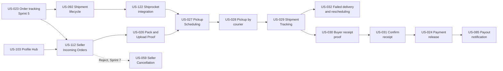
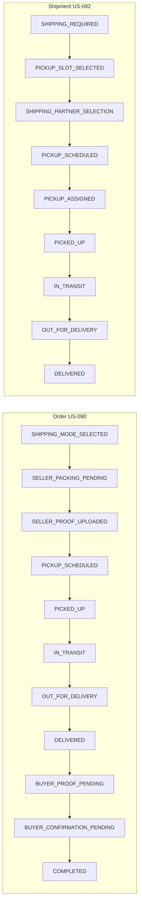
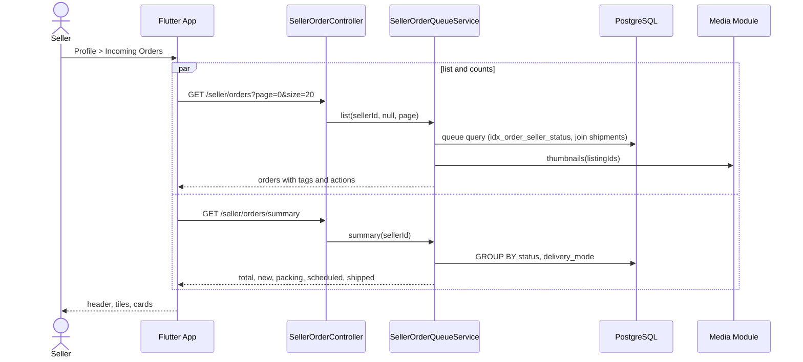
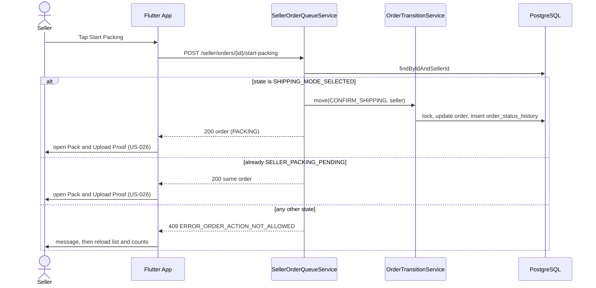
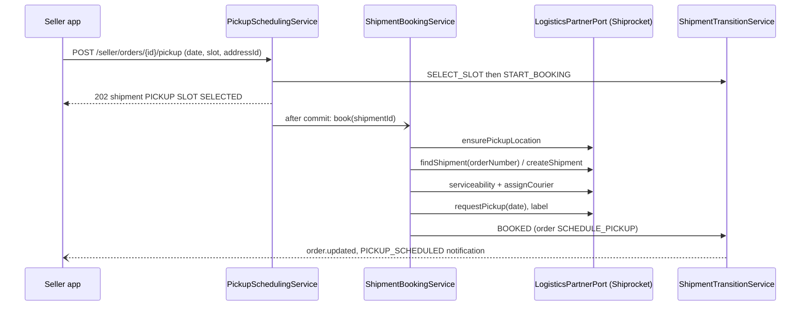
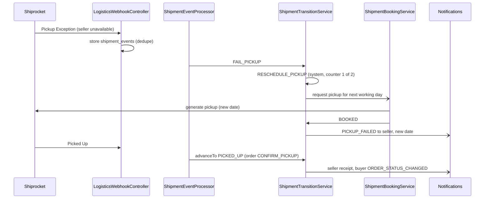
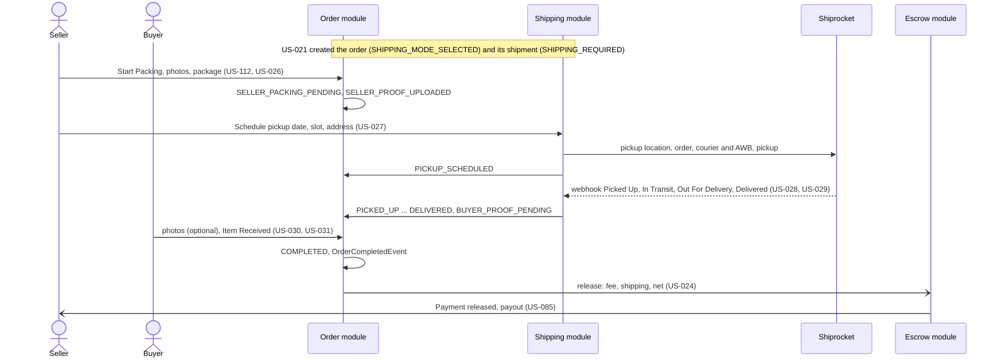

# Low Level Design - Sprint 6: Shipping & Delivery

**Document Version:** 0.4 (2026-11-27). Design only, nothing in this document is built. Decisions marked **Proposed** need product-owner confirmation; they are collected in Part M.4.
**Product:** ValueX
**Sprint:** Sprint 6 - Shipping & Delivery
**Stories Covered:** US-092, US-122, US-112, US-026, US-027, US-028, US-029, US-032, US-030, US-031, US-024, US-085 (all twelve Sprint 6 stories)
**Repos:** valuex-backend, valuex-mobile (no web or AI service work in this sprint)
**Sprint Goal:** Enable the fulfilment workflow, from the seller's incoming order through Shiprocket pickup, tracking and delivery, to the buyer's confirmation and the seller's payout.

**Change Log:**

| Version | Date | Change |
|---|---|---|
| 0.1 | Oct 2026 | Added Part A, US-112 Seller Incoming Orders, designed from the Figma Make `SellerIncomingOrdersScreen`. The remaining Sprint 6 stories get their own parts when they are designed. |
| 0.2 | Oct 2026 | Address design change: the seller's pickup address is a saved address chosen when posting the item (US-004), preselected as the default and replaceable by a new named address; the profile and Sign Up hold no address. |
| 0.3 | Oct 2026 | **Shiprocket (US-122, new):** the shipping partner is Shiprocket. US-026 to US-032, US-034 and US-060 are re-scoped inside US-122. The category taxonomy adds per-L3 delivery eligibility in the database, a packed weight and size captured on Item Details for delivery-eligible categories, Shiprocket serviceability and shipment calls behind a partner-neutral interface, pickup-location bindings per seller address, a quote cache, shipment persistence, and webhooks with polling as fallback. Whole vehicles and Real Estate are never delivery-eligible. The open items (launch eligibility states, prepaid only, who pays shipping, courier choice, pickup address and consent, account and limits, impact on the other Sprint 6 stories) are listed in US-122. Design only. |
| 0.4 | 2026-11-27 | **All Sprint 6 stories designed.** New: section 0 (cross-cutting: module ownership, order and shipment states side by side, settings, error codes, events), Part B US-092 (shipment lifecycle), Part C US-122 (Shiprocket adapter, eligibility, quotes, booking, webhooks, polling), Parts D to L (packing proof, pickup scheduling, pickup by the courier, tracking, failed delivery, buyer proof, confirmation, payment release, payout notification) and Part M (end-to-end flow, NFR, testing, decisions and gaps). **Part A revised** to the as-built Sprint 5 code (US-090 `V45__orders.sql` already has the columns and index; transitions go through `OrderTransitionService.move`; the new-order push uses `NEW_ORDER` of US-021) and to the shipment states (booking in progress, pickup failed, self-pickup hand-over). US-122 open items 1 to 7 answered as **Proposed** (M.4). Shiprocket facts are marked verified or to-verify (C.2). |

**Reference Documents:**
- [Sprint-plan.md](../Sprint-plan.md) - Sprint 5 and Sprint 6 sections
- [user-stories.md](../user-stories.md) - US-023, US-024, US-026 to US-032, US-085, US-090, US-092, US-112, US-122; also US-020, US-021, US-022, US-025, US-059, US-071, US-072
- [Sprint 5 LLD](Sprint-5-Cart-Checkout-Payments-LLD.md) - 0.3 to 0.7 (money flow, settings, codes, events, D2 and D6), Part B (`ShippingQuotePort`, stand-in adapter, B.6 as built), Part C (US-090 as built), Part D and D.2a (escrow and `EscrowProviderPort`), Part E.5 (order creation), Part F (Pay at Pickup), Part H (order detail), Part J (fees), Part K (payout methods), Part L (transactions)
- [HLD Part 2 - Backend Architecture](../HLD/02-Backend-Architecture.md) - §4.9 Order, §4.11 Escrow, §4.12 Shipping, events
- [HLD Part 3 - Data Architecture](../HLD/03-Data-Architecture.md) - §4.6 Order, §4.8 Escrow, §4.9 Shipping, media purposes
- [HLD Part 5 - Frontend Architecture](../HLD/05-Frontend-Architecture.md) - §6 Navigation, §7 Screen Inventory, §10 Push Notifications
- [HLD Part 7 - API Integrations, Release & Risk](../HLD/07-API-Integrations-Release-Risk.md) - §9 Order APIs, §11 Escrow, §12 Shipping APIs, §22 Logistics Integration
- [Category_Taxonomy_Review_Drafts.md](../Category_Taxonomy_Review_Drafts.md) - D10, D17, D18 and D22 (delivery eligibility, packed weight and size, Shiprocket story)
- [LLD Sprint 1](Sprint-1-Identity-User-Management-LLD.md) - §8 US-103 Profile Hub (`ProfileMenuBadgeProvider` SPI)
- [valuex-mobile/docs/Flutter-Design-System.md](../../valuex-mobile/docs/Flutter-Design-System.md)
- [CODING_STANDARDS.md](../CODING_STANDARDS.md)
- Shiprocket: [API reference](https://apidocs.shiprocket.in/), [API helpsheet](https://support.shiprocket.in/support/solutions/articles/43000337456-shiprocket-api-document-helpsheet), [API users](https://support.shiprocket.in/support/solutions/articles/43000604103-how-to-create-an-api-user-can-i-have-more-than-one-api-users-), [processing an NDR](https://support.shiprocket.in/support/solutions/articles/43000664210-how-to-process-an-ndr)

---

## Sprint 6 Story Map & Dependency Order



**Build order:** US-092, US-122, US-112, US-026, US-027, US-028, US-029, US-032, US-030, US-031, US-024, US-085. US-092 and US-122 come first because every other story reads or moves a shipment. US-122 ships with a `mock` logistics adapter (C.3) so the later stories can be built and tested end to end before a Shiprocket account exists.

**What Sprint 5 already provides (as built or designed):** orders, order items and the order history with `OrderTransitionService` (US-090, `V45`); the order state machine including the Sprint 6 transitions (`CONFIRM_SHIPPING` to `CONFIRM`); `ShippingState` and a skeleton `ShippingStateMachine` (Sprint 0); `ShippingQuotePort` and `DeliveryEligibilityPort` with the stand-in adapter (US-020, B.6); media purposes `SELLER_PRE_SHIPMENT_EVIDENCE` and `BUYER_DELIVERY_EVIDENCE`; the payment refund service and gateway event store (US-117); push delivery and `PushPolicy` (US-131); the realtime gateway (US-130). Checkout, order creation, escrow, fees and payout methods are designed in Sprint 5 (US-021, US-091, US-025, US-072) and are prerequisites of Parts K and L.

## Master Table of Contents

- [0. Cross-cutting design](#0-cross-cutting-design)
- [Part A - US-112: Seller Incoming Orders (revised)](#part-a---us-112-seller-incoming-orders)
- [Part B - US-092: Lifecycle State - Shipping](#part-b---us-092-lifecycle-state---shipping)
- [Part C - US-122: Shiprocket Delivery Integration](#part-c---us-122-shiprocket-delivery-integration)
- [Part D - US-026: Seller Prepares Package and Uploads Proof](#part-d---us-026-seller-prepares-package-and-uploads-proof)
- [Part E - US-027: Pickup Scheduling](#part-e---us-027-pickup-scheduling)
- [Part F - US-028: Item Pickup by Logistics Partner](#part-f---us-028-item-pickup-by-logistics-partner)
- [Part G - US-029: Shipment Tracking](#part-g---us-029-shipment-tracking)
- [Part H - US-032: Failed Delivery and Rescheduling](#part-h---us-032-failed-delivery-and-rescheduling)
- [Part I - US-030: Buyer Receives Item and Uploads Proof](#part-i---us-030-buyer-receives-item-and-uploads-proof)
- [Part J - US-031: Delivery Confirmation via In-App Button](#part-j---us-031-delivery-confirmation-via-in-app-button)
- [Part K - US-024: Payment Release After Buyer Confirmation](#part-k---us-024-payment-release-after-buyer-confirmation)
- [Part L - US-085: Seller Payment Release Notification](#part-l---us-085-seller-payment-release-notification)
- [Part M - End-to-end flow, NFR, testing, decisions and open items](#part-m---end-to-end-flow-nfr-testing-decisions-and-open-items)

---

# 0. Cross-cutting design

## 0.1 Module ownership

| Module | Owns (Sprint 6) | Does not own |
|---|---|---|
| `shipping` | `shipments`, `shipment_status_history`, `shipment_events` (raw partner events), `pickup_locations`; `ShipmentStateMachine` (US-092); `LogisticsPartnerPort` with the `shiprocket` and `mock` adapters; the quote adapter behind `ShippingQuotePort`; booking, tracking, NDR and SLA jobs; the logistics webhook | Order states, money, proof photos |
| `order` | Order transitions after `SHIPPING_MODE_SELECTED`; `order_proofs` (seller and buyer photos); seller queue (US-112), packing (US-026), receipt proof and confirmation (US-030, US-031); `OrderAutoConfirmJob` | Partner calls, escrow |
| `escrow` | Release (US-024), `payouts`, `PayoutTransferPort`, the shipping-failure refund (`EscrowRefundService`, US-032 and lost shipments) | Refund review, partial release and disputes (Sprints 7 and 8) |
| `listing` / `taxonomy` | `categories.delivery_eligibility`; packed `weight_kg` and `dimensions_cm` required on Item Details for eligible categories; `DeliveryEligibilityPort` adapter (US-122) | Shipping |
| `notification` | Listeners for the fulfilment and payout events, `PushPolicy` rows (channel `orders`) | Event decisions |
| `media` | Upload, validation, variants and signed links for the two evidence purposes (existing) | Which order a photo belongs to |

Cross-module calls go through ports in `<module>/application/port`, as in Sprints 4 and 5. `shipping` moves orders only through `OrderTransitionService.move` (via `OrderFulfilmentPort`, implemented in `order`), never by writing `orders.status`. `order` reads shipments through `ShipmentQueryPort`.

## 0.2 Order states and shipment states

A delivery order has one shipment. The **order** state is what buyer and seller see as the order's progress (US-090); the **shipment** state is the courier's detail (US-092). The shipment drives the order: each shipment change that matters to the order moves it through `OrderTransitionService` in the same transaction (B.4). A self-pickup order has a shipment row in `SHIPPING_NOT_REQUIRED` that never changes, so every order has exactly one shipment row and queries need no outer join.



The full shipment machine, its exceptions and the mapping to order triggers are in Part B.

## 0.3 Platform settings (new `FulfilmentSetting` registry, same pattern as `CheckoutSetting`)

| Key | Default | Range | Used by |
|---|---|---|---|
| `PROOF_MIN_IMAGES`, `PROOF_MAX_IMAGES` | 2, 5 | 1 to 5, 2 to 10 | US-026 |
| `PROOF_MIN_PIXELS` | 480 | 240 to 1080 | US-026, US-030 (shorter side) |
| `PICKUP_SLA_HOURS` | 48 | 12 to 120 | US-027, US-112 (urgent rule), F.3 escalation |
| `PICKUP_DAYS_AHEAD` | 7 | 1 to 14 | US-027 date picker |
| `PICKUP_MAX_RESCHEDULES` | 2 | 0 to 5 | US-092, US-027, US-028 (seller reschedules and failed pickups together) |
| `DELIVERY_MAX_ATTEMPTS` | 3 | 1 to 5 | US-092, US-032 |
| `NDR_RESPONSE_HOURS` | 24 | 6 to 72 | US-032 |
| `TRACKING_STALE_HOURS` | 24 | 6 to 96 | US-029, US-023 |
| `TRACKING_POLL_MINUTES` | 30 | 10 to 240 | US-029 polling fallback |
| `LOST_INVESTIGATION_DAYS` | 7 | 1 to 30 | US-092 (in transit with no scan this long opens an investigation) |
| `BUYER_CONFIRM_DAYS` | 7 | 1 to 30 | US-030, US-031, US-024 auto-confirmation |
| `PAYOUT_SLA_HOURS` | 24 | 1 to 72 | US-024 |
| `PAYOUT_SMS_THRESHOLD` | 5000 | 0 to 100000 | US-085 (gross amount above which an SMS is also sent) |
| `QUOTE_CACHE_MINUTES` | 30 | 5 to 240 | US-122 quote cache |
| `SELF_PICKUP_CONFIRM_DAYS` | 7 | 1 to 30 | Part J (self-pickup auto-confirmation after the seller marks the item handed over) |

Environment and properties: `valuex.shipping.provider` (`stub` | `mock` | `shiprocket`, env `SHIPPING_PROVIDER`; `stub` is the Sprint 5 quote-only adapter and refuses bookings), `valuex.shipping.shiprocket.*` (C.5), `valuex.payout.provider` (`mock` until a payout provider is chosen, K.3).

## 0.4 Error codes added in Sprint 6 (texts of the stories, used as written)

| Code | HTTP | Text | Story |
|---|---|---|---|
| `ERROR_DELIVERY_NOT_AVAILABLE` | 200 (option reason) / 409 | Delivery is not available for this item | US-122 |
| `ERROR_PIN_NOT_SERVICEABLE` | 200 (option reason) / 409 | Delivery is not available to this PIN code | US-122 |
| `ERROR_SHIPMENT_CREATION_FAILED` | 409 / notification | We could not arrange the shipment. Please try again | US-122 |
| `ERROR_IMAGE_REQUIRED` | 422 | Please upload package images before scheduling pickup | US-026 |
| `ERROR_IMAGE_UPLOAD_FAILED` | client | Failed to upload images. Try again (US-030: "Failed to upload images. You can still confirm") | US-026, US-030 |
| `WARNING_IMAGE_QUALITY_LOW` | 422 | Image quality low. Upload clearer photo | US-026, US-030 |
| `ERROR_PROOF_LIMIT` (new) | 422 | You can add up to 5 photos | US-026 (max 5) |
| `ERROR_NO_LOGISTICS_AVAILABLE` | 409 | No pickup service in your area. Contact support | US-027 |
| `ERROR_INVALID_TIMESLOT` | 422 | Selected time slot unavailable | US-027 |
| `ERROR_PICKUP_DELAYED` | notification | Pickup delayed. We'll notify you when rescheduled | US-027 |
| `ERROR_MAX_PICKUP_RESCHEDULES` (new) | 409 | Pickup can be rescheduled only twice. Contact support | US-027, US-092 |
| `ERROR_SELLER_UNAVAILABLE` | notification | Seller not available. Rescheduling pickup | US-028 |
| `ERROR_ITEM_MISMATCH` | notification | Item doesn't match order. Escalating to support | US-028 |
| `WARNING_TRACKING_DELAYED` | response flag | Tracking not updated. We're investigating (US-023: "Tracking information not yet available") | US-029, US-023 |
| `ERROR_SHIPMENT_EXCEPTION` | response flag | Delivery delayed due to logistical issues | US-023 |
| `ERROR_DELIVERY_FAILED` | notification | Delivery attempt failed. Contact logistics partner | US-029 |
| `ERROR_ITEM_LOST` | notification | Item cannot be located. Dispute process initiated | US-029 |
| `ERROR_MAX_ATTEMPTS_REACHED` | 409 / notification | Item returned to seller. Refund initiated | US-032 |
| `ERROR_INVALID_RESCHEDULE_TIME` | 422 | Selected time unavailable | US-032 |
| `WARNING_FINAL_ATTEMPT` | response flag | This is your last delivery attempt | US-032 |
| `WARNING_ITEM_MISMATCH` | client | Item doesn't match? File a dispute before confirming | US-030 |
| `WARNING_CANNOT_UNDO` | client | Once confirmed, you cannot dispute quality | US-031 |
| `ERROR_ALREADY_CONFIRMED` | 409 | Item already confirmed | US-031 |
| `ERROR_DISPUTE_PENDING` | 409 | Cannot release payment during active dispute | US-024 |
| `ERROR_BANK_TRANSFER_FAILED` | notification | Payment release failed. Contact support | US-024 |
| `AUTO_RELEASE_NOTIFICATION` | notification | Payment auto-released due to no response | US-024 |
| `PAYOUT_DELAYED` | notification | Payout delayed. Expected by [date] | US-085 |
| `ERROR_NO_PAYOUT_METHOD` | notification | Add payout method to receive funds | US-085 |
| `ERROR_NOTIFICATION_FAILED` | internal | (no user text: the system retries; the seller can check in-app) | US-085 |

Codes that already exist are reused: `ERROR_ORDER_NOT_FOUND` (404), `ERROR_ORDER_ACTION_NOT_ALLOWED` (409, US-112), `ERROR_INVALID_ADDRESS` (422, US-020), `INVALID_STATE_TRANSITION` (state machine), `ERROR_VALIDATION` (400). US-020's `ERROR_NO_DELIVERY_AVAILABLE` stays the checkout refusal; the delivery option's `reason` becomes the more precise `ERROR_DELIVERY_NOT_AVAILABLE` (category, size or weight) or `ERROR_PIN_NOT_SERVICEABLE` (no courier for the PIN pair).

## 0.5 Events and notifications

| Event (domain) | Published by | Listeners |
|---|---|---|
| `OrderStatusChangedEvent` (built, US-090) | `OrderTransitionService` | US-023 buyer notification and `order.updated` (Sprint 5); Sprint 6 adds the seller rows below |
| `ShipmentStatusChangedEvent` (new) | `ShipmentTransitionService` | `order.updated` realtime refresh; notifications for shipment-only states (pickup failed, delayed, delivery failed) |
| `ShipmentBookingFailedEvent` (new) | `ShipmentBookingService` | Seller notification `ERROR_SHIPMENT_CREATION_FAILED`, support escalation |
| `OrderCompletedEvent` (HLD `OrderCompleted`) | `OrderConfirmationService` | `EscrowReleaseService` (US-024), ratings (Sprint 8) |
| `EscrowReleasedEvent` (HLD `EscrowReleased`) | `EscrowReleaseService` | US-085 notification, `user_transactions` |
| `PayoutCompletedEvent`, `PayoutFailedEvent` (new) | `PayoutService` | US-085 notifications, admin alert |
| `ShipmentRefundRequestedEvent` (new) | `ShipmentExceptionService` (RTO, lost) | `EscrowRefundService` |

In-app and push notifications (type: recipient, title / body; English and Hindi in the app ARB files, the backend sends the type and parameters):

| Type | To | Text | Push channel (`PushPolicy`) |
|---|---|---|---|
| `NEW_ORDER` (US-021) | Seller | New order / {buyer} bought {item} | `orders`, high |
| `PICKUP_SCHEDULED` | Seller | Pickup booked / {courier} will collect {item} on {date} | `orders` |
| `PICKUP_FAILED` | Seller | `ERROR_SELLER_UNAVAILABLE` text, new date | `orders`, high |
| `PICKUP_ESCALATED` | Seller | `ERROR_PICKUP_DELAYED` text | `orders` |
| `SHIPMENT_BOOKING_FAILED` | Seller | `ERROR_SHIPMENT_CREATION_FAILED` text | `orders`, high |
| `ORDER_STATUS_CHANGED` (US-023) | Buyer | per buyer status | `orders` |
| `DELIVERY_FAILED` | Buyer | `ERROR_DELIVERY_FAILED` text, "Reschedule" | `orders`, high |
| `DELIVERY_RETURNING` | Buyer, Seller | `ERROR_MAX_ATTEMPTS_REACHED` text | `orders` |
| `SHIPMENT_LOST` | Buyer, Seller | `ERROR_ITEM_LOST` text | `orders`, high |
| `RECEIPT_PROOF_REQUESTED` | Buyer | Your item is delivered / Check it and confirm within 7 days | `orders` |
| `ORDER_AUTO_CONFIRMED` | Buyer, Seller | `AUTO_RELEASE_NOTIFICATION` text | `orders` |
| `PAYMENT_RELEASED` | Seller | US-085 content | `payments`, high |
| `PAYOUT_COMPLETED`, `PAYOUT_DELAYED`, `PAYOUT_METHOD_REQUIRED` | Seller | US-085 texts | `payments` |

Push rows are added to `PushPolicy` (two new Android channels, `orders` and `payments`). Realtime: `order.updated` (US-023) carries `{orderId, orderState, shipmentState}` and is sent to both buyer and seller; no new topic.

## 0.6 Decisions (Proposed unless marked)

| # | Decision |
|---|---|
| S1 | **One shipment per order, created with the order.** Delivery orders start in `SHIPPING_REQUIRED`, self-pickup orders in `SHIPPING_NOT_REQUIRED`. `OrderCreationService` (US-021) calls `ShipmentCreationPort.createFor(order)` in its transaction. |
| S2 | **The seller chooses the pickup date first, then the courier is booked** (shipment `PICKUP_SLOT_SELECTED` then `SHIPPING_PARTNER_SELECTION`). The story lists partner selection first; as with US-090 (decision G1, 2026-11-26) the list order is descriptive, not a sequence. Booking needs the pickup address and date, which only the seller can give. |
| S3 | **Booking is asynchronous and resumable.** Scheduling stores the slot and returns 202. `ShipmentBookingService` then runs the partner steps (pickup location, partner order, courier and AWB, pickup request), saving the partner ids after each step, so a retry continues where it stopped (US-122 edge case "partial failure, reconcile before retry"). |
| S4 | **Prepaid only, no COD** (US-122 open item 2). Every shipment is booked as prepaid; the money is already in escrow. |
| S5 | **The buyer pays the quoted shipping; the platform pays Shiprocket and absorbs the difference** between quote and final charge, including weight disputes and RTO charges (US-122 open item 3). Shipping is never part of the seller's payout. |
| S6 | **Courier choice is automatic**: Shiprocket's recommended courier when it is present in the serviceability answer, otherwise the cheapest courier whose estimated delivery is within the quoted date plus one day (US-122 open item 4). The buyer sees one price and one date. |
| S7 | **Shiprocket events are stored raw first, then processed.** Webhook and poll results go to `shipment_events` with a de-duplication key; a job applies them in order. Polling covers missed or unavailable webhooks. |
| S8 | **Courier events may skip states** (a courier can report "delivered" without "out for delivery"). The shipment and the order are moved along the shortest allowed path, writing the missing steps with the same time and the note `inferred` (validation rule "order status must progress sequentially"). |
| S9 | **Refunds for shipping failures happen in Sprint 6.** RTO after the last attempt (US-032) and a lost shipment (US-092) refund the buyer through the existing `PaymentRefundService` via a new `EscrowRefundService`; the review-based refunds stay in Sprint 7. |
| S10 | **Self-pickup hand-over:** the seller taps "Mark as handed over" (new action), which moves the order to `DELIVERED` through the new trigger `HANDED_OVER`; from there it follows the same proof, confirmation and 7-day auto-confirmation path as delivery (closes Part A open item 2). |
| S11 | **Payouts go through `PayoutTransferPort` with a `mock` adapter** until a payout provider is chosen (same approach as US-133 and the escrow provider, Sprint 5 D.2a). |

---

# Part A - US-112: Seller Incoming Orders

**Story Points:** 5 | **Repos:** valuex-backend, valuex-mobile
**Dependency:** US-023 (the order and its lifecycle), US-103 (the Profile hub that opens it); reads the shipment of US-092

> **Revised in 0.4:** A.3 (no migration: V45 has the columns and index), A.3.1 and A.5.2 (shipment sub-states, self-pickup hand-over, RTO), A.5.3 (`OrderTransitionService.move` with trigger `CONFIRM_SHIPPING`), A.5.6 (`NEW_ORDER` from US-021 instead of a new event), new endpoint A.4.4 (`mark-handed-over`), A.11 (open item 2 closed by S10).

## A.1 Story Overview

**As a** seller **I want** one list of every order buyers have placed on my items, grouped by what I need to do next **so that** I can pack, schedule pickup and follow each order without searching through chats and notifications.

The Figma Make screen shows a header ("Incoming Orders", "{n} orders · {x} new", a "{x} New" badge), four count tiles (New, Packing, Scheduled, Shipped) and one card per order. A card has the order reference, an URGENT tag, a status chip, the item photo, title and price, the buyer's name and initials, the time since the order, and buttons that depend on the status.

| Actor | Role |
|---|---|
| Seller | Opens the list from Profile, starts packing, continues packing, schedules pickup, views the schedule, marks a self-pickup item handed over, rejects a new order |
| Flutter Mobile App | Shows the page, calls the endpoints, navigates to the US-026, US-027 and US-059 screens, refreshes on push and on `order.updated` |
| Order Module (Spring Boot) | Owns the seller queue read model, the summary counts and the start-packing and hand-over transitions |
| Shipping Module | Provides the shipment state of each order (`ShipmentQueryPort`) |
| Auth Module (`ProfileMenuBadgeProvider` SPI) | Collects the `INCOMING_ORDERS` count for the Profile hub badge |
| Notification Module | Sends the new-order push (`NEW_ORDER`, US-021 and US-131) |
| Media Module | Resolves the item thumbnail URL |

### A.1.1 Edge Cases Covered

| Edge Case | Handling |
|---|---|
| Order changes state (buyer cancels, pickup scheduled elsewhere) while the page is open | The action endpoint returns `ERROR_ORDER_ACTION_NOT_ALLOWED` (409); the app shows the message and reloads the list and counts |
| "Start Packing" tapped twice or on two devices | Idempotent: an order already in `SELLER_PACKING_PENDING` returns the same 200 response |
| Seller leaves Pack & Upload Proof unfinished | Order stays in Packing; the card offers "Continue Packing" |
| Proof uploaded, pickup not scheduled | `SELLER_PROOF_UPLOADED` with shipment `SHIPPING_REQUIRED` stays in the Packing bucket with the "Schedule Pickup" action |
| Pickup chosen, courier still being booked | `SELLER_PROOF_UPLOADED` with shipment `PICKUP_SLOT_SELECTED` or `SHIPPING_PARTNER_SELECTION`: Packing bucket, chip "Arranging pickup", no action |
| Courier booking failed | Shipment back in `SHIPPING_REQUIRED` with `bookingError` set: Packing bucket, "Schedule Pickup" again, with the message `ERROR_SHIPMENT_CREATION_FAILED` or `ERROR_NO_LOGISTICS_AVAILABLE` |
| Courier did not come (pickup failed) | Scheduled bucket with the tag "Pickup failed"; actions `VIEW_SCHEDULE` and `RESCHEDULE_PICKUP` while reschedules remain |
| Cart with several items from several sellers | Checkout creates one order per item (owner decision); each is its own card with its own order number, escrow and state |
| Item photo missing or listing removed | `imageUrl` is null; the app shows a placeholder; the order stays |
| Delivery exception (`DELIVERY_FAILED`, `SHIPMENT_LOST`) | Shown in the Shipped bucket; no action button |
| Item coming back after failed delivery (`RETURN_TO_SELLER`) | Shown in the Shipped bucket with the chip "Returning to you" until the shipment reports it delivered back; then it leaves the list |
| Self-pickup order (buyer collects the item) | Treated like any New order (Pay Now or Pay at Pickup) with the extra tag "Self Pickup by Buyer"; no shipping; actions `VIEW_PICKUP_DETAILS`, `MARK_HANDED_OVER` and `REJECT`; never urgent; after hand-over it is in the Shipped bucket with the chip "Handed over" until the buyer confirms or the auto-confirmation runs (S10) |
| Pay at Pickup self-pickup order (no escrow payment, US-022) | Same card; Reject carries no penalty because nothing was paid into escrow and the hand-over is a mutual agreement between buyer and seller (owner decision) |
| Another seller's order id | Returns `ERROR_ORDER_NOT_FOUND` (404), the same as an unknown id, so ids cannot be probed |
| Hundreds of orders | Paginated, 20 per page, maximum 50 |
| Account suspended or banned | Endpoints return the standard account-state error (US-088); the app shows the blocked screen |

## A.2 Scope

**In scope:** `GET /api/v1/seller/orders`, `GET /api/v1/seller/orders/summary`, `POST /api/v1/seller/orders/{orderId}/start-packing`, `POST /api/v1/seller/orders/{orderId}/mark-handed-over` (S10), the `INCOMING_ORDERS` badge provider, the `NEW_ORDER` push row, the mobile page and its states.
**Out of scope:** packing proof upload (US-026, Part D), pickup scheduling and schedule view (US-027, Part E), seller cancellation and penalty (US-059, "Reject" opens it), tracking and order details content (US-023, US-029), order history of completed orders (US-070).

## A.3 Data Model

**No migration.** `V45__orders.sql` (US-090, built) already has `orders.seller_id`, `orders.order_number` (unique), `orders.delivery_mode` and the index `idx_order_seller_status (seller_id, status, created_at DESC)`. The queue also joins `shipments` (Part B, one row per order, unique `order_id`) for the shipment state and `booking_error`.

Decided (owner): every item gets its own order. A buyer's single consolidated payment for items from several sellers is split into one order per item, each with its own order number, escrow, chat and negotiation link, delivery and refund. `orders.seller_id` is therefore a plain column copied from the item's seller, and each order has exactly one `order_items` row.

### A.3.1 Bucket Mapping

The four buckets are derived in code from the order state, the delivery mode and the shipment state; nothing is stored.

| Bucket | Order state (and shipment state) | Chip | Actions offered |
|---|---|---|---|
| `NEW` | `SHIPPING_MODE_SELECTED`, `DELIVERY` | New Order | `START_PACKING`, `REJECT` |
| `NEW` (tag "Self Pickup by Buyer") | `SHIPPING_MODE_SELECTED`, `SELF_PICKUP` | New Order | `VIEW_PICKUP_DETAILS`, `MARK_HANDED_OVER`, `REJECT` |
| `PACKING` | `SELLER_PACKING_PENDING` | Packing Required | `CONTINUE_PACKING` |
| `PACKING` | `SELLER_PROOF_UPLOADED`, shipment `SHIPPING_REQUIRED` | Packing Required | `SCHEDULE_PICKUP` |
| `PACKING` | `SELLER_PROOF_UPLOADED`, shipment `PICKUP_SLOT_SELECTED` or `SHIPPING_PARTNER_SELECTION` | Arranging pickup | none |
| `SCHEDULED` | `PICKUP_SCHEDULED`, shipment `PICKUP_SCHEDULED`, `PICKUP_ASSIGNED` or `PICKUP_RESCHEDULED` | Pickup Scheduled | `VIEW_SCHEDULE`, plus `RESCHEDULE_PICKUP` while reschedules remain |
| `SCHEDULED` (tag "Pickup failed") | `PICKUP_SCHEDULED`, shipment `PICKUP_FAILED` | Pickup Scheduled | `VIEW_SCHEDULE`, `RESCHEDULE_PICKUP` while reschedules remain |
| `SHIPPED` | `PICKED_UP`, `IN_TRANSIT`, `OUT_FOR_DELIVERY`, `DELIVERED`, `BUYER_PROOF_PENDING`, `BUYER_CONFIRMATION_PENDING`, `DELIVERY_FAILED`, `SHIPMENT_LOST` (`DELIVERY`) | Shipped | none |
| `SHIPPED` (chip "Returning to you") | `RETURN_TO_SELLER` while the shipment has no `rto_delivered_at` | Returning to you | none |
| `SHIPPED` (chip "Handed over") | `DELIVERED`, `BUYER_PROOF_PENDING`, `BUYER_CONFIRMATION_PENDING` (`SELF_PICKUP`) | Handed over | none |
| not listed | everything before `SHIPPING_MODE_SELECTED`; `COMPLETED`, `CANCELLED`, `RETURN_REQUESTED`, `DISPUTE_RAISED`; `RETURN_TO_SELLER` once delivered back | n/a | n/a |

## A.4 API Contracts

All endpoints are under `/api/v1/seller`, need a valid access token and an `ACTIVE` account, and use the standard envelope and pagination metadata ([CODING_STANDARDS §1.6](../CODING_STANDARDS.md)).

### A.4.1 List incoming orders

```http
GET /api/v1/seller/orders?bucket=NEW|PACKING|SCHEDULED|SHIPPED&page=0&size=20
```

`bucket` is optional. Order: New, Packing, Scheduled, Shipped, then newest first. `size` defaults to 20 and is capped at 50.

```json
{
  "success": true,
  "data": [
    {
      "orderId": "6c1d5a3e-0c1f-4d0e-9a55-3f9a2b7f1a10",
      "orderNumber": "VX-261127-000123",
      "bucket": "NEW",
      "orderState": "SHIPPING_MODE_SELECTED",
      "shipmentState": "SHIPPING_REQUIRED",
      "deliveryMode": "DELIVERY",
      "tags": ["URGENT"],
      "placedAt": "2026-11-27T08:05:00Z",
      "amount": "42000.00",
      "item": {
        "listingId": "0d7e0a0a-2d2c-4a58-b3a4-1c7d2f3b9e11",
        "title": "Vintage Leica M6 Film Camera",
        "imageUrl": "https://cdn.example/thumb/abc.webp"
      },
      "buyer": { "displayName": "Ananya Sharma" },
      "actions": ["START_PACKING", "REJECT"]
    }
  ],
  "metadata": { "requestId": "uuid", "timestamp": "ISO-8601", "page": 0, "size": 20, "totalElements": 4, "totalPages": 1 }
}
```

`tags` holds `URGENT`, `SELF_PICKUP`, `PICKUP_FAILED`, `ARRANGING_PICKUP`, `RETURNING`, `HANDED_OVER` as they apply; the app localizes the chip and tags from `bucket` and `tags`. `orderState` and `shipmentState` are for the order details and for support. Amounts are JSON strings (Sprint 5 D10). `orderNumber` is the real order number; the mock repository returns the Make sample numbers (for example `ORD-S-1001`).

### A.4.2 Summary counts

```http
GET /api/v1/seller/orders/summary
```

```json
{ "success": true, "data": { "total": 4, "new": 1, "packing": 1, "scheduled": 1, "shipped": 1 }, "metadata": { "requestId": "uuid", "timestamp": "ISO-8601" } }
```

Feeds the header line, the "{x} New" badge, the four tiles and the Profile hub badge.

### A.4.3 Start packing

```http
POST /api/v1/seller/orders/{orderId}/start-packing
```

No body. `200` returns the updated order in the shape of A.4.1 (`bucket` `PACKING`, `actions` `["CONTINUE_PACKING"]`). Errors: `404 ERROR_ORDER_NOT_FOUND`, `409 ERROR_ORDER_ACTION_NOT_ALLOWED`.

### A.4.4 Mark a self-pickup item handed over (S10)

```http
POST /api/v1/seller/orders/{orderId}/mark-handed-over
```

No body. Only for a `SELF_PICKUP` order in `SHIPPING_MODE_SELECTED`; idempotent once handed over. Moves the order `SHIPPING_MODE_SELECTED → DELIVERED` (`HANDED_OVER`, actor seller) and `DELIVERED → BUYER_PROOF_PENDING` (`REQUEST_BUYER_PROOF`, actor system), and starts the buyer's confirmation window (Part J). `200` returns the order in the A.4.1 shape. Errors: `404 ERROR_ORDER_NOT_FOUND`, `409 ERROR_ORDER_ACTION_NOT_ALLOWED`.

## A.5 Backend Design (valuex-backend)

### A.5.1 Package additions (module `com.valuex.order`)

```text
com.valuex.order
├── api/
│   └── SellerOrderController.java            # the four endpoints
├── application/
│   ├── dto/
│   │   ├── IncomingOrderResponse.java
│   │   ├── IncomingOrdersSummaryResponse.java
│   │   └── IncomingOrderRow.java             # query projection, includes shipment state, booking error, reschedule count
│   ├── port/
│   │   └── ShipmentQueryPort.java            # implemented by shipping (read only)
│   └── service/
│       └── SellerOrderQueueService.java      # list, summary, startPacking, markHandedOver
├── domain/
│   ├── FulfilmentBucket.java                 # NEW, PACKING, SCHEDULED, SHIPPED + mapping
│   └── SellerOrderAction.java                # START_PACKING, REJECT, CONTINUE_PACKING, SCHEDULE_PICKUP, VIEW_SCHEDULE,
│                                             # RESCHEDULE_PICKUP, VIEW_PICKUP_DETAILS, MARK_HANDED_OVER
├── adapter/menu/
│   └── IncomingOrdersBadgeProvider.java      # implements ProfileMenuBadgeProvider, key "INCOMING_ORDERS"
└── infrastructure/persistence/
    └── SellerOrderQueryRepository.java       # projection query (orders ⋈ order_items ⋈ shipments ⋈ users) + grouped count
```

`OrderStateMachine` gains `HANDED_OVER` (`SHIPPING_MODE_SELECTED → DELIVERED`), checked in `markHandedOver` against `delivery_mode = SELF_PICKUP` (the state machine cannot see the mode, so the service enforces it).

### A.5.2 Bucket mapping and actions

```java
public final class FulfilmentBucketResolver {

    public Optional<FulfilmentView> resolve(IncomingOrderRow row) {
        OrderState o = row.orderState();
        ShipmentState s = row.shipmentState();
        if (row.deliveryMode() == DeliveryMode.SELF_PICKUP) {
            return switch (o) {
                case SHIPPING_MODE_SELECTED -> view(NEW, List.of(VIEW_PICKUP_DETAILS, MARK_HANDED_OVER, REJECT), SELF_PICKUP);
                case DELIVERED, BUYER_PROOF_PENDING, BUYER_CONFIRMATION_PENDING -> view(SHIPPED, List.of(), HANDED_OVER_TAG);
                default -> Optional.empty();
            };
        }
        return switch (o) {
            case SHIPPING_MODE_SELECTED -> view(NEW, List.of(START_PACKING, REJECT), urgentTag(row));
            case SELLER_PACKING_PENDING -> view(PACKING, List.of(CONTINUE_PACKING));
            case SELLER_PROOF_UPLOADED -> s == ShipmentState.SHIPPING_REQUIRED
                ? view(PACKING, List.of(SCHEDULE_PICKUP))
                : view(PACKING, List.of(), ARRANGING_PICKUP);
            case PICKUP_SCHEDULED -> view(SCHEDULED, scheduledActions(row), s == ShipmentState.PICKUP_FAILED ? PICKUP_FAILED_TAG : null);
            case PICKED_UP, IN_TRANSIT, OUT_FOR_DELIVERY, DELIVERED, BUYER_PROOF_PENDING,
                 BUYER_CONFIRMATION_PENDING, DELIVERY_FAILED, SHIPMENT_LOST -> view(SHIPPED, List.of());
            case RETURN_TO_SELLER -> row.rtoDeliveredAt() == null ? view(SHIPPED, List.of(), RETURNING) : Optional.empty();
            default -> Optional.empty();
        };
    }

    private List<SellerOrderAction> scheduledActions(IncomingOrderRow row) {
        return row.pickupReschedules() < settings.pickupMaxReschedules()
            ? List.of(VIEW_SCHEDULE, RESCHEDULE_PICKUP) : List.of(VIEW_SCHEDULE);
    }
}
```

The list query filters on the set of (order state, delivery mode) pairs that belong to the requested bucket (`FulfilmentBucket.pairsOf`), and the resolver refines the chip and actions from the shipment columns of the same row. The summary folds a `GROUP BY status, delivery_mode` count into buckets (the shipment state never moves an order between buckets, it only changes chips and actions, so the count needs no join).

`REJECT` always opens the US-059 seller cancellation, whose penalty applies whenever the buyer has booked the order and paid into escrow (owner decision). A Pay at Pickup order has no escrow payment and no penalty.

### A.5.3 SellerOrderQueueService

```java
@Service
@RequiredArgsConstructor
public class SellerOrderQueueService {

    private final SellerOrderQueryRepository queryRepository;
    private final OrderRepository orderRepository;
    private final OrderTransitionService transitions;            // US-090, built
    private final FulfilmentBucketResolver resolver;
    private final MediaUrlResolver mediaUrlResolver;

    @Transactional(readOnly = true)
    public Page<IncomingOrderResponse> list(UUID sellerId, FulfilmentBucket bucket, Pageable pageable) { /* query, batch thumbnails, resolve chips and actions */ }

    @Transactional(readOnly = true)
    public IncomingOrdersSummaryResponse summary(UUID sellerId) { /* one GROUP BY status, delivery_mode */ }

    @Transactional
    public IncomingOrderResponse startPacking(UUID sellerId, UUID orderId) {
        Order order = ownedOrder(sellerId, orderId);
        if (order.getStatus() == OrderState.SELLER_PACKING_PENDING) {
            return respond(order);                                                  // idempotent repeat
        }
        if (order.getDeliveryMode() != DeliveryMode.DELIVERY || order.getStatus() != OrderState.SHIPPING_MODE_SELECTED) {
            throw new BusinessException("ERROR_ORDER_ACTION_NOT_ALLOWED", "This order has already moved to the next step");
        }
        transitions.move(orderId, "CONFIRM_SHIPPING", new OrderActor(OrderActorType.SELLER, sellerId), null);
        return respond(orderId);
    }

    @Transactional
    public IncomingOrderResponse markHandedOver(UUID sellerId, UUID orderId) {
        Order order = ownedOrder(sellerId, orderId);
        if (order.getDeliveryMode() != DeliveryMode.SELF_PICKUP) {
            throw notAllowed();
        }
        if (order.getStatus() == OrderState.BUYER_PROOF_PENDING) {
            return respond(order);                                                  // idempotent repeat
        }
        if (order.getStatus() != OrderState.SHIPPING_MODE_SELECTED) {
            throw notAllowed();
        }
        transitions.move(orderId, "HANDED_OVER", new OrderActor(OrderActorType.SELLER, sellerId), null);
        transitions.move(orderId, "REQUEST_BUYER_PROOF", OrderActor.system(), null);
        return respond(orderId);
    }

    private Order ownedOrder(UUID sellerId, UUID orderId) {
        return orderRepository.findByIdAndSellerId(orderId, sellerId)
            .orElseThrow(() -> new NotFoundException("ERROR_ORDER_NOT_FOUND", "This order is no longer available"));
    }
}
```

Notes:
- `findByIdAndSellerId` makes another seller's order and an unknown order indistinguishable (404).
- `OrderTransitionService.move` locks the order row and checks the machine; a concurrent change surfaces as `INVALID_STATE_TRANSITION`, which the service maps to `ERROR_ORDER_ACTION_NOT_ALLOWED`.
- Urgent rule: a New delivery order whose pickup deadline (`placedAt + PICKUP_SLA_HOURS`) is within `urgent-window` (24 hours); self-pickup is never urgent.
- The projection query joins `orders`, the order's single `order_items` row, `shipments` (state, booking error, reschedule count, `rto_delivered_at`) and `users` (buyer display name). Thumbnails come in one batch call per page, so the list has no N+1 queries.

### A.5.4 Controller

`SellerOrderController` (`/api/v1/seller/orders`, tag "Seller Orders"): `GET` (list, `@PageableDefault(size = 20)`, size capped at 50), `GET /summary`, `POST /{orderId}/start-packing`, `POST /{orderId}/mark-handed-over`. Each reads the seller id from `SecurityContext.getCurrentUserId()` and returns `ApiResponse` or `PagedResponse`.

### A.5.5 Profile hub badge

`IncomingOrdersBadgeProvider implements ProfileMenuBadgeProvider` (key `INCOMING_ORDERS`): `badgeCount(userId)` is the New tile count (`status = SHIPPING_MODE_SELECTED`, both delivery modes), one indexed count; failures are isolated by `ProfileMenuService`. The badge key is added to the menu table in [LLD Sprint 1 §8.3](Sprint-1-Identity-User-Management-LLD.md).

### A.5.6 New-order push

The seller's new-order notification is `NEW_ORDER`, created by `OrderCreationService` (US-021, Sprint 5 E.5 step 7). US-112 adds only the `PushPolicy` row (`NEW_ORDER` → channel `orders`, high priority, not skipped when online) and the deep link `{ "type": "NEW_ORDER", "route": "/seller/orders" }`. No separate `SellerOrderPlacedEvent` is published (changed in 0.4). A failed push is logged, not fatal.

### A.5.7 Configuration

```yaml
valuex:
  seller-orders:
    urgent-window: PT24H     # owner-confirmed urgent rule; the pickup deadline uses PICKUP_SLA_HOURS (0.3)
    max-page-size: 50
```

## A.6 Sequence Diagrams

### A.6.1 Open the page



### A.6.2 Start packing



## A.7 Validation Rules & Error Codes

| Rule | Error Code | HTTP | Message |
|---|---|---|---|
| Order belongs to the caller | `ERROR_ORDER_NOT_FOUND` | 404 | "This order is no longer available" |
| Start Packing only from `SHIPPING_MODE_SELECTED` on a delivery order (repeat from `SELLER_PACKING_PENDING` succeeds) | `ERROR_ORDER_ACTION_NOT_ALLOWED` | 409 | "This order has already moved to the next step" |
| Mark handed over only for a self-pickup order in `SHIPPING_MODE_SELECTED` (repeat succeeds) | `ERROR_ORDER_ACTION_NOT_ALLOWED` | 409 | same |
| `bucket` is one of the four values | `ERROR_VALIDATION` | 400 | standard validation message |
| `size` above 50 is reduced to 50 | n/a | 200 | n/a |
| Account not `ACTIVE` | standard account-state error (US-088) | 403 | n/a |
| List cannot be loaded | `ERROR_INCOMING_ORDERS_LOAD_FAILED` (client message for any network or 5xx failure) | n/a | "Unable to load your incoming orders. Pull down or tap Retry" |

## A.8 Mobile Design (valuex-mobile)

### A.8.1 Structure

```text
lib/features/order/
├── domain/
│   ├── entities/incoming_order.dart          # IncomingOrder, FulfilmentBucket, SellerOrderAction, OrderTag, OrdersSummary
│   └── repositories/seller_order_repository.dart
├── data/
│   ├── seller_order_repository_impl.dart     # the four endpoints
│   └── mock_seller_order_repository.dart     # the four Make sample orders, used until the backend ships
└── presentation/
    ├── seller_incoming_orders_screen.dart    # page
    ├── providers/seller_order_providers.dart # paged list, summary, start-packing, mark-handed-over
    └── widgets/
        ├── incoming_orders_header.dart       # back, title, "{n} orders · {x} new", New badge
        ├── order_count_tile.dart             # one tile; four in a row
        ├── incoming_order_card.dart          # header row, item row, action row
        ├── order_status_chip.dart            # icon + text
        └── buyer_initials_avatar.dart
```

Route `/seller/orders` is pushed from the Profile "Incoming Orders" row (`RouteNames.sellerOrders`), gated like the other signed-in routes (`ACTIVE` accounts only). The Profile row replaces its "coming soon" action with this route and shows the `INCOMING_ORDERS` badge from `menu-summary`.

### A.8.2 Behaviour

- Two providers load in parallel: the paged list and the summary. Pull to refresh invalidates both. Returning from the packing or pickup screens invalidates both, so the card moves bucket. An `order.updated` frame for one of the seller's orders also invalidates both (booking finished, courier picked up).
- The buttons on a card come from `actions`. The app maps each value to a label and a destination and holds no order state machine: `START_PACKING` calls the endpoint then opens US-026; `CONTINUE_PACKING` opens US-026; `SCHEDULE_PICKUP`, `VIEW_SCHEDULE` and `RESCHEDULE_PICKUP` open US-027; `VIEW_PICKUP_DETAILS` opens a read-only sheet with the seller's pickup address and hours as the buyer sees them (US-020); `MARK_HANDED_OVER` asks "Has the buyer collected the item?" and calls the endpoint; `REJECT` opens the US-059 confirmation, which always states the penalty (until US-059 ships, it shows the coming-soon message); the details button opens the order details (US-023).
- Tags: "URGENT", "Self Pickup by Buyer", "Arranging pickup", "Pickup failed", "Returning to you", "Handed over".
- A 409 from an action shows `ERROR_ORDER_ACTION_NOT_ALLOWED` as a passing message and reloads both providers.
- The count line, "{x} New" badge and tiles read the summary. "Showing all {n} incoming orders" shows after the last page.
- Empty, loading (skeleton cards), error with Retry, and last-loaded-list-with-message states, as for Home (US-111).
- Push `NEW_ORDER` opens `/seller/orders` and invalidates both providers.

### A.8.3 Make to design system mapping (design system wins; no approval step needed per owner rule)

| Make element | Make value | Flutter |
|---|---|---|
| Title font | Outfit | `AppTextStyles.heading2` (Poppins); body DM Sans |
| Header background | blue-to-background gradient | tint (`brandSurfaceTint`) fading into `brandBackground`, as on Profile |
| Status colours | magenta, amber, blue, green with 10% tints | status is told by icon and text in `brandForeground` on `brandSurfaceTint`; each bucket has its own icon; no new colours and no colour carries meaning alone |
| Status chip and tile labels | 10 to 11 px | 14 px (`hint` or `label`); 12 px `caption` only for the URGENT tag |
| "Start Packing" | gradient button | `BrandGradientButton` (56 high) |
| "Reject" | red tint, 40 px | destructive secondary using `brandError` text and border, 48 dp |
| "Continue Packing", "View Schedule", "Mark as handed over" | amber and blue tints | `SingleToneButton` |
| "Order Shipped" | green button-like label | non-interactive status row, no button styling |
| Details chevron button | 40 px | 48 dp icon button with a label |
| Price | blue `#135CFF` bold | `AppTextStyles.cardPrice` (`brandLink`) |
| Buyer avatar | 20 px gradient circle, 9 px initials | 24 px circle with `AppGradients.brand`, white 12 px initials (decorative; the name is read from the text) |
| Time text | `#94A3B8` 11 px | `hint` in `brandMutedText` |

### A.8.4 Strings (English and Hindi ARB)

Title, count line (`{n} orders · {x} new` with plurals), `{x} New`, tile labels (New, Packing, Scheduled, Shipped), chip texts (New Order, Packing Required, Arranging pickup, Pickup Scheduled, Pickup failed, Shipped, Returning to you, Handed over), Self Pickup by Buyer, URGENT, Buyer: {name}, relative time, Start Packing, Reject, Continue Packing, Schedule Pickup, View Schedule, Reschedule Pickup, View Pickup Details, Mark as handed over and its confirmation, Order Shipped, empty state, footer, and the error messages.

## A.9 Security & NFR Notes

- Authorization: every query is scoped by `seller_id = caller`; an unknown or foreign order id returns the same 404.
- Privacy: only the buyer's display name is returned. No mobile, email or address; the seller reaches the buyer through the masked channels (Sprint 4).
- Performance (targets): list p95 under 300 ms for a seller with 1,000 orders (index `idx_order_seller_status`, one projection query with the unique `shipments.order_id` join, one batched thumbnail lookup, page size cap 50); summary and badge are single indexed counts. The badge provider must stay non-blocking (SPI contract).
- Rate limit (proposed): 60 requests per minute per seller across the endpoints.
- Logging: order id and seller id only, never buyer names; metrics `seller_orders_start_packing_total{result}`, `seller_orders_handed_over_total{result}`.
- Accessibility: tap areas of 48 dp, labelled buttons, title and count line as headings, status by icon and text, tested at 200% text in English and Hindi, and the screen is added to `all_screens_accessibility_test.dart` and `screen_headings_test.dart`.

## A.10 Testing Strategy

**Backend unit (JUnit 5, Mockito, AssertJ):**
- `FulfilmentBucketResolverTest`: every (order state, delivery mode, shipment state) combination of A.3.1 gives the listed bucket, tags and actions, or none; `RESCHEDULE_PICKUP` disappears at the reschedule limit
- `SellerOrderQueueServiceTest`: list order and bucket filter; summary folds (status, mode) into buckets; `startPacking` success, idempotent repeat, wrong state (409), self-pickup order (409), foreign order (404); `markHandedOver` success (two transitions), repeat, delivery order (409), wrong state (409); urgent rule at the window edges, and never for self-pickup
- `IncomingOrdersBadgeProviderTest`: returns the New count, delivery and self-pickup orders together

**Backend integration (`@SpringBootTest`, Testcontainers PostgreSQL):** seller sees only their orders; ordering across buckets; pagination metadata; `start-packing` and `mark-handed-over` write `order_status_history`; two concurrent start-packing calls end with one transition.

**Mobile (flutter_test, mocktail):** repository payloads; card shows the right buttons and tags per bucket; Start Packing calls the endpoint then navigates; Mark as handed over asks, calls and reloads; 409 shows the message and reloads; summary tiles and header line; empty, error and retry states; pull to refresh; back button; Hindi at 200% text; accessibility guidelines; push and `order.updated` refresh the page.

## A.11 Decisions and Open Items

**Decided by the product owner (2026-10-12):**
- **Urgent rule:** a New delivery order whose pickup deadline (48 hours from the order) is within 24 hours; both durations are configuration. Self-pickup orders have no logistics deadline and are never urgent.
- **Reject penalty:** the US-059 penalty always applies after a buyer has booked the order and paid into escrow. Pay at Pickup orders have no escrow payment and no penalty (mutual agreement of buyer and seller).
- **Self-pickup orders** are treated like any New order, with the extra tag "Self Pickup by Buyer" and no shipping.
- **One order per item:** a consolidated payment for any number of items from any number of sellers creates one order per item, each with its own order number, escrow, chat, negotiation, delivery and refund; each seller is paid for their own items.
- **Order reference:** mock data shows the Make sample numbers (for example `ORD-S-1001`); real data shows the backend `order_number`.

**Open:**
1. **Reject wiring.** The button is shown from Sprint 6 and opens US-059 once Sprint 7 ships; until then it shows the coming-soon message.
2. ~~Self-pickup hand-over states~~ **Proposed in 0.4 (S10):** "Mark as handed over" moves the order to `DELIVERED` with the new trigger `HANDED_OVER`; the buyer then confirms (Part J) or the order auto-confirms after `SELF_PICKUP_CONFIRM_DAYS`. Needs product-owner confirmation (M.4 G21).

---

# Part B - US-092: Lifecycle State - Shipping

**Story Points:** 3 | **Repos:** valuex-backend
**Dependency:** US-023 in the sprint plan. Technically it needs only the `orders` table and `OrderTransitionService` of US-090 (built); the dependency on US-023 is not blocking (tests insert orders directly, as US-090's did).

## B.1 Story Overview and Scope

**As a** platform **I want** to track shipping lifecycle states **so that** delivery is monitored end-to-end.

**In scope:** the `shipments`, `shipment_status_history` tables; the rewritten `ShipmentStateMachine` (the Sprint 0 `ShippingStateMachine` skeleton is replaced, as US-090 replaced the order skeleton); `ShipmentTransitionService`, the only code that changes `shipments.status`; the mapping of shipment changes to order triggers; the counters behind the business rules (2 pickup reschedules, 3 delivery attempts); `ShipmentStatusChangedEvent`; `ShipmentCreationPort` used by order creation (S1).
**Out of scope (owner):** partner calls, webhooks and polling (US-122, Part C); notification texts (Parts E to J); the refund itself (Part H.5, `EscrowRefundService`); GPS tracking (story: "future"); shipment cancellation (Sprint 7, G12).

## B.2 Data Model

```sql
-- V{N}__shipments.sql
CREATE TABLE shipments (
    id                     UUID PRIMARY KEY DEFAULT gen_random_uuid(),
    order_id               UUID NOT NULL UNIQUE REFERENCES orders (id),     -- one shipment per order (S1)
    status                 VARCHAR(40) NOT NULL,                            -- ShippingState name
    partner                VARCHAR(30),                                     -- 'shiprocket' | 'mock'; null for SHIPPING_NOT_REQUIRED
    -- package, confirmed by the seller in US-026
    weight_grams           INTEGER,
    length_cm              NUMERIC(6,1),
    breadth_cm             NUMERIC(6,1),
    height_cm              NUMERIC(6,1),
    declared_value         NUMERIC(12,2),
    -- pickup, chosen by the seller in US-027
    pickup_address_id      UUID REFERENCES addresses (id),
    pickup_address         JSONB,                                           -- snapshot sent to the partner
    pickup_location_id     UUID,                                            -- FK added in the pickup_locations migration (Part C)
    pickup_date            DATE,
    pickup_slot            VARCHAR(20),                                     -- MORNING | AFTERNOON | EVENING (E.2)
    pickup_reschedules     SMALLINT NOT NULL DEFAULT 0,
    -- partner booking (Part C.6); each id is saved as soon as the step succeeds
    booking_step           VARCHAR(30),                                     -- LOCATION | ORDER | COURIER | PICKUP | DONE
    booking_attempts       SMALLINT NOT NULL DEFAULT 0,
    booking_next_try_at    TIMESTAMPTZ,
    booking_error          VARCHAR(60),                                     -- last error code shown to the seller
    partner_order_id       VARCHAR(40),
    partner_shipment_id    VARCHAR(40),
    courier_id             VARCHAR(20),
    courier_name           VARCHAR(100),
    awb                    VARCHAR(40) UNIQUE,
    pickup_token           VARCHAR(60),
    label_url              TEXT,
    quoted_cost            NUMERIC(12,2),                                   -- what the buyer paid (orders.shipping_amount)
    booked_cost            NUMERIC(12,2),                                   -- what the partner quoted at booking (S5)
    -- delivery
    delivery_attempts      SMALLINT NOT NULL DEFAULT 0,
    ndr_respond_by         TIMESTAMPTZ,                                     -- US-032
    eta                    DATE,                                            -- latest estimate from the partner, else the quote date
    last_event_at          TIMESTAMPTZ,                                     -- time of the latest applied partner event
    picked_up_at           TIMESTAMPTZ,
    delivered_at           TIMESTAMPTZ,
    rto_initiated_at       TIMESTAMPTZ,
    rto_delivered_at       TIMESTAMPTZ,
    escalated_at           TIMESTAMPTZ,                                     -- SLA or stale escalation raised (F.3, G.5)
    investigation_outcome  VARCHAR(20),                                     -- FOUND | CONFIRMED_LOST
    version                BIGINT NOT NULL DEFAULT 0,
    created_at             TIMESTAMPTZ NOT NULL DEFAULT NOW(),
    updated_at             TIMESTAMPTZ NOT NULL DEFAULT NOW(),
    CONSTRAINT chk_shipments_status CHECK (status IN ('SHIPPING_NOT_REQUIRED','SHIPPING_REQUIRED','SHIPPING_PARTNER_SELECTION',
        'PICKUP_SLOT_SELECTED','PICKUP_SCHEDULED','PICKUP_ASSIGNED','PICKED_UP','IN_TRANSIT','OUT_FOR_DELIVERY','DELIVERED',
        'PICKUP_FAILED','PICKUP_RESCHEDULED','DELIVERY_FAILED','DELIVERY_RESCHEDULED','RETURN_TO_SELLER','SHIPMENT_DELAYED',
        'SHIPMENT_LOST','INVESTIGATION_OPENED')),
    CONSTRAINT chk_shipments_counters CHECK (pickup_reschedules >= 0 AND delivery_attempts >= 0 AND booking_attempts >= 0)
);
CREATE INDEX idx_shipments_booking_due ON shipments (booking_next_try_at) WHERE status = 'SHIPPING_PARTNER_SELECTION';
CREATE INDEX idx_shipments_active ON shipments (status, last_event_at)
    WHERE status NOT IN ('SHIPPING_NOT_REQUIRED','DELIVERED','RETURN_TO_SELLER','INVESTIGATION_OPENED','SHIPPING_REQUIRED');

CREATE TABLE shipment_status_history (       -- insert-only, like order_status_history
    id           UUID PRIMARY KEY DEFAULT gen_random_uuid(),
    shipment_id  UUID NOT NULL REFERENCES shipments (id),
    from_status  VARCHAR(40),
    to_status    VARCHAR(40) NOT NULL,
    action       VARCHAR(40) NOT NULL,                   -- trigger
    actor_type   VARCHAR(20) NOT NULL,                   -- BUYER | SELLER | SYSTEM | ADMIN | LOGISTICS
    actor_id     UUID,
    note         VARCHAR(255),                           -- 'inferred', partner status label, reason
    location     VARCHAR(120),                           -- partner scan location, when given
    changed_at   TIMESTAMPTZ NOT NULL,                   -- partner event time for LOGISTICS rows, else the clock
    CONSTRAINT chk_ssh_actor_type CHECK (actor_type IN ('BUYER','SELLER','SYSTEM','ADMIN','LOGISTICS'))
);
CREATE INDEX idx_ssh_shipment ON shipment_status_history (shipment_id, changed_at, id);
-- immutability trigger: reuse forbid_ledger_change() when US-091's escrow migration has created it; otherwise create it here
CREATE TRIGGER trg_ssh_immutable BEFORE UPDATE OR DELETE ON shipment_status_history
    FOR EACH ROW EXECUTE FUNCTION forbid_ledger_change();

-- order history gains the courier as an actor
ALTER TABLE order_status_history DROP CONSTRAINT chk_osh_actor_type;
ALTER TABLE order_status_history ADD CONSTRAINT chk_osh_actor_type
    CHECK (actor_type IN ('BUYER','SELLER','SYSTEM','ADMIN','GATEWAY','LOGISTICS'));
```

A migration step creates a `SHIPPING_REQUIRED` or `SHIPPING_NOT_REQUIRED` shipment for every order that exists without one (dev seed orders), so the one-row rule holds from the start.

Entities: `Shipment` (no status setter; `applyTrigger` only, like `Order`), `ShipmentStatusHistory` (`@Immutable`), `PackageDimensions` and `AddressSnapshot` (reused from `order.domain`) as embeddables or JSON.

## B.3 State Machine

`ShipmentStateMachine extends StateMachine<ShippingState>` with the trigger constants below. Every (state, trigger) pair has one target, so `resolveTarget(from, trigger)` works as for orders.

| From | To | Trigger | Actor | Cause |
|---|---|---|---|---|
| (created) | `SHIPPING_NOT_REQUIRED` | n/a | SYSTEM | self-pickup order (terminal) |
| (created) | `SHIPPING_REQUIRED` | n/a | SYSTEM | delivery order |
| `SHIPPING_REQUIRED` | `PICKUP_SLOT_SELECTED` | `SELECT_SLOT` | SELLER | US-027 schedule pickup |
| `PICKUP_SLOT_SELECTED` | `SHIPPING_PARTNER_SELECTION` | `START_BOOKING` | SYSTEM | booking job picks it up (same transaction as the slot when synchronous dispatch succeeds) |
| `SHIPPING_PARTNER_SELECTION` | `PICKUP_SCHEDULED` | `BOOKED` | SYSTEM | partner accepted order, courier, AWB and pickup |
| `SHIPPING_PARTNER_SELECTION` | `SHIPPING_REQUIRED` | `BOOKING_FAILED` | SYSTEM | not serviceable or retries exhausted (C.6) |
| `PICKUP_SCHEDULED` | `PICKUP_ASSIGNED` | `ASSIGN` | LOGISTICS | "out for pickup" or agent assigned |
| `PICKUP_SCHEDULED`, `PICKUP_ASSIGNED` | `PICKED_UP` | `CONFIRM_PICKUP` | LOGISTICS | picked up scan |
| `PICKUP_SCHEDULED`, `PICKUP_ASSIGNED` | `PICKUP_FAILED` | `FAIL_PICKUP` | LOGISTICS | pickup exception (US-028) |
| `PICKUP_SCHEDULED`, `PICKUP_FAILED` | `PICKUP_RESCHEDULED` | `RESCHEDULE_PICKUP` | SELLER or SYSTEM | US-027 reschedule, or the automatic reschedule after a failure (F.2); refused at the limit |
| `PICKUP_RESCHEDULED` | `PICKUP_SCHEDULED` | `BOOKED` | SYSTEM | new pickup request accepted |
| `PICKED_UP` | `IN_TRANSIT` | `IN_TRANSIT` | LOGISTICS | first transit scan |
| `IN_TRANSIT` | `SHIPMENT_DELAYED` | `DELAY` | LOGISTICS or SYSTEM | partner "delayed", or no scan for `TRACKING_STALE_HOURS` (G.5) |
| `SHIPMENT_DELAYED` | `IN_TRANSIT` | `RESUME` | LOGISTICS | a new transit scan |
| `IN_TRANSIT`, `SHIPMENT_DELAYED` | `OUT_FOR_DELIVERY` | `OUT_FOR_DELIVERY` | LOGISTICS | out for delivery |
| `OUT_FOR_DELIVERY` | `DELIVERED` | `DELIVER` | LOGISTICS | delivered |
| `OUT_FOR_DELIVERY` | `DELIVERY_FAILED` | `FAIL_DELIVERY` | LOGISTICS | undelivered / NDR (US-032) |
| `DELIVERY_FAILED` | `DELIVERY_RESCHEDULED` | `RESCHEDULE_DELIVERY` | BUYER or SYSTEM | buyer picked a date, or automatic re-attempt after `NDR_RESPONSE_HOURS` (H.3) |
| `DELIVERY_FAILED`, `DELIVERY_RESCHEDULED` | `OUT_FOR_DELIVERY` | `RETRY_DELIVERY` | LOGISTICS | next attempt |
| `DELIVERY_FAILED`, `DELIVERY_RESCHEDULED` | `RETURN_TO_SELLER` | `RETURN` | SYSTEM or LOGISTICS | attempts reached `DELIVERY_MAX_ATTEMPTS`, or partner RTO (terminal; `rto_delivered_at` set later) |
| `PICKED_UP`, `IN_TRANSIT`, `SHIPMENT_DELAYED`, `OUT_FOR_DELIVERY`, `DELIVERY_FAILED`, `DELIVERY_RESCHEDULED` | `SHIPMENT_LOST` | `REPORT_LOST` | LOGISTICS or ADMIN | partner "lost", or support confirms loss (G.5) |
| `SHIPMENT_LOST` | `INVESTIGATION_OPENED` | `OPEN_INVESTIGATION` | SYSTEM | always, right after `REPORT_LOST`: a claim is raised with the partner |
| `INVESTIGATION_OPENED` | `RETURN_TO_SELLER` | `FOUND` | ADMIN | item found after the buyer was refunded; it goes back to the seller |

Changes from the Sprint 0 skeleton: partner selection now follows slot selection (S2); `PICKUP_RESCHEDULED` returns to `PICKUP_SCHEDULED` (a new pickup request) instead of `PICKUP_ASSIGNED`; a seller can reschedule from `PICKUP_SCHEDULED`; `PICKED_UP` can follow `PICKUP_SCHEDULED` directly; loss can be reported from every moving state; `BOOKING_FAILED`, `RETRY_DELIVERY` from `DELIVERY_FAILED`, `SHIPMENT_DELAYED → OUT_FOR_DELIVERY` and `FOUND` are added. Shipment cancellation (`CANCELLED`) is not in the story's eighteen states and comes with Sprint 7 (G12).

### B.3.1 Business rules

| Rule (story) | Where enforced |
|---|---|
| Max 3 delivery attempts before `RETURN_TO_SELLER` | `delivery_attempts` is incremented on every `FAIL_DELIVERY`. When it reaches `DELIVERY_MAX_ATTEMPTS`, `ShipmentTransitionService` applies `RETURN` in the same transaction instead of waiting for a reschedule, and asks the partner for RTO (H.4). |
| `SHIPMENT_LOST` triggers refund process | `REPORT_LOST` publishes `ShipmentRefundRequestedEvent(reason=LOST)` after commit; `EscrowRefundService` refunds the buyer (H.5, S9); `OPEN_INVESTIGATION` follows at once. |
| `PICKUP_FAILED` allows 2 reschedules | `pickup_reschedules` is incremented on every `RESCHEDULE_PICKUP`, seller or automatic; at `PICKUP_MAX_RESCHEDULES` the trigger is refused (`ERROR_MAX_PICKUP_RESCHEDULES`) and the shipment is escalated to support (F.3). |
| Tracking updated at each checkpoint | Every applied partner event writes a history row (even when the state does not change, the scan is kept in `shipment_events` and shown on the timeline, G.2). |
| State transitions trigger notifications | `ShipmentStatusChangedEvent` (and the order's own event) after commit; listeners in 0.5. |
| GPS tracking for `IN_TRANSIT` (future) | Not built. Scan locations from the partner are shown as text. |
| ETA calculated dynamically | `eta` is replaced by each partner estimate (`etd`); before the first estimate it is the quote date (G.3). |
| Delivery proof (photo/signature) required | The partner's proof of delivery is stored when the partner provides it (to verify, C.2); the buyer's own photos are Part I. Gap G9. |

## B.4 ShipmentTransitionService and the order mapping

```java
@Service
@RequiredArgsConstructor
public class ShipmentTransitionService {

    private final ShipmentRepository shipments;
    private final ShipmentStatusHistoryRepository history;
    private final ShipmentStateMachine machine;
    private final OrderFulfilmentPort orders;           // implemented in order: calls OrderTransitionService.move
    private final ApplicationEventPublisher events;
    private final Clock clock;

    /** Moves one step. Locks the shipment row, checks the machine, writes history, moves the order, publishes. */
    @Transactional(propagation = Propagation.MANDATORY)
    public Shipment move(UUID shipmentId, String trigger, ShipmentActor actor, ShipmentEventContext ctx) { ... }

    /**
     * Brings the shipment to {@code target} along the shortest path of forward triggers (S8). Missing steps are written
     * with the event time and the note "inferred". Returns false when the target is behind the current state (an old
     * or repeated event), which is ignored.
     */
    @Transactional(propagation = Propagation.MANDATORY)
    public boolean advanceTo(UUID shipmentId, ShippingState target, ShipmentActor actor, ShipmentEventContext ctx) { ... }
}
```

- The shipment row is locked (`SELECT ... FOR UPDATE`) before the order row, always in that order, so a webhook and a user action cannot deadlock.
- `advanceTo` uses a breadth-first search over the forward triggers only (`CONFIRM_PICKUP`, `IN_TRANSIT`, `OUT_FOR_DELIVERY`, `DELIVER`, `ASSIGN`); exception states (`PICKUP_FAILED`, `DELIVERY_FAILED`, `SHIPMENT_LOST`, `RETURN`) are entered only by their own event.
- Counters, timestamps (`picked_up_at`, `delivered_at`, `rto_initiated_at`), `eta` and `last_event_at` are set in the same call.

Order triggers fired by a shipment change (the order machine already has them, except the rows marked new):

| Shipment change | Order trigger | Order move |
|---|---|---|
| `SHIPPING_PARTNER_SELECTION → PICKUP_SCHEDULED` (first booking) | `SCHEDULE_PICKUP` | `SELLER_PROOF_UPLOADED → PICKUP_SCHEDULED` |
| `PICKUP_ASSIGNED`, `PICKUP_FAILED`, `PICKUP_RESCHEDULED`, re-booking after reschedule | none | order stays `PICKUP_SCHEDULED` |
| `→ PICKED_UP` | `CONFIRM_PICKUP` | `PICKUP_SCHEDULED → PICKED_UP` |
| `PICKED_UP → IN_TRANSIT` | `IN_TRANSIT` | `PICKED_UP → IN_TRANSIT` |
| `SHIPMENT_DELAYED`, `RESUME`, `DELIVERY_RESCHEDULED` | none | unchanged (shown through the shipment, `ERROR_SHIPMENT_EXCEPTION` flag) |
| `→ OUT_FOR_DELIVERY` from transit | `OUT_FOR_DELIVERY` | `IN_TRANSIT → OUT_FOR_DELIVERY` |
| `→ OUT_FOR_DELIVERY` after a failed attempt | `REDELIVER` | `DELIVERY_FAILED → OUT_FOR_DELIVERY` |
| `→ DELIVERED` | `CONFIRM_DELIVERY` then `REQUEST_BUYER_PROOF` | `OUT_FOR_DELIVERY → DELIVERED → BUYER_PROOF_PENDING` (Part I) |
| `→ DELIVERY_FAILED` | `FAIL_DELIVERY` | `OUT_FOR_DELIVERY → DELIVERY_FAILED` |
| `→ RETURN_TO_SELLER` | `RETURN_TO_SELLER` | `DELIVERY_FAILED → RETURN_TO_SELLER` |
| `→ SHIPMENT_LOST` | `REPORT_LOST` | **new** sources: `PICKED_UP`, `OUT_FOR_DELIVERY`, `DELIVERY_FAILED` (today only `IN_TRANSIT`) |
| `INVESTIGATION_OPENED → RETURN_TO_SELLER` (`FOUND`) | none | order stays `SHIPMENT_LOST` (the buyer is already refunded) |

**New order transitions (Sprint 6):** `SHIPPING_MODE_SELECTED → DELIVERED` (`HANDED_OVER`, S10); `PICKED_UP`, `OUT_FOR_DELIVERY`, `DELIVERY_FAILED → SHIPMENT_LOST` (`REPORT_LOST`). The order is moved through `OrderTransitionService.move` with actor `LOGISTICS` (new `OrderActorType`) for partner-driven changes.

`ShipmentStatusChangedEvent(shipmentId, orderId, buyerId, sellerId, from, to, trigger, actorType, changedAt, attempt)` is published for every move.

## B.5 Creating the shipment (S1)

`ShipmentCreationPort.createFor(OrderCreatedContext)` is called by `OrderCreationService.createForLine` (US-021, Sprint 5 E.5) after the order insert, in the same transaction:
- `DELIVERY`: status `SHIPPING_REQUIRED`, `quoted_cost = orders.shipping_amount`, `eta` = the cart line's quoted date, `declared_value = orders.item_amount`, package size and weight copied from the listing (US-122), partner = the configured provider.
- `SELF_PICKUP`: status `SHIPPING_NOT_REQUIRED`, nothing else.

This is a hand-off to US-021, which is not built yet; until then the US-092 tests create shipments directly.

## B.6 Testing

- `ShipmentStateMachineTest`: every row of B.3 is allowed; every other (state, trigger) pair is refused; `resolveTarget` is unique.
- `ShipmentTransitionServiceTest`: history row and event per move; order trigger per the mapping table; `advanceTo` fills missing steps with `inferred` and ignores older targets; the attempt counter moves to `RETURN` at the third failure; the reschedule limit refuses the third reschedule; lost publishes the refund event and opens the investigation.
- Integration (Testcontainers): the history trigger refuses update and delete; shipment then order row lock order; two concurrent events for one shipment end in a valid sequence; migration back-fills shipments for existing orders.

---

# Part C - US-122: Shiprocket Delivery Integration

**Story Points:** 13 | **Repos:** valuex-backend, valuex-mobile
**Dependency:** US-006 (taxonomy and Item Details), US-021 (orders are created), US-023; replaces the Sprint 5 stand-in quote (US-020, Sprint 5 D6 and B.6)

## C.1 Story Overview and Scope

**As a** buyer and seller **I want** delivery to be offered only where it can actually be shipped **so that** orders are picked up and delivered reliably.

**In scope:**
1. Delivery eligibility per L3 category in the database (`categories.delivery_eligibility`), with whole vehicles and Real Estate never eligible.
2. Packed weight and size (`weight_kg`, `dimensions_cm`) shown and required on Item Details for eligible categories (Taxonomy D17).
3. `LogisticsPartnerPort` (partner-neutral) with `ShiprocketLogisticsAdapter` and `MockLogisticsAdapter`; Shiprocket token handling.
4. `ShiprocketQuoteAdapter` behind the existing `ShippingQuotePort`, with a quote cache.
5. Pickup locations bound to the seller's address and reused (`pickup_locations`).
6. The booking service (S3) used by US-027.
7. The logistics webhook, the raw event store, the event processor and the polling fallback, which feed US-028, US-029 and US-032.

**Out of scope:** reverse pickups for returns (US-034, Sprint 7); the courier-side app (US-060, not needed with Shiprocket couriers, G13); cancellation (Sprint 7, G12).

## C.2 Shiprocket API (as used by the adapter)

Verified means it was read on a Shiprocket page listed in the references; **to verify** means it comes from community integrations or general knowledge and must be checked against [apidocs.shiprocket.in](https://apidocs.shiprocket.in/) (rendered in a browser) at the start of the US-122 build (G19). The adapter keeps every path and field name in one class (`ShiprocketApi`) so a correction is local.

| Use | Call | Status |
|---|---|---|
| Base URL | `https://apiv2.shiprocket.in/v1/external` | Verified |
| Login | `POST /auth/login` with the **API user's** email and password (an API user is created under Settings > API, up to 4, with an email different from the account's); returns a token used as `Authorization: Bearer <token>`; **valid 240 hours** | Verified (fields `email`, `password` to verify) |
| Serviceability and rates | `GET /courier/serviceability/` with `pickup_postcode`, `delivery_postcode`, `weight` (kg), `cod=0`, `declared_value`, `length`, `breadth`, `height`; answer lists couriers (`courier_company_id`, `courier_name`, `rate`, `estimated_delivery_days`, `etd`) and a recommended courier id | Path verified; parameters and fields to verify |
| Add pickup location | `POST /settings/company/addpickup` (`pickup_location` nickname, `name`, `email`, `phone`, `address`, `address_2`, `city`, `state`, `country`, `pin_code`); list with `GET /settings/company/pickup` | To verify, including any phone verification for new pickup addresses |
| Create order | `POST /orders/create/adhoc` (order id = our `order_number`, date, `pickup_location`, buyer name, address, phone, `order_items`, `payment_method` `Prepaid`, `sub_total`, size in cm, weight in kg); returns the Shiprocket order id and shipment id | Path and returned ids verified; request fields to verify |
| Assign courier and AWB | `POST /courier/assign/awb` (`shipment_id`, `courier_id`); returns `awb_code` and courier name | Path and returned fields verified; request fields to verify |
| Request pickup | `POST /courier/generate/pickup` (`shipment_id`, pickup date); returns the scheduled pickup date and a token | Path verified; fields to verify |
| Label, manifest, invoice | `POST /courier/generate/label`, `POST /manifests/generate`, `POST /manifests/print`, `POST /orders/print/invoice`; each returns a PDF URL | Paths verified |
| Tracking | `GET /courier/track/awb/{awb}` | Path verified (method assumed GET); response fields (`current_status`, scans, `etd`) to verify |
| Failed delivery (NDR) | `POST /ndr/{awb}/action` with `action` `re-attempt` or `return`, `comments`, optional `deferred_date`, phone and address | To verify (community sources disagree on the path) |
| Cancel | cancel order or shipment by AWB | To verify; Sprint 7 |
| Webhook | Set in the Shiprocket panel ("Shipment Webhook Settings", with a test button). POST, JSON, a security token in the header `x-api-key`; must answer 200; the URL must not contain "shiprocket", "kartrocket", "sr" or "kr". Payload: `awb`, `current_status`, `current_status_id`, `shipment_status`, `shipment_status_id`, `current_timestamp`, `order_id`, `etd`, `scans[]` (date, status, activity, location) | Existence verified; format to verify. Webhook access may depend on the Shiprocket plan (G7) |
| Couriers' delivery attempts | Couriers make 3 attempts before marking RTO | Verified (NDR help article), matches US-032 |

## C.3 Ports and adapters

```java
package com.valuex.shipping.application.port;

/** The logistics partner, partner-neutral. Implementations never leak partner field names. */
public interface LogisticsPartnerPort {
    String partner();                                                    // "shiprocket" | "mock"

    List<CourierOption> serviceability(ServiceabilityRequest request);  // empty = not serviceable; never throws for that
    PartnerLocation ensurePickupLocation(PickupLocationRequest request); // idempotent by nickname
    PartnerShipment createShipment(CreateShipmentRequest request);      // idempotent by orderRef (our order number)
    Optional<PartnerShipment> findShipment(String orderRef);            // reconcile before retrying a create
    AssignedCourier assignCourier(String partnerShipmentId, String courierId);
    PickupBooking requestPickup(String partnerShipmentId, LocalDate date);
    Optional<String> label(String partnerShipmentId);                   // PDF URL
    TrackingSnapshot track(String awb);                                 // for polling
    void deliveryAction(String awb, DeliveryAction action);             // US-032: RE_ATTEMPT(date, phone?, addressLine?) | RETURN
    List<PartnerEvent> parseWebhook(byte[] rawBody, Map<String, String> headers); // throws InvalidWebhookException

    record CourierOption(String courierId, String name, BigDecimal rate, LocalDate etd, boolean recommended) {}
    record PartnerEvent(String awb, String orderRef, String statusCode, String statusLabel, Instant occurredAt,
                        String location, LocalDate etd, String dedupeKey) {}
}
```

| Adapter | Selected by | Notes |
|---|---|---|
| `ShiprocketLogisticsAdapter` (`shipping.infrastructure.shiprocket`) | `valuex.shipping.provider=shiprocket` | `RestClient` with connect 3 s and read 10 s timeouts; `ShiprocketTokenManager` keeps the token in Redis (`shiprocket:token`, refreshed after 216 hours or on a 401, one refresh at a time through a Redis lock); GET calls retried twice on 5xx or timeout, POST calls never retried blindly (the booking service reconciles first); every call timed in `shipping.partner.call{op,result}` |
| `MockLogisticsAdapter` (`shipping.infrastructure.mock`) | `valuex.shipping.provider=mock` (dev and test default) | Serviceable unless the delivery PIN starts with `9` (to test refusals); deterministic rates; ids derived from the order number; events produced by `DevLogisticsSimulationController` (`POST /api/v1/dev/logistics/{awb}/events`, dev profile only, like `DevPaymentSimulationController`) |
| `StubShippingQuoteAdapter` (Sprint 5, built) | `valuex.shipping.provider=stub` | Quotes only; `LogisticsPartnerPort` is then `UnconfiguredLogisticsPartner`, which refuses bookings with `ERROR_SHIPMENT_CREATION_FAILED`. Kept so the Sprint 5 flow works before US-122 is merged |

`ShiprocketQuoteAdapter` and `MockQuoteAdapter` implement `ShippingQuotePort` on top of `LogisticsPartnerPort.serviceability`, so US-020's checkout code does not change (Sprint 5 D6: replaced by configuration).

## C.4 Data Model

```sql
-- V{N}__delivery_eligibility.sql (taxonomy)
ALTER TABLE categories ADD COLUMN delivery_eligibility VARCHAR(20) NOT NULL DEFAULT 'UNKNOWN';
ALTER TABLE categories ADD CONSTRAINT chk_categories_delivery_eligibility
    CHECK (delivery_eligibility IN ('ELIGIBLE','NOT_ELIGIBLE','UNKNOWN'));
-- the taxonomy importer (Taxonomy D21) sets the value per L3 from a new CSV column; vehicles and Real Estate are
-- forced to NOT_ELIGIBLE by the importer whatever the CSV says
```

```sql
-- V{N}__pickup_locations_and_events.sql (shipping)
CREATE TABLE pickup_locations (
    id                UUID PRIMARY KEY DEFAULT gen_random_uuid(),
    seller_id         UUID NOT NULL REFERENCES users (id),
    address_id        UUID NOT NULL REFERENCES addresses (id),
    address_hash      VARCHAR(64) NOT NULL,         -- SHA-256 of the normalised address and phone; an edit gives a new location
    partner           VARCHAR(30) NOT NULL,
    partner_nickname  VARCHAR(36) NOT NULL,         -- 'VX-' + short id; reused for every later pickup from this address
    status            VARCHAR(20) NOT NULL,         -- ACTIVE | PENDING_VERIFICATION | FAILED
    consent_at        TIMESTAMPTZ NOT NULL,         -- seller agreed to share name, phone and address with the courier (G6)
    created_at        TIMESTAMPTZ NOT NULL DEFAULT NOW(),
    CONSTRAINT uq_pickup_locations UNIQUE (partner, address_id, address_hash)
);
ALTER TABLE shipments ADD CONSTRAINT fk_shipments_pickup_location
    FOREIGN KEY (pickup_location_id) REFERENCES pickup_locations (id);

CREATE TABLE shipment_events (           -- raw partner events, stored before they are applied (S7)
    id            UUID PRIMARY KEY DEFAULT gen_random_uuid(),
    partner       VARCHAR(30) NOT NULL,
    source        VARCHAR(10) NOT NULL,             -- WEBHOOK | POLL | DEV
    dedupe_key    VARCHAR(64) NOT NULL,             -- SHA-256 of awb, status code and event time
    awb           VARCHAR(40),
    shipment_id   UUID REFERENCES shipments (id),   -- resolved from the AWB or order ref; null when unknown
    status_code   VARCHAR(20),
    status_label  VARCHAR(80),
    occurred_at   TIMESTAMPTZ,
    payload       JSONB NOT NULL,                   -- partner body without personal data (C.7)
    outcome       VARCHAR(20) NOT NULL DEFAULT 'PENDING', -- PENDING | APPLIED | IGNORED | UNKNOWN_SHIPMENT | FAILED
    attempts      SMALLINT NOT NULL DEFAULT 0,
    received_at   TIMESTAMPTZ NOT NULL DEFAULT NOW(),
    processed_at  TIMESTAMPTZ,
    CONSTRAINT uq_shipment_events UNIQUE (partner, dedupe_key)
);
CREATE INDEX idx_shipment_events_pending ON shipment_events (received_at) WHERE outcome = 'PENDING';
CREATE INDEX idx_shipment_events_shipment ON shipment_events (shipment_id, occurred_at);
```

Raw events are kept 180 days, then deleted by `ShipmentEventRetentionJob` (the applied history stays in `shipment_status_history`). HLD 02 names a `logistics_requests` table; it is not created: outbound calls are traced by logs and metrics, and their results live on the shipment row (deviation to record in HLD 02 §4.12).

### C.4.1 Listing: packed weight and size (Taxonomy D17)

- `weight_kg` (decimal, 0.05 to 30) and `dimensions_cm` (three numbers `L x B x H`, each 1 to 150) are Common attributes, already reserved in `AttributeRules`. US-122 makes them **shown and required on Item Details when the L3 is `ELIGIBLE`**, hidden otherwise. Limits are **Proposed** (G5); larger or heavier items stay self-pickup only.
- The seller re-confirms both in US-026 before the shipment is booked; the confirmed values are stored on the shipment, not written back to the listing.
- Existing listings without the values are not delivery-eligible until edited (the dev data is discarded on the taxonomy import, Taxonomy D21).

### C.4.2 `DeliveryEligibilityAdapter` (listing module, changed)

Eligible when all hold: the L3 is `ELIGIBLE` (G1: `UNKNOWN` is treated as not eligible), the listing has `weight_kg` and `dimensions_cm` within the limits, and the pickup place has a pincode (US-020 B.6 row 4: the third fallback, a typed place, has none). The reason returned for each failure is `ERROR_DELIVERY_NOT_AVAILABLE`.

## C.5 Quotes (replaces the stand-in)

```java
@Component
@ConditionalOnExpression("'${valuex.shipping.provider}' != 'stub'")
public class PartnerShippingQuoteAdapter implements ShippingQuotePort {
    public Optional<ShippingQuote> quote(ShippingQuoteRequest r) {
        // 1. chargeable weight = max(actual, L*B*H / volumetric divisor) (divisor 5000, to verify; G19)
        // 2. cache key: pickupPin, deliveryPin, weight band (500 g steps), declared-value band (₹1,000 steps); TTL QUOTE_CACHE_MINUTES (Redis)
        // 3. partner.serviceability(...) -> choose courier (S6) -> quote(cost = courier rate rounded up to the rupee, eta = etd, courier name)
        // 4. empty list -> Optional.empty() (the option's reason becomes ERROR_PIN_NOT_SERVICEABLE)
    }
}
```

- The quote's `validUntil` stays 10 minutes (US-020 B.6 row 5): the checkout re-quotes and compares `expectedShippingCost` as built; a different price answers `ERROR_SHIPPING_CHANGED` as today.
- `ShippingQuoteRequest` gains `lengthCm`, `breadthCm`, `heightCm` (the port's record is extended; the stand-in ignores them).
- Partner unavailable (timeout, 5xx) during a quote: the delivery option answers `available: false`, reason `ERROR_DELIVERY_NOT_AVAILABLE`, and the metric `shipping.quote.failed` rises; self-pickup is unaffected.
- **Buyer price (S5):** the buyer pays the courier rate quoted at checkout. There is no markup (Proposed, G4).

## C.6 Booking (S3, used by US-027)

`ShipmentBookingService.book(shipmentId)` runs outside any long transaction: each step is one partner call followed by a short transaction that saves its result and the next `booking_step`.

| Step | Call | Saved | Failure handling |
|---|---|---|---|
| `LOCATION` | `ensurePickupLocation` (reuse `pickup_locations` row for this address and hash, else create) | `pickup_location_id` | Address refused by the partner → `BOOKING_FAILED`, `ERROR_INVALID_ADDRESS` to the seller |
| `ORDER` | `findShipment(orderNumber)`; when absent, `createShipment` | `partner_order_id`, `partner_shipment_id` | A create that timed out is never repeated before `findShipment` has been asked (reconcile, US-122 edge case) |
| `COURIER` | `serviceability` for the confirmed package, choose courier (S6), `assignCourier` | `courier_id`, `courier_name`, `awb`, `booked_cost` | Empty list → `BOOKING_FAILED`, `ERROR_NO_LOGISTICS_AVAILABLE`; courier changed since the checkout quote is accepted (edge case "courier changes between quote and booking"); a higher cost is absorbed (S5) and logged with the metric `shipping.cost_difference` |
| `PICKUP` | `requestPickup(date)`; then `label` | `pickup_token`, `pickup_date` (as accepted), `label_url` | Date refused → next working day once, then `BOOKING_FAILED`, `ERROR_INVALID_TIMESLOT` |
| `DONE` | `ShipmentTransitionService.move(BOOKED)` | order `SCHEDULE_PICKUP` | |

- Retryable failures (timeouts, 5xx, 429) set `booking_next_try_at` with back-off 1, 5, 15, 60 and 240 minutes; `ShipmentBookingJob` (every minute, `FOR UPDATE SKIP LOCKED` on `idx_shipments_booking_due`) resumes them. After 5 attempts: `BOOKING_FAILED` with `ERROR_SHIPMENT_CREATION_FAILED`, `ShipmentBookingFailedEvent` (seller notification, support escalation).
- The first attempt runs right after the scheduling transaction commits (`@TransactionalEventListener(AFTER_COMMIT)` on an async executor), so a normal booking finishes in seconds; the seller's app is refreshed by `order.updated`.
- A shipment in `SHIPPING_PARTNER_SELECTION` with a partner order already created keeps those ids when it fails back to `SHIPPING_REQUIRED`, so the next schedule reuses them.



## C.7 Webhook and event processing (S7)

```http
POST /api/v1/webhooks/logistics
x-api-key: <secret configured in the Shiprocket panel>
```

- `LogisticsWebhookController` (no user token; listed in `SecurityConfig` public paths like `/api/v1/webhooks/payment`): reads the raw body; `LogisticsPartnerPort.parseWebhook` checks the header against `valuex.shipping.shiprocket.webhook-token` in constant time (wrong or missing: 401, nothing stored, metric `shipping.webhook.rejected`), maps the body to `PartnerEvent`s; each is inserted into `shipment_events` with `ON CONFLICT (partner, dedupe_key) DO NOTHING` (duplicates are dropped, US-122 edge case); the answer is 200 even for unknown AWBs, and 500 only when the insert failed (so Shiprocket retries).
- The stored `payload` keeps the status fields, scans and ETA; buyer and seller names, phones and addresses that a partner may include are removed before the insert.
- `ShipmentEventProcessor` (every 30 seconds, and right after a webhook commits) takes pending events with `FOR UPDATE SKIP LOCKED`, oldest event time first per shipment, and for each: resolves the shipment by AWB (else by order ref, else `UNKNOWN_SHIPMENT`), maps the status (C.7.1), calls `ShipmentTransitionService.advanceTo` or `move`, sets `outcome` `APPLIED` or `IGNORED` (older or repeated). A failure leaves it `PENDING` with `attempts + 1`; after 5 it is `FAILED` and raises the alert metric `shipping.event.failed`.
- Path name check: `/api/v1/webhooks/logistics` contains none of the forbidden words (C.2).

### C.7.1 Status mapping (Shiprocket label → shipment)

Mapped by status label, with the numeric ids confirmed during the build (G19). Unmapped labels are stored, shown as a timeline checkpoint and do not move the shipment.

| Shiprocket status (label) | Shipment |
|---|---|
| AWB Assigned, Pickup Scheduled, Pickup Generated, Pickup Queued | no move (booking already set `PICKUP_SCHEDULED`) |
| Out For Pickup | `PICKUP_ASSIGNED` (`ASSIGN`) |
| Pickup Exception, Pickup Error | `PICKUP_FAILED` (`FAIL_PICKUP`, F.2) |
| Pickup Rescheduled | `PICKUP_RESCHEDULED` then `PICKUP_SCHEDULED` when not already rescheduled by us |
| Picked Up, Shipped | `PICKED_UP` |
| In Transit, Reached at Destination Hub, Misrouted | `IN_TRANSIT` (the hub label is kept as checkpoint "At logistics hub", G.2) |
| Delayed | `SHIPMENT_DELAYED` |
| Out For Delivery | `OUT_FOR_DELIVERY` |
| Delivered | `DELIVERED` |
| Undelivered (NDR) | `DELIVERY_FAILED` (Part H) |
| RTO Initiated, RTO In Transit, RTO Acknowledged | `RETURN_TO_SELLER` (if not already) |
| RTO Delivered | sets `rto_delivered_at`, notifies the seller |
| Lost | `SHIPMENT_LOST` |
| Cancelled | ignored in Sprint 6 (only Sprint 7 cancels), logged as `shipping.event.unexpected_cancel` and escalated |

## C.8 Polling fallback

`ShipmentTrackingPollJob` (every `TRACKING_POLL_MINUTES`, ShedLock-free with `SKIP LOCKED`): shipments in a moving state (`PICKUP_SCHEDULED` to `DELIVERY_RESCHEDULED`) whose `last_event_at` is older than 6 hours, oldest first, at most 100 per run (rate kept well below the partner limit, G7): `LogisticsPartnerPort.track(awb)`, each scan inserted into `shipment_events` with `source = POLL` and the same de-duplication key as a webhook, so a scan seen by both is applied once.

## C.9 Delivery options (change to US-020, Sprint 5 Part B)

`DeliveryOptionsService` keeps its shape (B.6 row 3). With US-122: the delivery option's `reason` is `ERROR_DELIVERY_NOT_AVAILABLE` (eligibility, size, weight or no pickup pincode) or `ERROR_PIN_NOT_SERVICEABLE` (no courier); `courierName` is the chosen courier; `etaDate` the courier's estimate. Real Estate cannot reach the cart at all (US-019), vehicles answer `ERROR_DELIVERY_NOT_AVAILABLE`.

## C.10 Mobile

- **Item Details (listing feature):** for an `ELIGIBLE` L3, a "Packed size and weight" group with weight (kg, decimal keyboard) and length, breadth, height (cm), required, with the limits of C.4.1 and the help text "Used to book a courier. Measure the item as it will be packed". Hidden for other categories. The category schema response gains `deliveryEligibility`.
- **Delivery screen (US-020):** the two new reasons have their own texts ("Delivery is not available for this item", "Delivery is not available to this PIN code"), and the courier name is shown under the date.

## C.11 Configuration

```yaml
valuex:
  shipping:
    provider: ${SHIPPING_PROVIDER:mock}          # stub | mock | shiprocket
    shiprocket:
      base-url: https://apiv2.shiprocket.in/v1/external
      email: ${SHIPROCKET_API_EMAIL:}           # API user, not the panel login
      password: ${SHIPROCKET_API_PASSWORD:}
      webhook-token: ${SHIPROCKET_WEBHOOK_TOKEN:}
      token-refresh-after: PT216H                # token lives 240 h
      connect-timeout: PT3S
      read-timeout: PT10S
      ops-email: ${SHIPROCKET_PICKUP_EMAIL:}     # e-mail sent for every pickup location instead of the seller's (G6)
```

Startup check: with `provider=shiprocket`, missing credentials or webhook token stop the application (fail fast), like the payment gateway configuration.

## C.12 Security and privacy

- Credentials and the webhook token come from the secret store, never from files in the repository; the token is never logged.
- Personal data sent to Shiprocket: the seller's name, phone and pickup address (pickup location), the buyer's name, phone and delivery address (order). The seller agrees once per pickup address (`pickup_locations.consent_at`, E.2); the buyer's agreement is part of the delivery terms, whose version moves to `DELIVERY-2` with a sentence on sharing with the courier (US-020 terms, G6). Logs carry order ids and AWBs only.
- Webhook: header token checked before the body is parsed; body size limited to 64 KB; no redirect or callback to a URL from the body.

## C.13 Testing

- Unit: courier choice (S6) including no recommendation and ties; chargeable weight; cache key bands; status mapping table (every label); token refresh on expiry and 401 (one refresh under concurrency); webhook token check; personal data stripped from payloads.
- Contract tests for `ShiprocketLogisticsAdapter` with WireMock and recorded JSON samples for each call of C.2 (samples refreshed from the sandbox or a test account when G7 is settled).
- Integration: booking happy path with the mock adapter; failure at each step then resume without a duplicate partner order (create timed out but exists); 5 failures end in `BOOKING_FAILED`; duplicate webhook stored once; out-of-order events (delivered before out for delivery) produce inferred rows; poll and webhook for the same scan applied once; unknown AWB stored as `UNKNOWN_SHIPMENT`.
- Mobile: Item Details shows and requires the fields only for eligible categories; delivery reasons texts.

---

# Part D - US-026: Seller Prepares Package and Uploads Proof

**Story Points:** 5 | **Repos:** valuex-backend, valuex-mobile
**Dependency:** US-023; opened from US-112 ("Start Packing", "Continue Packing")

## D.1 Story Overview

**As a** seller **I want to** upload package photos before pickup **so that** there's proof of item condition at shipping. The seller adds at least one photo of the item's condition before packing and one of the sealed package, confirms the packed weight and size (US-122), and finishes packing; only then can pickup be scheduled. The buyer can see the photos.

| Edge case (story) | Handling |
|---|---|
| Seller uploads incorrect or fake images | Not detected automatically in Sprint 6. Photos are timestamped by the server and kept as dispute evidence (Sprint 8); matching them to the listing photos is a later AI check (G16). |
| Seller skips image upload and schedules pickup | Impossible: scheduling needs order state `SELLER_PROOF_UPLOADED`; an earlier state answers `ERROR_IMAGE_REQUIRED` (E.3). |
| Images fail to upload due to poor network | Each photo uploads on its own with retry; finished photos stay attached as a draft, so "Continue Packing" reopens with them (US-112). |
| Seller packages wrong item | Evidence for the buyer's dispute (Sprint 8); the item-mismatch report from the courier is Part F. |

## D.2 Data Model

```sql
-- V{N}__order_proofs.sql (order module)
CREATE TABLE order_proofs (
    id            UUID PRIMARY KEY DEFAULT gen_random_uuid(),
    order_id      UUID NOT NULL REFERENCES orders (id),
    party         VARCHAR(10) NOT NULL,             -- SELLER | BUYER
    kind          VARCHAR(30) NOT NULL,             -- ITEM_CONDITION | PACKAGE_SEALED (seller); PACKAGE_RECEIVED | ITEM_RECEIVED (buyer)
    media_id      UUID NOT NULL UNIQUE REFERENCES media_assets (id),
    width         INTEGER NOT NULL,
    height        INTEGER NOT NULL,
    uploaded_by   UUID NOT NULL REFERENCES users (id),
    uploaded_at   TIMESTAMPTZ NOT NULL,             -- server time when attached ("images timestamped")
    submitted_at  TIMESTAMPTZ,                      -- null while a draft; set when packing completes or the buyer confirms
    CONSTRAINT chk_order_proofs_party CHECK (party IN ('SELLER','BUYER')),
    CONSTRAINT chk_order_proofs_kind CHECK (
        (party = 'SELLER' AND kind IN ('ITEM_CONDITION','PACKAGE_SEALED')) OR
        (party = 'BUYER'  AND kind IN ('PACKAGE_RECEIVED','ITEM_RECEIVED')))
);
CREATE INDEX idx_order_proofs_order ON order_proofs (order_id, party, uploaded_at);
```

- A draft proof can be removed; a submitted proof can never be changed or removed (service rule, and a trigger refusing `UPDATE` of `media_id`, `kind` and `submitted_at` once set, and `DELETE` of a submitted row).
- Media: uploaded through the existing `POST /api/v1/media/uploads` with purpose `SELLER_PRE_SHIPMENT_EVIDENCE`, visibility private. On attach, `OrderEvidencePort.accept(mediaId, uploaderId, purpose)` (implemented in media, like `ChatImagePort.sanitise`) checks ownership, purpose and `READY` status, removes EXIF location data and returns width and height. The capture time in EXIF is not trusted; `uploaded_at` is the server time.
- Retention: `media_assets.retention_until` = order completion + 2 years (dispute and legal evidence, **Proposed**, G16); a removed draft is deleted at once.

## D.3 API Contracts (seller, `ACTIVE`, own order)

| Method and path | Purpose |
|---|---|
| `GET /api/v1/seller/orders/{orderId}/packing` | Packing view: order summary, proofs (id, kind, signed URL, `uploadedAt`, `submitted`), package prefilled from the listing (`weightKg`, `lengthCm`, `breadthCm`, `heightCm`), rules (`minImages`, `maxImages`, `minPixels`) |
| `POST /api/v1/seller/orders/{orderId}/packing/proofs` | `{ "mediaId": "...", "kind": "ITEM_CONDITION" }` attaches one photo as a draft; 201 with the proof |
| `DELETE /api/v1/seller/orders/{orderId}/packing/proofs/{proofId}` | Removes a draft photo |
| `POST /api/v1/seller/orders/{orderId}/packing/complete` | `{ "package": { "weightKg": "1.20", "lengthCm": 30, "breadthCm": 20, "heightCm": 15 } }` submits the photos and the package; 200 with the order in the US-112 shape (`actions: ["SCHEDULE_PICKUP"]`) |

Rules:

| Rule (story) | Code | HTTP |
|---|---|---|
| Order in `SELLER_PACKING_PENDING` for attach, remove and complete (complete repeated after success answers 200 with the same order) | `ERROR_ORDER_ACTION_NOT_ALLOWED` | 409 |
| At least `PROOF_MIN_IMAGES` (2) photos, with at least one `ITEM_CONDITION` and one `PACKAGE_SEALED` | `ERROR_IMAGE_REQUIRED` | 422 |
| At most `PROOF_MAX_IMAGES` (5) photos per order | `ERROR_PROOF_LIMIT` | 422 |
| Shorter side at least `PROOF_MIN_PIXELS` (480) | `WARNING_IMAGE_QUALITY_LOW` | 422 |
| Media not the seller's, not ready, wrong purpose | `ERROR_VALIDATION` | 400 |
| Package within the US-122 limits (C.4.1) | `ERROR_VALIDATION` with field errors | 400 |

`complete` (one transaction): locks the order, checks the rules, sets `submitted_at` on the drafts, stores the package on the shipment (`weight_grams`, sizes), and moves the order with `UPLOAD_PROOF` (actor seller). A package that differs from the listing's values is accepted; the booking quotes it again (C.6) and absorbs a price difference (S5) (US-122 edge case "weight or dimensions changed after listing").

**Buyer view:** the order detail (US-023, Sprint 5 Part H) gains `sellerProofs: [{ kind, url, uploadedAt }]` (signed links, 10 minutes) once packing is complete; drafts are never shown to the buyer.

## D.4 Backend classes

`order.api.PackingController`, `order.application.service.PackingService` (`view`, `attach`, `remove`, `complete`), `order.application.port.OrderEvidencePort` (media), `order.domain.OrderProof`, `order.infrastructure.persistence.OrderProofRepository`, `order.application.port.ShipmentPackagePort` (shipping: store the confirmed package).

## D.5 Mobile (`features/order/presentation/packing`)

`PackAndUploadProofScreen` (route `/seller/orders/:id/packing`, opened from US-112):
- Two photo sections, "Item condition (before packing)" and "Packed and sealed", each with "Take photo" (camera first) and "Choose from gallery", thumbnails with a remove button and per-photo upload progress, retry on failure (`ERROR_IMAGE_UPLOAD_FAILED`), a low-quality message (`WARNING_IMAGE_QUALITY_LOW`) when the server refuses.
- "Packed size and weight" fields, prefilled, editable.
- Primary button "Done, schedule pickup" (enabled when both sections have a photo) calls `complete` and replaces the screen with Schedule Pickup (Part E). Back keeps the draft.
- Strings in English and Hindi; 48 dp targets; images described for screen readers by section ("Item condition photo 1 of 2").

## D.6 Tests

Unit: rules table (each code at its edge: 1 and 2 photos, missing kind, 5 and 6 photos, 479 and 480 pixels); idempotent complete; draft removal refused after submit. Integration: attach, remove, complete move the order and store the package; the trigger refuses changing a submitted proof; the buyer detail shows only submitted photos. Mobile: section enabling, upload retry, refusal messages, navigation to Schedule Pickup, Continue Packing restores drafts.

---

# Part E - US-027: Pickup Scheduling

**Story Points:** 5 | **Repos:** valuex-backend, valuex-mobile
**Dependency:** US-026; uses the US-122 booking (C.6); opened from US-112 ("Schedule Pickup", "View Schedule", "Reschedule Pickup")

## E.1 Story Overview

**As a** seller **I want to** schedule item pickup with logistics partner **so that** the item is collected and shipped. After packing, the seller picks a date (today or the next 7 days), a time slot and a pickup address (default preselected, another saved address or a new named one). The platform books the courier through Shiprocket and confirms the pickup with the courier's name and the tracking number.

## E.2 Rules and decisions

- **Dates:** today to today + `PICKUP_DAYS_AHEAD` (7), in India time. Today is offered only while at least one slot starts more than 2 hours from now.
- **Time slots (Proposed, G8):** `MORNING` (10:00 to 13:00), `AFTERNOON` (13:00 to 16:00), `EVENING` (16:00 to 19:00). Shiprocket's pickup request takes a date (to verify, C.2); the slot is kept for the seller's schedule and passed to the partner as a pickup note when the API allows it. The seller confirms "I will be available at this address during this slot" (validation rule "seller must be available at chosen time").
- **Address:** one of the seller's saved addresses (US-108, US-113), the listing's pickup address preselected, else the default address. A new address is first saved through `POST /users/me/addresses` (US-020 B.6 row 2). The address must be complete with a valid pincode; the phone sent to the courier is the seller's verified mobile number (`ERROR_INVALID_ADDRESS` otherwise).
- **Consent (G6):** the first pickup from an address asks the seller to agree to share name, phone and pickup address with the courier; stored as `pickup_locations.consent_at`.
- **"Pickup scheduling within 48 hours of order":** the seller must schedule within `PICKUP_SLA_HOURS` of the order; the date itself may be later (up to 7 days). An order not scheduled by then is escalated (E.5). US-112 marks it URGENT from 24 hours before.
- **Reschedules:** up to `PICKUP_MAX_RESCHEDULES` (2), counting seller reschedules and automatic ones after a failed pickup together (B.3.1).

## E.3 API Contracts (seller, `ACTIVE`, own order)

| Method and path | Purpose |
|---|---|
| `GET /api/v1/seller/orders/{orderId}/pickup/options` | `{ dates: [...], slots: [{ code, from, to, available }], addresses: [{ id, label, line1, city, pincode, preselected }], consentRequiredFor: [addressId...], scheduleBy, reschedulesLeft }` |
| `POST /api/v1/seller/orders/{orderId}/pickup` | `{ "date": "2026-11-28", "slot": "MORNING", "addressId": "...", "available": true, "consent": true }` → **202** with the order (`tags: ["ARRANGING_PICKUP"]`) |
| `GET /api/v1/seller/orders/{orderId}/pickup` | Schedule: `{ state, date, slot, address, courier: { name, awb, trackingUrl }, pickupToken, labelUrl, reschedulesLeft, bookingError }` |
| `POST /api/v1/seller/orders/{orderId}/pickup/reschedule` | `{ "date": "...", "slot": "..." }` → 202; same address and courier |

| Rule | Code | HTTP |
|---|---|---|
| Packing not complete (order before `SELLER_PROOF_UPLOADED`) | `ERROR_IMAGE_REQUIRED` | 422 |
| Order not in `SELLER_PROOF_UPLOADED` with shipment `SHIPPING_REQUIRED` (schedule) or shipment not in `PICKUP_SCHEDULED` / `PICKUP_FAILED` (reschedule) | `ERROR_ORDER_ACTION_NOT_ALLOWED` | 409 |
| Date in the past or beyond 7 days, slot unknown or already started | `ERROR_INVALID_TIMESLOT` | 422 |
| `available` or (first use of the address) `consent` not true | `ERROR_VALIDATION` | 400 |
| Address not the seller's, incomplete, no pincode | `ERROR_INVALID_ADDRESS` | 422 |
| No courier between the pickup and delivery pincodes for the package (checked with a cached quote before booking) | `ERROR_NO_LOGISTICS_AVAILABLE` | 409 |
| Reschedule limit reached | `ERROR_MAX_PICKUP_RESCHEDULES` | 409 |

`PickupSchedulingService.schedule` (one transaction): validates, saves the address snapshot, date and slot on the shipment, applies `SELECT_SLOT` (actor seller) and `START_BOOKING`, then after commit starts the booking (C.6). `reschedule` applies `RESCHEDULE_PICKUP`, increments the counter, stores the new date and sets `booking_step = PICKUP`, so the booking only sends a new pickup request. A failed booking returns the shipment to `SHIPPING_REQUIRED` with `bookingError`; the seller sees the message and can schedule again (US-112 A.3.1).

**After booking (`BOOKED`):** order `PICKUP_SCHEDULED`; notification `PICKUP_SCHEDULED` to the seller with courier name, date and AWB ("tracking is initiated"); buyer gets `ORDER_STATUS_CHANGED` ("Awaiting pickup", US-023). The courier's agent name and phone are shown when the partner provides them (`PICKUP_ASSIGNED` events, to verify); otherwise the seller sees the courier name and "Contact support".

## E.4 Edge cases

| Edge case (story) | Handling |
|---|---|
| No logistics partner available in area | `ERROR_NO_LOGISTICS_AVAILABLE` before booking, or `BOOKING_FAILED` with the same code after; the order stays in Packing with "Schedule Pickup" and the message names "Contact support" |
| Seller selects past date or time | `ERROR_INVALID_TIMESLOT` |
| Seller address is incomplete | `ERROR_INVALID_ADDRESS`; the app opens the address form |
| Logistics partner doesn't arrive in time slot | Partner reports a pickup exception (Part F) or nothing: the SLA job (E.5) escalates and the seller is told `ERROR_PICKUP_DELAYED` |
| Seller wants to reschedule pickup | Reschedule endpoint, within the limit |

## E.5 SLA and escalation (`PickupSlaJob`, every 15 minutes, `SKIP LOCKED`)

- Delivery orders still in `SHIPPING_MODE_SELECTED`, `SELLER_PACKING_PENDING` or `SELLER_PROOF_UPLOADED` with shipment `SHIPPING_REQUIRED` at `placedAt + PICKUP_SLA_HOURS`: seller reminder (once) and `SupportEscalationPort.raise(PICKUP_NOT_SCHEDULED)`.
- Shipments scheduled but not `PICKED_UP` by the end of the pickup date + 1 day: `escalated_at` set, `SupportEscalationPort.raise(PICKUP_OVERDUE)`, seller notification `PICKUP_ESCALATED` (`ERROR_PICKUP_DELAYED`).
- Each escalation is raised once per shipment and reason (`escalated_at` plus the reason in the escalation record). `SupportEscalationPort` is G14.

## E.6 Mobile (`features/order/presentation/pickup`)

- `SchedulePickupScreen` (route `/seller/orders/:id/pickup`, also reschedule mode): date chips (8 days, today hidden when too late), slot chips with times, address list (preselected, "Add a new address" with `AddressFormSheet` of US-020), the availability checkbox, the consent text for a new address, "Confirm pickup". After 202 the screen shows "Arranging your pickup…" and waits for `order.updated` (or polls `GET .../pickup` every 5 seconds for up to 1 minute), then shows the schedule or the booking error with "Try again".
- `PickupScheduleSheet` (View Schedule): date, slot, address, courier, AWB, "Track", "Download label" when `labelUrl` is present (G9), "Reschedule" while reschedules remain.
- Texts: the story's error texts and the screen labels, English and Hindi.

## E.7 Tests

Unit: options (today cut-off at the 2-hour edge, 7-day end in India time), every rule of E.3, reschedule counter shared with automatic reschedules, SLA job raises once. Integration: schedule → booking with the mock adapter → order `PICKUP_SCHEDULED`; booking failure returns to `SHIPPING_REQUIRED` with the error; reschedule sends only a new pickup request. Mobile: chips, address selection and new address, consent, waiting state, error and retry, schedule sheet.

---

# Part F - US-028: Item Pickup by Logistics Partner

**Story Points:** 5 | **Repos:** valuex-backend
**Dependency:** US-027

## F.1 Re-scope with Shiprocket

The story is written for a ValueX courier app ("I mark Picked Up in system"). With Shiprocket the courier works in the courier company's own system, and its scans reach ValueX as partner events (Part C.7, C.8). So this story is the backend's handling of **pickup events**: picked up, pickup failed, and the courier's reasons. A ValueX courier app (US-060) is not needed (G13).

| Story item | With Shiprocket |
|---|---|
| Courier verifies the item, marks "Picked Up", updates tracking | "Picked Up" event → shipment `PICKED_UP`, order `PICKED_UP` (B.4) |
| Provide receipt to seller | Notification to the seller "Picked up by {courier}, AWB {awb}" with the order number and time; it is the receipt |
| Pickup fails (seller unavailable): mark "Pickup Failed", reschedule initiated | "Pickup Exception" event → `PICKUP_FAILED` → automatic reschedule (F.2) |
| Photo proof of pickup, seller signature, ±30 minutes grace | Not available from the partner API (to verify, G10). The evidence is the seller's packing photos (Part D) and the partner's pickup scan time |

## F.2 Pickup failure handling (`PickupExceptionHandler`, called by the event processor)

1. `FAIL_PICKUP` with the partner's reason (stored in the history note).
2. Reason classes (by partner reason text, mapped in one table, G19): `SELLER_UNAVAILABLE`, `ITEM_NOT_READY`, `ITEM_MISMATCH`, `PACKAGE_TOO_LARGE`, `OTHER`.
3. `SELLER_UNAVAILABLE`, `ITEM_NOT_READY`, `OTHER`: when reschedules remain, `RESCHEDULE_PICKUP` (actor system) for the next working day, same slot, a new pickup request (booking step `PICKUP`); seller notification `PICKUP_FAILED` with `ERROR_SELLER_UNAVAILABLE` and the new date, and "Reschedule" to choose another date. When none remain: no reschedule, `SupportEscalationPort.raise(PICKUP_FAILED_FINAL)`, seller told to contact support (`ERROR_MAX_PICKUP_RESCHEDULES`). Cancelling the order then is Sprint 7 (US-059 or an admin cancellation, G12).
4. `ITEM_MISMATCH`, `PACKAGE_TOO_LARGE`: no automatic reschedule; escalation (`ERROR_ITEM_MISMATCH` to the seller, "Escalating to support"). Support may ask the seller to re-pack and re-weigh (back to Part D through an admin action) or cancel (Sprint 7).

| Edge case (story) | Handling |
|---|---|
| Seller not available at scheduled time | F.2 step 3 |
| Item doesn't match description | F.2 step 4 |
| Item too large or heavy for the vehicle | F.2 step 4 (`PACKAGE_TOO_LARGE`) |
| Multiple pickups from the same seller | Each order has its own shipment and AWB; they share the pickup location; the partner may collect them in one visit; nothing to merge on our side |
| Seller refuses to hand over item | Partner reason `OTHER` or `ITEM_NOT_READY`; after the limit, escalation; the refusal is handled by Sprint 7 cancellation with penalty |

## F.3 Sequence (pickup failed, then picked up)



## F.4 Tests

Every reason class; reschedule while remaining, escalation at the limit; mismatch never auto-reschedules; picked-up after a failure; picked-up event without an "out for pickup" event (inferred `PICKUP_ASSIGNED` is not needed, `PICKED_UP` is allowed from `PICKUP_SCHEDULED`); escalations raised once.

---

# Part G - US-029: Shipment Tracking

**Story Points:** 5 | **Repos:** valuex-backend, valuex-mobile
**Dependency:** US-028; completes the `shipment` part of the US-023 order detail (Sprint 5 Part H)

## G.1 Story Overview

**As a** buyer **I want to** track my shipment in real-time **so that** I know where my item is: checkpoints (picked up, at logistics hub, in transit, out for delivery, delivered), a push on each change, the estimated delivery date and the courier's details.

## G.2 API

```http
GET /api/v1/orders/{orderId}/tracking            # buyer or seller of the order; 404 for anyone else
```

```json
{
  "success": true,
  "data": {
    "orderId": "...", "orderNumber": "VX-261127-000123",
    "deliveryMode": "DELIVERY",
    "buyerStatus": "IN_TRANSIT",
    "shipmentState": "IN_TRANSIT",
    "courier": { "name": "Delhivery Surface", "awb": "1234567890", "trackingUrl": "https://..." },
    "eta": "2026-12-02", "etaSource": "PARTNER",
    "attempt": { "count": 0, "max": 3 },
    "checkpoints": [
      { "code": "PICKED_UP", "at": "2026-11-28T06:10:00Z", "location": "Pune" },
      { "code": "AT_HUB", "at": "2026-11-28T18:40:00Z", "location": "Pune Hub" },
      { "code": "IN_TRANSIT", "at": "2026-11-29T02:15:00Z", "location": null }
    ],
    "flags": { "stale": false, "warning": null, "exception": null },
    "actions": ["CONTACT_SUPPORT"]
  }
}
```

- **Checkpoints** are built from `shipment_status_history` (states) and the applied raw scans (the hub label gives `AT_HUB`), with codes `PICKED_UP`, `AT_HUB`, `IN_TRANSIT`, `DELAYED`, `OUT_FOR_DELIVERY`, `DELIVERY_FAILED`, `DELIVERED`, `RETURNING`, `LOST`; the app localizes the code. Inferred steps are shown with the same time.
- **ETA** (validation rule "ETA calculated based on distance and logistics SLA"): the partner's latest `etd` (`etaSource: PARTNER`), else the checkout quote date (`QUOTE`). The partner's estimate already reflects distance and courier SLA; ValueX does not compute its own.
- **Courier contact** ("buyer can contact logistics partner via platform"): the courier name, AWB and the partner tracking page (`trackingUrl`, format to verify, null when unknown) and the `CONTACT_SUPPORT` action. The courier's phone numbers are not shown (not reliably provided, G10).
- **Flags:** `stale` and `warning: WARNING_TRACKING_DELAYED` when the shipment is moving and `last_event_at` is older than `TRACKING_STALE_HOURS`; `exception: ERROR_SHIPMENT_EXCEPTION` while `SHIPMENT_DELAYED`, `DELIVERY_FAILED` or `DELIVERY_RESCHEDULED`.
- **Actions:** `CONTACT_SUPPORT` always for an open shipment, `RESCHEDULE_DELIVERY` while `DELIVERY_FAILED` and before `ndr_respond_by` (Part H).
- The order detail (Sprint 5 H.1) fills `shipment` with `{ courierName, awb, trackingUrl, eta, shipmentState }` and the `TRACK` action from the same service, and its buyer statuses now come with real data.

## G.3 Notifications

The buyer's `ORDER_STATUS_CHANGED` (US-023 listener) already covers picked up, in transit, out for delivery and delivered. Sprint 6 adds, from `ShipmentStatusChangedEvent`: `DELIVERY_FAILED` (Part H), `SHIPMENT_LOST`, and one "Your delivery is delayed" (`ERROR_SHIPMENT_EXCEPTION` text) per delay. A hub scan does not notify (only state changes do), so a buyer gets at most one push per state.

## G.4 Edge cases

| Edge case (story) | Handling |
|---|---|
| Tracking not updated for more than 24 hours | G.5 |
| Item stuck at hub | Same as stale; after `LOST_INVESTIGATION_DAYS` support is asked to confirm with the courier (G.5) |
| Delivery attempted but buyer unavailable | Part H |
| Wrong delivery address | Partner NDR reason "address issue" → Part H (address correction within the same pincode) |
| Item lost in transit | Partner "Lost" or support confirmation → `SHIPMENT_LOST`, `ERROR_ITEM_LOST` to both parties, refund (H.5), investigation (B.3) |

## G.5 Stale tracking (`TrackingStaleJob`, hourly)

1. Moving shipments with `last_event_at` older than `TRACKING_STALE_HOURS`: poll the partner once (C.8).
2. Still stale: `IN_TRANSIT` → `SHIPMENT_DELAYED` (`DELAY`, actor system); `SupportEscalationPort.raise(TRACKING_STALE)` once ("stale tracking auto-escalated to support"); the response flag shows `WARNING_TRACKING_DELAYED`.
3. No scan for `LOST_INVESTIGATION_DAYS`: `SupportEscalationPort.raise(SUSPECTED_LOST)`. Support confirms with Shiprocket and calls the internal admin endpoints `POST /api/v1/admin/shipments/{id}/report-lost` or `.../found` (role `ADMIN`; moved into the Admin console in Sprint 10).

## G.6 Mobile

- `OrderDetailScreen` (US-023): a tracking card with the current checkpoint, ETA, courier name and AWB (copy button), "Track" opening `TrackingScreen`, the stale banner (`WARNING_TRACKING_DELAYED`) and the exception banner (`ERROR_SHIPMENT_EXCEPTION`), "Contact support".
- `TrackingScreen` (route `/orders/:id/tracking`): vertical checkpoint timeline with time and place, attempt indicator after a failure, "Open courier tracking page" when `trackingUrl` is present. Refreshes on `order.updated` and pull to refresh.
- The seller opens the same screen from US-112's details button.

## G.7 Tests

Checkpoint building (inferred rows, hub labels, ordering by time then id), ETA source, every flag and action, notification once per state, stale job (poll first, delay, escalation once, suspected lost), admin lost and found endpoints (role checked). Mobile: timeline, banners, actions, realtime refresh.

---

# Part H - US-032: Failed Delivery and Rescheduling

**Story Points:** 5 | **Repos:** valuex-backend (the story's Flutter notes add a mobile screen; Proposed to build it here, G18)
**Dependency:** US-029

## H.1 Story Overview

**As a** buyer **I want to** reschedule delivery if I'm unavailable **so that** I don't miss my delivery. A failed attempt notifies the buyer with reschedule options; after the third failed attempt the item goes back to the seller and the buyer is refunded.

## H.2 Failed attempt (event "Undelivered")

`DeliveryFailureHandler` (called by the event processor) in one transaction:
1. `FAIL_DELIVERY` (shipment and order), `delivery_attempts + 1`, partner reason in the history note (`BUYER_UNAVAILABLE`, `ADDRESS_ISSUE`, `REFUSED`, `OTHER`, mapped like F.2).
2. If `delivery_attempts >= DELIVERY_MAX_ATTEMPTS`: H.4.
3. Else `ndr_respond_by = now + NDR_RESPONSE_HOURS`; notification `DELIVERY_FAILED` to the buyer with the deep link `/orders/{id}/reschedule-delivery`, and `WARNING_FINAL_ATTEMPT` in the text when the next attempt is the last.

## H.3 API

| Method and path | Purpose |
|---|---|
| `GET /api/v1/orders/{orderId}/delivery-reschedule` | `{ attempt: { count, max }, finalAttempt, respondBy, reason, dates: [tomorrow … +7 days], slots, address: { line1, line2, landmark, city, pincode }, phone (masked) }` |
| `POST /api/v1/orders/{orderId}/delivery-reschedule` | `{ "date": "2026-12-03", "slot": "EVENING", "phone": "98xxxxxx10", "addressLine2": "...", "landmark": "..." }` (phone and address fields optional) → 200 with the tracking view (G.2) and the new `eta` |

| Rule | Code | HTTP |
|---|---|---|
| Buyer's own order, shipment in `DELIVERY_FAILED`, before `respondBy` | `ERROR_ORDER_ACTION_NOT_ALLOWED` | 409 |
| Date from tomorrow to 7 days ahead, slot known | `ERROR_INVALID_RESCHEDULE_TIME` | 422 |
| Only line 2, landmark and phone may change; city, state and pincode cannot (a different pincode changes the courier and the price) | `ERROR_VALIDATION` | 400 |
| Attempts exhausted | `ERROR_MAX_ATTEMPTS_REACHED` | 409 |

`DeliveryRescheduleService.reschedule`: validates, calls `LogisticsPartnerPort.deliveryAction(awb, RE_ATTEMPT(date, phone, address))` (partner call before the transaction; a partner refusal answers `ERROR_INVALID_RESCHEDULE_TIME`), then applies `RESCHEDULE_DELIVERY` (actor buyer), sets `eta = date` and stores the corrected address lines on the order's delivery snapshot as a new version in the history note. The slot is a preference passed to the partner as a comment (G8).

**No response within 24 hours** (`NdrTimeoutJob`, every 15 minutes): `RE_ATTEMPT` for the next working day with no changes (actor system), so the parcel is not left waiting (Proposed; the alternative would be to return it at once).

## H.4 Maximum attempts reached

`RETURN` (shipment) and `RETURN_TO_SELLER` (order) in one transaction; `rto_initiated_at = now`; `LogisticsPartnerPort.deliveryAction(awb, RETURN)` after commit when the partner has not started RTO itself (retried by the booking job if it fails); notifications `DELIVERY_RETURNING` to buyer (`ERROR_MAX_ATTEMPTS_REACHED`) and seller ("Your item is coming back"); `ShipmentRefundRequestedEvent(orderId, RTO)`. The partner's "RTO Delivered" later sets `rto_delivered_at` and tells the seller; the listing stays `SOLD` (G15).

## H.5 Refund for shipping failures (`EscrowRefundService`, escrow module, S9)

Triggered by `ShipmentRefundRequestedEvent` (`RTO` or `LOST`), after commit, in its own transaction, idempotent per (order, reason):
1. Lock the escrow account; it must be `ESCROW_HELD` (otherwise log and alert; a released escrow is a support case).
2. `ESCROW_HELD → REFUND_APPROVED` (new trigger `AUTO_REFUND`, actor system); ledger `REFUND` entry.
3. `PaymentRefundService` (US-117) refunds that amount on the checkout payment (partial refund of the consolidated payment, receipt `order:{orderNumber}:{reason}`), then `REFUND_APPROVED → REFUND_PROCESSED` on the gateway's confirmation.
4. Amount (**Proposed, G11**): `LOST` refunds the full order total (item and shipping). `RTO` refunds the item amount; shipping is refunded too when no failed attempt had the reason `BUYER_UNAVAILABLE` or `REFUSED`, so a buyer who was never at fault pays nothing.
5. Notification to the buyer: "Refund initiated, expect it in 5 to 7 business days" (US-032 "within 5 business days" is the target; the bank's timing is outside ValueX's control).

Sprint 7 keeps the review-based refunds (`REFUND_REVIEW`); this path is only for these two system causes.

## H.6 Edge cases

| Edge case (story) | Handling |
|---|---|
| Buyer repeatedly unavailable | Each failure counts; the third ends in RTO (H.4) |
| Buyer doesn't respond to reschedule notification | Automatic re-attempt after 24 hours (H.3) |
| Buyer wants to change delivery address | Line 2, landmark and phone only; a different pincode goes to support (it would need a new booking) |
| Logistics partner can't deliver due to address issue | Reason `ADDRESS_ISSUE`; the reschedule screen opens with the address fields first |

## H.7 Mobile

`RescheduleDeliveryScreen` (route `/orders/:id/reschedule-delivery`, opened from the push and from the tracking screen): the reason, "Attempt {n} of 3" as a progress indicator, the final-attempt warning, a 7-day date picker, slot chips, phone and address-line fields, "Confirm", then the updated ETA. After `respondBy` the screen shows that the courier will try again automatically.

## H.8 Tests

Counter and RTO at the third failure; final-attempt flag on the second; reschedule rules; partner refusal; timeout job; RTO and lost refunds (amount rules, idempotency, escrow not held); refund failure from the gateway leaves `REFUND_APPROVED` for the refund reconciliation already in US-117. Mobile: attempt indicator, warning, date limits, address fields.

---

# Part I - US-030: Buyer Receives Item and Uploads Proof

**Story Points:** 5 | **Repos:** valuex-backend, valuex-mobile
**Dependency:** US-029

## I.1 Story Overview

**As a** buyer **I want to** upload proof images after receiving item **so that** delivery is documented. On delivery the buyer is asked to photograph the package and the item; photos are optional but recommended, kept for disputes, and the buyer then confirms receipt (Part J).

## I.2 Design

- On `DELIVERED` (courier event, or `HANDED_OVER` for self-pickup) the order moves on to `BUYER_PROOF_PENDING` (`REQUEST_BUYER_PROOF`, actor system) and gets `confirm_by = now + BUYER_CONFIRM_DAYS` (self-pickup: `SELF_PICKUP_CONFIRM_DAYS`). Notification `RECEIPT_PROOF_REQUESTED` to the buyer with the deep link `/orders/{id}/receipt`.
- Photos use `order_proofs` (Part D) with `party = BUYER`, kinds `PACKAGE_RECEIVED` and `ITEM_RECEIVED`, media purpose `BUYER_DELIVERY_EVIDENCE`, at most `PROOF_MAX_IMAGES`, shorter side at least `PROOF_MIN_PIXELS` (`WARNING_IMAGE_QUALITY_LOW`).
- The first photo moves the order `BUYER_PROOF_PENDING → BUYER_CONFIRMATION_PENDING` (`UPLOAD_BUYER_PROOF`, actor buyer); later photos do not move it. Photos are submitted (frozen) when the buyer confirms or when the order auto-confirms.
- Who sees them: the buyer, the seller after confirmation, support and (Sprint 8) dispute reviewers.

```sql
-- in V{N}__order_proofs.sql
ALTER TABLE orders ADD COLUMN confirm_by TIMESTAMPTZ;
CREATE INDEX idx_orders_confirm_due ON orders (confirm_by)
    WHERE status IN ('BUYER_PROOF_PENDING','BUYER_CONFIRMATION_PENDING');
```

## I.3 API (buyer, own order)

| Method and path | Purpose |
|---|---|
| `GET /api/v1/orders/{orderId}/receipt` | `{ confirmBy, proofs: [...], sellerProofs: [...], rules, actions: ["CONFIRM_RECEIPT", "REPORT_PROBLEM"] }` |
| `POST /api/v1/orders/{orderId}/receipt/proofs` | `{ "mediaId": "...", "kind": "ITEM_RECEIVED" }` → 201 |
| `DELETE /api/v1/orders/{orderId}/receipt/proofs/{proofId}` | removes a photo before confirmation |

Errors: order not in `BUYER_PROOF_PENDING` or `BUYER_CONFIRMATION_PENDING` → `ERROR_ORDER_ACTION_NOT_ALLOWED` (409); limits and quality as Part D.

## I.4 Edge cases

| Edge case (story) | Handling |
|---|---|
| Buyer receives damaged package | Photos, then "Report a problem" instead of confirming; raising a dispute is Sprint 8 (until then "Report a problem" opens support, G20). The 7-day clock keeps running; support can stop it by putting the escrow on `ADMIN_HOLD` |
| Item doesn't match listing | Same; the screen shows `WARNING_ITEM_MISMATCH` next to "Report a problem" |
| Buyer forgets to upload images | Photos are optional; confirmation works without them; auto-confirmation after 7 days (Part J) |
| Buyer uploads images but disputes item | Allowed; photos are evidence for the dispute |
| Buyer confirms by mistake | Confirmation cannot be undone (Part J) |

## I.5 Mobile

`ReceiptScreen` (route `/orders/:id/receipt`): "Check your item" with two photo sections (package, item), optional, upload with retry (`ERROR_IMAGE_UPLOAD_FAILED` text: "Failed to upload images. You can still confirm"), the seller's packing photos for comparison, the confirm-by date, "Item received" (opens Part J's dialog) and "Report a problem". Also reachable from the order detail action `CONFIRM_RECEIPT`.

## I.6 Tests

Proof rules (as Part D for the buyer), first photo moves the order once, photos frozen on confirmation, seller sees them only after confirmation, `confirm_by` set for delivery and self-pickup.

---

# Part J - US-031: Delivery Confirmation via In-App Button

**Story Points:** 3 | **Repos:** valuex-backend, valuex-mobile
**Dependency:** US-030

## J.1 Story Overview

**As a** buyer **I want to** confirm delivery via in-app button **so that** seller gets paid and transaction completes. The buyer taps "Item Received", confirms "Confirm item received in good condition?", the order becomes Completed, escrow releases the payment (Part K) and both can rate each other (Sprint 8).

## J.2 API

```http
POST /api/v1/orders/{orderId}/confirm-receipt
Idempotency-Key: <uuid from the app>
{ "confirmed": true }
```

`OrderConfirmationService.confirm(buyerId, orderId)` (one transaction, order row locked):

| Current order state | Result |
|---|---|
| `BUYER_PROOF_PENDING` | `UPLOAD_BUYER_PROOF` (note `no photos`), then `CONFIRM` → `COMPLETED` |
| `BUYER_CONFIRMATION_PENDING` | `CONFIRM` → `COMPLETED` |
| `SHIPPING_MODE_SELECTED` with `SELF_PICKUP` (seller has not marked the hand-over) | `HANDED_OVER` (actor buyer), `REQUEST_BUYER_PROOF`, `UPLOAD_BUYER_PROOF`, `CONFIRM` → `COMPLETED` (US-024: "Item Received after self-pickup") |
| `COMPLETED` | same `Idempotency-Key` → 200 with the same body; otherwise `ERROR_ALREADY_CONFIRMED` (409) |
| `DISPUTE_RAISED` or escrow `ADMIN_HOLD` | `ERROR_DISPUTE_PENDING` (409) |
| any other | `ERROR_ORDER_ACTION_NOT_ALLOWED` (409) |

On success: buyer proofs submitted; `OrderCompletedEvent(orderId, paymentOption, confirmedBy=BUYER)` after commit; notification to the seller "{buyer} confirmed receipt"; response is the order detail with `actions: ["RATE_SELLER"]` (`RATE_SELLER` opens "coming soon" until Sprint 8, which owns ratings).

## J.3 Auto-confirmation (`OrderAutoConfirmJob`, every 15 minutes, `SKIP LOCKED` on `idx_orders_confirm_due`)

Orders in `BUYER_PROOF_PENDING` or `BUYER_CONFIRMATION_PENDING` with `confirm_by < now`, not in dispute and escrow not on `ADMIN_HOLD`: the same moves as J.2 with actor system and note `auto`; `OrderCompletedEvent(confirmedBy=SYSTEM)`; notifications `ORDER_AUTO_CONFIRMED` to both (`AUTO_RELEASE_NOTIFICATION`). A reminder `RECEIPT_CONFIRM_REMINDER` goes to the buyer 48 hours before `confirm_by` (Proposed).

## J.4 Rules and edge cases

| Rule or edge case (story) | Handling |
|---|---|
| One-time action (cannot undo) | No endpoint reverses `COMPLETED`; the app shows `WARNING_CANNOT_UNDO` in the dialog |
| Confirmation triggers payment release within 24 hours | Part K starts the release at once; the payout transfer starts within `PAYOUT_SLA_HOURS` |
| Auto-confirmation after 7 days | J.3 |
| Confirmation disables dispute option for quality issues | Sprint 8's dispute creation refuses `COMPLETED` orders for quality reasons; Sprint 6 removes the `REPORT_PROBLEM` action after completion |
| Buyer taps by mistake | Two-step dialog; still irreversible; support case |
| Buyer confirms, damage noticed later | Not a quality dispute any more; support case (Sprint 11) |
| Self-pickup buyer forgets to confirm | Auto-confirmation after the seller's hand-over (S10) |
| Auto-release before manual confirmation | The job and the endpoint lock the same row; the loser sees `COMPLETED` and answers `ERROR_ALREADY_CONFIRMED` |
| Pay at Pickup order | Completes the same way; no escrow, so Part K does nothing for it |

## J.5 Mobile

`ConfirmReceiptDialog` (two steps: "Confirm item received in good condition?" then the cannot-undo warning), opened from `ReceiptScreen` and the order detail; success shows "Thanks! The seller will be paid" and the rating card (coming soon). Errors map to the story texts.

## J.6 Tests

Each row of J.2's table; idempotency with and without the key; dispute and admin hold; the auto job (due edge, dispute excluded, both notifications); race between the job and the endpoint (one completion, one event).

---

# Part K - US-024: Payment Release After Buyer Confirmation

**Story Points:** 5 | **Repos:** valuex-backend
**Dependency:** US-031; Sprint 5 escrow (US-091, D.2a), fees (US-025, Part J), payout methods (US-072, Part K)

## K.1 Story Overview

**As a** seller **I want** payment released after buyer confirms receipt **so that** I receive my money once the transaction completes. The escrow deducts the platform fee and releases the net amount; the seller is paid out to the primary payout method.

## K.2 Data Model

```sql
-- V{N}__payouts.sql (escrow module)
CREATE TABLE payouts (
    id                  UUID PRIMARY KEY DEFAULT gen_random_uuid(),
    escrow_id           UUID NOT NULL UNIQUE REFERENCES escrow_accounts (id),
    order_id            UUID NOT NULL REFERENCES orders (id),
    seller_id           UUID NOT NULL REFERENCES users (id),
    payout_method_id    UUID REFERENCES payout_methods (id),  -- null while on hold for no method
    method_snapshot     JSONB,                                -- type and masked account, never the full number
    gross_amount        NUMERIC(12,2) NOT NULL,               -- item amount
    fee_amount          NUMERIC(12,2) NOT NULL,
    fee_tax_amount      NUMERIC(12,2) NOT NULL,
    net_amount          NUMERIC(12,2) NOT NULL,
    status              VARCHAR(20) NOT NULL,                 -- ON_HOLD | PENDING | PROCESSING | PAID | FAILED
    hold_reason         VARCHAR(30),                          -- NO_PAYOUT_METHOD
    provider            VARCHAR(30) NOT NULL,                 -- 'mock' until chosen (S11)
    provider_reference  VARCHAR(100),
    attempts            SMALLINT NOT NULL DEFAULT 0,
    next_try_at         TIMESTAMPTZ,
    expected_by         DATE,                                 -- initiation + 3 business days
    initiated_at        TIMESTAMPTZ,
    paid_at             TIMESTAMPTZ,
    failure_code        VARCHAR(50),
    version             BIGINT NOT NULL DEFAULT 0,
    created_at          TIMESTAMPTZ NOT NULL DEFAULT NOW(),
    updated_at          TIMESTAMPTZ NOT NULL DEFAULT NOW(),
    CONSTRAINT chk_payouts_status CHECK (status IN ('ON_HOLD','PENDING','PROCESSING','PAID','FAILED')),
    CONSTRAINT chk_payouts_net CHECK (net_amount = gross_amount - fee_amount - fee_tax_amount AND net_amount >= 0)
);
CREATE INDEX idx_payouts_due ON payouts (next_try_at) WHERE status IN ('PENDING','PROCESSING');
CREATE INDEX idx_payouts_seller ON payouts (seller_id, created_at DESC);
```

`escrow_ledger.entry_type` gains `FEE_TAX` and `SHIPPING_CHARGE`. For a released order: `DEPOSIT = FEE + FEE_TAX + SHIPPING_CHARGE + RELEASE` (checked by the reconciliation metric `escrow.ledger_mismatch` of Sprint 5 D.4). `PendingPayoutPort` (Sprint 5 K.3, G14) now answers from this table (`ON_HOLD`, `PENDING`, `PROCESSING`).

## K.3 Release flow (`EscrowReleaseService`, listener of `OrderCompletedEvent`, after commit, own transaction)

1. Pay at Pickup orders have no escrow: nothing to do.
2. Lock the escrow account. `ADMIN_HOLD` or an open dispute → stop, log `ERROR_DISPUTE_PENDING`, metric; the release runs when the hold is lifted (`RELEASE_HOLD`, Sprint 8).
3. `ESCROW_HELD → RELEASE_PENDING` (`REQUEST_RELEASE`). Ledger: `FEE` (`fee_amount`), `FEE_TAX` (`fee_tax_amount`), `SHIPPING_CHARGE` (`orders.shipping_amount`, kept by the platform for the courier, S5), `RELEASE` (net). The fee is the one fixed when the escrow was created (Sprint 5 J.1: "platform fee deducted before release").
4. Payout row: the seller's primary payout method whose `effective_from <= now` (Sprint 5 K.3). None → `ON_HOLD`, `hold_reason = NO_PAYOUT_METHOD`, notification `PAYOUT_METHOD_REQUIRED` (`ERROR_NO_PAYOUT_METHOD`), and the escrow stays `RELEASE_PENDING`. Else `PENDING`, `next_try_at = now`.
5. `EscrowProviderPort.release(...)` (the `internal` adapter records it); `RELEASE_PENDING → RELEASED_TO_SELLER` (`RELEASE`); `EscrowReleasedEvent` (US-085, `user_transactions` `SALE` and `FEE` rows of US-071).

When a payout method becomes active (`PayoutMethodActivatedEvent`, US-072), `ON_HOLD` payouts of that seller move to `PENDING` and their escrows complete step 5.

## K.4 Payout transfer (`PayoutJob`, every 5 minutes, `SKIP LOCKED`)

- `PENDING` → `PayoutTransferPort.transfer(PayoutInstruction(payoutId, method, netAmount, reference = order number))` → `PROCESSING`, `initiated_at`, `expected_by = initiated_at + 3 business days` (Monday to Friday; bank holidays are not modelled, G17). The `mock` adapter completes after a delay set in configuration.
- `PROCESSING` → status check (or provider callback when a provider is chosen) → `PAID` (`PayoutCompletedEvent`) or failure.
- Failure: retry 3 times with 1, 6 and 24 hours between; then `FAILED`, `PayoutFailedEvent` (seller notification `ERROR_BANK_TRANSFER_FAILED`, admin alert, metric `payout.failed`). An admin re-queues it after the seller fixes the method (admin console, Sprint 10).

## K.5 Rules and edge cases

| Rule or edge case (story) | Handling |
|---|---|
| Manual confirmation within 7 days; auto-release after 7 days | Part J |
| Buyer must be able to upload images as proof | Part I |
| Seller cannot request early release | No seller endpoint. HLD's `POST /api/v1/escrow/{id}/release` is not built as a public API; release is internal (deviation to record in HLD 02 §4.11 and 07 §11) |
| Platform fee deducted before release | K.3 step 3 |
| Payment released within 24 hours of confirmation | Release is immediate; the transfer starts at the next `PayoutJob` run; metric `payout.initiation_delay` with an alert above `PAYOUT_SLA_HOURS` |
| `ERROR_DISPUTE_PENDING` | K.3 step 2 |
| `ERROR_BANK_TRANSFER_FAILED` | K.4 |
| `AUTO_RELEASE_NOTIFICATION` | Part J.3 |
| Buyer doesn't confirm (delayed or forgot) | Part J.3 |
| Buyer disputes quality before confirming | No release until the dispute ends (Sprint 8) |
| Item damaged in transit | The buyer reports it before confirming (Part I); a courier claim is support's (G10, G13) |
| Buyer confirms by mistake | Irreversible; support case |
| Auto-release timeout triggers | Part J.3 then K.3 |

## K.6 Tests

Ledger sum rule; fee from the escrow, not recalculated; Pay at Pickup ignored; admin hold stops the release; no payout method → `ON_HOLD`, then released when a method is activated; payout retries and final failure; idempotency (a second `OrderCompletedEvent` does nothing); `PendingPayoutPort` answers; Testcontainers test for the whole confirmation → release → payout path with the mock adapters.

---

# Part L - US-085: Seller Payment Release Notification

**Story Points:** 3 | **Repos:** valuex-backend, valuex-mobile
**Dependency:** US-024

## L.1 Design

`PayoutNotificationListener` (notification module, `@TransactionalEventListener(AFTER_COMMIT)`, async):

| Event | Notification | Channels | Content |
|---|---|---|---|
| `EscrowReleasedEvent` | `PAYMENT_RELEASED` | push, in-app, email; SMS when the gross amount is above `PAYOUT_SMS_THRESHOLD` (₹5,000) | order number, item name, gross amount, platform fee (with GST on the fee), net amount, expected payout date (2 to 3 business days); deep link to the transaction details (US-071) |
| `PayoutCompletedEvent` | `PAYOUT_COMPLETED` | push, in-app, email | net amount, masked account, date |
| Payout past `expected_by` and not paid (daily `PayoutDelayJob`) | `PAYOUT_DELAYED` | push, in-app | "Payout delayed. Expected by [date]" with `expected_by + 2 business days` |
| Payout `ON_HOLD` for no method (at release, then every 3 days, at most 3 times) | `PAYOUT_METHOD_REQUIRED` | push, in-app, email | `ERROR_NO_PAYOUT_METHOD`; deep link to payout methods (US-072) |
| `PayoutFailedEvent` | `PAYOUT_FAILED` | push, in-app, email | `ERROR_BANK_TRANSFER_FAILED` |

- Each request uses `NotificationDispatcher` with a `dedupeKey` (`payment-released:{escrowId}`, `payout-completed:{payoutId}`, ...), so a repeated event sends nothing twice. The in-app row is stored first; push, email and SMS failures are retried 3 times with back-off (`ERROR_NOTIFICATION_FAILED` is the internal outcome; the seller can always see the notification in the app).
- "Within 5 minutes of release": the listener runs right after the release commits; metric `notification.payment_released.delay` with an alert above 5 minutes.
- Multiple payouts on the same day: one notification each (no daily digest, Proposed).
- "Seller can view pending payouts in wallet": there is no wallet (Sprint 5 D8). The transactions list of US-071 gains the filter "Pending payouts" (`ON_HOLD`, `PENDING`, `PROCESSING`) and shows each payout's status and expected date.
- SMS text has no item name (length and privacy): "ValueX: ₹{net} for order {orderNumber} released. Payout by {date}." English and Hindi templates; the SMS provider of Sprint 1 is used (`SmsNotificationPort`).

## L.2 Mobile

- Push `PAYMENT_RELEASED` and `PAYOUT_*` open `TransactionDetailScreen` (US-071, route `/transactions/:id`), which shows item price, platform fee, GST on fee, net amount, payout status and expected date.
- Incoming Orders and the Profile hub show a "Add a payout method to receive your money" banner while any payout is `ON_HOLD` for that reason (Sprint 5 K.3).
- Strings for every notification type in English and Hindi.

## L.3 Tests

Each event to its channels; SMS threshold edges (5,000 and 5,000.01, gross); de-duplication; delay job (business-day arithmetic); hold reminders capped at 3; retry of a failed channel; deep links.

---

# Part M - End-to-end flow, NFR, testing, decisions and open items

## M.1 End-to-end sequence (delivery, happy path)



## M.2 Non-Functional Requirements

| Area | Requirement |
|---|---|
| Consistency | Shipment and order move in one transaction (shipment row locked first); history tables insert-only; the escrow ledger sum rule holds for every released or refunded order. |
| Idempotency | Partner events de-duplicated by key; booking resumes by step and reconciles before re-creating; confirmation with `Idempotency-Key`; release, refund and payout keyed by escrow and order; notifications by `dedupeKey`. |
| Reliability | Webhooks and polling both feed `shipment_events`; a partner outage stops only booking, quotes and tracking freshness, never the order data. Retries with back-off everywhere a partner is called; no retry of a POST without reconciliation. |
| Performance | Webhook answer p95 under 200 ms (insert only); event lag (received to applied) p95 under 1 minute; tracking endpoint p95 under 300 ms (two indexed queries); seller queue as Part A.9. Jobs process in batches of 100 with `SKIP LOCKED`, so several instances can run them. |
| Security | Webhook token checked first, constant time; partner credentials only in the secret store; seller and buyer personal data sent to the partner only with consent (C.12); proof photos private with signed links of 10 minutes; payout accounts masked everywhere. |
| Privacy | The seller sees the buyer's name only; the buyer sees courier name and AWB, never the seller's phone; partner payloads stored without names, phones or addresses. |
| Observability | Metrics: `shipping.partner.call{op,result}`, `shipping.quote.failed`, `shipping.booking{result}`, `shipping.cost_difference`, `shipping.webhook.rejected`, `shipping.event.lag`, `shipping.event.failed`, `shipping.stale`, `shipping.rto`, `shipping.lost`, `order.auto_confirmed`, `escrow.released`, `payout.failed`, `payout.initiation_delay`, `notification.payment_released.delay`. Logs carry order id, shipment id and AWB only. |
| Accessibility and language | All new screens in English and Hindi, 48 dp targets, headings and labels, tested at 200% text; added to the accessibility screen tests. |
| Retention | `shipment_events` 180 days; proof photos 2 years after completion (G16); shipment and payout rows kept with the financial records (7 years, Sprint 5 N.2). |

## M.3 Testing Strategy

| Level | Cases |
|---|---|
| Unit | Shipment machine (every allowed and refused pair), order mapping, `advanceTo`, counters; courier choice, chargeable weight, status mapping; bucket resolver; proof rules; pickup options and rules; NDR rules; confirmation table; release ledger; payout retries; notification channels and threshold. |
| Contract | `ShiprocketLogisticsAdapter` against WireMock with recorded samples for every call (C.13); the webhook parser against sample payloads. |
| Integration (Testcontainers) | Full delivery flow with the mock adapter and `DevLogisticsSimulationController`: order → packing → schedule → booking → events → delivered → confirm → release → payout. Failure flows: booking failure and resume, pickup failure and reschedule limit, three failed deliveries → RTO → refund, lost → refund and investigation, stale → delay and escalation, duplicate and out-of-order events, auto-confirmation, no payout method. |
| Controller | Validation, ownership (404 for others), error mapping, idempotent replays, webhook 401 and 200 rules. |
| Mobile | Every new screen (packing, schedule, schedule sheet, tracking, reschedule delivery, receipt, confirm dialog), the Item Details fields, the revised Incoming Orders, push deep links, realtime refresh, English and Hindi, accessibility. |
| Manual (testing guide per story) | With `SHIPPING_PROVIDER=mock` and the dev simulation endpoint; once the Shiprocket test account exists (G7), one real booking and webhook round trip in staging. |

Coverage target above 90% for new and changed code in each story (CLAUDE.md rule).

## M.4 Decisions Needing Confirmation and Open Gaps

| # | Gap or decision | Proposal |
|---|---|---|
| G1 | US-122 open item 1: which delivery-eligibility states show delivery at launch; is `UNKNOWN` hidden? | Three values `ELIGIBLE`, `NOT_ELIGIBLE`, `UNKNOWN`; only `ELIGIBLE` offers delivery; `UNKNOWN` hidden. Confirm. |
| G2 | US-122 open item 2: prepaid only, no COD. | Yes (S4). Confirm. |
| G3 | Shipment states order: the story lists partner selection before slot selection. | Slot first, then partner (S2). Confirm. |
| G4 | US-122 open item 3: who pays shipping, markup, quote-versus-actual differences, RTO charges. | Buyer pays the quoted courier rate, no markup; the platform absorbs differences and RTO charges; shipping never in the seller's payout (S5). Confirm, and confirm with finance how the absorbed cost is booked. |
| G5 | Packed weight and size limits (C.4.1). | 0.05 to 30 kg, each side 1 to 150 cm; larger items self-pickup only. Confirm against the Shiprocket plan's courier limits. |
| G6 | US-122 open item 5: pickup address and consent; buyer data to the courier. | Pickup address chosen at scheduling from saved addresses (listing address preselected); seller consent once per address; buyer consent through delivery terms `DELIVERY-2`; the platform's operations e-mail instead of the seller's for pickup locations. Confirm, and legal review of the consent texts. |
| G7 | US-122 open item 6: Shiprocket account owner, plan, sandbox or test account, pickup-location limits, webhook availability on the plan, API rate limits. | Owner to provide. The design works with polling alone if webhooks are not on the plan; the `mock` adapter covers development. **Blocks only the production switch**, not the build. |
| G8 | Pickup and delivery time slots: Shiprocket appears to take a date only. | Keep three slots as the seller's and buyer's preference, passed as a note where supported. Confirm, or drop slots from the screens. |
| G9 | Shipping label: many couriers need a printed label; C2C sellers may have no printer. Also "delivery proof (photo/signature) required" (US-092). | Show "Download label" when available and ask Shiprocket whether couriers can bring labels for this account; store the partner's proof of delivery when the API offers it. Decide after G7. |
| G10 | US-028's pickup photo, seller signature and 30-minute grace; courier agent phone. | Not available from the partner (to verify); the seller's packing photos and the pickup scan are the evidence. Confirm the re-scope. |
| G11 | Refund amounts for RTO and lost shipments (H.5). | Lost: full total. RTO: item amount, and shipping too unless a failed attempt was the buyer's fault. Confirm. |
| G12 | Cancelling a shipment (seller rejects after booking, buyer cancels, pickup failed for good): no `CANCELLED` shipment state among the story's 18. | Add `CANCELLED` and the partner cancel call in Sprint 7 (US-058, US-059); until then support handles these cases manually. Confirm. |
| G13 | US-060 (logistics partner app) and US-034 (reverse logistics) were re-scoped into US-122 in 0.3. | US-060 not needed with Shiprocket couriers (drop or park); US-034 uses the partner's return order API in Sprint 7. Confirm. |
| G14 | Support escalations (`SupportEscalationPort`): the support module is Sprint 11. | Sprint 6 adapter writes an admin notification and a log entry, and counts `support.escalation{reason}`; replaced by tickets in Sprint 11. Confirm. |
| G15 | Listing after RTO: the item is back with the seller but the listing is `SOLD`. | Keep it `SOLD`; a "relist after return" action belongs with US-125 or Sprint 7. Decide. |
| G16 | Evidence photos: retention period, and an automatic check that the packed item matches the listing. | 2 years after completion; no automatic check in Sprint 6 (candidate AI story). Confirm retention with legal. |
| G17 | Business days for payout dates: holidays. | Monday to Friday only; a holiday calendar later. Confirm. |
| G18 | US-032 is marked backend only, but its Flutter notes describe a reschedule screen. | Build the screen in US-032 (H.7). Confirm, or move it to US-029. |
| G19 | Shiprocket details not verifiable from public pages (request fields, status ids, NDR, pickup reschedule, cancel, tracking URL, volumetric divisor). | First task of US-122: read the API reference in a browser or obtain the Postman collection, correct C.2 and C.7.1, and record samples for the contract tests. |
| G20 | Disputes are Sprint 8; US-030 and US-031 refer to disputing before confirming. | "Report a problem" opens support in Sprint 6; Sprint 8 replaces it with the dispute flow. Confirm. |
| G21 | Self-pickup hand-over and auto-confirmation (S10, Part A open item 2). | "Mark as handed over" by the seller, or the buyer's confirmation, completes the hand-over; auto-confirm after 7 days. Confirm. |
| G22 | Automatic re-attempt when the buyer does not answer an NDR within 24 hours (H.3). | Re-attempt next working day (the courier's usual behaviour). Confirm, or return at once. |
| G23 | Dependencies not built yet: US-021 (order creation, which must also create the shipment), US-091 (escrow), US-025, US-072. | Parts B to J can be built and tested with test-inserted orders and the mock adapter; Parts K and L need US-091, US-025 and US-072 first. |

## M.5 Documents to update when each story is built

`user-stories.md` (built notes; US-028 and US-032 re-scope notes), `Sprint-plan.md` (Sprint 6 rows), this LLD ("As built" section per story), Sprint 5 LLD (B.3 and B.6: the stand-in replaced; E.5: shipment created with the order; H.1: `shipment` filled; K.3: `PendingPayoutPort`), HLD 02 §4.11 and §4.12 (no public release endpoint, no `logistics_requests`, shipping tables and events), HLD 03 §4.9 (shipment tables as built), HLD 07 §12 and §22 (final endpoint names, webhook path and auth), Category taxonomy CSV (delivery eligibility column), testing guides per story.

---

