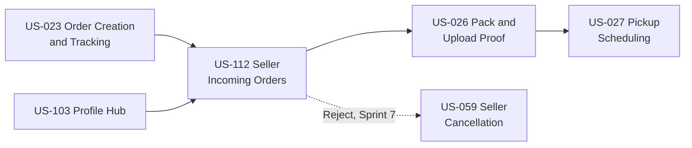
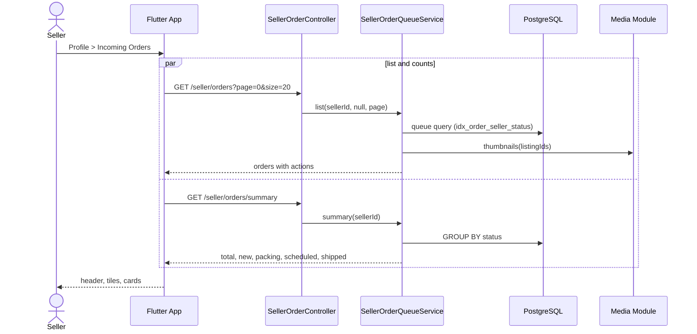
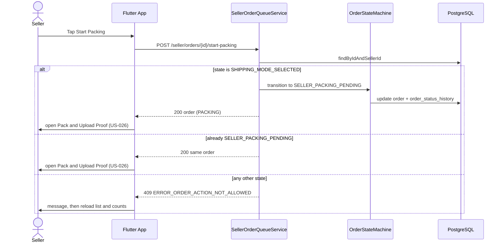

# Low Level Design - Sprint 6: Shipping & Delivery

**Document Version:** 0.1 (design only, not implemented)
**Product:** ValueX
**Sprint:** Sprint 6 - Shipping & Delivery
**Stories Covered in this version:** US-112
**Stories still to be designed in this document:** US-092, US-026, US-027, US-028, US-029, US-030, US-031, US-032, US-024, US-085
**Repos:** valuex-backend, valuex-mobile
**Sprint Goal:** Enable the fulfilment workflow, from the seller's incoming order to payment release.

**Change Log:**

| Version | Date | Change |
|---|---|---|
| 0.1 | Oct 2026 | Added Part A, US-112 Seller Incoming Orders, designed from the Figma Make `SellerIncomingOrdersScreen`. The remaining Sprint 6 stories get their own parts when they are designed. |

**Reference Documents:**
- [Sprint-plan.md](../Sprint-plan.md) - Sprint 6 section
- [user-stories.md](../user-stories.md) - US-112, US-103, US-023, US-026, US-027, US-059, US-090
- [HLD Part 2 - Backend Architecture](../HLD/02-Backend-Architecture.md) - §4.2 Profile Hub Badges, §4.9 Order Module
- [HLD Part 3 - Data Architecture](../HLD/03-Data-Architecture.md) - §4.6 Order Domain, indexes
- [HLD Part 5 - Frontend Architecture](../HLD/05-Frontend-Architecture.md) - §6 Navigation, §7 Screen Inventory, §10 Push Notifications
- [HLD Part 7 - API Integrations, Release & Risk](../HLD/07-API-Integrations-Release-Risk.md) - §9 Order APIs, Seller Incoming Orders
- [LLD Sprint 1](Sprint-1-Identity-User-Management-LLD.md) - §8 US-103 Profile Hub (`ProfileMenuBadgeProvider` SPI)
- [valuex-mobile/docs/Flutter-Design-System.md](../../valuex-mobile/docs/Flutter-Design-System.md)
- [CODING_STANDARDS.md](../CODING_STANDARDS.md)

---

## Sprint 6 Story Map & Dependency Order



US-112 is the seller's work queue. It does not pack, schedule or cancel anything itself: it shows where each order stands and opens the screens of US-026, US-027 and US-059.

## Master Table of Contents

- [Part A - US-112: Seller Incoming Orders](#part-a---us-112-seller-incoming-orders)

---

# Part A - US-112: Seller Incoming Orders

**Story Points:** 5 | **Repos:** valuex-backend, valuex-mobile
**Dependency:** US-023 (the order and its lifecycle), US-103 (the Profile hub that opens it)

## A.1 Story Overview

**As a** seller **I want** one list of every order buyers have placed on my items, grouped by what I need to do next **so that** I can pack, schedule pickup and follow each order without searching through chats and notifications.

The Figma Make screen shows a header ("Incoming Orders", "{n} orders · {x} new", a "{x} New" badge), four count tiles (New, Packing, Scheduled, Shipped) and one card per order. A card has the order reference, an URGENT tag, a status chip, the item photo, title and price, the buyer's name and initials, the time since the order, and buttons that depend on the status.

| Actor | Role |
|---|---|
| Seller | Opens the list from Profile, starts packing, continues packing, schedules pickup, views the schedule, rejects a new order |
| Flutter Mobile App | Shows the page, calls the three endpoints, navigates to the US-026, US-027 and US-059 screens, refreshes on push |
| Order Module (Spring Boot) | Owns the seller queue read model, the summary counts and the start-packing transition |
| Auth Module (`ProfileMenuBadgeProvider` SPI) | Collects the `INCOMING_ORDERS` count for the Profile hub badge |
| Notification Module | Sends the new-order push (US-077) |
| Media Module | Resolves the item thumbnail URL |

### A.1.1 Edge Cases Covered

| Edge Case | Handling |
|---|---|
| Order changes state (buyer cancels, pickup scheduled elsewhere) while the page is open | The action endpoint returns `ERROR_ORDER_ACTION_NOT_ALLOWED` (409); the app shows the message and reloads the list and counts |
| "Start Packing" tapped twice or on two devices | Idempotent: an order already in `SELLER_PACKING_PENDING` returns the same 200 response |
| Seller leaves Pack & Upload Proof unfinished | Order stays in Packing; the card offers "Continue Packing" |
| Proof uploaded, pickup not scheduled | `SELLER_PROOF_UPLOADED` stays in the Packing bucket with the "Schedule Pickup" action |
| Cart with several items from several sellers | Checkout creates one order per item (owner decision); each is its own card with its own order number, escrow and state |
| Item photo missing or listing removed | `imageUrl` is null; the app shows a placeholder; the order stays |
| Delivery exception (`DELIVERY_FAILED`, `SHIPMENT_LOST`) | Shown in the Shipped bucket; no action button |
| Self-pickup order (buyer collects the item) | Treated like any New order (Pay Now or Pay at Pickup) with the extra tag "Self Pickup by Buyer"; no shipping; actions `VIEW_PICKUP_DETAILS` and `REJECT`; never urgent (no logistics pickup deadline); leaves the list when the buyer confirms collection (US-031) |
| Pay at Pickup self-pickup order (no escrow payment, US-022) | Same card; Reject carries no penalty because nothing was paid into escrow and the hand-over is a mutual agreement between buyer and seller (owner decision) |
| Another seller's order id | Returns `ERROR_ORDER_NOT_FOUND` (404), the same as an unknown id, so ids cannot be probed |
| Hundreds of orders | Paginated, 20 per page, maximum 50 |
| Account suspended or banned | Endpoints return the standard account-state error (US-088); the app shows the blocked screen |

## A.2 Scope

**In scope:** `GET /api/v1/seller/orders`, `GET /api/v1/seller/orders/summary`, `POST /api/v1/seller/orders/{orderId}/start-packing`, the `INCOMING_ORDERS` badge provider, the new-order push listener, the mobile page and its states.
**Out of scope:** packing proof upload (US-026), pickup scheduling and schedule view (US-027), seller cancellation and penalty (US-059, "Reject" opens it), tracking and order details content (US-023, US-029), order history of completed orders (US-070).

## A.3 Data Model

No new table. The queue reads `orders`, `order_items`, `listings`, `listing_images` and `users`. Three columns on `orders`, which Sprint 5 (US-020, US-021, US-023) creates, are needed; if Sprint 5 already created them the migration below is only the index:

```sql
-- V{N}__orders_seller_queue.sql
ALTER TABLE orders ADD COLUMN IF NOT EXISTS seller_id UUID REFERENCES users(id);
ALTER TABLE orders ADD COLUMN IF NOT EXISTS order_number VARCHAR(30);
ALTER TABLE orders ADD COLUMN IF NOT EXISTS delivery_mode VARCHAR(20) NOT NULL DEFAULT 'DELIVERY';   -- DELIVERY | SELF_PICKUP (US-020)
CREATE UNIQUE INDEX IF NOT EXISTS uq_orders_order_number ON orders(order_number);

CREATE INDEX idx_order_seller_status
    ON orders(seller_id, status, created_at DESC);
```

Decided (owner): every item gets its own order. A buyer's single consolidated payment for items from several sellers is split into one order per item, each with its own order number, escrow, chat and negotiation link, delivery and refund. `orders.seller_id` is therefore a plain column copied from the item's seller, and each order has exactly one `order_items` row.

### A.3.1 Bucket Mapping

The four buckets are derived in code from the US-090 `OrderStatus`; nothing is stored.

| Bucket | `OrderStatus` values | Actions offered |
|---|---|---|
| `NEW` | `SHIPPING_MODE_SELECTED` with `delivery_mode = DELIVERY` | `START_PACKING`, `REJECT` |
| `NEW` (extra tag "Self Pickup by Buyer") | `SHIPPING_MODE_SELECTED` with `delivery_mode = SELF_PICKUP` | `VIEW_PICKUP_DETAILS`, `REJECT` |
| `PACKING` | `SELLER_PACKING_PENDING` | `CONTINUE_PACKING` |
| `PACKING` | `SELLER_PROOF_UPLOADED` | `SCHEDULE_PICKUP` |
| `SCHEDULED` | `PICKUP_SCHEDULED` | `VIEW_SCHEDULE` |
| `SHIPPED` | `PICKED_UP`, `IN_TRANSIT`, `OUT_FOR_DELIVERY`, `DELIVERED`, `BUYER_PROOF_PENDING`, `BUYER_CONFIRMATION_PENDING`, `DELIVERY_FAILED`, `SHIPMENT_LOST` | none |
| not listed | everything before `SHIPPING_MODE_SELECTED`, and `COMPLETED`, `CANCELLED`, `RETURN_REQUESTED`, `RETURN_TO_SELLER`, `DISPUTE_RAISED` | n/a |

## A.4 API Contracts

All three are under `/api/v1/seller`, need a valid access token and an `ACTIVE` account, and use the standard envelope and pagination metadata ([CODING_STANDARDS §1.6](../CODING_STANDARDS.md)).

### A.4.1 List incoming orders

```http
GET /api/v1/seller/orders?bucket=NEW|PACKING|SCHEDULED|SHIPPED&page=0&size=20
```

`bucket` is optional. Order: New, Packing, Scheduled, Shipped, then newest first. `size` defaults to 20 and is capped at 50.

```json
{
  "success": true,
  "data": [
    {
      "orderId": "6c1d5a3e-0c1f-4d0e-9a55-3f9a2b7f1a10",
      "orderNumber": "VX-2026-1001",
      "bucket": "NEW",
      "orderState": "SHIPPING_MODE_SELECTED",
      "deliveryMode": "DELIVERY",
      "urgent": true,
      "placedAt": "2026-10-12T08:05:00Z",
      "amount": 42000.00,
      "item": {
        "listingId": "0d7e0a0a-2d2c-4a58-b3a4-1c7d2f3b9e11",
        "title": "Vintage Leica M6 Film Camera",
        "imageUrl": "https://cdn.example/thumb/abc.webp"
      },
      "buyer": { "displayName": "Ananya Sharma" },
      "actions": ["START_PACKING", "REJECT"]
    }
  ],
  "metadata": { "requestId": "uuid", "timestamp": "ISO-8601", "page": 0, "size": 20, "totalElements": 4, "totalPages": 1 }
}
```

The text of the status chip is not sent. The app localizes it from `bucket` (and shows "Self Pickup by Buyer" when `deliveryMode` is `SELF_PICKUP`); `orderState` is for the order details and for support. `orderNumber` is the real order number; the mock repository returns the Make sample numbers (for example `ORD-S-1001`).

### A.4.2 Summary counts

```http
GET /api/v1/seller/orders/summary
```

```json
{ "success": true, "data": { "total": 4, "new": 1, "packing": 1, "scheduled": 1, "shipped": 1 }, "metadata": { "requestId": "uuid", "timestamp": "ISO-8601" } }
```

Feeds the header line, the "{x} New" badge, the four tiles and the Profile hub badge.

### A.4.3 Start packing

```http
POST /api/v1/seller/orders/{orderId}/start-packing
```

No body. `200` returns the updated order in the shape of A.4.1 (`bucket` `PACKING`, `actions` `["CONTINUE_PACKING"]`). Errors: `404 ERROR_ORDER_NOT_FOUND`, `409 ERROR_ORDER_ACTION_NOT_ALLOWED`.

## A.5 Backend Design (valuex-backend)

### A.5.1 Package additions (module `com.valuex.order`, same layering as `auth` and `notification`)

```text
com.valuex.order
├── api/
│   └── SellerOrderController.java            # the three endpoints
├── application/
│   ├── dto/
│   │   ├── IncomingOrderResponse.java
│   │   ├── IncomingOrdersSummaryResponse.java
│   │   └── IncomingOrderRow.java             # query projection
│   └── service/
│       └── SellerOrderQueueService.java      # list, summary, startPacking
├── domain/
│   ├── FulfilmentBucket.java                 # NEW, PACKING, SCHEDULED, SHIPPED + mapping
│   └── SellerOrderAction.java                # START_PACKING, REJECT, CONTINUE_PACKING, SCHEDULE_PICKUP, VIEW_SCHEDULE, VIEW_PICKUP_DETAILS
├── adapter/menu/
│   └── IncomingOrdersBadgeProvider.java      # implements ProfileMenuBadgeProvider, key "INCOMING_ORDERS"
└── infrastructure/persistence/
    └── SellerOrderQueryRepository.java       # projection query + grouped count
```

`Order`, `OrderStatus` and the order state machine come from US-023 and US-090 (Sprint 5). This story adds no new state, only one guarded transition.

### A.5.2 Bucket mapping and actions

```java
public enum FulfilmentBucket {
    NEW, PACKING, SCHEDULED, SHIPPED;

    private static final Map<OrderStatus, FulfilmentBucket> DELIVERY = Map.ofEntries(
        Map.entry(OrderStatus.SHIPPING_MODE_SELECTED, NEW),
        Map.entry(OrderStatus.SELLER_PACKING_PENDING, PACKING),
        Map.entry(OrderStatus.SELLER_PROOF_UPLOADED, PACKING),
        Map.entry(OrderStatus.PICKUP_SCHEDULED, SCHEDULED),
        Map.entry(OrderStatus.PICKED_UP, SHIPPED),
        Map.entry(OrderStatus.IN_TRANSIT, SHIPPED),
        Map.entry(OrderStatus.OUT_FOR_DELIVERY, SHIPPED),
        Map.entry(OrderStatus.DELIVERED, SHIPPED),
        Map.entry(OrderStatus.BUYER_PROOF_PENDING, SHIPPED),
        Map.entry(OrderStatus.BUYER_CONFIRMATION_PENDING, SHIPPED),
        Map.entry(OrderStatus.DELIVERY_FAILED, SHIPPED),
        Map.entry(OrderStatus.SHIPMENT_LOST, SHIPPED));

    // Self-pickup is a New order without shipping; the later hand-over states come with the US-090 update.
    // US-090 has no self-pickup hand-over states yet (owner will add them), so only this one is listed.
    private static final Map<OrderStatus, FulfilmentBucket> SELF_PICKUP = Map.of(
        OrderStatus.SHIPPING_MODE_SELECTED, NEW);

    public static Optional<FulfilmentBucket> of(OrderStatus status, DeliveryMode mode) {
        var map = mode == DeliveryMode.SELF_PICKUP ? SELF_PICKUP : DELIVERY;
        return Optional.ofNullable(map.get(status));   // empty: not shown in the queue
    }

    /** (status, mode) pairs that belong to a bucket; the queue query filters on these. */
    public static Set<StatusMode> pairsOf(FulfilmentBucket bucket) { /* inverse of both maps */ }
    public static Set<StatusMode> allListedPairs() { /* union of both maps */ }
}

static List<SellerOrderAction> actionsFor(OrderStatus status, DeliveryMode mode) {
    if (mode == DeliveryMode.SELF_PICKUP) {
        return status == OrderStatus.SHIPPING_MODE_SELECTED ? List.of(VIEW_PICKUP_DETAILS, REJECT) : List.of();
    }
    return switch (status) {
        case SHIPPING_MODE_SELECTED -> List.of(START_PACKING, REJECT);
        case SELLER_PACKING_PENDING -> List.of(CONTINUE_PACKING);
        case SELLER_PROOF_UPLOADED -> List.of(SCHEDULE_PICKUP);
        case PICKUP_SCHEDULED -> List.of(VIEW_SCHEDULE);
        default -> List.of();
    };
}
```

`REJECT` always opens the US-059 seller cancellation, whose penalty applies whenever the buyer has booked the order and paid into escrow (owner decision). A Pay at Pickup order has no escrow payment and no penalty: the hand-over is a mutual agreement between buyer and seller (owner decision).

### A.5.3 SellerOrderQueueService

```java
@Service
@RequiredArgsConstructor
public class SellerOrderQueueService {

    private final SellerOrderQueryRepository queryRepository;
    private final OrderRepository orderRepository;
    private final OrderStateMachine orderStateMachine;          // US-090
    private final MediaUrlResolver mediaUrlResolver;
    private final SellerOrderProperties properties;             // urgent window, pickup SLA

    @Transactional(readOnly = true)
    public Page<IncomingOrderResponse> list(UUID sellerId, FulfilmentBucket bucket, Pageable pageable) {
        Set<StatusMode> pairs = bucket == null ? FulfilmentBucket.allListedPairs() : FulfilmentBucket.pairsOf(bucket);
        Page<IncomingOrderRow> rows = queryRepository.findQueue(sellerId, pairs, pageable);   // ORDER BY bucket rank, created_at DESC
        Map<UUID, String> thumbs = mediaUrlResolver.thumbnails(rows.map(IncomingOrderRow::listingId).toList());
        return rows.map(row -> IncomingOrderResponse.from(row, thumbs.get(row.listingId()), urgent(row), actionsFor(row.status(), row.deliveryMode())));
    }

    @Transactional(readOnly = true)
    public IncomingOrdersSummaryResponse summary(UUID sellerId) {
        Map<StatusMode, Long> counts = queryRepository.countByStatusAndMode(sellerId);   // one GROUP BY query
        return IncomingOrdersSummaryResponse.fromCounts(counts);                        // folds (status, mode) into buckets
    }

    @Transactional
    public IncomingOrderResponse startPacking(UUID sellerId, UUID orderId) {
        Order order = orderRepository.findByIdAndSellerId(orderId, sellerId)
            .orElseThrow(() -> new NotFoundException("ERROR_ORDER_NOT_FOUND", "This order is no longer available"));

        if (order.getStatus() == OrderStatus.SELLER_PACKING_PENDING) {
            return respond(order);                                    // idempotent repeat
        }
        if (order.getDeliveryMode() != DeliveryMode.DELIVERY || order.getStatus() != OrderStatus.SHIPPING_MODE_SELECTED) {
            throw new BusinessException("ERROR_ORDER_ACTION_NOT_ALLOWED", "This order has already moved to the next step");
        }
        orderStateMachine.transition(order, OrderStatus.SELLER_PACKING_PENDING, sellerId, "SELLER_STARTED_PACKING");
        return respond(order);                                        // history row written by the state machine
    }

    private boolean urgent(IncomingOrderRow row) {
        // Owner-confirmed rule: a New delivery order whose pickup deadline is within the urgent window; self-pickup is never urgent
        Instant deadline = row.placedAt().plus(properties.pickupSla());       // default 48h (US-027)
        return row.deliveryMode() == DeliveryMode.DELIVERY
            && row.status() == OrderStatus.SHIPPING_MODE_SELECTED
            && Duration.between(Instant.now(), deadline).compareTo(properties.urgentWindow()) <= 0;   // default 24h
    }
}
```

Notes:
- `findByIdAndSellerId` makes another seller's order and an unknown order indistinguishable (404).
- The state machine call uses the optimistic lock (`@Version`) on `orders`; a concurrent update surfaces as the same `ERROR_ORDER_ACTION_NOT_ALLOWED`.
- The projection query joins `orders`, the order's single `order_items` row, `listings` (title) and `users` (buyer display name). Thumbnails are fetched in one batch call for the page, so the list has no N+1 queries.
- The summary does one `GROUP BY status` over `idx_order_seller_status`.

### A.5.4 Controller

```java
@RestController
@RequestMapping("/api/v1/seller/orders")
@RequiredArgsConstructor
@Tag(name = "Seller Orders", description = "Incoming orders queue for sellers (US-112)")
public class SellerOrderController {

    private final SellerOrderQueueService service;

    @GetMapping
    public ResponseEntity<PagedResponse<IncomingOrderResponse>> list(
            @RequestParam(required = false) FulfilmentBucket bucket,
            @PageableDefault(size = 20) Pageable pageable) {
        UUID sellerId = SecurityContext.getCurrentUserId();
        return ResponseEntity.ok(PagedResponse.of(service.list(sellerId, bucket, capSize(pageable, 50))));
    }

    @GetMapping("/summary")
    public ResponseEntity<ApiResponse<IncomingOrdersSummaryResponse>> summary() {
        return ResponseEntity.ok(ApiResponse.success(service.summary(SecurityContext.getCurrentUserId())));
    }

    @PostMapping("/{orderId}/start-packing")
    public ResponseEntity<ApiResponse<IncomingOrderResponse>> startPacking(@PathVariable UUID orderId) {
        return ResponseEntity.ok(ApiResponse.success(service.startPacking(SecurityContext.getCurrentUserId(), orderId)));
    }
}
```

### A.5.5 Profile hub badge

```java
package com.valuex.order.adapter.menu;

@Component
@RequiredArgsConstructor
public class IncomingOrdersBadgeProvider implements ProfileMenuBadgeProvider {

    private final SellerOrderQueryRepository queryRepository;

    @Override public String menuKey() { return "INCOMING_ORDERS"; }

    @Override public int badgeCount(UUID userId) {
        return (int) queryRepository.countByStatus(userId, OrderStatus.SHIPPING_MODE_SELECTED);   // the New tile, both delivery modes; indexed count; failures are isolated by ProfileMenuService
    }
}
```

The badge key is added to the menu table in [LLD Sprint 1 §8.3](Sprint-1-Identity-User-Management-LLD.md).

### A.5.6 New-order push

When an order reaches `SHIPPING_MODE_SELECTED` (a US-090 transition in Sprint 5) the order module publishes `SellerOrderPlacedEvent(orderId, sellerId, orderNumber)`. A new `OrderEventNotificationListener` in the notification module (`@TransactionalEventListener(AFTER_COMMIT)`, same pattern as `AccountEventNotificationListener`) stores the in-app notification and sends the push with the data `{ "type": "SELLER_ORDER_PLACED", "route": "/seller/orders" }`. The push is high priority ([HLD 05 §10](../HLD/05-Frontend-Architecture.md)). A failed push is logged, not fatal.

### A.5.7 Configuration

```yaml
valuex:
  seller-orders:
    pickup-sla: PT48H        # US-027: pickup within 48 hours of the order
    urgent-window: PT24H     # owner-confirmed urgent rule
    max-page-size: 50
```

## A.6 Sequence Diagrams

### A.6.1 Open the page



### A.6.2 Start packing



## A.7 Validation Rules & Error Codes

| Rule | Error Code | HTTP | Message |
|---|---|---|---|
| Order belongs to the caller | `ERROR_ORDER_NOT_FOUND` | 404 | "This order is no longer available" |
| Start Packing only from `SHIPPING_MODE_SELECTED` (repeat from `SELLER_PACKING_PENDING` succeeds) | `ERROR_ORDER_ACTION_NOT_ALLOWED` | 409 | "This order has already moved to the next step" |
| `bucket` is one of the four values | `ERROR_VALIDATION` | 400 | standard validation message |
| `size` above 50 is reduced to 50 | n/a | 200 | n/a |
| Account not `ACTIVE` | standard account-state error (US-088) | 403 | n/a |
| List cannot be loaded | `ERROR_INCOMING_ORDERS_LOAD_FAILED` (client message for any network or 5xx failure) | n/a | "Unable to load your incoming orders. Pull down or tap Retry" |

## A.8 Mobile Design (valuex-mobile)

### A.8.1 Structure

```text
lib/features/order/
├── domain/
│   ├── entities/incoming_order.dart          # IncomingOrder, FulfilmentBucket, SellerOrderAction, OrdersSummary
│   └── repositories/seller_order_repository.dart
├── data/
│   ├── seller_order_repository_impl.dart     # the three endpoints
│   └── mock_seller_order_repository.dart     # the four Make sample orders, used until the backend ships
└── presentation/
    ├── seller_incoming_orders_screen.dart    # page
    ├── providers/seller_order_providers.dart # paged list, summary, start-packing
    └── widgets/
        ├── incoming_orders_header.dart       # back, title, "{n} orders · {x} new", New badge
        ├── order_count_tile.dart             # one tile; four in a row
        ├── incoming_order_card.dart          # header row, item row, action row
        ├── order_status_chip.dart            # icon + text
        └── buyer_initials_avatar.dart
```

Route `/seller/orders` is pushed from the Profile "Incoming Orders" row (`RouteNames.sellerOrders`), gated like the other signed-in routes (`ACTIVE` accounts only). The Profile row replaces its "coming soon" action with this route and shows the `INCOMING_ORDERS` badge from `menu-summary`.

### A.8.2 Behaviour

- Two providers load in parallel: the paged list and the summary. Pull to refresh invalidates both. Returning from the packing or pickup screens invalidates both, so the card moves bucket.
- The buttons on a card come from `actions`. The app maps each value to a label and a destination and holds no order state machine: `START_PACKING` calls the endpoint then opens US-026; `CONTINUE_PACKING` opens US-026; `SCHEDULE_PICKUP` and `VIEW_SCHEDULE` open US-027; `VIEW_PICKUP_DETAILS` opens a read-only sheet with the seller's pickup address and hours as the buyer sees them (US-020); `REJECT` opens the US-059 confirmation, which always states the penalty (until US-059 ships, it shows the coming-soon message); the details button opens the order details (US-023). A card with `deliveryMode` `SELF_PICKUP` shows the tag "Self Pickup by Buyer" next to the "New Order" chip.
- A 409 from Start Packing shows `ERROR_ORDER_ACTION_NOT_ALLOWED` as a passing message and reloads both providers.
- The count line, "{x} New" badge and tiles read the summary. "Showing all {n} incoming orders" shows after the last page.
- Empty, loading (skeleton cards), error with Retry, and last-loaded-list-with-message states, as for Home (US-111).
- Push `SELLER_ORDER_PLACED` opens `/seller/orders` and invalidates both providers.

### A.8.3 Make to design system mapping (design system wins; no approval step needed per owner rule)

| Make element | Make value | Flutter |
|---|---|---|
| Title font | Outfit | `AppTextStyles.heading2` (Poppins); body DM Sans |
| Header background | blue-to-background gradient | tint (`brandSurfaceTint`) fading into `brandBackground`, as on Profile |
| Status colours | magenta, amber, blue, green with 10% tints | status is told by icon and text in `brandForeground` on `brandSurfaceTint`; each bucket has its own icon; no new colours and no colour carries meaning alone |
| Status chip and tile labels | 10 to 11 px | 14 px (`hint` or `label`); 12 px `caption` only for the URGENT tag |
| "Start Packing" | gradient button | `BrandGradientButton` (56 high) |
| "Reject" | red tint, 40 px | destructive secondary using `brandError` text and border, 48 dp |
| "Continue Packing", "View Schedule" | amber and blue tints | `SingleToneButton` |
| "Order Shipped" | green button-like label | non-interactive status row, no button styling |
| Details chevron button | 40 px | 48 dp icon button with a label |
| Price | blue `#2D6BFF` bold | `AppTextStyles.cardPrice` (`brandLink`) |
| Buyer avatar | 20 px gradient circle, 9 px initials | 24 px circle with `AppGradients.brand`, white 12 px initials (decorative; the name is read from the text) |
| Time text | `#94A3B8` 11 px | `hint` in `brandMutedText` |

### A.8.4 Strings (English and Hindi ARB)

Title, count line (`{n} orders · {x} new` with plurals), `{x} New`, tile labels (New, Packing, Scheduled, Shipped), chip texts (New Order, Packing Required, Pickup Scheduled, Shipped), Self Pickup by Buyer, URGENT, Buyer: {name}, relative time, Start Packing, Reject, Continue Packing, Schedule Pickup, View Schedule, View Pickup Details, Order Shipped, empty state, footer, and the three error messages.

## A.9 Security & NFR Notes

- Authorization: every query is scoped by `seller_id = caller`; an unknown or foreign order id returns the same 404.
- Privacy: only the buyer's display name is returned. No mobile, email or address; the seller reaches the buyer through the masked channels (Sprint 4).
- Performance (targets): list p95 under 300 ms for a seller with 1,000 orders (index `idx_order_seller_status`, one projection query, one batched thumbnail lookup, page size cap 50); summary and badge are single indexed counts. The badge provider must stay non-blocking (SPI contract).
- Rate limit (proposed): 60 requests per minute per seller across the three endpoints.
- Logging: order id and seller id only, never buyer names; metric `seller_orders_start_packing_total{result}`.
- Accessibility: tap areas of 48 dp, labelled buttons, title and count line as headings, status by icon and text, tested at 200% text in English and Hindi, and the screen is added to `all_screens_accessibility_test.dart` and `screen_headings_test.dart`.

## A.10 Testing Strategy

**Backend unit (JUnit 5, Mockito, AssertJ):**
- `FulfilmentBucketTest`: every (`OrderStatus`, `DeliveryMode`) pair maps to the bucket in A.3.1 or to none; `pairsOf` is the inverse
- `SellerOrderQueueServiceTest`: list order and bucket filter; summary folds (status, mode) into buckets; `startPacking` success, idempotent repeat, wrong state (409), self-pickup order (409), foreign order (404); urgent rule at the window edges, and never for self-pickup
- `IncomingOrdersBadgeProviderTest`: returns the New count, delivery and self-pickup orders together

**Backend integration (`@SpringBootTest`, TestContainers PostgreSQL):** seller sees only their orders; ordering across buckets; pagination metadata; `start-packing` writes `order_status_history`; two concurrent start-packing calls end with one transition.

**Mobile (flutter_test, mocktail):** repository payloads; card shows the right buttons per bucket; Start Packing calls the endpoint then navigates; 409 shows the message and reloads; summary tiles and header line; empty, error and retry states; pull to refresh; back button; Hindi at 200% text; accessibility guidelines; push opens the page.

## A.11 Decisions and Open Items

**Decided by the product owner (2026-10-12):**
- **Urgent rule:** a New delivery order whose pickup deadline (48 hours from the order) is within 24 hours; both durations are configuration (A.5.7). Self-pickup orders have no logistics deadline and are never urgent.
- **Reject penalty:** the US-059 penalty always applies after a buyer has booked the order and paid into escrow. Pay at Pickup orders have no escrow payment and no penalty (mutual agreement of buyer and seller).
- **Self-pickup orders** are treated like any New order, with the extra tag "Self Pickup by Buyer" and no shipping.
- **One order per item:** a consolidated payment for any number of items from any number of sellers creates one order per item, each with its own order number, escrow, chat, negotiation, delivery and refund; each seller is paid for their own items.
- **Order reference:** mock data shows the Make sample numbers (for example `ORD-S-1001`); real data shows the backend `order_number`.

**Open:**
1. **Reject wiring.** The button is shown from Sprint 6 and opens US-059 once Sprint 7 ships; until then it shows the coming-soon message.
2. **Self-pickup hand-over states.** US-090 has no states for it; the owner will update US-090 when needed. Until then a self-pickup order stays New (only `SHIPPING_MODE_SELECTED` is listed for it) until it completes or is cancelled, so it counts in the New tile and the Profile badge for that time.

---
