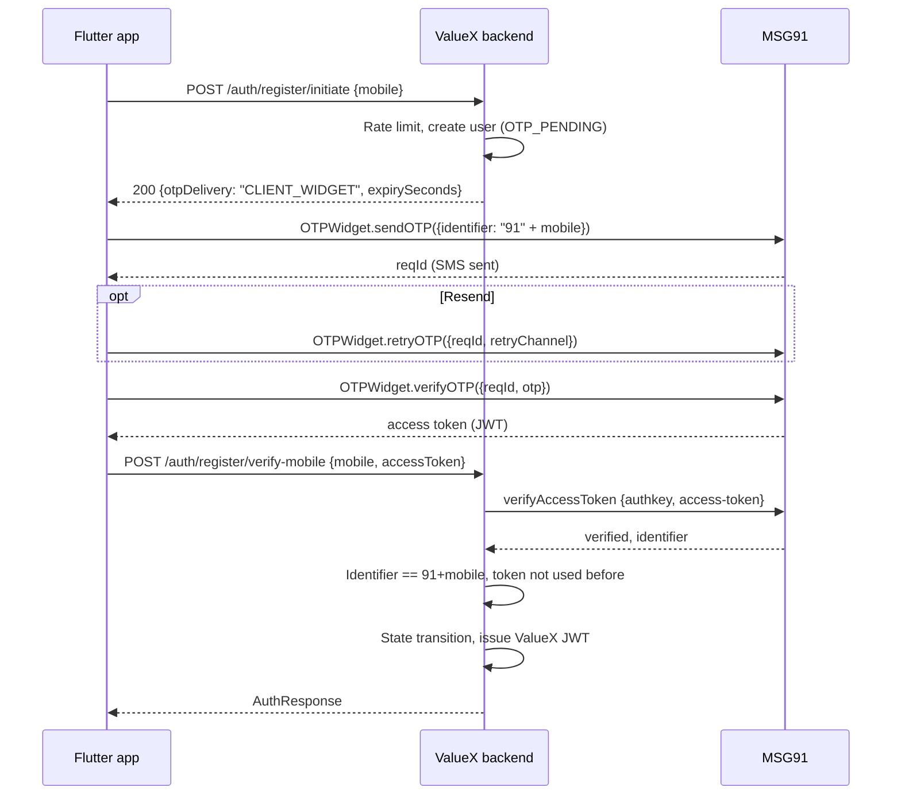

# MSG91 OTP Widget Integration — Mobile and Email OTP

**Status:** Draft for review  
**Scope:** Sending and verifying mobile (SMS) and email OTPs through the MSG91 OTP Widget service, for every OTP flow in the app.  
**Out of scope:** Aadhaar OTP (separate provider, `valuex.aadhaar.*`), transactional notifications (`valuex.notification.*`).  
**Replaces:** the backend-generated-OTP approach (MSG91 Flow API and Email API) in [MSG91-Integration-Guide.md](MSG91-Integration-Guide.md). The widget generates, delivers and verifies the OTP itself, so the backend no longer does.

> **Verify before coding.** The MSG91 documentation pages could not be read while preparing this document. Details marked **[Confirm]** come from the Flutter SDK readme and general knowledge of the widget API and must be checked in the MSG91 dashboard documentation (see section 12).

---

## 1. Decisions in this document

| # | Decision | Choice |
|---|---|---|
| D1 | Who talks to MSG91 for send, retry and verify | The Flutter app, using `sendotp_flutter_sdk` |
| D2 | Who proves the OTP was verified to ValueX | The backend, by validating the widget access token with MSG91 using the account **authkey** |
| D3 | Where the MSG91 **authkey** lives | Backend only, in a secret store. Never in the repo, the mobile app or the docs |
| D4 | Number of widgets | Two: one for mobile (SMS first, WhatsApp and voice as retry channels), one for email |
| D5 | Local development | Keep `mock` providers; the widget is used only in staging and production |

---

## 2. Current state

- OTPs are generated by the backend (`SecureRandom`, 6 digits), stored as a SHA-256 hash in Redis (`otp:{target}:{purpose}`, 300 s) and delivered through `OtpPort.sendOtp` or `EmailOtpPort.sendEmailOtp`. Only mock adapters exist (`MockOtpAdapter`, `MockEmailOtpAdapter`).
- Provider selection is already split per channel: `valuex.otp.sms-provider` and `valuex.otp.email-provider` in [application.yml](../valuex-backend/src/main/resources/application.yml), read through `OtpProviderConfig`.
- Rate limits are enforced in the services with Redis: send attempts, verify attempts and window (`valuex.otp.max-send-attempts-per-window`, `max-verify-attempts-per-window`, `rate-limit-window-minutes`).

OTP flows that must move to the widget:

| Flow | Purpose (`OtpPurpose`) | Send endpoint | Verify endpoint | Service |
|---|---|---|---|---|
| Sign up, mobile | `MOBILE_VERIFY` | `POST /auth/register/initiate` | `POST /auth/register/verify-mobile` | `UserRegistrationService` |
| Sign in, mobile | `LOGIN` | `POST /auth/login/initiate` | `POST /auth/login/verify-mobile` | `UserLoginService` |
| Google sign-in, mobile step | `MOBILE_VERIFY` | `POST /auth/social/google/initiate-mobile` | `POST /auth/social/google/verify-mobile` | `GoogleSignInService` |
| Sign up, email | `EMAIL_VERIFY` | `POST /auth/email/send-otp` | `POST /auth/email/verify-otp` | `EmailVerificationService` |
| Change mobile | `MOBILE_CHANGE` | `POST /users/me/mobile/change/initiate` | `POST /users/me/mobile/change/verify` | `AccountSecurityService` |
| Change email | `EMAIL_CHANGE` | `POST /users/me/email/change/initiate` | `POST /users/me/email/change/verify` | `AccountSecurityService` |

---

## 3. Integration approach

| | A. Client SDK + server token check (chosen) | B. Backend calls the widget API for send, retry and verify |
|---|---|---|
| App talks to | MSG91 (SDK) and ValueX | ValueX only |
| Backend proves the result | Validates the access token with MSG91 | Calls MSG91 verify and trusts the response |
| Mobile change | New dependency (`sendotp_flutter_sdk` 0.0.2, published by MSG91) and widget id and token in the app | None |
| Abuse control for sends (SMS pumping) | MSG91 widget limits only; ValueX cannot see sends | ValueX rate limits every send, as today |
| Identifier binding | Must be confirmed from the token (section 12, item 1) | Guaranteed, the backend supplies the identifier |
| Fit with MSG91 | The documented mobile path (widget needs **Mobile Integration** enabled) | Uses the same widget REST API without the SDK; less documented **[Confirm]** |

**Chosen: A**, because it is the path MSG91 documents for mobile and it was the requested direction. Its weaknesses are the extractable widget id and token (section 10) and the lack of ValueX-side send limits. If MSG91 cannot confirm item 1 or item 4 in section 12, switch to **B**: the backend design in section 6 stays the same, only the adapter changes.

---

## 4. Target flows

### 4.1 Mobile OTP (sign up shown; sign in, Google and change-mobile are the same shape)



### 4.2 Email OTP

Same shape, with the email widget and `identifier` set to the email address. The existing authenticated endpoints are used: `POST /auth/email/send-otp` (checks rate limit and that the email is free, returns `CLIENT_WIDGET`), then the SDK calls, then `POST /auth/email/verify-otp {email, accessToken}`.

### 4.3 What changes per endpoint

- **Send endpoints** keep their checks (rate limit, state, eligibility, uniqueness) but no longer generate, store or send an OTP when the provider is `msg91-widget`. They return `otpDelivery` so the app knows whether to call the SDK (`CLIENT_WIDGET`) or just wait for a message (`SERVER`, mock mode).
- **Verify endpoints** accept `accessToken` instead of `otp` in widget mode. `otp` stays valid in mock mode. Exactly one is required, chosen by the active provider.
- The state machine, JWT issuing, sessions and error envelope are unchanged.

---

## 5. MSG91 dashboard setup (once per environment)

Use separate MSG91 widgets, tokens and templates for staging and production.

1. **Account prerequisites:** DLT entity, registered sender id (6 characters) and DLT-approved OTP templates for SMS (mandatory in India). Verified sending domain for email.
2. **Mobile widget** (OTP section, create widget):
   - Channels: SMS as default; WhatsApp and voice as retry channels.
   - SMS template: the DLT-approved one, with the OTP variable.
   - OTP length 6, expiry 5 minutes, resend interval and maximum resends set here (section 8.3).
   - **Mobile Integration: enabled** (required for the SDK).
3. **Email widget:** email channel only, email template with the OTP variable, same length and expiry.
4. **Tokens:** generate the widget token for each widget and keep it enabled. Note each widget id and token.
5. **Authkey:** from the MSG91 account (Authkey page). Create one per environment. Enable IP whitelisting for the staging and production backend egress IPs **[Confirm available]**.
6. **Alerts:** low-balance alert and a daily send cap, to limit the cost of abuse.

---

## 6. Backend design

### 6.1 Port and adapters

Replace the send-and-compare logic that is duplicated in the six services with one port. The services keep their pre-checks and post-steps; only the OTP mechanics move.

```java
public interface OtpChallengePort {
    /** Server mode generates and sends the OTP; widget mode only reports that the client drives it. */
    OtpChallenge start(String identifier, OtpPurpose purpose);

    /** Throws BusinessException unless the credential proves the identifier received an OTP for this purpose. */
    void verify(String identifier, OtpPurpose purpose, String credential);
}

public record OtpChallenge(OtpDelivery delivery, int expirySeconds) {}
public enum OtpDelivery { SERVER, CLIENT_WIDGET }
```

| Adapter | Selected by | Behaviour |
|---|---|---|
| `LocalOtpChallengeAdapter` (existing logic moved, wraps `OtpPort`, `EmailOtpPort` and Redis) | `…-provider=mock` | Generate, hash in Redis, send through the mock port, compare on verify. `credential` is the OTP |
| `Msg91WidgetChallengeAdapter` | `…-provider=msg91-widget` | `start` returns `CLIENT_WIDGET`. `verify` validates the access token with MSG91 (below). `credential` is the access token |

One adapter instance per channel (SMS and email), selected by `valuex.otp.sms-provider` and `valuex.otp.email-provider`.

### 6.2 Token verification (`Msg91WidgetChallengeAdapter.verify`)

1. Call MSG91 `verifyAccessToken` with the authkey and the access token **[Confirm path, body and response]**:

   ```
   POST {valuex.msg91.api-base-url}{valuex.msg91.verify-access-token-path}
   Content-Type: application/json

   { "authkey": "<MSG91_AUTH_KEY>", "access-token": "<token from the app>" }
   ```

2. Treat anything other than a success response as invalid.
3. Confirm the verified identifier equals the expected one (mobile: `country-code` + mobile, for example `919876543210`; email: lower-cased address). A valid token for another number or email must be rejected.
4. Store `sha256(token)` in Redis with `valuex.msg91.used-token-ttl-seconds`; reject a token already stored (replay). Use `SET NX`.
5. Apply the existing verify-attempt rate limit (`otp_fail:{target}`) to failed checks.
6. The authkey is sent only in the request body or header to MSG91, never logged. Log the purpose, masked identifier and outcome only.

### 6.3 Errors

| Code | When | HTTP |
|---|---|---|
| `ERROR_INVALID_OTP` | MSG91 rejects the token (existing code, unchanged message) | 400 |
| `ERROR_OTP_EXPIRED` | MSG91 reports the token or OTP expired | 400 |
| `ERROR_OTP_IDENTIFIER_MISMATCH` | Token is valid for a different mobile or email | 400 |
| `ERROR_OTP_TOKEN_REUSED` | Token already used | 400 |
| `ERROR_OTP_PROVIDER_UNAVAILABLE` | Timeout or 5xx from MSG91 | 503 |
| `ERROR_OTP_MAX_ATTEMPTS`, `ERROR_OTP_RATE_LIMIT` | Existing rate limits, unchanged | 429 |

### 6.4 Code changes

| Action | File |
|---|---|
| Add | `OtpChallengePort`, `OtpChallenge`, `OtpDelivery` (`auth.application.port`) |
| Add | `LocalOtpChallengeAdapter`, `Msg91WidgetChallengeAdapter` (`auth.adapter.otp`) |
| Modify | `OtpProviderConfig`: accept `mock` and `msg91-widget` for each channel, add a `RestClient` bean with timeouts for MSG91 |
| Modify | `ValuexProperties`: add the `Msg91` block (section 8.1) |
| Modify | The six services in section 2: call `OtpChallengePort` instead of generating and comparing |
| Modify | Verify DTOs (`VerifyMobileOtpRequest`, `VerifyLoginOtpRequest`, `VerifyEmailOtpRequest`, and the Google, mobile-change and email-change equivalents): add optional `accessToken`; `otp` becomes optional; one of the two is required (class-level validation) |
| Modify | `MessageResponse` for send endpoints: add `otpDelivery` |
| Modify | `application.yml`, `.env.example`: new keys |
| Tests | Adapter tests with a stubbed MSG91 (success, invalid, expired, mismatch, replay, timeout); service tests for both delivery modes; controller tests for the either-or validation |

The existing `OtpPort`, `EmailOtpPort`, `OtpPurpose` and the mock adapters stay for mock mode.

---

## 7. Mobile design

- Add `sendotp_flutter_sdk: ^0.0.2` and pin the exact version.
- New `core/otp` abstraction used by the existing entry and verify controllers, so screens do not change:

  ```dart
  abstract class OtpClient {
    Future<OtpSession> send(OtpTarget target);            // reqId for the widget, nothing for server mode
    Future<void> resend(OtpSession session, {OtpChannel? channel});
    Future<OtpCredential> verify(OtpSession session, String otp); // access token or the raw OTP
  }
  ```

  | Implementation | Used when |
  |---|---|
  | `ServerOtpClient` | Backend returns `otpDelivery = SERVER` (mock mode); `verify` returns the typed OTP as the credential |
  | `Msg91WidgetOtpClient` | Backend returns `CLIENT_WIDGET`; wraps `OTPWidget.initializeWidget`, `sendOTP`, `retryOTP`, `verifyOTP` |

- Initialize the SDK once at startup with the mobile widget, and with the email widget before the email step (the SDK holds one widget at a time, so initialize again when switching **[Confirm]**).
- Flow in each controller: call the backend send endpoint, then if `CLIENT_WIDGET` call `OtpClient.send`; on verify call `OtpClient.verify`, then post `accessToken` (or `otp`) to the backend verify endpoint.
- Mobile numbers are sent to the SDK as `91` plus the 10 digits (no `+`).
- Resend uses the cooldown and maximum from config (section 8.2). Offer WhatsApp or voice after the first resend, using the channel codes SMS 11, voice 4, email 3, WhatsApp 12.
- Map SDK errors to the existing error messages; show a retry message for network failures. Never log the OTP or the access token.
- Tests: fake `OtpClient` for controller and widget tests; the SDK itself is not called in tests.

---

## 8. Configuration items

### 8.1 Backend (`application.yml`, values from environment variables)

| Property | Env var | Default | Secret | Purpose |
|---|---|---|---|---|
| `valuex.otp.sms-provider` | `OTP_SMS_PROVIDER` | `mock` | No | `mock` or `msg91-widget` |
| `valuex.otp.email-provider` | `OTP_EMAIL_PROVIDER` | `mock` | No | `mock` or `msg91-widget` |
| `valuex.otp.expiry-seconds` | none | `300` | No | Mock mode expiry; in widget mode returned to the app as the display value and must equal the widget setting |
| `valuex.otp.length` | none | `6` | No | Mock mode only |
| `valuex.otp.max-send-attempts-per-window` | none | `3` | No | Send limit at the initiate endpoints (still applies) |
| `valuex.otp.max-verify-attempts-per-window` | none | `5` | No | Failed verify limit (still applies) |
| `valuex.otp.rate-limit-window-minutes` | none | `10` | No | Window for both limits |
| `valuex.msg91.auth-key` | `MSG91_AUTH_KEY` | empty | **Yes** | MSG91 account authkey; used only to verify tokens |
| `valuex.msg91.api-base-url` | `MSG91_API_BASE_URL` | `https://control.msg91.com` **[Confirm]** | No | MSG91 API host |
| `valuex.msg91.verify-access-token-path` | `MSG91_VERIFY_TOKEN_PATH` | `/api/v5/widget/verifyAccessToken` **[Confirm]** | No | Token verification path |
| `valuex.msg91.country-code` | `MSG91_COUNTRY_CODE` | `91` | No | Prefix for mobile identifiers |
| `valuex.msg91.connect-timeout-ms` | `MSG91_CONNECT_TIMEOUT_MS` | `2000` | No | HTTP connect timeout |
| `valuex.msg91.read-timeout-ms` | `MSG91_READ_TIMEOUT_MS` | `5000` | No | HTTP read timeout |
| `valuex.msg91.used-token-ttl-seconds` | `MSG91_USED_TOKEN_TTL_SECONDS` | `900` | No | How long a used token is remembered (at least the token lifetime) |

Validate at startup: if either provider is `msg91-widget`, `auth-key` must be non-empty or the application fails to start.

### 8.2 Mobile (`valuex-mobile/config/<env>.json`, passed with `--dart-define-from-file`)

| Key | Example | Purpose |
|---|---|---|
| `OTP_PROVIDER` | `mock` or `msg91_widget` | Fallback only; the backend `otpDelivery` decides at run time |
| `MSG91_MOBILE_WIDGET_ID` | injected by CI | Mobile widget id |
| `MSG91_MOBILE_WIDGET_TOKEN` | injected by CI | Mobile widget token |
| `MSG91_EMAIL_WIDGET_ID` | injected by CI | Email widget id |
| `MSG91_EMAIL_WIDGET_TOKEN` | injected by CI | Email widget token |
| `OTP_LENGTH` | `6` | OTP input boxes (must equal the widget setting) |
| `OTP_RESEND_COOLDOWN_SECONDS` | `30` | Time before Resend is enabled |
| `OTP_MAX_RESENDS` | `3` | Resend limit in the UI (the widget enforces its own) |
| `OTP_RETRY_CHANNELS` | `["WHATSAPP","VOICE"]` | Channels offered after the first resend |

`dev_*.json` keeps `mock` and no widget values. `staging.json` and `prod.json` in the repo keep placeholder values (like `replace-before-use.invalid`); the real values are injected at build time (section 9).

### 8.3 Configured in the MSG91 dashboard, not in files

Record these in the environment runbook so they can be rebuilt: widget channels and retry channel order, OTP length and expiry, resend interval and maximum resends, SMS and email template text and variable name, DLT template id and sender id, from address and name for email, Mobile Integration flag, IP whitelist, balance alert, daily send cap.

---

## 9. Where secrets are stored

| Value | Sensitivity | Local dev | Staging and production |
|---|---|---|---|
| **MSG91 authkey** | **Secret.** Can send messages, spend balance and verify tokens | Not needed (mock). If a developer tests a real widget, use the git-ignored `.env` | Managed secret store, synced into a Kubernetes `Secret` (for example with External Secrets) and exposed to the pod as `MSG91_AUTH_KEY`. Defined by Terraform as a secret reference, value set by hand once |
| Widget id and token (mobile and email) | Client-exposed. Not a credential for the account, but they allow sends through the widget, so treat as confidential | `.env` / config file not needed (mock) | GitHub Actions **environment secrets** (`staging`, `production`) written into the config JSON by the build job; never committed |
| MSG91 dashboard login | Secret | Password manager, MFA on, named owners | Same |

Rules:

- The authkey is never in the mobile app, the mobile config files, `application.yml` defaults, `docker-compose.yml`, logs, error responses, screenshots or documents.
- `application.yml` keeps `${MSG91_AUTH_KEY:}` with an empty default, as for the other keys. Never put a real default.
- Separate authkeys per environment; rotate every 90 days and immediately on any leak or staff change. Rotation steps: create new key, update the secret store, restart the pods, delete the old key.
- Restrict who can read the production secret; log access to it.
- Add a secret scan (for example gitleaks) to GitHub Actions so a committed key fails the build.

---

## 10. Security considerations

| Risk | Mitigation |
|---|---|
| Widget id and token can be extracted from the app and used to send OTPs directly (SMS pumping, cost) | Dashboard resend limits, daily send cap, balance alert, IP and device protections if offered **[Confirm]**; alerting on send spikes; fallback to approach B if abuse appears |
| A token for one number used to verify another | Identifier check in 6.2 step 3; blocked until MSG91 confirms the token carries the identifier |
| Token replay | Single-use store in Redis (6.2 step 4) and short token lifetime |
| MSG91 outage blocks sign-in | Timeouts, `ERROR_OTP_PROVIDER_UNAVAILABLE` with a clear message, status monitoring; a switch to the mock provider is **not** allowed in production |
| OTP or token in logs | Never logged; masked identifiers only |
| Brute force on verify | MSG91 widget attempt limits plus the existing `otp_fail` limit at the backend |

---

## 11. Rollout and testing

1. Implement the backend port and adapters with `mock` as default; all current tests must pass unchanged in mock mode.
2. Create the staging widgets and authkey; set `OTP_SMS_PROVIDER` and `OTP_EMAIL_PROVIDER` to `msg91-widget` in staging only.
3. Run the OTP regression checklist ([Sprint-1-OTP-Regression-Checklist.md](Sprint-1-OTP-Regression-Checklist.md)) with real SMS and email: sign up, sign in, Google mobile step, email verification, change mobile, change email; wrong OTP, expired OTP, resend by each channel, wrong-number token, reused token, MSG91 timeout.
4. Verify cost and delivery in the MSG91 dashboard, then enable in production with a daily cap.
5. Rollback: switching production back to `mock` is not allowed (it would make OTPs guessable or unsent); redeploy the previous release instead.

---

## 12. To confirm with MSG91 before implementation

| # | Question | Why it matters |
|---|---|---|
| 1 | Does the `verifyOTP` result include an access token, and does `verifyAccessToken` return (or the token contain) the verified identifier? | Needed to bind a token to the mobile or email. If not, use approach B |
| 2 | Exact `verifyAccessToken` endpoint, request fields and response, and whether a token is single-use and how long it lives | Section 6.2 |
| 3 | Can one widget serve both mobile and email, and can the SDK switch widgets at run time? | Decision D4 and mobile initialization |
| 4 | Which abuse controls exist for mobile widgets (rate limits per number and per device, IP restriction, daily cap)? | Section 10 |
| 5 | Is the widget REST API for send, retry and verify supported for server-side use with the widget token? | Approach B fallback |
| 6 | Does the SDK (0.0.2) support the Flutter and Dart versions in the app, and is there a maintenance commitment? | The package is young; pin the version and review its source |
| 7 | Is authkey IP whitelisting available? | Section 5 |

---

## 13. Documents to update when approved

- [MSG91-Integration-Guide.md](MSG91-Integration-Guide.md): mark as superseded for OTP by this document.
- [Sprint-1-Identity-User-Management-LLD.md](LLD/Sprint-1-Identity-User-Management-LLD.md) section 2.1: replace `valuex.otp.provider=msg91` with `msg91-widget` and the new port.
- [HLD 07](HLD/07-API-Integrations-Release-Risk.md) MSG91 section and the auth endpoint contracts (`accessToken`, `otpDelivery`).
- [Sprint-1-OTP-Regression-Checklist.md](Sprint-1-OTP-Regression-Checklist.md): add the widget-specific cases above.
