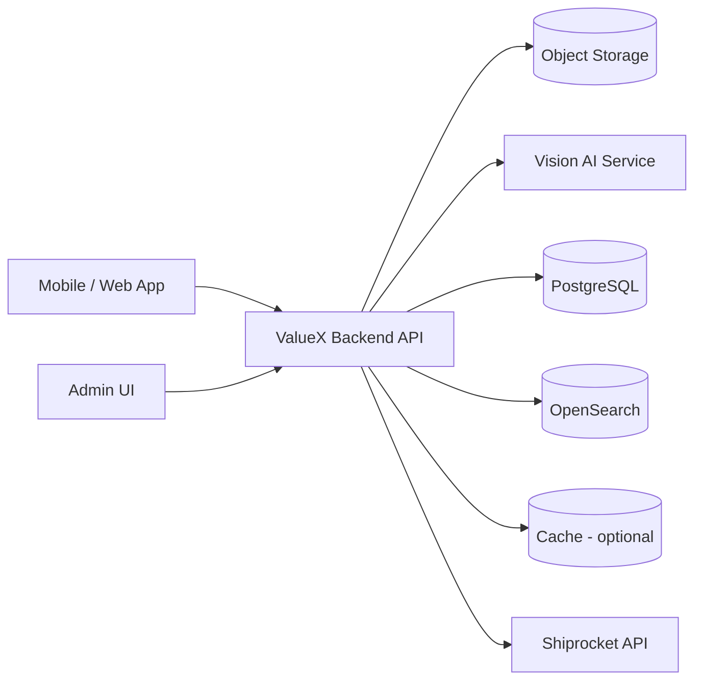
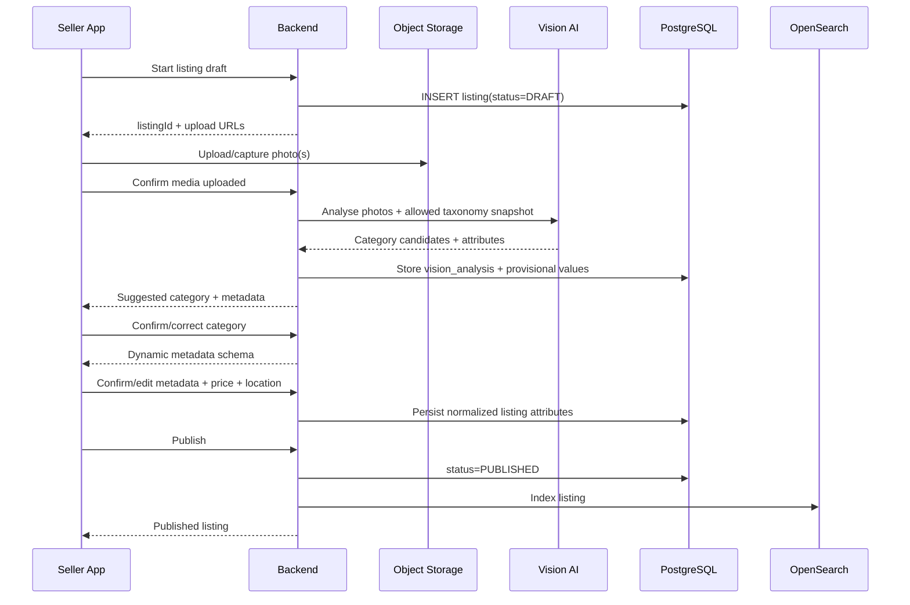
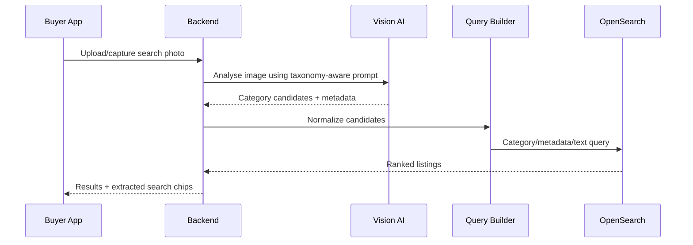

# ValueX / JustQlic Category Taxonomy, Metadata Search & Delivery Integration — MVP Detailed Design

> **Adoption note (2026-10-25):** this document was written without knowledge of ValueX's existing design. It supplies ideas for tables, endpoints, search and delivery; where it conflicts with the existing design, the existing design wins. **Adopted:** the 3-level hierarchy with immutable codes; metadata profiles and typed attribute values (tables renamed to plural names); the idempotent all-or-nothing importer idea; OpenSearch nested typed attributes with outbox indexing; photo search by Vision AI plus OpenSearch with query relaxation and no pgvector in MVP; the delivery eligibility policy table and Shiprocket behind a partner-neutral interface (US-122). **Not adopted:** the `listing`, `listing_media` and `/listing-drafts/.../publish` shapes and its status list (the existing lifecycle with plan selection, payment and Trust & Safety review stays); its condition scale (ours is NEW, LIKE_NEW, GOOD, FAIR, POOR); its photo rule of one image (ours is 2 to 10); its OpenSearch document without plan type and seller rating (the HLD ranking stays); exact indexing of postal code and coordinates (privacy rules apply). Decisions: `Documents/Category_Taxonomy_Review_Drafts.md`.

**Document status:** Implementation design for Phase 1 (MVP)  
**Last updated:** 2026-10-24  
**Primary taxonomy source:** `ValueX_JustQlic_Master_Category_Taxonomy_UI_Controls_v2.xlsx`  
**Search strategy:** Structured taxonomy + metadata + OpenSearch; **no vector search / pgvector in MVP**  
**Image intelligence strategy:** One Vision AI model used for both seller photo understanding and buyer photo search query extraction  
**Shipping partner for MVP:** Shiprocket

---

## 1. Purpose

This document defines the implementation design for the ValueX/JustQlic category taxonomy created for the marketplace, including:

- Three-level category taxonomy (L1 → L2 → L3).
- Configurable category metadata schemas.
- Dynamic seller listing forms driven by category metadata.
- Photo-first seller journey.
- Buyer keyword/filter search using OpenSearch.
- Buyer photo search **without vector embeddings** in MVP.
- Admin controls for category enable/disable and popular-category UI configuration.
- Delivery eligibility configuration at L3 category level.
- Shiprocket serviceability, rate and shipment integration for C2C pickup-anywhere / deliver-anywhere flows.
- A clean migration path for category-specific vector search in later phases if MVP evidence shows a clear relevance benefit.

The design is intended to be directly usable by a coding agent. PostgreSQL DDL, API contracts, OpenSearch document shapes, validation rules and sequence flows are included.

---

## 2. MVP Design Principles

### 2.1 Category tells us what the listing is

A category is a stable product/property type hierarchy, not a transaction verb.

Example:

```text
Real Estate
  → Homes & Residences
    → Apartment
```

For Real Estate, `SALE`, `RENT` or `LEASE` is stored as transaction intent, not duplicated into category branches.

### 2.2 Metadata tells us the listing's characteristics

Examples:

- Smartphone → brand, model, storage, RAM, battery health, color.
- Car → make, model, fuel, transmission, year, km driven.
- Apartment → BHK, area, furnishing, floor, parking, amenities.
- Saree → fabric, color, pattern, occasion, condition.

### 2.3 Seller journey is always photo-first

The seller must **never** start by manually navigating the category tree.

MVP seller entry point:

```text
Take Photo / Upload Photo(s)
        ↓
Vision AI model
        ↓
Suggested category + visible metadata
        ↓
Seller confirms/corrects
        ↓
Dynamic metadata form for non-visual / missing fields
        ↓
Publish
```

This applies to **all categories, including Real Estate**.

### 2.4 Buyer photo search uses the same Vision model, but no vector search

MVP buyer photo-search path:

```text
Buyer takes/uploads a photo
        ↓
Same Vision AI model
        ↓
Category candidates + metadata candidates
        ↓
Search Query Builder
        ↓
OpenSearch
        ↓
Metadata/text/category ranked results
```

No image embeddings are generated or stored in Phase 1.

### 2.5 OpenSearch is the search engine; PostgreSQL is the source of truth

PostgreSQL owns:

- categories and hierarchy;
- metadata definitions;
- listings and normalized attribute values;
- category UI configuration;
- delivery eligibility configuration;
- shipment/order state.

OpenSearch owns:

- keyword search;
- metadata filtering;
- facets;
- geo filtering;
- relevance ranking.

### 2.6 Category and shipping behavior are data-driven

Adding a new category or changing its fields must not require adding database columns or releasing a new app version.

Similarly, Shiprocket/partner delivery eligibility must be configurable from data once the final partner matrix is received.

---

## 3. Phase 1 Scope and Non-Scope

### 3.1 In scope

- PostgreSQL category/metadata schema.
- Import/seed of the current taxonomy workbook.
- Category enable/disable from Admin UI.
- UI popular L1 and L2 category configuration.
- Dynamic metadata form schema API.
- Seller photo analysis and category/metadata suggestion.
- Seller confirmation/correction.
- Listing persistence.
- OpenSearch indexing.
- Text/facet/location search.
- Buyer photo → Vision AI → OpenSearch search.
- L3 delivery eligibility gating.
- Shiprocket serviceability/rate lookup.
- Dynamic seller pickup locations for C2C shipments.
- Shipment creation/tracking state persistence.

### 3.2 Explicitly out of scope for MVP

- pgvector.
- CLIP/image embeddings.
- OpenSearch k-NN/vector fields.
- Semantic vector text retrieval.
- Multimodal rerankers.
- Automatic packaging recommendation from Shiprocket (Shiprocket APIs require shipment/package information; ValueX must own packaging rules/estimates).
- Automatic legal/ownership inference from photos.

---

## 4. High-Level Architecture



### 4.1 Logical backend modules

```text
TaxonomyService
MetadataSchemaService
ListingDraftService
VisionAnalysisService
ListingService
SearchService
OpenSearchIndexer
CategoryAdminService
DeliveryEligibilityService
ShippingQuoteService
ShiprocketClient
ShipmentService
```

Keep the Shiprocket integration behind a partner-neutral interface so another shipping partner can be added later.

```text
ShippingPartnerClient
  ├── ShiprocketClient
  └── FuturePartnerClient
```

---

# PART A — CATEGORY TAXONOMY AND METADATA

## 5. Taxonomy Source Workbook Mapping

The current taxonomy workbook has a `Category Taxonomy` sheet with the following implementation-relevant columns:

| Workbook column | Target implementation |
|---|---|
| Category Code | Stable external code for L3 category |
| L1 Category | `category` row, level 1 |
| L2 Category | `category` row, level 2 |
| L3 Category | `category` row, level 3 |
| Marketplace Status | Category marketplace policy/status |
| Metadata Profile | `metadata_profile.code` |
| Category-specific Metadata | Profile attribute keys |
| Recommended Search/Filter Facets | Search/filter configuration |
| AI Extraction Targets | Vision extraction configuration/documentation |
| Policy / Capture Notes | Category policy notes |
| Delivery Eligibility (Provisional) | Category shipping policy seed |
| Delivery Handling Class | Category shipping handling class |
| Interim UI Delivery Treatment | Delivery UI policy notes |
| Delivery Eligibility Notes | Shipping policy notes |
| UI Popular L1 (Provisional) | L1 `ui_popular` |
| L1 UI Rank | L1 `ui_rank` |
| UI Popular L2 (Provisional) | L2 `ui_popular` |
| L2 UI Rank | L2 `ui_rank` |
| Admin Enabled - L1 | L1 `admin_enabled` |
| Admin Enabled - L2 | L2 `admin_enabled` |
| Admin Enabled - L3 | L3 `admin_enabled` |

The workbook should be treated as a **seed/configuration source**, not as the runtime database.

---

## 6. Category Hierarchy Model

Use one hierarchical `category` table instead of separate L1/L2/L3 tables.

### 6.1 Category rules

- L1 has `parent_id = NULL`.
- L2 parent must be L1.
- L3 parent must be L2.
- Listings must point to an L3 category.
- Category codes are immutable once used by published listings.
- Category display names can change without changing IDs/codes.
- If a parent is disabled, all descendants are considered runtime-disabled.

### 6.2 L1/L2 popularity rules

The UI should display only selected popular categories by default.

- Maximum popular L1 categories: **15 globally**.
- Maximum popular L2 categories: **10 per L1**.
- Other enabled categories are available through the **Others** action.
- L3 popularity is not required in the current design.
- Popularity is an Admin-controlled UX configuration, not a hardcoded constant.

---

## 7. PostgreSQL Schema — Taxonomy

The DDL below is the recommended baseline. UUID generation assumes `pgcrypto`.

```sql
CREATE EXTENSION IF NOT EXISTS pgcrypto;

CREATE TYPE category_level AS ENUM ('L1', 'L2', 'L3');
CREATE TYPE marketplace_status AS ENUM ('ALLOWED', 'CONDITIONAL', 'PROHIBITED');

CREATE TABLE category (
    id                  UUID PRIMARY KEY DEFAULT gen_random_uuid(),
    parent_id           UUID NULL REFERENCES category(id),

    code                VARCHAR(120) NOT NULL UNIQUE,
    name                VARCHAR(180) NOT NULL,
    slug                VARCHAR(180) NOT NULL,
    level               category_level NOT NULL,

    marketplace_status  marketplace_status NOT NULL DEFAULT 'ALLOWED',
    admin_enabled       BOOLEAN NOT NULL DEFAULT TRUE,

    ui_popular          BOOLEAN NOT NULL DEFAULT FALSE,
    ui_rank             INTEGER NULL,

    display_order       INTEGER NULL,
    policy_notes        TEXT NULL,

    created_at          TIMESTAMPTZ NOT NULL DEFAULT now(),
    updated_at          TIMESTAMPTZ NOT NULL DEFAULT now(),

    UNIQUE(parent_id, slug)
);

CREATE INDEX idx_category_parent ON category(parent_id);
CREATE INDEX idx_category_level_enabled ON category(level, admin_enabled);
CREATE INDEX idx_category_popular ON category(level, ui_popular, ui_rank);
```

### 7.1 Runtime enabled rule

Do not rely only on the current row's `admin_enabled` value.

An L3 category is effectively enabled only when:

```text
L1.admin_enabled = true
AND L2.admin_enabled = true
AND L3.admin_enabled = true
AND marketplace_status != PROHIBITED
```

This should be calculated in the service layer and cached.

### 7.2 Generated codes for L1 and L2

The workbook currently provides stable L3 `Category Code` values. Generate deterministic immutable codes for L1/L2 during seed import, for example:

```text
L1-MOBILES_TABLETS
L2-MOBILES_TABLETS-MOBILE_PHONES
CAT-0001     // existing L3 code
```

Do not regenerate codes based on renamed labels after initial deployment.

---

## 8. Metadata Model

Do **not** create one `listing` table with hundreds of category-specific columns.

Use:

```text
Common listing columns
+
Attribute definitions
+
Metadata profiles
+
Typed listing attribute values
```

### 8.1 Supported attribute data types

```sql
CREATE TYPE attribute_data_type AS ENUM (
    'TEXT',
    'LONG_TEXT',
    'INTEGER',
    'DECIMAL',
    'BOOLEAN',
    'DATE',
    'KEYWORD',
    'OPTION',
    'MULTI_OPTION',
    'JSON'
);
```

### 8.2 Attribute definitions

```sql
CREATE TABLE attribute_definition (
    id                  UUID PRIMARY KEY DEFAULT gen_random_uuid(),
    attribute_key       VARCHAR(120) NOT NULL UNIQUE,
    display_name        VARCHAR(180) NOT NULL,
    data_type           attribute_data_type NOT NULL,
    unit                VARCHAR(40) NULL,

    searchable          BOOLEAN NOT NULL DEFAULT FALSE,
    filterable          BOOLEAN NOT NULL DEFAULT FALSE,
    sortable            BOOLEAN NOT NULL DEFAULT FALSE,
    ai_extractable      BOOLEAN NOT NULL DEFAULT FALSE,

    validation_json     JSONB NULL,
    help_text           TEXT NULL,
    admin_enabled       BOOLEAN NOT NULL DEFAULT TRUE,

    created_at          TIMESTAMPTZ NOT NULL DEFAULT now(),
    updated_at          TIMESTAMPTZ NOT NULL DEFAULT now()
);
```

Example definitions:

```text
brand                 OPTION / KEYWORD
model                 TEXT
storage_gb            INTEGER, unit=GB
battery_health_pct    INTEGER, unit=%; min=0; max=100
bhk                   INTEGER
built_up_area_sqft    DECIMAL, unit=sq.ft
furnishing            OPTION
fuel_type             OPTION
```

**Important:** Do not silently default an unknown metadata key to `TEXT` during taxonomy import. Every attribute key referenced by a metadata profile must have an explicit type definition in seed configuration.

### 8.3 Attribute options

```sql
CREATE TABLE attribute_option (
    id                  UUID PRIMARY KEY DEFAULT gen_random_uuid(),
    attribute_id        UUID NOT NULL REFERENCES attribute_definition(id),
    code                VARCHAR(120) NOT NULL,
    display_value       VARCHAR(180) NOT NULL,
    display_order       INTEGER NULL,
    admin_enabled       BOOLEAN NOT NULL DEFAULT TRUE,
    created_at          TIMESTAMPTZ NOT NULL DEFAULT now(),

    UNIQUE(attribute_id, code)
);
```

Examples:

```text
condition_grade:
  LIKE_NEW
  EXCELLENT
  GOOD
  FAIR
  POOR

furnishing:
  UNFURNISHED
  SEMI_FURNISHED
  FULLY_FURNISHED
```

---

## 9. Metadata Profiles

Profiles reduce duplication across similar L3 categories.

Examples from the taxonomy:

```text
PHONE
TABLET
LAPTOP
APPAREL
BICYCLE
BOOK
RESIDENTIAL_PROPERTY
COMMERCIAL_PROPERTY
OTHER
```

```sql
CREATE TABLE metadata_profile (
    id              UUID PRIMARY KEY DEFAULT gen_random_uuid(),
    code            VARCHAR(100) NOT NULL UNIQUE,
    name            VARCHAR(180) NOT NULL,
    version         INTEGER NOT NULL DEFAULT 1,
    admin_enabled   BOOLEAN NOT NULL DEFAULT TRUE,
    created_at      TIMESTAMPTZ NOT NULL DEFAULT now(),
    updated_at      TIMESTAMPTZ NOT NULL DEFAULT now()
);

CREATE TABLE metadata_profile_attribute (
    profile_id          UUID NOT NULL REFERENCES metadata_profile(id),
    attribute_id        UUID NOT NULL REFERENCES attribute_definition(id),

    required            BOOLEAN NOT NULL DEFAULT FALSE,
    display_order       INTEGER NOT NULL,
    ai_prefill_enabled  BOOLEAN NOT NULL DEFAULT FALSE,
    seller_editable     BOOLEAN NOT NULL DEFAULT TRUE,
    searchable          BOOLEAN NOT NULL DEFAULT FALSE,
    filterable          BOOLEAN NOT NULL DEFAULT FALSE,

    override_json       JSONB NULL,

    PRIMARY KEY(profile_id, attribute_id)
);

CREATE TABLE category_metadata_profile (
    category_id         UUID PRIMARY KEY REFERENCES category(id),
    profile_id          UUID NOT NULL REFERENCES metadata_profile(id)
);
```

### 9.1 Optional category-level overrides

Use only where one L3 differs from the shared profile.

```sql
CREATE TABLE category_attribute_override (
    category_id         UUID NOT NULL REFERENCES category(id),
    attribute_id        UUID NOT NULL REFERENCES attribute_definition(id),
    required            BOOLEAN NULL,
    display_order       INTEGER NULL,
    ai_prefill_enabled  BOOLEAN NULL,
    searchable          BOOLEAN NULL,
    filterable          BOOLEAN NULL,
    override_json       JSONB NULL,
    PRIMARY KEY(category_id, attribute_id)
);
```

---

# PART B — LISTINGS AND PHOTO-FIRST AI FLOW

## 10. Listing Schema

Universal listing fields should remain relational columns.

```sql
CREATE TYPE listing_status AS ENUM (
    'DRAFT',
    'AI_ANALYSING',
    'NEEDS_CONFIRMATION',
    'READY_TO_PUBLISH',
    'PUBLISHED',
    'RESERVED',
    'SOLD',
    'RENTED',
    'WITHDRAWN',
    'BLOCKED'
);

CREATE TYPE transaction_type AS ENUM ('SALE', 'RENT', 'LEASE');

CREATE TABLE listing (
    id                  UUID PRIMARY KEY DEFAULT gen_random_uuid(),
    seller_id           UUID NOT NULL,
    category_id         UUID NULL REFERENCES category(id),

    status              listing_status NOT NULL DEFAULT 'DRAFT',
    transaction_type    transaction_type NOT NULL DEFAULT 'SALE',

    title               VARCHAR(220) NULL,
    description         TEXT NULL,

    price_amount        NUMERIC(14,2) NULL,
    currency            CHAR(3) NOT NULL DEFAULT 'INR',
    condition_grade     VARCHAR(40) NULL,

    city_id             UUID NULL,
    postal_code         VARCHAR(12) NULL,
    latitude            NUMERIC(9,6) NULL,
    longitude           NUMERIC(9,6) NULL,

    published_at        TIMESTAMPTZ NULL,
    created_at          TIMESTAMPTZ NOT NULL DEFAULT now(),
    updated_at          TIMESTAMPTZ NOT NULL DEFAULT now()
);

CREATE INDEX idx_listing_category_status ON listing(category_id, status);
CREATE INDEX idx_listing_seller ON listing(seller_id);
CREATE INDEX idx_listing_price ON listing(price_amount);
```

### 10.1 Real Estate transaction behavior

For seller flow:

```text
Photo upload
  → Vision AI identifies Real Estate + likely L2/L3
  → Seller confirms/corrects property type
  → THEN UI asks: Sell / Rent Out / Lease
```

Do not make Real Estate seller flow start with Sell/Rent selection.

---

## 11. Listing Media

```sql
CREATE TYPE media_type AS ENUM ('IMAGE', 'VIDEO');

CREATE TABLE listing_media (
    id              UUID PRIMARY KEY DEFAULT gen_random_uuid(),
    listing_id      UUID NOT NULL REFERENCES listing(id) ON DELETE CASCADE,
    media_type      media_type NOT NULL DEFAULT 'IMAGE',
    object_key      TEXT NOT NULL,
    sort_order      INTEGER NOT NULL DEFAULT 0,
    is_primary      BOOLEAN NOT NULL DEFAULT FALSE,
    width_px        INTEGER NULL,
    height_px       INTEGER NULL,
    created_at      TIMESTAMPTZ NOT NULL DEFAULT now()
);

CREATE INDEX idx_listing_media_listing ON listing_media(listing_id, sort_order);
```

Object storage URLs should be generated using signed URLs; do not store public permanent URLs if the storage model is private.

---

## 12. Typed Listing Attribute Values

### 12.1 Scalar attributes

```sql
CREATE TABLE listing_attribute_value (
    listing_id        UUID NOT NULL REFERENCES listing(id) ON DELETE CASCADE,
    attribute_id      UUID NOT NULL REFERENCES attribute_definition(id),

    value_text        TEXT NULL,
    value_integer     BIGINT NULL,
    value_decimal     NUMERIC(18,4) NULL,
    value_boolean     BOOLEAN NULL,
    value_date        DATE NULL,
    value_option_id   UUID NULL REFERENCES attribute_option(id),
    value_json        JSONB NULL,

    value_source      VARCHAR(20) NOT NULL DEFAULT 'SELLER',
    ai_confidence     NUMERIC(5,4) NULL,
    seller_confirmed  BOOLEAN NOT NULL DEFAULT FALSE,

    created_at        TIMESTAMPTZ NOT NULL DEFAULT now(),
    updated_at        TIMESTAMPTZ NOT NULL DEFAULT now(),

    PRIMARY KEY(listing_id, attribute_id)
);
```

Allowed `value_source` values in application code:

```text
AI
SELLER
ADMIN
IMPORT
SYSTEM
```

### 12.2 Multi-option attributes

```sql
CREATE TABLE listing_attribute_option_value (
    listing_id        UUID NOT NULL REFERENCES listing(id) ON DELETE CASCADE,
    attribute_id      UUID NOT NULL REFERENCES attribute_definition(id),
    option_id         UUID NOT NULL REFERENCES attribute_option(id),
    value_source      VARCHAR(20) NOT NULL DEFAULT 'SELLER',
    ai_confidence     NUMERIC(5,4) NULL,
    seller_confirmed  BOOLEAN NOT NULL DEFAULT FALSE,

    PRIMARY KEY(listing_id, attribute_id, option_id)
);
```

Never store multi-select values as comma-separated text.

---

## 13. Vision AI Analysis Persistence

Store the raw Vision output for audit/debug/model evaluation, but normalize confirmed values into the listing tables.

```sql
CREATE TABLE vision_analysis (
    id                    UUID PRIMARY KEY DEFAULT gen_random_uuid(),
    listing_id            UUID NULL REFERENCES listing(id) ON DELETE CASCADE,
    purpose               VARCHAR(30) NOT NULL,
    model_provider        VARCHAR(80) NOT NULL,
    model_name            VARCHAR(120) NOT NULL,
    model_version         VARCHAR(80) NULL,
    prompt_version        VARCHAR(40) NOT NULL,
    input_media_count     INTEGER NOT NULL,
    output_json           JSONB NOT NULL,
    processing_ms         INTEGER NULL,
    created_at            TIMESTAMPTZ NOT NULL DEFAULT now()
);
```

`purpose`:

```text
SELLER_LISTING
BUYER_PHOTO_SEARCH
```

For buyer searches there may be no `listing_id`; store only if search analytics/audit retention policy allows it.

---

## 14. Vision AI Output Contract

Use the **same normalized output contract** for seller listing and buyer photo search.

```json
{
  "schemaVersion": "1.0",
  "categoryCandidates": [
    {
      "l1Code": "L1-MOBILES_TABLETS",
      "l2Code": "L2-MOBILES_TABLETS-MOBILE_PHONES",
      "l3Code": "CAT-0001",
      "confidence": 0.96
    }
  ],
  "attributes": [
    {
      "key": "brand",
      "value": "Apple",
      "confidence": 0.98,
      "visibleEvidence": "logo and device design"
    },
    {
      "key": "model",
      "value": "iPhone 14",
      "confidence": 0.82
    },
    {
      "key": "color",
      "value": "Blue",
      "confidence": 0.95
    }
  ],
  "condition": {
    "suggestedGrade": "GOOD",
    "confidence": 0.74,
    "visibleIssues": ["minor edge scratches"]
  },
  "titleSuggestion": "Apple iPhone 14 Blue",
  "warnings": []
}
```

### 14.1 Vision restrictions

The model must only return attribute keys allowed by the selected category/profile.

Never infer non-visible/legal facts from images, for example:

- property ownership;
- RERA registration;
- IMEI validity;
- repair history;
- battery health percentage unless visible in an uploaded screenshot;
- vehicle ownership count;
- warranty status;
- seller identity;
- authenticity as a fact.

The database `ai_extractable` flag is authoritative.

---

# PART C — SELLER JOURNEY

## 15. Seller Photo-First Sequence



## 16. Seller API Contracts

### 16.1 Start listing

```http
POST /api/v1/listing-drafts
```

Response:

```json
{
  "listingId": "...",
  "status": "DRAFT"
}
```

### 16.2 Request media upload URL

```http
POST /api/v1/listing-drafts/{listingId}/media/upload-url
```

### 16.3 Trigger AI analysis

```http
POST /api/v1/listing-drafts/{listingId}/vision-analysis
```

Response contains category candidates and AI-extractable metadata only.

### 16.4 Confirm category

```http
PUT /api/v1/listing-drafts/{listingId}/category
```

```json
{
  "categoryCode": "CAT-0001"
}
```

Server validation:

- category is L3;
- category is effectively enabled;
- marketplace status is not prohibited.

### 16.5 Get category-specific form schema

```http
GET /api/v1/categories/{categoryCode}/listing-schema
```

Example:

```json
{
  "category": {
    "code": "CAT-0001",
    "name": "Smartphones",
    "path": ["Mobiles & Tablets", "Mobile Phones", "Smartphones"]
  },
  "profile": "PHONE",
  "fields": [
    {
      "key": "brand",
      "label": "Brand",
      "type": "OPTION",
      "required": true,
      "aiPrefillEnabled": true,
      "sellerEditable": true,
      "options": []
    },
    {
      "key": "storage_gb",
      "label": "Storage",
      "type": "INTEGER",
      "unit": "GB",
      "required": true
    }
  ]
}
```

### 16.6 Save attributes

```http
PUT /api/v1/listing-drafts/{listingId}/attributes
```

Server must reject keys not allowed by the selected category schema.

### 16.7 Publish

```http
POST /api/v1/listing-drafts/{listingId}/publish
```

Required checks:

- effective category enabled;
- required common fields complete;
- required metadata complete;
- price/rent as applicable;
- location complete;
- at least one valid image;
- marketplace policy passes;
- delivery configuration rules do not block listing publication (delivery can be disabled independently).

---

# PART D — CATEGORY UI AND ADMIN CONTROLS

## 17. Buyer Category Navigation

### 17.1 Home category display

```http
GET /api/v1/categories/popular?level=L1
```

Return only:

- effectively enabled L1;
- `ui_popular = true`;
- ordered by `ui_rank`;
- maximum 15.

The UI renders an **Others** button after these categories.

### 17.2 L2 display

```http
GET /api/v1/categories/{l1Code}/children?popular=true
```

Return max 10 popular enabled L2 children ordered by rank.

`Others` retrieves all remaining enabled L2 children.

### 17.3 L3 display

Return all enabled L3 children of the selected L2 unless product UX later adds L3 popularity.

---

## 18. Admin Category Controls

### 18.1 Admin endpoint

```http
PATCH /api/v1/admin/categories/{categoryCode}
```

```json
{
  "adminEnabled": true,
  "uiPopular": true,
  "uiRank": 3
}
```

### 18.2 Validation rules

- Popular L1 count cannot exceed 15.
- Popular L2 count under one L1 cannot exceed 10.
- `uiPopular=true` requires `adminEnabled=true`.
- L3 `uiPopular` is ignored/rejected in MVP.
- Disabling parent does not rewrite child flags; it makes descendants effectively disabled.
- Re-enabling parent restores children according to their own flags.

### 18.3 Audit

Recommended:

```sql
CREATE TABLE category_admin_audit (
    id              UUID PRIMARY KEY DEFAULT gen_random_uuid(),
    category_id     UUID NOT NULL REFERENCES category(id),
    admin_user_id   UUID NOT NULL,
    before_json     JSONB NOT NULL,
    after_json      JSONB NOT NULL,
    created_at      TIMESTAMPTZ NOT NULL DEFAULT now()
);
```

---

# PART E — OPENSEARCH MVP DESIGN

## 19. OpenSearch Role

OpenSearch handles:

- category filtering;
- keyword search over title/description/search text;
- metadata filters;
- numeric ranges;
- facets;
- geo-distance;
- price sorting;
- recency;
- buyer photo-search results after Vision extraction.

It does **not** contain vector fields in MVP.

---

## 20. OpenSearch Listing Document

Recommended index alias:

```text
valuex-listings
```

Versioned backing index:

```text
valuex-listings-v1-000001
```

Example document:

```json
{
  "listingId": "uuid",
  "sellerId": "uuid",
  "status": "PUBLISHED",
  "transactionType": "SALE",

  "title": "Apple iPhone 14 128GB Blue",
  "description": "...",
  "searchText": "apple iphone 14 128gb blue smartphone ...",

  "category": {
    "l1Code": "L1-MOBILES_TABLETS",
    "l2Code": "L2-MOBILES_TABLETS-MOBILE_PHONES",
    "l3Code": "CAT-0001",
    "l1Name": "Mobiles & Tablets",
    "l2Name": "Mobile Phones",
    "l3Name": "Smartphones"
  },

  "price": 42000,
  "currency": "INR",
  "conditionGrade": "GOOD",

  "location": {
    "postalCode": "411014",
    "cityId": "...",
    "point": { "lat": 18.55, "lon": 73.94 }
  },

  "attributes": [
    {
      "key": "brand",
      "type": "KEYWORD",
      "keywordValue": "Apple"
    },
    {
      "key": "storage_gb",
      "type": "INTEGER",
      "numberValue": 128
    },
    {
      "key": "battery_health_pct",
      "type": "INTEGER",
      "numberValue": 89
    }
  ],

  "publishedAt": "2026-10-24T12:00:00Z"
}
```

---

## 21. OpenSearch Mapping Strategy

To avoid a field-mapping explosion when hundreds of category-specific attributes exist, store attribute values as `nested` typed records.

Conceptual mapping:

```json
{
  "mappings": {
    "dynamic": "strict",
    "properties": {
      "listingId": { "type": "keyword" },
      "status": { "type": "keyword" },
      "transactionType": { "type": "keyword" },
      "title": { "type": "text" },
      "description": { "type": "text" },
      "searchText": { "type": "text" },
      "price": { "type": "double" },
      "currency": { "type": "keyword" },
      "conditionGrade": { "type": "keyword" },
      "category": {
        "properties": {
          "l1Code": { "type": "keyword" },
          "l2Code": { "type": "keyword" },
          "l3Code": { "type": "keyword" },
          "l1Name": { "type": "keyword" },
          "l2Name": { "type": "keyword" },
          "l3Name": { "type": "keyword" }
        }
      },
      "location": {
        "properties": {
          "postalCode": { "type": "keyword" },
          "cityId": { "type": "keyword" },
          "point": { "type": "geo_point" }
        }
      },
      "attributes": {
        "type": "nested",
        "properties": {
          "key": { "type": "keyword" },
          "type": { "type": "keyword" },
          "keywordValue": { "type": "keyword", "normalizer": "lowercase_normalizer" },
          "textValue": { "type": "text" },
          "numberValue": { "type": "double" },
          "booleanValue": { "type": "boolean" },
          "dateValue": { "type": "date" }
        }
      },
      "publishedAt": { "type": "date" }
    }
  }
}
```

A later optimization may denormalize frequently-used attributes such as `brand`, `model`, `bhk`, `year`, etc. into top-level fields if profiling shows nested aggregation cost is significant.

---

## 22. Indexing Lifecycle

Publish/update flow:

```text
PostgreSQL transaction commits
       ↓
Listing event/outbox record
       ↓
OpenSearchIndexer
       ↓
Upsert search document
```

Recommended outbox table:

```sql
CREATE TABLE search_index_outbox (
    id              UUID PRIMARY KEY DEFAULT gen_random_uuid(),
    aggregate_type  VARCHAR(40) NOT NULL,
    aggregate_id    UUID NOT NULL,
    event_type      VARCHAR(60) NOT NULL,
    payload_json    JSONB NULL,
    status          VARCHAR(20) NOT NULL DEFAULT 'PENDING',
    attempts        INTEGER NOT NULL DEFAULT 0,
    created_at      TIMESTAMPTZ NOT NULL DEFAULT now(),
    processed_at    TIMESTAMPTZ NULL
);
```

Use outbox/retry instead of making listing publication fail because OpenSearch is temporarily unavailable.

---

# PART F — BUYER SEARCH

## 23. Standard Search

Example:

```text
"iPhone 14 128GB blue under 40000"
```

MVP can combine:

- normal text analysis;
- explicit user filters;
- category filters;
- metadata facets;
- location;
- price.

No vector model is needed.

---

## 24. Buyer Photo Search — Approach A

### 24.1 Sequence



### 24.2 API

```http
POST /api/v1/search/photo
Content-Type: multipart/form-data
```

Response:

```json
{
  "interpretedAs": {
    "category": "Smartphones",
    "categoryCode": "CAT-0001",
    "attributes": {
      "brand": "Apple",
      "color": "Blue"
    }
  },
  "results": []
}
```

### 24.3 Query construction rules

Use confidence thresholds from configuration; do not hardcode them in UI.

Recommended starting behavior:

```text
category confidence >= 0.80
  → filter by L3

category confidence 0.55–0.79
  → search top 2–3 L3 candidates as SHOULD clauses

attribute confidence >= 0.80
  → strong metadata filter / high boost

attribute confidence 0.60–0.79
  → SHOULD / boost, not hard filter

attribute confidence < 0.60
  → ignore for retrieval; optionally show as low-confidence suggestion
```

### 24.4 Relaxation strategy

If result count is too low:

1. L3 + high-confidence metadata.
2. Remove lowest-confidence metadata filters.
3. Expand to L2.
4. Expand to top category candidates.
5. Use category names + extracted text in full-text query.

This is essential for MVP because there is no vector fallback.

### 24.5 Buyer-visible refinement

Show extracted metadata as editable chips, for example:

```text
[Smartphones] [Apple] [Blue] [128GB?]
```

The buyer can remove/correct a chip, which re-runs OpenSearch without another Vision call.

---

# PART G — DELIVERY ELIGIBILITY AND PACKAGING

## 25. Delivery Eligibility Design

The taxonomy currently has **provisional** L3 delivery classification. The final partner-confirmed matrix is still pending.

The database must therefore distinguish:

```text
PROVISIONAL_ELIGIBLE
PROVISIONAL_CONDITIONAL
PARTNER_ELIGIBLE
PARTNER_CONDITIONAL
PARTNER_INELIGIBLE
UNKNOWN
```

Only partner-confirmed rules should become authoritative once received.

```sql
CREATE TYPE delivery_eligibility_status AS ENUM (
    'PROVISIONAL_ELIGIBLE',
    'PROVISIONAL_CONDITIONAL',
    'PARTNER_ELIGIBLE',
    'PARTNER_CONDITIONAL',
    'PARTNER_INELIGIBLE',
    'UNKNOWN'
);

CREATE TABLE category_shipping_policy (
    category_id             UUID PRIMARY KEY REFERENCES category(id),
    eligibility_status      delivery_eligibility_status NOT NULL DEFAULT 'UNKNOWN',
    handling_class          VARCHAR(80) NULL,

    fragile                 BOOLEAN NOT NULL DEFAULT FALSE,
    contains_battery_possible BOOLEAN NOT NULL DEFAULT FALSE,
    high_value_possible     BOOLEAN NOT NULL DEFAULT FALSE,
    oversized_possible      BOOLEAN NOT NULL DEFAULT FALSE,

    default_weight_kg       NUMERIC(8,3) NULL,
    default_length_cm       NUMERIC(8,2) NULL,
    default_breadth_cm      NUMERIC(8,2) NULL,
    default_height_cm       NUMERIC(8,2) NULL,

    packaging_instruction   TEXT NULL,
    policy_notes            TEXT NULL,
    partner_rule_json       JSONB NULL,
    partner_verified_at     TIMESTAMPTZ NULL,
    updated_at              TIMESTAMPTZ NOT NULL DEFAULT now()
);
```

### 25.1 UI gating rule

Show delivery options only when all of the following are true:

```text
Listing category effectively enabled
AND category shipping policy permits partner check
AND listing has usable package profile
AND buyer has delivery PIN/postal code
AND Shiprocket serviceability returns at least one valid courier
```

Real Estate and whole-vehicle categories should normally be partner-ineligible for parcel delivery unless a future logistics partner explicitly supports them.

---

## 26. Listing Shipping Profile

Shiprocket rate/serviceability depends on the **packed shipment**, not just the naked item.

```sql
CREATE TYPE package_measurement_source AS ENUM (
    'CATEGORY_DEFAULT',
    'AI_ESTIMATE',
    'SELLER_CONFIRMED',
    'ADMIN_CONFIRMED'
);

CREATE TABLE listing_shipping_profile (
    listing_id              UUID PRIMARY KEY REFERENCES listing(id) ON DELETE CASCADE,

    delivery_enabled        BOOLEAN NOT NULL DEFAULT FALSE,
    weight_kg               NUMERIC(8,3) NULL,
    length_cm               NUMERIC(8,2) NULL,
    breadth_cm              NUMERIC(8,2) NULL,
    height_cm               NUMERIC(8,2) NULL,

    measurement_source      package_measurement_source NULL,
    seller_confirmed        BOOLEAN NOT NULL DEFAULT FALSE,

    fragile                 BOOLEAN NOT NULL DEFAULT FALSE,
    contains_battery        BOOLEAN NOT NULL DEFAULT FALSE,
    declared_value          NUMERIC(14,2) NULL,

    pickup_postal_code      VARCHAR(12) NULL,
    updated_at              TIMESTAMPTZ NOT NULL DEFAULT now()
);
```

### 26.1 MVP packaging UX

Recommended flow after category confirmation if delivery is potentially supported:

```text
System loads category packaging defaults
      ↓
Pre-fills estimated packed size / weight
      ↓
Seller confirms or edits
      ↓
listing_shipping_profile.seller_confirmed = true
```

Shiprocket documentation does not provide a generic API that accepts a product photo/name and returns packaging instructions. Packaging guidance therefore remains a ValueX/category policy responsibility until a shipping partner supplies a machine-readable packaging matrix.

---

# PART H — SHIPROCKET INTEGRATION

## 27. Shiprocket API References Used by MVP

Current Shiprocket public API documentation:

- Main docs: https://apidocs.shiprocket.in/
- API base: `https://apiv2.shiprocket.in/v1/external`
- Login: `POST /auth/login`
- Courier serviceability/rates: `GET /courier/serviceability/`
- Create custom order: `POST /orders/create/adhoc`
- Forward-shipment wrapper: `POST /shipments/create/forward-shipment`
- Request pickup: `POST /courier/generate/pickup`
- Add pickup location (available in Shiprocket public workspace): `POST /settings/company/addpickup`

The implementation must be integration-tested against the Shiprocket account/plan used by ValueX before production release.

---

## 28. Authentication

Use a dedicated Shiprocket API user; do not use end-user credentials.

```http
POST https://apiv2.shiprocket.in/v1/external/auth/login
Content-Type: application/json

{
  "email": "${SHIPROCKET_API_USER}",
  "password": "${SHIPROCKET_API_PASSWORD}"
}
```

Cache the returned bearer token securely. Do not persist it in plaintext application tables.

Client behavior:

```text
No token / expired token
   → login
   → cache token
   → call API

401 response
   → invalidate cached token
   → login once
   → retry original request once
```

Secrets belong in a secret manager / environment injection mechanism.

---

## 29. Serviceability and Delivery Cost

### 29.1 Shiprocket endpoint

```http
GET /v1/external/courier/serviceability/
```

MVP request should supply:

```text
pickup_postcode      seller pickup PIN
 delivery_postcode    buyer PIN
 cod                  0/1
 weight               packed kg
 length               packed cm
 breadth              packed cm
 height               packed cm
 declared_value       item/order value when available
 mode                 Surface/Air when explicitly required
```

Shiprocket returns serviceable couriers and rate/estimated delivery information.

### 29.2 ValueX endpoint

```http
GET /api/v1/listings/{listingId}/delivery-options?deliveryPostalCode=411014
```

Backend sequence:

```text
1. Load listing + category + shipping profile.
2. Verify category delivery eligibility.
3. Verify pickup PIN + package weight/dimensions.
4. Call Shiprocket serviceability.
5. Normalize courier responses.
6. Apply ValueX business rules.
7. Return buyer-facing options.
```

Example normalized response:

```json
{
  "serviceable": true,
  "quoteStatus": "ESTIMATE",
  "options": [
    {
      "partner": "SHIPROCKET",
      "partnerCourierId": 10,
      "serviceName": "Standard Delivery",
      "charge": 145.00,
      "currency": "INR",
      "estimatedDays": 3
    }
  ]
}
```

Do not expose partner internal details unless product UX requires them.

---

## 30. Shipping Quote Cache

Serviceability/rates may be queried repeatedly while buyers browse.

```sql
CREATE TABLE shipping_quote_cache (
    id                      UUID PRIMARY KEY DEFAULT gen_random_uuid(),
    listing_id              UUID NOT NULL REFERENCES listing(id),
    partner_code            VARCHAR(40) NOT NULL,
    pickup_postal_code      VARCHAR(12) NOT NULL,
    delivery_postal_code    VARCHAR(12) NOT NULL,
    package_fingerprint     VARCHAR(128) NOT NULL,
    payment_mode            VARCHAR(20) NOT NULL,
    response_json           JSONB NOT NULL,
    expires_at              TIMESTAMPTZ NOT NULL,
    created_at              TIMESTAMPTZ NOT NULL DEFAULT now()
);
```

`package_fingerprint` should hash:

```text
weight + length + breadth + height + declared value bucket
```

Use a short configurable TTL. Re-check at checkout even if a browsing quote exists.

---

## 31. C2C Dynamic Pickup Location

ValueX is not a conventional warehouse model. Each seller address can be a pickup address.

### 31.1 Required seller pickup data

At shipment creation time ValueX must have:

```text
seller name
seller phone
seller email (if required by partner contract)
address line 1
address line 2 (optional)
city
state
country
PIN/postal code
```

### 31.2 Pickup-location binding

Avoid creating duplicate Shiprocket pickup locations for the same seller address.

```sql
CREATE TABLE shipping_pickup_location_binding (
    id                          UUID PRIMARY KEY DEFAULT gen_random_uuid(),
    seller_id                   UUID NOT NULL,
    seller_address_id           UUID NOT NULL,
    partner_code                VARCHAR(40) NOT NULL,
    partner_pickup_name         VARCHAR(36) NOT NULL,
    partner_pickup_id           VARCHAR(100) NULL,
    active                      BOOLEAN NOT NULL DEFAULT TRUE,
    created_at                  TIMESTAMPTZ NOT NULL DEFAULT now(),
    updated_at                  TIMESTAMPTZ NOT NULL DEFAULT now(),

    UNIQUE(seller_address_id, partner_code)
);
```

Generate a stable alphanumeric Shiprocket pickup name within the documented length limit, e.g.:

```text
VXS7F32A19
```

Do not include PII in the pickup-location name.

---

## 32. Recommended Shipment Creation Flow

For MVP, keep browsing/checkout quote checks separate from actual shipment creation.

### 32.1 Before purchase

```text
Seller pickup PIN + package profile
        +
Buyer delivery PIN
        ↓
Shiprocket Serviceability API
        ↓
Show delivery only if serviceable
```

### 32.2 After order is confirmed and seller is ready for pickup

Preferred MVP implementation for C2C dynamic pickup:

```text
1. Confirm final package weight/dimensions.
2. Re-check serviceability/rate.
3. Choose courier according to buyer selection / ValueX rule.
4. Resolve existing Shiprocket pickup binding.
5. If new pickup location is required, use Shiprocket dynamic pickup support.
6. Create shipment.
7. Request pickup.
8. Persist Shiprocket order ID, shipment ID, courier ID, AWB and status.
```

The Shiprocket Forward Shipment wrapper supports adding a new pickup location through `vendor_details` and assigning it to the shipment. It also supports courier selection, pickup request, label and manifest generation.

For greater control, the adapter may later use separate APIs (add pickup location → create custom order → assign AWB → request pickup) if production testing shows the wrapper is difficult to reconcile after partial failures.

---

## 33. Shipment Persistence

```sql
CREATE TYPE shipment_status AS ENUM (
    'QUOTE_ONLY',
    'CREATING',
    'CREATED',
    'AWB_ASSIGNED',
    'PICKUP_REQUESTED',
    'PICKED_UP',
    'IN_TRANSIT',
    'OUT_FOR_DELIVERY',
    'DELIVERED',
    'NDR',
    'RTO',
    'CANCELLED',
    'FAILED'
);

CREATE TABLE shipment (
    id                      UUID PRIMARY KEY DEFAULT gen_random_uuid(),
    order_id                UUID NOT NULL,
    listing_id              UUID NOT NULL REFERENCES listing(id),
    partner_code            VARCHAR(40) NOT NULL,

    status                  shipment_status NOT NULL,
    partner_order_id        VARCHAR(100) NULL,
    partner_shipment_id     VARCHAR(100) NULL,
    partner_courier_id      VARCHAR(100) NULL,
    awb_code                VARCHAR(120) NULL,

    pickup_postal_code      VARCHAR(12) NOT NULL,
    delivery_postal_code    VARCHAR(12) NOT NULL,

    final_weight_kg         NUMERIC(8,3) NOT NULL,
    final_length_cm         NUMERIC(8,2) NOT NULL,
    final_breadth_cm        NUMERIC(8,2) NOT NULL,
    final_height_cm         NUMERIC(8,2) NOT NULL,

    quoted_charge           NUMERIC(12,2) NULL,
    actual_charge           NUMERIC(12,2) NULL,
    currency                CHAR(3) NOT NULL DEFAULT 'INR',

    partner_response_json   JSONB NULL,

    created_at              TIMESTAMPTZ NOT NULL DEFAULT now(),
    updated_at              TIMESTAMPTZ NOT NULL DEFAULT now()
);
```

Never use a Shiprocket response as the only record of shipment state.

---

## 34. Idempotency and Reconciliation

### 34.1 Outbound idempotency

Use the ValueX order/shipment reference as a stable unique external order reference.

Before retrying shipment creation:

- check local shipment table;
- check whether a partner order/shipment ID already exists;
- if uncertain, query Shiprocket before creating a duplicate.

### 34.2 Failure handling

Classify errors:

```text
4xx validation/business error
  → do not blind retry

401
  → refresh auth and retry once

429 / 5xx / network timeout
  → exponential retry with idempotency/reconciliation
```

### 34.3 Tracking updates

Prefer Shiprocket webhook integration when configured and verified. Persist incoming raw events before applying state transitions.

```sql
CREATE TABLE shipping_partner_event (
    id                  UUID PRIMARY KEY DEFAULT gen_random_uuid(),
    partner_code        VARCHAR(40) NOT NULL,
    external_event_id   VARCHAR(160) NULL,
    awb_code            VARCHAR(120) NULL,
    payload_json        JSONB NOT NULL,
    processing_status   VARCHAR(20) NOT NULL DEFAULT 'PENDING',
    received_at         TIMESTAMPTZ NOT NULL DEFAULT now(),
    processed_at        TIMESTAMPTZ NULL
);
```

Use polling as a reconciliation/fallback mechanism.

---

# PART I — TAXONOMY SEED / IMPORT

## 35. Seed Import Workflow

Implement an idempotent taxonomy importer.

Suggested command:

```text
./taxonomy-import --file ValueX_JustQlic_Master_Category_Taxonomy_UI_Controls_v2.xlsx --dry-run
./taxonomy-import --file ... --apply
```

### 35.1 Import steps

1. Read `Category Taxonomy` sheet.
2. Build unique L1 rows.
3. Build unique L2 rows under each L1.
4. Build L3 rows using workbook category codes.
5. Upsert metadata profiles.
6. Validate every metadata key against the explicit attribute definition registry.
7. Upsert profile attributes.
8. Upsert category → metadata profile assignment.
9. Upsert UI popularity/ranks.
10. Upsert admin-enabled flags.
11. Upsert provisional delivery policies.
12. Validate hierarchy and limits.
13. Emit import summary and errors.

### 35.2 Import validations

Fail import if:

- duplicate L3 code maps to different paths;
- L3 has no metadata profile;
- metadata profile references undefined attribute key;
- >15 L1 categories are popular;
- >10 L2 categories are popular under a single L1;
- rank is duplicated among popular siblings;
- prohibited category is admin-enabled for listing;
- hierarchy level is inconsistent.

Do not partially apply invalid seed files.

---

# PART J — CACHING

## 36. Recommended Cache Entries

Cache is optional for initial low traffic, but the design should allow it.

Useful keys:

```text
category:tree:enabled
category:popular:l1
category:popular:l2:{l1Code}
category:schema:{l3Code}:{profileVersion}
category:shipping-policy:{l3Code}
shiprocket:token
```

Invalidate taxonomy cache after Admin changes or seed import.

---

# PART K — SECURITY, PRIVACY AND DATA BOUNDARIES

## 37. Security Rules

- Do not put Shiprocket credentials in source code.
- Encrypt sensitive seller/buyer addresses at rest according to platform security standards.
- Do not index full seller/buyer addresses or phone numbers in OpenSearch.
- OpenSearch listing document should contain only search-required location granularity.
- Signed media URLs should expire.
- Admin category changes require authenticated/authorized admin role.
- Store Vision AI raw responses only for the retention period required for debugging/model improvement.
- Strip unnecessary EXIF/geolocation metadata from public listing images unless explicitly required.
- Validate all Vision-returned metadata keys against the server-side schema before persistence.

---

# PART L — OBSERVABILITY

## 38. Metrics

### Taxonomy/listing

```text
vision_category_top1_accept_rate
vision_category_correction_rate
vision_attribute_accept_rate
listing_publish_completion_rate
unknown_category_rate
other_l3_usage_rate
```

### Search

```text
search_zero_result_rate
search_click_through_rate
photo_search_zero_result_rate
photo_search_click_through_rate
photo_search_category_correction_rate
facet_usage_rate
```

### Shipping

```text
shiprocket_serviceability_success_rate
shiprocket_quote_latency_ms
shiprocket_no_service_rate
shiprocket_api_error_rate
shipment_creation_success_rate
pickup_failure_rate
ndr_rate
rto_rate
quote_vs_actual_cost_delta
```

These metrics are essential for deciding whether/where vector search should be introduced later.

---

# PART M — TESTING STRATEGY

## 39. Unit Tests

- Category effective-enabled calculation.
- L1 popular <= 15.
- L2 popular <= 10 per L1.
- Metadata type validation.
- Attribute option validation.
- Vision key allowlist filtering.
- Buyer photo confidence-to-query conversion.
- Search relaxation logic.
- Delivery eligibility gating.
- Shiprocket request mapping.
- Shipment state transitions.

## 40. Integration Tests

- PostgreSQL taxonomy import.
- Listing publish → outbox → OpenSearch index.
- Category disable immediately removes listings from search results via query gating.
- Buyer photo result generation using mocked Vision response.
- Shiprocket auth token lifecycle.
- Shiprocket serviceability success/no-service/error cases.
- Dynamic seller pickup location creation/reuse.
- Shipment creation idempotency.

## 41. End-to-End MVP Scenarios

### Scenario A — Smartphone sale with delivery

```text
Seller uploads iPhone photos
→ AI suggests Smartphones + brand/model/color
→ seller confirms metadata
→ category allows delivery
→ seller confirms packed dimensions/weight
→ publish
→ buyer enters PIN
→ Shiprocket returns courier/rate
→ buyer purchases
→ seller pickup is created/reused
→ shipment created and pickup requested
```

### Scenario B — Real Estate sale

```text
Seller uploads apartment photos
→ AI suggests Real Estate > Homes & Residences > Apartment
→ seller confirms
→ UI asks Sell / Rent Out
→ seller selects Sell
→ property metadata form opens
→ delivery is never offered
→ listing indexed for metadata search
```

### Scenario C — Buyer photo search without vector search

```text
Buyer uploads photo of blue iPhone
→ Vision AI returns Smartphones + Apple + Blue + likely model
→ OpenSearch filters/boosts those metadata values
→ results shown
→ buyer edits/removes extracted chip if needed
```

### Scenario D — Disabled category

```text
Admin disables an L2 category
→ descendants remain stored but effectively disabled
→ category navigation hides branch
→ seller cannot publish under branch
→ search service excludes its L3 categories
```

---

# PART N — FUTURE VECTOR SEARCH EXTENSION

## 42. Phase 2+ Trigger

Do **not** implement vectors simply because the feature is technically available.

Use MVP evidence to identify categories where metadata-only photo search is insufficient.

Likely candidates to evaluate later:

```text
Furniture
Fashion
Footwear
Jewellery
Home décor
Art
Collectibles
Watches
```

Structured categories such as phones, laptops, cars and real estate may continue to perform well with metadata-driven retrieval.

### 42.1 Decision metrics

Consider vector search only when a category shows meaningful problems such as:

- high photo-search zero-result rate;
- low click-through despite correct category detection;
- users repeatedly remove/correct metadata chips;
- visual style/pattern similarity cannot be represented economically as metadata;
- offline relevance benchmarks show statistically meaningful gains from vectors.

### 42.2 Future-compatible config

Add now only if useful as a harmless configuration field; keep false for all MVP categories:

```sql
ALTER TABLE category
ADD COLUMN vector_search_enabled BOOLEAN NOT NULL DEFAULT FALSE;
```

No vector column/index/database is required in MVP.

Future flow may become:

```text
Buyer photo
  ├── Vision metadata → OpenSearch candidates
  └── Image embedding → vector candidates
                     ↓
              Hybrid reranking
```

This should be a later additive capability, not a rewrite of the taxonomy or metadata model.

---

# PART O — IMPLEMENTATION ORDER

## 43. Recommended Engineering Sequence

1. **Taxonomy DB schema**
2. **Attribute/profile schema**
3. **Workbook seed importer**
4. **Category Admin APIs + popular category APIs**
5. **Dynamic listing schema API**
6. **Listing draft/media upload**
7. **Vision AI normalized contract**
8. **Seller photo-first flow**
9. **Listing persistence + publish validation**
10. **OpenSearch index + outbox indexer**
11. **Standard metadata search/facets**
12. **Buyer photo → Vision → OpenSearch**
13. **Category shipping policy + listing shipping profile**
14. **Shiprocket auth/serviceability/rates**
15. **C2C pickup binding + shipment creation**
16. **Tracking/reconciliation**
17. **Admin partner eligibility update/import**
18. **Metrics dashboards for photo-search and shipping performance**

---

# PART P — MVP ACCEPTANCE CRITERIA

## 44. Taxonomy

- All L1/L2/L3 rows from the approved taxonomy workbook are imported.
- L1/L2/L3 hierarchy is preserved.
- Popular-category constraints are enforced.
- Admin can enable/disable every category.
- Disabled parent branches are unavailable at runtime.

## 45. Seller listing

- Seller starts with photo capture/upload only.
- Vision AI suggests category and allowed metadata.
- Seller can correct category and metadata.
- Dynamic form changes when selected L3 changes.
- Non-visual mandatory fields are collected before publish.
- Published listing is indexed in OpenSearch.

## 46. Buyer search

- Keyword/category/filter search uses OpenSearch.
- Buyer can upload/take a photo.
- Same Vision model returns category + metadata.
- Search Query Builder converts extraction into OpenSearch clauses.
- No vector database/index is required.
- Buyer can edit extracted search chips.

## 47. Shipping

- Delivery is shown only for categories allowed by DB shipping policy and serviceable buyer PIN.
- Shiprocket serviceability lookup uses pickup PIN, delivery PIN, package weight/dimensions and payment mode as applicable.
- Rates/ETD are normalized to ValueX delivery options.
- C2C seller pickup address can be dynamically added/reused.
- Shipment partner IDs/AWB/status are persisted.
- Partner failures do not corrupt ValueX order state.

---

# PART Q — OPEN ITEMS / PARTNER CONFIRMATION

The following must remain configurable until Shiprocket / other shipping partners provide final operating rules:

1. Final L3 category eligibility matrix.
2. Restricted/prohibited item matrix.
3. Maximum/minimum weight and dimension limits by courier/service.
4. Battery/electronics restrictions.
5. High-value item limits and insurance requirements.
6. Fragile-item acceptance/packaging rules.
7. Whether particular categories require Surface only.
8. Dynamic pickup-location scale/account restrictions for a large C2C seller base.
9. COD availability policy for C2C.
10. Reverse/RTO handling commercial model.
11. Final label/manifest workflow expected from individual consumers.

Do not encode these as hardcoded application constants.

---

# Appendix A — Example Smartphone Persistence

```text
listing
  id = L10001
  category = CAT-0001 (Smartphones)
  title = Apple iPhone 14 128GB Blue
  price = 42000
  condition = GOOD

listing_attribute_value
  brand                 = Apple
  model                 = iPhone 14
  storage_gb            = 128
  battery_health_pct    = 89
  color                 = Blue
```

---

# Appendix B — Example Real Estate Persistence

```text
category:
  Real Estate > Homes & Residences > Apartment

transaction_type:
  SALE

attributes:
  bhk = 3
  bathrooms = 3
  carpet_area_sqft = 1125
  built_up_area_sqft = 1480
  furnishing = SEMI_FURNISHED
  floor_number = 8
  total_floors = 15
  parking_spaces = 2
```

Seller journey remains:

```text
Photo first
→ AI category suggestion
→ seller confirmation
→ transaction type
→ property details
→ publish
```

---

# Appendix C — Shiprocket Notes for Coding Agent

Current public documentation indicates:

- Authentication uses a bearer token obtained from `POST /auth/login`.
- `GET /courier/serviceability/` checks courier availability between pickup/delivery PIN codes and can return rates and delivery estimates.
- Serviceability accepts package weight and optional dimensions; ValueX should send dimensions for more reliable quotes because volumetric size may affect courier/rate selection.
- The custom order API requires shipment weight and dimensions when creating the order.
- The Forward Shipment wrapper supports `vendor_details` to add a new pickup location and assign it to the order, which is relevant to ValueX's consumer-to-consumer model.
- ValueX should perform contract/integration tests against the actual Shiprocket account because courier availability, plan features and commercial restrictions can vary.

Primary reference: https://apidocs.shiprocket.in/

---

# Appendix D — Final MVP Architecture Summary

```text
SELLER
Photo(s)
  ↓
Vision AI
  ↓
Category + Metadata Suggestions
  ↓
Seller Confirmation + Missing Fields
  ↓
PostgreSQL
  ↓
OpenSearch Index

BUYER STANDARD SEARCH
Text / filters / category / location
  ↓
OpenSearch

BUYER PHOTO SEARCH (MVP)
Photo
  ↓
Same Vision AI
  ↓
Category + Metadata
  ↓
OpenSearch
  ↓
Results

DELIVERY
L3 Delivery Policy + Seller Package Profile + Buyer PIN
  ↓
Shiprocket Serviceability / Rate
  ↓
Show Delivery Option only if serviceable
  ↓
Order Confirmed
  ↓
Dynamic Seller Pickup + Shipment Creation
```

**No pgvector or vector embeddings are required for Phase 1.**
